# Owner Material 038 — Star Wars Insider #1–153 plus specials (with The Lucasfilm Fan Club Magazine #1–22): Star Wars Insider #57 (2001)

- **Source:** *Star Wars Insider* magazine (issues 23–153, 1994–2014) and its predecessor *The Lucasfilm Fan Club Magazine* (issues 1–22, 1987–1994), plus seven special editions: articles, interviews, comics and short fiction Secondary source (licensed Legends reference). Scan OCR'd on the box; the scan stays box-only and is **not** published.
- **Method:** every scanned page was OCR'd and machine-screened sentence by sentence for power-relevant statements (fights, kills, defeats, Force feats, rankings, superweapons) that name a character on our roster; each kept sentence is quoted verbatim from the OCR text and has a crop of the printed passage directly under it. Pages with nothing power-relevant are still listed with what is on them.
- **Citation:** "*Star Wars Insider #57* (2001), p.X" by printed page ("scan p.X" where no printed number applies). **Weight:** Licensed magazine: a secondary source. Its short fiction and comics are Legends stories; its articles and interviews sum up or discuss lore and rank below the novels, comics and games they describe.

## scan p.1 (scan page 1)

Page contents: Cover: Star Wars Insider (issue 57, US $5.99) "Bounty Hunter Special - Countdown to Attack of the Clones"; "Bad Company - Behind the Masks of Jango Fett, Zam Wesell, Boba Fett"; Jango Fett and Zam Wesell with blasters; "Who's Who in the New Jedi Order"; "Plus: Aurra Sing's Convention Diary p. 60; Darth Vader's Bounty Hunters p. 80". (hand-read)

## scan p.2 (scan page 2)

Page contents: Contents "Insider 57" (magazine p. 4): features - Birth of the Bounty Hunter / Once & Future Warrior, Temuera Morrison interview by Scott Chernoff (p. 26); Logan's Run, Daniel Logan interview (p. 36); Down Underworld, Leeanna Walsman interview by Michael J. Ryan (p. 42); Who's Who: New Jedi Order by Daniel Wallace (p. 52); Aurra Sing's Diary by Michonne Bourriague (p. 60); "On the Cover" box (Jango Fett / Temuera Morrison and Zam Wesell / Leeanna Walsman; photos by Keith Hamshere and Giles Westley); Slave I silhouette. (hand-read)

## scan p.3 (scan page 3)

Page contents: Departments list and editorial "Who Was That Masked Man? Which characters appear in all the Star Wars movies?" by editor-in-chief Dave Gross (magazine p. 5): top-right "Anti-Hero Worship" box (staff joke about the editor's Vader fixation, photo of him in a Vader mask); editorial argues Darth Vader is the third figure in all films and that mystery (Vader's mask, Boba Fett's helmet, Jango Fett, the veiled Zam Wesell) is the power of the best Star Wars villains. Staff opinion, no in-universe text. (hand-read)

## scan p.4 (scan page 4)

Page contents: Masthead (issue 57, January/February 2002) and Rebel Rumblings (magazine pp. 6-7): joking Q&A ground rules (no Episode III parts, no title change, no dates with Natalie Portman); top-right "Let the Wookiee Talk" letter suggesting DVD subtitles for Chewbacca, editor reply joking Wookiees are "potty-mouths"; "Ben's Your Uncle" letter citing the Return of the Jedi novelization's Obi-Wan/Owen "brother" line, editor reply that in the films Obi-Wan and Owen are not brothers; "Wanna Rumble?" address box (letter-writer names omitted). (hand-read)

## scan p.5 (scan page 5)

Page contents: Episode II Prequel Update with Rick McCallum, interview by Dan Madsen, story by Robin D. Laws (magazine p. 8): "The Way It Works" - McCallum on George Lucas choosing the subtitle Attack of the Clones and advice to fans not to repeat the reaction to The Phantom Menace title; caption on Beru Whitesun (Bonnie Piesse) on Tatooine, Padme Amidala (Natalie Portman) and Anakin Skywalker (Hayden Christensen) with R2-D2, Australian construction crew. (hand-read)

## scan p.6 (scan page 6)

Page contents: Prequel Update photo page (magazine p. 9): Padme Amidala, Anakin Skywalker and R2-D2; Anakin close-up (Hayden Christensen). No other text. (hand-read)

## scan p.7 (scan page 7)

Page contents: Prequel Update (magazine p. 10): "What's a Producer For?" - McCallum on a producer's role and that Star Wars "was totally created by George"; captions: effects crew on Obi-Wan Kenobi's Jedi starfighter; Obi-Wan Kenobi (Ewan McGregor) and R4-P17 surveying alien environs; the starfighter under construction (verified on crop). (hand-read)

## scan p.8 (scan page 8)

Page contents: Prequel Update (magazine p. 11): McCallum sees a new cut of the film every two weeks; "Need to Know" - early cuts shown only on a need-to-know basis, trailer due in November, marketing under Jim Ward; caption on Coruscant back-alley extras ("No, it's not the Boy George fan club", verified on crop). (hand-read)

## scan p.9 (scan page 9)

Page contents: "George Lucas Select - Images Hand-Picked by the Director" (magazine p. 12): intro box (photos first on starwars.com); three photos by George Lucas from the Episode II shoot (droid detail, night shot, Mace Windu actor in thought). (hand-read)

## scan p.10 (scan page 10)

Page contents: Prequel Update (magazine p. 13): pull quote and text - Episode III conceptual design starting in September, casting not underway as of July 2001, McCallum not yet thinking about the saga's end; "Playing to Your Strength"; captions: Padme Amidala (Natalie Portman) in the Theed Palace Throne Room with Anakin Skywalker (Hayden Christensen) "out of this round"; Obi-Wan (Ewan McGregor) researching in the Jedi Temple Archive Library. (hand-read)

## scan p.11 (scan page 11)

Page contents: Prequel Update (magazine p. 14): McCallum loves prep and shooting; each episode equally challenging, Episode III "the benchmark"; his failed AFI directing film and producer Ron Underwood; pull quote "I don't believe in screening rooms..."; captions: Padme and Anakin; Tatooine extras. (hand-read)

## scan p.12 (scan page 12)

Page contents: Prequel Update (magazine p. 15): "At the Movies" - McCallum sees six or seven films a week, prefers European films, never uses screening rooms; captions: "Even Jedi fights require paperwork" - stunt coordinator Nick Gillard discusses fight-scene scripting with George Lucas; crane-mounted 24p digital camera filming Hayden Christensen, Natalie Portman and Ewan McGregor on a custom gimbal (verified on crop). (hand-read)

## scan p.13 (scan page 13)

Page contents: Prequel Update conclusion (magazine p. 16): the movie-going "adventure"; Lucas also goes to the movies and is low-key; captions: Anakin Skywalker (Hayden Christensen) contemplating his future; alien extras (Klatooinians, Quarren and Bith) on the Coruscant back-alley set ("They said to wait here while they fetch something called 'cocktail sauce'"); Lucas with the young Jedi-trainee actors. (hand-read)

## scan p.14 (scan page 14)

Page contents: Star News "From the World of Lucasfilm" by Sue Weinlein Cook (magazine p. 20): "Star Wars Celebration II - 25 Years of the Force", May 3-5, 2002, Indianapolis Convention Center (events, exclusive action figure, Fan Club benefits, registration); "Trailers" - Episode II footage via The Phantom Menace DVD-ROM web link and a theatrical teaser; photo of costumed fans. (hand-read)

## scan p.15 (scan page 15)

Page contents: Star News (magazine p. 21): "Padawan No Longer - Honorary Degree First Event in Scottish Actor's Busy Summer" (Ewan McGregor made Doctor of Letters by the University of Ulster; Gig on the Green; Young Adam; Crieff Highland Games); "It's an Honor Just to be Nominated" box (The Phantom Menace DVD Video Premiere Award nominations); "Released" - the Attack of the Clones trailers show the romance of Padme Amidala and Anakin Skywalker; caption on McGregor's "perfect attendance award" (verified on crop). (hand-read)

## scan p.16 (scan page 16)

Page contents: Star Sightings by Sue Weinlein Cook (magazine p. 22): Natalie Portman (New York "Summer Fun Cover Girl", Zoolander cameo); C-3PO #5 in Moviefone.com's sexiest-robot poll; Anthony Daniels on British TV; Popcorn.co.uk poll; Samuel L. Jackson in No Good Deed and his CNN remark on asking for a violet lightsaber, editor's note that George gave Mace Windu the purple lightsaber; Christopher Lee (Count Dooku) made CBE, Gormenghast; Mark Hamill on Jay and Silent Bob Strike Back; Carrie Fisher cameo; Peter Serafinowicz, Jay Laga'aia; Mel's Drive-In; Oscar digital rule; The Magic of Myth exhibit in Toledo. (hand-read)

- **Mace Windu** — entry/section: Samuel L. Jackson on asking for a purple lightsaber: ""I can tell you I asked for a violet light," he said. "George thought about it and he said, 'Well, the good guys have this color light and the bad guys have that color light.' So he's debating whether he'll make my light something different or as common as everybody else's. But you know, I don't care as long as it comes on." —Samuel L. Jackson (to CNN), Star Wars Insider 57, p. 22" Source: *Star Wars Insider #57* (2001), scan p.16
  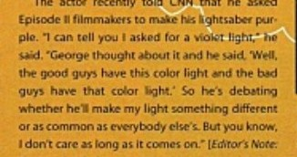

## scan p.17 (scan page 17)

Page contents: Star News (magazine p. 23): McGregor's Highland Games role, polar-bear documentary "The Bear Facts" and short-film judging; "Artoo's Story Revealed" box - spoof documentary "Artoo Detoo: Beneath the Dome" (joke captions about Artoo's "drinking problem", American Graffiti and Richard Dreyfuss, shadowing Coppola and Lucas; verified on crop), airing with The Phantom Menace's Fox broadcast premiere November 25 and on starwars.com; Magic of Myth exhibit highlights (C-3PO, R2-D2, Chewbacca, Yoda, Darth Vader, Jabba the Hutt and Salacious Crumb, audio tour by James Earl Jones). (hand-read)

- **R2-D2** — entry/section: Lucasfilm marketing VP Jim Ward on the spoof Artoo documentary: ""For 25 years, Artoo Detoo has been one of the most beloved actors ever to appear on film," raves Lucasfilm Vice-President of Marketing, Jim Ward. "We get calls from the fans and the press all the time asking all about the guy—where he came from, what's his story, what's he up to now. To be honest, we had no idea." —Jim Ward, Star Wars Insider 57, p. 23" Source: *Star Wars Insider #57* (2001), scan p.17
  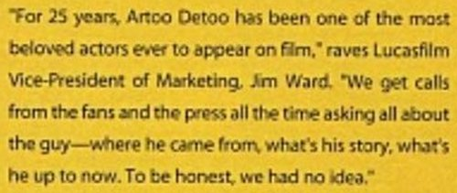

## scan p.18 (scan page 18)

Page contents: Star News (magazine p. 24): "Neeson Film an Oscar Contender? Actor Hosts Party for Michael Jackson" - Liam Neeson (Qui-Gon Jinn) in Gangs of New York, East of Harlem, chairing the Michael Jackson 30th Anniversary Celebration, narrating Endurance; Neeson photo. (hand-read)

## scan p.19 (scan page 19)

Page contents: Star News end and "Next Issue: 58" box (magazine p. 25): Return to Tatooine - Joel Edgerton (Owen Lars) and Bonnie Piesse (Beru Whitesun); Billy Dee Williams (Lando Calrissian); new column Behind the Magic (Watto at ILM); Celebration II; "2¢ = $10? Sometimes..." reader-survey box; Star Wars Gamer #7 ad ("Living on the Fringe", Jag Fel among the Chiss, Bartyn's Landing, Secrets of Mos Eisley); Neeson in K-19: The Widowmaker with Harrison Ford (Han Solo). (hand-read)

## scan p.20 (scan page 20)

Page contents: "Birth of the Bounty Hunter" opener photo page (magazine p. 26): Jango Fett (Temuera Morrison) in the cockpit and young Boba Fett (Daniel Logan). No other text. (hand-read)

## scan p.21 (scan page 21)

Page contents: "Boba Fett & Jango Fett - The Truth Is Finally Revealed in Star Wars: Episode II Attack of the Clones" by Scott Chernoff (magazine p. 27): descriptive headers (lurking in the darkness, macrobinocular viewplate, battle-scarred helmet, jet pack); Boba Fett's mystery since the classic films; Episode II unmasks him: Daniel Logan, 14, plays young Boba, Temuera Morrison plays his father Jango Fett, "the Fett in Attack of the Clones who will remind fans most of the Fett they know". (hand-read)

## scan p.22 (scan page 22)

Page contents: "Temuera Morrison: Once & Future Warrior" (magazine p. 28): Morrison donned the Jango Fett armor at Fox Studios Australia and ran around the costume department doing fight moves; his New Zealand fame (Once Were Warriors); "Everybody wants to be in Star Wars"; video-store box intro. (hand-read)

## scan p.23 (scan page 23)

Page contents: Morrison interview (magazine p. 29): caption "Testing, one... two... three..." (Morrison resting under a fan while his helmet is retouched); "Jangopalooza - The Essential Films of Temuera Morrison" list (Once Were Warriors through Attack of the Clones). (hand-read)

## scan p.24 (scan page 24)

Page contents: Morrison interview (magazine p. 30): top-right "Test Your Knowledge" trivia box (General Rieekan's "death mark", the Sarlacc's thousand years, Boushh's 35,000 credits, IG-88, Khetanna; answers printed upside down, verified on crop); caption on Morrison (Jango Fett) and Daniel Logan (Boba Fett); Morrison on getting character from the costume, only receiving his own script pages, and learning he was Boba Fett's father. (hand-read)

- **Jango Fett** — entry/section: Temuera Morrison on finding Jango Fett through the costume: ""You get most of your stuff from your outfit," he said, "because it gives you all that texture. It starts from all these organic feelings you get while you're in costume: You have to walk the way you can walk in it, which gives you a little bit of character as well." —Temuera Morrison, Star Wars Insider 57, p. 30" Source: *Star Wars Insider #57* (2001), scan p.24
  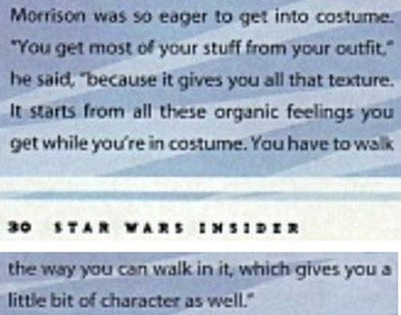
- **Jango Fett; Boba Fett** — entry/section: Temuera Morrison on learning he was cast as Jango Fett: ""When Robin called to tell me, I wasn't quite sure who it was. She said, 'You're playing Jango Fett, Boba Fett's father,' and I just said, 'Great! Beautiful! That sounds good!' Then, when I hung up, I said, 'Who the hell is that?'" —Temuera Morrison, Star Wars Insider 57, pp. 30-31" Source: *Star Wars Insider #57* (2001), scan p.24
  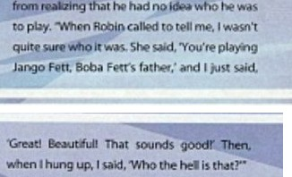
- **Boba Fett; Han Solo** — entry/section: Quiz question: "What rival did Boba Fett outduel in space above Tatooine to deliver Han Solo to Jabba the Hutt?" Source: *Star Wars Insider #57* (2001), scan p.24
  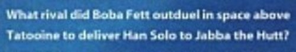
- **Jango Fett; Boba Fett**: "More than just any old bad guy, Jango Fett is the bounty hunting bad guy who is the progenitor of legendary mercenary Boba Fett." Source: *Star Wars Insider #57* (2001), scan p.24
  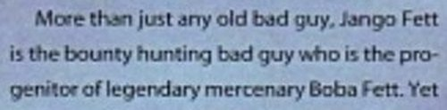

### Stat block notes (game mechanics, not feats)

- Photo caption (verified on crop): Temuera Morrison (Jango Fett) and Daniel Logan (Boba Fett) have almost as much in common as do the characters they play. (Source: *Star Wars Insider #57* (2001), scan p.24)

## scan p.25 (scan page 25)

Page contents: Morrison interview (magazine p. 31): friends told him Boba Fett "was the coolest"; pull quote on cursing under the helmet; his singing family (Sir Howard Morrison), Maori culture in Rotorua, journalism and radio career; caption on Morrison and Daniel Logan with George Lucas and assistant director James McTeigue. (hand-read)

- **Boba Fett; Jango Fett** — entry/section: Temuera Morrison on playing Boba Fett's father: ""I asked around, and everybody said, 'Boba Fett—he was the coolest! Everybody had a Boba Fett toy.' Now I know that Boba Fett was one of the most popular characters in the Star Wars saga. With Fett, I'm fortunate to have such a dynamic role, to be playing the father of one of the popular characters from the earlier trilogy. "I'm the original bounty hunter. Whatever Boba Fett is, he takes it from me." —Temuera Morrison, Star Wars Insider 57, p. 31" Source: *Star Wars Insider #57* (2001), scan p.25
  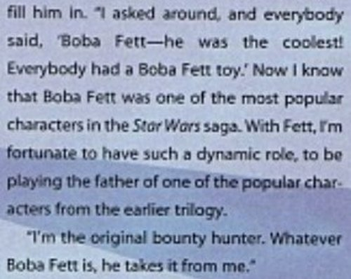
- **Jango Fett** — entry/section: Temuera Morrison pull quote on the Jango Fett helmet: ""When the helmet was on my head, I had trouble breathing, seeing, and everything—so there were a lot of curse words underneath my helmet." —Temuera Morrison, Star Wars Insider 57, p. 31" Source: *Star Wars Insider #57* (2001), scan p.25
  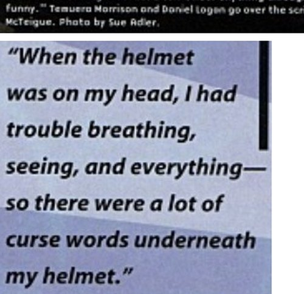

## scan p.26 (scan page 26)

Page contents: Morrison interview (magazine p. 32): caption on George Lucas and Morrison discussing a scene in Jango Fett's apartment; Morrison's water business and Maori TV projects; Harrison Ford's advice against directing (Six Days, Seven Nights); career from extra to Other Halves, Never Say Die, The Piano, Shortland Street, Once Were Warriors and its sequel, Crooked Earth, Barb Wire, The Island of Dr. Moreau, Speed 2, Vertical Limit; meeting casting director Robin Gurland. (Magazine p. 33 is not in the scan; text jumps.) (hand-read)

### Stat block notes (game mechanics, not feats)

- Photo caption (verified on crop): George Lucas and Temuera Morrison talk about a scene in Jango Fett's apartment. (Source: *Star Wars Insider #57* (2001), scan p.26)

## scan p.27 (scan page 27)

Page contents: Morrison interview conclusion (magazine p. 34): only shining when the helmet comes off; rain fight scenes and stunt coordinator Nick Gillard; green-screen work; Once Were Warriors co-star Rena Owen standing in for the CG Taun We; facing Samuel L. Jackson's Mace Windu; pull quote on the buzz of film running through a camera; Jeremy Bulloch at his favorite L.A. restaurant; Jango vs. Boba. Photo of Jango Fett. (hand-read)

- **Jango Fett** — entry/section: Temuera Morrison on Jango Fett's rain fight scenes: ""I had a lot of fight scenes in the rain, and at first I was quite willing to do it," Morrison said. "But after a day or two, I let the stunt guy have his turn." —Temuera Morrison, Star Wars Insider 57, p. 34" Source: *Star Wars Insider #57* (2001), scan p.27
  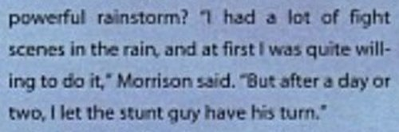
- **Jango Fett; Taun We; Obi-Wan Kenobi** — entry/section: Temuera Morrison on Rena Owen standing in for Taun We: ""It was a little bit weird for me when I saw the woman who played my wife in Once Were Warriors, Rena Owen, wearing a helmet and something like a cardboard cut-out on her head, too," he said with a laugh. "We do this scene with Obi-Wan Kenobi, and she's in there as well with this ridiculous thing on her head. We tried to keep ourselves from laughing too much." —Temuera Morrison, Star Wars Insider 57, p. 34" Source: *Star Wars Insider #57* (2001), scan p.27
  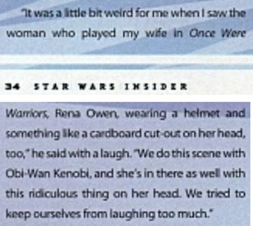
- **Jango Fett; Mace Windu** — entry/section: Temuera Morrison on his scenes with Samuel L. Jackson's Mace Windu: ""I had a couple of scenes with Samuel," he said. "That was lovely, because I've always respected his work. He's very focused, and there's a good kind of stillness about him, a powerful presence. He's quite still in his acting as well. It was nice to come eyeball-to-eyeball with Samuel L. Jackson. That's what we actors enjoy—that vibe that happens between us, which is caused by that internal energy." —Temuera Morrison, Star Wars Insider 57, p. 34" Source: *Star Wars Insider #57* (2001), scan p.27
  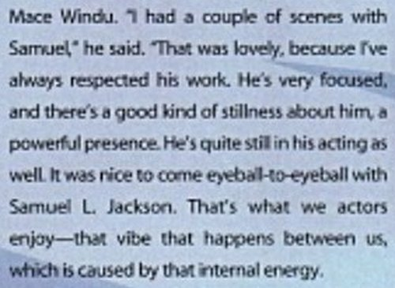
- **Boba Fett; Jango Fett** — entry/section: Temuera Morrison on Jeremy Bulloch, his "son": ""The funny thing is," he said, "the guy who used to play Boba Fett, Jeremy Bulloch, goes to one of my favorite restaurants in L.A. all the time, and every time I turn up there, they go, 'Oh, your son was just in here'—which is funny because he's about 20 years older than me. I'm going to tell the guys at the restaurant to tell me when he's coming back, and I'll come in. I need to meet my son, Boba Fett!" —Temuera Morrison, Star Wars Insider 57, p. 34" Source: *Star Wars Insider #57* (2001), scan p.27
  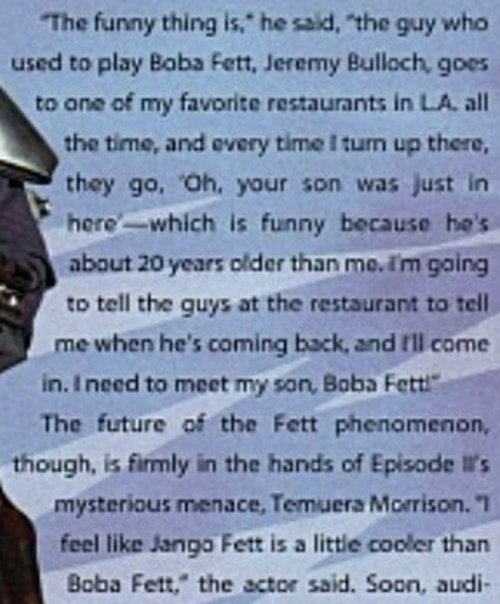
- **Jango Fett; Boba Fett** — entry/section: Temuera Morrison comparing Jango and Boba: ""I feel like Jango Fett is a little cooler than Boba Fett," the actor said. —Temuera Morrison, Star Wars Insider 57, p. 34" Source: *Star Wars Insider #57* (2001), scan p.27
  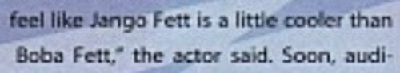

## scan p.28 (scan page 28)

Page contents: "Daniel Logan: Logan's Run" opener (magazine p. 36): the 14-year-old New Zealand newcomer plays Boba Fett; two June days alone in green screen shooting 82 effects shots under visual effects supervisor Pablo Helman and an ILM crew; full-page photo of Logan in costume. (hand-read)

## scan p.29 (scan page 29)

Page contents: Logan feature (magazine p. 37): caption "The young Boba Fett gives indication that he will fully fill his father's shoes"; Logan prefers imagining his green-screen action; the shot will last four seconds; driving golf buggies at Fox Studios Australia. (hand-read)

- **Boba Fett** — entry/section: Daniel Logan on the perks of playing Boba Fett: "Not that there aren't fringe benefits to being Boba Fett. "The best thing about it," he said, "is I got to drive those golf buggies [on the Fox Studios Australia lot]. I was driving everyone around. I was like the chauffeur—it was so fun!" —Daniel Logan, Star Wars Insider 57, p. 37" Source: *Star Wars Insider #57* (2001), scan p.29
  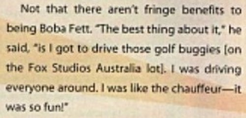

### Stat block notes (game mechanics, not feats)

- Photo caption (verified on crop): The young Boba Fett gives indication that he will fully fill his father's shoes. (Source: *Star Wars Insider #57* (2001), scan p.29)

## scan p.30 (scan page 30)

Page contents: Logan feature (magazine p. 38): Morrison on Logan ("a sweet, lovely boy" who told Christopher Lee and Samuel Jackson he'd seen them in movies); Logan's family; Morrison as his Maori screen dad who kept calling him "son"; best friend on set Ewan McGregor; pull quote that he told people he plays a baby Ewok. Timeline sidebar "The Fett Effect" part 1: 1978 Ready! Fett! Go! (Joe Johnston's design, he painted Fett's armor himself); 1978 Cartoon Debut (Holiday Special, C-3PO reveals him as "Darth Vader's right-hand man"); 1979 It Figures (mail-away action figure); 1980 It Takes Two to Jango (Jeremy Bulloch in costume, voice by Jason Wingreen; both interviewed in Insider #49); 1983 Return of the Fett-I (Sarlacc fate; editor's aside about Zuckuss, Dengar and Bossk). Photos of Bulloch and Wingreen. (hand-read)

## scan p.31 (scan page 31)

Page contents: Logan feature (magazine p. 39): Logan's earlier Hercules demon role, rugby commercial with Michael Jones, Shortland Street, Falling Sparrows, Tamoro; caption: Logan listens as George Lucas explains the next scene. Timeline "The Fett Effect: Boba Fett's Steady Rise from Concept Art to Cult Anti-Hero" part 2: 1995 Boba Fett Superstar (Dark Horse one-shot and Enemy of the Empire); 1996 Insider #30 article "Boba Fett: From Obscure Villain to Cultural Icon"; 1997 Special Edition cameos (ILM's Mark Austin, Don Bies, Nelson Hall); 1999 Rick McCallum announces Boba in Episode II; 2002 Boba Fett and Jango Fett in Attack of the Clones. Photo of Slave I concept art and Special Edition still. (hand-read)

## scan p.32 (scan page 32)

Page contents: Logan feature (magazine p. 40): pull quote about his mom taking him out of the business if he got big-headed; his Darth Vader coin bank ("Impressive, most impressive"); won the role after one audition; secrecy (told kids he played a baby Ewok or baby Chewbacca); Lucas on why fans can't let Boba go; Logan on Boba's appeal and on Jango. (hand-read)

- **Darth Vader (Anakin Skywalker)** — entry/section: Daniel Logan on his Darth Vader coin bank: ""When you put a coin in," he said, "you hear, 'Impressive, most impressive—but you are not a Jedi yet,' and the lightsaber would raise and go across—it was quite cool. My little sister liked it—all you could ever hear was 'Impressive, most impressive, impressive,' because she kept pushing the button." —Daniel Logan, Star Wars Insider 57, p. 40" Source: *Star Wars Insider #57* (2001), scan p.32
  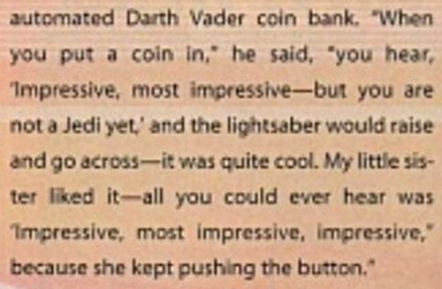
- **Boba Fett** — entry/section: Daniel Logan relaying what George Lucas told him about Boba Fett: ""George said that even though he was a mysterious person, heaps of people knew him," Logan said of his bounty-hunting alter ego. "He said, 'You know how Boba Fett falls down that hole and they think he's dead? People don't think he's dead, they think he's coming back. They can't let him go.'" —Daniel Logan, Star Wars Insider 57, p. 40" Source: *Star Wars Insider #57* (2001), scan p.32
  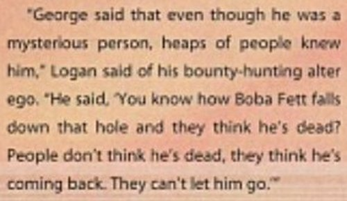
- **Boba Fett** — entry/section: Daniel Logan on Boba Fett's character: ""He's a strong guy," he said. "He always sticks up for himself. I think he didn't have anything against the Jedi, and he didn't have anything against the bad guys. He was just in the middle." —Daniel Logan, Star Wars Insider 57, p. 40" Source: *Star Wars Insider #57* (2001), scan p.32
  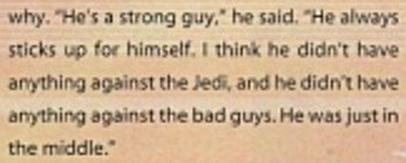
- **Boba Fett** — entry/section: Daniel Logan on Boba Fett's appeal: "The appeal of the character can also be explained more simply, he said: "It's because he gets to fight the Jedi, and he's so strong and mighty, and the way he's set up—his helmet—he's got all those things!" —Daniel Logan, Star Wars Insider 57, p. 40" Source: *Star Wars Insider #57* (2001), scan p.32
  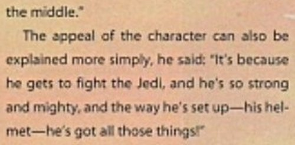
- **Jango Fett; Boba Fett** — entry/section: Daniel Logan predicting audiences' reaction to Jango Fett: ""I think people are going to be attracted to Jango Fett because of Boba Fett," Daniel said. "They're probably going to think Jango Fett is Boba Fett. They'll be like, 'Yeah! Boba Fett!' And then this little guy comes in. They'll say, 'Hey, who's that? Did Boba Fett have a son?'" —Daniel Logan, Star Wars Insider 57, p. 40" Source: *Star Wars Insider #57* (2001), scan p.32
  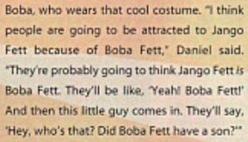
- **Boba Fett; Jango Fett** — entry/section: Daniel Logan on Boba Fett and his father: ""He's always with his dad," Daniel said. "He does things with his dad, lives with his dad, loves his dad, and is always there for his dad. Jango Fett is his idol." —Daniel Logan, Star Wars Insider 57, pp. 40-41" Source: *Star Wars Insider #57* (2001), scan p.32
  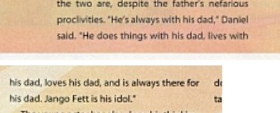

## scan p.33 (scan page 33)

Page contents: Logan feature conclusion (magazine p. 41): Logan on the light side and dark side, Lucas's imagination and double-bladed lightsabers, action movies (Van Damme, Bruce Lee), imagining a Boba Fett video game and action figure, being scanned for a toy, and his mom keeping him grounded; caption "Just a normal 14-year-old... bounty hunter hanging around the set on his day off" (T-shirt shows his heroes). Photo of Logan on set. (hand-read)

## scan p.34 (scan page 34)

Page contents: "Down Underworld: Australian Actress Leeanna Walsman Arms Herself to Play a Bounty Hunter in Star Wars: Episode II Attack of the Clones" by Michael G. Ryan, opener (magazine p. 42): silhouette art only. (hand-read)

## scan p.35 (scan page 35)

Page contents: Walsman feature (magazine p. 43): plays bounty hunter Zam Wesell, who mixes it up with Obi-Wan Kenobi and Anakin Skywalker; calls the character "a baddie"; joins villains like Darth Vader, Darth Maul and Boba Fett; "Hunting for the Perfect Part" - drama troupe, old black-and-white movies with her childhood carer. Portrait photo. (hand-read)

## scan p.36 (scan page 36)

Page contents: Walsman feature (magazine p. 44): caption "What do you mean, 'Exact change only.'?" - Zam Wesell (Leeanna Walsman) takes aim from the cockpit of her speeder; first film role in Blackrock; drawn to "baddies"; preference for film; sidebar "The Price of Fame: 'I've Got to Have a Little Figurine of Me!'" on Zam Wesell action figures, comics and novelizations. (hand-read)

- **Zam Wesell** — entry/section: Leeanna Walsman on a Zam Wesell action figure (sidebar): ""I've got to have a little figurine of me!" Leeanna Walsman says, thinking ahead to when action figures of her character Zam Wesell might appear in toy stores around the world. "Imagine that—a figurine of me! I love Star Wars! This has all been so good for me and for the acting community in Australia." —Leeanna Walsman, Star Wars Insider 57, p. 44" Source: *Star Wars Insider #57* (2001), scan p.36
  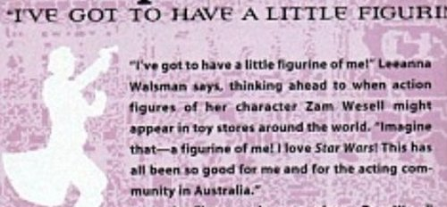

### Stat block notes (game mechanics, not feats)

- Photo caption (verified on crop): "What do you mean, 'Exact change only.'?" Bounty hunter Zam Wesell (Leeanna Walsman) takes aim from the cockpit of her speeder. (Source: *Star Wars Insider #57* (2001), scan p.36)

## scan p.37 (scan page 37)

Page contents: Walsman feature (magazine p. 45): end of "The Price of Fame" sidebar (premiere, conventions, "even the small characters still get attention"); theater career; La Dispute directed by Benedict Andrews; caption "Zam Wesell has the coolest accessories and outfit since Boba Fett." Photo of Zam Wesell in helmet. (hand-read)

### Stat block notes (game mechanics, not feats)

- Photo caption (verified on crop): Zam Wesell has the coolest accessories and outfit since Boba Fett. (Source: *Star Wars Insider #57* (2001), scan p.37)

## scan p.38 (scan page 38)

Page contents: Walsman feature (magazine p. 46): plot of La Dispute and her character Eglé; captions on Walsman and costar Nathan Page in La Dispute at the Sydney Theatre Company, and on her fun-loving character in Love Is a Four-Letter Word (ABC TV). Photos. (hand-read)

## scan p.39 (scan page 39)

Page contents: Walsman feature (magazine p. 47): Robin Gurland saw her in La Dispute (castmate Rose Byrne became a handmaiden in Episode II); pull quote on costume and weaponry; "Trip to Bountiful" - first day facing Obi-Wan Kenobi and Ewan McGregor, unsure what accent to use; caption "Zam Wesell takes aim in Attack of the Clones." (hand-read)

## scan p.40 (scan page 40)

Page contents: Walsman feature (magazine p. 48): caption "Zam's headgear features a set of specially equipped binoculars that enable her to hone in on her prey"; scenes with Obi-Wan and Anakin Skywalker (Hayden Christensen); costume and guns; 10 days on a relaxed set; George Lucas "very laid back"; only seeing her own scenes. (hand-read)

- **Zam Wesell** — entry/section: Leeanna Walsman on Zam Wesell's costume: ""It's all about the costume," she says, noting that getting fixed up with outfits and weaponry took up plenty of time. In fact, various parts of her leather-and-Lycra costume, like the armor, had different crewmembers attending them, as did her guns. "I wear a helmet, but I have my own face most of the time. I briefly wear a veil so I can be anonymous, but it flies off at some point. That costume and the weaponry really help make the character. You look at yourself in the mirror, and you say, 'This is how I'm going to be.' And then it's all about dodging light sabers, flying spacecraft, running down streets. It was all completely different than anything else I'd ever done." —Leeanna Walsman, Star Wars Insider 57, p. 48" Source: *Star Wars Insider #57* (2001), scan p.40
  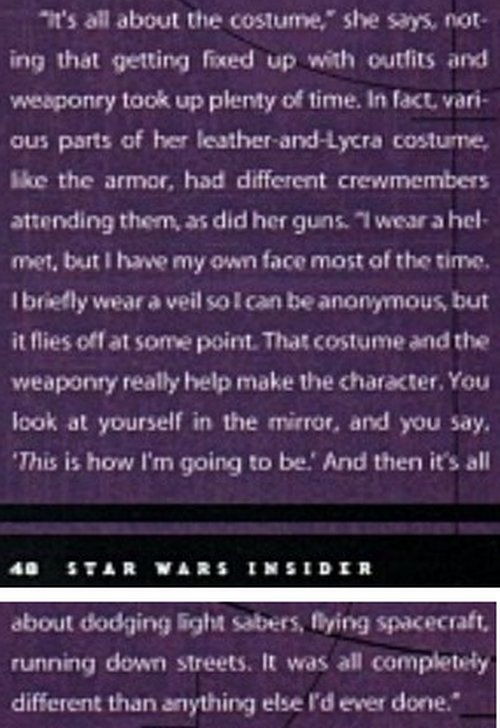

### Stat block notes (game mechanics, not feats)

- Photo caption (verified on crop): Zam's headgear features a set of specially equipped binoculars that enable her to hone in on her prey. (Source: *Star Wars Insider #57* (2001), scan p.40)

## scan p.41 (scan page 41)

Page contents: Walsman feature conclusion (magazine p. 50; p. 49 not in scan): Australian crew; no lightsaber but a great gun; "Setting Her Sights on the Future" - whether Zam Wesell will rival Darth Maul or Boba Fett, fan mail, Old Masters, Hollywood agent; pull quote on wanting lead roles like Audrey Hepburn's; sidebar "Guises and Disguises" credits list 1996-2001 (Blackrock through Farscape and Old Masters). (hand-read)

- **Zam Wesell** — entry/section: Leeanna Walsman on being a bounty hunter, not a Jedi: ""I didn't get to play with a lightsaber," Walsman admits. "But I'll tell you: I had a great gun. I was very pleased with my weaponry." —Leeanna Walsman, Star Wars Insider 57, p. 50" Source: *Star Wars Insider #57* (2001), scan p.41
  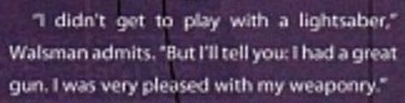
- **Zam Wesell** — entry/section: Leeanna Walsman on not knowing what a bounty hunter was: ""I had no idea how big it was at the time," she says. "Honestly, I didn't even know what a bounty hunter was when they offered me the role. But I didn't want to admit that and look stupid, of course. So now I can't believe that I already have people sending me fan mail. I think that's surreal! Then there are these Internet sites where people are already talking about me and about my character. I think it's phenomenal. I hope everyone likes me." —Leeanna Walsman, Star Wars Insider 57, p. 50" Source: *Star Wars Insider #57* (2001), scan p.41
  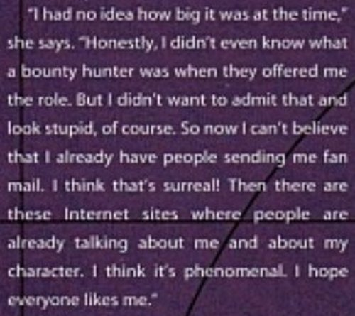

## scan p.42 (scan page 42)

Page contents: Full-page New Jedi Order painting (magazine p. 52): Mara Jade Skywalker and Luke Skywalker with lightsaber holding their infant son Ben, Rebel insignia behind. No text. (hand-read)

## scan p.43 (scan page 43)

Page contents: "Who's Who in the New Jedi Order" by Daniel Wallace, illustrated by Russell Walks and Dan Veesenmeyer (magazine p. 53): spoiler warning through Star by Star; the NJO novel series (Yuuzhan Vong invasion, Chewbacca's death in Vector Prime, about twenty novels through 2003); Luke Skywalker rekindling the Jedi after the Old Jedi Order of ten thousand fell to two Sith; sidebar list "The New Jedi Order Saga" (Vector Prime through Dark Journey, February 2002). (hand-read)

- **Palpatine (Darth Sidious)**: "This "Old Jedi Order" was both a spiritual discipline and a de facto police force, settling galactic disputes with flashing lightsabers in the manner of frontier marshals in the Old West. Ultimately, these ten thousand Jedi fell to the machinations of just two Sith. Emperor Palpatine hunted the seemingly invincible order to extinction." Source: *Star Wars Insider #57* (2001), scan p.43
  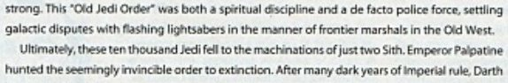
- **Darth Vader (Anakin Skywalker); Luke Skywalker**: "After many dark years of Imperial rule, Darth Vader killed the Emperor, was redeemed, and became one with the Force. Luke Skywalker then set out to restore the vanished institution to a galaxy hungering for justice." Source: *Star Wars Insider #57* (2001), scan p.43
  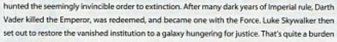

## scan p.44 (scan page 44)

Page contents: Who's Who (magazine p. 54): "The Academy" (Luke's Yavin 4 academy, large classes, about one hundred Knights and Masters); pull quote of Yoda "when I am gone, the last of the Jedi will you be"; "The Invasion" (Yuuzhan Vong exist outside the Force, Peace Brigade, voxyn); "Jedi Masters" entries Luke Skywalker and Mara Jade Skywalker with line portraits. (hand-read)

- **Luke Skywalker** — entry/section: Luke Skywalker: "He has brought freedom to the oppressed, toppled despotic tyrants, and single-handedly resurrected the formal belief systems surrounding the Force. As head of the New Jedi Order, Luke Skywalker carries more weight on his shoulders than anyone in the galaxy." Source: *Star Wars Insider #57* (2001), scan p.44
  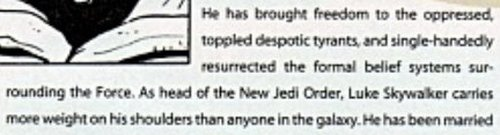
- **Luke Skywalker; Yoda**: "Seven years after the Emperor's defeat at Endor, Luke founded a Jedi training academy on the jungle moon Yavin 4. Yoda had once told him, "when I am gone, the last of the Jedi will you be," and Luke wasn't about to accept that as his epitaph." Source: *Star Wars Insider #57* (2001), scan p.44
  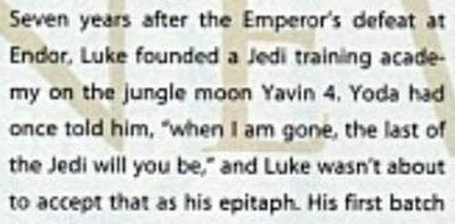
- **Mara Jade Skywalker** — entry/section: Mara Jade Skywalker: "The baby has given Mara hope for the future and redoubled her determination to defeat the Yuuzhan Vong before there's nothing left to defend." Source: *Star Wars Insider #57* (2001), scan p.44
  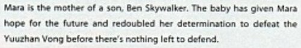

### Stat block notes (game mechanics, not feats)

- Who's Who in the New Jedi Order: Luke Skywalker: Now in his forties, Luke Skywalker is no longer the farmboy who whined about going into Tosche Station to buy some power converters. He has brought freedom to the oppressed, toppled despotic tyrants, and single-handedly resurrected the formal belief systems surrounding the Force. As head of the New Jedi Order, Luke Skywalker carries more weight on his shoulders than anyone in the galaxy. He has been married to ex-Imperial assassin Mara Jade for several years and the two of them recently welcomed their first child, Ben. Still carrying the green-bladed lightsaber he used in the climactic battle against Darth Vader, Luke is troubled by the impulsiveness of Master Kyp Durron and other members of the Order. He understands the temptations of the dark side better than anyone, but his warnings against anger, fear, and aggression often fall on deaf ears. (Source: *Star Wars Insider #57* (2001), scan p.44)
- Who's Who in the New Jedi Order: Mara Jade Skywalker: First introduced in Timothy Zahn's Heir to the Empire, Mara Jade is one of the most popular characters in the Expanded Universe. (A poll in Insider #38 ranked her at 20th, the highest showing by a non-movie character.) A former Emperor's Hand who performed covert missions for Palpatine, Mara now fights for the good guys alongside her husband Luke Skywalker. She typically carries Anakin Skywalker's blue-bladed lightsaber given to Luke by Obi-Wan Kenobi. At the onset of the Yuuzhan Vong invasion, Mara served as a Jedi mentor to Jaina Solo. Infected with a debilitating illness by an enemy agent, Mara struggled to keep the pathogen at bay, especially after she discovered her pregnancy. (Source: *Star Wars Insider #57* (2001), scan p.44)

## scan p.45 (scan page 45)

Page contents: Who's Who (magazine p. 55): Jedi Masters Cilghal, Kyp Durron, Ikrit (died), Kenth Hamner, Tresina Lobi, Kam Solusar, Streen; "Jedi Knights" begins with Daye Azur-Jamin (cyborg prosthetics; Kathy Tyers' Adventure Journal stories; investigating Nal Hutta). Key: a dot indicates the character has died. (hand-read)

- **Kyp Durron** — entry/section: Kyp Durron: "Kyp's own experience in overcoming the spiritual influence of a dead Sith Lord has led him to believe that Yoda's advice was wrong—you can start down the dark path without having it dominate your destiny." Source: *Star Wars Insider #57* (2001), scan p.45
  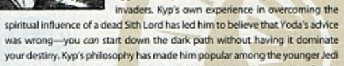

### Stat block notes (game mechanics, not feats)

- Who's Who in the New Jedi Order: Cilghal: A female Mon Calamari, Cilghal worked as an ambassador before becoming one of Luke Skywalker's first Jedi academy students. Kind and soft-spoken, Master Cilghal is famous for her abilities as a healer. Readers might remember Cilghal from the Jedi Academy trilogy, in which she used the Force to cure Mon Mothma of a molecular poison. Cilghal used the same skills to ease Mara's pain when her immune system fought off a Yuuzhan Vong-induced illness. (Source: *Star Wars Insider #57* (2001), scan p.45)
- Who's Who in the New Jedi Order: Kyp Durron: Kyp's own experience in overcoming the spiritual influence of a dead Sith Lord has led him to believe that Yoda's advice was wrong—you can start down the dark path without having it dominate your destiny. Kyp's philosophy has made him popular among the younger Jedi and could lead to a split in the Jedi ranks. Kyp leads a highly trained starfighter squadron ("Kyp's Dozen") and performs renegade military missions without the blessing of Luke Skywalker or the New Republic Defense Force. His apprentice, Miko Reglia, was the first Jedi to die at the hands of the Yuuzhan Vong. (Source: *Star Wars Insider #57* (2001), scan p.45)
- Who's Who in the New Jedi Order: Kenth Hamner: As an ex-military man, Hamner is an invaluable link between the Jedi and the New Republic's soldiers, many of whom view the Force-wielding "magicians" as distractions or renegades. Luke Skywalker values Hamner's level head and his insight into matters of strategy. (Source: *Star Wars Insider #57* (2001), scan p.45)
- Who's Who in the New Jedi Order: Tresina Lobi: Master Lobi was the first Chev to demonstrate Force-sensitivity. She trained the female human Thrynni Vae to Knighthood, only to learn of her apprentice's brutal death at the hands of enemy collaborators on Duro. (Source: *Star Wars Insider #57* (2001), scan p.45)
- Who's Who in the New Jedi Order: Kam Solusar: As a boy, Kam Solusar learned the Jedi way under his father Ranik, who died during the Jedi Purge. Kam fled the hunters and later fell under the dark influence of the reborn Emperor. Luke brought Kam back from the dark side, and their exploits were covered in the comic book series Dark Empire II. At the start of the New Jedi Order era, Solusar and his wife Tionne served as joint headmasters of the Jedi academy on Yavin 4. When the Yuuzhan Vong menaced the jungle moon, Master Solusar evacuated the Jedi children just ahead of an enemy invasion force. (Source: *Star Wars Insider #57* (2001), scan p.45)
- Who's Who in the New Jedi Order: Streen: Already an old man when Luke Skywalker invited him to join the inaugural class of academy students, Streen is now the oldest human serving in the New Jedi Order. For most of his life Streen worked as a tibanna gas prospector on Bespin. Luke taught him to harness his Force aptitude to shut out the "noise" he felt while in the presence of other living beings. (Source: *Star Wars Insider #57* (2001), scan p.45)

## scan p.46 (scan page 46)

Page contents: Who's Who, Jedi Knights (magazine p. 56): Tam Azur-Jamin, Eryl Besa (died), Cheklev, Daeshara'cor (died), Dorsk 82 (died), Jovan Drark (died), Eelysa (died), Keyan Farlander (Jedi piloting instructor, the Y-wing pilot fleeing the Death Star), Swilja Fenn (died), Corran Horn, Seyyerin Itoklo (died). Line portraits. (hand-read)

- **Corran Horn; Shedao Shai** — entry/section: Corran Horn: "Corran's defeat of the warriors earned him the enmity of enemy commander Shedao Shai. The two eventually squared off in a one-on-one duel for the planet Ithor. Though Corran won, the Yuuzhan Vong destroyed Ithor anyway." Source: *Star Wars Insider #57* (2001), scan p.46
  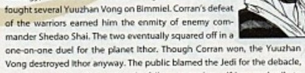

### Stat block notes (game mechanics, not feats)

- Who's Who in the New Jedi Order: Daeshara'cor: In Dark Tide II: Ruin, Daeshara'cor embarked on a search for a lost superweapon to use against the Yuuzhan Vong against Luke Skywalker's wishes. The Twi'lek Jedi drifted so close to the dark side that she imprisoned Anakin Solo when the younger Jedi got in her way. Ultimately Daeshara'cor gave up her search and fought alongside her fellow Jedi in the Battle of Ithor. She was poisoned by amphistaff venom and passed into the Force a short time later, her body dematerializing as Yoda's had done. (Source: *Star Wars Insider #57* (2001), scan p.46)
- Who's Who in the New Jedi Order: Jovan Drark: A new addition to the Jedi pantheon, Jovan Drark is a male Rodian Jedi Knight who works closely with the Dathomirian warrior woman Tenel Ka. The two Jedi were stationed at the New Republic's Bilbringi shipyards during Balance Point, using the Force to help root out undercover Yuuzhan Vong infiltrators. (Source: *Star Wars Insider #57* (2001), scan p.46)
- Who's Who in the New Jedi Order: Eelysa: On Barab I she discovered the Force-strong Barabel Saba Sebatyne and trained her as her own apprentice. (Source: *Star Wars Insider #57* (2001), scan p.46)
- Who's Who in the New Jedi Order: Swilja Fenn: In Edge of Victory I: Conquest, the enemy collaborators of the Peace Brigade captured her on Cujicor and turned her over to the Yuuzhan Vong. She is believed to have died at the hands of Warmaster Tsavong Lah. (Source: *Star Wars Insider #57* (2001), scan p.46)
- Who's Who in the New Jedi Order: Corran Horn: In The New Jedi Order's Dark Tide duology, Corran Horn and fellow Knight Ganner Rhysode fought several Yuuzhan Vong on Bimmiel. Corran's defeat of the warriors earned him the enmity of enemy commander Shedao Shai. The two eventually squared off in a one-on-one duel for the planet Ithor. Though Corran won, the Yuuzhan Vong destroyed Ithor anyway. The public blamed the Jedi for the debacle, and Corran voluntarily became the fall guy, entering self-imposed exile to distance himself from Luke Skywalker and the rest of the Jedi. A year later he returned to active duty and helped Anakin Solo and Tahiri Veila foil an enemy mission to Yag'Dhul. (Source: *Star Wars Insider #57* (2001), scan p.46)

## scan p.47 (scan page 47)

Page contents: Who's Who, Jedi Knights cont. (magazine p. 58): Miko Reglia (died), Ganner Rhysode, Saba Sebatyne, Wurth Skidder (died), Anakin Solo (died), Jacen Solo, Jaina Solo, Tekli. Line portraits. (hand-read)

- **Tsavong Lah; Jacen Solo (Darth Caedus)** — entry/section: Jacen Solo: "When Tsavong Lah threatened his mother's life, Jacen reluctantly tapped into the Force and defeated the enemy warmaster." Source: *Star Wars Insider #57* (2001), scan p.47
  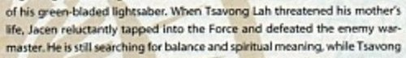
- **Jaina Solo** — entry/section: Jaina Solo: "Jag Fel, son of legendary TIE fighter ace Baron Soontir Fel, has exhibited a budding romantic interest in Jaina Solo." Source: *Star Wars Insider #57* (2001), scan p.47
  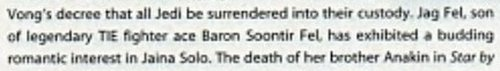

### Stat block notes (game mechanics, not feats)

- Who's Who in the New Jedi Order: Ganner Rhysode: Narcissistic in the extreme, Ganner Rhysode debuted as a rival of Corran Horn in Dark Tide I: Onslaught. Ganner prefers ostentatious blue and black robes that highlight his muscular physique. He possesses strong telekinetic abilities and carries a yellow-bladed lightsaber. Partnered with Corran on a mission to Garqi, Ganner clashed with his fellow Jedi Knight over their conflicting styles—one flashy, the other by-the-book. Ultimately Ganner saved Corran's life and then accompanied him to Garqi, where Ganner suffered a facial scar that marred his poster-boy good looks. The experience taught him the value of humility, though Ganner still struggles with his inherent ego. He later joined Kyp Durron in a failed mission to rescue Wurth Skidder from enemy captivity. As the oldest member of the Jedi taskforce sent behind enemy lines to infiltrate Myrkr, Ganner appeared to be the group's leader, but he deferred all command decisions to young Anakin Solo. (Source: *Star Wars Insider #57* (2001), scan p.47)
- Who's Who in the New Jedi Order: Saba Sebatyne: Introduced in Star by Star, this female Barabel from Barab I was trained through an unorthodox apprenticeship under Jedi Knight Eelysa and thus technically is not a member of the 100-odd Jedi in Luke Skywalker's Order. Saba trained others in the Force, including her Barabel offspring Tesar Sebatyne, Bela Hara, and Krasov Hara, and attracted Force-sensitive followers including Drif Lij, an Arcona named Izal Waz, and Wonetun, a male Brubb. Saba's "Wild Knights" starfighter squadron rivals Kyp's Dozen in its maverick exploits. (Source: *Star Wars Insider #57* (2001), scan p.47)
- Who's Who in the New Jedi Order: Wurth Skidder: Once a cocky follower of Kyp Durron's philosophy, Wurth Skidder clashed with Leia Organa Solo early in Vector Prime over his accidental interference in her diplomatic negotiations at Rhommamool. Skidder fought at the Battle of Ithor and then allowed himself to be captured by the Yuuzhan Vong on Gyndine. Placed aboard an enemy warship carrying a battle-coordinating yammosk, Skidder posed as a common prisoner until his status as a Jedi Knight was revealed. A rescue mission led by Kyp Durron failed to free him and Skidder died aboard the yammosk vessel. (Source: *Star Wars Insider #57* (2001), scan p.47)
- Who's Who in the New Jedi Order: Anakin Solo: Youngest of the three Solo children, Anakin Solo was—in the eyes of some—Luke Skywalker's heir apparent to become the next head of the New Jedi Order. Anakin's birth came in the comic book series Dark Empire II, and in the years since he emerged as a confident young man with a deep, almost unconscious connection to the Force. In his mid-teens Anakin viewed the Force as a tool, much like his violet-bladed lightsaber. His pragmatic approach—the polar opposite of his brother Jacen's spirituality—made him vulnerable to the aggressiveness preached by Kyp Durron. In Vector Prime, Anakin blamed himself for the death of Chewbacca and allowed the guilt to affect his actions. When he later debated whether to fire the Centerpoint Station superweapon against the enemy, his hesitation triggered a disaster for the New Republic navy. Anakin emerged as a hero in Edge of Victory I: Conquest, gaining a new understanding of the Yuuzhan Vong by partnering with an enemy warrior. In Star by Star, Anakin led the seventeen-member Jedi mission to infiltrate an enemy worldship at Myrkr, where he died heroically in combat. (Source: *Star Wars Insider #57* (2001), scan p.47)
- Who's Who in the New Jedi Order: Jacen Solo: Oldest son of Han Solo and Leia Organa Solo, Jacen Solo has played an important role in Star Wars literature since he and his twin Jaina were born in 1993's The Last Command. The invasion of the Yuuzhan Vong has thrown Jacen into a moral quandary. In his maturing understanding of Jedi abilities, he has come to believe that the Force should never be used as a weapon or a tool. As the war progressed Jacen became a pacifist, pulling away from the Force in the hopes of gaining further insight. Prior to the Battle of Duro, he even rejected the use of his green-bladed lightsaber. When Tsavong Lah threatened his mother's life, Jacen reluctantly tapped into the Force and defeated the enemy warmaster. He is still searching for balance and spiritual meaning, while Tsavong Lah is determined to sacrifice Jacen to the gods. Following the pivotal Myrkr mission in Star by Star, Jacen was captured by enemy troops. (Source: *Star Wars Insider #57* (2001), scan p.47)
- Who's Who in the New Jedi Order: Jaina Solo: Teenaged Jaina Solo took a starring role in the Young Jedi Knights series, defeating threats to the New Republic with her glowing violet lightsaber. She's a hot pilot and knows her way around a toolbox, demonstrating that the Solo blood runs strong in her veins. Jaina often clashes with her mother, and she took up an apprenticeship with Mara Jade Skywalker prior to the events of Vector Prime. Jaina has been more aggressive than either of her siblings in countering the Yuuzhan Vong threat. In Dark Tide II: Ruin, Jaina accepted a position as an X-wing pilot in Rogue Squadron but suffered temporary blindness while flying against the enemy at Kalarba. She recuperated on Duro but did not immediately rejoin the squadron in light of the Yuuzhan Vong's decree that all Jedi be surrendered into their custody. Jag Fel, son of legendary TIE fighter ace Baron Soontir Fel, has exhibited a budding romantic interest in Jaina Solo. The death of her brother Anakin in Star by Star has pushed Jaina dangerously close to the dark side. (Source: *Star Wars Insider #57* (2001), scan p.47)
- Who's Who in the New Jedi Order: Tekli: A student of Master Cilghal's, this female Chadra-Fan has only limited Force-sensitivity yet still managed to attain the rank of Jedi Knight. Like all members of her species, she is short by human standards and possesses a sensitive nose capable of distinguishing thousands of scents. Tekli appears briefly in Balance Point, pointing Luke Skywalker in the direction of a Yuuzhan Vong infiltrator hiding in Coruscant's undercity. In Star by Star, Tekli showed her skills as a healer by acting as the medic for Anakin Solo's Jedi infiltration force. (Source: *Star Wars Insider #57* (2001), scan p.47)

## scan p.48 (scan page 48)

Page contents: Who's Who conclusion (magazine p. 59): Raynar Thul, Kirana Ti, Tionne, Thrynni Vae (died), Zekk; "Jedi Trainees" Jysella Horn, Valin Horn, Sannah, Tahiri Veila. Bottom-left "Test Your Knowledge" box (verified on crop, answers printed upside down): 1. Imperial servant disguised as a dancing girl in Jabba's Palace - Mara Jade; 2. event chronicled in Star Wars: Union - his wedding; 3. which of Madine, Mon Mothma, Ackbar would not survive to the Vong invasion - General Crix Madine; 4. red and yellow piping on Han Solo's trousers - Corellian bloodstripe; 5. fallen Jedi who gave Leia a lightsaber on Nar Shaddaa - Vima-Da-Boda, in the Dark Empire comics. (hand-read)

### Stat block notes (game mechanics, not feats)

- Who's Who in the New Jedi Order: Raynar Thul: Introduced in the Young Jedi Knights series, Raynar Thul is the wealthy heir to the Thul merchant fleet, formerly of Alderaan. During his academy training, Raynar developed a reputation as pompous and spoiled, an image he shed after seeing his father die in battle with the Diversity Alliance. In the current era of the Yuuzhan Vong invasion, Raynar is considered one of the bravest Jedi Knights, and he fought with distinction and was wounded aboard the Myrkr worldship in Star by Star. (Source: *Star Wars Insider #57* (2001), scan p.48)
- Who's Who in the New Jedi Order: Kirana Ti: In The Courtship of Princess Leia, readers met the witches of Dathomir—a tribe of Force-wielding spellcasters from a primitive planet. Kirana Ti was one of the novel's less-prominent witches, but she became one of the first students at Luke Skywalker's Jedi academy. Now a Jedi Knight, Kirana Ti is using her Jedi skills and her knowledge of Dathomirian "magic" to stem the Yuuzhan Vong invasion. (Source: *Star Wars Insider #57* (2001), scan p.48)
- Who's Who in the New Jedi Order: Tionne: The Jedi Knight known as Tionne joined the inaugural class of the Jedi academy after Luke Skywalker discovered her aboard the ancient space outpost Exis Station. Her passion is Jedi history, which she relates in the form of lyrical ballads. Her Force abilities were never strong, but Tionne emerged as an able instructor for the younger students. Eventually she married fellow Jedi Kam Solusar, and the two became co-administrators of the academy in the New Jedi Order era. (Source: *Star Wars Insider #57* (2001), scan p.48)
- Who's Who in the New Jedi Order: Thrynni Vae: Thrynni Vae, a human Jedi Knight, learned the Jedi way under the direct tutelage of Master Tresina Lobi. Prior to the events of Balance Point, Thrynni Vae went to Duro to investigate possible enemy collaboration within CorDuro Shipping. When Vae got too close to the truth, CorDuro officials had her beaten to death by Gamorrean thugs, then dumped her body out an airlock. (Source: *Star Wars Insider #57* (2001), scan p.48)
- Who's Who in the New Jedi Order: Zekk: In Young Jedi Knights: The Lost Ones, Zekk was introduced as a juvenile delinquent inhabiting the seedy undercity of Coruscant. Over the course of the series he became a Dark Jedi, then a bounty hunter, before joining Luke Skywalker's Jedi academy as a trainee. By the time of the New Jedi Order series Zekk is a full Jedi Knight. He fought valiantly at Myrkr in Star by Star, but despite disgust for his dark-side past he may yet prove susceptible to Kyp Durron's philosophy of aggression. (Source: *Star Wars Insider #57* (2001), scan p.48)
- Who's Who in the New Jedi Order: Valin Horn: Corran Horn's son and oldest child, Valin was eleven years old at the start of the Yuuzhan Vong invasion. He appears briefly in Dark Tide I: Onslaught, mischievously using the Force to cover Ganner Rhysode in a swarm of garnant insects. (Source: *Star Wars Insider #57* (2001), scan p.48)
- Who's Who in the New Jedi Order: Tahiri Veila: Though she is human, Tahiri was raised by Tusken Raiders on Tatooine after the deaths of her homesteader parents. Tionne brought her to the Jedi academy on Yavin 4, where she befriended Anakin Solo in the Junior Jedi Knights series of young-reader novels. Still in her early teens, Tahiri is a friendly, free-spirited young woman who prefers to walk barefoot. In Edge of Victory I: Conquest, Yuuzhan Vong shapers on Yavin 4 captured Tahiri and tortured her into thinking she was one of them. Anakin rescued her, and the two of them partnered on a mission to Yag'Dhul. Tahiri and Anakin have since developed a deep connection that goes far beyond mere friendship. Tahiri still possesses facial scarring inflicted on her by the Yuuzhan Vong, as well as implanted memories of their culture and language. Her unconscious understanding of the enemy allows her to easily operate captured equipment, making her an invaluable member of Anakin Solo's Jedi infiltration squad in Star by Star. (Source: *Star Wars Insider #57* (2001), scan p.48)

## scan p.49 (scan page 49)

Page contents: "Aurra Sing's Convention Diary" by Michonne Bourriague, the actress who played Aurra Sing (magazine p. 60): GenCon 2000 (Milwaukee), DecipherCon 2000 (Orlando) - receiving the Masterpiece Edition Aurra Sing figure, meeting the model for Decipher's Mara Jade card art, new Young Jedi cards featuring Aurra Sing - and SciFiCon 2000 (Austin). Fan names omitted. (hand-read)

- **Aurra Sing** — entry/section: Aurra Sing's fan base: ""I had so much fun! Aurra Sing has a pretty large fan base considering she only had three seconds of screen time. I've learned that Star Wars fans will analyze scenes, and they want information on anything they don't know much about." —Michonne Bourriague, Star Wars Insider 57, p. 60" Source: *Star Wars Insider #57* (2001), scan p.49
  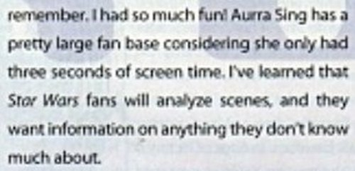

## scan p.50 (scan page 50)

Page contents: Convention diary cont. (magazine p. 61): meeting Dave Prowse at a signing; a fan in Aurra Sing costume; "Japan Tour 2000" with Jeremy Bulloch, Jerome Blake and Paul Blake - six cities in ten days, a high school visit in Osaka with 700 students. Photo captions: Osaka view; Japan Tour 2000. Fan names omitted. (hand-read)

## scan p.51 (scan page 51)

Page contents: Convention diary cont. (magazine p. 62): the Osaka school crowd; a toy-museum signing; Pittsburgh Comic Con (Monroeville) with Garrick Hagon and Kenneth Colley, Matt Busch's convention booklet cover of Aurra Sing; Alpha Con (Omaha) with many Episodes IV-VI actors (Anthony Daniels, Peter Mayhew, Warwick Davis, etc.) and a Q&A with Paul Blake. Photo captions: Wizard World Chicago, Wrestlemania XVII, Detroit comic con. Fan names omitted. (hand-read)

## scan p.52 (scan page 52)

Page contents: "Adapting Jedi Quest" by Daniel Wallace (magazine p. 72): Ryder Windham (writer) and Pop Mhan (artist) adapt Jude Watson's Jedi Quest novel as a four-issue Dark Horse limited series; Anakin vs. the space pirate Krayn, four years after The Phantom Menace. Comic panels with speech balloons (e.g. "The dark side can deliver what you most desire"). (hand-read)

- **Darth Vader (Anakin Skywalker); Obi-Wan Kenobi** — entry/section: Anakin in Jedi Quest: ""Jedi Quest does more than hint at Anakin's precariousness with the dark side of the Force, which makes it a solid bridge between Episodes I and II," says Windham. "Although Anakin has yet to reach his full height in Jedi Quest, this story definitely marks the end of his childhood." —Ryder Windham, Star Wars Insider 57, p. 72" Source: *Star Wars Insider #57* (2001), scan p.52
  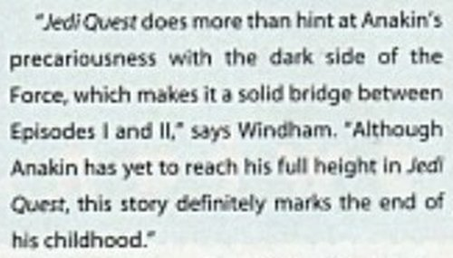

## scan p.53 (scan page 53)

Page contents: Jedi Quest cont. (magazine p. 73): Windham on scripting comics as a screenplay and reworking the novel's prologue as a flashback in issue #2; added scenes (Krayn's pirate battle, Jedi Council); Pop Mhan's background (Wildstorm, Marvel, DC, SpyBoy) and manga influence. Pull quote repeats Windham's "solid bridge" line. Right sidebar "Four Reasons to Check Out Jedi Quest" (verified on crop): Anakin Skywalker vs. Darth Maul dream sequence; Krayn; the Colicoids (who created the droidekas in their own image); "Bridging the Gap" - Mhan's transitional Anakin. (hand-read)

- **Krayn** — entry/section: Krayn in the comic: ""I think there's a quite bit more space-pirate action in the comic," says Windham, explaining where he branched off from the novel's plot. "This wasn't gratuitous action, as it establishes Krayn's relationship with various other characters, not to mention his brutal ways. The Jedi Council figures into another extra scene." —Ryder Windham, Star Wars Insider 57, p. 73" Source: *Star Wars Insider #57* (2001), scan p.53
  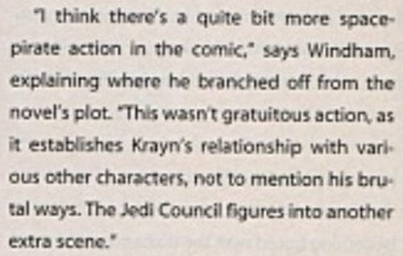
- **Darth Vader (Anakin Skywalker)** — entry/section: Drawing Anakin: ""Jedi Quest was a fun project to work on as an artist," says Mhan. "I got to draw some of the things I really enjoyed as a kid, and up to now with Episode I. Plus, I really enjoyed drawing Anakin. He is much cooler as a teenager than a kid." —Pop Mhan, Star Wars Insider 57, p. 73" Source: *Star Wars Insider #57* (2001), scan p.53
  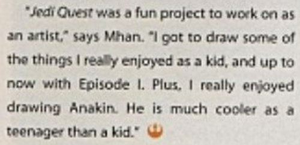

### Stat block notes (game mechanics, not feats)

- Four Reasons to Check Out Jedi Quest: ANAKIN SKYWALKER VS. DARTH MAUL. What else needs to be said? Sure it's a dream sequence, but when are you ever going to see this again? (Source: *Star Wars Insider #57* (2001), scan p.53)
- Four Reasons to Check Out Jedi Quest: KRAYN! Without a doubt, this bloodthirsty space pirate is one of the baddest Star Wars aliens ever designed. His fists could pulverize rock, his teeth could snip cable, and his face looks like a freeze-framed explosion. (Source: *Star Wars Insider #57* (2001), scan p.53)

## scan p.54 (scan page 54)

Page contents: "The New Jedi Editor: Shelly Shapiro Spills All... Well, Some" by Jason Fry (magazine p. 74): the spring 1998 Skywalker Ranch meeting that conceived The New Jedi Order; Del Rey editorial director Shelly Shapiro and Lucasfilm's Sue Rostoni coordinate the series; Chewbacca's death in Vector Prime and the rules behind the Yuuzhan Vong. Row of NJO cover art (Vector Prime through Jedi Eclipse). (hand-read)

- **Chewbacca; Han Solo** — entry/section: Why Chewbacca died: "Shapiro notes it was a logical choice for the story. Chewie, she says, "is a difficult character to do much with in terms of point of view, and yet he was sufficiently beloved by the other characters that his death would have a real impact on them." (To which she adds with a grin that she refused to kill off Han Solo.) —Shelly Shapiro, Star Wars Insider 57, p. 74" Source: *Star Wars Insider #57* (2001), scan p.54
  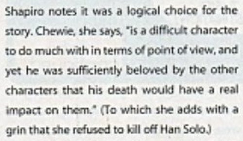
- **Tsavong Lah** — entry/section: The Yuuzhan Vong and the Force: ""We were told that the aliens could not be dark Force users—so we settled on no Force use at all," Shapiro says —Shelly Shapiro, Star Wars Insider 57, p. 74" Source: *Star Wars Insider #57* (2001), scan p.54
  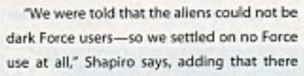

## scan p.55 (scan page 55)

Page contents: Shapiro article cont. (magazine p. 75): giving authors freedom; misconceptions about Mara Jade's illness, switching points of view and Leia's trials; Star by Star as "the Heart of Darkness of the whole series." Pull quote: "There are parts left to be filled in..." Right sidebar "More Spoilers! What's ahead for the New Jedi Order in 2002? Oh, just the end of the New Republic." (verified on crop): five 2002 books - Aaron Allston's Enemy Lines Rebel Dream and Rebel Stand (Wedge Antilles starring, return of Booster Terrik), Walter Jon Williams's hardcover, Elaine Cunningham's Dark Journey (starring Jaina Solo), Matthew Woodring Stover's Traitor; closes with a Yoda quote "Always in motion is the future." (hand-read)

- **Mara Jade Skywalker; Luke Skywalker; Han Solo; Leia Organa Solo** — entry/section: Mara's disease: ""Mara's disease was not supposed to be a way to get rid of Mara or to dis her—it was supposed to provide an interesting challenge for her and Luke," Shapiro says. "We have never, ever, played favorites with those two couples, Luke and Mara and Han and Leia . . . And it certainly never occurred to us that we were 'torturing' Leia in the extreme." —Shelly Shapiro, Star Wars Insider 57, p. 75" Source: *Star Wars Insider #57* (2001), scan p.55
  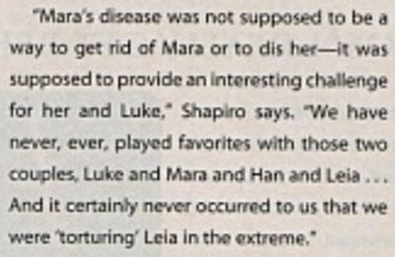
- **No single roster character (rules/setting/general)** — entry/section: Who lives and who dies: ""There are parts left to be filled in. We're still not exactly sure how it's all going to end, though the pieces are all in place. And contrary to popular belief, we have not decided who is to live and who is to die." —Shelly Shapiro, Star Wars Insider 57, p. 75" Source: *Star Wars Insider #57* (2001), scan p.55
  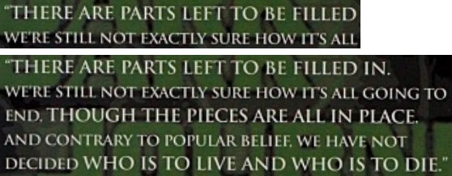

## scan p.56 (scan page 56)

Page contents: Game Scape: "Being Obi-Wan Kenobi: Finally, a Jedi You Can Really Get Behind" by Elliott Chin (magazine p. 76): LucasArts' Xbox game Obi-Wan, set in the weeks before Episode I; the Black Heth gang, the new Jin'ha aliens mining lightsaber-resistant cortosis and selling it to the Trade Federation; five chapters. (hand-read)

### Stat block notes (game mechanics, not feats)

- Photo caption (verified on crop): "CAN YOU FLY, BABA?" Obi-Wan uses the familiar Force Push high atop a Coruscant tower. (Source: *Star Wars Insider #57* (2001), scan p.56)

## scan p.57 (scan page 57)

Page contents: Obi-Wan game cont. (magazine p. 77): chapters on Coruscant, Obredaan (rescuing Eeth Koth and Plo Koon with Qui-Gon), Naboo, Theed and Tatooine, and the final confrontation with Darth Maul; Jedi duel levels against a training droid, Ki-Adi-Mundi, Saesee Tiin and Mace Windu; producer Mikhael Gallo. Pull quote on the full array of Force powers. Caption (verified on crop): "JEDI II: ELECTRIC BOOGALOO. Not only do your acrobatics save your hide, they look pretty darned cool." (hand-read)

- **Ki-Adi-Mundi; Saesee Tiin; Mace Windu** — entry/section: Jedi Knight II game: "After each chapter, you'll return to the Jedi Council for a non-lethal lightsaber duel. Your first battle is against a training droid, but subsequent battles pit you against Jedi Masters Ki-Adi-Mundi, Saesee Tin, and eventually Mace Windu." Source: *Star Wars Insider #57* (2001), scan p.57
  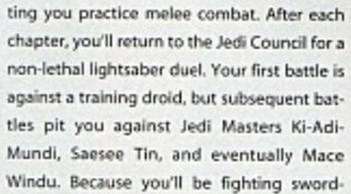
- **Darth Maul** — entry/section: Jedi Knight II game: "Because you'll be fighting sword-wielding bad guys, and even Darth Maul himself, these duel levels are great practice for honing your lightsaber technique." Source: *Star Wars Insider #57* (2001), scan p.57
  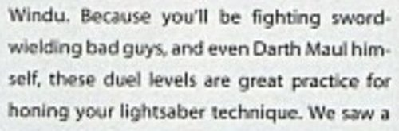

## scan p.58 (scan page 58)

Page contents: Obi-Wan game cont. (magazine p. 78): analog-stick lightsaber controls, lock-on, blocking, acrobatics, Force powers including lightsaber throw; Xbox graphics; split-screen two-player Jedi duel mode (Mace Windu to Qui-Gon Jinn to Obi-Wan); December release. Left sidebar "Another Pathetic Life Form?" (verified on crop): Jin'ha, Tusken Raiders, droids (battle, destroyer, barren, assassin, exploding), Darth Maul. (hand-read)

### Stat block notes (game mechanics, not feats)

- Another Pathetic Life Form? (Obi-Wan game sidebar): DARTH MAUL The final confrontation in Obi-Wan is the climactic battle at the end of Episode I. All your training comes down to this: a battle to the death against the new face of Sith power. (Source: *Star Wars Insider #57* (2001), scan p.58)

## scan p.59 (scan page 59)

Page contents: "Star Wars Website: Free and Easy Ways to Spruce Up Your Site" by Paul Ens, starwars.com webmaster (magazine p. 80): official headline and thumbnail feeds, sample HTML/JavaScript code. (hand-read)

## scan p.60 (scan page 60)

Page contents: Website article cont. (magazine p. 81): countdown script to Celebration II (May 3, 2002), free polls, mailing lists, "Go Vertical" advice on niche sites. Pull quote: "The net doesn't need another website with a scan of the Episode I teaser poster, five links, and a thank you to..." (hand-read)

## scan p.61 (scan page 61)

Page contents: Set Piece: "Imperial Star Destroyer - Help Wanted: Scum and Villainy, Apply Within" by Chris Reiff & Chris Trevas (magazine p. 82): the Empire bridge set on Stage 5 at Elstree (1979), designed by Norman Reynolds; how Bossk, Dengar, 4-LOM and IG-88 costumes were built from recycled parts. Captions (verified on crop): holographic communications center; wall panels recycled from the Tantive IV hallway set. (hand-read)

### Stat block notes (game mechanics, not feats)

- Photo caption (verified on crop): Holographic Communications Center: Join Vader in watching as Imperial commanders cower at oncoming asteroids while in pursuit of the Millennium Falcon. (Source: *Star Wars Insider #57* (2001), scan p.61)
- Set Piece text (verified on crop): "Bounty hunters. We don't need that scum," we hear Piett say from below as we are introduced to the motley group Vader has summoned to track down our heroes. Bossk, a Trandoshan, overhears the comment and snarls ferociously at the officers. (Source: *Star Wars Insider #57* (2001), scan p.61)
- Set Piece text (verified on crop): Three of these hunters would return for the final film of the Star Wars saga. Although Dengar and Bossk lost their quarry to the infamous Boba Fett, they are seen briefly among Jabba's minions. In the competitive world of the bounty hunter, you have to go where the work is. (Source: *Star Wars Insider #57* (2001), scan p.61)

## scan p.62 (scan page 62)

Page contents: Set Piece cont. (magazine p. 83): labelled prop-weapon callouts on the bounty hunter line-up (verified on crop): IG-88's blaster is an altered Hoth Rebel Trooper rifle prop (see Insider #55); Boba Fett's gun is a WWI British Webley flare gun with an antique camera-flash handle and scope; Bossk's rifle a modified British Schermuly anti-riot gun; Dengar's blaster a German MG42 machine gun; 4-LOM's an unmodified German MG34; Zuckuss's insect-like eyes are bubble-wrap packing material over the mask eyeholes. Caption: down this corridor lies Lord Vader's meditation chamber and his direct line to the Emperor. (hand-read)

### Stat block notes (game mechanics, not feats)

- Photo caption (verified on crop): Down this corridor lies Lord Vader's meditation chamber and his direct line to the Emperor. (Source: *Star Wars Insider #57* (2001), scan p.62)

## scan p.63 (scan page 63)

Page contents: Scouting the Galaxy: "On the Circuit: Comprehending Collectibles - Finding Star Wars' Holy Grail" by Steve Sansweet (magazine p. 84): summer convention circuit, the "Star Wars: Connections" presentation, Hasbro and Topps previews; reader question "Death Star Sighting" on the whereabouts of the original Death Star studio model. Letter-writer names omitted. (hand-read)

## scan p.64 (scan page 64)

Page contents: Scouting cont. (magazine p. 85): the Death Star model's history - found at a Lake of the Ozarks flea market, bought by three collectors, now in Gus Lopez's foyer in a custom Plexiglas case; "One Cape Short" (Luke Imperial Guard disguise figure missing its cape - a mistake, not a variation); "Canvas the Field" reader question. Pull quote: "To me, something like this is a mistake, not a true variation, and thus worth less than the regular mint, carded figure." Letter-writer names omitted. (hand-read)

## scan p.65 (scan page 65)

Page contents: Scouting cont. (magazine p. 86): the "poster" is a cutting of ICI Star Wars vinyl wallpaper worth $25-$30; "Leia Leanings" follow-up; "Maybe If You Drop a '0'" - mint boxed 12-inch Leia $225-$250, Luke $375-$400, not $3,000 each; "No Lost Treasure Here" - Sigma Bib Fortuna figurine stamped Boba Fett has no added worth; submission address. Letter-writer names omitted. (hand-read)

## scan p.66 (scan page 66)

Page contents: "Title Shock" crossword by Mike Selinker (magazine p. 88), clues and grid (answers on p. 90). Gag cartoon "Boba Fetish" (Kovalic): Boba Fett "As you wish." / Vader "Heeeey... nice shoes..." - humor, not logged as T. (hand-read)

## scan p.67 (scan page 67)

Page contents: Rebel Rumblings continued (magazine p. 89): letters on motherhood, a correction (The Indian in the Cupboard Vader figure battles a dinosaur, not Robocop), "Print My Letter!" and tips; "Who's That Girl?" box - the model for Decipher's Mara Jade card, pictured with Michonne Bourriague (Aurra Sing); "Double Takes" San Diego Comic-Con costume photos. Editor replies summarized only; letter-writer and costumer names omitted. (hand-read)

## scan p.68 (scan page 68)

Page contents: Rebel Rumblings cont. (magazine p. 90): "Sore Losers" box - an Imperial loyalist's complaint of New Republic bias, with an editor reply; letter-writing tips cont.; "Never Trust a Jedi" (Tusken accuracy vs. Obi-Wan's blast-point remark); "Hunting for the Hunter" (where is Boba Fett - pointed to Star Wars: Underworld and The Bounty Hunter Wars). Editor replies summarized only; letter-writer names omitted. (hand-read)

## scan p.69 (scan page 69)

Page contents: Rebel Rumblings cont. (magazine p. 91): "What's in a Name?" (word origins - an article promised); "Girl Power" (strong women in Zahn's novels - Mara Jade, Mon Mothma, Winter); "Allegorically Speaking" (Amidala and the Dalai Lama, Padme as Tibetan for lotus). Box "Top 10 Rejected Names for the Death Star" (#1 "I Can't Believe That's No Small Moon"). Letter-writer and contributor names omitted. (hand-read)

## scan p.70 (scan page 70)

Page contents: Rebel Rumblings cont. (magazine p. 92): British-accent villains reply; "Recommended Reading" request; "Tattoo-ine" box with reader tattoo photos; Statement of Ownership, Management, and Circulation. Letter-writer names omitted. (hand-read)

- **Darth Vader (Anakin Skywalker)**: "In that movie, James Earl Jones as Thulsa Doom murdered Conan's parents when he was a child. Since James Earl Jones (who we all know provides the voice for Darth Vader) killed Conan's parents, by movie logic, that means he killed his own grandparents." Source: *Star Wars Insider #57* (2001), scan p.70
  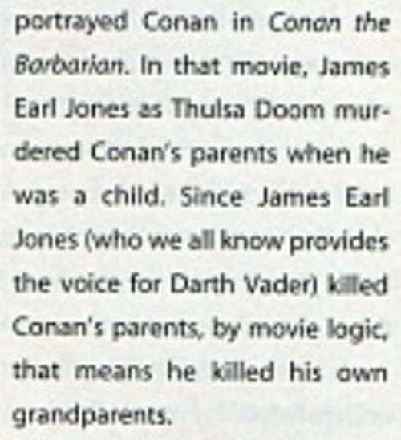

## scan p.71 (scan page 71)

Page contents: "Dear 2-1B: Advice for Humans" (magazine p. 94), in-character humor column - 2-1B announces he has been fired/quit after 10 issues; replies to a reader asking about Natalie Portman. Letter-writer names omitted. (hand-read)

### Stat block notes (game mechanics, not feats)

- Dear 2-1B (in-character column, verified on crop): over the course of 10 issues, I've clearly established that (1) Luke Skywalker never properly acknowledged my role as the droid behind the man; (2) I, 2-1B am solely responsible for the downfall of the Empire and victory of good over evil, because if it weren't for my quick medical action, Luke would have ended up a one-handed popsicle and never would have made it past Empire; (3) FX-7 is a blowhard; and (4) I'm the best. So long, suckers! (Source: *Star Wars Insider #57* (2001), scan p.71)

## scan p.72 (scan page 72)

Page contents: Dear 2-1B cont. (magazine p. 95): mock celebrity anecdotes; nail-biting advice to a reader; jab at Luke "Nimble-Fingers-Provided-by-2-1B" Skywalker. Letter-writer names omitted. (hand-read)

## scan p.73 (scan page 73)

Page contents: Full-page illustration by Stan Shaw (magazine p. 96): Boba Fett reading "The Galactic Inquirer" tabloid ("Hutt Love! Exclusive", "Where Are They Now!?" with Luke, Leia and Han, "Bizarre Gungan Love Cult!"). (hand-read)

## scan p.74 (scan page 74)

Page contents: Back cover ad: Star Wars Galactic Battlegrounds (LucasArts real-time strategy, Age of Empires engine; six armies). (hand-read)

