# Owner Material 038 — Star Wars Insider #1–153 plus specials (with The Lucasfilm Fan Club Magazine #1–22): Star Wars Insider #58 (2002)

- **Source:** *Star Wars Insider* magazine (issues 23–153, 1994–2014) and its predecessor *The Lucasfilm Fan Club Magazine* (issues 1–22, 1987–1994), plus seven special editions: articles, interviews, comics and short fiction Secondary source (licensed Legends reference). Scan OCR'd on the box; the scan stays box-only and is **not** published.
- **Method:** every scanned page was OCR'd and machine-screened sentence by sentence for power-relevant statements (fights, kills, defeats, Force feats, rankings, superweapons) that name a character on our roster; each kept sentence is quoted verbatim from the OCR text and has a crop of the printed passage directly under it. Pages with nothing power-relevant are still listed with what is on them.
- **Citation:** "*Star Wars Insider #58* (2002), p.X" by printed page ("scan p.X" where no printed number applies). **Weight:** Licensed magazine: a secondary source. Its short fiction and comics are Legends stories; its articles and interviews sum up or discuss lore and rank below the novels, comics and games they describe.

## scan p.1 (scan page 1)

Page contents: Cover, Star Wars Insider 58: Anakin Skywalker returns to Tatooine; cover lines - new column Behind the Magic: bringing Watto to life; secrets of the set: Death Star dumpster diving; galactic ladykiller Billy Dee Williams; art of the new trading card game; the Fighting 501st, a legion of fans. Issue 58, US $5.00. (hand-read)

## scan p.2 (scan page 2)

Page contents: Contents, features (magazine p. 2): Fosters of the Force - "Lars Attacks" (Joel Edgerton as young Owen) and "Micro Beru" (Bonnie Piesse) interviews by Scott Chernoff; Billy Dee Williams career interview by Helen Keir; Attack of the Clones card game art; the Fighting 501st. On the Cover: Anakin Skywalker (Hayden Christensen) returns to Tatooine in Attack of the Clones (photo by Keith Hamshere). (hand-read)

## scan p.3 (scan page 3)

Page contents: Contents, departments (magazine p. 3): Rebel Rumblings, Prequel Update (Dan Madsen), Star News, Behind the Magic (Rob Coleman on Watto), Gamescape (revised Star Wars Roleplaying Game), Bookshelf (Daniel Wallace), Set Piece (Death Star trash compactor), Scouting the Galaxy, Crossword, Star Wars Q&A (Pablo Hidalgo). Editorial by editor-in-chief Dave Gross on fan groups and the value of fantasy; staff photo of a Darth Vader costume "taking over" the offices. (hand-read)

## scan p.4 (scan page 4)

Page contents: Masthead and Rebel Rumblings (magazine p. 6): intro on trailer reactions and defenses of a "prevaricating Jedi Knight"; "Set to Stun" box (first Attack of the Clones images; Obi-Wan hanging off a vessel over Coruscant); "Handmaiden Heaven" letter asking for coverage of Sabé, Rabé, Eirtaé, Saché and Yané and Keira Knightley as the decoy Sabé. Editor replies summarized only; letter-writer names omitted. (hand-read)

## scan p.5 (scan page 5)

Page contents: Attack of the Clones Update with Rick McCallum by Dan Madsen (magazine p. 8): "Trailer Parts" - teaser with Monsters, Inc., second trailer with Harry Potter, cut at the Ranch by Jim Ward's marketing group; 5,000-10,000 prints. (hand-read)

### Stat block notes (game mechanics, not feats)

- Photo caption (verified on crop): [CLOCKWISE, FROM LEFT] Anakin Skywalker (Hayden Christensen), deep in the bowels of Coruscant, tries to get answers to some vital questions. » Senator Padmé Amidala (Natalie Portman) gets some disturbing news in Star Wars: Episode II Attack of the Clones. » Obi-Wan Kenobi (Ewan McGregor) has his hands full fighting a wily bounty hunter. » Intent on not losing his prey in the skylanes over Coruscant, Anakin throttles up his speeder. (Source: *Star Wars Insider #58* (2002), scan p.5)

## scan p.6 (scan page 6)

Page contents: Attack of the Clones Update cont. (magazine p. 9): full-bleed photo of Obi-Wan Kenobi with lightsaber igniting in a corridor; title spread. (hand-read)

## scan p.7 (scan page 7)

Page contents: AotC Update cont. (magazine p. 10): "Title Treatment" - McCallum defends the Attack of the Clones title as a nod to old-time serials; "Finishing Touches" - five days of pick-ups in England at end of September. Captions on Watto, Jango/Boba on Kamino, Anakin on a swoop. (hand-read)

### Stat block notes (game mechanics, not feats)

- Photo caption (verified on crop): [TOP LEFT] Watto returns in Episode II, this time with some protection against the blazing suns for his bald head. [MIDDLE] Jango Fett (Temuera Morrison) confronts an unexpected visitor on the Kamino landing platform as Boba Fett (Daniel Logan) looks on from atop Slave I's ramp. [BOTTOM] Anakin (Hayden Christensen) mounts a borrowed swoop bike and speeds across the Tatooine dunes on an urgent mission. (Source: *Star Wars Insider #58* (2002), scan p.7)

## scan p.8 (scan page 8)

Page contents: AotC Update cont. (magazine p. 11): looping with English actors; ILM has finished about 1,000 shots with about 1,000 more to do; "Bridging the Eras" - prequels and classic trilogy as "two separate branches"; pull quote on script changes. (hand-read)

- **Luke Skywalker** — entry/section: Rick McCallum on the gap between the trilogies: ""They are really two separate branches," McCallum stresses. "They are separated by so many years. The next time the story is picked up, in Episode IV, it's almost 20 years later, because Luke Skywalker is around 20 years old." —Rick McCallum, Star Wars Insider 58, p. 11" Source: *Star Wars Insider #58* (2002), scan p.8
  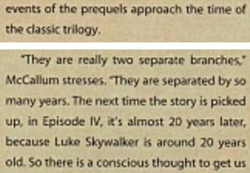

### Stat block notes (game mechanics, not feats)

- Photo caption (verified on crop): [TOP RIGHT] Jet pack blazing, Jango Fett (Temuera Morrison) aims at Obi-Wan Kenobi during a desperate fight. (Source: *Star Wars Insider #58* (2002), scan p.8)

## scan p.9 (scan page 9)

Page contents: AotC Update cont. (magazine p. 12): script "very, very flexible" - more scenes written for characters who work well together; "Homecoming" - the Australian crew filmed in Tunisia at the exact location of Luke's home, located with David West Reynolds. (hand-read)

### Stat block notes (game mechanics, not feats)

- Photo caption (verified on crop): [TOP] Senator Padmé Amidala (Natalie Portman) isn't packing for a vacation in this scene shot in her Coruscant apartment. Photo by Sue Adler. [BOTTOM] Anakin, Padmé, and Obi-Wan get ready to confront one of the biggest challenges of their lives. (Source: *Star Wars Insider #58* (2002), scan p.9)

## scan p.10 (scan page 10)

Page contents: AotC Update cont. (magazine p. 13): the Tunisia location moved the crew; McCallum on CTV Services, Tunisia and Morocco; "World Travels". Caption: ILM's John Knoll explains a finished scene to Temuera Morrison. (hand-read)

### Stat block notes (game mechanics, not feats)

- Photo caption (verified on crop): [TOP] Unexpected hazards greet Obi-Wan Kenobi (Ewan McGregor) and Anakin Skywalker (Hayden Christensen) during a speeder chase. [BELOW, LEFT] In the skylanes above Coruscant, sometimes the direction is straight down, as Obi-Wan wonders whether he should have let Anakin drive. (Source: *Star Wars Insider #58* (2002), scan p.10)

## scan p.11 (scan page 11)

Page contents: AotC Update cont. (magazine p. 14): McCallum on India (most amazing) and Turkey (most difficult) as locations; The Phantom Menace DVD breaking sales records. Captions: "Public transit: your gateway to adventure." / "Important tasks ... and some other cool stuff." (hand-read)

### Stat block notes (game mechanics, not feats)

- Photo caption (verified on crop): The Episode II crew prepares Zam Wesell's speeder for imminent action. Photo by Giles Westley. / Anakin (Hayden Christensen) has to confront some unpleasant truths, but Padmé (Natalie Portman) helps to share his burden. Photo by Lisa Tomasetti. (Source: *Star Wars Insider #58* (2002), scan p.11)

## scan p.12 (scan page 12)

Page contents: AotC Update cont. (magazine p. 15): the DVD took almost as long as the film, with hundreds of new shots and six or seven months of work. Caption: George Lucas watches playback with camera crew. (hand-read)

### Stat block notes (game mechanics, not feats)

- Photo caption (verified on crop): Jedi Master Yoda challenges conventional wisdom in the Chancellor's office at the Galactic Senate. (Source: *Star Wars Insider #58* (2002), scan p.12)

## scan p.13 (scan page 13)

Page contents: AotC Update cont. (magazine p. 16): "Back to the Future..." - Episode III pre-production; Erik Tiemens and Ryan Church in the art department; first script draft hoped for by November of next year; location scouting next summer. Middle caption is a joke line ("Master, I don't think he's blinked in over an hour."). (hand-read)

### Stat block notes (game mechanics, not feats)

- Photo caption (verified on crop): [TOP] Dressing in native costumes, Padmé Amidala (Natalie Portman) and Anakin Skywalker (Hayden Christensen) have R2-D2 along on what could turn into a perilous journey. [BOTTOM] Count Dooku (Christopher Lee) seems to have captured the attention of Obi-Wan Kenobi (Ewan McGregor). (Source: *Star Wars Insider #58* (2002), scan p.13)

## scan p.14 (scan page 14)

Page contents: Star News by Scott Chernoff (magazine p. 18): "I Scream Clones: Fans Turn Out for Unveiling of Episode II Teaser Trailers" - the "Breathing" teaser with Monsters, Inc. on November 2, 2001, a starwars.com DVD-exclusive trailer, and a longer trailer with Harry Potter; fan reactions (names omitted). (hand-read)

## scan p.15 (scan page 15)

Page contents: Star News cont. (magazine p. 19): "Episode Won: Phantom Menace Shatters Records in DVD Debut" - an estimated 2.2 million copies in the first week, over $45 million; classic trilogy DVD not planned until after Episode III; Monsters, Inc. records; Frank Oz and John Ratzenberger in Monsters, Inc. Pull quotes from a Fox executive and a fan (fan name omitted). (hand-read)

## scan p.16 (scan page 16)

Page contents: Star News: Star Sightings by Scott Chernoff (magazine p. 20): Jimmy Smits at the Tribute to Heroes telethon; Ford and Portman at the Concert for New York City; Samuel L. Jackson's projects; Ewan McGregor; Leeanna Walsman and Matt Doran on Love Is a Four-Letter Word; Nature's Guard voice cast; Ian McDiarmid leaves the Almeida. "Last Exit to Brooklyn" - Magic of Myth exhibit's final US stop at the Brooklyn Museum of Art, April 5-July 7. (hand-read)

## scan p.17 (scan page 17)

Page contents: Star Sightings cont. (magazine p. 21): Keira Knightley, Rose Byrne, Susie Porter; Kenneth Colley, Michael Culver, John Ratzenberger, Hugh Quarshie; Bob Anderson; Lawrence Kasdan; George Lucas honored by the National Mentoring Partnership; Iain McCaig; Anthony Daniels' website; ILM projects; Magic of Myth adds Amidala's Senate costume; Art of the Starfighter in Indianapolis; Sydney Powerhouse Museum dates. (hand-read)

## scan p.18 (scan page 18)

Page contents: Star News: "In May, the Force Will Be With You (Especially if you're in Indianapolis)" by Kat Smith (magazine p. 24), framed as an "Advance Recon Logbook" - preview of Star Wars Celebration II, May 3-5, Indiana Convention Center: over 340,000 square feet; Some People to Meet (over thirty on-screen celebrities, the 501st); Things to See (Lucasfilm Archives display); Stuff to Buy (86,500 sq ft Exhibit Hall, exclusive action figure); Fan Club Benefits box (lanyard, early Exhibit Hall access, limited seating, private lounge). (hand-read)

## scan p.19 (scan page 19)

Page contents: Celebration II cont. (magazine p. 25): Staying Nearby (skywalk-connected hotels list); Things to Watch; Things to Play (launch of the Star Wars Trading Card Game designed by Richard Garfield, RPGA Living Force sessions, video gaming); Things to Do (art show, costume contest, collectors' Road Show); Art of the Starfighter exhibit at the Children's Museum of Indianapolis (35-foot Naboo starfighter model). Side ad: Star Wars Gamer #8 "Die Jedi! Die!" (Yuuzhan Vong campaign, Endor and Nodell sector, grid starship combat). (hand-read)

## scan p.20 (scan page 20)

Page contents: Comlink: "A Star Wars Summer, Part 2" by Lisa Stevens (magazine p. 26): Wizard World 2001 (Chicago) and Dragon*Con 2001 (Atlanta) with actor guests; Make-A-Wish auction; 501st's largest assembly and Peter Mayhew's plaque; Anthony Daniels as emcee. "Not So Silent: Kevin Smith Narrates Star Wars Fan Documentary" - Starwoids by Dennis Przywara, released October 16. Fan names omitted. (hand-read)

## scan p.21 (scan page 21)

Page contents: Next issue (59) preview - 25th Anniversary Collector's Issue: Mark Hamill, Carrie Fisher, Harrison Ford retrospectives; the secret history of Bantha Tracks; AotC final update; bonus entries from the New Essential Guide to Characters; Who's Who in Rogue Squadron. Ad: Star Wars Silver Anniversary Pin Collection (PinUSA). (hand-read)

## scan p.22 (scan page 22)

Page contents: "Lars Attacks" interview with Joel Edgerton by Scott Chernoff (magazine p. 28): intro on young Owen Lars - in A New Hope he feared Luke would follow his father; Attack of the Clones reveals Owen's connection to Anakin Skywalker. (hand-read)

### Stat block notes (game mechanics, not feats)

- Photo caption (verified on crop): "A nice and somewhat eager country boy," is how Australian actor Joel Edgerton decided to play Owen Lars in Episode II. Photo by Lisa Tomasetti. (Source: *Star Wars Insider #58* (2002), scan p.22)

## scan p.23 (scan page 23)

Page contents: "Lars Attacks" title spread (magazine p. 29): pixelated portrait of Phil Brown; deck "From the Australian countryside to the sands of Tatooine - meet the lifelong Star Wars fan who grew up to become Luke Skywalker's future uncle, Owen Lars, in Attack of the Clones." (hand-read)

## scan p.24 (scan page 24)

Page contents: "Lars Attacks" cont. (magazine p. 30): Edgerton, 27, a lifelong fan, on his approach - he always saw Uncle Owen as a father figure, not a "dream-squasher"; young Owen as "a nice and somewhat eager country boy." Pull quote: "Most people talk about Uncle Owen as this awful character..." (hand-read)

- **Owen Lars; Luke Skywalker** — entry/section: Joel Edgerton on Owen as a father figure: ""Most people talk about Uncle Owen as this awful character because he's trying to stop Luke from fulfilling his dreams, that he was a bit of a dream-squasher. But I never thought of him like that. I always saw him as a father figure that was trying to act in Luke's best interests." —Joel Edgerton, Star Wars Insider 58, p. 30" Source: *Star Wars Insider #58* (2002), scan p.24
  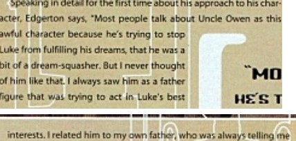
- **Owen Lars; Darth Vader (Anakin Skywalker); Obi-Wan Kenobi** — entry/section: Joel Edgerton on playing the young Owen: ""When we find Owen as a young man, he obviously hasn't had too much experience in the way of what eventually happened with Anakin and Obi-Wan. I wanted to bring him back to a nice and somewhat eager country boy. He was probably curious about the world outside, and I think he's eager to understand and be told stories of places." —Joel Edgerton, Star Wars Insider 58, p. 30" Source: *Star Wars Insider #58* (2002), scan p.24
  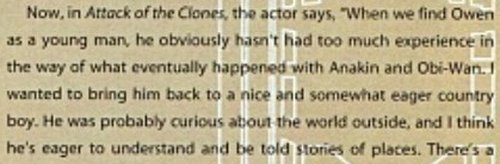

## scan p.25 (scan page 25)

Page contents: "Lars Attacks" cont. (magazine p. 31): on Phil Brown's well-lived-in face; Edgerton's background in Dural outside Sydney, the Sydney stage, Blood and Guts, The Secret Life of Us; as a child he loved the creatures, Chewbacca ("a big, walking dog") and the Ewoks. (hand-read)

- **Owen Lars; Luke Skywalker** — entry/section: Joel Edgerton on Owen before the hard years: ""That's a good thing about going back to him as a young man: This is perhaps prior to any of that heavy experience. I'm sure he was a bit of a Luke himself—working away in this country town and wondering whether or not to go explore." —Joel Edgerton, Star Wars Insider 58, p. 31" Source: *Star Wars Insider #58* (2002), scan p.25
  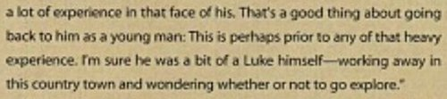

### Stat block notes (game mechanics, not feats)

- Photo caption (verified on crop): [ABOVE] Owen Lars (Joel Edgerton) and his girlfriend Beru Whitesun (Bonnie Piesse) pay close attention to a disturbing tale in this scene from Attack of the Clones. >> The man who grows up to become Luke Skywalker's Uncle Owen comes face to face with harsh reality in Episode II. Photo by Lisa Tomasetti. (Source: *Star Wars Insider #58* (2002), scan p.25)

## scan p.26 (scan page 26)

Page contents: "Lars Attacks" cont. (magazine p. 32): what caught him in the trilogy was the Luke-Leia relationship; his brother Nash, a stuntman, was Obi-Wan's stunt double on AotC; his resemblance to Phil Brown ("I'm like a mini-Phil Brown"); casting director Robin Gurland found his headshot. Pull quote on the human qualities of the characters: trust, loyalty and ambition. (hand-read)

### Stat block notes (game mechanics, not feats)

- Photo caption (verified on crop): [ABOVE] Beru Whitesun (Bonnie Piesse) is comforted by Owen Lars as a stoic Cliegg Lars (Jack Thompson) watches the horizon. >> Beru and Owen have a hardscrabble life on Tatooine, but there's always the comfort of the homestead. Photo by Lisa Tomasetti. (Source: *Star Wars Insider #58* (2002), scan p.26)

## scan p.27 (scan page 27)

Page contents: "Lars Attacks" cont. (magazine p. 33): the audition used Owen's lines from A New Hope ("I need you here"); Edgerton asked to swap and read Luke's lines instead to get into a young man's headspace; he won the part on his 26th birthday. Large photos of Beru and Owen. (hand-read)

## scan p.28 (scan page 28)

Page contents: "Lars Attacks" cont. (magazine p. 34): a friend put all of Phil Brown's lines on a CD so he could learn the rhythm and accent; Owen's hands-on-hips posture came from the heavy costume; first day on set exchanged the C-3PO purchase dialogue with Anthony Daniels, R2-D2 milling around; shooting at the original Lars homestead location in Tunisia. Full-length costume photo with caption "Australian actor Joel Edgerton takes on the role of Owen Lars in Episode II. Photo by Sue Adler." (hand-read)

## scan p.29 (scan page 29)

Page contents: "Lars Attacks" ends (magazine p. 35): the homestead crater and vaporators as "the highlight"; "And there I was playing Luke Skywalker's uncle." Test Your Knowledge box (four questions; upside-down answers: a restraining bolt, See-Threepio, Bocce, Jawas). (hand-read)

## scan p.30 (scan page 30)

Page contents: "Omicron Beru" - Bonnie Piesse interview by Scott Chernoff (magazine p. 36): "After Attack of the Clones, you won't think of Beru Whitesun the same way again." Beru was played in the original by the late Shelagh Fraser; Piesse, 18, from Melbourne, plays guitar, just finishing school; Blue Heelers credit. (hand-read)

## scan p.31 (scan page 31)

Page contents: Title spread (magazine p. 37): "Star Wars Insider chats with the spirited teen actress who plays Beru years before she ever poured Luke Skywalker his first drop of blue milk." Portrait photo. (hand-read)

## scan p.32 (scan page 32)

Page contents: "Omicron Beru" cont. (magazine p. 38): Piesse on the young Beru as more shy; she had seen only Episode I before her audition, then watched them all with her family; found via an actors' database; auditioned with Beru's lines from A New Hope. (hand-read)

- **Luke Skywalker** — entry/section: Bonnie Piesse on the young Beru: ""I think you'll find the young Beru is a bit more shy than in Episode IV, because I felt like maybe she hadn't quite come out of her shell yet," Piesse said. "I feel like Beru hasn't quite found herself. She's still very young. She's got the genuine kindness and love that the older Beru does, but she hasn't really settled down yet. I would say that when Luke comes to live with them, she becomes a mother and really becomes content in the desert. I think the introduction of Luke into her life probably made her a lot more mature, because she had to grow up and look after this child." —Bonnie Piesse, Star Wars Insider 58, p. 38" Source: *Star Wars Insider #58* (2002), scan p.32
  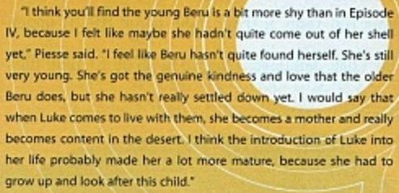

### Stat block notes (game mechanics, not feats)

- Photo caption (verified on crop): [ABOVE] Bonnie Piesse admires the warmth and kindness in Shelagh Fraser's portrayal of Beru. [RIGHT] One of Bonnie Piesse's creative outlets is vegetarian cooking, so she felt right at home in the Lars kitchen. (Source: *Star Wars Insider #58* (2002), scan p.32)

## scan p.33 (scan page 33)

Page contents: "Omicron Beru" cont. (magazine p. 39): pull quote repeating Beru "hasn't quite found herself"; other roles (Stingers, Composite Creatures); first role at 15 as the trapezist on High Flyers; songwriting since 14. Large photo of Beru in the Lars kitchen. (hand-read)

## scan p.34 (scan page 34)

Page contents: "Omicron Beru" cont. (magazine p. 40): music as "contemporary folk"; writing a film, short stories, poems. (hand-read)

### Stat block notes (game mechanics, not feats)

- Photo caption (verified on crop): [ABOVE] Luke Skywalker (Mark Hamill) shares a meal with his Aunt Beru (Shelagh Fraser) in the homestead kitchen in A New Hope. [BELOW] Director George Lucas and actress Bonnie Piesse closely examine a Tatooine snack in the kitchen nearly 25 years later. Photo by Lisa Tomasetti. (Source: *Star Wars Insider #58* (2002), scan p.34)

## scan p.35 (scan page 35)

Page contents: "Omicron Beru" ends (magazine p. 41): trapeze training for High Flyers; the overwhelming size of the Star Wars set ("I wasn't a visitor"); friendship with Joel Edgerton; seeing his resemblance to the older Owen ("like looking into the future"); snapshots at the original homestead. Photo caption "Home, sweet home." (verified on crop). (hand-read)

## scan p.36 (scan page 36)

Page contents: "Billy Dee Williams: An Eclectic Career" title spread (magazine p. 42): full-page photo of Lando Calrissian; side title "Talking with the real-life Lando Calrissian." (hand-read)

## scan p.37 (scan page 37)

Page contents: "An Eclectic Career" by Helen Keier with Allen Varney (magazine p. 43): interview at the Gen Con Game Fair, Milwaukee, August 2001. Section "Card player, gambler, scoundrel. You'd like him." - Williams jokes Lando's popularity is "His good looks, certainly. He's me." (hand-read)

- **Lando Calrissian** — entry/section: Billy Dee Williams on what makes Lando work: "More seriously: "He's charming and a bon vivant. He's a man who's devoid of all the clichés, a man of the future. The Lando character was good because you weren't sure which way he was going to go. That's always good when you write a character. There's a little bit of uncertainty that you can attribute to a kind of villain. The [ambiguity] makes it much more interesting." —Billy Dee Williams, Star Wars Insider 58, p. 43" Source: *Star Wars Insider #58* (2002), scan p.37
  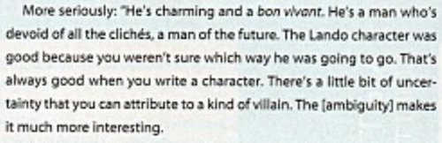

## scan p.38 (scan page 38)

Page contents: "An Eclectic Career" cont. (magazine p. 44): Lando gave him a lasting fan base ("big discussions about me betraying Han Solo"); biography - born in Harlem April 1938, twin sister, first stage job at 7, painting scholarship, High School of the Performing Arts, Brian's Song, Batman (Harvey Dent). Sidebar "The Billy Dee Williams World Art Gallery" (painting since Fences, 120 works in two years). Montage of Lando film stills. (hand-read)

## scan p.39 (scan page 39)

Page contents: "An Eclectic Career" cont. (magazine p. 45): Lady Sings the Blues and Mahogany made him a sex symbol; "ladies' man" reputation; The Ladies Man; Art Gallery sidebar cont. (Smithsonian, Tuskegee Airmen series, "Abstract Reality"; lithograph "Lando Calrissian, Into the Future"). Pull quote on looking at the world "as an amalgamation of ideas and energies." (hand-read)

## scan p.40 (scan page 40)

Page contents: "An Eclectic Career" cont. (magazine p. 46): being the first black romantic matinee idol; racism limiting his roles; The Visit (2001) and its award nominations. Sidebar "By Billy Dee Williams": the novels PsiNet (1999) and Just/In Time (2000) with Rob MacGregor. (hand-read)

## scan p.41 (scan page 41)

Page contents: "An Eclectic Career" ends (magazine p. 47): interest in psychic phenomena; upcoming romance novel Twilight with Elizabeth Atkins Bowman; "I live in the gray area"; Thelonious Monk Institute co-chair. Pull quote on wanting to play Duke Ellington. Test Your Knowledge box (three Lando questions; upside-down answers: 1. Ashandi [faint], 2. "At the East ... 'gasp' Platform", 3. The Battle of Taanab). (hand-read)

## scan p.42 (scan page 42)

Page contents: "An Eclectic Career" ends (magazine p. 48): American Cancer Society benefits; upcoming Undercover Brother and Zen; Gideon's Crossing; his dream of a Duke Ellington biopic ("Foppishly elegant"); on getting older. Photo montage of Lando stills. (Magazine p. 49 not in the scan.) (hand-read)

## scan p.43 (scan page 43)

Page contents: "Art of the Star Wars Trading Card Game: New Star Wars TCG Features Episode II Imagery" by Michael G. Ryan (magazine p. 50), title page. (hand-read)

## scan p.44 (scan page 44)

Page contents: Star Wars TCG cont. (magazine p. 51): Wizards of the Coast won the worldwide license for a TCG based on the movies and Expanded Universe, designed by Richard Garfield (Magic: The Gathering). Pull quote from Sean Glenn, Star Wars Brand Art Director: "It's great to work with a partner who knows exactly what they need from us." Card-back image. (hand-read)

## scan p.45 (scan page 45)

Page contents: Star Wars TCG cont. (magazine p. 52): game arrives April 2002 with AotC scenes; full card list due in Star Wars Gamer #10 (May 7); Card-by-Card - Glenn selecting, color-correcting and cropping Lucasfilm images; the game pits players in three arenas, battling to control two of three. Pull quote: 60-70 percent of cards to be film scenes. Caption (verified on crop): "Studio shots such as this one of Hayden Christensen (Anakin Skywalker) are taken against a gray background. More exciting backgrounds are later added. photo by Sue Adler" (hand-read)

## scan p.46 (scan page 46)

Page contents: Star Wars TCG cont. (magazine p. 53): composites, isolating studio shots, CG-modeled ships approved by Lucasfilm. "Standard Card Anatomy" box (verified on crop) labels card name, build cost, key words, affiliation (Light Side, Dark Side, or Neutral), card text, color (space, ground, character, mission, combat), speed, power (dice; 4, 5, or 6 is a hit), health, unique indicator (this is version "C" of Anakin Skywalker), card number/rarity symbol; the card pictured is an unnumbered promo card. (hand-read)

### Stat block notes (game mechanics, not feats)

- Promo card text (verified on crop): Anakin Skywalker / Character - Jedi [build cost 5; speed 60, power 5, health 4] Pay 2 Force -> Evade 2 (Prevent up to 2 damage to Anakin.) "I feel things are going to happen in our generation that will change the galaxy in profound ways." (Source: *Star Wars Insider #58* (2002), scan p.46)

## scan p.47 (scan page 47)

Page contents: Star Wars TCG cont. (magazine p. 54): ILM creating special renders in advance of the film's completion (e.g., Obi-Wan's Jedi starfighter and Slave I over an asteroid); "Art, Too, Detoured" - the card list drives image choices. Photo of Sean Glenn and graphic designer Rick Achberger with design concepts. (hand-read)

## scan p.48 (scan page 48)

Page contents: Star Wars TCG ends (magazine p. 56): 150-180 cards expected in the first release; packaging done first; Skywalker Ranch visits ("exactly like Naboo"); plenty of ships in the film; some Episode I imagery (e.g., Darth Maul); second set tentatively titled Sith Rising; later sets to cover the classic trilogy; January "pencils down." "Art Extras" box: promo cards packed with Hasbro's new action figures, carrying a promo stamp and no numbering. (Magazine p. 57 not in the scan.) (hand-read)

## scan p.49 (scan page 49)

Page contents: "New Heirs to the Empire: The Fighting 501st" by Michael G. Ryan (magazine p. 58), title page: the fan organization of stormtrooper costumers. Founder photo caption omitted (fan name). (hand-read)

## scan p.50 (scan page 50)

Page contents: "The Fighting 501st" cont. (magazine p. 59): origins in 1997 at the Special Edition premiere, a website called Detention Block 2551, photos sent from around the world; founder's aim of "a collective identity at the conventions, a family of their own." Fan names omitted; garrison photo from Dragon*Con 2001. (hand-read)

## scan p.51 (scan page 51)

Page contents: "The Fighting 501st" cont. (magazine p. 60): the fictional regiment backstory - named after units like the 101st Airborne, imagined as Darth Vader's elite troops; Rules of Engagement (one rule: own a professional-grade Imperial costume; no dues; Garrisons, Squads, Outposts; "TK designation" homage to TK-421). Photo captions name costumers (omitted): trooper at a birthday party, a Jango and Boba pair "desperate for roles in Episode III", biker scouts in Atlanta. (hand-read)

## scan p.52 (scan page 52)

Page contents: "The Fighting 501st" cont. (magazine p. 61): growth from about 300 to more than 800 members; Dave Prowse an Honorary Commander. Photo captions (charity visits, Dragon*Con class photo, Imperial pilots with the 501st flag) - costumer names omitted. (hand-read)

### Stat block notes (game mechanics, not feats)

- Box "The 'Origins' of the 501st" (verified on crop; club's fictional backstory): Stormtroopers: deadly shock troops of the Emperor. Heartless, fearless, tenacious soldiers of unwavering loyalty who crush the enemies of the Galactic Empire. This archive commemorates the greatest of all Stormtrooper units: the legendary Fighting 501st Squad, known as "Vader's Fist." Commissioned after the fall of the Old Republic, the 501st distinguished itself in hunting down and destroying scores of Rebel cells and outposts. Their accomplishments won the attention of the Emperor's right-hand man, Lord Vader, who made them his personal guard. Whenever Vader's aims fall outside the realm of the Imperial bureaucracy, he calls upon the 501st to accomplish his bidding. The only cross-disciplinary squad in the Empire, it is composed of every kind of trooper, pilot, scout, or driver. Whatever agenda Lord Vader pursues, he is assured of the specialized manpower to accomplish it. The 501st is ready to be deployed to his side at a moment's notice. This resource is a testimony to Vader's power and often baffles generals who wonder how he manages to wage campaigns with little or no involvement with the normal ranks. (Source: *Star Wars Insider #58* (2002), scan p.52)

## scan p.53 (scan page 53)

Page contents: "The Fighting 501st" ends (magazine p. 62): Being a Real Trooper - charity events, hospital visits, Make-a-Wish, the Blood War blood drive vs. Klingon clubs, over $3,000 for September 11 relief, goal of 501 troopers at Celebration II. Box "Why Aren't You at Your Post?" (verified on crop): ID numbers are never retired; prefix list TK stormtrooper, TD sandtrooper, TI fighter pilot, TB scout trooper, TS snowtrooper, TR royal guard, TA AT-AT pilot, TX special operations trooper, ID officer, SL Sith Lord, TG gunner, TZ spacetrooper, TT Death Star (navy) trooper, TXP bounty hunter. Costumer names in captions omitted. (hand-read)

## scan p.54 (scan page 54)

Page contents: "The Fighting 501st" ends (magazine p. 63): the founder's hope that the 501st will one day appear in a Star Wars film as stormtroopers. "We Want You!" box: join "the proud ranks of Vader's Fist" via www.501st.com. Photo captions (Dragon*Con, Celebration events, hospital visits) name costumers - omitted. (hand-read)

## scan p.55 (scan page 55)

Page contents: "A Trooper's Tale (and a Jawa's)" (magazine p. 64): profile of a married costuming couple in the Southern California Garrison (names omitted as fans) - homemade Jawa costume, City of Hope charity picnic for children with cancer; pull quote "Stormtroopers may look cool but they're fairly ineffective!" (Magazine pp. 65-71 not in the scan.) (hand-read)

## scan p.56 (scan page 56)

Page contents: Behind the Magic: "Watto You Looking At? Creating Animated Characters for Star Wars" by Rob Coleman, ILM Animation Director (magazine p. 72): Watto as the animators' favorite TPM character; eight steps - design, modeling, backstory, voice, animation, acting, rendering, compositing; Design starts with George Lucas and the Skywalker Ranch art department (drawings and maquettes). Captions (verified on crop): "[LEFT] A rare close-up of Watto's "good" side. [TOP RIGHT] Concept sketches by Iain McCaig. [BOTTOM RIGHT] Watto and Jack Haye see eye to eye." (hand-read)

## scan p.57 (scan page 57)

Page contents: "Watto You Looking At?" cont. (magazine p. 73): Modeling (Geoff Campbell's team; Watto speaks out of one side of his mouth, chipped lower left tusk); Backstory; Voice (Andy Secombe rehearsed in Tunisia with Liam Neeson, then stepped aside). Caption "[CLOCKWISE FROM LEFT] Andy Secombe and Liam Neeson reherse on set; the completed scene; Secombe stands in for Watto..." Pull quote: "Seeing a digital character interacting believably with an actor like Liam Neeson is what puts the magic in ILM." (hand-read)

- **Watto; Darth Vader (Anakin Skywalker)** — entry/section: Rob Coleman on Watto's backstory: "Other elements to Watto's backstory included that he was a gambler, a rough customer who aspired to more wealth and social standing. To help convey that aspect of his personality, the animators squinted one eye to make him look more like a pirate. He was older and tended to be grumpy, a quality he demonstrates the first time Anakin arrives on screen. To show his age, animators decided that Watto would fly all the time because his legs hurt. If you look carefully, you can see him scratching his legs to relieve the pain in a couple of scenes. —Rob Coleman, Star Wars Insider 58, p. 73" Source: *Star Wars Insider #58* (2002), scan p.57
  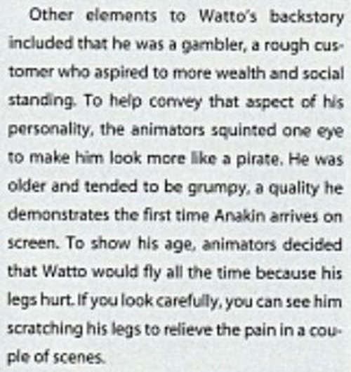

## scan p.58 (scan page 58)

Page contents: "Watto You Looking At?" ends (magazine p. 74): Animation (Steve Aplin's model, James Tooley's skeleton setup, 24 frames per second, key poses); Acting (Caricature software, library of facial shapes, lip sync to Secombe); Editing & Compositing (animation director keeps the character consistent; Lucas reviews; cloth, lighting, compositing). Caption (verified on crop): "Would you buy a used ship from this Toydarian? The final amalgamation of art, technology, talent, and teamwork form a character as real as any human actor." (Magazine p. 75 not in the scan.) (hand-read)

## scan p.59 (scan page 59)

Page contents: Game Scape: "The Core Rules Strike Back!" by Christopher Perkins with Dave Gross (magazine p. 76): the revised Star Wars Roleplaying Game (April 2002 per context; text says "April 2001" [sic]), 384 pages, errata incorporated, reputation modifier. Top 10 new additions box: 10. new Jedi prestige classes (Jedi ace, Jedi master, Jedi investigator); 9. three era-specific maps. Caption "Twi'lek Jedi Ace" (verified on crop). (hand-read)

## scan p.60 (scan page 60)

Page contents: "The Core Rules Strike Back!" cont. (magazine p. 77): Top 10 items 8-1 - more character species (seventeen total; Gamorrean scoundrel, Kel Dor fringer/Jedi consular, Tarbak noble; stats for 26 more incl. Chiss, Jawas, Yuuzhan Vong), new foreword by Steve Sansweet, new skills and feats, creature creation rules, new full-color art, dark side Force feats and prestige classes (dark side devotee, dark side marauder), the tech specialist class, Attack of the Clones features (stats for Anakin, Padme, Mace Windu, Jango Fett, Count Dooku, Slave I, Geonosians, Kaminoans). Body: More Heroes, More Choices (droid hero rules from Star Wars Gamer #3); Grittier Combat (attacks of opportunity, armor as damage reduction, starship combat on a grid; preview in Star Wars Gamer #8). Caption "Rodian Crime Lord: Clever, witty, and deadly - nothing like Greedo." (hand-read)

## scan p.61 (scan page 61)

Page contents: Bookshelf: "Flirting with the Dark Side - Jaina Solo's New Master" by Daniel Wallace, special thanks to Jason Fry (magazine p. 78): interview with Elaine Cunningham on the New Jedi Order novel Dark Journey (standalone softcover following Star by Star); story picks up with Jaina fleeing in a stolen Yuuzhan Vong ship; Hapes and Ta'a Chume; Cunningham's father's WWII story as a parallel; Jaina's romantic situation (Zekk, Jag Fel, Kyp Durron). (hand-read)

- **Jaina Solo; Han Solo; Leia Organa Solo** — entry/section: Elaine Cunningham on writing Jaina in Dark Journey: "I found the key in Jaina's impulsive nature, and in her resemblance to her father, Han Solo. Like Han, Jaina reacted to tragedy by striking out at the people closest to her—this was a reaction, and not an admirable one, but not necessarily a true reflection of her feelings. —Elaine Cunningham, Star Wars Insider 58, p. 78" Source: *Star Wars Insider #58* (2002), scan p.61
  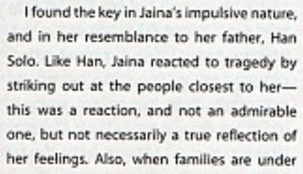

## scan p.62 (scan page 62)

Page contents: "Flirting with the Dark Side" ends (magazine p. 79): Jaina sees romance as a distraction; Cunningham read all the Young Jedi Knights books (Tenel Ka, Zekk, Lowbacca appear); her three Star Wars Gamer stories ("The Crystal" #5, "Red Sky, Blue Flame" #7, "The Apprentice" #8); on the Episode II title; her next book The Wizardwar. Pull quote repeats the Han/Jaina line. Caption: Gamer story art credits. (hand-read)

- **Jaina Solo; Jagged Fel; Han Solo; Leia Organa Solo; Kyp Durron** — entry/section: Elaine Cunningham on Jaina, Jag, and Kyp: "Jag Fel intrigues her. I see their interaction as very similar to that between a young Han and Leia—only the roles are flipped. Jag is about honor and duty, and Jaina, at least to a by-the-books guy like Jag, falls closer to the "scruffy scoundrel" mark. —Elaine Cunningham, Star Wars Insider 58, p. 79" Source: *Star Wars Insider #58* (2002), scan p.62
  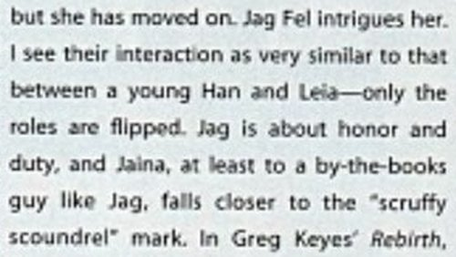

### Stat block notes (game mechanics, not feats)

- Box: Star Wars: The Approaching Storm (verified on crop): The Approaching Storm pairs Obi-Wan Kenobi and Anakin Skywalker with new Episode II Jedi characters Luminara Unduli and Barriss Offee. The four Jedi are ordered to mediate a border dispute on the planet Ansion, whose city dwellers are threatening to join the galaxy's growing secessionist movement unless they are permitted to take over the ancestral lands belonging to Ansion's nomadic tribes. With the stability of the Republic in their hands, the heroes must negotiate a settlement before a hidden enemy destroys all their hard work. The Approaching Storm goes on sale January of 2002. (Source: *Star Wars Insider #58* (2002), scan p.62)

## scan p.63 (scan page 63)

Page contents: Comics Link: "Bounty Hunters - We Don't Need Their Scum" by Daniel Wallace (magazine p. 80): bounty hunters' appeal (politically neutral, motivated by money); Dark Horse's two interlocking one-shots Jango Fett and Zam Wesell, both written by Ron Marz (Darth Maul miniseries; "I guess I'm the 'Bad Guy' guy"); Marz's professional-envy and attraction angle between Zam and Jango. (hand-read)

### Stat block notes (game mechanics, not feats)

- Photo caption (verified on crop): Zam Wesell artist Ted Naifeh drew the page pictured above before he got the job. He was asked to draw Boba Fett and a female bounty hunter. (Source: *Star Wars Insider #58* (2002), scan p.63)

## scan p.64 (scan page 64)

Page contents: "Bounty Hunters" ends (magazine p. 81): Ted Naifeh (Zam Wesell artist; his sample female hunter resembled Zam); Tom Fowler (Jango Fett artist, fully painted; first thought he'd been hired for a Boba Fett book); Marz and Fowler on seeing Star Wars as kids. Pull quote: "I really like Zam, her look, her costume. But Jango has the armor, which I've loved for two decades. That's a big appeal." —Ted Naifeh. (hand-read)

- **Zam Wesell** — entry/section: Ted Naifeh on drawing Zam Wesell: "Zam seems pretty relaxed and cool, unlike many action characters these days, who have that permanent scowl. She can go from friendly, civil conversation to sharp action, and she doesn't seem to lose control. In the reference I have of her, she just oozes composed deadliness. —Ted Naifeh, Star Wars Insider 58, p. 81" Source: *Star Wars Insider #58* (2002), scan p.64
  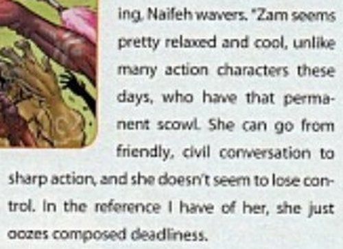
- **Jango Fett; Boba Fett** — entry/section: Tom Fowler on Jango vs. Boba: "Jango has a really sleek look to him as opposed to Boba. His armor is newer, all blue and silver. With Boba I always got the impression he was patched together. Jango is like the James Bond of Star Wars. —Tom Fowler, Star Wars Insider 58, p. 81" Source: *Star Wars Insider #58* (2002), scan p.64
  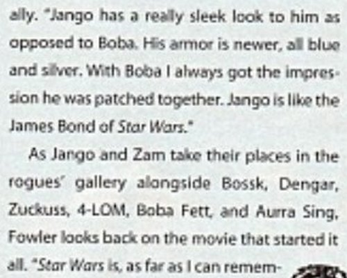

## scan p.65 (scan page 65)

Page contents: Set Piece: "The Death Star Trash Compactor - Drop In and Stay Awhile" by Chris Reiff & Chris Trevas (magazine p. 82): Elstree set; Mayhew's Wookiee suit kept the damp smell; rubber suits under costumes; Hamill submerged repeatedly, sang "Pardon me George, could this be Dianoga poo-poo?" ("Or so the story goes."); earlier dianoga designs (several-yard tentacle, brown blob) retired; final single tentacle and periscope eye operated by two divers. (hand-read)

### Stat block notes (game mechanics, not feats)

- Photo captions (verified on crop): The name dianoga was derived from the revised first draft of the Star Wars screenplay. In it "Dai Nogas" were the galactic warriors we now know as the Jedi. / At Leia's urging, Han attempts to use this large pipe to brace the closing walls, but it bends completely in half. / Mark Hamill loses that fabulous blow-dry do, only to get it back in time for the next plunge. (Source: *Star Wars Insider #58* (2002), scan p.65)

## scan p.66 (scan page 66)

Page contents: Set Piece concludes (magazine p. 83): full-page trash compactor still (Leia, Luke and Han in stormtrooper armor, Chewbacca) with prop callout captions. (hand-read)

### Stat block notes (game mechanics, not feats)

- Photo captions (verified on crop): Stormtrooper blaster rifles like Han's were made from British Sterling Mk 4 submachine guns with short heavy artillery sighting telescopes mounted on top. / The ridged grip of the Imperial comlink prop was also used as the muzzle of Greedo's blaster pistol. Many detail pieces were "found" parts repeated on different props. / Stormtrooper armor was made from vacuformed plastic. Flat sheets of plastic were heated and shaped to a mold by a vacuum pump. / The Imperial rifle prop Chewbacca carries (and tries to stop the walls with) was a slightly modified German MG-34 machine gun. These were produced during the late 1930s and early 40s, and they were widely used during World War II. / Much of the Imperial garbage is painted blocks of Styrofoam. (Source: *Star Wars Insider #58* (2002), scan p.66)

## scan p.67 (scan page 67)

Page contents: Scouting the Galaxy: "Super Collector Surprise at Celebration II - How much would you pay for the boss' John Hancock? Repro lunch boxes, holiday ads, and really big T's" by Steve Sansweet (magazine p. 84): a secret, extremely limited exclusive figure sold only at Celebration II (Indianapolis, May 3-5), identity not revealed in advance; Fan Club early store hour; Collectibles track with appraisals and auctions. First letter (reader name omitted): a George Lucas-signed Episode I poster bought at Lucas' alma mater Thomas Downey High School's 50th-anniversary auction for $570. Columnist reply begins (S only). (hand-read)

## scan p.68 (scan page 68)

Page contents: Scouting the Galaxy cont. (magazine p. 85), letters with names omitted, columnist replies summarized: authenticated Lucas signatures (a signed Episode II cap went for $700 at Dragon*Con; "99% of the so-called George Lucas autographs on eBay are 100% bogus"); Hallmark School Days reproduction lunch boxes at 75% size, $10.95 (SW 1999, ESB and ROTJ 2000); the 1977 Christmas newspaper ad with holiday greetings from Tarkin, C-3PO, Darth Vader and Han Solo was a real national Fox ad, not a joke. (hand-read)

## scan p.69 (scan page 69)

Page contents: Scouting the Galaxy ends (magazine p. 86): value of the original double-record album ($15-$25 per Tomart's) and ROTJ picture storybook (~$3); big-size T-shirts and the 1977 Ballantine Star Wars Iron-On Transfer Book ($6.95, 16 designs); no catalog of hard replica costumes exists yet, Lucas Licensing reconsidering. Letter writers' names omitted. (hand-read)

## scan p.70 (scan page 70)

Page contents: Crossword: "Songs of the Mos Eisley Cantina" by Mike Selinker (magazine p. 88); answers on p. 94. Gag cartoon (S only): "These aren't the droids you're looking for" / "Now this model, on the other hand..." - "Unbeknownst to Obi-Wan, his early career as a salesman would one day serve him well as a Jedi..." (hand-read)

## scan p.71 (scan page 71)

Page contents: Rebel Rumblings continued from p. 6 (magazine p. 90): letters (names omitted) - "Defending Kenobi" and "Getting Her Scottish Up" protesting Insider #57's teasing of Obi-Wan (editor replies blame Sir Alec Guinness's wilier Kenobi, joking); "Who's That Rodian?" (Paul Blake played Greedo in the British shoot, Maria De Aragon in Hollywood pick-up shots); "Car Wars" fan car photo; "Ewan Mania" (a reader met Ewan McGregor as Chieftain of the Crieff Highland Games); "Spoiler Alerts" begins. (hand-read)

## scan p.72 (scan page 72)

Page contents: Rebel Rumblings cont. (magazine p. 92): "Letter of the Month" - "Six Degrees Times Two" (writer's name omitted), responding to #57's "Six Degrees of Anakin Skywalker": single films with several Star Wars actors - Ford and James Earl Jones in the Jack Ryan films, Willow, Under the Rainbow, Time Bandits (Kenny Baker, Jack Purvis, Mike Edmonds, Declan Mulholland, Sean Connery); Batman (Billy Dee Williams as Harvey Dent, Porkins and Biggs actors). "Spoiler Alerts" ends - editors admit moving the Star by Star spoiler warning to the sidebar was a mistake (S only). "Advanced (Six) Degrees" chain ending at Hayden Christensen via Sofia Coppola; "Settling a Bet" begins. (hand-read)

## scan p.73 (scan page 73)

Page contents: Rebel Rumblings cont. (magazine p. 93): Letter of the Month ends - Force 10 from Navarone (Gold Leader shot by Admiral Ozzel, who is shot by Han Solo), Michael Sheard and Angus MacInnes films with Harrison Ford, Strange Brew's Vader-breathing hockey scene ("He saw Jedi seventeen times, eh"), Superman II crossovers (Lobot, Motti, Major Derlin). Editor reply (S only): George Lucas doesn't come up with all Expanded Universe storylines though he approves them in general. "Keep 'Em Separate" letter asking for EU coverage to be segregated. Names omitted. (hand-read)

## scan p.74 (scan page 74)

Page contents: Rebel Rumblings ends (magazine p. 94): "Model Citizen" (fan's 1:1 scale vehicles for 3 3/4-inch figures - Obi-Wan's hut, sandcrawler, AT-AT, a planned Tantive IV; name omitted); editor reply declining to drop EU coverage (S only) and agreeing on Yoda; "Fan Favorites" top-ten Star Wars book lists from three readers (Zahn Thrawn books, Crispin Han Solo trilogy, Vector Prime, Star by Star, etc.; names omitted). Crossword "Songs of the Mos Eisley Cantina" answer grid printed upside down in the bottom-left corner. (hand-read)

## scan p.75 (scan page 75)

Page contents: Star Wars Q&A: "Answers to Your Star Wars Questions" with Pablo Hidalgo, Internet Content Provider for starwars.com (magazine p. 96): no official in-universe calendar (BBY used by fans; Zahn's "pre-Empire" dating; the Empire's founding in Episode III would be the logical zero); why only two Sith; why droids have personalities (Luke never memory-wiped R2-D2, giving a near-symbiotic link to his X-wing); Boba Fett's death; Han and Luke on the Falcon ladder (gunnery wells' artificial gravity canted 90 degrees); Hutt gender begins. (hand-read)

- **Darth Bane** — entry/section: Pablo Hidalgo on the Sith Rule of Two: "The Sith aren't numerous, but it's not for lack of trying. A long, long time ago, the Sith were legion, and their hunger for power led to internal strife that defeated their ventures time and again. After a bloody and ultimately wasteful effort at the Battle of Ruusan, the sole surviving Sith, Darth Bane, said enough is enough. He restructured the Sith order so that there could only be two at a time—a master and an apprentice. This methodology proved far more successful than that of his precursors. Bane's Sith were, after all, eventually able to conquer the galaxy. —Pablo Hidalgo, Star Wars Insider 58, p. 96" Source: *Star Wars Insider #58* (2002), scan p.75
  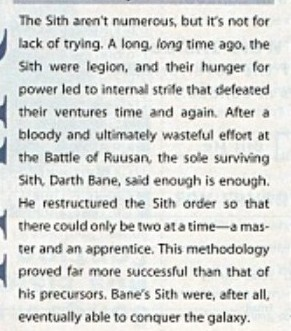
- **Boba Fett** — entry/section: Pablo Hidalgo on Boba Fett's death: "I could probably dig up some plausible explanation, but when you get right down to it, karma doesn't care how hot a bounty hunter you are. —Pablo Hidalgo, Star Wars Insider 58, p. 96" Source: *Star Wars Insider #58* (2002), scan p.75
  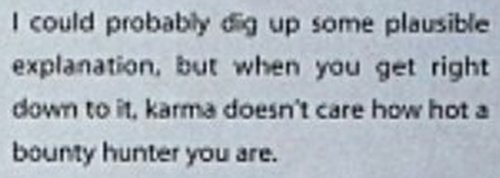

## scan p.76 (scan page 76)

Page contents: Star Wars Q&A ends (magazine p. 97): Hutts called "he" until pregnant with a brood, then "she"; Jabba's tastes in humanoid females looked on with disdain by many Hutts; turning on a lightsaber needs no Force (Han used Luke's), safety deactivation and lock-on switches, The Crystal Star's dark side sect with internal switches; English lettering on the Death Star (one of several alphabets for Basic besides Aurebesh and Naboo futhark; real reason: legibility); droid names. Illustration of Jabba with his dancers. Box: "Questions?" send to [email omitted] (include Q&A in subject) or Q&A, Star Wars Insider, [postal address omitted]. (hand-read)

- **R2-D2; Corran Horn** — entry/section: Pablo Hidalgo on droid names: "The droid names used in the movies are merely fragments of much longer serial numbers. This makes sense when you think about it, since the number of letter-number combinations in droid naming conventions is pretty limiting. That's why you can have an Episode I-R5 unit named G8-R3 (he's on the Queen's starship). His name might have really been something like R5-X41238-G8-R3-3124-D2, and the middle portion is just what he is called. —Pablo Hidalgo, Star Wars Insider 58, p. 97" Source: *Star Wars Insider #58* (2002), scan p.76
  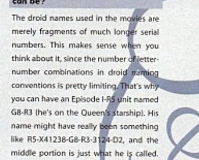

## scan p.77 (scan page 77)

Page contents: Full-page caricature illustration of Lando Calrissian with Cloud City figures (magazine p. 98), "Illustration by Stan Shaw"; no text beyond the credit and footer. (hand-read)

## scan p.78 (scan page 78)

Page contents: Back-cover advertisement: Star Wars Starfighter for PC and Xbox ("Sleek, sophisticated, and fully loaded"; swstarfighter.lucasarts.com). (hand-read)

