# Owner Material 038 — Star Wars Insider #1–153 plus specials (with The Lucasfilm Fan Club Magazine #1–22): Star Wars Insider #59 (2002)

- **Source:** *Star Wars Insider* magazine (issues 23–153, 1994–2014) and its predecessor *The Lucasfilm Fan Club Magazine* (issues 1–22, 1987–1994), plus seven special editions: articles, interviews, comics and short fiction Secondary source (licensed Legends reference). Scan OCR'd on the box; the scan stays box-only and is **not** published.
- **Method:** every scanned page was OCR'd and machine-screened sentence by sentence for power-relevant statements (fights, kills, defeats, Force feats, rankings, superweapons) that name a character on our roster; each kept sentence is quoted verbatim from the OCR text and has a crop of the printed passage directly under it. Pages with nothing power-relevant are still listed with what is on them.
- **Citation:** "*Star Wars Insider #59* (2002), p.X" by printed page ("scan p.X" where no printed number applies). **Weight:** Licensed magazine: a secondary source. Its short fiction and comics are Legends stories; its articles and interviews sum up or discuss lore and rank below the novels, comics and games they describe.

## scan p.1 (scan page 1)

Page contents: Cover, Star Wars Insider #59 (25th anniversary special collector's issue): Darth Vader helmet art; "Ultimate Prequel Update - Two Months to the Attack!"; Mark Hamill, Harrison Ford, Carrie Fisher, Peter Mayhew; "45 Rebel Aces - Who's Who in Rogue Squadron"; "Silver Age - the early days of Lucasfilm and the original fan club"; sneak preview of the new Essential Guide to Characters with 2 exclusive bonus entries; "It Belongs in a Museum!" Star Wars comes to Brooklyn. (hand-read)

## scan p.2 (scan page 2)

Page contents: Master Replicas ad: Han Solo blaster (A New Hope) official prop replica, with the "Hokey religions and ancient weapons are no match for a good blaster at your side, kid" line; $449.00, limited to 1,500 worldwide. (hand-read)

## scan p.3 (scan page 3)

Page contents: Master Replicas ad: Luke Skywalker lightsaber (Return of the Jedi) prop replica, "I see you have constructed a new lightsaber. Your skills are now complete"; release date April 2, 2002. (hand-read)

## scan p.4 (scan page 4)

Page contents: Contents (magazine p. 4), Features: 25 Years of the Force - Ford Tough (Harrison Ford, plus Peter Mayhew), When Carrie Met Leia, From Jedi to Joker (Mark Hamill); Who's Who in Rogue Squadron; Cast of Thousands (Essential Guide to Characters, two exclusive entries); Skywalker Scrapbook (Lucy Autrey Wilson); Following the Bantha Tracks (the original fan club newsletter); cover note on the 25th anniversary. (hand-read)

## scan p.5 (scan page 5)

Page contents: Contents departments (Rebel Rumblings, Prequel Update, Star News, Gamescape, Bookshelf - Aaron Allston, Comics Link, Set Piece, Scouting the Galaxy, Crossword, Star Wars Q&A) and "Twenty-Five Years and Counting - A Word from George Lucas" (magazine p. 5): Lucas on creating a mythology for kids, the Skywalker story in six episodes, waiting for technology, Anakin in Episode II, recurring themes like a symphony, thanks to the fans. (hand-read)

- **Darth Vader (Anakin Skywalker); Obi-Wan Kenobi; Padmé Amidala** — entry/section: George Lucas on Anakin in Episode II: "In the beginning of Episode II, Anakin Skywalker is clearly a good kid. He is a Padawan learner on his way to becoming a Jedi. Exceptionally talented, he is growing impatient with the fact that he's still an apprentice—making for an interesting relationship with his Master, Obi-Wan Kenobi. In many ways, Anakin is a typical 20-year-old—he wants to be in control of his life, yet he is not quite ready to be on his own. He is charming and charismatic, but he is also headstrong, rebellious, and impetuous. In Episode I, young Anakin had a crush on Queen Amidala. Ten years later, this crush has turned into love, even though romantic love is forbidden for a Jedi. Anakin is torn between his loyalty to the Jedi order and his uncontrollable passion for Padmé. —George Lucas, Star Wars Insider 59, p. 5" Source: *Star Wars Insider #59* (2002), scan p.5
  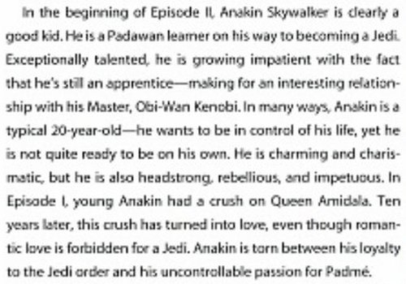

## scan p.6 (scan page 6)

Page contents: Masthead and Rebel Rumblings (magazine p. 6): editor's intro (Obi-Wan's integrity mail, Expanded Universe inquiries, the label that wouldn't come off Issue #58); letter photo "European Star Wars Vacation" (a family visit to the Royal Palace of Caserta, used as Naboo's palace); letter "Confession of a (Former) Snob" from a reader converted to the Expanded Universe by "Who's Who in The New Jedi Order" and asking where to start reading. Letter-writer names omitted. (hand-read)

## scan p.7 (scan page 7)

Page contents: Hasbro ad: Luke Skywalker & Princess Leia Organa "Swing to Freedom" Star Wars Saga Collection figure set, "Watch those hands, she might be your sister." (hand-read)

## scan p.8 (scan page 8)

Page contents: Attack of the Clones Update with Rick McCallum (magazine p. 8), "Two Months and Counting": final days of additional shooting (Hayden, Natalie, Ewan, then Christopher Lee), looping and scoring with the London Symphony Orchestra at Abbey Road, 18-19 dubbing countries, final trailer in March, hoping for 50-100 digital theaters in the U.S. (hand-read)

## scan p.9 (scan page 9)

Page contents: AotC Update photos (magazine p. 9): clone troopers on a Kamino landing platform; Jango Fett jetpack fight on Kamino; Kamino classroom of young clones; ILM's all-digital Yoda replacing the 60-lb. puppet. (hand-read)

### Stat block notes (game mechanics, not feats)

- Photo caption (verified on crop): Bounty hunter Jango Fett (played by actor Temuera Morrison) uses his handy jetpack to evade his pursuer, Obi-Wan Kenobi, during a fierce fight on a rain-swept landing platform on the planet of Kamino. Digital work by ILM. (Source: *Star Wars Insider #59* (2002), scan p.9)

## scan p.10 (scan page 10)

Page contents: AotC Update cont. (magazine p. 10): Lucas has made several cuts; only editorial staff and Ben Burtt have seen the whole film; McCallum on fans already lining up in Seattle ("I think those guys need help... but I absolutely love it!"); ILM model shop photo (Tipoca City miniature); Anakin and Padmé on Naboo lake retreat caption. (hand-read)

### Stat block notes (game mechanics, not feats)

- Photo caption (verified on crop): A determined Obi-Wan Kenobi (played by actor Ewan McGregor) goes saber to saber with another determined foe in a secret hangar on the planet of Geonosis in Episode II Attack of the Clones. Digital work by ILM. (Source: *Star Wars Insider #59* (2002), scan p.10)

## scan p.11 (scan page 11)

Page contents: AotC Update cont. (magazine p. 11), "Beyond the Clones": McCallum negotiating Fox Studios Sydney lease, location scouting, wardrobe starts November, shooting summer 2003; Lucas to begin writing Episode III as soon as AotC opens ("He pretty much has the entire story in his head"); praise for designers Erik Tiemens and Ryan Church; photos of Anakin and Padmé and the Tipoca City matte painting; pull quote on the line-standers. (hand-read)

## scan p.12 (scan page 12)

Page contents: AotC Update cont. (magazine p. 12): minimal casting for Episode III (Ewan, Hayden, Natalie, Ian McDiarmid, Christopher Lee, Jimmy Smits, Samuel L. Jackson returning; "another bad guy" to cast); Liam Neeson did not film anything for Episode II; Gabriel Byrne rumor denied; "Year of the Sequel" - McCallum on The Lord of the Rings; photos of the Padmé apartment miniature and Mas Amedda with Supreme Chancellor Palpatine. (hand-read)

## scan p.13 (scan page 13)

Page contents: AotC Update cont. (magazine p. 13): McCallum on Peter Jackson; no classic-trilogy DVDs until the three prequels are finished (the Phantom Menace DVD took effects people eight months); Celebration II in Indianapolis; photos of Obi-Wan and Yoda in the Jedi Temple training room, the Jedi Temple library miniature, Coruscant skylanes, Padmé on Geonosis, Ewan McGregor leading Jedi on a bluescreen soundstage. (hand-read)

### Stat block notes (game mechanics, not feats)

- Photo caption (verified on crop): Padmé Amidala finds herself between a rock and a hard place as she tries to figure out how to avoid near-certain death on the planet Geonosis. (Source: *Star Wars Insider #59* (2002), scan p.13)

## scan p.14 (scan page 14)

Page contents: AotC Update end (magazine p. 14): McCallum's fondest Celebration memory is the rain ("Everybody was united under one umbrella"); photos of Padmé and Anakin before Queen Jamillia, Obi-Wan's hologram via R2-D2 aboard the Naboo Royal Cruiser, C-3PO and R2-D2, Ewan McGregor and Temuera Morrison filming the battle with real water. (hand-read)

### Stat block notes (game mechanics, not feats)

- Photo caption (verified on crop): C-3PO's complaint that it is a droid's lot in life to suffer has never been truer than in Attack of the Clones. Trying to help their masters only gets him and R2-D2 into a perilous adventure. (Source: *Star Wars Insider #59* (2002), scan p.14)
- Photo caption (verified on crop): Senator Padmé Amidala (played by Natalie Portman) and her assigned protector, Anakin Skywalker (played by Hayden Christensen), explain why they have returned to Naboo to Queen Jamillia (played by Ayesha Dharker). (Source: *Star Wars Insider #59* (2002), scan p.14)

## scan p.15 (scan page 15)

Page contents: Ad: Star Wars Silver Anniversary Pin Collection (ten framed pins, limited to 1,977 sets). (hand-read)

## scan p.16 (scan page 16)

Page contents: Star News (magazine p. 16), "Fans of the World, Unite!" by Ben Harper: Lucasfilm sets international release dates for Attack of the Clones - recalling the staggered Phantom Menace releases of 1999, the U.S./Canada date is May 16 and most countries are close to it; Jim Ward quoted. (hand-read)

## scan p.17 (scan page 17)

Page contents: Star News cont. (magazine p. 17): pull quote from Jim Ward ("We've tried our hardest to make it so fans around the globe can experience the film together"); "British Film Academy Salute to George Lucas Postponed" (BAFTA Stanley Kubrick Britannia Award moved to April 12, 2002 after September 11); joke caption on Jango Fett's armor being waterproof; "Unite! for Attack of the Clones" table of release dates by region (South America, Europe, North America, Asia). (hand-read)

## scan p.18 (scan page 18)

Page contents: Science Fiction Book Club ad (left page; Star Wars novels among the offered titles). (hand-read)

## scan p.19 (scan page 19)

Page contents: Science Fiction Book Club ad (right page). (hand-read)

## scan p.20 (scan page 20)

Page contents: Star Sightings by Ben Harper (magazine p. 20): Christopher Lee made CBE and his AIDS program with Sting and Nelson Mandela; Channel 4 poll ranks Star Wars and Empire tied #1; Harrison Ford's Cecil B. DeMille Award; Han and Chewbacca ranked #11 movie buddies; Ewan McGregor's European Film Award and Tonight Show remarks; Hayden Christensen's awards; Christensen and Natalie Portman on MTV's Movie House; Pernilla August in Dina; Liam Neeson in an Exorcist prequel; Samuel L. Jackson in The 51st State and Basic. (hand-read)

- **Darth Vader (Anakin Skywalker)** — entry/section: Hayden Christensen on Anakin (MTV's Movie House, as reported): ""Anakin is a very passionate person. He's very passionate about the path he wants to take as a Jedi," Christensen stated. —Hayden Christensen, Star Wars Insider 59, p. 20" Source: *Star Wars Insider #59* (2002), scan p.20
  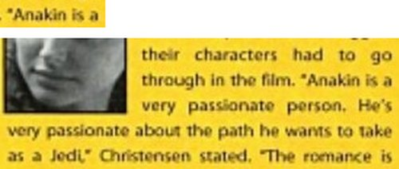

## scan p.21 (scan page 21)

Page contents: Star Sightings cont. and "Lucasfilm Joins Forces With Internet Giant eBay in 'Auction for America'" (magazine p. 21): Carrie Fisher's Conversations from the Edge; John Williams' Olympic chorus "Citius, Altius, Fortius"; Naboo pilot actress in Absolutely Fabulous, Christopher Malcolm (Rogue 2) and Rocky Horror; auction raised $123,565.56 for the September 11th Children's Fund; signed Darth Vader helmet ($10,100) and a stormtrooper helmet used in Empire and Jedi ($35,100). (hand-read)

## scan p.22 (scan page 22)

Page contents: Auction for America items cont. (magazine p. 22): Darth Maul stunt lightsaber used by Ray Park ($45,111.56); ILM-made Jedi lightsaber; customized ILM model kits (Millennium Falcon $8,688.50, STAP with battle droid, Luke's X-wing, Anakin's Podracer, Trade Federation AAT, Slave I, snowspeeder, Boba Fett, R2-D2 and C-3PO, Princess Leia, AT-AT) with opening and winning bids. (hand-read)

## scan p.23 (scan page 23)

Page contents: Ad: Star Wars Celebration II, May 3-5, Indiana Convention Center, Indianapolis. (hand-read)

## scan p.24 (scan page 24)

Page contents: "Star Wars: The Magic of Myth Exhibition Comes to Its Final U.S. Stop" by Michael G. Ryan (magazine p. 24): the Smithsonian exhibition at the Brooklyn Museum of Art from early April, with a screened-off space for Attack of the Clones objects; BMA Director Arnold L. Lehman on the "hero's journey" theme and the companion show The Myth of the Hero and the Heroine; curator James Romano on meeting a local fan club. (hand-read)

## scan p.25 (scan page 25)

Page contents: Museum exhibition cont. (magazine p. 25): designer Matthew Yokobosky on the environments (Tatooine sand and sky, icy-blue Hoth room, lighting with colored Plexiglas, the Yoda room); runs April 5 - July 7, 2002, then the Powerhouse Museum in Sydney; Romano pull quote and recollection of first seeing Star Wars. (hand-read)

## scan p.26 (scan page 26)

Page contents: "25 Years of the Force - Han Solo: He certainly has courage. Ford Tough" by Michael G. Ryan (magazine p. 26): Harrison Ford as celebrity chair at a Seattle Museum of Flight charity auction, arriving in his own floatplane; his rescues of lost hikers (a Boy Scout said he had actually been rescued by Han Solo); his awards. (hand-read)

### Stat block notes (game mechanics, not feats)

- Pull quote (film line, verified on crop): "Sometimes I amaze even myself." —Han Solo, Star Wars (1977) (Source: *Star Wars Insider #59* (2002), scan p.26)

## scan p.27 (scan page 27)

Page contents: Full-page Han Solo illustration (blaster drawn) with a film-still strip (magazine p. 27). (hand-read)

## scan p.28 (scan page 28)

Page contents: Ford feature cont. (magazine p. 28): Ford moved by the tribute film; "Empire Building" - after winning the role of Han Solo; Lucas let him improvise ("Don't get cocky, kid!"); Rolling Stone quote that it was "an accessible, human story"; post-Star Wars films; Empire made him leading-man material; Ford on the cliffhanger and "eleven dollars worth of entertainment". (hand-read)

- **Han Solo** — entry/section: Harrison Ford on Star Wars (to Rolling Stone, as reported): ""I always thought it was an accessible, human story," he told Rolling Stone magazine four years after the film opened. "I mean, I didn't have to act science fiction." —Harrison Ford, Star Wars Insider 59, p. 28" Source: *Star Wars Insider #59* (2002), scan p.28
  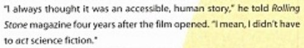

### Stat block notes (game mechanics, not feats)

- Pull quote (film line, verified on crop): "She's fast enough for you, old man." —Han Solo on the Millennium Falcon (Source: *Star Wars Insider #59* (2002), scan p.28)

## scan p.29 (scan page 29)

Page contents: Ford feature cont. (magazine p. 29): changing Han's reply to Leia's "I love you" to "I know"; Janet Maslin on "a real air of tragedy to Han's fate"; casting as Indiana Jones (Steranko drawings "spelled Harrison Ford"); hopes for a fourth Indy film; Blade Runner clashes with Ridley Scott. (hand-read)

- **Han Solo; Leia Organa Solo** — entry/section: Harrison Ford on changing Han's reply to "I know" (to Bantha Tracks, 1980, as reported): "Leia's "I love you" from an echoing "I love you, too" to "I know" was a fight that Ford was wise to wage. As he told Bantha Tracks, a Star Wars fanzine, in 1980, "I felt a sense of responsibility for making it better. I mean, if you get the chance to do it over again, the only reason to do it is to do it better." Under Ford's watchful eye, Han Solo became a deeper, more significant character, and reviewers took notice. —Harrison Ford, Star Wars Insider 59, p. 29" Source: *Star Wars Insider #59* (2002), scan p.29
  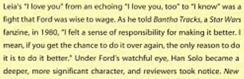

### Stat block notes (game mechanics, not feats)

- Pull quote (film line, verified on crop): "Watch your mouth, kid, or you'll find yourself floating home." —Han Solo to Luke Skywalker (Source: *Star Wars Insider #59* (2002), scan p.29)

## scan p.30 (scan page 30)

Page contents: Ford feature cont. (magazine p. 30): Han Solo frozen in carbonite in case Ford didn't return; Ford wanted Han to die; Starburst quote after Jedi that Solo's story is over ("Just three for Solo"); "The Hero with Many Faces" - Temple of Doom, Witness and his Oscar nomination, The Mosquito Coast, Frantic, Working Girl, Last Crusade, Presumed Innocent, Regarding Henry. (hand-read)

- **Han Solo** — entry/section: Harrison Ford on wanting Han Solo to die (as reported): "Ford himself saw both things as possible: his own involvement in the final film, and Han Solo's termination. "I was convinced that Han Solo should die," he said after filming on Empire was completed. "I told George: 'He's got no mama, no papa, and he's got no story. Let's kill him and give some weight to this thing.'" —Harrison Ford, Star Wars Insider 59, p. 30" Source: *Star Wars Insider #59* (2002), scan p.30
  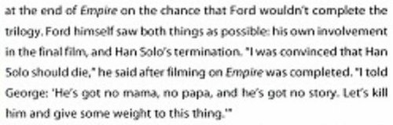
- **Han Solo; Luke Skywalker** — entry/section: Harrison Ford on Han's story ending with Jedi (to Starburst, as reported): ""The story that Han Solo was part of, which is The Adventures of Luke Skywalker, in my guise of best friend is over. The story completes itself in this third film. I had a great time on Jedi. I'm glad I did it. I'm glad I did all three of them. But as well, I'm glad I don't have to do any more. After Jedi, the saga goes back in time, so Solo's not in the next three. Just three for Solo." —Harrison Ford, Star Wars Insider 59, p. 30" Source: *Star Wars Insider #59* (2002), scan p.30
  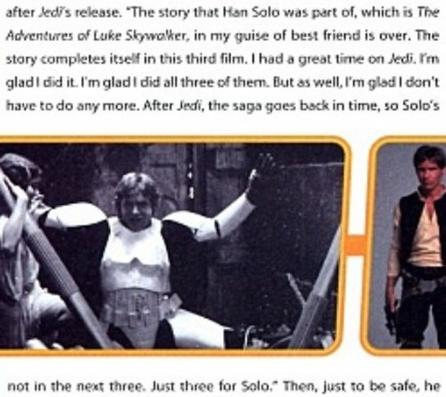

## scan p.31 (scan page 31)

Page contents: Ford feature cont. (magazine p. 31): Regarding Henry reviews, Jack Ryan films and the Young Indiana Jones cameo, Sabrina, The Devil's Own, Air Force One (Ford on not running for president), Six Days Seven Nights, Random Hearts, What Lies Beneath; "Man of the People" after September 11; sidebar "Ford for Fans" (website, biographies, Future Noir, video biographies). (hand-read)

### Stat block notes (game mechanics, not feats)

- Pull quote (film line, verified on crop): "There's no mystical energy field that controls my destiny." —Han Solo on the Force (Source: *Star Wars Insider #59* (2002), scan p.31)

## scan p.32 (scan page 32)

Page contents: Ford feature end (magazine p. 32): Ford on the real heroes of September 11 and feeling "a bit of a fraud" among astronauts and pilots; "The Hero that Might Have Been" quiz matching ten Ford films to earlier choices for his part (Star Wars among them); start of "Big Footsteps" Peter Mayhew interview - raising money for two Seattle orphanages, 24 appearances a year. (hand-read)

## scan p.33 (scan page 33)

Page contents: "25 Years on the Trail of a Hero" Ford filmography timeline 1977-2000 (Star Wars - Han Solo joins the Rebellion; Empire - Han Solo leaves the Rebellion; Jedi - Han Solo thaws out and rejoins the Rebellion) and Mayhew interview cont. (magazine p. 33): cast as the minotaur in Sinbad and the Eye of the Tiger for his big feet; called in to read for Vader; McQuarrie's Chewbacca sketch; Lucas: "I think we found him." (hand-read)

- **Chewbacca; Darth Vader (Anakin Skywalker)** — entry/section: Peter Mayhew on his Chewbacca casting: "Though originally called in to read for Vader, the lanky Mayhew admits, "It needed someone with a bit more muscle than I've got." He saw several Ralph McQuarrie character sketches on the wall while waiting, and saw one labeled Chewbacca, "Eight foot plus, with a question mark ... the original one, with the pointed ears. It had a vest and Bermuda shorts." —Peter Mayhew, Star Wars Insider 59, p. 33" Source: *Star Wars Insider #59* (2002), scan p.33
  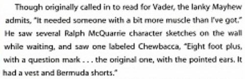

## scan p.34 (scan page 34)

Page contents: Mayhew interview end (magazine p. 34): passing out on Cloud City carrying Threepio; Empire is his favorite; the Holiday Special, The Muppet Show, the 1997 MTV Lifetime Achievement medal from Carrie Fisher; Chewie's death in Vector Prime ("You can't control the characters"); next film Bigfoot Among Us; hopes to return in Episode III ("Chewie is 200 years old"). (hand-read)

- **Chewbacca** — entry/section: Peter Mayhew on Chewbacca in Empire: "Despite passing out, the actor says that Empire is his favorite of the three Star Wars films. "Chewie came alive," he says proudly. "He became ... a full character. By the time Empire came around, I knew what I could do with him. It was amazing." —Peter Mayhew, Star Wars Insider 59, p. 34" Source: *Star Wars Insider #59* (2002), scan p.34
  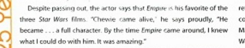

## scan p.35 (scan page 35)

Page contents: Ad: Star Wars real-time 3D space strategy game (PC) with review quotes. (hand-read)

## scan p.36 (scan page 36)

Page contents: "25 Years of the Force - Princess Leia Organa: Charming to the last... When Carrie Met Leia" by Scott Chernoff (magazine p. 36): intro on Carrie Fisher beyond Leia; Leia's first appearance in 1977 - a fragile figure who then shoots a stormtrooper and stands up to Vader; the trio as the heart and soul of the Rebellion. (hand-read)

- **Leia Organa Solo** — entry/section: Carrie Fisher pull quote (from Star Wars Insider #23, 1994): ""I was not a damsel in distress. I was a distressing damsel." —Carrie Fisher, Star Wars Insider 59, p. 36" Source: *Star Wars Insider #59* (2002), scan p.36
  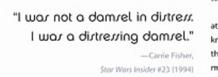

## scan p.37 (scan page 37)

Page contents: Full-page Princess Leia illustration with blaster (magazine p. 37) and film-still strip. (hand-read)

## scan p.38 (scan page 38)

Page contents: Leia feature cont. (magazine p. 38): Leia propels the story (spotting the probe droid on Hoth, rescuing Luke at Cloud City, freeing Han, killing Jabba, allies on Endor); no damsel in distress; quotes from a 1998 Insider favorite-character poll; her memories of her mother; Fisher cast at 19, told Bantha Tracks in 1982 "I grew up in the Star Wars saga". (hand-read)

- **Leia Organa Solo** — entry/section: Carrie Fisher on growing up in the saga (to Bantha Tracks, 1982, as reported): ""I grew up in the Star Wars saga," Fisher told Bantha Tracks, the original newsletter of the Official Star Wars Fan Club (and predecessor to the Insider), in 1982. "While everyone else was 25 to 30, I was only 19 when the filming started. I wasn't even fully formed physically. You can see me growing in each new episode." —Carrie Fisher, Star Wars Insider 59, p. 38" Source: *Star Wars Insider #59* (2002), scan p.38
  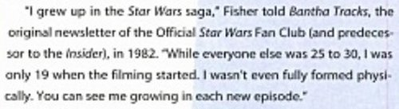

### Stat block notes (game mechanics, not feats)

- Pull quote (film line, verified on crop): "You came in that thing? You're braver than I thought." —Princess Leia Organa on the Millennium Falcon (Source: *Star Wars Insider #59* (2002), scan p.38)

## scan p.39 (scan page 39)

Page contents: Leia feature cont. (magazine p. 39): the gold bikini; Fisher on the hairstyles and crossing out "staggeringly beautiful"; her comedies (Blues Brothers, When Harry Met Sally, Hannah and Her Sisters, Austin Powers, Heartbreakers, Jay and Silent Bob, Scream 3), Oxygen talk show, Postcards from the Edge and script doctoring; photo of Luke, Leia and George Lucas on set. (hand-read)

### Stat block notes (game mechanics, not feats)

- Pull quote (film line, verified on crop): "Listen. I don't know who you are or where you come from, but from now on, you do as I tell you. Okay?" —Princess Leia Organa to her gallant rescuers (Source: *Star Wars Insider #59* (2002), scan p.39)

## scan p.40 (scan page 40)

Page contents: Leia feature cont. (magazine p. 40): writing a Young Indy episode with Lucas; Lucas "directing me like a puppet"; her debut, Shampoo, and the interview with Lucas and Brian DePalma; Fisher on the script and stilted lines; Lucas wanted Leia "proud and frightening"; effects; the chasm swing; Leia's anger and commitment. (hand-read)

- **Leia Organa Solo** — entry/section: Carrie Fisher on playing Leia in A New Hope: "It took the actress a little while to get into her part. "Leia is angry, which is part of her strength, but not all of it," Fisher said. "She was very clear about her responsibilities toward her cause, the Rebellion, and that was it for her. That commitment didn't leave her any time for relationships. While it was okay for 'the boys' to be strong, that same strength made Leia seem, somehow, almost mean or sarcastic." —Carrie Fisher, Star Wars Insider 59, p. 40" Source: *Star Wars Insider #59* (2002), scan p.40
  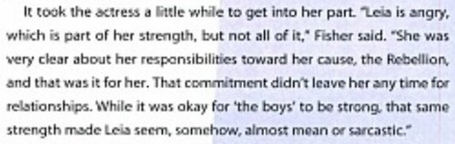

## scan p.41 (scan page 41)

Page contents: Leia feature cont. (magazine p. 41): Fisher on character development across the trilogy; fame after 1977 (SNL, Blues Brothers, Holiday Special); Kershner's rehearsals on Empire; Under the Rainbow and Faerie Tale Theatre; Jedi - Leia disguised as Boushh, choking Jabba with a chain, learning Luke is her brother; sidebar "Postcards From the Edge" filmography. (hand-read)

- **Leia Organa Solo; Luke Skywalker; Jabba the Hutt** — entry/section: Carrie Fisher on Leia in Return of the Jedi: "Fisher then returned to the Star Wars saga one last time, filming the movie that was initially going to be called Revenge of the Jedi, in 1982 and in which Leia dons a disguise as bounty hunter Boushh and later chokes Jabba the Hutt with a chain. The final episode turned out to be Fisher's biggest acting challenge yet, as the character sheds her caustic façade and displays a softer side when she discovers that Luke is her brother. "Leia's character undergoes quite a change in Jedi," she said. "They found a way for her to be very nice while remaining strong and committed. Leia is quite feminine, and her character is as clearly defined as the boys are—and she even dresses like a woman." —Carrie Fisher, Star Wars Insider 59, p. 41" Source: *Star Wars Insider #59* (2002), scan p.41
  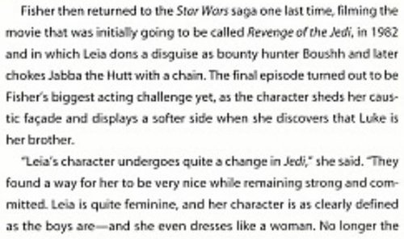

### Stat block notes (game mechanics, not feats)

- Pull quote (film line, verified on crop): "Someday you're going to be wrong, and I just hope I'm there to see it." —Princess Leia Organa to Han Solo (Source: *Star Wars Insider #59* (2002), scan p.41)

## scan p.42 (scan page 42)

Page contents: Leia feature cont. (magazine p. 42): Fisher on the trilogy's acting challenges and the slave bikini; 1980s comedies and B-movies; Postcards from the Edge novel and screenplay, script doctoring, later novels, daughter, talk show and recent roles; 1984 fan club quote about returning as "one of the monsters"; closing tribute; photo of Fisher. (hand-read)

### Stat block notes (game mechanics, not feats)

- Pull quote (film line, verified on crop): "Aren't you a little short for a stormtrooper?" —Princess Leia Organa to Luke Skywalker (Source: *Star Wars Insider #59* (2002), scan p.42)

## scan p.43 (scan page 43)

Page contents: Ad: Green Ronin Publishing d20 books (Freeport: The City of Adventure, Master Class Shaman's Handbook, Secret College of Necromancy). (hand-read)

## scan p.44 (scan page 44)

Page contents: "25 Years of the Force - Luke Skywalker" full-page Luke illustration (magazine p. 44), title spread with p. 45. (hand-read)

## scan p.45 (scan page 45)

Page contents: "Luke Skywalker... need to see his identification. From Jedi to Joker" by Cory J. Herndon (magazine p. 45): myths about Mark Hamill; Exhibit A: The Wampa Attack - the car accident happened in early 1977, not before Empire; Hamill lost the Eight Is Enough role. (hand-read)

- **Luke Skywalker** — entry/section: Mark Hamill on the wampa scene and his accident (1999 interview, as reported): "Second, that scene was filmed two years after Hamill's accident and successful plastic surgery. In a 1999 interview, Hamill related, "I broke my nose, but it didn't affect the filming schedule. It happened in early '77, and we didn't start working on Empire until '79 or so . . . I even asked George about it myself. He said 'No,' that Luke was always captured by the Wampa." —Mark Hamill, Star Wars Insider 59, p. 45" Source: *Star Wars Insider #59* (2002), scan p.45
  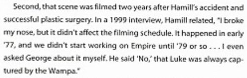

### Stat block notes (game mechanics, not feats)

- Pull quote (film line, verified on crop): "It looks like I'm going nowhere." —Luke Skywalker to Aunt Beru (Source: *Star Wars Insider #59* (2002), scan p.45)

## scan p.46 (scan page 46)

Page contents: Hamill feature cont. (magazine p. 46): Exhibit B - The Guyver and his Black Pearl comic; Exhibit C: Princess Carrie - the "Carrie!" blooper rumor; Exhibit D: The Joker and the Trickster - casting on Batman: The Animated Series via Andrea Romano, "Heart of Ice," the Joker laugh from Amadeus. (hand-read)

- **Luke Skywalker; Leia Organa Solo** — entry/section: Mark Hamill on the "Carrie" blooper rumor (1996 AOL chat, as reported): "Hamill said in a 1996 AOL chat, "The yelling 'Carrie' rumor is wrong, was always wrong despite the fact that it was printed in a book of film bloopers. . . . The actual phrase said was 'There she . . .' as in 'There she is' as I was looking for the Princess in the crowd, and that's what I dubbed. Because the rumor was printed, people believe it, but I don't want to deny it too much, because that makes people believe it more." —Mark Hamill, Star Wars Insider 59, p. 46" Source: *Star Wars Insider #59* (2002), scan p.46
  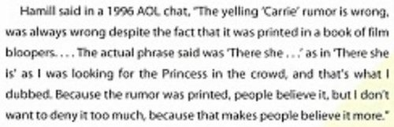

### Stat block notes (game mechanics, not feats)

- Pull quote (film line, verified on crop): "You know that little droid is going to cause me a lot of trouble." —Luke Skywalker on R2-D2 (Source: *Star Wars Insider #59* (2002), scan p.46)

## scan p.47 (scan page 47)

Page contents: Hamill feature cont. (magazine p. 47): misconceptions about his career; The Simpsons guest spot; refusing "Luke-clone" parts; comics, B-movies, stage work (The Elephant Man, Amadeus, Harrigan 'n Hart); biography - born 1951 in Oakland, Navy family, high school in Japan, L.A. City College. (hand-read)

### Stat block notes (game mechanics, not feats)

- Pull quote (film line, verified on crop): "My father didn't fight in the wars. He was a navigator on a spice freighter." —Luke Skywalker to Obi-Wan Kenobi (Source: *Star Wars Insider #59* (2002), scan p.47)

## scan p.48 (scan page 48)

Page contents: Hamill feature cont. (magazine p. 48): early TV career (Bill Cosby Show, General Hospital, The Partridge Family, The Texas Wheelers, Sarah T.), Wizards, the Luke audition, marriage to Marilou York; 1981 quote on not getting auditions; The Big Red One and Corvette Summer; children; voice-over career and villains (Joker, Hobgoblin, Maximus, Gargoyle, Dr. Jak), Batman Beyond: Return of the Joker. (hand-read)

## scan p.49 (scan page 49)

Page contents: Hamill feature cont. (magazine p. 49): avoiding Star Wars spoofs out of respect for the fans; later poking fun (Rosie O'Donnell, Conan, SNL, The Simpsons); Jay and Silent Bob Strike Back; sidebar of teen-magazine quotes about Mark Hamill. (hand-read)

### Stat block notes (game mechanics, not feats)

- Pull quote (film line, verified on crop): "If there's a bright center of the universe, you're on the planet that it's farthest from." —Luke Skywalker to C-3PO (Source: *Star Wars Insider #59* (2002), scan p.49)

## scan p.50 (scan page 50)

Page contents: Hamill feature cont. (magazine p. 50): Lucas's only request for the Jay and Silent Bob spoof (lightsaber blade colors); voice work (Justice League, video games, Balto II, Joseph: King of Dreams), V.I.P. and Son of the Beach; directing ambitions; his Phantom Menace comments; photo of Hamill and Fisher. (hand-read)

- **Han Solo; Jar Jar Binks** — entry/section: Mark Hamill on The Phantom Menace (to Entertainment Tonight, as reported): "He critqiued what he considered a missing element. "There was no voice of skepticism [in The Phantom Menace]. . . . Since everyone was so serious in [our films], we had Han Solo who would say, 'Whatever. I'm in it for the money, pal.'" Pointedly, he adds, "That's constructive criticism. I just don't like these people who go off on Jar Jar. . . . I get real defensive." —Mark Hamill, Star Wars Insider 59, p. 50" Source: *Star Wars Insider #59* (2002), scan p.50
  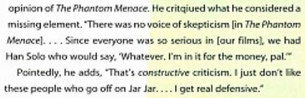

### Stat block notes (game mechanics, not feats)

- Pull quote (film line, verified on crop): "Between his howling and your blasting everything in sight, it's a wonder the whole station doesn't know we're here." —Luke Skywalker to Han Solo (Source: *Star Wars Insider #59* (2002), scan p.50)

## scan p.51 (scan page 51)

Page contents: Ad: Star Wars Insider subscription offer (6 issues $19.95, 12 issues $35.95). (hand-read)

## scan p.52 (scan page 52)

Page contents: "Who's Who in Rogue Squadron" by Jason Fry, illustrated by Scott Fuller (magazine pp. 52-53): Rogue Squadron in the Expanded Universe - a dozen top X-wing pilots of the Rebel Alliance and New Republic, led by Wedge Antilles; Wes Janson and Hobbie Klivian; Dark Horse comics by Michael A. Stackpole and novels by Stackpole and Aaron Allston; the Rogues as working-class soldiers. (hand-read)

## scan p.53 (scan page 53)

Page contents: Rogue Squadron cont. (magazine p. 53): spread art of X-wings; list "The Adventures of Rogue Squadron" - X-Wing Rogue Squadron comics and trade paperbacks (Dark Horse, 1995-2000) and X-Wing novels (Bantam, 1996-1999). (hand-read)

## scan p.54 (scan page 54)

Page contents: Who's Who in Rogue Squadron cont. (magazine p. 54): "Rogue Squadron" history (from Red Squadron after Yavin, Luke's idea after Hoth, Wedge's command, renamed Red Group at Endor, rebuilt two years after Endor); "Wraith Squadron" (Wedge's commando squadron, Ackbar's three-month bet, war against Warlord Zsinj); "The Incom T-65" X-wing sidebar with schematics; Wedge Antilles entry with portrait. (hand-read)

- **Wedge Antilles** — entry/section: Wedge Antilles: "One of the greatest heroes of the Galactic Civil War, Wedge was raised in the Corellian system, where he worked on his parents' refueling station in high orbit." Source: *Star Wars Insider #59* (2002), scan p.54
  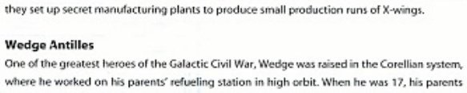

### Stat block notes (game mechanics, not feats)

- Rogue Squadron history: Rogue Squadron's traditions go back to Red Squadron, which returned from the Battle of Yavin with Luke Skywalker and Wedge Antilles as the lone survivors. Skywalker took command of the fighter group shortly before the Battle of Hoth; after that escape, he came up with the idea of an elite fighter squadron that would be able to take on any mission. With Luke concentrating on his Jedi training after The Empire Strikes Back, command of Rogue Squadron fell to Wedge. (Wedge continued to defer to his friend when Luke flew with the group, however.) At the Battle of Endor, Rogue Squadron was renamed Red Group in tribute to the brave pilots who died at Yavin. Following Return of the Jedi, Wedge and Tycho Celchu commanded a changing roster of pilots, and Wedge found himself touring the galaxy as the New Republic propaganda machine played up the squadron's exploits. More than two years after the Battle of Endor, the New Republic directed Wedge to rebuild the legendary unit with the galaxy's best pilots. (Source: *Star Wars Insider #59* (2002), scan p.54)
- Wraith Squadron: After the Bacta War, described in Mike Stackpole's Rogue Squadron books, Wedge decided the New Republic needed a squadron whose pilots could also serve as commandos in ground operations. If the Rogues were lightsabers in the fight against darkness, the Wraiths were vibroblades for use in back alleys. Wedge put together his new squadron from pilots no one else wanted, and Admiral Ackbar made him a bet: Wedge had three months to prove the Wraiths' worth, and if Ackbar thought he'd failed, Wedge would have to join his advisory staff as a general. Wedge's gamble succeeded. The Wraiths were key players in the battle against Warlord Zsinj as portrayed in Aaron Allston's Wraith Squadron series. (Source: *Star Wars Insider #59* (2002), scan p.54)
- Wedge Antilles: One of the greatest heroes of the Galactic Civil War, Wedge was raised in the Corellian system, where he worked on his parents' refueling station in high orbit. When he was 17, his parents were killed when the pirate ship Buzzzer cast off from the station during refueling, starting a fatal fire. Wedge became a freighter captain, often hauling Alliance cargos that family friend Booster Terrik sent his way, then heeded the Alliance's call for fighter pilots. He is a veteran of countless battles against the enemies of the Alliance and the New Republic, including Yavin (where he had to leave the endgame with a damaged fighter), Hoth, Endor (where he and Lando shared the kill of the second Death Star), Bakura, Coruscant, Thyferra, Selaggis, Sluis Van, and Bilbringi. He eventually married Iella Wessiri, Corran Horn's former partner in CorSec, and they have two daughters. (Source: *Star Wars Insider #59* (2002), scan p.54)

## scan p.55 (scan page 55)

Page contents: Who's Who cont. (magazine p. 55), with line portraits: "Red Squadron" - Biggs Darklighter, Garven Dreis, Cesi "Doc" Eirriss (Twi'lek, Red Four, killed fleeing Commenor), Commander Narra (Renegade Flight, killed at Derra IV; his droid K-3PO), Jek Porkins, Luke Skywalker; "Rogue Squadron: The Battle of Hoth" - Wes Janson, Derek "Hobbie" Klivian, Dack Ralter (Luke's snowspeeder gunner, escaped Kalist VI with Breg), Zev Senesca (rescued Han and Luke, died at Echo Base; parents killed at Kestic Station). (hand-read)

- **Luke Skywalker** — entry/section: Luke Skywalker: "He was forced to come of age when the Empire killed his family in search of a pair of droids from the Blockade Runner Tantive IV." Source: *Star Wars Insider #59* (2002), scan p.55
  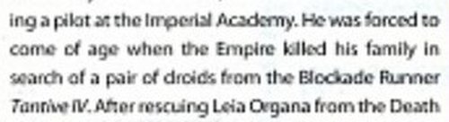

### Stat block notes (game mechanics, not feats)

- Biggs Darklighter: Luke Skywalker's best friend on Tatooine, Biggs earned his pilot stripes in Beggar's Canyon, then trained at the Academy under Baron Soontir Fel. He and classmate Derek Klivian mutinied, escaping on the freighter Rand Ecliptic and joining the Rebellion. Biggs was assigned to Yavin 4, where he was reunited with Luke and acquired the callsign Red Three. Darth Vader killed Biggs during the battle of the first Death Star. (Source: *Star Wars Insider #59* (2002), scan p.55)
- Garven Dreis: This veteran pilot served as Red Leader in the Battle of Yavin and led the first X-wing attack run on the Death Star's exhaust port. He launched a pair of proton torpedoes, but they only impacted on the surface, shaking the station but dealing no serious damage. Moments later, Garven's fighter was blasted by Darth Vader and plowed into the Death Star. (Source: *Star Wars Insider #59* (2002), scan p.55)
- Jek Porkins: Porkins learned his piloting skills hunting sink crabs in a skyhopper on Bestine IV. He'd just gone into business for himself as a free trader when the Empire forced Bestine's small population to vacate the planet. Porkins joined the Alliance, serving in Tierfon Yellow Squadron before being summoned to Yavin. He was killed over the Death Star, where his callsign was Red Six. (Source: *Star Wars Insider #59* (2002), scan p.55)
- Luke Skywalker: A farmboy from Tatooine, Luke dreamed of becoming a pilot at the Imperial Academy. He was forced to come of age when the Empire killed his family in search of a pair of droids from the Blockade Runner Tantive IV. After rescuing Leia Organa from the Death Star, he was assigned an X-wing fighter and the callsign Red Five for the climactic battle above the planet Yavin. With the help of the Force, he destroyed the space station and saved the Alliance. He later fought at the Battle of Hoth, and while increasingly dedicated to becoming a Jedi Knight, would occasionally fly with his fellow pilots in Rogue Squadron. (Source: *Star Wars Insider #59* (2002), scan p.55)
- Wes Janson: Rogue Squadron's muscular enforcer, Wes served as Wedge's gunner during the Battle of Hoth, as one of his wingmen at Endor, and as second-in-command of Wraith Squadron. A native of Taanab, he received the Alliance's highest order for gunnery during his time at Tierfon Fighter Base. Most of his experience behind the stick of an X-wing came after the Battle of Hoth, but Janson proved so adept that he became a revered flight instructor. He was transferred to Yavin before the Death Star battle, but he couldn't go because he was sick with Hesken Fever. Porkins went instead and died above the Death Star. (Source: *Star Wars Insider #59* (2002), scan p.55)
- Derek "Hobbie" Klivian: A former Imperial cadet, he joined the Alliance with Biggs and flew at Hoth, Endor, and Bakura. (He's the pilot in The Empire Strikes Back who's skeptical of Princess Leia's evacuation plan.) A native of Ralltir, Hobbie was beloved by the Rogues for his vast experience behind the stick of an X-wing and kidded for his apparent taste for the healing agent bacta, in which he was dipped after any number of crashes and close calls. He served as Rogue Squadron's second-in-command under Tycho Celchu when Wedge put together Wraith Squadron. (Source: *Star Wars Insider #59* (2002), scan p.55)

## scan p.56 (scan page 56)

Page contents: Who's Who cont. (magazine p. 56), "Rogue Squadron: The Early Years" with line portraits: Feylis Ardele (Commenor Militia TIE pilot, involved with Avan Beruss), Tycho Celchu, Ibtisam (Mon Calamari, killed over Ciutric), Plourr Ilo (secretly Eiattu royal heir), Elscol Loro (Cilpar Resistance, later organized Thyferra's Ashern), Baron Soontir Fel, Dllr Nep (Sullustan, Malrev incident, died with Herian I'ngre), Xarrce Huwla (Tunroth from Saloch), Nrin Vakil (Quarren, snoopscoot pilot, later trainer). (hand-read)

### Stat block notes (game mechanics, not feats)

- Tycho Celchu: Introduced in "The Rebel Opposition," Celchu was born on Alderaan and became a pilot in the Empire's service. He was speaking to his family on his homeworld when the transmission suddenly ended; later, he discovered the Death Star's attack had killed his family and his fiancée. He deserted and joined the Rebellion, fighting at Hoth and flying an A-wing at the Battle of Endor. He served as Wedge's second-in-command in Rogue Squadron's early years, but he was captured on a covert mission to Coruscant and sent to the feared Imperial prison known as Lusankya (which later turned out to be a Super Star Destroyer buried beneath Coruscant). Tycho escaped, but the New Republic feared that Imperial Intelligence had turned him, and he was forced to live under security restrictions while serving as the reformed Rogues' executive officer. He was arrested for treason after Corran Horn disappeared on Coruscant; the situation looked hopeless until Horn returned from the Lusankya with information that acquitted Tycho and restored the Alliance's trust in him. Over a number of missions, Tycho developed a romantic interest in the enigmatic special-forces operative Winter. (Source: *Star Wars Insider #59* (2002), scan p.56)
- Baron Soontir Fel: Perhaps the Empire's greatest TIE fighter pilot, Fel instructed Tycho Celchu, Biggs Darklighter, and Hobbie Klivian at the Imperial Academy. After Darklighter and Klivian mutinied, Fel was exiled to the lackluster 181st Imperial Fighter Wing. He revived it and was decorated on Imperial Center, where he met and wed Wynssa Starflare, the holo-name of Wedge Antilles' sister Syal. He fought against Rogue Squadron at the Battle of Brentaal and was captured but agreed to join them in exchange for the squadron's help locating his wife. He flew with the squadron before returning to Imperial service under Grand Admiral Thrawn. Fel is first encountered in the series In the Empire's Service. (Source: *Star Wars Insider #59* (2002), scan p.56)

## scan p.57 (scan page 57)

Page contents: Who's Who cont. (magazine p. 57), "Rogue Squadron: The Later Years" with line portraits: Pash Cracken, Gavin Darklighter, Corran Horn, Bror Jace (Thyferran, staged his own death), Erisi Dlarit (Thyferran Imperial mole, shot down by Corran at Thyferra), Aril Nunb, Ooryl Qrygg (Gand, "name reduction," declared janwuine), Inyri Forge (sister of Lujayne Forge, shot Zekka Thyne), Asyr Sei'lar (Bothan, resisted Borsk Fey'lya). (hand-read)

- **Corran Horn** — entry/section: Corran Horn: "He married the smuggler Mirax Terrik, daughter of the legendary Corellian smuggler Booster Terrik—who had been sent to Kessel by Corran's father." Source: *Star Wars Insider #59* (2002), scan p.57
  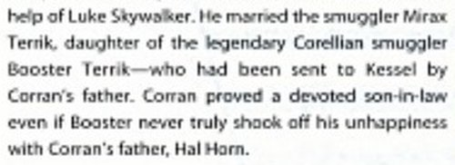

### Stat block notes (game mechanics, not feats)

- Pash Cracken: The son of Alliance legend Airen Cracken, Pash entered the Imperial Academy under a fabricated identity and led his entire wing in defecting to the Alliance on his first assignment after graduation. He took a reduction in rank to become a Rogue after the Battle of Borleias. The red-haired pilot served well during his brief stint but had to overcome his fellow pilots' suspicions that he was reporting the squadron's doings to his famous father. (Source: *Star Wars Insider #59* (2002), scan p.57)
- Gavin Darklighter: A cousin of Biggs Darklighter, Gavin was tapped for Rogue Squadron when he was just 16 and as green as the foam on Lomin ale. He grew up fast, learning the twists and turns of alien politics during the Rogues' covert mission to Coruscant. There he became romantically involved with the Bothan Asyr Sei'lar, who would later join the squadron and apparently die at Corvis Minor. Gavin was the creator of Rogue Squadron's unofficial emblem—a 12-pointed red star with the Alliance crest in blue at the center and an X-wing at each point. At the time of the Yuuzhan Vong invasion, he was the Rogues' commanding officer. (Source: *Star Wars Insider #59* (2002), scan p.57)
- Corran Horn: Corran was first encountered in Blood and Honor as a young member of the Corellian Security Force; later, he joined the re-formed Rogue Squadron. He was captured after crash-landing on Coruscant but resisted Ysanne Isard's attempts to make him into an Imperial agent. After escaping from the Lusankya, he discovered that his real grandfather was the Corellian Jedi Master Nejaa Halcyon—a heritage he would later explore with the help of Luke Skywalker. He married the smuggler Mirax Terrik, daughter of the legendary Corellian smuggler Booster Terrik—who had been sent to Kessel by Corran's father. Corran proved a devoted son-in-law even if Booster never truly shook off his unhappiness with Corran's father, Hal Horn. (Source: *Star Wars Insider #59* (2002), scan p.57)
- Aril Nunb: The sister of Rebel hero Nien Nunb, Aril was originally selected as the re-formed Rogue Squadron's executive officer but was passed over by Wedge in favor of Tycho Celchu. She was admitted to the squadron after the Battle of Borleias as a pilot. (Source: *Star Wars Insider #59* (2002), scan p.57)

## scan p.58 (scan page 58)

Page contents: Who's Who cont. (magazine p. 58), with line portraits: end of Asyr Sei'lar; Riv Shiel (Shistavanen, confused with Lak Sivrak, killed near Thyferra); Nawara Ven (Twi'lek lawyer who defended Tycho); "Wraith Squadron" - Jesmin Ackbar, Castin Donn, Myn Donos, Hohass "Runt" Ekwesh, Garik "Face" Loran, Lara Notsil (Gara Petothel), Dia Passik (begins); vertical margin note: for more on Wraith Squadron see Star Wars Gamer #8. (hand-read)

- **Jesmin Ackbar; Admiral Ackbar** — entry/section: Jesmin Ackbar: "She got more than she bargained for and was killed in the M2398 system." Source: *Star Wars Insider #59* (2002), scan p.58
  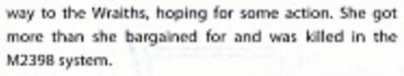

### Stat block notes (game mechanics, not feats)

- Jesmin Ackbar: A communications expert, this Mon Calamari female was Admiral Ackbar's niece and graduated top of her class. Commanders were scared of endangering her, however, and assigned her to routine missions or desk jobs. Chafing under these restraints, Jesmin made her way to the Wraiths, hoping for some action. She got more than she bargained for and was killed in the M2398 system. (Source: *Star Wars Insider #59* (2002), scan p.58)
- Castin Donn: Wraith Squadron's second computer specialist was a Coruscant native whose slicer group rebroadcast the Alliance's HoloNet feed of the destruction of the second Death Star—only to see stormtroopers mow down a crowd that cheered the Emperor's death. Donn assumed a false identity, served the New Republic as a code slicer for the fleet, and then became a pilot trainee. As a Wraith, he infiltrated Warlord Zsinj's Iron Fist but was ultimately captured and killed. (Source: *Star Wars Insider #59* (2002), scan p.58)
- Myn Donos: Donos earned the coveted Corellian Bloodstripe as an elite sniper before becoming a pilot. He was the one member of Talon Squadron to escape an Imperial ambush at Gravan Seven. The incident haunted him: When his R2 unit Shiner was destroyed at M2398, Donos became nearly catatonic. His squadron mates managed to shake him out of his catatonia by re-enacting the Gravan disaster in simulators, and at Ession he shot down the Imperial admiral who had devastated the Talons. He became involved with squadron mate Lara Notsil but snapped when it turned out Lara was actually the Imperial agent who'd sent the Talons to their deaths. Donos worked through the crisis and was reactivated before the Battle of Selaggis. When the Wraiths became an intelligence unit, he joined Rogue Squadron. (Source: *Star Wars Insider #59* (2002), scan p.58)
- Hohass Ekwesh: A Thakwaash male, "Runt" could fit into an X-wing cockpit only because of his small stature. Like all Thakwaash, he used multiple personalities for different tasks; unfortunately for Runt, his pilot personality was unstable and got him kicked out of several units. His wingman Kell Tainer helped Runt keep his pilot personality under control, and he became a valuable member of the squadron. (Source: *Star Wars Insider #59* (2002), scan p.58)
- Garik "Face" Loran: Black-haired with emerald eyes, this human male from Pantolomin was a child star in Imperial holodramas. Because of the propaganda he had helped create, ex-Alliance extremists kidnapped him. When Face was caught in the crossfire between the extremists and Imperial commandos, a blaster bolt scarred his face. Reported dead, he made his way to the Alliance but decided to keep the scar as a reminder. As a Wraith, his acting ability and skill with languages were huge assets, particularly during a long campaign in which Face impersonated an Imperial captain. After Ton Phanan died on Halmad, Face got a copy of his friend's will and found Phanan had left him everything—provided he remove the scar. Face bowed to his friend's last wish. (Source: *Star Wars Insider #59* (2002), scan p.58)
- Lara Notsil (Gara Petothel): Born Gara Petothel on Coruscant, this Imperial agent found out the hard way that juggling different identities can be hazardous to one's peace of mind. Her first secret identity was Kirney Slane, a Coruscant student. Later, she escaped from a deep-cover assignment within the New Republic to serve with Admiral Trigit under Warlord Zsinj. There she helped arrange the ambush of Myn Donos' Talon Squadron. When Trigit died at Ession, Gara posed as Lara Notsil, his unwilling mistress, and so escaped prosecution. As Lara, she helped the New Republic expose a crooked colonel and was accepted into Wraith Squadron. She became involved with Myn Donos, but her intelligence training began to slip. When Face Loran confronted her during a mission at Kidriff Five, Myn Donos overheard and discovered that she was the agent who had betrayed his squadron. He tried to kill Lara and was stopped only by Face's intervention. Lara escaped to rejoin Zsinj, but not before telling the Wraiths she'd never betrayed them and never would. She did betray Zsinj and was apparently killed at Selaggis. Later, however, Donos received a message from Lara awaiting him on Corellia. (Source: *Star Wars Insider #59* (2002), scan p.58)
- Dia Passik (begins): A Twi'lek female from Ryloth, Dia was the property of a wealthy Coruscant entrepreneur and persuaded several of his pilots to teach her to fly. (Source: *Star Wars Insider #59* (2002), scan p.58)

## scan p.59 (scan page 59)

Page contents: Who's Who cont. (magazine p. 59), with line portraits: end of Dia Passik; Kell Tainer, Ton Phanan, Eurrsk "Grinder" Thri'ag, Voort saBinring, Falynn Sandskimmer, Tyria Sarkin; "The Rogue's Saga Continues" - Jaina Solo. Top-right box "Test Your Knowledge" (womp rat length, Luke's Hoth call sign, snowspeeder problem, Wedge's call sign in ROTJ, where the fleet assembles, the physicist who composed "Ghost Jedi"); upside-down answers: two meters, Rogue Leader, technicians having trouble adapting them to the cold, Red Leader, Sullust, Ronax Falleen. (hand-read)

### Stat block notes (game mechanics, not feats)

- Dia Passik (cont.): then stole an armed shuttle and vaped her former owner's space yacht. On the Wraiths' mission to infiltrate the Iron Fist, she passed Zsinj's test and saved the unit by agreeing to shoot the captured Castin Donn. Although she knew he was already dead, the guilt nearly drove her to suicide. Face saved Dia from killing herself, and the two became romantically involved. (Source: *Star Wars Insider #59* (2002), scan p.59)
- Kell Tainer: A human male from Sluis Van, the handsome Tainer seemed right out of a holodrama, complete with a painful family history. Tainer's father had served in the Tierfon Yellow Aces with Wes Janson and Jek Porkins. When he panicked on a freighter-escort mission, Janson was forced to shoot him down. Tainer showed his skills on flight simulators and became a fighter pilot, but two crash-landings left him a near-washout and a candidate for the Wraiths. He performed well with the Wraiths, winning the Kalidor Crescent for his efforts to save Jesmin Ackbar, but he continued to battle his fears, even briefly leaving the fight at Ession before returning to the fray. He became involved with squadron mate Tyria Sarkin. (Source: *Star Wars Insider #59* (2002), scan p.59)
- Ton Phanan: A human male with an eye for the ladies, Phanan lived his life in an even more-vulnerable fashion than most fighter pilots. When he joined the Wraiths, he already had a mechanical leg and a prosthetic shell over part of his face, the legacy of an allergy to bacta and injuries suffered as a doctor on a frigate during the Battle of Endor. During the squadron's undercover mission to Halmad, Phanan was shot down. Although Face Loran found him, Phanan was badly injured and died on the planet. (Source: *Star Wars Insider #59* (2002), scan p.59)
- Eurrsk "Grinder" Thri'ag: A silver-furred Bothan male, Grinder served as the Wraiths' code-slicer, simulating communications from Captain Zurel Darillian (actually Face Loran) to Warlord Zsinj, among other things. He became the squadron's prankster, but a misadventure with a Storini Glass Prowler brought him to the attention of Phanan and Loran, who outpranked him so thoroughly that he was put in his place. For all his code-slicing expertise, Grinder was only a mediocre pilot; he was killed at Ession. (Source: *Star Wars Insider #59* (2002), scan p.59)
- Voort saBinring: A Gamorrean male known as Piggy, saBinring was hardly typical of his species: smart, mathematically astute, and possessed of rigid self-control. He was the product of an Imperial-sanctioned experiment by Binring Biomedical Product to design Gamorreans for use in espionage. (Piggy was the only such experiment who didn't commit suicide.) One of his creators ran Piggy through flight-simulator training and helped him escape the Binring compound. Piggy became a Wraith after facing court martial for striking a superior officer—something he hadn't actually done—and thrived in the unit. (Source: *Star Wars Insider #59* (2002), scan p.59)
- Falynn Sandskimmer: A dark-haired human female from Tatooine, Falynn Sandskimmer was a Y-wing ace in New Republic service. Her career was in the incinerator, for she had a history of insubordination. Falynn was killed flying a TIE fighter at the Battle of Ession, but not before crippling the Star Destroyer Implacable. (Source: *Star Wars Insider #59* (2002), scan p.59)
- Tyria Sarkin: A tall blonde human female from Toprawa, Sarkin served as an Antarian Ranger and demonstrated some basic skills with the Force. Luke Skywalker regretfully informed her she would not progress far as a Jedi. Tyria was in danger of washing out of a New Republic pilot-training squadron when her superior officer offered her a deal: He'd raise her low scores if she agreed to help him steal an X-wing. When Tyria refused, the officer revealed that he'd already been falsifying her scores, and she would have washed out long before if he hadn't done so. If she ratted him out, he promised her real scores would be revealed. Tyria neither helped him nor turned him in, graduated at the bottom of her class, and soon became a Wraith. She became romantically involved with Kell Tainer and continued to improve with the Force. (Source: *Star Wars Insider #59* (2002), scan p.59)
- Jaina Solo: With Han Solo for a father, Luke Skywalker for an uncle, and Anakin Skywalker for a grandfather, it's no surprise that Jaina Solo turned out to be a hotshot pilot. She joined Rogue Squadron as a teenager during the Yuuzhan Vong invasion and quickly earned the callsign Sticks. (Source: *Star Wars Insider #59* (2002), scan p.59)

## scan p.60 (scan page 60)

Page contents: "The Making of The New Essential Guide to Characters" (magazine p. 60) by Daniel Wallace: Behind the Music analogy; character-centric appeal of Star Wars and the Expanded Universe (Mara Jade ranked #20 in an Insider poll); the 1995 original guide; history of the project (Essential Guide to Episode I, Haden Blackman's Episode I Technical Journal, Ultimate Guide to Episode I, relaunch as the New Essential Guide series - Characters May 2002, Vehicles and Vessels 2003, Weapons and Technology 2004, Droids 2005). (hand-read)

## scan p.61 (scan page 61)

Page contents: Making of NEGC cont. (magazine p. 61), illustrations by Michael Sutfin (Qui-Gon and Obi-Wan art): 102 full entries plus 50 appendix thumbnails; cuts (Het Nkik, Davin Felth) and additions (Qui-Gon Jinn, Nom Anor, Jango Fett); Sutfin on the deadline, researching EU characters, redoing the Episode II Anakin, the Obi-Wan lightsaber layer; bonus entries for Wes Janson and Poggle the Lesser. (hand-read)

- **Grand Moff Tarkin; Mara Jade Skywalker** — entry/section: Illustrator Michael Sutfin on researching characters: ""I knew a few of the expanded universe characters, like Xizor and Mara Jade, but for many of them I had to visit the comics and novels to see what they were about. With the Episode II illustrations, I had to ask Lucasfilm questions to get a feel for them, since I thought it was crucial to capture the character's personality in addition to the costume. For example, imagine putting Grand Moff Tarkin in an action pose. It just doesn't work." —Michael Sutfin, Star Wars Insider 59, p. 61" Source: *Star Wars Insider #59* (2002), scan p.61
  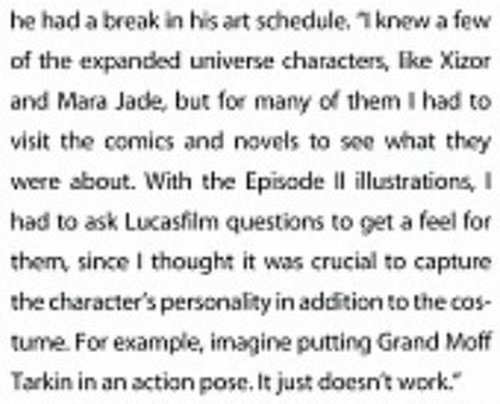
- **Darth Vader (Anakin Skywalker)** — entry/section: Illustrator Michael Sutfin on the Episode II Anakin illustration: "Not every illustration passed muster the first time around. "One I specifically remember is the Episode II version of Anakin Skywalker," he says. "The pose I originally chose was not as dynamic as it could have been, and the likeness of Hayden Christensen wasn't clicking. Lucasfilm called me on it. In hindsight, I'm glad they made those comments, because they were right on." —Michael Sutfin, Star Wars Insider 59, p. 61" Source: *Star Wars Insider #59* (2002), scan p.61
  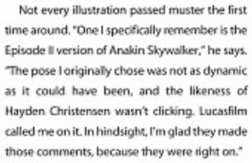
- **Obi-Wan Kenobi** — entry/section: Illustrator Michael Sutfin on coloring Obi-Wan: ""When I was working on coloring Obi-Wan, I had his lightsaber on its own layer in PhotoShop," he says. "I clicked the layer off and on, igniting his saber while mouthing the obligatory "whoosh" sound effect. That's when I realized I was really having fun." —Michael Sutfin, Star Wars Insider 59, p. 61" Source: *Star Wars Insider #59* (2002), scan p.61
  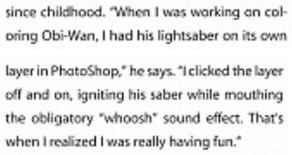

## scan p.62 (scan page 62)

Page contents: "The New Essential Guide to Star Wars Characters: Wes Janson" bonus entry (magazine p. 62) with Sutfin portrait and stat block (Human, male, dark brown hair, brown eyes, 1.7 meters, Taanab): Tierfon and the Kissek Doran incident; True Gunner commendation; Hesken Fever; founding Rogue Squadron; Hoth harpoon; Gall, Endor, Brentaal; Wraith Squadron and Kell Tainer; Thrawn, Krennel, promotion to major; Adumar; retired after the New Republic-Empire peace treaty; notes pointing to Star Wars Gamer and p. 52. (hand-read)

### Stat block notes (game mechanics, not feats)

- NEGC entry: Wes Janson (opening): "You can't look dignified when you're having fun." Wes Jansen's philosophy is more suited to a hedonist than an officer, but fortunately Janson is both. War hero, Rogue Squadron ace, practical joker, and (at least in his own mind) indomitable ladies' man, the irrepressible Wes Janson greets his friends with a grin and his enemies with a fist to the face. (Source: *Star Wars Insider #59* (2002), scan p.62)
- NEGC entry: Wes Janson (Tierfon): Born on Taanab, Janson earned a posting to the Rebel base on Tierfon after enlisting in the Alliance. Early in his first tour, Janson accompanied fellow Yellow Ace pilots Jek Porkins and Kissek Doran on a raid against an Imperial freighter. Doran panicked—threatening to blow their cover—and Janson shot him down to preserve base security. It was his first kill. (Source: *Star Wars Insider #59* (2002), scan p.62)

## scan p.63 (scan page 63)

Page contents: "The New Essential Guide to Star Wars Characters: Poggle the Lesser" bonus entry (magazine p. 63) with Sutfin art and stat block (Geonosian, male, no hair, gold eyes, 1.83 meters, Geonosis): Geonosis and its caste system; Poggle's revolt against Archduke Hadiss the Vaulted; petranaki arena; Sidious's funding; Poggle rides an acklay into the High Audience Chamber; sells battle droids to Nute Gunray and designs the super battle droid. (hand-read)

### Stat block notes (game mechanics, not feats)

- NEGC entry: Poggle the Lesser (opening): Poggle the Lesser hated Nute Gunray, but he had more in common with the rapacious Neimoidian than he realized. Both aliens were manipulated into positions of power by Darth Sidious, where their natural greed overwhelmed the apprehension they should have felt in setting themselves against the Republic. (Source: *Star Wars Insider #59* (2002), scan p.63)
- NEGC entry: Poggle the Lesser (rise to power): The Sith Lord secretly funneled resources to fund Poggle's mutiny, and within a year the political balance on Geonosis had flipped. On the Eve of Meckgin, a triumphant Poggle the Lesser rode into the High Audience Chamber on the back of an acklay. The monster neatly snipped Hadiss the Vaulted into three glistening pieces. Archduke Poggle took revenge on all those who had stood in his way, employing the execution arena more than his predecessor ever had. But he also had to pay his dues to Darth Sidious. Poggle stepped up production of Geonosian battle droids, selling tens of thousands of them to Viceroy Nute Gunray of the Trade Federation. Following Gunray's idiotic bungling at the Battle of Naboo, Poggle designed a better-quality product, the super battle droid. (Source: *Star Wars Insider #59* (2002), scan p.63)

## scan p.64 (scan page 64)

Page contents: "Skywalker Scrapbook: Twenty-Five Years of Lucasfilm Through the Eyes of Its Veteran Employee - and Her Photo Album" by Benjamin Harper (magazine p. 64): Lucy Autrey Wilson, third hire after Gary Kurtz and Bunny Alsup and Lucasfilm employee Number One, head of Lucas Licensing publishing; "California Dreamin'" - childhood in Santa Barbara without TV, college in La Jolla; photo captions on the Main House under construction and early staff on the Ranch site. (hand-read)

## scan p.65 (scan page 65)

Page contents: Wilson feature cont. (magazine p. 65): hired in 1974 as bookkeeper via her sister's boss; interview with Lucas and Kurtz at Universal; Marin office; typed most script drafts from Lucas's handwritten notes; "Old School Lucasfilm" - painting in the quiet office, Ben Burtt recording her footsteps and helium voices; photo captions (Wilson with daughter Amber; Skywalker Ranch construction). (hand-read)

## scan p.66 (scan page 66)

Page contents: Wilson feature cont. (magazine p. 66): headline pull quote "I was so spoiled I didn't realize how lucky I was. I just assumed I would get the job." -Lucy Autrey Wilson; Lucasfilm Licensing in L.A. under Charlie Lippincott and the founding of ILM in Van Nuys; casual Marin culture (Friday lunches, volleyball injuries); seeing the rough cut and opening-day lines; "Home on the Range" - Jane Bay hired as Lucas's assistant; photo captions (George Lucas with daughter Amanda and Amber Wilson; Mark Hamill toast at a picnic). Sidebar "Those Dark Times": a humorous alternate history in which the typist omitted the C-3PO oil bath scene from the A New Hope script, so Luke never finds Leia's message and the Empire wins; Wilson recalls, "He noticed," and retyped the entire script. (hand-read)

## scan p.67 (scan page 67)

Page contents: Ad: Dark Horse Comics one-shots Star Wars: Zam Wesell and Star Wars: Jango Fett ($5.95 each). (hand-read)

## scan p.68 (scan page 68)

Page contents: Wilson feature cont. (magazine p. 68): to ILM accounting in 1980 (near the computer group later sold to Steve Jobs as Pixar); Skywalker Ranch (originally Bulltail Ranch) construction accounting; MBA in 1984; Finance Director of Licensing under Howard Roffman in 1987; Willow book program; Roffman's 1990 "malcontent" award and quote; George Lucas quote on her career; "Keepers of the Holocron" - in 1989 she found Bantam's unanswered spin-off proposal and Lucas approved original fiction set after Return of the Jedi; photo captions (Steve Starkey, George Lucas and Hal Barwood perambulating the Ranch; postcard). (hand-read)

## scan p.69 (scan page 69)

Page contents: Wilson feature cont. (magazine p. 69): chose Timothy Zahn - Heir to the Empire #1 on the NYT list for 19 weeks; Wilson quote on the surprising audience; Dark Horse takes over from Marvel (107 issues), Dark Empire success; continuity with Sue Rostoni; growing staff; "The Learner Becomes the Master" - over 1,000 titles, LucasBooks imprint, NJO best sellers; "Sometimes it's more exciting when it's a blank piece of paper"; pull quote from Lucas, "...and has never looked back. She's done an amazing job." (hand-read)

## scan p.70 (scan page 70)

Page contents: "Bantha Tracks: Looking back at the original Fan Club" by Chris Fawcett (magazine p. 70): the 1978 fan club and its four-page blue-and-white newsletter; "The Beginning" - issues 1-8 between Star Wars and Empire (Lucas biography and interview, Oscar cover story, interviews with Hamill, Gary Kurtz, Irvin Kershner, Harrison Ford, Anthony Daniels); naming contest (third-place entry "Inside Star Wars"; winner's name omitted); Hamill's issue 3 story of phoning a hospitalized child as Luke. (hand-read)

- **Luke Skywalker; Han Solo; Chewbacca** — entry/section: Mark Hamill (Bantha Tracks issue 3) on calling a sick child as Luke: "Normally I don't say I'm Luke Skywalker. I try to keep my identity separate from that of the film character, but in this case I made an exception. I called and said "Hi! It's Luke Skywalker. Are you in the hospital? I heard you're sick. The Rebel Alliance needs you, we have to beat the Empire." He said, "Luke? Where are you?" And I said, "I'm here in your galaxy for just a little bit. We just stopped off to regroup our forces." He got so thrilled and excited, he said, "I knew it was you!" He just went crazy. Then I said, "I have to go. Han is not going to stay around too long and Chewie is real crabby today." —Mark Hamill, Star Wars Insider 59, p. 70" Source: *Star Wars Insider #59* (2002), scan p.70
  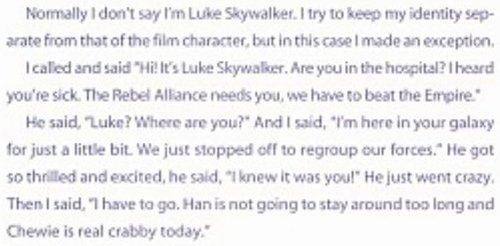

## scan p.71 (scan page 71)

Page contents: Bantha Tracks cont. (magazine p. 71): end of the Hamill anecdote; The Empire Strikes Back title announced August 4th, 1978; Harrison Ford's issue 5 interview on his first break (Christopher Walken and Tom Selleck mentioned as considered for Han and Indy); Lucas's interview on twelve, then nine, films and a third trilogy dealing "with the character that survives Star Wars III"; Lucas on naming R2-D2 and the Wookiee; pull quote "Hi! It's Luke Skywalker..." -Mark Hamill, Issue 3; the [phone number omitted] Empire call-in campaign; Lucasfilm Fan Club patch. (hand-read)

- **Han Solo** — entry/section: Harrison Ford (Bantha Tracks issue 5) on his first break: "I walked out, went down the hall to the elevators, realized I had to use the bathroom. I went to the bathroom and when I came out, his assistant is coming down the hall saying to me, "Come back, he wants to talk to you." If I'd gone on the elevator, I would have been gone and nobody would have bothered to chase me. When I went back, the first thing the guy says is, "How'd you like to be on a contract?" —Harrison Ford, Star Wars Insider 59, p. 71" Source: *Star Wars Insider #59* (2002), scan p.71
  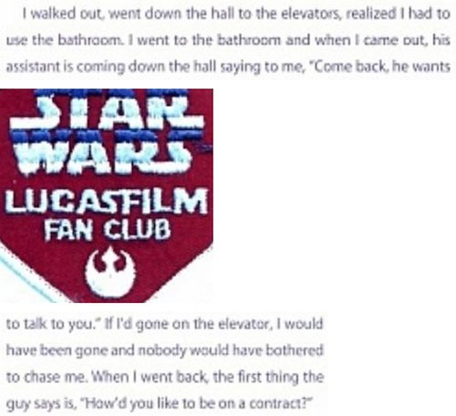
- **R2-D2; Chewbacca** — entry/section: George Lucas (Bantha Tracks issue 8) on naming R2-D2 and the Wookiee: "The truth is I was mixing the soundtrack of American Graffiti with the sound editor, Walter Murch. Walter asked me to go to the rack and get R2-D2—reel two, dialogue track two. When I heard that, I thought it was a great name and wrote it down. A similar thing happened with Chewbacca, the Wookie. A friend of mine and I were riding in his car one day when he said, "I think I ran over a Wookie back there!" I asked him what a Wookie was and he said he didn't know, that he had just made it up. I loved the word, so I wrote it down and planned to use it when I had a chance. —George Lucas, Star Wars Insider 59, p. 71" Source: *Star Wars Insider #59* (2002), scan p.71
  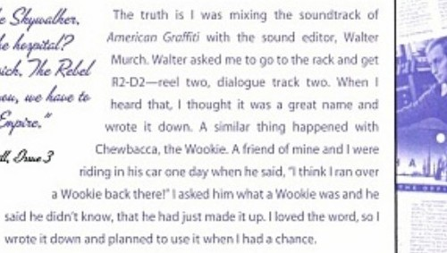

## scan p.72 (scan page 72)

Page contents: Bantha Tracks cont. (magazine p. 72): the Darth Vader call-in message; "Post-Empire" - issues 9-12 (Washington premiere, international release, Raiders interviews with Howard Kazanjian and Steven Spielberg); the first print reference to Star Wars collectors (collector's name omitted); fan answers to "Is Darth Vader really Luke's father?" ("Why would Obi-Wan lie?"); Spielberg Q&A on sneaking onto the Universal lot and Lucas telling him the Raiders story in Hawaii in May 1977; "Pre-Jedi" - the Skywalker Ranch time capsule; Lucas on watching the Space Shuttle's maiden flight; Fisher on being called "the girl" (continues on p. 73). (hand-read)

### Stat block notes (game mechanics, not feats)

- Darth Vader 1980 Empire Strikes Back call-in message: They managed to rescue the Princess and to destroy the Death Star, but this time the Rebels won't be so lucky. The power of the Death Star was insignificant compared to the power of the Force. And with Obi-Wan Kenobi gone, I am the master. See it, as The Empire Strikes Back. (Source: *Star Wars Insider #59* (2002), scan p.72)

## scan p.73 (scan page 73)

Page contents: Bantha Tracks cont. (magazine p. 73): end of Fisher's "honorary camera operator" anecdote; Hamill on the Dagobah snakes; 5th-anniversary article on the opening-day lines; "Post-Jedi" - effects issues 21-23 (Dennis Muren, Ken Ralston, model makers, matte artists) and Robert Watts interview; Creativity Contest story summaries (authors' names omitted); sidebar "Bantha Tracks Editor" - Maureen Garrett, hired 1979 by first Fan Club director Craig Miller, the Death Star trench pieces that became contest prizes, her art career, and "Perhaps once you are a Star Wars Ambassador, you somehow retain elements of that role forever." (hand-read)

- **Luke Skywalker** — entry/section: Mark Hamill (Bantha Tracks) on the Dagobah snakes: "I didn't mind the snakes that much; I just didn't like to handle them. I was pulling snakes from the X-wing's engines. The handler told me to hold them about 18 inches from the head so the snake would writhe around and everyone would see it's not rubber. Every time I touched him, he flinched, so I flinched. I still think that's some of the best acting I've ever done. I look so calm and yet inside I was going, "Yecch." The snake bit me on the eighth take and drew blood. He wasn't poisonous, of course, but the idea of actually being struck is really scary. The snake handler said, "He didn't so much bite you, as sort of nicked you." "Hey," I said. "Let's not get into semantics right now!" He got his little snaky lips all over my hand and now I'm bleeding. It was terrible! The whole film is constructed to make me look like a hero and I'm running around yelling, "Yeow! He bit me!" in front of everyone. —Mark Hamill, Star Wars Insider 59, p. 73" Source: *Star Wars Insider #59* (2002), scan p.73
  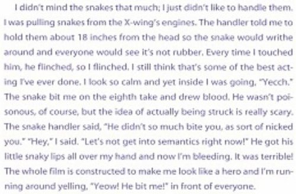

## scan p.74 (scan page 74)

Page contents: Bantha Tracks cont. (magazine p. 74): another contest story summary; letter in issue 23 from the then-14-year-old Ewok actor (gerbil, roller skates on set; later three roles in The Phantom Menace); "The Ewok Era" - issues 25-29 (Ewok movies, Jonathan Ke Quan, optical department, Miki Herman); Fisher at the 42nd World Science Fiction Convention; "After Star Wars" - issues 30-35 (Labyrinth, Howard the Duck, Captain Eo, Star Tours); Random Access prizes (Death Star sections, Bunker model, C-3PO costume piece, grand prize C-3PO's hand); issue 34 Soundsheet Edition (Ben Burtt, Randy Thom, Gary Summers); Lucas's farewell letter in issue 33. (hand-read)

- **Leia Organa Solo; Luke Skywalker** — entry/section: Carrie Fisher (Bantha Tracks issue 26) on learning Leia had a twin: "Q: Carrie, what was your reaction when you discovered that you had a twin brother? CF: I was stunned, my parents were stunned. No, I was very surprised. We had different colored eyes, but it meant I got to date Harrison. Q: Would you be willing to work on another Star Wars film? CF: As an old, old woman, I think I would like to play one of the monsters. Q: What was your most exciting scene in all three movies? CF: I liked the scene in Star Wars when we did the swing across the chasm. We were so frightened. We thought surely we would hit the opposite wall and melt down its face. —Carrie Fisher, Star Wars Insider 59, p. 74" Source: *Star Wars Insider #59* (2002), scan p.74
  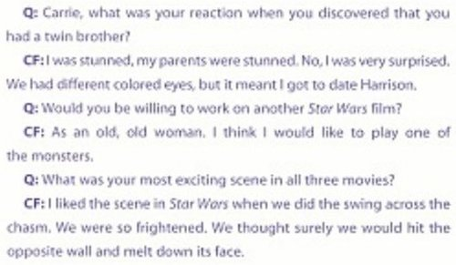

## scan p.75 (scan page 75)

Page contents: Ad: Star Wars Fan Club Online Store at swfan.wizards.com ("Can You Feel the Disturbance in the Force?" - Attack of the Clones merchandise, keywords, member pricing) and fan club membership / Insider subscription options. (hand-read)

## scan p.76 (scan page 76)

Page contents: Jawa Trader catalog (Fan Club store at swfan.wizards.com): Attack of the Clones / Power of the Jedi / Saga action figures with keywords and member prices (Darth Vader, Chewbacca, Obi-Wan, Qui-Gon, Leia, Padmé, R2-D2, Super Battle Droid, AT-AT driver and others), action figure stands, and the Luke Skywalker in Bacta Tank figure with a short product story (Luke rescued by Han after the wampa attack, recovering in the bacta tank in Echo Base in time for the Battle of Hoth). (hand-read)

## scan p.77 (scan page 77)

Page contents: Jawa Trader catalog cont.: Star Wars Roleplaying Game Core Rulebook, The Living Force campaign guide, Starships of the Galaxy, New Jedi Order Sourcebook, Rebellion Era Sourcebook, The Dark Side Sourcebook, Secrets of Naboo and Secrets of Tatooine campaign packs, Hero's Guide; Star Wars Gamer back issues #4-#8 with contents. (hand-read)

## scan p.78 (scan page 78)

Page contents: Jawa Trader catalog cont.: Star Wars Celebration pass set (with Ahmed Best-signed exhibitor pass), Episode I hardbound novel special edition signed by Terry Brooks (5,000 copies), Attakus Collection porcelain statues (Slave Leia, Darth Maul, Boba Fett, R2-D2, Han in Carbonite, Yoda), and Star Wars Insider back issues #54-#58 with contents. (hand-read)

## scan p.79 (scan page 79)

Page contents: Insider subscription and Fan Club membership offer and mail-in order form (gift certificate, welcome letter from George Lucas, preferred online store status; prices for U.S. and Canadian residents). (hand-read)

## scan p.80 (scan page 80)

Page contents: "The Star Wars Trading Card Game" (magazine p. 80), Wizards of the Coast: Attack of the Clones set released April 23rd; "The Path of the Hopeful" - Starter Set contents and instructional playmat; "You Will Become a Jedi" - controlling two of three arenas; full-game setup with Build Points; "Basic Card Anatomy" diagram (build cost, card name, key words, affiliation, speed, power, health, card text, expansion symbol). (hand-read)

## scan p.81 (scan page 81)

Page contents: TCG cont. (magazine p. 81): Ready, Command and Battle phases; using the Force; Jar Jar Binks (A) card ability quoted; "You Aren't All-Powerful, Yet" - deck building rules; "Powerful You Will Become" - league stores, Celebration II demos, Star Wars Gamer #10 card reproductions; sidebar "Rules of Engagement" (tapping, speed order, hits on 4-6, damage counters); Jango Fett card image. (hand-read)

## scan p.82 (scan page 82)

Page contents: "Living on the Front Lines: Aaron Allston Jumps into the Middle of the Race, Star Wars Style" by Jason Fry (magazine p. 82): NJO Enemy Lines I: Rebel Dream and II: Rebel Stand (books 11-12); relay-race metaphor; X-Wing: Wraith Squadron history; Rebel Dream fitted around Star by Star and Dark Journey; Wedge Antilles twenty years older; Borleias and Bastogne; family theme, Wedge's wife Iella Wessiri and two daughters. (hand-read)

- **Wedge Antilles** — entry/section: Aaron Allston on writing Wedge again: "One thing that made Allston's job easier is that he's back telling the tale of a character he—not to mention legions of Star Wars fans—holds dear. "It's a lot of fun to play around with Wedge Antilles again, because I really enjoy writing him," Allston says. —Aaron Allston, Star Wars Insider 59, p. 82" Source: *Star Wars Insider #59* (2002), scan p.82
  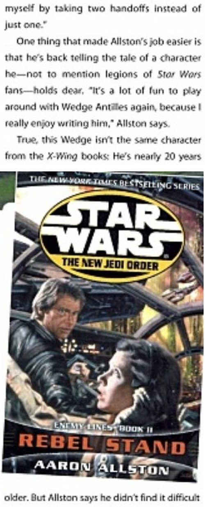

## scan p.83 (scan page 83)

Page contents: Allston feature cont. (magazine p. 83): pull quote "These novels are very carefully fitted so they'll snap together like a jigsaw puzzle"; the Wraiths' friendships (Ton Phanan and Garik "Face" Loran) and Voort "Piggy" saBinring as the rational Gamorrean outsider; roleplaying-game roots; Web of Danger (1988), Galatea in 2-D, Doc Sidhe, Mongoose Among Cobras; wish to write Han finding his strengths in Leia's political world; sidebar "Three Books to Watch for..." (Alan Dean Foster's The Approaching Storm with Obi-Wan and Anakin on Ansion; Wallace's New Essential Guide to Characters; R. A. Salvatore's Attack of the Clones novelization). (hand-read)

## scan p.84 (scan page 84)

Page contents: "Clone Wars: Adapting Attack of the Clones for the Comic Page" (magazine p. 84): adaptations as reworkings in each medium; the Episode I trade paperback outsold the nearest non-movie trade six to one; writer Henry Gilroy on orchestrating "a visual symphony of sorts," his Phantom Menace adaptation, the 44 extra pages, at least three script scenes not in the film, and the Skywalker Ranch script reading. (hand-read)

## scan p.85 (scan page 85)

Page contents: Comic adaptation cont. (magazine p. 85): illustrator Jan Duursema (Al Williamson's Empire adaptation as influence; Marvel #92; Darth Maul miniseries) nearly quit comics until Episode I; co-creating Quinlan Vos with John Ostrander from a background character; adaptation vs. original story; Gilroy on Anakin; Duursema and Gilroy on the darker tone of Episode II; adaptation page art. (hand-read)

- **Quinlan Vos** — entry/section: Jan Duursema on the origin of Quinlan Vos: "The result was Quinlan Vos, who, as Duursema explains, "came from the design of a background character in the outdoor cantina scene on Tatooine," —Jan Duursema, Star Wars Insider 59, p. 85" Source: *Star Wars Insider #59* (2002), scan p.85
  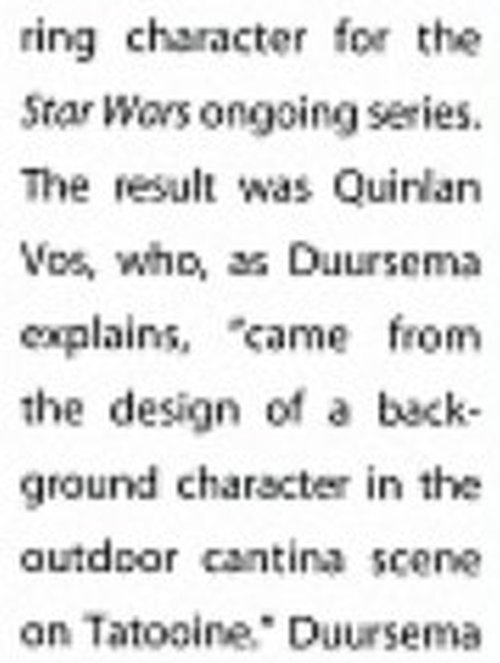
- **Darth Vader (Anakin Skywalker); Luke Skywalker** — entry/section: Henry Gilroy on Anakin: ""Anakin is such a great character, to root against him as the greatest villain ever—Darth Vader—then go back to discover he was once the hero of the story, who though tragedy lost sight of his goodness. Then later on, when Anakin sees the incorruptible goodness in his son, he is drawn back from the dark side. Powerful stuff!" —Henry Gilroy, Star Wars Insider 59, p. 85" Source: *Star Wars Insider #59* (2002), scan p.85
  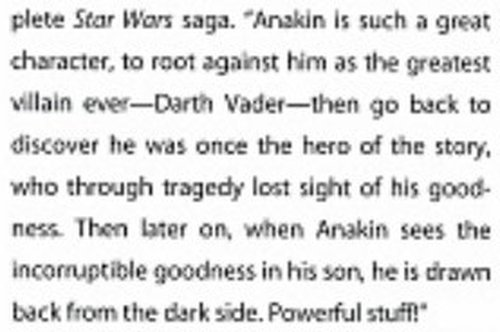
- **Obi-Wan Kenobi; Darth Vader (Anakin Skywalker)** — entry/section: Jan Duursema on Attack of the Clones: ""It's got the best of Episode I and the best of the classic trilogy. It's the story. Obi-Wan and Anakin. The Master and the apprentice. It's the story we've all anticipated." —Jan Duursema, Star Wars Insider 59, p. 85" Source: *Star Wars Insider #59* (2002), scan p.85
  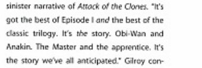

## scan p.86 (scan page 86)

Page contents: "Set Piece: Rebel Alliance Briefing Room - Take a seat, but keep an eye out for pigeons" by Chris Reiff & Chris Trevas (magazine p. 86): Elstree Stage 5 (Star Destroyer sets in Empire) became the Return of the Jedi briefing room and bridge of Admiral Ackbar's cruiser Home One; tin roof and rain noise; pigeons forced re-recording of the Mon Mothma, General Madine and Admiral Ackbar monologues nine months later; Richard Marquand and about 75 extras. Callouts (verified on crops): Ishi Tib aliens nicknamed Star Fish, also seen in Jabba's palace; puppeteer Tim Rose played Ackbar in the full-body suit and operated the separate close-up puppet; the 3D graphic of the forest moon and Death Star was one of ILM's earliest uses of computer animation on film. (hand-read)

### Stat block notes (game mechanics, not feats)

- Set Piece: pigeons in the briefing room: The major monologues from the scene belonging to Mon Mothma, General Madine, and Admiral Ackbar would all need to be re-recorded. It seems that caught on the original sound track—there were most definitely pigeon noises in the background. (Source: *Star Wars Insider #59* (2002), scan p.86)

## scan p.87 (scan page 87)

Page contents: Set Piece cont. (magazine p. 87) callouts (verified on crops): Lando's new holstered sidearm, a modified Heckler and Koch double-action pistol (model number unclear in print), standard issue to U.S. Navy SEALs in the 1980s; Leia's blaster from a Soviet Margolin target pistol, as in A New Hope; Ten Numb, the B-wing pilot beside Wedge, mistaken for Nien Nunb, named because their species was number nine on the creature list; "Prune Face" Dresselians on the Endor strike team in vests reused from the Hoth troops; Endor trooper helmets from Nilo Rodis-Jamero, WWII-era British AN-H-15 summer flying helmets. (hand-read)

### Stat block notes (game mechanics, not feats)

- Set Piece callout: Ten Numb and Nien Nunb: Standing next to Wedge during the briefing is Ten Numb. This B-wing pilot is commonly mistaken for Lando's co-pilot Nien Nunb. Nien got his name from their species being number nine on the creature list, and of course Ten came after. (Source: *Star Wars Insider #59* (2002), scan p.87)
- Set Piece callout: Leia's blaster: Princess Leia's blaster was created from a Soviet manufactured Margolin target pistol. Her blaster from the beginning of Star Wars: Episode IV A New Hope was based on the same model gun. (Source: *Star Wars Insider #59* (2002), scan p.87)

## scan p.88 (scan page 88)

Page contents: "Scouting the Galaxy" by Steve Sansweet (magazine p. 88): "Midnight Madness II Anyone?" - Attack of the Clones merchandise at midnight April 22-23, fewer licensees and SKUs; Celebration II, May 3-5, Indiana Convention Center. (hand-read)

## scan p.89 (scan page 89)

Page contents: Scouting the Galaxy cont. (magazine p. 89): Celebration II art show, 25+ celebrities' autographs, collectors' track, auction, appraisal panel; reader questions (names omitted): "Half-Price Brooks" (signed Episode I hardcover; Celebration I special edition, 5,000 copies, $85) and "Trailer Mix" (35mm Jedi trailer reel - worth $25-$35 unless a rare Revenge of the Jedi version). (hand-read)

## scan p.90 (scan page 90)

Page contents: Scouting the Galaxy cont. (magazine p. 90): trailer frames not worth cutting up; "Flying Cans: Priceless" (Episode I Pepsi can mobile - cash value zip); "Going Offline" (Star Cases by Protech); "At a Loss for Words" (Applause Boba Fett figural mug with a truncated certificate of authenticity - "quality by Lucasfilm Ltd." dropped in a layout change); address for questions. (hand-read)

## scan p.91 (scan page 91)

Page contents: Ad: Suncoast ("You don't get any more Star Wars than Suncoast unless your last name is Skywalker"), a store manager's pick of the Star Wars Trilogy, Celebration II commemorative postcard offer. (hand-read)

## scan p.92 (scan page 92)

Page contents: Crossword "Their Other Sci-Fi Work" by Mike Selinker (clues on Star Wars actors' other genre films, e.g. Alien Intruder, Sphere, The Time Guardian, Blade Runner, Waterworld; answers on p. 96) and cartoon "Jedi and Their Caddies" ("Use the Fours, Luke..."). (hand-read)

## scan p.93 (scan page 93)

Page contents: Ad: Dragon magazine subscription with free d20 adventure Burning Shaolin by Robin D. Laws. (hand-read)

## scan p.94 (scan page 94)

Page contents: "Rebel Rumblings" letters (continued from p. 6; writers' names omitted): a reader new to the novels asks where to start - Sue Rostoni recommends the Thrawn Trilogy, then NJO (Vector Prime, Dark Tide, Agents of Chaos), filling in with Shadows of the Empire and The Truce at Bakura; "There's a Reason He Wears That Helmet" (Jaster Mereel vs. Daniel Logan's Boba Fett, begins); "Apology Accepted, Captain Needa?" (correction from #58 - Michael Culver as Needa, Julian Glover as Veers - and Star Wars actors in Flash Gordon: Boss Nass's actor as Voltan, Lobot's actor, Kenny Baker, Deep Roy, Max von Sydow; Angus MacInnes as Gold Leader). (hand-read)

## scan p.95 (scan page 95)

Page contents: Ad: Games Workshop Warhammer Skaven army. (hand-read)

## scan p.96 (scan page 96)

Page contents: Rebel Rumblings cont. (magazine p. 96; writers' names omitted): Boba Fett/Jaster Mereel continuity reply (hunters are shifty with names; films need not obey the EU); "Love Is a Four-Letter Word" (romance in the novels; reply notes Jag Fel and Jaina in Dark Journey); "Love Laws" (Jedi and love; reply offers three theories); crossword answers; Index of Advertisers. (hand-read)

### Stat block notes (game mechanics, not feats)

- Rebel Rumblings reply: Jaster Mereel and Boba Fett: ...bounty hunters are often as shifty as Jedi—especially when it comes to using their real names. Some continuity fans suggest that Jaster Mereel wasn't Boba Fett at all, while others propose that Mereel was one of Fett's many aliases, and a little cosmetic surgery is just part of the cost of doing business in that line of work. Still others suggest that the continuity between the Star Wars films and books isn't perfect, and isn't meant to be, and the movies simply don't have to obey "facts" established in the Expanded Universe. We know that's a wild theory, but we thought we'd share it with you just the same. (Source: *Star Wars Insider #59* (2002), scan p.96)

## scan p.97 (scan page 97)

Page contents: Ad: CrossGen Comics. (hand-read)

## scan p.98 (scan page 98)

Page contents: "Star Wars Q&A: Answers to Your Star Wars Questions" with Pablo Hidalgo, Internet Content Provider for starwars.com (magazine p. 98): Boonta Eve survivors; why "Close the blast doors!" returned in the Special Edition (five audio mixes - 70mm six-track, 35mm Dolby stereo, 35mm mono, laserdisc, Special Edition - with differences such as "Blast it, Wedge" vs. Biggs and Aunt Beru's voice); IG-88 on Bespin; why Ponda Baba's arm bleeds; captions "@#$%!", "Help me," "My arm...", "Missed me." (hand-read)

### Stat block notes (game mechanics, not feats)

- Q&A: Boonta Eve Podrace survivors: Of the 18 Podracers, six finished in one piece. Anakin, of course, came in first. Gasgano came in second. Aldar Beedo, Ebe Endocott, Elan Mak, and Boles Roor finished off the race. Official race records show that Clegg Holdfast finished last, but those with the DVD can see that in fact, his Podracer was set ablaze by Sebulba and then dashed apart when it hit a cliff face. (Source: *Star Wars Insider #59* (2002), scan p.98)
- Q&A: IG-88 on Bespin: IG-88B followed Boba Fett to Bespin, computing that Fett would be the best bet to nab Solo. This droid did not survive an off-screen run-in with the armored bounty hunter, and its scrapped remains are what you see in The Empire Strikes Back. (Source: *Star Wars Insider #59* (2002), scan p.98)
- Q&A: Ponda Baba's bleeding arm: So, that leaves us to imagine a workaround solution for why Ponda's a bleeder and the wampa, Qui-Gon, and Luke aren't. No official sources have really explained this point, but I would chalk it up to a peculiar side effect of Aqualish physiology and blood chemistry. Or perhaps a quirk of the way Obi-Wan cut. Or the fact that no two injuries are ever identical. (Source: *Star Wars Insider #59* (2002), scan p.98)

## scan p.99 (scan page 99)

Page contents: Ad (inside back cover): LEGO Star Wars - eight new sets from Cloud City to Endor to the Death Star ("Feel the power of the Brick"). (hand-read)

## scan p.100 (scan page 100)

Page contents: Ad (back cover): Star Wars Jedi Starfighter for PlayStation 2 by LucasArts ("Now, FORCE powered."). (hand-read)

