# Owner Material 038 — Star Wars Insider #1–153 plus specials (with The Lucasfilm Fan Club Magazine #1–22): Star Wars Insider #60 (2002)

- **Source:** *Star Wars Insider* magazine (issues 23–153, 1994–2014) and its predecessor *The Lucasfilm Fan Club Magazine* (issues 1–22, 1987–1994), plus seven special editions: articles, interviews, comics and short fiction Secondary source (licensed Legends reference). Scan OCR'd on the box; the scan stays box-only and is **not** published.
- **Method:** every scanned page was OCR'd and machine-screened sentence by sentence for power-relevant statements (fights, kills, defeats, Force feats, rankings, superweapons) that name a character on our roster; each kept sentence is quoted verbatim from the OCR text and has a crop of the printed passage directly under it. Pages with nothing power-relevant are still listed with what is on them.
- **Citation:** "*Star Wars Insider #60* (2002), p.X" by printed page ("scan p.X" where no printed number applies). **Weight:** Licensed magazine: a secondary source. Its short fiction and comics are Legends stories; its articles and interviews sum up or discuss lore and rank below the novels, comics and games they describe.

## scan p.1 (scan page 1)

Page contents: Cover, Star Wars Insider #60 (movie release issue): "Inside Attack of the Clones!"; Ewan McGregor, Hayden Christensen, Natalie Portman, George Lucas; Attack of the Clones excerpt from the novel by R. A. Salvatore; Droids of Episode II; Who's Who in Jabba's Palace; Behind the Magic: battle droids; all-new Star Wars action figures and games. Cover photo of Anakin, Obi-Wan and Padmé. (hand-read)

## scan p.2 (scan page 2)

Page contents: Master Replicas ad (continued from the inside cover): lightsaber replica ordering details, dimensions and suggested retail price $129, phone 1-866-REPLIKA. (hand-read)

## scan p.3 (scan page 3)

Page contents: Master Replicas ad: Yoda lightsaber replica from Attack of the Clones ("A Jedi's saber is his most precious possession."), $249.00, and a second lightsaber replica from Attack of the Clones, $299.00, each limited to 5,000 worldwide; list of the line's standards (researched, hand-assembled, Lucasfilm certificate of authenticity, display plaque). (hand-read)

## scan p.4 (scan page 4)

Page contents: Contents (magazine p. 4), Features: Inside the Attack (David West Reynolds), Return of the Jedi (Ewan McGregor interview, Scott Chernoff), Forbidden Love (Natalie Portman interview), Journey to the Dark Side (Hayden Christensen interview), The Plot Thickens (George Lucas interview), Attack of the Clones (novel excerpt, R. A. Salvatore), Droids of Episode II (Daniel Wallace), Who's Who in Jabba's Palace (Daniel Wallace), Back on Topps (Chris Fawcett), Man of 1,000 Voices (Rich Handley interview with Anthony Daniels' fellow voice actor). On the cover: Anakin Skywalker (Hayden Christensen) and Obi-Wan Kenobi (Ewan McGregor) ordered to protect Senator Padmé Amidala (Natalie Portman). Full-page photo of Anakin. (hand-read)

## scan p.5 (scan page 5)

Page contents: Contents departments (Rebel Rumblings, Star News, Jawa Trader catalog, Action Figure Update, Behind the Magic - Rob Coleman on battle droids, Gamescape, Bookshelf, Comics Link - Jango Fett: Open Seasons, Set Piece, Scouting the Galaxy, Crossword, Star Wars Q&A, Last Page - Drew Struzan poster) and editorial "Best Episode Ever?" by Editor-in-Chief Dave Gross (magazine p. 5), with a spoiler warning: ten reasons Attack of the Clones could top the list - 10 lightsabers, 9 mystery (Obi-Wan's search for the assassin), 8 war machines, 7 forbidden love, 6 troopers, 5 bounty hunters (Jango Fett vs Obi-Wan), 4 giant monsters (Geonosis arena), 3 fighting banter (Count Dooku vs the silent Darth Maul), 2 warrior princess (Padmé), 1 return of the dismemberments. (hand-read)

- **Obi-Wan Kenobi; Darth Vader (Anakin Skywalker)** — entry/section: Return of the dismemberments: "Obi-Wan's nightclub altercation brings back fond memories of disarming belligerent aliens in Mos Eisley, while Anakin gives us a hand for the first—but not the final—time." Source: *Star Wars Insider #60* (2002), scan p.5
  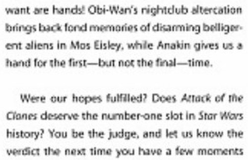

## scan p.6 (scan page 6)

Page contents: Masthead (Issue Number 60) and Rebel Rumblings letters (magazine p. 6): editor's note that readers are watching Attack of the Clones and the new mailing address; "The Joy of Pepsi" letter about collectibles ruined by exploded soda cans, with an editor's warning; "She Dropped Us a Clothes Line" letter supporting the handmaiden society idea (Sabé had more screen time than Aurra Sing); Yoda-style droid drawing; how to write to Rebel Rumblings. Letter-writer names omitted. (hand-read)

## scan p.7 (scan page 7)

Page contents: Ad: Star Wars Episode II: Attack of the Clones original motion picture soundtrack, music composed and conducted by John Williams (Sony Classical), "Collect all 4 covers while supplies last!" (hand-read)

## scan p.8 (scan page 8)

Page contents: "Inside Attack of the Clones: Message from Obi-Wan" by David West Reynolds (magazine p. 8), a cinematic scrapbook of the Palpatine-office scene with a key of blue behind-the-scenes boxes and yellow Star Wars universe boxes. Blue "Thematic Scarlet" box (ILM's Pablo Helman on the red color theme for Palpatine); yellow "Holotransmission" box; numbered key of 16 figures in the scene (Sly Moore, Stass Allie, Onaconda Farr, Plo Koon, Ister Paddie, Luminara Unduli, Barriss Offee, Yoda, Mace Windu, Ronet Coorr, Bail Organa, Mas Amedda, Jar Jar Binks, Palpatine, Lexi Dio, Ask Aak). (hand-read)

- **Palpatine (Darth Sidious)** — entry/section: Pablo Helman on Palpatine's red color theme: ""George always uses a very deliberate color palette," comments Pablo Helman, an ILM visual effects supervisor on Attack of the Clones. "The planets are color-themed, for example. The red color here is part of a visual theme to go with the character of Palpatine." —Pablo Helman, Star Wars Insider 60, p. 8" Source: *Star Wars Insider #60* (2002), scan p.8
  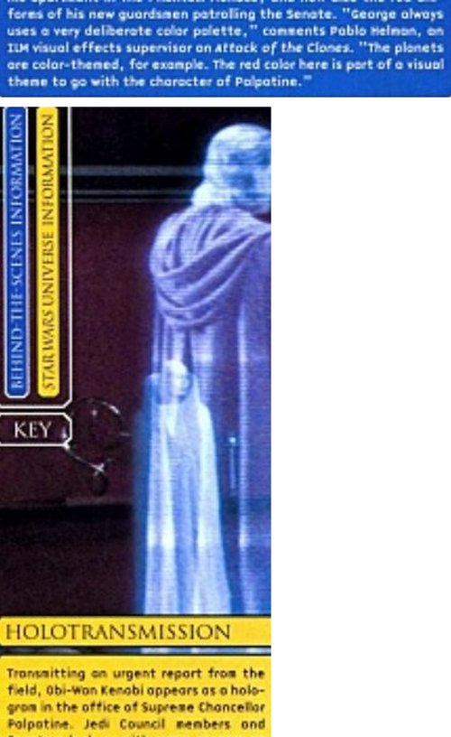

### Stat block notes (game mechanics, not feats)

- Holotransmission (Inside Attack of the Clones, Star Wars universe box): Transmitting an urgent report from the field, Obi-Wan Kenobi appears as a hologram in the office of Supreme Chancellor Palpatine. Jedi Council members and Senators look on with grave concern as Obi-Wan reveals the existence of a massive droid army on Geonosis and the machinations of the Trade Federation and the Separatists. Everyone present realizes that this is a moment of great portent. The sun outside the great window seems to be setting on the very Republic itself. (Source: *Star Wars Insider #60* (2002), scan p.8)

## scan p.9 (scan page 9)

Page contents: "Message from Obi-Wan" by David West Reynolds continued (magazine p. 9): Palpatine's office overlooking the Coruscant skyline. Yellow boxes "Representative Jar Jar Binks" and "Senator Ask Aak"; blue box "Coruscant Sunset" (Pablo Helman on the four versions of the Coruscant skyline, a 3D painting with CG skyscraper models, the city ten years later than in Episode I, aristocratic and politically charged like the heart of Washington, D.C.). (hand-read)

- **Palpatine (Darth Sidious)** — entry/section: Pablo Helman on the view from Palpatine's office: ""George has a very specific view of what kinds of architectural traits go with Coruscant. The skyline seen from Palpatine's office represents an aristocratic and politically charged environment, like the heart of Washington, D.C." —Pablo Helman, Star Wars Insider 60, p. 9" Source: *Star Wars Insider #60* (2002), scan p.9
  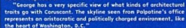

### Stat block notes (game mechanics, not feats)

- Representative Jar Jar Binks (Inside Attack of the Clones, Star Wars universe box): Representative Jar Jar Binks likes Supreme Chancellor Palpatine very much. He most often feels he knows what to do as a politician when the Chancellor is around. It's almost as if Palpatine radiates a sense of helpful guiding influence . . . Soon Jar Jar will have an idea of how he can aid the situation and help Palpatine do what is necessary: Jar Jar will suggest a motion that Palpatine be granted emergency powers. This would force an immediate vote of the Senate without debate and delay. It cannot, however, be proposed by anyone on the Supreme Chancellor's Senatorial advisory council . . . as are all the other representatives in the room. Jar Jar, even with the best intentions, could alter the future of the galaxy. (Source: *Star Wars Insider #60* (2002), scan p.9)
- Senator Ask Aak (Inside Attack of the Clones, Star Wars universe box): The Gran Senator from Malastare has already heard enough. Aak is convinced that the Republic must make use of the clone army mysteriously created for it on Kamino. (Source: *Star Wars Insider #60* (2002), scan p.9)

## scan p.10 (scan page 10)

Page contents: "Inside Attack of the Clones: Duel at the Landing Platform" (magazine p. 10): Obi-Wan vs Jango Fett on Kamino. Blue boxes "Background Miniature" (model shop supervisor Brian Gernand on the Tipoca City miniature, about 18 major elements), "Hand-Animated Fire" (blaster bolts mostly hand-animated) and "Real Obi-Wan Kenobi" (Pablo Helman: Obi-Wan is the only real element in the shot, Ewan's movement retimed so he could deflect a blast); yellow box "Fast Parry". (hand-read)

- **Obi-Wan Kenobi; Jango Fett** — entry/section: Pablo Helman on the digital Obi-Wan shot: ""Obi-Wan is the only real element in this shot," says Pablo Helman. "And even he was digitally manipulated. We changed the timing of Ewan's movement so that he could deflect a blast from Jango in the revised shot." —Pablo Helman, Star Wars Insider 60, p. 10" Source: *Star Wars Insider #60* (2002), scan p.10
  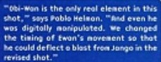
- **Obi-Wan Kenobi; Jango Fett** — entry/section: Fast Parry: Jango vs. Obi-Wan: "At best the bounty hunter might overwhelm Obi-Wan with so many bolts that he'll be unable to deflect them back at Jango." Source: *Star Wars Insider #60* (2002), scan p.10
  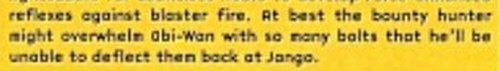

### Stat block notes (game mechanics, not feats)

- Fast Parry (Inside Attack of the Clones, Star Wars universe box): Jango Fett has little chance of hitting a skilled swordsman like Obi-Wan Kenobi with blaster bolts. Jedi train with their lightsabers for countless hours to develop Force-enhanced reflexes against blaster fire. At best the bounty hunter might overwhelm Obi-Wan with so many bolts that he'll be unable to deflect them back at Jango. (Source: *Star Wars Insider #60* (2002), scan p.10)

## scan p.11 (scan page 11)

Page contents: "Duel at the Landing Platform" continued (magazine p. 11): yellow boxes "Blaster Pistols" (Jango's pistols) and "Autumn Weather" (Kaminoans prefer their planet's autumn season; summer heat and brightness are unpleasant to their large eyes and delicate skin); blue boxes "Jango Fett" (Helman: Jango is digital whenever he flies) and "Landing Platform" (the floor done digitally for camera control). (hand-read)

- **Jango Fett** — entry/section: Pablo Helman on the digital Jango Fett: ""Jango is digital here," Helman says. "Whenever he flies he's digital. We want to believe that he flies via the rockets, and the only way to do that is to have complete control, to get rid of gravity. Some things like this are easier to do in CG than with an actor flying on wires." —Pablo Helman, Star Wars Insider 60, p. 11" Source: *Star Wars Insider #60* (2002), scan p.11
  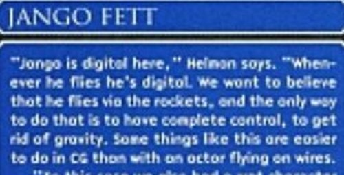

### Stat block notes (game mechanics, not feats)

- Blaster Pistols (Inside Attack of the Clones, Star Wars universe box): Jango Fett's blasters suit his Mandalorian style. Fett favors lightning-fast confrontations to long-distance sniping. He uses blaster pistols, which are quickly and easily drawn compared to a heavier rifle. A second pistol allows him to fire a blistering volley of bolts at double the rate. (Source: *Star Wars Insider #60* (2002), scan p.11)
- Autumn Weather (Inside Attack of the Clones, Star Wars universe box): Kaminoans prefer their planet's Autumn season, when the sky never clears and light rainstorms fill the atmosphere. Summer heat and brightness is unpleasant to the Kaminoans, with their large eyes and delicate skin. (Source: *Star Wars Insider #60* (2002), scan p.11)

## scan p.12 (scan page 12)

Page contents: "Inside Attack of the Clones: Preparations for a Kill" (magazine p. 12): Coruscant nightlife scene. Yellow boxes "Market Forces" (graphic advertisements evidence Coruscant's competitive capitalist economy, virtually nonexistent on outland worlds like Tatooine), "Bounty Hunter" (hated by criminals and distrusted by authorities, bounty hunters have few friends; many step over the line into kidnapping and murder-for-hire), "ASN-121 Assassin Droid" (black-market assassin droid adapted illegally from a standard Coruscant courier droid) and "Deadly Cargo" (secure communication capsules adapted to hold venomous creatures for assassinations). (hand-read)

## scan p.13 (scan page 13)

Page contents: "Preparations for a Kill" continued (magazine p. 13): yellow boxes "Zolander" (Zam Wesell's homeworld Zolan, home of shape-shifting Clawdites and cold-adapted Zolan icelanders) and "Hidden Secret". (hand-read)

### Stat block notes (game mechanics, not feats)

- Hidden Secret (Inside Attack of the Clones, Star Wars universe box): Zam Wesell is a skin changer, able to change her appearance to any vaguely humanoid form. This transformation takes effort, however. To allow her to rest, Zam wears a facemask to cover the unchanged part of her face. When necessary she changes her face from its natural Clawdite form into that of a beautiful woman. (Source: *Star Wars Insider #60* (2002), scan p.13)

## scan p.14 (scan page 14)

Page contents: "Inside Attack of the Clones: Jedi Library on Coruscant" (magazine p. 14): blue boxes "Miniature Set" (Pablo Helman and Brian Gernand: only a tiny portion was built full-size; the 1/8-scale library miniature about 12 feet deep), "Full-Size Set" (one floor section, one column and the portrait bust of Count Dooku were the only full-size elements) and "Doubled Element" (the five-bay model filmed twice to look ten bays deep); key: 1 bust of Count Dooku, 2 Obi-Wan Kenobi, 3 Madame Jocasta Nu, 4 extras digitally added. (hand-read)

## scan p.15 (scan page 15)

Page contents: "Jedi Library on Coruscant" continued (magazine p. 15): yellow boxes "Archive Library" (the ancient Archive Library in the Jedi Temple, the most important section to active Jedi field agents; the building is nearly 2,500 years old) and "Jedi Master Busts" (portrait busts honor great Jedi masters, leaders and lost colleagues, for living Jedi to look upon and reflect); blue box "Small Set, Big Effort" (Gernand on the model shop's collaborative build, laser-cut floor, light boxes for the Jedi data modules; Helman's optical group made the holobooks blink and twinkle). (hand-read)

## scan p.16 (scan page 16)

Page contents: "Inside Attack of the Clones: Clone Youth in Training" (magazine p. 16): blue box "32 Live-Action Clones" (Pablo Helman: Daniel Logan was filmed 32 separate times for this shot and 82 for a similar one; George wanted him used for every clone, even in the background); yellow box "Clone Learning Stations". (hand-read)

### Stat block notes (game mechanics, not feats)

- Clone Learning Stations (Inside Attack of the Clones, Star Wars universe box): As Obi-Wan Kenobi tours the Kaminoan facilities, he encounters extraordinary scenes of thousands of identical clones under development. Dressed identically and herded through their training like so many cattle, the clone trooper youth spend many hours at their instruction stations, learning at an accelerated rate to match their accelerated growth. Special learning helmets aid the process, enhancing long-term memory formation and making their brains more receptive to instruction. (Source: *Star Wars Insider #60* (2002), scan p.16)

## scan p.17 (scan page 17)

Page contents: "Clone Youth in Training" continued (magazine p. 17): blue box "Learning Helmets" (built from production illustrations by Doug Chiang); yellow box "Accelerated Growth": "This batch of clones is only 6 years old, but they appear to be 12, thanks to the Kaminoans' genetically induced accelerated growth process." (hand-read)

## scan p.18 (scan page 18)

Page contents: "Inside Attack of the Clones: Sandcrawlers at Sunset" (magazine p. 18): blue box "Miniature Jawa Camp" (Brian Gernand and model-maker Adam Savage, who built the three-foot-square miniature in 14 hours and imagined the tent as a staging yard for sandcrawler repairs; the tent camp was designed years ago by ILM but never used, a miniature appears in From Star Wars to Indiana Jones); key: 1 Owen Lars' swoop, 2 Anakin Skywalker, 3 Jawa Chieftain, 4 Sandcrawler Maintainance Tent (yellow: high enough to house an entire sandcrawler; several Jawa clans share its components and store them aboard their sandcrawlers during the storm season), 5 Salvage Crane (blue: previously seen only in Star Wars: Incredible Cross-Sections), 6 miniature camp debris. (hand-read)

## scan p.19 (scan page 19)

Page contents: "Sandcrawlers at Sunset" continued (magazine p. 19): blue boxes "Tread Design" (Tatooine's sandcrawler treads adapted from NASA's Apollo moon rocket transporter) and "Digital Sandcrawlers" (Pablo Helman: the original sandcrawler miniature was on display in Finland, so John Knoll's CG model from the Special Edition and the Mos Espa Arena was reused with added detail and paintwork). (hand-read)

## scan p.20 (scan page 20)

Page contents: Star News: From the World of Lucasfilm (magazine p. 20): Lucasfilm and 20th Century Fox charity premieres of Attack of the Clones on Mother's Day, May 12, benefiting children's charities in U.S. and Canadian cities (Boys and Girls Clubs of Boston, Metropolitan Family Services of Chicago, The Family Place of Dallas, Kempe Children's Foundation of Denver, and others); George Lucas: "Throughout the years, Star Wars films have entertained generations of children"; charity directors' comments; blocks of seats set aside for underprivileged children. (hand-read)

## scan p.21 (scan page 21)

Page contents: Star News continued (magazine p. 21): Fox TV previewed the Attack of the Clones trailer on March 10 between Malcolm in the Middle and The X-Files (Lucasfilm VP Jim Ward to Entertainment Weekly), fan reactions (names omitted), trailer shown again before Ice Age on March 15; Fossil Attack of the Clones collectible watches ($85, limited to 2,500) and a Boba Fett watch ($105, limited to 2,000); "Collector's Dream Come True": the Taco Bell "Feel the Force" Star Wars Hummer from 1997. (hand-read)

## scan p.22 (scan page 22)

Page contents: Star News: celebrity news (magazine p. 22): Carrie Fisher interviewed George Lucas on "Conversations from the Edge" (Oxygen, January 30) at Skywalker Ranch, on Leia's buns and her runner-up for the role (Terri Nunn of Berlin); Fisher and Debbie Reynolds memorabilia auction; Natalie Portman, Pernilla August (Maria Stuart), Hayden Christensen (Teen People cover, National Board of Review award, This Is Our Youth), Ewan McGregor (Tetley Tea, charity flight, Down With Love, Hollywood Reporter Star Power list with Harrison Ford #7, Samuel L. Jackson #52, Liam Neeson #125, Golden Satellite and Empire awards for Moulin Rouge), Christopher Lee (Empire and Evening Standard awards), Keira Knightley, Rose Byrne, Joel Edgerton, Ian McDiarmid (Critics' Circle Best Actor 2001 for Faith Healer). (hand-read)

- **Leia Organa Solo** — entry/section: Carrie Fisher to George Lucas on Leia's buns: ""You don't put a wide hairstyle on an already wide face," Fisher chastised Lucas on the subject of the famous buns. —Carrie Fisher, Star Wars Insider 60, p. 22" Source: *Star Wars Insider #60* (2002), scan p.22
  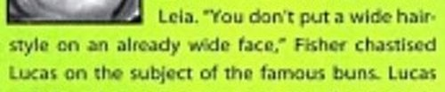

## scan p.23 (scan page 23)

Page contents: Star News continued (magazine p. 23): Ian McDiarmid in BBC 2's Crime and Punishment; Julian Glover (General Veers) cast as the voice of Aragog in Harry Potter and the Chamber of Secrets; John Williams conducted E.T. at its Shrine Auditorium re-premiere; ILM's two technical Oscars (Creature Dynamics System; MARS motion and structure recovery) and Terminator 3. Ads for Friends of Animals and The Nature Conservancy. (hand-read)

## scan p.24 (scan page 24)

Page contents: Star News continued (magazine p. 24): the one-of-a-kind $120,000 Taco Bell Star Wars Hummer, signed by Peter Mayhew and David Prowse, now owned by a collector in Portland, Oregon who bought it on eBay (owner, contest winner and seller names omitted); "The Force at Work": a 10-year-old fan lent his Star Wars collection, begun by his late father, to the White Plains Hospital Center for display (names omitted), opening with Shmi's line "You have brought hope to those who have none." (hand-read)

## scan p.25 (scan page 25)

Page contents: Ad: Star Wars Roleplaying Game (Wizards of the Coast), "Take your place in the greatest space fantasy of all time," from the classic trilogy to Attack of the Clones; available May 10. (hand-read)

## scan p.26 (scan page 26)

Page contents: "Return of the Jedi" Ewan McGregor interview opener (magazine p. 26): full-page photo of McGregor as Obi-Wan by Sue Adler, with pull quote. (hand-read)

- **Obi-Wan Kenobi** — entry/section: Ewan McGregor on the nightclub scene: ""It's hero stuff when you calmly take someone's arm off and return to your drink." —Ewan McGregor, Star Wars Insider 60, p. 26" Source: *Star Wars Insider #60* (2002), scan p.26
  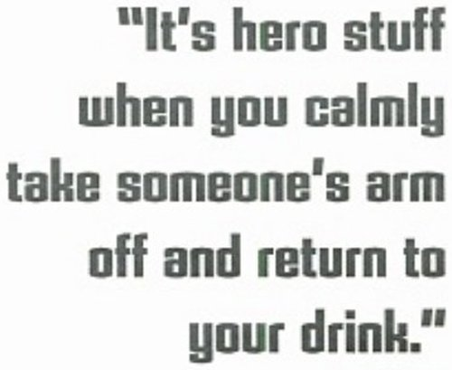

## scan p.27 (scan page 27)

Page contents: "Return of the Jedi" by Scott Chernoff (magazine p. 27), Ewan McGregor interview with spoiler warning: "Emerging from the shadow of his mentor, Obi-Wan Kenobi continues his evolution from impatient Padawan learner to wise Jedi in Attack of the Clones"; the beard as a symbolic step toward the Obi-Wan of A New Hope. Photo of Obi-Wan downing a drink as Elan Sleazebaggano (Matt Doran) looks on. (hand-read)

- **Obi-Wan Kenobi; Darth Maul; Darth Vader (Anakin Skywalker)** — entry/section: Ewan McGregor bridging the gap: "Now, beginning with Attack of the Clones, it's Ewan McGregor's job to bridge the gap, to bring together the Padawan whose stunning lightsaber duel with Darth Maul thrilled audiences in The Phantom Menace and the jaded Jedi Knight who faced off against his former pupil Darth Vader in A New Hope." Source: *Star Wars Insider #60* (2002), scan p.27
  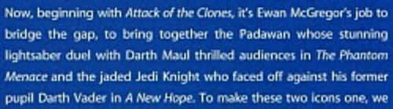

## scan p.28 (scan page 28)

Page contents: McGregor interview continued (magazine p. 28): his career (Trainspotting, Black Hawk Down, Moulin Rouge, Young Adam); Obi-Wan's detective mission; cutting off Zam Wesell's arm mirrors the cantina; imitating Guinness's voice; "Mull-It Over": his mullet hairpiece; Lucas called Obi-Wan "a part in development." Captions: Padmé and Obi-Wan aboard a Republic gunship; Obi-Wan in the Jedi Temple library. (hand-read)

- **Obi-Wan Kenobi; Zam Wesell** — entry/section: Ewan McGregor on Obi-Wan's detective mission: ""I go on a kind of Dick Tracy detective spree, and it's really good," McGregor said. "This bounty hunter has been killed in my arms with a little toxic dart, and the Jedi archives can't find any trace of it. They don't know where it's come from, and then I get a lead. There's some nice underworld stuff." —Ewan McGregor, Star Wars Insider 60, p. 28" Source: *Star Wars Insider #60* (2002), scan p.28
  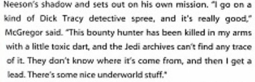
- **Obi-Wan Kenobi; Zam Wesell** — entry/section: Ewan McGregor on cutting off Zam Wesell's arm: ""We chase her into this club, she attempts to kill me, and I cut her arm off," he said, "which is cool, because Obi-Wan Kenobi cuts an arm off in the first film [in the Mos Eisley Cantina]. So he's obviously a bit of an arm cutter, isn't he? It's hero stuff when you calmly take someone's arm off and return to your drink. So I get to do that and mirror it a little bit." —Ewan McGregor, Star Wars Insider 60, p. 28" Source: *Star Wars Insider #60* (2002), scan p.28
  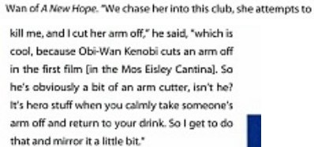
- **Obi-Wan Kenobi; Jango Fett** — entry/section: Ewan McGregor on mirroring Alec Guinness: ""I'm trying to do his voice the best I can," the actor said. "I'm trying to imitate the tune in his voice. There are also moments when I'm going into Jango Fett's apartment, where it's like the scene on the Death Star when Guinness is going around with his hood up to turn off the tractor beam. There are moments that remind me of him—and other bits that don't." —Ewan McGregor, Star Wars Insider 60, p. 28" Source: *Star Wars Insider #60* (2002), scan p.28
  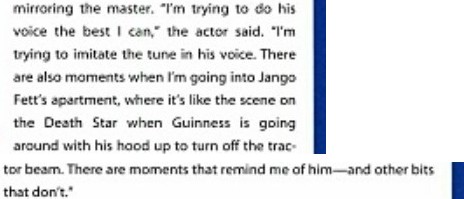
- **Obi-Wan Kenobi** — entry/section: Ewan McGregor on Lucas calling Obi-Wan a part in development: "McGregor said that Star Wars creator George Lucas "told me it was a part in development. He kept telling me that a lot throughout the first one. I think he was worried I didn't think there was enough in it." —Ewan McGregor, Star Wars Insider 60, p. 28" Source: *Star Wars Insider #60* (2002), scan p.28
  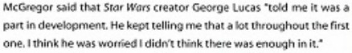

## scan p.29 (scan page 29)

Page contents: McGregor interview continued (magazine p. 29): Obi-Wan and Anakin as bickering old friends; more room for humor than in The Phantom Menace; Attack of the Clones more character-driven like the first trilogy; "Jedi Breakdown": what may happen in Episode III. Caption: Obi-Wan chastises Anakin for being careless with his lightsaber. (hand-read)

- **Obi-Wan Kenobi; Darth Vader (Anakin Skywalker); Qui-Gon Jinn** — entry/section: Ewan McGregor on Obi-Wan and Anakin: ""They're like two old friends who have been together a long time and spend too much time together," McGregor said. "They argue, but as friends do. Obi-Wan is worried that Anakin's a bit headstrong and overconfident, even arrogant, and he thinks the reverse of me—that I'm staid and boring, and I do everything by the book. But they're really close—they've been together probably every day since Qui-Gon Jinn died, I suppose." —Ewan McGregor, Star Wars Insider 60, p. 29" Source: *Star Wars Insider #60* (2002), scan p.29
  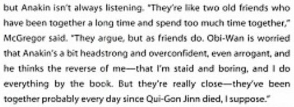
- **Darth Vader (Anakin Skywalker); Padmé Amidala** — entry/section: Ewan McGregor on Attack of the Clones and Anakin: ""Attack of the Clones is more about the characters, and there's a clearer relationship between Anakin and Padmé. It's tense at the end, and you can feel the tension building as it goes toward the climax. The structure and pace are much better, and it's funnier. Also, it's much more intricate now. You can see where things are going to go in terms of Anakin. You can start to put the pieces together of how he got to be Darth Vader, and that's fun." —Ewan McGregor, Star Wars Insider 60, p. 29" Source: *Star Wars Insider #60* (2002), scan p.29
  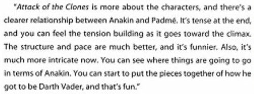
- **Darth Vader (Anakin Skywalker); Obi-Wan Kenobi** — entry/section: Ewan McGregor on Episode III: ""I don't know what's going to happen in the next one," he said. "I imagine something awful happens—Anakin becomes Darth Vader, and I give up." —Ewan McGregor, Star Wars Insider 60, p. 29" Source: *Star Wars Insider #60* (2002), scan p.29
  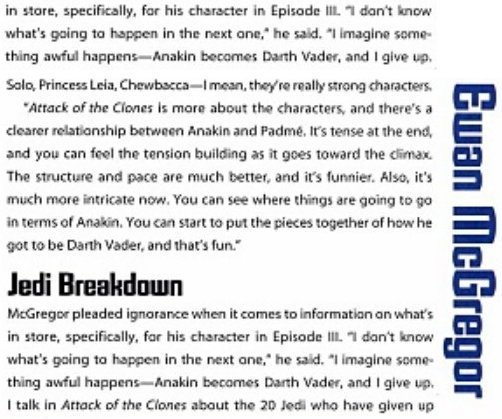

## scan p.30 (scan page 30)

Page contents: McGregor interview continued (magazine p. 30): only 20 Jedi have ever left the order; guesses about Episode III; his uncle Denis Lawson (Wedge Antilles); Star Wars names (Orn Free Taa from "corn fritter"); avoiding the mayhem of fame; "Technical Difficulties" begins. Captions: McGregor in a stunt rig; Obi-Wan dismisses a solicitation from Elan Sleazebaggano in a Coruscant nightclub. (hand-read)

- **Obi-Wan Kenobi; Yoda; Luke Skywalker; Leia Organa Solo; Darth Vader (Anakin Skywalker)** — entry/section: Ewan McGregor on Obi-Wan's future: ""So it seems the Jedi who are left are either working on the dark side or are Obi-Wan Kenobi and Yoda. I suppose something happens, and they split. I believe I go to look over Luke, because I take him somewhere when he's a baby, and Princess Leia gets taken somewhere else when she's a baby. I'm living near where Luke lives in Episode IV, so I must be watching over him, and living in a small white room in a hut. Obviously, there's a huge trust between me and Anakin in these films, which probably leads to the ultimate betrayal in the end." —Ewan McGregor, Star Wars Insider 60, p. 30" Source: *Star Wars Insider #60* (2002), scan p.30
  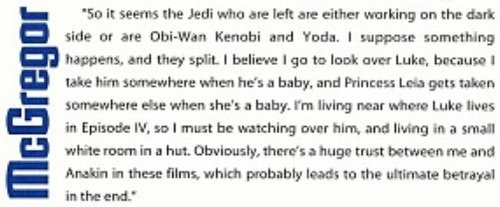

## scan p.31 (scan page 31)

Page contents: McGregor interview continued (magazine p. 31): frustration of acting against blue screen ("It's the weirdest job you'll ever do"); the sick-making speeder chase shoot; the magic of seeing ILM's finished work. Photo of Obi-Wan with Elan Sleazebaggano in the nightclub; caption: McGregor sprayed with water for a scene after his arrival on the storm-lashed planet of Kamino. (hand-read)

## scan p.32 (scan page 32)

Page contents: McGregor interview continued (magazine p. 32): the Star Wars world as "retrospective future"; "Laugh It Up, Fuzzball": coaching Daniel Logan (teenage Boba Fett), Anthony Daniels' cameo as Lieutenant Faytonni, working with R2-D2. Sidebar "Oh Be-have, Obi-Wan!": McGregor filmography 1994-2005 (Shallow Grave through Star Wars: Episode III). Caption: Obi-Wan searches for information after landing on Geonosis. (hand-read)

- **Obi-Wan Kenobi** — entry/section: Ewan McGregor on Obi-Wan's surroundings: ""The frustrations of not knowing exactly what's 'round about you don't necessarily show in this film," he said. "All our characters are space traveling, and the fact that there are thousands of speeders going past us outside the window is an everyday occurrence. It creates more of a sense of belief that they're in that world—because it is about the world." —Ewan McGregor, Star Wars Insider 60, p. 32" Source: *Star Wars Insider #60* (2002), scan p.32
  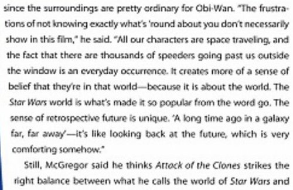
- **Boba Fett** — entry/section: Ewan McGregor on Daniel Logan's Boba Fett: "Recalled McGregor, "When Daniel opened the door and saw me for the first time, George wanted him to look very suspicious of me. I just told him to pretend like I'd done a really bad fart. Surprise and bad smells register a similar expression in the face. He was brilliant." —Ewan McGregor, Star Wars Insider 60, p. 32" Source: *Star Wars Insider #60* (2002), scan p.32
  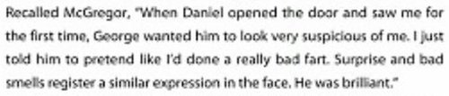
- **R2-D2** — entry/section: Ewan McGregor on R2-D2: ""If Artoo's standing still and twirling his head and whistling, he's perfect," McGregor said. "But when we start to move him around, that's when the fun starts. He falls over a lot, or gets stuck on gratings. The floors always have grooves in them or something that catch him up now and again." —Ewan McGregor, Star Wars Insider 60, p. 32" Source: *Star Wars Insider #60* (2002), scan p.32
  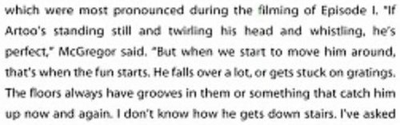

## scan p.33 (scan page 33)

Page contents: McGregor interview concludes (magazine p. 33): R2-D2 as "George's favorite actor"; Hayden Christensen as Anakin; McGregor now in "the middle bracket"; getting the line "I have a bad feeling about this"; the long way to Episode IV. Caption: Obi-Wan hears puzzling news from Kaminoan Prime Minister Lama Su. (hand-read)

- **Darth Vader (Anakin Skywalker); Obi-Wan Kenobi** — entry/section: Ewan McGregor on Hayden Christensen's Anakin: ""Hayden is stepping into a huge part," McGregor said. "To be the young Darth Vader is a big deal. Also, he's stepping into a bunch of people who know each other, because Ahmed and Natalie and I all made the first one, but he's fantastic. You can see it in him—you can imagine how he ends up losing it and going over to the dark side, because of his frustrations, his ego, and his pain." —Ewan McGregor, Star Wars Insider 60, p. 33" Source: *Star Wars Insider #60* (2002), scan p.33
  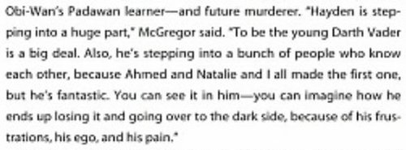
- **Obi-Wan Kenobi** — entry/section: Ewan McGregor on getting Obi-Wan's line: ""I have the great line—'I have a bad feeling about this.' I didn't have that one in the script originally, but George put one in for me because it's important to me that I have that line. It's appeared in all the films." —Ewan McGregor, Star Wars Insider 60, p. 33" Source: *Star Wars Insider #60* (2002), scan p.33
  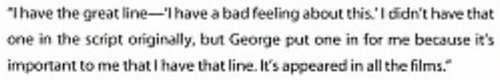

## scan p.34 (scan page 34)

Page contents: Ad: Science Fiction Book Club, 5 books for $1 (left page of spread: Ray Bradbury, Hitchhiker's Guide, Dune, Shannara and other titles). (hand-read)

## scan p.35 (scan page 35)

Page contents: Ad: Science Fiction Book Club continued (right page: Tolkien, Star Wars and comics titles; membership terms). (hand-read)

## scan p.36 (scan page 36)

Page contents: "Natalie Portman: Forbidden Love" by Scott Chernoff (magazine p. 36): "The Phantom Menace's teen queen is back, now a Senator distracted by attraction in Attack of the Clones"; Padmé, 10 years after Episode I, now Senator in Palpatine's former seat; Portman's career (Anywhere But Here, Where the Heart Is, The Seagull, The Bride Wore Black); making Padmé seem 10 years older. (hand-read)

- **Padmé Amidala; Darth Vader (Anakin Skywalker)** — entry/section: Natalie Portman pull quote on Padmé and Anakin: ""Everyone who ever came into Anakin's world had some effect on him that led him to where he ended up—and especially Padmé." —Natalie Portman, Star Wars Insider 60, p. 36" Source: *Star Wars Insider #60* (2002), scan p.36
  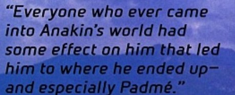
- **Padmé Amidala; Darth Vader (Anakin Skywalker)** — entry/section: Natalie Portman on making Padmé seem older: ""George told me that the struggle for this one is to make me seem older," Portman said. "He's been working with me on that. He wants to make sure I seem older than Anakin, so it's believable that I can be bossing him around, and he's a little intimidated. She looks at him as a little boy—at least for the first half of the film." —Natalie Portman, Star Wars Insider 60, p. 36" Source: *Star Wars Insider #60* (2002), scan p.36
  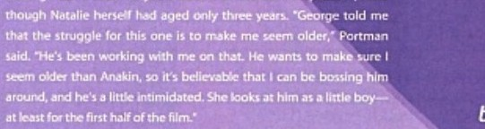

## scan p.37 (scan page 37)

Page contents: Portman feature (magazine p. 37): full-page photo, "Love": Padmé and Anakin "know they shouldn't but just can't help themselves in Star Wars: Episode II Attack of the Clones." (hand-read)

## scan p.38 (scan page 38)

Page contents: Portman feature continued (magazine p. 38): the improvised fruit-flying dinner scene; Padmé's 19 outfits, the "leather-and-lace" corset outfit. Captions: Senator Padmé Amidala at her lake retreat on Naboo; Portman turns chains meant to bind her into a massive weapon. (hand-read)

- **Padmé Amidala; Darth Vader (Anakin Skywalker)** — entry/section: Natalie Portman on the fruit-flying scene: ""There's a scene where Anakin and I are finishing dinner, and he uses his Jedi powers to make the fruit fly, which scares me a little, but it turns into a flirting tactic," she recalled. "I don't think George was satisfied with the dialogue he had written, because he told Hayden and me to just improvise—which was amusing, because it got inappropriate very quickly. It was a fun scene to shoot, although we felt pretty stupid biting fruit which didn't exist out of the air." —Natalie Portman, Star Wars Insider 60, p. 38" Source: *Star Wars Insider #60* (2002), scan p.38
  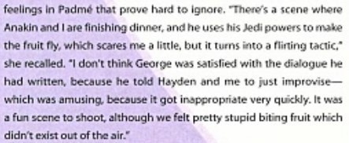

## scan p.39 (scan page 39)

Page contents: Portman feature continued (magazine p. 39): Episode II costumes ("a lot of midriff, and a lot of tight corsets"); "Wise Beyond Her Years": making a 14-year-old Queen believable in Episode I; her early career (The Professional/Léon, Beautiful Girls, Heat, Everyone Says I Love You, Mars Attacks!, The Diary of Anne Frank) and thoughts on fame. Captions: portrait by Keith Hamshere; Portman takes aim during the Geonosis execution arena battle. (hand-read)

- **Padmé Amidala** — entry/section: Natalie Portman on playing a 14-year-old Queen: ""George told me his biggest struggle with Amidala was to make it believable that a 14-year-old would be Queen," she said. "No one could doubt she could be Queen, so we worked a lot on voice and posture, all the movement and facial expressions, to make it very stern. Even though it's already more acceptable just because it's part of the Star Wars universe, I think it was a little less questioned because of all the stuff we worked on." —Natalie Portman, Star Wars Insider 60, p. 39" Source: *Star Wars Insider #60* (2002), scan p.39
  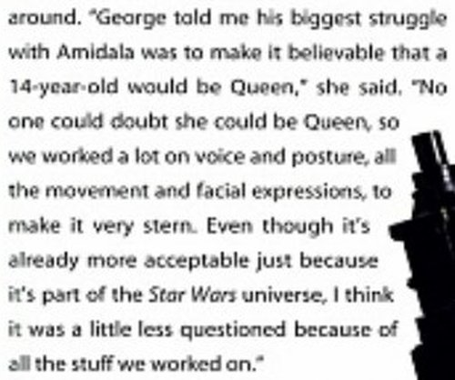

## scan p.40 (scan page 40)

Page contents: Portman feature continued (magazine p. 40): the link between Padmé and Leia; meeting Carrie Fisher ("she introduced me as her mother!"); "Like Daughter, Like Mom": Amidala now a Senator, having resigned as Queen. Captions: Portman laughs on the set of Padmé's Naboo lake retreat; Portman styled during a break in filming at Fox Studios Australia. (hand-read)

- **Padmé Amidala; Leia Organa Solo** — entry/section: Natalie Portman on Padmé and Leia: ""It definitely did come into play how strong and smart a character Carrie Fisher portrayed, because I think that a lot of that is passed on from parent to child," Portman said. "I think George wrote Amidala as a strong, smart character, but it helped to know that I had this great woman before me who had portrayed her character as a fiery woman." —Natalie Portman, Star Wars Insider 60, p. 40" Source: *Star Wars Insider #60* (2002), scan p.40
  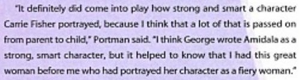
- **Padmé Amidala; Darth Vader (Anakin Skywalker)** — entry/section: Natalie Portman on Amidala as Senator: ""Amidala is now a Senator—she's not a Queen anymore," Portman said. "She has resigned because she believes that is the way a rightful government is conducted, that one leader should not be in power too long. At this point, she is still very powerful and respected, and she's putting her career in front of her personal plans. The fact that Amidala doesn't start a relationship with Anakin when she has feelings for him shows that she doesn't really think of her own desires before her role as a leader of people." —Natalie Portman, Star Wars Insider 60, p. 40" Source: *Star Wars Insider #60* (2002), scan p.40
  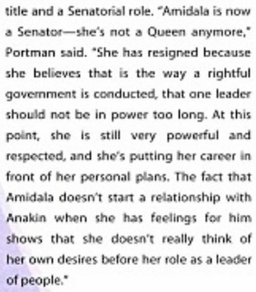

## scan p.41 (scan page 41)

Page contents: Portman feature continued (magazine p. 41): Padmé's idealism and naivete; chemistry with Hayden Christensen; little preparation for the role; Star Wars themes of good and evil; Attack of the Clones as a love story. Full-page photo of Portman having her hair styled. (hand-read)

- **Padmé Amidala** — entry/section: Natalie Portman on Padmé's character: ""She's a very idealistic person," the actress said. "She's a very honest and good person, and because of that, sometimes she's a naive person. She doesn't imagine that other people aren't as good as she is. She's very strong and intelligent, but her weakness is that she doesn't think about what she needs for herself. She is always thinking about her career and role as a leader, as opposed to her role as a woman, a person, a human being." —Natalie Portman, Star Wars Insider 60, p. 41" Source: *Star Wars Insider #60* (2002), scan p.41
  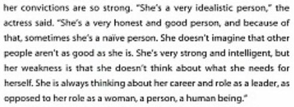
- **Padmé Amidala; Darth Vader (Anakin Skywalker)** — entry/section: Natalie Portman on Padmé playing the politician: ""She's more comfortable in the role of leader," she explained, "and she's obviously more comfortable acting the older person, especially at the beginning of the film with Anakin." —Natalie Portman, Star Wars Insider 60, p. 41" Source: *Star Wars Insider #60* (2002), scan p.41
  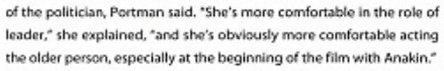

## scan p.42 (scan page 42)

Page contents: Portman feature continued (magazine p. 42): foreshadowing of Anakin's dark side; "On the Edge": working with digital video. Sidebar "All Hail the Queen!": Portman filmography 1994-2005 (The Professional through Star Wars: Episode III). Captions: makeup supervisor Lesley Vanderwalt prepares Portman as an assistant freshens Hayden Christensen; Senator Padmé Amidala listens to Supreme Chancellor Palpatine. (hand-read)

## scan p.43 (scan page 43)

Page contents: Portman feature concludes (magazine p. 43): being on a film like Star Wars as a lesson in humility; surprise at The Phantom Menace's visuals; blue-screen acting as "the purest form of acting... like being a little kid in a cardboard box and thinking it's a spaceship." Captions: Portman and Christensen on location in Tunisia outside the Lars family homestead; portrait by Sue Adler. (hand-read)

## scan p.44 (scan page 44)

Page contents: Portman feature concludes (magazine p. 44): disappointment at fake speeder buttons; "Love Sydney": filming at Fox Studios Australia; Lucas unchanged ("He wears the same clothes"); Lucas told her the plot of all three prequels when she signed at 14; what she knows of Episode III; Padmé's part in Anakin's turn. Caption: hooded against the twin suns of Tatooine, Padmé makes her first visit to the Lars family homestead. (hand-read)

- **Padmé Amidala; Darth Vader (Anakin Skywalker); Luke Skywalker; Leia Organa Solo** — entry/section: Natalie Portman on Episode III: ""It's very basic—I think it's pretty much what everyone knows about Episode III," she said. "The children are born, and Anakin goes to the dark side. But that's pretty much all I know." —Natalie Portman, Star Wars Insider 60, p. 44" Source: *Star Wars Insider #60* (2002), scan p.44
  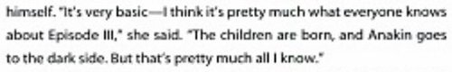
- **Padmé Amidala; Darth Vader (Anakin Skywalker)** — entry/section: Natalie Portman on Padmé's part in Anakin's turn: ""I don't think you can say someone else's decisions or actions are caused by a particular person," she said, "but I think everyone's environment shapes them. So I have a feeling that everyone who ever came into Anakin's world had some effect on him that led him to where he ended up—and especially Padmé, being such a central part of his life, from such a young age, probably influenced him a little bit." —Natalie Portman, Star Wars Insider 60, p. 44" Source: *Star Wars Insider #60* (2002), scan p.44
  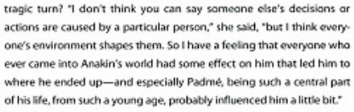

## scan p.45 (scan page 45)

Page contents: Ad: subscribe to Star Wars Insider (6 issues $19.95, 12 issues $35.95; Wizards of the Coast, Escondido, CA); "Every other month, go behind the scenes with Star Wars Insider." (hand-read)

## scan p.46 (scan page 46)

Page contents: "Hayden Christensen: Journey to the Dark Side" by Scott Chernoff (magazine p. 46): "Episode II's Anakin Skywalker talks about wielding his lightsaber, kissing his co-star, and his journey to the dark side"; the challenge of showing the heroic Anakin and the undercurrents leading to Darth Vader. (hand-read)

- **Darth Vader (Anakin Skywalker)** — entry/section: Hayden Christensen pull quote: ""I pray for it every night—let me put the dark helmet on!" —Hayden Christensen, Star Wars Insider 60, p. 46" Source: *Star Wars Insider #60* (2002), scan p.46
  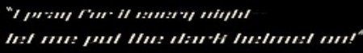
- **Darth Vader (Anakin Skywalker)** — entry/section: Hayden Christensen on playing Anakin: ""It was a challenge every day," Christensen admitted. "The most fulfilling aspect of playing Anakin is being given material in which you're able to make such a drastic and archetypal transition from good to evil. What George impressed upon me most was to be as subtle as possible. Subtlety reads so much, especially when you're trying to define such an intricate balance. We were very specific when we wanted to show the dark side of Anakin." —Hayden Christensen, Star Wars Insider 60, p. 46" Source: *Star Wars Insider #60* (2002), scan p.46
  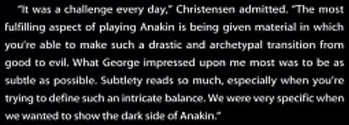

## scan p.47 (scan page 47)

Page contents: Christensen feature (magazine p. 47): full-page photo of Christensen as Jedi apprentice Anakin Skywalker with lightsaber (Keith Hamshere; digital work by ILM). (hand-read)

## scan p.48 (scan page 48)

Page contents: Christensen feature continued (magazine p. 48): since Insider #50 he made Life as a House and founded Forest Park Pictures with his brother Tove; his discovery at age seven, In the Mouth of Madness, Family Passions. Captions: Christensen gets last-minute advice from Ewan McGregor aboard a Coruscant transport set; Supreme Chancellor Palpatine has words of encouragement for a frustrated young Jedi apprentice. (hand-read)

## scan p.49 (scan page 49)

Page contents: Christensen feature continued (magazine p. 49): sports versus acting, turning down a tennis scholarship for Higher Ground; Hamlet as his most fulfilling role; chosen from more than 400 actors; reading the script for the first time. Captions: fighting a bluescreen creature (the reek) on a bluescreen set; Anakin on Coruscant. (hand-read)

- **Darth Vader (Anakin Skywalker); Obi-Wan Kenobi** — entry/section: Hayden Christensen on reading the script: ""I can't impress upon you," Hayden said, "what it was like to read the Star Wars script for the first time—reading the lines that I was going to speak, and getting my first understanding of what my relationship with Obi-Wan would be. I was excited by what George expected from me as an actor, in terms of emotional range. I knew I could really sink my teeth into the part." —Hayden Christensen, Star Wars Insider 60, p. 49" Source: *Star Wars Insider #60* (2002), scan p.49
  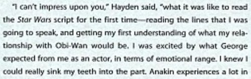

## scan p.50 (scan page 50)

Page contents: Christensen feature continued (magazine p. 50): studying the previous films; the seamless flow from Jake Lloyd to Darth Vader and Sebastian Shaw; Internet research; his written method; the scenes of Shmi's death and Anakin's confession to Padmé. Caption: Portman and Christensen on a platform at the end of a long hallway to be added digitally by ILM. (hand-read)

- **Darth Vader (Anakin Skywalker)** — entry/section: Hayden Christensen on studying Darth Vader: "As for Darth Vader (played by actor David Prowse, voice actor James Earl Jones, and stunt performer Bob Anderson), "I tried to steal some of his physicality, like his posture, as well as this very monotone demeanor that he has. He's very aware." —Hayden Christensen, Star Wars Insider 60, p. 50" Source: *Star Wars Insider #60* (2002), scan p.50
  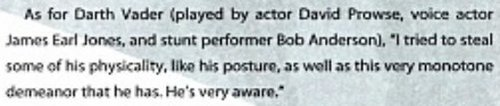
- **Darth Vader (Anakin Skywalker); Shmi Skywalker** — entry/section: Hayden Christensen on scenes with Pernilla August: "Of shooting his powerful scenes with Pernilla August on the Clones set at Fox Studios Australia, the actor observed, "It's a set that is not used to that emotional aspect. Even though Star Wars movies have a gripping, emotional quality to them, people weren't going in every day and crying, and leaving emotionally exhausted. I felt like I got a chance to do that." —Hayden Christensen, Star Wars Insider 60, p. 50" Source: *Star Wars Insider #60* (2002), scan p.50
  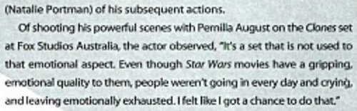

## scan p.51 (scan page 51)

Page contents: Christensen feature continued (magazine p. 51): Anakin's breakdown in the confession scene; a month of lightsaber training with Nick Gillard; riding a reek; kissing scenes with Portman. Captions: Padmé and Anakin share a blissful moment in the hill country of Naboo; Anakin tells Padmé his true feelings as they face a perilous situation together. (hand-read)

- **Darth Vader (Anakin Skywalker); Padmé Amidala** — entry/section: Hayden Christensen on Anakin's confession scene: ""childish, dismissive tone. He has the arrogance that a child has. So it was important to me, when he is on his own emotional and mental brink, that he break down and cry, and display his emotion the way a child would. The fact that he breaks down and cries like a baby is important to me, because it will show a larger change and a greater transformation from someone who reacts to a tragic event by crying and asking for help, to someone who would react very differently in the future. That's why I made those choices. I put a lot of effort into that scene." —Hayden Christensen, Star Wars Insider 60, p. 51" Source: *Star Wars Insider #60* (2002), scan p.51
  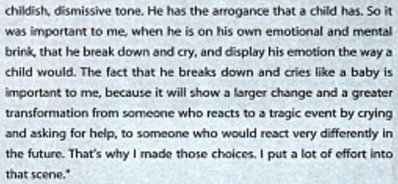
- **Darth Vader (Anakin Skywalker)** — entry/section: Hayden Christensen on lightsaber training: ""I spent the most time on learning the fight scene," Christensen said. "When I arrived in Sydney, I spent about a month learning how to play with a lightsaber. They were heavy—it was like wielding a real sword. But it's not really a style of fighting you're taught—Nick shows you where the sword should be every step of the way. I knew where every foot was supposed to go, and I knew it like the back of my hand, up to the point where it became second nature. He just embedded the routine into my head, so I couldn't mess up." —Hayden Christensen, Star Wars Insider 60, p. 51" Source: *Star Wars Insider #60* (2002), scan p.51
  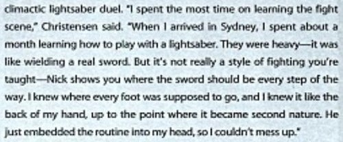

## scan p.52 (scan page 52)

Page contents: Christensen feature continued (magazine p. 52): the craftsmanship of the built sets; acting against blue screen; location shooting in Italy, England and Seville; the Lars homestead location in Tunisia. Captions: Anakin Skywalker is up to something on the set of the Geonosis Execution Arena (photo by Lisa Tomasetti); Anakin Skywalker speeds on a borrowed swoop bike across the Tatooine dunes to a date with destiny (digital work by ILM). (hand-read)

### Stat block notes (game mechanics, not feats)

- Caption: Anakin on the swoop bike: Anakin Skywalker speeds on a borrowed swoop bike across the Tatooine dunes to a date with destiny. Digital work by ILM. (Source: *Star Wars Insider #60* (2002), scan p.52)

## scan p.53 (scan page 53)

Page contents: Christensen feature concludes (magazine p. 53): bonding with cast and crew; Ewan McGregor as mentor; the Anakin/Obi-Wan relationship ("Butch Cassidy and the Sundance Kid"); not letting knowledge of Anakin's future get in the way; Episode III expectations; hopes to don the Darth Vader helmet. Full-width swoop-bike sunset photo. (hand-read)

- **Darth Vader (Anakin Skywalker); Obi-Wan Kenobi** — entry/section: Hayden Christensen on Anakin and Obi-Wan: ""Even though Obi-Wan's my master and wants to guide me on the path toward wisdom," Hayden said, "Anakin feels that he's being oppressed and not being given his freedom to go and explore, and be the Jedi he wants to be. Obi-Wan wants to go by the book, and he doesn't want to let Anakin rush through his training. It's almost a Butch Cassidy and the Sundance Kid type of relationship, which was fun to play." —Hayden Christensen, Star Wars Insider 60, p. 53" Source: *Star Wars Insider #60* (2002), scan p.53
  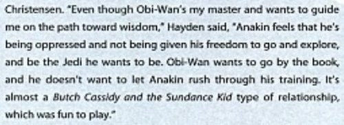
- **Darth Vader (Anakin Skywalker)** — entry/section: Hayden Christensen on playing Anakin's present: "But Christensen said he doesn't let his knowledge of what Anakin will become get in the way of who he is at the moment. "You just forget about it," he said, "and you let the struggles and obstacles he has to overcome manifest themselves, and let that guide you. You can't worry about what has happened before, or what's going to happen afterward." —Hayden Christensen, Star Wars Insider 60, p. 53" Source: *Star Wars Insider #60* (2002), scan p.53
  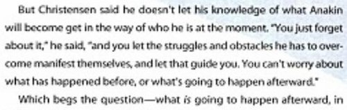
- **Darth Vader (Anakin Skywalker); Obi-Wan Kenobi; Padmé Amidala** — entry/section: Hayden Christensen on Episode III: "He does have one solid prediction for the final sequel. "I think it will be even more fun than Episode II—I can't wait," he said. "We have so much room to play. Everything is set up—we've got the relationship that's going to evolve between Obi-Wan and myself, and what's going to happen with me and Senator Amidala." —Hayden Christensen, Star Wars Insider 60, p. 53" Source: *Star Wars Insider #60* (2002), scan p.53
  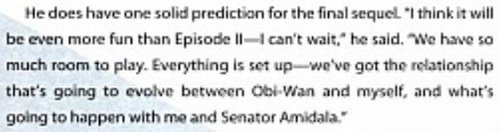

## scan p.54 (scan page 54)

Page contents: George Lucas interview "The Plot Thickens" by Scott Chernoff opens (magazine p. 54): "The creator of Star Wars talks about Indy 4, Episode III, and his latest adventure, Star Wars: Episode II Attack of the Clones." Lucas on watching his films with an audience and on critics. Photo: Padmé, Anakin and Cliegg Lars at the Lars homestead table. (hand-read)

## scan p.55 (scan page 55)

Page contents: Lucas interview continued (magazine p. 55), section "Love & War": Episode II as the darker middle act of a three-act play; comparison with The Empire Strikes Back; toned-down humor; the opening as a Maltese Falcon-style mystery. Captions: the extended Lars family around the dining table with visitors (Padmé, Anakin, Cliegg Lars, Owen Lars, Beru Whitesun); Star Wars: Episode II Attack of the Clones director George Lucas (photo by Tobi Corney); Beru Whitesun and her boyfriend Owen Lars share news with Padmé Amidala and Anakin Skywalker. (hand-read)

- **No single roster character (rules/setting/general)** — entry/section: George Lucas on the middle act: ""The last one was just for fun," Lucas said. "A lot of the things that were planted there start to pay off in this one. You can begin to see in this the root of the problem, whereas in the last one you couldn't. In this one, it starts to happen, but it doesn't really happen. In the next one, everything happens. I'm basically doing a three-act play over a period of 10 years, and the last act of a play is always the best act because you have the climax. The first act has the advantage of introducing all the characters and setting everything up—and that's fascinating to see. But the middle act is always the hardest act to deal with, because you're adding more substance to the story. The plot thickens." —George Lucas, Star Wars Insider 60, p. 55" Source: *Star Wars Insider #60* (2002), scan p.55
  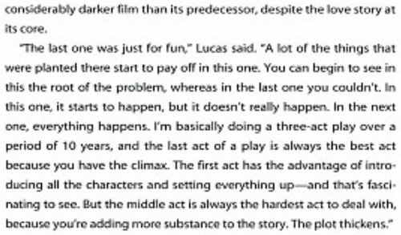

### Stat block notes (game mechanics, not feats)

- Caption: the Lars family table: In a scene that echoes the original Star Wars, the extended Lars family sits around the dining table at their homestead, sharing cool drinks with visitors, (from left) Padmé Amidala (actress Natalie Portman), Anakin Skywalker (actor Hayden Christensen), Cliegg Lars (actor Jack Thompson), Owen Lars (actor Joel Edgerton), and Beru Whitesun (actress Bonnie Piesse). Digital work by ILM. (Source: *Star Wars Insider #60* (2002), scan p.55)

## scan p.56 (scan page 56)

Page contents: Lucas interview continued (magazine p. 56), sections "Dark Side Story" and "From Dreams to Screens": Episode III "will be much darker"; Star Wars grew out of a script too large for one film; the Episode IV title and the studio; creative control; constraints of the original trilogy's effects. Photos: Obi-Wan; Anakin and Padmé at the lake retreat; Lucas, C-3PO, R2-D2 and Rick McCallum. (hand-read)

- **Darth Vader (Anakin Skywalker)** — entry/section: George Lucas on Episode III as tragedy: "Although the saga ends on a high note in Return of the Jedi, Lucas said the final Star Wars film he makes, Episode III, "will be much darker. It's a tragedy. I'm not sure how popular it will be, but it's what the story is, and I think I have to be true to the story more than anything else." —George Lucas, Star Wars Insider 60, p. 56" Source: *Star Wars Insider #60* (2002), scan p.56
  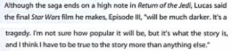

## scan p.57 (scan page 57)

Page contents: Lucas interview continued (magazine p. 57), section "Six Chapters, One Story": returning to make the backstory; ILM's effects giving him a novelist's freedom; Boba Fett's added role via Jango Fett; the prequels as character-driven backstory; Anakin's turn to evil. Pull quote: "I'm free to be as creative in whatever way I want to be—which means that if I make mistakes, they are my own mistakes." Captions identify Obi-Wan on Geonosis, Padmé and Anakin at Padmé's lake retreat, Lucas and McCallum with C-3PO and R2-D2, and Mace Windu and other Jedi arriving on Geonosis. (hand-read)

- **Boba Fett; Jango Fett** — entry/section: George Lucas on Boba Fett and Jango Fett: ""Probably not," Lucas said. "He is a background character, but I needed a device, a bounty hunter to do things. That particular bounty hunter had become a rather popular character, and even though people were writing all kinds of things about where he came from, in my mind he was always connected to the stormtroopers. I realized I could use Jango Fett as the bounty hunter, and he would be Boba's father, and then it all fell into place. But even if he wasn't a popular character, it probably would have fallen into place. There are lots of little stories going on in this one, sidebars of how things came to be. Some of it was written back then, mainly the main characters. But all the secondary characters, like Boba Fett, were added later." —George Lucas, Star Wars Insider 60, p. 57" Source: *Star Wars Insider #60* (2002), scan p.57
  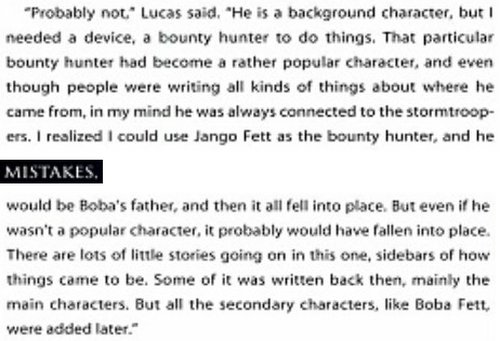
- **No single roster character (rules/setting/general)** — entry/section: George Lucas on backstory being character-driven: ""The thing about a back story," he explained, "is it's more character-driven. It is basically saying, 'Well, this is how everybody got to be where they are.' The other trilogy was more plot-driven. That's the big change." —George Lucas, Star Wars Insider 60, p. 57" Source: *Star Wars Insider #60* (2002), scan p.57
  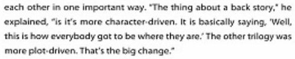

### Stat block notes (game mechanics, not feats)

- Caption strip: Obi-Wan Kenobi (actor Ewan McGregor) does some intelligence work on the planet of Geonosis. >> Padmé Amidala (actress Natalie Portman) and Anakin Skywalker (actor Hayden Christensen) enjoy a respite from their worries at a romantic spot at Padmé's lake retreat. Digital work by ILM. >> Director George Lucas and Producer Rick McCallum surround C-3PO (actor Anthony Daniels) and R2-D2 on a starship set on an Australian soundstage for Attack of the Clones. Photo by Sue Adler. >> Jedi Master Mace Windu (actor Samuel L. Jackson) and other Jedi arrive on Geonosis just in time to even the odds for Obi-Wan Kenobi (actor Ewan McGregor) and his compatriots. Digital work by ILM. (Source: *Star Wars Insider #60* (2002), scan p.57)

## scan p.58 (scan page 58)

Page contents: Lucas interview continued (magazine p. 58): Anakin's fall as a tragedy; thinking of the saga as six movies; Episode I setting up Anakin as a sweet kid; the prequels as "kind of a bummer"; the Coruscant nightclub as a reprise of the Mos Eisley Cantina; Anakin and Luke confronting the same things; the Lars homestead. Photo: Anakin, Padmé, Ki-Adi-Mundi and Jedi in the Geonosis arena. (hand-read)

- **Darth Vader (Anakin Skywalker)** — entry/section: George Lucas on Anakin not being born evil: ""The point is not that you are born evil—the thing that makes the film work ultimately is the fact that he is a good kid, trying to be a good kid, and he grows up to be a good kid. It's simply that his emotions take him places he can't control. He becomes evil out of his own ambition and greed, and revenge and hatred—all those things that kids face. Kids can see how their fears can cause them to do things that will turn them evil, even if they don't want to be evil. So hopefully, that will have some kind of an impact when it's all finished." —George Lucas, Star Wars Insider 60, p. 58" Source: *Star Wars Insider #60* (2002), scan p.58
  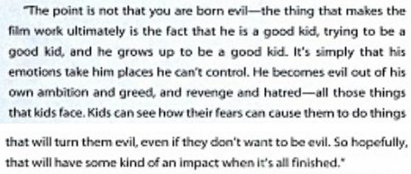
- **Darth Vader (Anakin Skywalker); Luke Skywalker; Obi-Wan Kenobi** — entry/section: George Lucas on the nightclub and the cantina: ""It's more of a sports bar or betting club than a bar," Lucas said of the new nightclub, "but it's obviously a bar and it's one of these reprises. You've got to remember that I'm doing them backward—when you see all six episodes in order, the cantina scene will be the reprise of that scene. You will see the father and the son going through the same things. Anakin and Luke confront exactly the same things. They make different choices, and that adds to the tension at the end of Episode III." —George Lucas, Star Wars Insider 60, p. 58" Source: *Star Wars Insider #60* (2002), scan p.58
  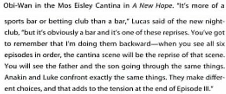

## scan p.59 (scan page 59)

Page contents: Lucas interview continued (magazine p. 59), section "Characters": returning to the Tunisia homestead location; making the digital Yoda look like a puppet and bridging the Phantom Menace and Empire versions; expanding Mace Windu and Samuel L. Jackson; Count Dooku as an old gentleman rather than a monster; Darth Sidious needing an already-trained apprentice. Caption strip (top right) identifies Anakin and Padmé in the Geonosis arena, Lucas in Lake Como, R2-D2 and C-3PO reunited on Tatooine, and the Naboo Royal Cruiser landing on Coruscant. (hand-read)

- **Yoda** — entry/section: George Lucas on the digital Yoda: "Getting Yoda right was crucial, as Lucas acknowledged that the Yoda of The Phantom Menace wasn't exactly perfect. "In the last one," he said, "they built a new puppet with a different kind of material, and it gave him a slightly different nature. He was younger, so we rationalized that we could get away with that. Now, we're trying to bridge that particular version of Yoda with The Empire Strikes Back Yoda. I think we're doing it. We've got a middle ground between the two of them, and he still looks and acts like Yoda to where I don't think you're going to say it's not the same character." —George Lucas, Star Wars Insider 60, p. 59" Source: *Star Wars Insider #60* (2002), scan p.59
  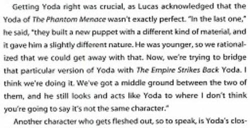
- **Mace Windu** — entry/section: George Lucas on Mace Windu: ""When Sam said he wanted to do anything in the first film, I said, 'Well, I've got this character and he doesn't do anything in the first movie, but gets to do more and fight in the second film, and then he's more pivotal in the third film.'" —George Lucas, Star Wars Insider 60, p. 59" Source: *Star Wars Insider #60* (2002), scan p.59
  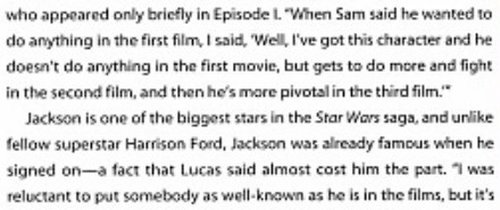
- **Count Dooku; Darth Maul** — entry/section: George Lucas on creating Count Dooku: ""I didn't want to keep creating bigger monsters," Lucas said in explaining the genesis of Count Dooku (Christopher Lee). "I decided to make him an old gentleman—go more into the elegant mode than a monstrous mode. I just felt it was more right for the part. It's not as jazzy as other things, but it seemed to fit better." —George Lucas, Star Wars Insider 60, p. 59" Source: *Star Wars Insider #60* (2002), scan p.59
  
- **Mace Windu** — entry/section: George Lucas on Samuel L. Jackson as Mace: ""I think he has become enmeshed in the milieu and become a character more than Sam Jackson. In the first film, some people tried to get old Sam Jackson, the Shaft reality from the other movies he'd done, but now I think he's established himself strongly enough as Mace that you don't think of him as anything else. He's overcome his other work in creating this character, and it's a very strong character now."" Source: *Star Wars Insider #60* (2002), scan p.59
  

### Stat block notes (game mechanics, not feats)

- Caption strip: Anakin Skywalker (actor Hayden Christensen) and Padmé Amidala (actress Natalie Portman) form a defensive circle with other Jedi as battle droids and super battle droids move in for the kill in the Geonosis execution arena. Digital work by ILM. >> Director George Lucas sets up a shot in Lake Como, Italy, with the Sony high-definition digital camera used to make Star Wars: Episode II Attack of the Clones. Photo by Lisa Tomasetti. >> The droids R2-D2 and C-3PO (actor Anthony Daniels) are reunited on the planet Tatooine with each other and with Padmé Amidala (actress Natalie Portman) and Anakin Skywalker (actor Hayden Christensen). >> The Naboo Royal Cruiser heads in for a landing on Coruscant at the beginning of Star Wars: Episode II Attack of the Clones. Digital work by ILM. (Source: *Star Wars Insider #60* (2002), scan p.59)

## scan p.60 (scan page 60)

Page contents: Lucas interview continued (magazine p. 60): Sidious turning a Jedi as apprentice; Obi-Wan and Dexter Jettster in Dex's diner; the Clone Wars battle; cloning becoming real; Episode III and classic characters. Pull quote: "I'm basically doing a three-act play over a period of 10 years and the last act of a play is always the best act because you have the climax." Photos: the Geonosis battle; Lucas on location. (hand-read)

- **Palpatine (Darth Sidious); Count Dooku** — entry/section: George Lucas on Sidious's new apprentice (continued from p. 59): ""After Darth Sidious' first apprentice is killed," Lucas said, "he has to come up with a new apprentice, and rather than coming up with some baby that he trains from birth, which is what he should have done—well, he shouldn't have gotten himself in a position of getting his apprentice killed anyway—he's decided to make his move, so he needs somebody that was already trained. The point is to set up that he turned this one Jedi, so he could turn another Jedi. It has to be set up that way." —George Lucas, Star Wars Insider 60, pp. 59–60" Source: *Star Wars Insider #60* (2002), scan p.60
  
- **Obi-Wan Kenobi; Dexter Jettster** — entry/section: George Lucas on Dex's diner and the Clone Wars: ""That's been a really fun scene," he said. "It's not anything challenging really, but I like it a lot. We also get to do the Clone Wars, which is like the battle of Naboo, and like the Death Star battle, only it's much more straightforward and intense. We've never done anything like this before—this is really pushing it." —George Lucas, Star Wars Insider 60, p. 60" Source: *Star Wars Insider #60* (2002), scan p.60
  

## scan p.61 (scan page 61)

Page contents: Lucas interview concludes (magazine p. 61), section "Beyond the Clone Wars": possible fourth Indiana Jones film; no original theatrical versions on DVD ("I think of the film as The Special Edition"); television plans after Episode III. Caption strip identifies clone troopers and an SPHA-T on Geonosis, Lucas in Tunisia ("I want it just so."), and Ki-Adi-Mundi, Mace Windu and Yoda with clone troopers in a Republic gunship. (hand-read)

### Stat block notes (game mechanics, not feats)

- Caption strip: Clone troopers help the Jedi wage a fierce battle on Geonosis with the assistance of fighting machines such as this SPHA-T, taking aim at a Trade Federation core ship. Digital work by ILM. >> "'I want it just so,'" Director George Lucas seems to be saying before a shot on location in Tunisia for Star Wars: Episode II Attack of the Clones. Photo by Lisa Tomasetti. >> Clone troopers lean out of the open hatch of a Republic gunship as Jedi Ki-Adi-Mundi (actor Silas Carson), Mace Windu (actor Samuel L. Jackson), and Yoda prepare for further battle against the Separatists. Digital work by ILM. (Source: *Star Wars Insider #60* (2002), scan p.61)

## scan p.62 (scan page 62)

Page contents: "Excerpt from the novelization" Star Wars: Attack of the Clones by R. A. Salvatore, based on the story and screenplay by George Lucas, begins (magazine p. 62): four starships—the Naboo Royal Cruiser and Naboo starfighters—skim past Coruscant's skyscrapers. Title art over rows of clone troopers. Caption: Obi-Wan Kenobi and Anakin Skywalker prepare to confront the enemy at a secret hangar on Geonosis. (hand-read)

### Stat block notes (game mechanics, not feats)

- Caption: Obi-Wan and Anakin: Jedi Obi-Wan Kenobi (actor Ewan McGregor) and his apprentice, the powerful young Anakin Skywalker (actor Hayden Christensen), prepare to confront the enemy at a secret hangar on the planet Geonosis. Digital work by ILM. (Source: *Star Wars Insider #60* (2002), scan p.62)

## scan p.63 (scan page 63)

Page contents: Novelization excerpt continued (magazine p. 63): Senator Amidala returning to vote against the Military Creation Act; Corporal Dolphe in the lead fighter; Captain Typho, Amidala's chief security officer, lands. Byline "By R. A. Salvatore, based on the story and screenplay by George Lucas." Caption: Clone troopers by the thousands pick up their helmets at a central point on the planet Kamino. Digital work by ILM. (hand-read)

## scan p.64 (scan page 64)

Page contents: Novelization excerpt art page (magazine p. 64): reek and nexu photos. Pull quote from the excerpt: "'There's always danger, Captain,' the other responded in a distinctly female voice. 'Sometimes we're just lucky enough to avoid it.'" Captions: a giant, lumbering reek enters the Geonosian execution arena; bounty hunter Jango Fett (Temuera Morrison) fires flames from a wrist weapon during a battle on Geonosis against a phalanx of Jedi; a ferocious nexu bares its teeth in the Geonosis execution arena. (hand-read)

### Stat block notes (game mechanics, not feats)

- Caption: Jango Fett: [RIGHT] Bounty hunter Jango Fett (played by actor Temuera Morrison) fires flames from a wrist weapon during a battle on Geonosis against a phalanx of Jedi. Digital work by ILM. (Source: *Star Wars Insider #60* (2002), scan p.64)

## scan p.65 (scan page 65)

Page contents: Novelization excerpt continued (magazine p. 65): the decoy (Cordé) exits the cruiser dressed as Amidala; Typho's admiration of the Senator; the Royal Cruiser explodes on the landing platform. (hand-read)

## scan p.66 (scan page 66)

Page contents: Novelization excerpt continued (magazine p. 66): Typho sees the robed figure dying in the wreckage; scene shift to Obi-Wan and Anakin on a shuttle—Anakin has reset the hyperspace coordinates; descriptions of the older Obi-Wan and the energetic Padawan Anakin. (hand-read)

## scan p.67 (scan page 67)

Page contents: Novelization excerpt continued (magazine p. 67): Obi-Wan scolds Anakin ("Never do this again"); Anakin thinks about their destination. Captions: an acklay appears ready to close its pincers around Obi-Wan Kenobi in the Geonosis execution arena; Jedi Master Yoda (played by Frank Oz) shows up just in time at a secret hangar on the planet of Geonosis; Padmé Amidala and her Jedi protector Anakin Skywalker share a meal in Padmé's Naboo lake retreat. (hand-read)

### Stat block notes (game mechanics, not feats)

- Caption: Yoda: [BOTTOM LEFT] Jedi Master Yoda (played by Frank Oz) shows up just in time at a secret hangar on the planet of Geonosis. Digital work by ILM. (Source: *Star Wars Insider #60* (2002), scan p.67)

## scan p.68 (scan page 68)

Page contents: Novelization excerpt continued (magazine p. 68): Anakin is anxious to reach Coruscant because of a rumor that Senator Padmé Amidala is on her way to address the Senate; he has not seen her in a decade and has known since he was ten that she was the woman he would marry. (hand-read)

## scan p.69 (scan page 69)

Page contents: Novelization excerpt continued (magazine p. 69): the female pilot beside the dying decoy is revealed as Padmé Amidala; her bodyguard Cordé dies ("I've failed you."). Captions: the Royal Naboo starship makes a return visit to the planet Tatooine; a menacing Geonosian hunts down prey along a droid factory conveyor belt. (hand-read)

### Stat block notes (game mechanics, not feats)

- Excerpt: Cordé's death: Cordé opened her eyes, rich brown orbs so similar to Padmé's own. "I'm sorry, m'Lady," she gasped, struggling for breath with every word. "I'm... not sure I..." She paused and lay there, staring at Padmé. "I've failed you." (Source: *Star Wars Insider #60* (2002), scan p.69)

## scan p.70 (scan page 70)

Page contents: Novelization excerpt concludes (magazine p. 70): Padmé grieves Cordé; Typho urges her away to the vote ("Would you so diminish Cordé's death as to stand here and risk your own life?"); R2-D2 falls in line behind them. Captions: Obi-Wan tries to maneuver his Jedi starfighter out of the way of a guided aerial torpedo fired by Jango Fett in an asteroid belt above Geonosis; Yoda discusses the worrisome state of affairs in the galaxy with Obi-Wan and Mace Windu in a corridor of the Jedi Temple; Padmé and Anakin leave a Coruscant airbus as Obi-Wan looks on. (hand-read)

### Stat block notes (game mechanics, not feats)

- Caption: asteroid belt chase: Obi-Wan Kenobi (actor Ewan McGregor) tries to maneuver his Jedi starfighter out of the way of a guided aerial torpedo fired by bounty hunter Jango Fett in an asteroid belt above the planet Geonosis. Digital work by ILM. (Source: *Star Wars Insider #60* (2002), scan p.70)
- Caption: Jedi Temple corridor: Jedi Master Yoda (played by Frank Oz) discusses the worrisome state of affairs in the galaxy with Obi-Wan Kenobi (actor Ewan McGregor) and Mace Windu (actor Samuel L. Jackson) in a corridor of the Jedi Temple. Digital work by ILM. (Source: *Star Wars Insider #60* (2002), scan p.70)

## scan p.71 (scan page 71)

Page contents: Full-page ad: Topps "The Saga Continues" Star Wars: Attack of the Clones Movie Cards—100 premium movie cards, silver foil stamping, deluxe glossy coating, extra thick card stock, silver and prismatic foil inserts, panoramic fold-out cards; "Coming April 2002." (hand-read)

## scan p.72 (scan page 72)

Page contents: Feature "The Droids of Episode II" by Daniel Wallace opens (magazine pp. 72–73), banner "It's 2002, and it looks like the clones aren't the only ones attacking.": droidekas, battle droids, floating assassins, intelligent tanks and super battle droids; droids can't be considered evil because evil requires intent. Photo: Geonosis droid army. (hand-read)

### Stat block notes (game mechanics, not feats)

- Droids feature intro: Nevertheless, the killer droids of Star Wars can't really be considered evil. Evil cannot exist without intent, and these push-button warriors simply carry out the wishes of their more sinister masters. (When the battle droids in Episode I disengaged from their master control signal, they went as limp as wet noodles.) (Source: *Star Wars Insider #60* (2002), scan p.72)

## scan p.73 (scan page 73)

Page contents: Droids feature intro concludes (magazine p. 73): most droids are automated tools; R2-D2 and C-3PO as fully realized characters; droid personalities develop without memory wipes ("Aware droids" such as 2-1B); Obi-Wan's astromech R4-P17 continues the tradition. (hand-read)

### Stat block notes (game mechanics, not feats)

- Droid personalities: Droids in Star Wars have never been mere appliances, though. From the moment of their screen debut in a blockade-runner's hallway, it was obvious that R2-D2 and C-3PO were fully realized characters. Droid personalities develop when the automatons go too long without memory wipes. Their processors start to catalog life experiences and soon generate a self-aware consciousness complete with personality quirks. (Source: *Star Wars Insider #60* (2002), scan p.73)

## scan p.74 (scan page 74)

Page contents: Droids feature (magazine p. 74), entry "ASN-121 (Zam Wesell's Assassin Droid)": echoes Empire's probe droid; no built-in weaponry, a universal tool mount for glasscutters, flame projectors, poison gas sprayers, kouhuns and more; sentry loadouts; electrified shell; Zam Wesell prefers to hit targets from a safe distance. Banner "ASN-121 Assassin/Sentry droid." (hand-read)

### Stat block notes (game mechanics, not feats)

- ASN-121 and Zam Wesell: The long barrel of her sniper rifle is evidence that Zam Wesell prefers to hit her targets from a safe distance. The ASN-121 is perfect for Wesell's needs, so small that it escapes casual notice and so quiet that it won't even wake a light sleeper (Source: *Star Wars Insider #60* (2002), scan p.74)

## scan p.75 (scan page 75)

Page contents: Droids feature (magazine p. 75), entry "R4-P17 (Obi-Wan's Astromech)": Obi-Wan's "Don't-Seem-To-Remember-Ever-Owning-A-Droid" line defended as the droid being Jedi Temple property; R-series cap types; per Episode II Incredible Cross Sections, R4-P17 was crushed in a Gyndine shipyard trash compactor, rebuilt by Anakin with an R2's cupola, and became the prototype for half-sized astromechs. Banner "R4-P17 astromech droid." (hand-read)

### Stat block notes (game mechanics, not feats)

- R4-P17's origin: According to Episode II Incredible Cross Sections, R4-P17 began his operational life as a cone-headed R4 until a malfunctioning trash compactor at the Gyndine shipyards accordioned him into a mini-droid. Anakin Skywalker found the crumpled wreck while inspecting the shipyard's modifications to the Jedi starfighter, replaced the ruined head with an R2's cupola, and used his skills at droid reconstruction to save the ailing R4 from the scrap heap. (Source: *Star Wars Insider #60* (2002), scan p.75)

## scan p.76 (scan page 76)

Page contents: Droids feature (magazine p. 76), entry "RIC-920 (Rickshaw Droid)": rickshaw origins; conceived by George Lucas to convey Anakin and Padmé through Mos Espa and designed by Marc Gabbana; "unipod droids" per The Episode II Visual Dictionary; street maps, broadcast speaker, three-fingered grippers and a balance gyro. Photo of the rickshaw droid in Mos Espa. (hand-read)

## scan p.77 (scan page 77)

Page contents: Droids feature (magazine p. 77), entry "Super Battle Droid": Nute Gunray pays for better soldiers after Naboo; Count Dooku arranges production in the Geonosis foundries; Poggle the Lesser calls them "the finest army in the galaxy"; acertron armor, mitten hands with an "impulse transmitter," double-barreled forearm blaster cannons, low-profile head. (hand-read)

### Stat block notes (game mechanics, not feats)

- Super battle droid origins: Separatist leader Count Dooku arranged for the production of these robo-killers in the foundries of Geonosis. Nearly a decade after the defeat of automated armies on Naboo, the first super battle droid rolled off the steam-shrouded assembly lines. Upon seeing a demonstration of the new droids' destructive power, the penny-pinching Gunray complained that their firing accuracy left something to be desired. Geonosian leader Poggle the Lesser countered by noting the design improvements built into the super battle droid, calling his factory output "the finest army in the galaxy." (Source: *Star Wars Insider #60* (2002), scan p.77)

## scan p.78 (scan page 78)

Page contents: Droids feature (magazine p. 78), section "Mercantile Murderers": Count Dooku lures mercantile interests to the secessionist banner; the Corporate Alliance, headed by Passel Argente, and its CA tank droid. Footnote: "*Appears off-screen in Star Wars: Episode II Attack of the Clones." Banner "CA tank droid*." (hand-read)

### Stat block notes (game mechanics, not feats)

- Corporate Alliance: The Corporate Alliance is a negotiating body responsible for brokering deals between the galaxy's biggest commercial operations. Headed by Passel Argente, the Corporate Alliance enforces its will with a legion of unstoppable tank droids. (Source: *Star Wars Insider #60* (2002), scan p.78)

## scan p.79 (scan page 79)

Page contents: Droids feature (magazine p. 79): Commerce Guild spider droids (including the Mining Guild mentioned by Princess Leia in Empire) visiting mines that don't pay Guild tributes. Banner "Commerce Guild spider droids." Photos of spider droids at Geonosis. (hand-read)

- **Leia Organa Solo** — entry/section: Spider droids and the Commerce Guild: "Spider droids scuttle through crags and craters on planets under the sway of the Commerce Guild. This conglomerate, which includes the Mining Guild mentioned by Princess Leia in Empire, has a stranglehold on excavating and drilling operations throughout the Republic." Source: *Star Wars Insider #60* (2002), scan p.79
  

## scan p.80 (scan page 80)

Page contents: Droids of Episode II (end): Commerce Guild spider droids under Presidente Shu Mai, burrowing spider droids for mining tunnels; InterGalactic Banking Clan under San Hill on Muunilinst fields Hailfire droids — hoop-wheeled assault 'mechs with fanlike pods of hailfire missiles and a single red eye. Photos of Hailfire droids in battle. (hand-read)

### Stat block notes (game mechanics, not feats)

- Hailfire droids (IBC): From his headquarters on Muunilinst, IBC chief executive San Hill pragmatically extends financing to parties on both sides of a political conflict—but if one of those parties dares to default on an IBC loan, it's time to send in the Hailfire droids. (Star Wars Insider 60, p. 80) (Source: *Star Wars Insider #60* (2002), scan p.80)

## scan p.81 (scan page 81)

Page contents: Full-page advertisement: Games Workshop Warhammer Armies. (hand-read)

## scan p.82 (scan page 82)

Page contents: "Who's Who in Jabba's Palace" by Daniel Wallace, illustrated by Dennis Cramer. Pull quote attributed to Jabba the Hutt: "I keep my friends close, and my enemies even closer." Intro traces the palace denizens from ILM creature-shop nicknames (the Day the Earth Stood Still "Klaatu, Barada, Nikto" joke) through West End Games' Galaxy Guide 6, Tales from Jabba's Palace (1995) and Decipher's Jabba's Palace CCG expansion (1998), which created Sergeant Doallyn. (hand-read)

- **Jabba the Hutt** — entry/section: Pull quote, Who's Who in Jabba's Palace: ""I keep my friends close, and my enemies even closer." —Jabba the Hutt (pull quote), Star Wars Insider 60, p. 82" Source: *Star Wars Insider #60* (2002), scan p.82
  

### Stat block notes (game mechanics, not feats)

- Tales from Jabba's Palace plotters: Tales from Jabba's Palace, a short-story anthology published in 1995, further brought the menagerie to life, this time as complicated characters nursing a host of grudges against Jabba. (Star Wars Insider 60, p. 82) (Source: *Star Wars Insider #60* (2002), scan p.82)

## scan p.83 (scan page 83)

Page contents: Title art: "Palace" over Jabba's palace exterior and close-up of Jabba the Hutt's face. (hand-read)

## scan p.84 (scan page 84)

Page contents: Who's Who, "The Good": Arica (Mara Jade), Attark (Hoover), BG-J38, Sergeant Doallyn, Yarna d'al' Gargan, Ghoel, Kalit, Malakili, Ephant Mon (start). Illustrations for each. (hand-read)

- **Luke Skywalker; Lady Valarian; Jabba's Rancor** — entry/section: Malakili: "The tubby rancor-keeper is best remembered for his crying jag following the death of his pet. Tales from Jabba's Palace explored the bond between trainer and monster, revealing that Malakili had plotted with Jabba's Whipid rival Lady Valarian to free the rancor from its cruel captivity, only to see those hopes dashed when Luke Skywalker brought a gate down on the creature's head. More recently, the Star Wars ongoing comic gave a glimpse of Malakili's early days in the Circus Horrificus, and LucasArts' Star Wars Demolition allowed gamers to control Malakili and his rancor as contestants in a smash-and-crash vehicular brawl." Source: *Star Wars Insider #60* (2002), scan p.84
  

### Stat block notes (game mechanics, not feats)

- Arica: During Return of the Jedi, however, Mara Jade posed as a dancing girl named Arica on a secret mission for the Emperor. Her failure to assassinate Luke inside Jabba's palace earned her a stern reprimand from her master, who died a few days later aboard the second Death Star. (Star Wars Insider 60, p. 84) (Source: *Star Wars Insider #60* (2002), scan p.84)
- Ephant Mon: Ephant Mon has since been identified as a Chevin gunrunner, and comic books such as the Star Wars ongoing series have shown that he's had his paws in corrupt conspiracies since the time of The Phantom Menace. (Star Wars Insider 60, p. 84) (Source: *Star Wars Insider #60* (2002), scan p.84)

## scan p.85 (scan page 85)

Page contents: Who's Who, "The Good" cont.: Ephant Mon (end — founded a Force-worshiping sect on Vinsoth), Loje Nella, Oola, Porcellus, Rennek, Saelt-Marae (Yak Face), Tamtel Skreej (Lando), Tanus Spijek, Gauron Nas Tal, Tessek, Pucumir Thryss. (hand-read)

### Stat block notes (game mechanics, not feats)

- Ephant Mon epiphany: After Jabba died at the Great Pit of Carkoon, Ephant Mon returned to his homeworld of Vinsoth and founded a religious sect that worshiped the Force. (Star Wars Insider 60, p. 85) (Source: *Star Wars Insider #60* (2002), scan p.85)
- Oola: Oola, a young Twi'lek from the deserts of Ryloth, landed in Jabba's palace after fellow Twi'lek Bib Fortuna sold her into slavery. (Star Wars Insider 60, p. 85) (Source: *Star Wars Insider #60* (2002), scan p.85)
- Tamtel Skreej: Tamtel Skreej is actually Lando Calrissian in disguise, of course. (Star Wars Insider 60, p. 85) (Source: *Star Wars Insider #60* (2002), scan p.85)
- Tessek: Tessek has since been revealed to be a Quarren from the planet Mon Calamari (also the homeworld of Admiral Ackbar's species of the same name). (Star Wars Insider 60, p. 85) (Source: *Star Wars Insider #60* (2002), scan p.85)

## scan p.86 (scan page 86)

Page contents: Who's Who cont.: Pucumir Thryss (end), Shasa Tiel; "The Bad": Cane Adiss, Amanaman, B'omarr Monk, Bubo, EV-9D9, Bib Fortuna, Fozec (start). (hand-read)

### Stat block notes (game mechanics, not feats)

- EV-9D9: Unfortunately a hardware glitch gave her the personality of a professional torturer. (Star Wars Insider 60, p. 86) (Source: *Star Wars Insider #60* (2002), scan p.86)
- Bib Fortuna: As demonstrated by his appearance in The Phantom Menace's Podracing box, Bib Fortuna worked for Jabba for decades. In all that time, not a minute went by that he didn't hate the Hutt with all his might. (Star Wars Insider 60, p. 86) (Source: *Star Wars Insider #60* (2002), scan p.86)

## scan p.87 (scan page 87)

Page contents: Who's Who cont.: Fozec (end), Giran, Herat, J'Quille, Klaatu, Nysad, Vizam, Wittin, Wooof; "The Goofy": 8D8, Barada, Beedo (start). (hand-read)

### Stat block notes (game mechanics, not feats)

- J'Quille: Prior to Han Solo's rescue, J'Quille became the lover of Jabba's rival, Lady Valarian. (Star Wars Insider 60, p. 87) (Source: *Star Wars Insider #60* (2002), scan p.87)
- Wittin: Another Jawa seen in Jabba's throne room, Wittin is a chieftain of a powerful Jawa tribe. (Star Wars Insider 60, p. 87) (Source: *Star Wars Insider #60* (2002), scan p.87)
- Beedo: Beedo entered the bounty hunting profession to erase his cousin Greedo's disgrace and restore honor to the Rodians of clan Tetsus. (Star Wars Insider 60, p. 87) (Source: *Star Wars Insider #60* (2002), scan p.87)

## scan p.88 (scan page 88)

Page contents: Who's Who cont.: Beedo (end), Salacious Crumb, Hermi Odle, Ortugg, Ree-Yees, Pote Snitkin, Weequay. "Test Your Knowledge" quiz box (5 questions) with upside-down answers: 1. Jabba disintegrated him; 2. Jabba the Hutt (in Star Wars: A New Hope Special Edition); 3. He had hibernation sickness; 4. Fifteen percent; 5. Gran and Humans. (hand-read)

### Stat block notes (game mechanics, not feats)

- Salacious Crumb: A tiny Kowakian monkey-lizard, Salacious Crumb always sat at Jabba's side as a combination pet and court jester. (Star Wars Insider 60, p. 88) (Source: *Star Wars Insider #60* (2002), scan p.88)
- Test Your Knowledge Q1 + answer: In Return of the Jedi, C-3PO is forced to serve as Jabba the Hutt's protocol droid. What happened to the Hutt's previous protocol droid? … Answers: 1. Jabba disintegrated him (Star Wars Insider 60, p. 88) (Source: *Star Wars Insider #60* (2002), scan p.88)
- Test Your Knowledge Q3 + answer: According to Boushh, why was Han Solo shaking when he was released from the carbonite in Return of the Jedi? … 3. He had hibernation sickness (Star Wars Insider 60, p. 88) (Source: *Star Wars Insider #60* (2002), scan p.88)

## scan p.89 (scan page 89)

Page contents: Full-page advertisement: O.R.B. 3D real-time strategy game (Strategy First), with press blurbs. (hand-read)

## scan p.90 (scan page 90)

Page contents: "Back on Topps: Return of the Trading Cards" by Chris Fawcett. Topps (Star Wars licensee since 1977) — Star Wars Evolution set (characters only, two photos per card, prequel and classic images together, first images of young Beru/Owen and teenage Anakin; autographed cards incl. Mike Quinn as Nien Nunb, Carrie Fisher, Anthony Daniels). Quotes from Topps editor/project manager Matthew Saunders and supervising editor John Williams. Episode II: Attack of the Cards — 100-card set in April, standard card size. Captions: signature cards; photo of Saunders and Williams. (hand-read)

- **No single roster character (rules/setting/general)** — entry/section: Saunders on Evolution set: ""This is really one of the first places fans could see the growing Star Wars universe not as distinct parts—classic vs. new—but as one unified whole." —Matthew Saunders, Star Wars Insider 60, p. 90" Source: *Star Wars Insider #60* (2002), scan p.90
  

### Stat block notes (game mechanics, not feats)

- Caption: Evolution signature cards: Star Wars Evolution signature cards signed by voice actor James Earl Jones and actor Peter Mayhew. (Star Wars Insider 60, p. 90) (Source: *Star Wars Insider #60* (2002), scan p.90)

## scan p.91 (scan page 91)

Page contents: Topps article cont.: AOTC set types (Character, Storyline, Behind-the-Scenes cards), chase cards (8 Prismatic, 10 Silver Foil, 5 Panoramic Fold-Out), Gary Gerani's scene selection, late Lucasfilm imagery, possible Series Two/Widevision/3D; twenty-eighth regular Topps Star Wars set. Card images: clone trooper, Anakin, Jango Fett, Padmé, Yoda; Behind-the-Scenes cards "The Many Faces of Anthony Daniels", "Mace Sets the Pace". Captions [ABOVE]/[BELOW]. (hand-read)

### Stat block notes (game mechanics, not feats)

- Captions p91: [ABOVE] Attack of the Clones character cards [BELOW] Behind-the-Scenes cards reveal what happened between takes and in the ILM prop shop. (Star Wars Insider 60, p. 91) (Source: *Star Wars Insider #60* (2002), scan p.91)

## scan p.92 (scan page 92)

Page contents: "Anthony Heald" title spread: portrait with pull quote "You really, I think, can't paint with colors that are too bold in an audiotape. —Anthony Heald"; photo credit courtesy of Endeavor. (hand-read)

## scan p.93 (scan page 93)

Page contents: "Anthony Heald: Man of a Thousand Voices" by Rich Handley. History of Star Wars audio (NPR radio drama, Brian Daley, book-and-cassette adaptations, audiobooks); Heald holds the record with thirty-five Star Wars audiobooks in eight years; career bio (Silence of the Lambs, Boston Public); started with The Truce at Bakura via producer David Rapkin. (hand-read)

- **No single roster character (rules/setting/general)** — entry/section: Heald on starting Star Wars audiobooks: ""I started doing audiobooks," Heald recalls, "back in the early '90s with The Things They Carried [by Tim O'Brien], and the second one I did was The Pelican Brief. I worked with the producer, David Rapkin, who at the time was doing the Star Wars books with Anthony Daniels." —Anthony Heald, Star Wars Insider 60, p. 93" Source: *Star Wars Insider #60* (2002), scan p.93
  

## scan p.94 (scan page 94)

Page contents: Heald interview cont.: preferred reading, Alec Guinness as influence, "The Reason of Voice" — preparation (four read-throughs, ~thirty hours per three-hour tape), suggesting rather than imitating characters, character growth of Han, Leia and Lando, female characters. Sidebar "Star Wars Audiobooks Narrated by Anthony Heald" lists 35 titles (The Truce at Bakura through The New Jedi Order—Agents of Chaos II: Jedi Eclipse). Strip of audiobook covers. (hand-read)

- **Han Solo; Leia Organa Solo; Lando Calrissian** — entry/section: Heald on characters progressing: ""When you do a Star Wars book or a film or a play," says Heald, "you have characters with a very specific life. In the Star Wars books, which is the closest experience that I've had to doing a series [before Boston Public], you have characters like Han and Leia and Lando that progress through time, that age, that go through a variety of experiences and have their ups and downs." —Anthony Heald, Star Wars Insider 60, p. 94" Source: *Star Wars Insider #60* (2002), scan p.94
  
- **No single roster character (rules/setting/general)** — entry/section: Heald on not imitating voices: ""I'm not Rich Little, I'm not a great vocal impersonator, and I can't do Harrison Ford or whomever. What I try to do is just get a sense of the type of person it is and look for a vocal quality that suggests the character, rather than do an out-and-out imitation." —Anthony Heald, Star Wars Insider 60, p. 94" Source: *Star Wars Insider #60* (2002), scan p.94
  

## scan p.95 (scan page 95)

Page contents: Full-page Dark Horse advertisement: Star Wars: Episode II Attack of the Clones trade-paperback adaptation by Henry Gilroy, Jan Duursema and Ray Kryssing, cover by Drew Struzan, $17.95; tagline "A Jedi shall not know anger. Nor hatred. Nor love." (hand-read)

## scan p.96 (scan page 96)

Page contents: Heald interview end. "Where Have I Heard You Before?" — consistency across books, computer database of characters, director Lars Hoel playing back earlier voices, basing alien accents on Earth accents. "Video Called the Audio Star" — move to Oregon in the mid-90s, recording in Medford with producer David Rapkin, Boston Public schedule ending his Star Wars audiobook work after the Bantam-to-Del Rey transition; last title Jedi Eclipse. (hand-read)

- **No single roster character (rules/setting/general)** — entry/section: Heald on recurring characters: ""It got extremely complicated as we got later on in my association with the books, because when I was doing the fifteenth or twentieth book, characters that had appeared in earlier books were re-appearing. I mean, you always have the core characters who are in every book, and those voices are fairly ingrained—but you get someone where you think, 'Now, what was that voice like?' or 'Has this character appeared before?' and so forth." —Anthony Heald, Star Wars Insider 60, p. 96" Source: *Star Wars Insider #60* (2002), scan p.96
  

## scan p.97 (scan page 97)

Page contents: The Jawa Trader, Volume 60 (Fan Club Online Store, swfan.wizards.com): contents box; "What Is Collector Grade?" (Collector Grade vs. Standard Grade); Keywords box (Queen Amidala keyword JT4557 $8.99/$7.49); subscription and membership prices (Fan Club 1 yr $29.95 / 2 yr $45.95 US; Insider 1 yr $19.95 / 2 yr $35.95 US; Canadian prices). (hand-read)

## scan p.98 (scan page 98)

Page contents: Jawa Trader: Action Figures — Luke Skywalker (pilot), Ellorrs Madak (Fan Choice #1), Darth Vader (Emperor's Wrath), Ketwol, Queen Amidala (Royal Decoy), Darth Maul, Gungan Warrior, Coruscant Guard, Sabé (Queen's Decoy), Bespin Guard, Qui-Gon Jinn (Naboo), Obi-Wan Kenobi (Duel), Darth Maul & Sith Attack Droid, Princess Leia Organa with Sail Barge Cannon, Mon Calamari, Episode I C-3PO, FX-7 Medical Droid, K-3PO; Action Figure Stands; Luke Skywalker in Bacta Tank ($13.99/$12.99). (hand-read)

### Stat block notes (game mechanics, not feats)

- Luke Skywalker in Bacta Tank blurb: After a nearly fatal encounter with a vicious wampa on the frozen plains of Hoth, Luke Skywalker is rescued by a determined Han Solo. (Star Wars Insider 60, p. 98) (Source: *Star Wars Insider #60* (2002), scan p.98)

## scan p.99 (scan page 99)

Page contents: Jawa Trader: Games — Star Wars Roleplaying Game Revised Rulebook (NEW!), Star Wars Gamer back issues #4–#9 (contents listed), Rebellion Era Sourcebook, The Dark Side Sourcebook, New Jedi Order Sourcebook, Tempest Feud, Starships of the Galaxy, The Secrets of Naboo, Alien Anthology, The Secrets of Tatooine. (hand-read)

## scan p.100 (scan page 100)

Page contents: Jawa Trader: Miscellaneous — Episode I hardbound novel special edition signed by Terry Brooks (5,000 copies), limited edition Princess Leia cookie jar (1,000), Star Wars Celebration pass set (with Ahmed Best–signed Exhibitor Pass), Star Wars bobbleheads (Boba Fett, R2-D2 & C-3PO, Darth Vader; 4,000 each), Star Wars Insider back issues #52–#59 with contents; "Subscribe! 6 issues only $19.95, see offer p. 121". (hand-read)

## scan p.101 (scan page 101)

Page contents: Subscribe to Star Wars Insider and become a Star Wars Fan Club Member: benefits ($10 gift certificate, welcome letter from George Lucas, preferred online-store status); membership order form (blank fields; [postal address omitted]). (hand-read)

## scan p.102 (scan page 102)

Page contents: Jawa Trader: "Attack of the Clones action figures are now available at swfan.wizards.com" — check online for pricing, selection and availability. (hand-read)

## scan p.103 (scan page 103)

Page contents: "The Clones Figure Update: Flying Off the Shelves at Lightspeed," photos by Dan McCormack. AOTC figures: Obi-Wan Kenobi (Coruscant Chase), Anakin Skywalker (Outland Peasant Disguise), Padmé Amidala (Arena Escape), Geonosian Warrior, Shaak Ti (Jedi Master), Super Battle Droid; action-feature callouts. (hand-read)

### Stat block notes (game mechanics, not feats)

- Figure update intro: You may have one, two, or all of these figures by now if your local toy store was able to keep them in stock long enough for you to count your allowance. (Star Wars Insider 60, p. 103) (Source: *Star Wars Insider #60* (2002), scan p.103)

## scan p.104 (scan page 104)

Page contents: Behind the Magic: "Swarm Troopers — Creating the Battle Droids of The Phantom Menace" by Rob Coleman, ILM animation director. Lucas's concept of droids controlled by a droid control ship; signal lag makes them vulnerable to Jedi. "Building a Battle Droid": Doug Chiang's art department, designed slimmer than a human so fully CG, maquette used by modeler Simon Cheung. "Troop Colors" box: Security droid (red shoulders), Commander droid (yellow head), Pilot droid (blue shoulders), Trooper droid (back pack). (hand-read)

### Stat block notes (game mechanics, not feats)

- Battle droids: control ship: George Lucas' idea for the battle droids was that they didn't think for themselves but instead received signals from a droid control ship. (Star Wars Insider 60, p. 104) (Source: *Star Wars Insider #60* (2002), scan p.104)

## scan p.105 (scan page 105)

Page contents: Battle droids cont.: full-sized prop droids (one shot in Naboo hangar), droid torso on Ahmed Best's costumed foot, live-action interaction (droids leading Sio Bibble/Oliver Ford Davies), key frame animation explained. Caption on concept sketches by Doug Chiang; numbered droid caption (1138). (hand-read)

### Stat block notes (game mechanics, not feats)

- Caption: droid number 1138: During the production of the film, George decided that he wanted each droid to have an individual number. This can be seen most clearly at the end of the ground battle with the Gungans. After the droid control ship is destroyed and the battle droids are deactivated, Jar Jar pushes over droid number 1138—a significant number, as true fans know. You are a true fan, aren't you? (Star Wars Insider 60, p. 105) (Source: *Star Wars Insider #60* (2002), scan p.105)
- Battle droids push Sio Bibble: A good example of this effect is when battle droids lead Sio Bibble (Oliver Ford Davies) away in the Queen's palace. (Star Wars Insider 60, p. 105) (Source: *Star Wars Insider #60* (2002), scan p.105)

## scan p.106 (scan page 106)

Page contents: Battle droids cont.: motion capture; "The People Behind the Droids" — Ben Burtt's magnetic-suit walk with offset hip rotation became the "duck walk"; Lucas cites Ray Harryhausen's skeleton fight in Jason and the Argonauts and "pigeon" movements; James Tooley (chaining, battle droid lead animator), Jeff Light (motion capture), palace stairs captured on plywood steps, Tim McLaughlin (digital clothing), Paul Kavanagh (ground battle lead); "Battle Droids on Parade" begins. Captions: [LEFT] Qui-Gon clears a path to the Queen's starship; [BELOW] Harryhausen's skeletons inspired the movement of the battle droids. (hand-read)

### Stat block notes (game mechanics, not feats)

- Battle droid "duck walk": George saw the render of the session and liked the effect. From that point, the droid had its distinct "duck walk." (Star Wars Insider 60, p. 106) (Source: *Star Wars Insider #60* (2002), scan p.106)
- Battle droids as early experiment: As he explained, these droids were an early experiment that was phased out by the time we reach A New Hope, so they couldn't be too powerful or threatening. (Star Wars Insider 60, p. 106) (Source: *Star Wars Insider #60* (2002), scan p.106)

## scan p.107 (scan page 107)

Page contents: Battle droids end: crowd simulation and splines for marching armies, Spartacus/Braveheart battle study, mini-fights, rigid body simulations (James Tooley); ends "Four words: Attack of the Clones!" "Animation Glossary" box: Chaining, Cycling, Key Frame Animation, Maquette, Matte, Motion Capture, Optical Motion Capture Suit, Rigid Body Simulation, Rotoscoping, Spline. (hand-read)

### Stat block notes (game mechanics, not feats)

- Glossary: Rigid body simulation: RIGID BODY SIMULATION: A technical process by which animators define the weight, gravity, and momentum of computer-generated objects for creating believable collisions and explosions. (Star Wars Insider 60, p. 107) (Source: *Star Wars Insider #60* (2002), scan p.107)

## scan p.108 (scan page 108)

Page contents: Game Scape: "Attack of the Board Games — Fight Star Wars Battles Right on Your Dining Room Table" by Rob Daviau, photos by Dan McCormack. Five new Hasbro board games: Jedi Unleashed (Geonosis arena, dice-driven, Yoda's arrival ends the battle), Star Wars Stratego (four variants, special powers), Star Wars The Game of Life: A Jedi's Path (start). (hand-read)

- **Yoda** — entry/section: Jedi Unleashed gameplay: "Gameplay is dice-driven, and players control a Jedi and an enemy character on each turn. When Yoda arrives, the surviving Jedi who has defeated the most enemy characters wins the battle." Source: *Star Wars Insider #60* (2002), scan p.108
  

### Stat block notes (game mechanics, not feats)

- Jedi Unleashed: The Geonosians, Count Dooku, Jango Fett, and army of battle droids all outnumber the Jedi—Not to mention the reek, which is out of control and stomps good and evil alike. (Star Wars Insider 60, p. 108) (Source: *Star Wars Insider #60* (2002), scan p.108)

## scan p.109 (scan page 109)

Page contents: Board games cont.: Game of Life (light vs. dark paths; four aspects of the Force: Logic, Intuition, Fighting, Energy), Star Wars Epic Duels (36 duels, 4 locations — Geonosis, Kamino, Bespin, Emperor's Throne Room; 31 painted figures, 12 card decks), Star Wars—Electronic Battleship (10 ships; Classic, Salvo, Bonus, Advanced missions). Photos of game boxes and boards. (hand-read)

### Stat block notes (game mechanics, not feats)

- Epic Duels: You can take the role of Mace Windu and challenge Darth Vader to an all-out battle on Geonosis, or send Jango Fett to hunt down Luke Skywalker on Kamino. (Star Wars Insider 60, p. 109) (Source: *Star Wars Insider #60* (2002), scan p.109)

## scan p.110 (scan page 110)

Page contents: Bookshelf: "Dark Duo — Boys Will Be Boys" by Jason Fry. Scholastic's two new young-reader series: Jedi Quest (Jude Watson; The Way of the Apprentice, The Trail of the Jedi; editor David Levithan; Anakin's rivalry with Ferus, friend Tru, Padawan Darra) and Boba Fett (Terry Bisson; The Fight to Survive; "Huck Finn meets Batman"). Covers of Jedi Quest books. (hand-read)

- **Obi-Wan Kenobi; Darth Vader (Anakin Skywalker)** — entry/section: Levithan on Anakin/Obi-Wan imbalance: ""From the very moment their relationship was formed there has been this strange imbalance," Levithan says. —David Levithan, Star Wars Insider 60, p. 110" Source: *Star Wars Insider #60* (2002), scan p.110
  

### Stat block notes (game mechanics, not feats)

- Jedi Quest apprentices: Those who started reading in April have already met Tru, Anakin's first friend at the Jedi Academy; the wise-cracking female Padawan Darra; and Ferus, who resents Anakin's status as the Jedi supposed Chosen One. (Star Wars Insider 60, p. 110) (Source: *Star Wars Insider #60* (2002), scan p.110)

## scan p.111 (scan page 111)

Page contents: Dark Duo end: Boba Fett series intersects the Clone Wars, old Fett back story no longer applies, moral quandaries; pull quote "It's certainly dark, though not so dark that we will alienate our young readers." —David Levithan, series editor. Photos: Obi-Wan and Anakin in speeder, young Boba Fett; Boba Fett book cover. (hand-read)

- **Boba Fett** — entry/section: Levithan on Boba Fett series tone: ""It's certainly dark, though not so dark that we will alienate our young readers," he says. —David Levithan, Star Wars Insider 60, p. 111" Source: *Star Wars Insider #60* (2002), scan p.111
  
- **Boba Fett; Darth Vader (Anakin Skywalker)** — entry/section: Levithan: Anakin redeems himself: "Levithan points out one key difference between Boba Fett and Anakin Skywalker: With Anakin, "at least we know he redeems himself in the very end." —David Levithan, Star Wars Insider 60, p. 111" Source: *Star Wars Insider #60* (2002), scan p.111
  

## scan p.112 (scan page 112)

Page contents: Comics Link: "Jango Fett: Open Seasons — What's a Mandalorian? Glad You Asked." by Daniel Wallace. Temuera Morrison's "Bucket Head" umbrella homage; four-issue series by Haden Blackman (LucasArts, Star Wars Galaxies producer; Crossbones with Nym); developed backstory with Bounty Hunter lead Jon Knoles; Jaster Mereel/Concord Dawn fragments preserved. Comic art illustrations by Ramon F. Bachs and Raul Fernandez. (hand-read)

- **Jango Fett** — entry/section: Blackman on Open Seasons title: ""I chose the title Open Seasons because the story is really about four seasons in Jango's life," explains Blackman. "Four key events that transform him and put him on a different path. Throughout the series, we see him go from an innocent, to a soldier, to a hardened killer." —Haden Blackman, Star Wars Insider 60, p. 112" Source: *Star Wars Insider #60* (2002), scan p.112
  
- **Jango Fett** — entry/section: Blackman: Jango as a soldier: ""I'm really trying to show Jango as a soldier, a grunt," Blackman clarifies. —Haden Blackman, Star Wars Insider 60, p. 112" Source: *Star Wars Insider #60* (2002), scan p.112
  

## scan p.113 (scan page 113)

Page contents: Open Seasons end: Jaster Mereel in Fett's life, Jango as cult hero, artists Ramon F. Bachs and Raul Fernandez (Barcelona) on Star Wars in Spain. Comic panels (Death Watch, Vizsla, Jaster Mereel, Concord Dawn). Sidebar "The Marvel Series Returns": Dark Horse reprinting the Marvel series in seven trade paperbacks (first volume June 5), with quote from editor David Land. (hand-read)

- **Jaster Mereel; Jango Fett** — entry/section: Blackman on Jaster Mereel: ""We thought it was plausible that Jaster Mereel had been someone in Fett's life and that the two histories got confused over time." —Haden Blackman, Star Wars Insider 60, p. 113" Source: *Star Wars Insider #60* (2002), scan p.113
  
- **Jango Fett; Wedge Antilles** — entry/section: Blackman on Jango as cult hero: ""Who knew that Wedge would become such a fan favorite? Jango's a bounty hunter with a cool suit of armor and lots of gadgets—what's not cool about that? He's technically a villain, but you get the feeling that there's more to him than just a hired gun, that he has some depth. And, of course, he can whack just about anyone in the galaxy." —Haden Blackman, Star Wars Insider 60, p. 113" Source: *Star Wars Insider #60* (2002), scan p.113
  

### Stat block notes (game mechanics, not feats)

- Open Seasons panels: Death Watch: "Decades ago, the mercenary group known as the Mandalorians fractured, giving rise to a chaotic splinter group." "They called themselves the 'Death Watch' and followed a barbarian called Vizsla, who believed that the Mandalorians should conquer the galaxy." (Star Wars Insider 60, p. 113) (Source: *Star Wars Insider #60* (2002), scan p.113)
- Marvel Series Returns: classic additions: Marvel's classic additions to the Star Wars universe—the Tarkin superweapon, the Mandalorian Supercommandos, Luke Skywalker's love-turned-nemesis Shira Brie, and even the infamous six-foot bunny rabbit—are now accessible to a new audience. (Star Wars Insider 60, p. 113) (Source: *Star Wars Insider #60* (2002), scan p.113)

## scan p.114 (scan page 114)

Page contents: Set Piece: "Theed Palace Hangar — Now Boarding for Coruscant, With Just One Short Layover..." by Chris Reiff & Chris Trevas. TPM's Leavesden Stage A (former Rolls Royce aviation factory) became the hangar; set decorator Peter Walpole; ILM digital extensions (42 starfighters, 275-foot set doubled, 80-foot ceiling, Mylar floor and bluescreen). Callouts: boarding ramp/landing gear only built; bulk shipping containers; battle droid blaster rifles by Jay Shuster. (hand-read)

### Stat block notes (game mechanics, not feats)

- Hangar set and ILM extension: The final hangar seen on film is several times the size of the physical set with a full capacity of forty-two starfighters. (Star Wars Insider 60, p. 114) (Source: *Star Wars Insider #60* (2002), scan p.114)
- Battle droid blaster design: Jay Shuster designed the battle droid blaster rifles as predecessors to Imperial weapons. The influence was taken a step further when the handles and textured grip of the toy stormtrooper blaster by Hasbro were incorporated into the final props. (Star Wars Insider 60, p. 114) (Source: *Star Wars Insider #60* (2002), scan p.114)

## scan p.115 (scan page 115)

Page contents: Theed hangar callouts: starfighter support units are stripped-down street cleaners; ground crew wore leather motorcycle boots; Art Nouveau hairpin inspired Naboo N-1 (Doug Chiang); "Battle Droids don't stand half a chance against two Jedi."; pilot helmets/WWII RAF goggles, construction helmet earmuffs; deck scrubber droids from upside-down plastic storage containers, one with an R2 unit's holographic eye. (hand-read)

### Stat block notes (game mechanics, not feats)

- N-1 starfighter inspiration: An Art Nouveau hairpin spotted by design director Doug Chiang was the inspiration for the sleek curves of the Naboo N-1 Starfighter. (Star Wars Insider 60, p. 115) (Source: *Star Wars Insider #60* (2002), scan p.115)
- Naboo pilot helmets: Naboo pilot helmets reflect a similarity in style to early aviation headgear. In fact, the pilots wear the same goggles as those used by the British Air Force in World War II. The built-in headphones are construction helmet safety earmuffs. (Star Wars Insider 60, p. 115) (Source: *Star Wars Insider #60* (2002), scan p.115)

## scan p.116 (scan page 116)

Page contents: Scouting the Galaxy: "Now That You Bought It, Where Do You Put It? — Sleeping on Action Figures, a Leia Gender Change, Programs, Posters, and Glasses for a Ticket" by Steve Sansweet. AOTC merchandise after April 23; Toy Fair report: LEGO Republic Gunship, Hasbro's 52 new figures (Gentle Giant laser scans), 12-inch line, Geonosian Arena playset, Playskool line, voice-activated electronic R2-D2. Photos: Jango Fett figure, R2-D2, Playskool toys. (hand-read)

- **R2-D2** — entry/section: Sansweet on Playskool and electronic Artoo: ""But I've got to admit that I was blown away by two things: The Playskool Star Wars line for small kids (and not a few collectors) and the voice-activated electronic R2-D2." —Steve Sansweet, Star Wars Insider 60, p. 116" Source: *Star Wars Insider #60* (2002), scan p.116
  

## scan p.117 (scan page 117)

Page contents: Scouting cont.: Artoo reacts to Darth Vader; Master Replicas announced as new licensee. Reader Q&As (letter writers' names omitted): 1977 Burger King glasses (Luke and Leia, Han and Chewie, the droids, Darth Vader; $5–$10 each) and 25th Anniversary poster (Trends International); "Dark Lord of the Stiffs" — Ponda Baba Freeze Frame card with Vader with Removable Helmet figure (sold for $761, 61 bids). Pull quote. Photos: Burger King glasses, Freeze-Frame Vader vs. actual Ponda Baba cards. (hand-read)

- **No single roster character (rules/setting/general)** — entry/section: Sansweet pull quote on movie programs: ""In the U.S., movie programs sold in theater lobbies have gone the way of real butter on popcorn." —Steve Sansweet, Star Wars Insider 60, p. 117" Source: *Star Wars Insider #60* (2002), scan p.117
  
- **Luke Skywalker; Leia Organa Solo; Han Solo; Chewbacca; Darth Vader (Anakin Skywalker)** — entry/section: Sansweet on 1977 Burger King glasses: ""The glasses—which feature designs of Luke and Leia, Han and Chewie, the droids and Darth Vader—have a wonderful retro look." —Steve Sansweet, Star Wars Insider 60, p. 117" Source: *Star Wars Insider #60* (2002), scan p.117
  
- **Darth Vader (Anakin Skywalker)** — entry/section: Sansweet on Ponda Baba/Vader card oddity: ""It's a definite oddity and worth exactly $761 . . . the top bid out of the 61 total bids in your eBay auction. Most impressive." —Steve Sansweet, Star Wars Insider 60, p. 117" Source: *Star Wars Insider #60* (2002), scan p.117
  

## scan p.118 (scan page 118)

Page contents: Scouting cont. Reader Q&As (names omitted): displaying a collection (photos of figures on a bed); TPM souvenir program booklet (Canadian program by Tribute Publishing, 11 x 13.5 inches, 52 pages); Expanded Universe Speeder Bike box holding Princess Leia in Endor Gear instead of the exclusive pilot; official stormtrooper outfit note. "Scouting for Answers?" box: send questions to Scouting the Galaxy, [postal address omitted], or [email omitted]. (hand-read)

- **No single roster character (rules/setting/general)** — entry/section: Sansweet on photographing collections: ""But with the low price and convenience of digital cameras and huge disk-drive storage, maybe more collectors should think about taking photos of everything before closing them away in some personal storage locker." —Steve Sansweet, Star Wars Insider 60, p. 118" Source: *Star Wars Insider #60* (2002), scan p.118
  
- **Leia Organa Solo** — entry/section: Sansweet on swapped figure: ""But it's just as likely someone wanted the exclusive speeder bike pilot figure, bought the toy, and expertly exchanged figures before returning it for a full refund. It has been known to happen—a lot. I'd call it theft." —Steve Sansweet, Star Wars Insider 60, p. 118" Source: *Star Wars Insider #60* (2002), scan p.118
  

## scan p.119 (scan page 119)

Page contents: Dragon magazine subscription ad ("Pick up a 6-Pack of Dragon"). No editorial content. (hand-read)

## scan p.120 (scan page 120)

Page contents: Crossword: "Jar Jar Binks Is 31 Today!" by Mike Selinker (Across/Down clues, e.g. "Rebel pilot Darklighter (9)", "Chewbacca's home planet (28)", "Luke's preferred starfighter (16)"; answers on p. 124). Cartoon "Shogungan" (Jar Jar with a sword: "Me-san Jar-Jar Binks..."). (hand-read)

### Stat block notes (game mechanics, not feats)

- Crossword clues: Rebel pilot Darklighter (9) ... Chewbacca's home planet (28) ... Luke's preferred starfighter (16) (Star Wars Insider 60, p. 120) (Source: *Star Wars Insider #60* (2002), scan p.120)

## scan p.121 (scan page 121)

Page contents: THQ/LucasArts Star Wars Episode II: Attack of the Clones Game Boy Advance ad ("Grab Your Lightsaber, The Clone War Has Begun!"; play as Anakin Skywalker, Obi-Wan Kenobi and Mace Windu; villains Jango Fett, Zam Wesell, Count Dooku). (hand-read)

## scan p.122 (scan page 122)

Page contents: Rebel Rumblings (letters cont. from p. 6; letter-writer names omitted): costumers article request; Fighting 501st thanks; Temuera Morrison/Once Were Warriors; editorial replies. Box "Who Reads Star Wars Insider?": photos of Star Wars actors reading Insider at Planet Hollywood Toronto — Garrick Hagon, Richard LeParmentier, Paul Blake, Peter Mayhew; upside-down answers (A. Greedo—Paul Blake, B. Biggs Darklighter—Garrick Hagon, C. Admiral Motti—Richard LeParmentier, D. Chewbacca—Peter Mayhew). (hand-read)

- **Darth Vader (Anakin Skywalker)** — entry/section: Editors' reply on Star Wars fashion show: ""Fitting the runway into the magazine might be a bit tricky, but fortunately we have a line on some Ugnaughts who have a slightly damaged catwalk for sale." —Editors, Star Wars Insider 60, p. 122" Source: *Star Wars Insider #60* (2002), scan p.122
  

### Stat block notes (game mechanics, not feats)

- Who Reads Star Wars Insider? answers: ANSWERS: A. Greedo—Paul Blake B. Biggs Darklighter—Garrick Hagon C. Admiral Motti—Richard LeParmentier D. Chewbacca—Peter Mayhew (Star Wars Insider 60, p. 122) (Source: *Star Wars Insider #60* (2002), scan p.122)

## scan p.123 (scan page 123)

Page contents: Rebel Rumblings cont. (names omitted): request for Ewok TV films article (Caravan of Courage, The Battle for Endor; Wicket by Warwick Davis) with editors' reply that one is lined up; letter supporting Expanded Universe coverage (Timothy Zahn's trilogy) and editors' reply ("the Expanded Universe is here to stay"); a birth announcement; Celebration romance letter begins. Photo box "More Singing & Dancing" (school talent show of "The Saga Begins"; private individuals omitted). (hand-read)

- **Wicket W. Warrick** — entry/section: Editors on upcoming Ewok article: ""We have just such an article lined up for an issue in the near future, complete with interviews with some of the stars you remember so fondly. Nothing's too good for our little Ewok buddies." —Editors, Star Wars Insider 60, p. 123" Source: *Star Wars Insider #60* (2002), scan p.123
  
- **No single roster character (rules/setting/general)** — entry/section: Editors: the Expanded Universe is here to stay: ""While the films will keep center stage, the Expanded Universe is here to stay." —Editors, Star Wars Insider 60, p. 123" Source: *Star Wars Insider #60* (2002), scan p.123
  

## scan p.124 (scan page 124)

Page contents: Rebel Rumblings cont. (names omitted): Celebration romance letter ends (headed to Celebration II in Indianapolis); "Star Avengers" — Julian Glover (Veers) and Christopher Lee in The Avengers; "Gender Bender" — correction that it was Heath Ledger, not "Heather," in issue #58; "Car Wars Revisited" license-plate photos (fan names omitted). Cartoon: "You know, sometimes I swear, men are from Mon Calamari, women are from Hoth..." Index of Advertisers. Upside-down crossword solution "Jar Jar Binks Is 31 Today!" (hand-read)

- **No single roster character (rules/setting/general)** — entry/section: Editors on the Heath Ledger correction: ""Our apologies to Mr. Ledger for the unsolicited sex change. We had no idea we wielded that sort of power." —Editors, Star Wars Insider 60, p. 124" Source: *Star Wars Insider #60* (2002), scan p.124
  

### Stat block notes (game mechanics, not feats)

- Cartoon caption: "You know, sometimes I swear, men are from Mon Calamari, women are from Hoth..." (Star Wars Insider 60, p. 124) (Source: *Star Wars Insider #60* (2002), scan p.124)

## scan p.125 (scan page 125)

Page contents: Dungeon/Polyhedron subscription ad ("A Hell of a Deal!"; free Legions of Hell). No editorial content. (hand-read)

## scan p.126 (scan page 126)

Page contents: Star Wars Q&A "Answers to Your Star Wars Questions" with Pablo Hidalgo, Internet Content Provider for starwars.com: the Jabba's palace "perimeter droid" is a B'omarr Monk brain in a modified BT-16 droid shell; full Aurebesh/English key (first printed 1995 in a miniatures roleplaying supplement) shown; why B-wings are called B-wings ("blade"; Ackbar and Verpine; ILM "A"/"B" fighters, "Bill-wing" after Bill George; LucasArts T-wing); the ladder to Luke's X-wing (begins). (hand-read)

### Stat block notes (game mechanics, not feats)

- Perimeter droid is a B'omarr Monk: As described in The Illustrated Star Wars Universe, and also Darksaber and Tales from Jabba's Palace, the perimeter droid is really a B'omarr Monk. (Star Wars Insider 60, p. 126) (Source: *Star Wars Insider #60* (2002), scan p.126)
- B-wing name, real-world answer: The real-world answer can be found at ILM. When model-makers were assigned the two new Rebel fighters for Return of the Jedi, they were labeled "A" and "B" fighters. The "A" ended up being the A-wing, and the "B" the B-wing, regardless of what they actually looked like. During production, the B-wing also earned the nickname the "Bill-wing," after model-maker Bill George. (Star Wars Insider 60, p. 126) (Source: *Star Wars Insider #60* (2002), scan p.126)

## scan p.127 (scan page 127)

Page contents: Q&A cont.: X-wing cargo hold explains the Dagobah ladder (Luke left it behind); Theed Generator retaining gates in the TPM duel (six gates inspired by Naboo mythology); why prequel dialogue is formal (Victorian-era analogy, Young Indiana Jones Chronicles); why Leia is a Princess (Royal House of Alderaan; Bail Organa Viceroy and First Chairman). Images captioned "Forsooth," "Verily," "M'lord." "Questions?" box ([email omitted]; Q&A, Star Wars Insider, [postal address omitted]). (hand-read)

### Stat block notes (game mechanics, not feats)

- X-wing ladder conclusion: Otherwise we're left with the unfortunate conclusion that Luke did the Star Wars equivalent of driving away with his coffee cup still on the roof of his car. (Star Wars Insider 60, p. 127) (Source: *Star Wars Insider #60* (2002), scan p.127)
- Theed Generator retaining gates: In fact, the number of gates—six—is partially inspired by Naboo mythology that speaks of Chaos being held back by six impenetrable gates. (Star Wars Insider 60, p. 127) (Source: *Star Wars Insider #60* (2002), scan p.127)
- Why Leia is a Princess: Leia's title of Princess comes from her being part of the Royal Family of Alderaan, not the offspring of the monarch of Naboo. (Star Wars Insider 60, p. 127) (Source: *Star Wars Insider #60* (2002), scan p.127)

## scan p.128 (scan page 128)

Page contents: Neverwinter Nights ad (BioWare/Infogrames), left page. No editorial content. (hand-read)

## scan p.129 (scan page 129)

Page contents: Neverwinter Nights ad, right page. No editorial content. (hand-read)

## scan p.130 (scan page 130)

Page contents: DK Publishing ad (inside back cover, left): Star Wars Episode II Attack of the Clones books art. (hand-read)

## scan p.131 (scan page 131)

Page contents: DK Publishing ad cont.: Attack of the Clones Incredible Cross-Sections and The Visual Dictionary. No editorial content. (hand-read)

## scan p.132 (scan page 132)

Page contents: Back cover: LucasArts Star Wars Jedi Starfighter ad ("Now, FORCE powered."; PlayStation 2 and Xbox). No editorial content. (hand-read)

