# Owner Material 038 — Star Wars Insider #1–153 plus specials (with The Lucasfilm Fan Club Magazine #1–22): Star Wars Insider #61 (2002)

- **Source:** *Star Wars Insider* magazine (issues 23–153, 1994–2014) and its predecessor *The Lucasfilm Fan Club Magazine* (issues 1–22, 1987–1994), plus seven special editions: articles, interviews, comics and short fiction Secondary source (licensed Legends reference). Scan OCR'd on the box; the scan stays box-only and is **not** published.
- **Method:** every scanned page was OCR'd and machine-screened sentence by sentence for power-relevant statements (fights, kills, defeats, Force feats, rankings, superweapons) that name a character on our roster; each kept sentence is quoted verbatim from the OCR text and has a crop of the printed passage directly under it. Pages with nothing power-relevant are still listed with what is on them.
- **Citation:** "*Star Wars Insider #61* (2002), p.X" by printed page ("scan p.X" where no printed number applies). **Weight:** Licensed magazine: a secondary source. Its short fiction and comics are Legends stories; its articles and interviews sum up or discuss lore and rank below the novels, comics and games they describe.

## scan p.1 (scan page 1)

Page contents: Cover, Star Wars Insider issue 61: "Exclusive Sith Rising card encyclopedia", "Maestro: John Williams score", Celebration II report, "Heroic handmaidens: Rose Byrne + Veronica Segura", Tatooine/Amazing Race; price $5.99 US. (hand-read)

## scan p.2 (scan page 2)

Page contents: Neverwinter Nights (BioWare/Infogrames) ad, part 1: "the land of Neverwinter is a gravely imperiled place" copy. (hand-read)

## scan p.3 (scan page 3)

Page contents: Neverwinter Nights ad, part 2: website and legal lines. (hand-read)

## scan p.4 (scan page 4)

Page contents: Contents (features): Inside Attack of the Clones (David West Reynolds), Across the Stars (John Williams music, Brian J. Robb), Star Wars Celebration II report (Michael Mikaelian & Dave Gross), Handmaidens: Rose Byrne (Dormé) and Veronica Segura, The Amazing Race on Tatooine, Sith Rising card encyclopedia; Behind the Magic teaser on how ILM turned Yoda into a fighter. (hand-read)

## scan p.5 (scan page 5)

Page contents: Contents (departments: Rebel Rumblings, Star News, Of the Jedi/Power of the Jedi Sourcebook, Bookshelf on Matthew Stover's Traitor, Comics Link on the Marvel reprints, Set Piece on the Cloud City carbon-freezing chamber, Scouting the Galaxy, Crossword, Q&A); editorial by Dave Gross urging fans to see Attack of the Clones in digital projection after comparing a digital and a film screening. (hand-read)

## scan p.6 (scan page 6)

Page contents: Masthead and legal; Rebel Rumblings letters page (editors' answers to frequent requests; Mark Hamill Band-Aid commercial letter; a reader's ice-carved stormtrooper photo). Letter-writer and fan names omitted. (hand-read)

## scan p.7 (scan page 7)

Page contents: O.R.B. (Off-world Resource Base) PC strategy game ad with press quotes. (hand-read)

## scan p.8 (scan page 8)

Page contents: Star Wars Trading Card Game ad, part 1: "Jedi Are Overrated" headline over a photo of Count Dooku. (hand-read)

## scan p.9 (scan page 9)

Page contents: Star Wars TCG ad, part 2: Sith Rising set copy ("Discover the power of the dark side"), TCG League and online demo. (hand-read)

## scan p.10 (scan page 10)

Page contents: Star News: "Cannes Film Festival Goes Digital, So Do Theaters Around the World" (Lucas and Rick McCallum show Attack of the Clones digitally at Cannes on May 16; 94 theaters use TI DLP Cinema; McCallum and TI quotes). (hand-read)

## scan p.11 (scan page 11)

Page contents: Star News photo page: Geonosis gunships still; Lucas with the Sony 24p digital camera; Lucas on the red carpet at Cannes. (hand-read)

## scan p.12 (scan page 12)

Page contents: Star News "From the World of Lucasfilm" cast news by Ben Harper: Liam Neeson's Tony nomination for The Crucible; Ewan McGregor projects (Tulse Luper, Young Adam fall into the sea, Tartan Day Parade with Sean Connery); Hayden Christensen New Line deal, This Is Our Youth, Shattered Glass; Portman in People's 50 Most Beautiful; Harrison Ford projects and the butterfly naming; Carrie Fisher emcees the Britannia Awards honoring Lucas. (hand-read)

## scan p.13 (scan page 13)

Page contents: Star News cont.: Mark Hamill voices the Joker for the Birds of Prey pilot; Billy Dee Williams in Undercover Brother; "Fans Raise Awareness While Having Fun in Line" (Chicago Force charity line); Kevin J. Anderson Hidden Empire (Aspect) hardcover ad. (hand-read)

## scan p.14 (scan page 14)

Page contents: Star News cont.: Nashville, New York and Seattle lines raising charity money; "Star Wars: Episode II Charity Premieres Wow Kids and Raise Big Bucks" (11 premieres; Lucas quote on the New York premiere for the Children's Aid Society; James Earl Jones, Frank Oz and Natalie Portman attend). (hand-read)

## scan p.15 (scan page 15)

Page contents: Star News cont.: Denver premiere for the Kempe Children's Foundation; cast at the Los Angeles, San Francisco and Toronto premieres; "'Attack' of the Box Office" ($110 million four-day opening, second fastest to $100 million); "'Midnight Madness' Strikes Back" product launch on April 22. (hand-read)

## scan p.16 (scan page 16)

Page contents: "Inside Attack of the Clones" by David West Reynolds, part 1: the archaeology approach; Then & Now feature on returning to the exact Tunisian salt-flat site of the Lars homestead (filmed 1976), John Barry's original "Christmas tree" moisture vaporators and Gavin Bocquet's faithful replicas; numbered key to the homestead courtyard. (hand-read)

## scan p.17 (scan page 17)

Page contents: Inside Attack of the Clones: Lars Homestead spread (garage "crater", hangar well, sand-buzzers, John Barry's original 1976 ceiling mural still in Matmata's Hotel Sidi Driss, composite courtyard, re-created set researched with Hans Jenssen's unpublished cross-section art). (hand-read)

### Stat block notes (game mechanics, not feats)

- Garage (Inside Attack of the Clones, Star Wars universe box): This roof covers a third "crater" of the Lars homestead, the garage. The garage serves as a parking area for vehicles like landspeeders and speeder bikes, and also as a sand-proof work area for maintenance on various kinds of machinery. The roof opens to allow vehicles in or out via a platform elevator. (Star Wars Insider 61, p. 17) (Source: *Star Wars Insider #61* (2002), scan p.17)
- Hangar Well (Inside Attack of the Clones, Star Wars universe box): The second "crater" of the Lars homestead is open to the sky like the main courtyard. This pit serves as a hangar for the family's skyhopper. (Star Wars Insider 61, p. 17) (Source: *Star Wars Insider #61* (2002), scan p.17)
- Sand-Buzzers (Inside Attack of the Clones, Star Wars universe box): Sand-buzzers emit an electronic field that drives away small vermin that might burrow into the soft earth and destabilize the walls of the homestead courtyards. (Star Wars Insider 61, p. 17) (Source: *Star Wars Insider #61* (2002), scan p.17)

## scan p.18 (scan page 18)

Page contents: Inside Attack of the Clones: Kamino clone trooper quartermaster station, part 1 ("Digital Environment" box: the station Obi-Wan observes was a completely digital environment; all clone troopers digitally generated from a full-body scan of Temuera Morrison, animated with motion capture of ILM employees). (hand-read)

- **Jango Fett** — entry/section: Pablo Helman on the digital clone crowd: ""It was very difficult to create a sense of individuality when all of these guys had the exact same height and the same outfit. With a crowd of real actors, you would have different heights, different speeds of reaction, and so on." —Pablo Helman, Star Wars Insider 61, p. 18" Source: *Star Wars Insider #61* (2002), scan p.18
  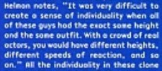

### Stat block notes (game mechanics, not feats)

- Digital Environment (Inside Attack of the Clones, behind-the-scenes box): Most of the highly realistic environments created by ILM for Attack of the Clones were model-shop miniatures—including the hallways that Obi-Wan Kenobi walks through as he observes the Kaminoans' cloning operations. But this clone trooper quartermaster station that Obi-Wan observes from above was created as a completely digital environment. (Star Wars Insider 61, p. 18) (Source: *Star Wars Insider #61* (2002), scan p.18)

## scan p.19 (scan page 19)

Page contents: Inside Attack of the Clones: quartermaster station, part 2 (Rank & File officer colors; Hybrid Faces; Crucial Connection on the clone troopers putting on their helmets). (hand-read)

- **No single roster character (rules/setting/general)** — entry/section: Pablo Helman on the helmet shot: ""This is a key content point," Helman says. "George wanted to make a big deal out of this because of what it establishes." —Pablo Helman, Star Wars Insider 61, p. 19" Source: *Star Wars Insider #61* (2002), scan p.19
  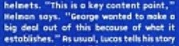

### Stat block notes (game mechanics, not feats)

- Rank & File (Inside Attack of the Clones, Star Wars universe box): Clone trooper officers have color-coded armor: Commander [yellow] Captain [red] Lieutenant [blue] Sergeant [green] (Star Wars Insider 61, p. 19; colors as printed on the rank bars) (Source: *Star Wars Insider #61* (2002), scan p.19)
- Hybrid Faces (Inside Attack of the Clones, behind-the-scenes box): The clone troopers' faces are a digital blend of scans of Temuera Morrison and Bodie "Tihoi" Taylor, the actor who plays a young adult clone in the cafeteria scene. (Star Wars Insider 61, p. 19) (Source: *Star Wars Insider #61* (2002), scan p.19)

## scan p.20 (scan page 20)

Page contents: Inside Attack of the Clones: Freighter-Liner Terminal, part 1 (key: blue behind-the-scenes / yellow Star Wars universe information; Botajef freighter-liner; tiny cockpit windows for titanic scale; "Rainforest Lighting" on Coruscant). (hand-read)

- **No single roster character (rules/setting/general)** — entry/section: Doug Chiang on Coruscant lighting: ""Lit this way," Doug Chiang says, "the buildings come to look like huge trees in a rainforest, the shafts of light filtering down through the canopy. You get a surreal, magical quality." —Doug Chiang, Star Wars Insider 61, p. 20" Source: *Star Wars Insider #61* (2002), scan p.20
  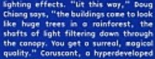

### Stat block notes (game mechanics, not feats)

- Botajef Freighter-Liner (Inside Attack of the Clones, Star Wars universe box): These large space freighters are built at the great commercial shipyards of Botajef, which sprawl across that planet's southern island continent. Constructed components are efficiently lifted into the orbital division overhead via 325-kilometer elevator cables, and final assembly takes place in space. Originally designed to carry only cargo, many giant Botajef freighters have been adapted to carry passengers during the mounting unrest throughout the Republic. (Star Wars Insider 61, p. 20; last digit of "325" is soft in the scan and could be 8) (Source: *Star Wars Insider #61* (2002), scan p.20)

## scan p.21 (scan page 21)

Page contents: Inside Attack of the Clones: Freighter-Liner Terminal, part 2 (Tramper Haunt, Corellian Design engines, Port of Call with Doug Chiang on ocean-liner scale). (hand-read)

- **No single roster character (rules/setting/general)** — entry/section: Doug Chiang on Coruscant scale: ""The vehicles and the structures are heavily exaggerated in size to become impossibly, almost absurdly large. Everything on Coruscant is an exercise in playing with scale." —Doug Chiang, Star Wars Insider 61, p. 21" Source: *Star Wars Insider #61* (2002), scan p.21
  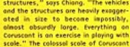

### Stat block notes (game mechanics, not feats)

- Tramper Haunt (Inside Attack of the Clones, Star Wars universe box): Built ages ago as a cargo-loading terminal, this facility is now used by vast numbers of passengers, especially the "freighter trampers" who spend much of their lives traveling between jobs from planet to planet on the freighter-liners. This terminal lacks even the most basic passenger comforts normally expected on such a sophisticated planet as Coruscant, but freighter trampers are used to utilitarian conditions. (Star Wars Insider 61, p. 21) (Source: *Star Wars Insider #61* (2002), scan p.21)
- Corellian Design (Inside Attack of the Clones, Star Wars universe box): The Botajef freightliners are propelled by Corellian Engineering Corp. Dyne 2577 radial sublight engines. (Star Wars Insider 61, p. 21) (Source: *Star Wars Insider #61* (2002), scan p.21)

## scan p.22 (scan page 22)

Page contents: "Across the Stars" by Brian J. Robb, opener: John Williams provides the music for Attack of the Clones; Lucas compares the films to silent movies carried by the score; Williams' 70th birthday and "Call of the Champions" for the 2002 Winter Olympics. (hand-read)

## scan p.23 (scan page 23)

Page contents: Across the Stars title spread over a Coruscant skyline, with John Williams pull quote on the expanding canon of themes. (hand-read)

- **No single roster character (rules/setting/general)** — entry/section: John Williams pull quote on the expanding themes: ""The canon of scenes in all five films is expanding quite dramatically." —John Williams, Star Wars Insider 61, p. 23" Source: *Star Wars Insider #61* (2002), scan p.23
  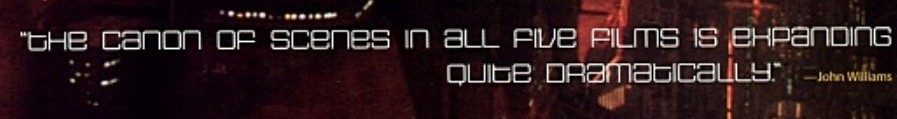

## scan p.24 (scan page 24)

Page contents: Across the Stars: "Refrain Spotting" section on the Lucas-Williams process (Lucas walks Williams through the cut scene by scene, temp tracks, "spotting" session); Lucas calls the music "like Christmas." (hand-read)

- **No single roster character (rules/setting/general)** — entry/section: George Lucas on Williams' music: ""The music is always a surprise, a wonderful surprise," says Lucas. "It's like Christmas. It's always better than I expected, always wonderful." —George Lucas, Star Wars Insider 61, p. 24" Source: *Star Wars Insider #61* (2002), scan p.24
  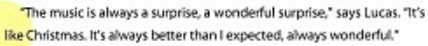

## scan p.25 (scan page 25)

Page contents: Across the Stars cont.: "For Beginners" Williams biography sidebar (born New York 1932, Juilliard, TV work, Jaws, Boston Pops 1980-1993, Olympic themes, upcoming Harry Potter sequels, Minority Report, Catch Me If You Can); Williams on first-time viewing and George's notes on emotional undercurrents; "Pleasing Surprises" with Rick McCallum on the recording-studio "moment of absolute faith." (hand-read)

## scan p.26 (scan page 26)

Page contents: Across the Stars cont.: music almost all the time; Lucas makes "four or five little fixes"; Williams calls Lucas "a very good collaborator" like Spielberg; "Musical History" on adding themes across serial films; Lucas pull quote. (hand-read)

- **No single roster character (rules/setting/general)** — entry/section: George Lucas pull quote on Williams: ""John Williams' music is the glue that holds the whole movie together." —George Lucas, Star Wars Insider 61, p. 26" Source: *Star Wars Insider #61* (2002), scan p.26
  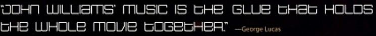
- **No single roster character (rules/setting/general)** — entry/section: John Williams on Lucas as collaborator: ""George is a very good collaborator," notes the composer. "He's like Steven Spielberg in the sense that he's very comfortable with music. Many directors are not, but George is very happy when the orchestra is playing and filling an emotive role, if you like, in his film. It's reassuring and enjoyable for me as a composer to be working on something with someone who is that comfortable with the elaborate use of music." —John Williams, Star Wars Insider 61, p. 26" Source: *Star Wars Insider #61* (2002), scan p.26
  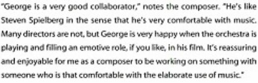

## scan p.27 (scan page 27)

Page contents: Across the Stars cont.: "He Scores!" sidebar (Williams scored four of the top five money-makers; five Oscars, two Emmys, three Golden Globes, 18 Grammys); musical hints of Anakin's metamorphosis in his theme; Williams on the Imperial March at the climax; McCallum on the saga as "the journey of a family." (hand-read)

- **Darth Vader (Anakin Skywalker)** — entry/section: John Williams on the Imperial March in Attack of the Clones: ""The Imperial March in this case is a powerful portent, suggesting a very dramatic future which is in store for all of the characters in the next episode," says Williams. "It's a piece of music that represents, in my mind at least, not only Darth Vader but the forces of the Empire. It was actually George's suggestion to use it there, and I think it works extremely well." —John Williams, Star Wars Insider 61, p. 27" Source: *Star Wars Insider #61* (2002), scan p.27
  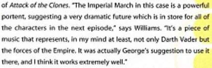
- **Darth Vader (Anakin Skywalker)** — entry/section: Rick McCallum on Anakin's music: ""That's because it's all one story," he says. "It's the journey of a family. In this one we find out who Anakin really is and why he does the things that he does. In Episode I we meet little Anakin, and he's this perfect little boy, but in the music there's some minor chords which tell us, 'Uh-oh, something's not quite right. There's some damage here.' That's built on in Episode II, and that develops all the way through Episode III. So that by the time you get to Episode IV, you understand exactly where Anakin Skywalker has come from." —Rick McCallum, Star Wars Insider 61, pp. 27, 29" Source: *Star Wars Insider #61* (2002), scan p.27
  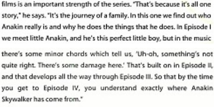

## scan p.28 (scan page 28)

Page contents: Across the Stars photo spread: John Williams and George Lucas watch Attack of the Clones on a large screen in the recording studio (photo by Tobi Corney). (hand-read)

## scan p.29 (scan page 29)

Page contents: Across the Stars cont.: end of McCallum's Anakin quote; "Theme Music" on the new love theme (Lucas: never had a love theme before; Williams on star-crossed lovers separated by rank). (hand-read)

- **No single roster character (rules/setting/general)** — entry/section: George Lucas on the love theme: ""I think that one of the stand-outs in this one is the love theme," says Lucas. "When you think of the whole series, we've had a lot of different kinds of themes, but we've never had a love theme before." —George Lucas, Star Wars Insider 61, p. 29" Source: *Star Wars Insider #61* (2002), scan p.29
  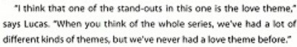
- **Darth Vader (Anakin Skywalker); Padmé Amidala** — entry/section: John Williams on the Anakin-Padmé love theme: ""It is a kind of love theme that has a sense of star-crossed destinies if you like, where the lovers in this case, not unlike Romeo and Juliet, are separated. In this case they are separated by rank: One is a senator, and the other is a soldier. Only perhaps at the end of their lives can they be joined together without any of the obstacles that the world sets forth. It gives a wonderfully compelling and dramatic and satisfying texture, even though in the end it's sad . . . . It can also be liberating . . . the idea of eternal love being something which extends beyond time." —John Williams, Star Wars Insider 61, p. 29" Source: *Star Wars Insider #61* (2002), scan p.29
  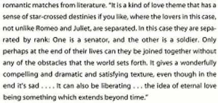

## scan p.30 (scan page 30)

Page contents: Across the Stars cont.: "Name That Theme" quiz matching Attack of the Clones CD tracks ("Yoda and the Younglings", "Departing Coruscant", "Return to Tatooine", "Love Pledge and the Arena", "Confrontation with Count Dooku and Finale") to earlier themes (Duel of the Fates, the Force theme/Ben's Theme, Yoda's Theme, Imperial March); Williams on the atmospheric chorus and solo woman's voice; "Commanding Performances" on concert use of the music. (hand-read)

## scan p.31 (scan page 31)

Page contents: Across the Stars cont.: Williams on writing for film alongside sound effects and dialogue, pencil and paper; Lucas on "old-fashioned movie music"; opener of the Abbey Road recording-session report (London Symphony Orchestra recording the asteroid-field chase between Jango Fett and Obi-Wan Kenobi). (hand-read)

- **No single roster character (rules/setting/general)** — entry/section: George Lucas on Williams' traditional style: ""It's old-fashioned movie music," he says. "It's from the golden age of film composing. John Williams' music is the glue that holds the whole movie together." —George Lucas, Star Wars Insider 61, p. 31" Source: *Star Wars Insider #61* (2002), scan p.31
  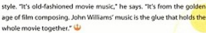

## scan p.32 (scan page 32)

Page contents: Abbey Road session report cont.: percussion for bounty hunters Zam Wesell and Jango Fett; takes and retakes; scoring the assassin droid in Padmé's apartment and the chase of Zam to the nightclub; "Across the Pond" sidebar (first two scores recorded at Denham Studios, then Abbey Road); musicians' lunch; Williams on the LSO as "old partners." Orchestra member quoted anonymously only. (hand-read)

## scan p.33 (scan page 33)

Page contents: Games Workshop The Lord of the Rings: The Fellowship of the Ring tabletop strategy game ad. (hand-read)

## scan p.34 (scan page 34)

Page contents: Science Fiction Book Club ad, part 1 ("The shields are down!"; Star Wars and other SF/fantasy titles, 5 books for $1 membership terms). (hand-read)

## scan p.35 (scan page 35)

Page contents: Science Fiction Book Club ad, part 2 ("Your only haven", join-now offer and title list). (hand-read)

## scan p.36 (scan page 36)

Page contents: "Star Wars Celebration II Report" by Michael Mikaelian & Dave Gross, opener: some 27,000 fans in Indianapolis; Anthony Daniels as master of ceremonies interviewing Temuera Morrison, Daniel Logan and Ben Burtt; "Sneak Preview: The Rick McCallum Spectacular" (8-minute digital synopsis of Episode II; McCallum on scratched film prints). (hand-read)

## scan p.37 (scan page 37)

Page contents: Celebration II Report cont.: McCallum answers "no" to Episodes VII-IX; "The Chosen Ones" sweepstakes winners (names omitted); "Celebration Celebrity Sightings" (Daniel Logan plays games, Hayden Christensen and his brother tour the hall incognito, Carrie Fisher visits the Kenner toy museum display); "Shopping Spree" exhibitors' hall; overheard father-and-son exchange about standing in line. (hand-read)

## scan p.38 (scan page 38)

Page contents: Celebration II Report cont.: 10-foot LEGO Yoda built through the weekend, life-size LEGO Jango Fett, battle droid and destroyer droid, LEGO preview of the Geonosis battle; Dark Horse/Gentle Giant laser scanning; Hasbro voice-controlled R2-D2; game demos (Hasbro board games, TCG, RPG, LucasArts); new licensees (Fernandes guitars, Rubie's costumes, Australia Post stamps); autograph area and toy museum; "Going ... Going ... Gone!" collectibles track opener. (hand-read)

- **Jango Fett** — entry/section: LEGO artwork at Celebration II: "Other LEGO artwork included a life-size Jango Fett, battle droid, and destroyer droid, plus dioramas of some of the most memorable Star Wars scenes." Source: *Star Wars Insider #61* (2002), scan p.38
  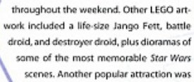

## scan p.39 (scan page 39)

Page contents: Celebration II Report cont.: collectibles track panels and a Q&A with Lucas Licensing's Howard Roffman and Tim Wills; auction totaling $35,000; "It Belongs in a Museum" Kenner/Hasbro Star Wars Museum sidebar assembled by Cloud City Collectibles with several collectors; "25th Anniversary Concert" opener with Anthony Daniels as MC. Private collectors' names omitted. (hand-read)

## scan p.40 (scan page 40)

Page contents: Celebration II Report cont.: concert (Darth Vader and 501st stormtroopers appear during the Imperial March; Duel of the Fates with a chorus; Augie's Great Municipal Band encore); "Super Troopers: The Fighting 501st Lends a Gauntleted Hand" (200+ members, hospital visit, "Buckets off!" group photo); "The Huttish Play" opener on the USC-born 30-minute Star Wars trilogy stage adaptation. Fan and troupe-member names omitted. (hand-read)

## scan p.41 (scan page 41)

Page contents: Celebration II Report cont.: the 30-minute trilogy play (troupe members on playing Jabba, Han Solo, Nien Numb, Tarkin/Yoda, Vader/Chewbacca and Obi-Wan; names omitted); "Scanning for Life" sidebar on Gentle Giant's mobile scanner used on Episode II actors, with Gentle Giant's Mitchel Wu on the Mini-Bust process (scan winners' names omitted). (hand-read)

## scan p.42 (scan page 42)

Page contents: Celebration II Report cont.: end of the play story (performed once in the U.S., hoping for a college tour; requests to "do Jar Jar"); "They'd Like to Thank the Academy: Fan Filmmakers Take a Bow" (Lucasfilm/atomfilms.com Fan Film Awards hosted by Scott Chernoff, presenters Jim Ward, Howard Roffman, Steve Sansweet and Kevin Rubio); winners list and Spirit of Fandom, Documentary profiles. Fan filmmaker names omitted. (hand-read)

## scan p.43 (scan page 43)

Page contents: Celebration II Report cont.: fan film profiles; Pioneer Award to Kevin Rubio for TROOPS (surprise award; next project Alien Hunter; advice that length is not always important); Mockumentary and George Lucas Selects award profiles (Lucas chose the winner himself via videotape). Fan filmmaker names omitted. (hand-read)

## scan p.44 (scan page 44)

Page contents: "Handmaidens: A Rose by Any Other Name" by Michael G. Ryan, opener: Rose Byrne (Dormé), 22, from Sydney; a week and a half of shooting behind Natalie Portman; Venice Best Actress for The Goddess of 1967; "Budding Rose": seen by casting director Robin Gurland in La Dispute with Leeanna Walsman, auditioned at Fox Studios. (hand-read)

## scan p.45 (scan page 45)

Page contents: Rose Byrne profile cont.: pull quote on fandom; early jobs and drama classes at the Australian Theatre for Young People; film debut at 13 in Dallas Doll (1994); TV work (Echo Point, Murder Call, Heartbreak High), Two Hands (1999), "blind acting" preparation for The Goddess of 1967. (hand-read)

- **No single roster character (rules/setting/general)** — entry/section: Rose Byrne pull quote on fandom: ""I haven't given much thought to all the Star Wars fandom, as it seems a little surreal and hard to get my head around, which perhaps is a good thing so as not to freak me." —Rose Byrne, Star Wars Insider 61, p. 45" Source: *Star Wars Insider #61* (2002), scan p.45
  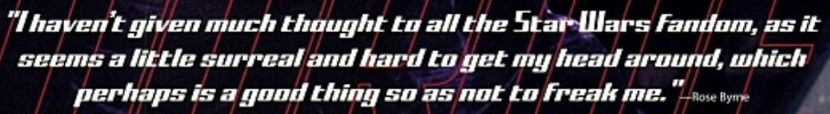

## scan p.46 (scan page 46)

Page contents: Rose Byrne profile cont.: Golden Lion for Best Actress at Venice 2000, learned of it by email; Robin Gurland cast her as Dormé while Leeanna Walsman became Zam Wesell; "The Handmaiden's Tale": 12 days on set, has not seen the original trilogy, the regal costume as inspiration, Lucas greeted her on day one, worked with Samuel L. Jackson, Ewan McGregor and Natalie Portman; blue-screen work. (hand-read)

- **Padmé Amidala** — entry/section: Rose Byrne on playing Dormé: ""What really helped me get into the character of Dormé was definitely her costume," she admits. "It was so regal that it made me walk and behave very differently than a twenty-two-year-old Sydney girl. Her entire role really is to support Amidala, and her safety is Dormé's top priority. That helped give me focus." —Rose Byrne, Star Wars Insider 61, p. 46" Source: *Star Wars Insider #61* (2002), scan p.46
  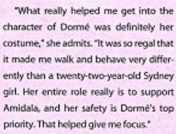

## scan p.47 (scan page 47)

Page contents: Rose Byrne profile cont.: caption with Senator Amidala, Dormé and Captain Typho meeting Supreme Chancellor Palpatine; blue screen "challenging and daunting"; next film City of Ghosts with Matt Dillon; would she reprise the role: "of course, of course, of course!"; "The Thorns of Fame" joke sidebar about her miniature schnauzer wanting premiere tickets. (hand-read)

## scan p.48 (scan page 48)

Page contents: "From Mexico to Naboo": Veronica Segura (Cordé) profile opener: played Princess Leia as a child after The Empire Strikes Back; first Mexican actor in a Star Wars film; acting since kindergarten, inspired by Annie; studied directing in Texas. (hand-read)

## scan p.49 (scan page 49)

Page contents: Veronica Segura profile cont.: moved to Australia, TV serial Tribe; found by Robin Gurland in Sydney; low expectations at the casting call; pull quote on walking toward what you want "with passion, with love, and with the greatest effort." (hand-read)

## scan p.50 (scan page 50)

Page contents: Veronica Segura profile cont.: Gurland's "Tell me all about you" audition, costume fittings before being told she had the part; given only two pages of dialogue and built Cordé from her knowledge of The Phantom Menace's handmaidens and the Practical Aesthetics technique; 4:00 a.m. makeup and heavy costumes. (hand-read)

- **Padmé Amidala** — entry/section: Veronica Segura on building a handmaiden character: ""If you saw Episode I," she explains, "you can figure out where all these girls come from and what they're doing there." —Veronica Segura, Star Wars Insider 61, p. 50" Source: *Star Wars Insider #61* (2002), scan p.50
  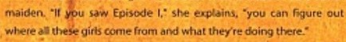

## scan p.51 (scan page 51)

Page contents: Veronica Segura profile cont.: meeting Lucas ("Uncle Lucas"), meeting Natalie Portman, Ahmed Best, Anthony Daniels, Rose Byrne and Hayden Christensen; the only Mexican on set; Gentle Giant body scan; hopes for a Cordé action figure and trading card; filmography sidebar (Tribe, Subterano, Sandia, Sin ton ni Sonia, Tiempo Fuera, Attack of the Clones). (hand-read)

- **No single roster character (rules/setting/general)** — entry/section: Veronica Segura on George Lucas: ""He turned out to be the person with whom I spent most of my time," she says. "He's incredibly nice and friendly, and we were joking all the time. He's like 'Uncle Lucas.'" —Veronica Segura, Star Wars Insider 61, p. 51" Source: *Star Wars Insider #61* (2002), scan p.51
  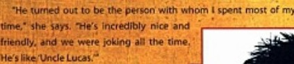

## scan p.52 (scan page 52)

Page contents: "Crossing the Dune Sea" by Michael G. Ryan, opener: the season-one winners of CBS's The Amazing Race raced through Tunisia's Tatooine locations on the way to the one-million-dollar prize (contestant names omitted). (hand-read)

## scan p.53 (scan page 53)

Page contents: "Crossing the Dune Sea" title spread: "Amazing Race recall the sands of Tatooine"; pull quote from a winner about crossing Tatooine and the Dune Sea; photos of Tunisian locations (Ksar Hadada/Ghomrassen slave-quarters architecture, Lars homestead set remains) and a map of Tunisia. (hand-read)

## scan p.54 (scan page 54)

Page contents: "Crossing the Dune Sea" cont.: the team known as "The Lawyers" on the race around the globe; "The Brightest Center of the Universe": episodes 4–6 of the show (broadcast the previous October) went to Tunisia, stops at El Jem, Tataouine and Ksar Hadada (the Episode I slave-quarters ksars); falling into last place at Ksar Hadada; a camel trek across the dunes. Contestant names omitted. (hand-read)

## scan p.55 (scan page 55)

Page contents: "Crossing the Dune Sea" cont.: memories of the race (Victoria Falls); hiring a local driver in Tunisia; "Collecting the Prize": future plans, collecting Luke Skywalker farmboy-outfit items, avoiding Attack of the Clones spoilers; sidebar pointing to a Tunisian locations website. Contestant names omitted. (hand-read)

## scan p.56 (scan page 56)

Page contents: "Forge Ahead: The Beautiful Star Wars Campaign" opener: full-page photo, Star Wars: Episode II Attack of the Clones at the 2002 World Cup. (hand-read)

## scan p.57 (scan page 57)

Page contents: "The Beautiful Star Wars Campaign: Star Wars Episode II at the 2002 World Cup" title page by Michelle Vuckovich, with photos. (hand-read)

## scan p.58 (scan page 58)

Page contents: "The Beautiful Star Wars Campaign": Lucasfilm Marketing's Attack of the Clones ad campaign for the June 2002 World Cup ("Force-Force-Two," "The Other Group of Death"), aimed at the U.K., Italy, Brazil, Argentina and Japan; quotes from marketing manager Tom Warner and art director Scott Erwert. (hand-read)

- **Mace Windu** — entry/section: Scott Erwert on the World Cup campaign: ""We're talking about two worldwide entertainment events that started within weeks of each other," he noted. "By combining these separate entities into one campaign, we couldn't help but provoke a little friendly competition. I mean, who wouldn't want to see Mace Windu with his purple lightsaber tending goal for the Jedi?" —Scott Erwert, Star Wars Insider 61, p. 58" Source: *Star Wars Insider #61* (2002), scan p.58
  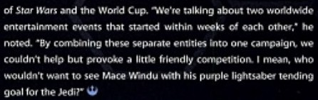

## scan p.59 (scan page 59)

Page contents: World Cup campaign ads: Anakin with a field of lightsabers ("Force-Force-Two" plays on the 4-4-2 formation); "Our Goalie Uses the Force" (Mace Windu); captions on Padmé's "aggressive negotiations" and "This party's over!"; USA vs. Portugal match photo. (hand-read)

## scan p.60 (scan page 60)

Page contents: World Cup campaign ads: "The Other 'Group of Death'" (Dooku, Jango Fett, Zam Wesell and a droid army); "On Our Pitch, Size Matters Not" and "Yodinho!" (Yoda); captions on the Group of Death and pitch size. (hand-read)

## scan p.61 (scan page 61)

Page contents: Official Star Wars Fan Club online store catalog (swfan.wizards.com): contents, keyword search, member pricing; limited-edition Bobblehead Set Series One (Darth Vader, Boba Fett, C-3PO with R2-D2). (hand-read)

## scan p.62 (scan page 62)

Page contents: Fan Club online store catalog: Attack of the Clones action figures (Zam Wesell, Obi-Wan Kenobi, Battle Droid, Boba Fett, Padmé Amidala, Captain Typho, Jango Fett and others); exclusive carbon-freezing chamber playset with Bespin security guard; Stormtrooper Troop Builder Set. (hand-read)

## scan p.63 (scan page 63)

Page contents: Fan Club store catalog: Power of the Jedi Sourcebook; Star Wars Gamer back issues #5–#10 with contents; Star Wars Roleplaying Game Revised Core Rulebook and Rebellion Era Sourcebook; other RPG sourcebooks and campaign books (Secrets of Naboo, Secrets of Tatooine). (hand-read)

## scan p.64 (scan page 64)

Page contents: Fan Club store catalog: Star Wars Trading Card Game Attack of the Clones set and Sith Rising expansion; Drew Struzan Attack of the Clones one-sheet poster; limited-edition Princess Leia cookie jar; Hardware Wars collector's edition DVD (Ernie Fosselius); Star Wars Insider back issues #54–#60 with cover subjects. (hand-read)

## scan p.65 (scan page 65)

Page contents: Subscription and Official Star Wars Fan Club membership offer and order form (benefits include a $10 gift certificate, welcome letter from George Lucas, preferred online-store status; one- and two-year rates). (hand-read)

## scan p.66 (scan page 66)

Page contents: "Crouching Yoda, Hidden Dooku: Transforming a Muppet into a Master" by ILM animation director Rob Coleman: ILM first read the Episode II shooting script on June 28, 2000; the script's description of the Dooku–Yoda fight; "There Is No Try": Lucas wanted Yoda ferociously leaping and fighting. (hand-read)

- **Yoda; Count Dooku** — entry/section: Attack of the Clones script on the Yoda–Dooku duel: ""Yoda attacks! He flies forward. Count Dooku is forced to retreat. Words are insufficient to describe the range and skill of Yoda's speed and swordplay. His lightsaber is a humming blur of light." —Star Wars: Episode II shooting script, quoted by Rob Coleman, Star Wars Insider 61, p. 66" Source: *Star Wars Insider #61* (2002), scan p.66
  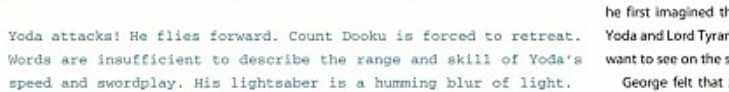
- **Yoda** — entry/section: Lucas's direction for Yoda's duel: "He wanted us to show Yoda ferociously leaping and fighting, not just standing his ground and deflecting incoming attacks." Source: *Star Wars Insider #61* (2002), scan p.66
  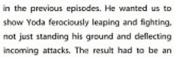

## scan p.67 (scan page 67)

Page contents: "Crouching Yoda" cont.: Yoda had to be as believable as Frank Oz's performance; Geoff Campbell's computer model; six proof-of-concept shots recreating the Empire swamp scene shown to Lucas in April 2000, after which all Yoda shots became CG; "No Strings Attached": studying the puppet's micro-movements (ear quiver) and limiting facial articulation; sidebar "Rob's Top 10 Fu Films." (hand-read)

### Stat block notes (game mechanics, not feats)

- Rob's Top 10 Fu Films: ROB'S TOP 10 FU FILMS / While no single movie or performer acted as inspiration for Master Yoda's fighting style, the wizards at ILM are no strangers to martial arts movies. Here are Animation Director Rob Coleman's ten favorite examples of Jedi-like fighting. / 1. Seven Samurai (1954) 2. Yojimbo (1962) 3. Sanjuro (1963) 4. Enter the Dragon (1973) 5. Return of the Dragon (1973) 6. Drunken Master (1978) 7. The Shaolin Temple (1986) 8. Swordsman II (1991) 9. Drunken Master II (1994) 10. Crouching Tiger, Hidden Dragon (2000) (Star Wars Insider 61, p. 67) (Source: *Star Wars Insider #61* (2002), scan p.67)

## scan p.68 (scan page 68)

Page contents: "Crouching Yoda" cont.: restrained lip and mouth animation; "From Puppet to Projectile": Lucas insisted on Yoda moving quickly and attacking; martial-arts film references (Seven Samurai, Return of the Dragon, Drunken Master, The Shaolin Temple) and Nick Gillard's stunt documentary on The Phantom Menace DVD; sidebar "The Clothes Make the Jedi" (James Tooley's clothing team, Anna Biel's costume patterns, Juan Luis Sanchez's cloth simulations); Yoda costume sketches. (hand-read)

## scan p.69 (scan page 69)

Page contents: "Crouching Yoda" cont.: Gillard's choreography as the basis; animatics showing Yoda twice as fast as expected; the "battle of the wizards" prelude (debris and blue lightning); "Virtual Meets Reality": match-moving the Dooku hangar set, rotoscoping Christopher Lee; lead animator Tim Harrington and supervisor Chris Armstrong; sidebar "The Agony & the Ecstasy," an ILM animator's March–April 2001 diary of Yoda cloth-simulation struggles. (hand-read)

- **Yoda** — entry/section: Nick Gillard's choreography as the basis for Yoda: "Nick's movements and fighting style choices formed the basis of what we would strive to achieve with Yoda's actions." Source: *Star Wars Insider #61* (2002), scan p.69
  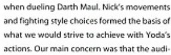
- **Yoda; Count Dooku** — entry/section: The "battle of the wizards" prelude: "The resulting discussion provided the solution to the problem, and thus was born the "battle of the wizards" prelude. George decided to have Dooku first attempt to overwhelm Yoda by tossing debris at him, and then he decided to introduce the evil blue lighting from Return of the Jedi." Source: *Star Wars Insider #61* (2002), scan p.69
  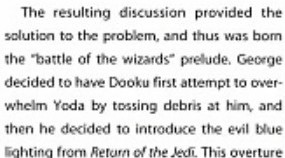
- **Yoda; Count Dooku** — entry/section: The overture to the duel: "This overture to the main duel turned out to be exactly what we needed to show how powerful Yoda really was as the diminutive Jedi to nullifies Dooku's awesome assault. It forces the two masters into a stalemate that can be broken only one way." Source: *Star Wars Insider #61* (2002), scan p.69
  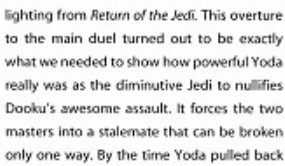
- **Yoda** — entry/section: Yoda reveals his lightsaber: "By the time Yoda pulled back his robe to reveal his lightsaber, the audience was ready to see Yoda explode into action." Source: *Star Wars Insider #61* (2002), scan p.69
  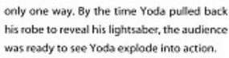

## scan p.70 (scan page 70)

Page contents: "Sith Rising Casts a Shadow" by Michael G. Ryan: the Star Wars TCG's first expansion, the 90-card Sith Rising set, by designers David Eckelberry and Bill Rose; new Stun ability for Darth Maul and Mace Windu; self-damage mechanic (Infantry Battle Droid); combos; rare Darth Tyranus card; "Expanding the Universe": art director Sean Glenn and marketing manager Chris Erb; Aayla Secura as the first Dark Horse Comics character in a film; booster prices ($1.49 five-card, $3.29 eleven-card). (hand-read)

- **Darth Maul; Mace Windu** — entry/section: The Stun ability in Sith Rising: "Stun reduces a damaged unit's power for the duration of a battle—both Darth Maul and Mace Windu have this new ability, which combines quite effectively with the Deflect ability, which allows damage to be redirected from one unit to another." Source: *Star Wars Insider #61* (2002), scan p.70
  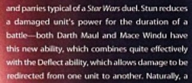

## scan p.71 (scan page 71)

Page contents: Full-page Darth Maul photo with the line "At last we shall reveal ourselves to the Jedi." (hand-read)

### Stat block notes (game mechanics, not feats)

- Darth Maul photo caption: "At last we shall reveal ourselves to the Jedi." (Star Wars Insider 61, p. 71) (Source: *Star Wars Insider #61* (2002), scan p.71)

## scan p.72 (scan page 72)

Page contents: Sith Rising Card Encyclopedia, Characters: Aayla Secura, Anakin Skywalker (two), Aurra Sing, C-3PO, Chancellor Palpatine, Clone Captain, Clone Trooper 6/298, Darth Maul (four versions), Darth Sidious, Darth Tyranus (two); intro box on the set's rarities. Card rules text too small to transcribe reliably from the scan. (hand-read)

### Stat block notes (game mechanics, not feats)

- Sith Rising card set box: The Sith Rising card set consists of 30 common (●), 30 uncommon (◆), and 30 rare (★) cards, as well as a parallel set of foils. (Star Wars Insider 61, p. 72) (Source: *Star Wars Insider #61* (2002), scan p.72)

## scan p.73 (scan page 73)

Page contents: Sith Rising Card Encyclopedia, Characters cont.: Destroyer Droid, W Series; Female Tusken Raider; Geonosian Scout; Infantry Battle Droid; Jango Fett; Jocasta Nu; Mace Windu (three versions); Massiff; Nute Gunray; Obi-Wan Kenobi; Padmé Amidala; Passel Argente; R2-D2; Sio Bibble. Card text too small to transcribe reliably. (hand-read)

## scan p.74 (scan page 74)

Page contents: Sith Rising Card Encyclopedia cont.: Characters (Sun Fac, Super Battle Droid 5TB, Tusken Raider, Yoda); Ground (Aiwha Rider, AT-TE Troop Transport, Battle Droid Assault Squad, Clone Facility, Clone Trooper Legion, Commerce Guild Spider Droid, Coruscant Speeder, Geonosian Artillery Battery, Geonosian Picador, Hailfire Droid, Homing Spider Droid, Jedi Heroes). Card text too small to transcribe reliably. (hand-read)

## scan p.75 (scan page 75)

Page contents: Sith Rising Card Encyclopedia cont.: Ground (Mobile Assault Cannon, Republic Drop Ship, Republic LAAT/i Gunship, Super Battle Droid Squad, Trade Federation Control Core, Tusken Camp); Space (Acclamator-Class Assault Ship, Commerce Guild Cruiser, Diplomatic Cruiser, Droid Starfighter DFS-327, Geonosian Defense Fighter, Jedi Starfighter Scout, Jedi Starfighter Wing, Naboo Starfighter Wing, Nubian Yacht, Senatorial Cruiser). Card text too small to transcribe reliably. (hand-read)

## scan p.76 (scan page 76)

Page contents: Sith Rising Card Encyclopedia cont.: Space (Sith Infiltrator, Slave I, Techno Union Warship, Trade Federation Warship); Mission cards (Concentrated Fire, Maul's Strategy, Price of Failure, Recognition of Valor, Run the Gauntlet, Twilight of the Republic, Visit the Lake Retreat and others); Battle cards (Aggressive Negotiations, Brutal Assault, Careful Targeting). Card text too small to transcribe reliably. (hand-read)

## scan p.77 (scan page 77)

Page contents: "Jedi Nights" sidebar: Wizards of the Coast's weekly Star Wars TCG tournament program in comic and card shops with exclusive foil promo cards (first two: Padmé Amidala and Darth Tyranus), launched in early July; next expansion A New Hope due in November; Chris Erb on demos at Celebration II. Battle cards: Clever Escape, Impossible Victory, Jedi Bravery, Moment of Truth, Out of His Misery, Padawan and Senator, Retreat Underground, Shoot Her or Something, Suppressing Fire, Trade Federation Offensive, Unfriendly Fire. (hand-read)

## scan p.78 (scan page 78)

Page contents: "Power of the Jedi" review of the Star Wars Roleplaying Game Power of the Jedi Sourcebook (Wizards of the Coast): Jedi of the prequel era and the Expanded Universe; history chapter from the first hyperdrive to The New Jedi Order (Ulic and Cay Qel-Droma, Lord Hoth's war against the Brotherhood of Darkness, Ruusan, Luke's Jedi academy); new Force powers incl. Nomi Sunrider's ability and the art of Morichro; holocrons and Force spirits. (hand-read)

- **Nomi Sunrider** — entry/section: Exotic light side powers in the Power of the Jedi Sourcebook: "Nomi Sunrider's ability to sever a Jedi's connection to the Force and the prohibited art of Morichro are two notable examples." Source: *Star Wars Insider #61* (2002), scan p.78
  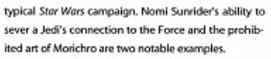

## scan p.79 (scan page 79)

Page contents: Power of the Jedi review cont.: five new prestige classes (Force warrior, Jedi healer, instructor, scholar, weapon master); gamemastering chapter; Jedi Traditions chapter with 50+ Jedi heroes; equipment (Corran Horn's dual-phase lightsaber, Whitecloak fighter, Qel-Droma's Nebulon Ranger); Where the Force Is Strong locations (Ambria, Ruusan, Pelgrim, Nam Chorios). "Show & Tell" sidebar of sourcebook excerpts: Jedi Weapon Master, Miraluka, Kieran Halcyon, Force Training Aids. Art by Dan Brereton and Jeff Carlisle. (hand-read)

### Stat block notes (game mechanics, not feats)

- Show & Tell: Jedi Weapon Master: Although a Jedi's greatness does not derive from combat prowess, some threats to peace and justice demand a martial response. While all Jedi receive some training in combat, a few make fighting the central focus of their union with the Force. These Jedi are weapon masters, adepts of various styles of melee combat. (Star Wars Insider 61, p. 79) (Source: *Star Wars Insider #61* (2002), scan p.79)
- Show & Tell: Miraluka: Outwardly, Miraluka appear human. Their size, build, hair, and skin run the gamut of human varieties. Their speech could be particular to any region of Coruscant or any other planet all the way to the Outer Rim. Only one aspect distinguishes Miraluka from humans: All Miraluka are blind from birth. Where their eyes would have been, Miraluka have nearly featureless eye sockets that they prefer to cover with decorative cloth. Although they are not entirely concerned with appearing human, they prefer not to draw attention to themselves when traveling. Millennia of evolution robbed the Miraluka of sight but granted them the ability to "see" with the Force. (Star Wars Insider 61, p. 79) (Source: *Star Wars Insider #61* (2002), scan p.79)
- Show & Tell: Kieran Halcyon, Jedi Knight: Kieran Halcyon, a Corellian, earned the title of Jedi Knight during the time when Afarathu terrorism was on the rise. He had constructed a special dual-phase lightsaber that could go from standard length (1.3 meters) to a length of 3 meters with the flick of a switch. As with all the Halcyon Jedi before him, Kieran lacked the ability to manipulate the Force to perform telekinetic feats. (Star Wars Insider 61, p. 79) (Source: *Star Wars Insider #61* (2002), scan p.79)
- Show & Tell: Force Training Aids: Long ago, Jedi discovered that younger students are far easier to train in the ways of the Force than are older ones. They're more likely to absorb the philosophy of the Jedi while avoiding the temptations of the dark side. To prevent early training from becoming too dull or rigid, instructors developed a number of training aids that allowed trainees to enjoy their instruction time. (Star Wars Insider 61, p. 79) (Source: *Star Wars Insider #61* (2002), scan p.79)

## scan p.80 (scan page 80)

Page contents: Feature on author Matthew Woodring Stover and his New Jedi Order novel Traitor (due October): why he joined the series, focusing on Jacen Solo as a "Hamlet character", Jacen aboard a Yuuzhan Vong worldship with Vergere, the original "Die Hard in space" idea, the hero's journey through the Land of the Dead. (hand-read)

- **Jacen Solo (Darth Caedus)** — entry/section: Stover on Jacen Solo: ""a Hamlet character—thinks too much, too intellectual, too philosophical." —Matthew Woodring Stover, Star Wars Insider 61, p. 80" Source: *Star Wars Insider #61* (2002), scan p.80
  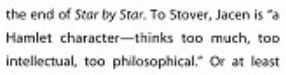
- **Jacen Solo (Darth Caedus)** — entry/section: Jacen Solo in Traitor: "By the book's end—which includes an epic battle in the heart of the former Galactic Senate—Jacen will have been "broken apart and put back together stronger than before."" Source: *Star Wars Insider #61* (2002), scan p.80
  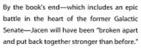

## scan p.81 (scan page 81)

Page contents: Stover feature cont.: Dante's Inferno as inspiration (original title Underworld), Vergere and Jacen, Taoist view of the Force, "Everything I tell you is a lie," upcoming Mace Windu Clone Wars novel. Sidebar "The New Jedi Order So Far..." listing Vector Prime through Enemy Lines II: Rebel Stand plus Recovery (e-book), "Emissary of the Void" and "The Apprentice"; next up Destiny's Way by Walter Jon Williams in November. (hand-read)

- **No single roster character (rules/setting/general)** — entry/section: Stover on the Force and Taoism: ""The Force is so intimately connected to Taoist philosophy that I thought there is room for more of a traditional Taoist viewpoint," Stover says. "The Tao—the Force—transcends duality by embracing opposites. That's why Taoist teachers—and the Zen Masters who followed them—teach in paradox." —Matthew Woodring Stover, Star Wars Insider 61, p. 81" Source: *Star Wars Insider #61* (2002), scan p.81
  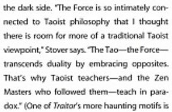

### Stat block notes (game mechanics, not feats)

- The New Jedi Order So Far...: The New Jedi Order will encompass 19 books, as well as an e-book and several short stories, before it wraps up. Published by Del Rey and LucasBooks since 1999, the series takes place 21 years after the end of Return of the Jedi, with Luke Skywalker trying to restore the Jedi tradition in a Republic threatened by the Yuuzhan Vong, an implacable, extra-galactic enemy that's non-existent in the Force. The series now includes 13 novels on e-book available only online, and four short stories with more on the way. (Star Wars Insider 61, p. 81) (Source: *Star Wars Insider #61* (2002), scan p.81)

## scan p.82 (scan page 82)

Page contents: "A Long Time Ago": Marvel Comics' Star Wars series (1977–1986, 107 monthly and three annual issues) being reprinted by Dark Horse in seven trade paperback volumes, restored and digitally colored; editor Dave Land on fan demand; the "big three" writers Archie Goodwin, David Michelinie and Jo Duffy; Duffy's #24 "Silent Drifting" prequel story. (hand-read)

- **No single roster character (rules/setting/general)** — entry/section: David Michelinie on joining Marvel's Star Wars: ""I decided to work on Star Wars simply because the job was offered to me. I was a huge fan of the movies and jumped at the chance to play in that universe." —David Michelinie, Star Wars Insider 61, p. 82" Source: *Star Wars Insider #61* (2002), scan p.82
  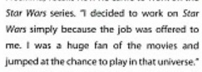

## scan p.83 (scan page 83)

Page contents: Marvel feature cont.: Michelinie's #68 Boba Fett origin as a Mandalorian Protector, continuity limits (no Han Solo, no Luke–Vader confrontation), the second Death Star story; Duffy on shared-universe writing; Shira Brie/Lumiya created by Michelinie and Duffy. Sidebar "Marvel Madness": ten wacky and memorable issues (#8, #17, #24, #28, #38, #52, #68, #80, #96, #107). (hand-read)

- **Lumiya; Luke Skywalker** — entry/section: Jo Duffy on creating Lumiya: ""I wanted a really strong foil for Luke, a character people would love to see him go up against. It looked like the seeds of what could turn someone to the dark side were all there in Shira, based on what we knew then of Anakin Skywalker and on what David had already established for Shira. Once the progression had occurred to me, developing it along those lines to create my villain was a pretty irresistible idea." —Jo Duffy, Star Wars Insider 61, p. 83" Source: *Star Wars Insider #61* (2002), scan p.83
  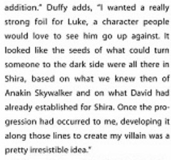
- **No single roster character (rules/setting/general)** — entry/section: David Michelinie on drifting into Return of the Jedi territory: ""Occasionally, I'd unwittingly drift into Jedi territory, such as when I plotted a story that involved the construction of a second Death Star [#51/52 "Resurrection of Evil"/"To Take the Tarkin"]." —David Michelinie" Source: *Star Wars Insider #61* (2002), scan p.83
  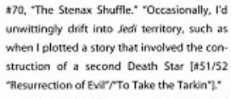

### Stat block notes (game mechanics, not feats)

- Marvel Madness: #8 "Eight for Aduba-3": The most infamous issue of the Marvel run, it introduced Jaxxon, a Lepus Carnivorus (a giant, green, rascally rabbit), as well as Don-Wan Kihotay, a deluded old man who thought he was a Jedi. No joke. (Star Wars Insider 61, p. 83) (Source: *Star Wars Insider #61* (2002), scan p.83)
- Marvel Madness: #28 "Whatever Happened to Jabba the Hutt?": Indeed. When we see Jabba in this issue, he's a good 500 pounds lighter, has whiskers sprouting from his face, and he's got legs! A great story by the master, Archie Goodwin, written before anyone knew Jabba would turn out to be a giant slug in Return of the Jedi. (Star Wars Insider 61, p. 83) (Source: *Star Wars Insider #61* (2002), scan p.83)
- Marvel Madness: #52 "To Take the Tarkin": Chewie blows up the tractor beam generator of the Empire's greatest superweapon since the original Death Star, the Tarkin, by chucking a stormtrooper 50 feet directly into it. Leia also manages to destroy the space station by simply "switching a couple of wires," causing the Tarkin to shoot itself. When will the Empire stop designing such shoddy super-weapons? (Star Wars Insider 61, p. 83) (Source: *Star Wars Insider #61* (2002), scan p.83)
- Marvel Madness: #68 "The Search Begins": Mandalorians with Scottish accents? For decades, this story offered fans the most in-depth look at the Clone Wars, the Mandalorians, and Boba Fett. (Star Wars Insider 61, p. 83) (Source: *Star Wars Insider #61* (2002), scan p.83)
- Marvel Madness: #96 "Duel With a Dark Lady": In a wordless showdown so intense it took two issues to tell it, Luke meets his better when he comes face to face with the Dark Jedi Lumiya and her deadly lightwhip. (Star Wars Insider 61, p. 83) (Source: *Star Wars Insider #61* (2002), scan p.83)
- Marvel Madness: #107 "All Together Now": The last issue in the series sees the heroes teaming up with former enemies like the Empire and Nagai assassins to defeat Lumiya and the galactic invaders, the Tof. Writer Jo Duffy had intended to use the invasion as a launching point for a two-year story arc, but she had to wrap it up in one issue when the series was abruptly cancelled. (Star Wars Insider 61, p. 83) (Source: *Star Wars Insider #61* (2002), scan p.83)

## scan p.84 (scan page 84)

Page contents: Set Piece: "Cloud City Carbon-Freezing Chamber" by Chris Reiff & Chris Trevas ("Today's Special—Frozen Scoundrel with a Side of Steamed Wookiee"): Elstree Studios Stage 5, summer 1979; set design and lighting; Kershner and Ford reworking Han's reply to "I love you". Captions on C-3PO's head, Chewie's droid backpack, stormtroopers on the platform. (hand-read)

### Stat block notes (game mechanics, not feats)

- How "I know" came about: Kershner suggested that Han say, "Just remember that Leia, because I'll be back," but it seems that catch phrase was destined for another action hero. It was Ford who came up with the clever "I know." He described the line to the director as "beautiful and acceptable and funny," and they decided to shoot it. (Star Wars Insider 61, p. 84) (Source: *Star Wars Insider #61* (2002), scan p.84)
- Caption: C-3PO's head: C-3PO's head was controlled by a thin line attached to Peter Mayhew's costume. The actor's movement caused the droid's head to swivel from side to side. (Star Wars Insider 61, p. 84) (Source: *Star Wars Insider #61* (2002), scan p.84)
- Caption: Chewie's back: The plastic and fiberglass droid on Chewie's back weighed 35 pounds. After filming on this set with the heavy, hairy costume and steam effects, Peter Mayhew was sent home to rest from exhaustion. (Star Wars Insider 61, p. 84) (Source: *Star Wars Insider #61* (2002), scan p.84)
- Caption: stormtroopers on the platform: Imperial stormtroopers positioned along the perimeter of the platform had to watch their step because of their limited range of vision. Boxes were arranged below to prevent injury from falling. (Star Wars Insider 61, p. 84) (Source: *Star Wars Insider #61* (2002), scan p.84)

## scan p.85 (scan page 85)

Page contents: Carbon-Freezing Chamber cont.: captions on Bespin blaster pistols, Kershner hit by debris, capes (Calrissian, Fett, Vader; costume designer John Mollo), Lobot (John Hollis), Vader's lightsaber prop from a camera flash, an Imperial officer, the head Ugnaught (Jack Purvis). (hand-read)

### Stat block notes (game mechanics, not feats)

- Caption: Bespin blaster pistols: The blaster pistols carried by Bespin security were pellet guns painted silver and dressed up with parts from plastic model kits. (Star Wars Insider 61, p. 85) (Source: *Star Wars Insider #61* (2002), scan p.85)
- Caption: Kershner: Director Irvin Kershner was once hit in the head by a small piece of debris that fell from the array looming above. (Star Wars Insider 61, p. 85) (Source: *Star Wars Insider #61* (2002), scan p.85)
- Caption: capes: It takes a bold character to wear a cape. Calrissian, Fett, and Vader all come to this event dressed to impress. Costume designer John Mollo is responsible for Lando's dashing attire. (Star Wars Insider 61, p. 85) (Source: *Star Wars Insider #61* (2002), scan p.85)
- Caption: Lobot: Lobot, played by John Hollis, was originally to have lines in the film. His dialogue was cut to add interest to the character who was deemed lobotomized and able to receive messages directly through Cloud City's central computer. (Star Wars Insider 61, p. 85) (Source: *Star Wars Insider #61* (2002), scan p.85)
- Caption: Vader's lightsaber: Darth Vader's lightsaber hangs concealed under his cape, awaiting the confrontation with his son. An antique camera flash minus the large reflector dish was the basis for the prop. The chrome body of an identical flash was used for the barrel of Boba Fett's blaster rifle. (Star Wars Insider 61, p. 85) (Source: *Star Wars Insider #61* (2002), scan p.85)
- Caption: Imperial officer: This Imperial hangs back out of the way. He heard Lord Vader has been in a foul mood and is on another officer-choking spree. (Star Wars Insider 61, p. 85) (Source: *Star Wars Insider #61* (2002), scan p.85)
- Caption: head Ugnaught: The head Ugnaught was played by the late Jack Purvis. He also played the lead Jawa in A New Hope and the Ewok Teebo in Return of the Jedi. (Star Wars Insider 61, p. 85) (Source: *Star Wars Insider #61* (2002), scan p.85)

## scan p.86 (scan page 86)

Page contents: "Scouting the Galaxy" collecting column (special action figures, video bags, and spare parts): intro on Attack of the Clones merchandise, Hasbro figures, Celebration II exclusives (Commander Jorg Sacul) and collectibles track; reader Q&A on a Cloud Car Pilot card with a Revenge of the Jedi offer. Letter-writer names omitted. (hand-read)

### Stat block notes (game mechanics, not feats)

- Scouting the Galaxy pull quote: "Episode VI was titled Revenge of the Jedi until late 1982, barely six months before Return of the Jedi opened." (Star Wars Insider 61, p. 86) (Source: *Star Wars Insider #61* (2002), scan p.86)

## scan p.87 (scan page 87)

Page contents: Scouting the Galaxy cont.: Revenge of the Jedi collectibles (Admiral Ackbar offer), the 1997 Theater Edition Luke Skywalker Jedi Knight figure (about 150,000 made; $50–$75), a misspelled Star Wars reference on a video store bag (pictured), no plans for a new Tomart's price guide. Letter-writer names omitted. (hand-read)

### Stat block notes (game mechanics, not feats)

- Scouting the Galaxy pull quote: "In these days of eBay auctions, a price guide is outdated as soon as it goes to the printer." (Star Wars Insider 61, p. 87) (Source: *Star Wars Insider #61* (2002), scan p.87)

## scan p.88 (scan page 88)

Page contents: Scouting the Galaxy cont.: online databases incl. starwars.com Cargo Bay; spare parts for 1995–97 toys; Toys "R" Us store-display Millennium Falcon (about 800 made, $700–$800); emptying full Pepsi cans; keeping toys boxed vs. opening them; how to submit questions. Letter-writer names omitted. (hand-read)

## scan p.89 (scan page 89)

Page contents: Ad: Dark Horse Star Wars Episode II Attack of the Clones trade-paperback adaptation by Henry Gilroy, Jan Duursema and Ray Kryssing, cover by Drew Struzan ("A Jedi shall not know anger. Nor hatred. Nor love."), also a four-issue comic series. (hand-read)

## scan p.90 (scan page 90)

Page contents: Crossword "A Man for the Millennium" by Mike Selinker (Across and Down clues; answers on p. 94). Cartoon by John Kovalic: a diner customer ordering from a "New Jedi Order" menu ("I'll have the corn dog. No! Wait! Make that the tuna melt..."). (hand-read)

## scan p.91 (scan page 91)

Page contents: Ad: Star Wars Insider subscription offer (6 issues $19.95, 12 issues $35.95), list of features. (hand-read)

## scan p.92 (scan page 92)

Page contents: Rebel Rumblings letters continued from p. 6: a Carrie Fisher film missing from issue 59's list (Drop Dead Fred); a reader's trip to Lake Como's Villa del Balbianello (Naboo retreat); a Star Wars-themed wedding (photo); a reader's photos of Star Wars filming locations (Tikal, Tunisia, Yuma, Death Valley, Finse, Caserta); editors' replies. Letter-writer names omitted. (hand-read)

## scan p.93 (scan page 93)

Page contents: Letters cont.: Obi-Wan's "Only Imperial stormtroopers are that precise" line; Anthony Daniels nearly hit by a car at Celebration II; Attack of the Clones on a reader's birthday; editors' replies. Letter-writer names omitted. (hand-read)

## scan p.94 (scan page 94)

Page contents: Letters cont.: "The Empire Wants You" photo letter about a costume contest and the 501st (reply points to www.501st.com); Attack of the Clones reactions; request for a "Who's Who in the Empire" article (promised later this year); marching with the 501st at Celebration II. Crossword answers box ("A Man for the Millennium"). Letter-writer names omitted. (hand-read)

## scan p.95 (scan page 95)

Page contents: Letters cont.: issue 60 as a souvenir for Attack of the Clones; the Loje Nella puppet visible in Jabba's Palace (correction to issue 60's "Who's Who in Jabba's Palace"); a fan photo with Temuera Morrison; an omission (Melina Carniss) from "Who's Who in Jabba's Palace"; a fan poem "We Love You Chewie, Oh Yes We Do" (CHEWBACCA acrostic). Index of Advertisers. Letter-writer names omitted. (hand-read)

## scan p.96 (scan page 96)

Page contents: "Star Wars Q&A: Answers to Your Star Wars Questions" with Pablo Hidalgo, Internet Content Provider for starwars.com: Han's red vs. gold Corellian Bloodstripes (graphic of First and Second Class), Han's chin scar, the Droid Control Ship's shields, the Mon Calamari/Quarren backstory, Klaatu/Barada/Nikto names. (hand-read)

### Stat block notes (game mechanics, not feats)

- Q&A: Corellian Bloodstripes: A mark of recognition awarded by the Corellian people, the Corellian Bloodstripe is a three-centimeter wide broken stripe of piping sewn on the seam of trousers. It comes in two classes. The Second Class is the broken gold stripe. The First Class is a broken red stripe. To hear a Corellian tell it, namely Han's old military instructor Badure, "It's pretty difficult to get the Second Class to begin with, and the First Class is usually posthumous." How Han got the First Class one is his business, and he's not telling. How he got the Second Class one has something to do with a Wookiee, but again, few details exist. Solo wore his red stripes for a while, until a bounty hunter identified him by them and tried to cash Solo in. After that messiness, Solo switched to his more low-profile yellow. (Star Wars Insider 61, p. 96) (Source: *Star Wars Insider #61* (2002), scan p.96)
- Q&A: Han's scar: Harrison Ford got it in a car accident. Indiana Jones got it in a bullwhip mishap. Han Solo got it in a knife fight in the pages of Brian Daley's Han Solo and the Lost Legacy. No word on how Bob Falfa, Dr. Richard Kimble, or Jack Ryan got theirs. (Star Wars Insider 61, p. 96) (Source: *Star Wars Insider #61* (2002), scan p.96)

## scan p.97 (scan page 97)

Page contents: Q&A cont.: origin of the Klaatu, Barada and Nikto names and their later Expanded Universe species (photo captions of six aliens), Jabba's Desilijic tattoo, what bantha fodder ("poodoo") means, why Jedi use lightsabers; how to submit questions. (hand-read)

### Stat block notes (game mechanics, not feats)

- Q&A: alien photo captions: Barada—a Klatooinian / Klaatu—a Nikto / Vizam—a Nikto / Wooof—a Nikto / Giron—a Nikto / Nysad—a Nikto (Star Wars Insider 61, p. 97) (Source: *Star Wars Insider #61* (2002), scan p.97)
- Q&A: Jabba's tattoo: Jabba's inverted anchor-like tattoo is a mark of his clan, the Desilijic. He doesn't have it in the A New Hope Special Edition, but the big latex slug puppet in Return of the Jedi did indeed sport it on his right arm. According to lore, it's made of yoro root pigment. (Star Wars Insider 61, p. 97) (Source: *Star Wars Insider #61* (2002), scan p.97)
- Q&A: why Jedi use lightsabers: The answer lies in tradition. As Episode II reveals, the Jedi can be an odd bunch when it comes to ancient customs. I'm sure there are all sorts of practical reasons to allow romantic love in their ranks too, but they don't do that, and they don't do blasters. (Star Wars Insider 61, p. 97) (Source: *Star Wars Insider #61* (2002), scan p.97)

## scan p.98 (scan page 98)

Page contents: Full-page illustration by Jay Stephens (2001): two Jawas working on a droid dome, with R2-D2, C-3PO and a GNK droid. (hand-read)

## scan p.99 (scan page 99)

Page contents: Ad: magazine subscription offer (6-month subscription $22.95). (hand-read)

## scan p.100 (scan page 100)

Page contents: Ad: DK Star Wars Attack of the Clones Incredible Cross-Sections and The Visual Dictionary. (hand-read)

