# Owner Material 038 — Star Wars Insider #1–153 plus specials (with The Lucasfilm Fan Club Magazine #1–22): Star Wars Insider #62 (2002)

- **Source:** *Star Wars Insider* magazine (issues 23–153, 1994–2014) and its predecessor *The Lucasfilm Fan Club Magazine* (issues 1–22, 1987–1994), plus seven special editions: articles, interviews, comics and short fiction Secondary source (licensed Legends reference). Scan OCR'd on the box; the scan stays box-only and is **not** published.
- **Method:** every scanned page was OCR'd and machine-screened sentence by sentence for power-relevant statements (fights, kills, defeats, Force feats, rankings, superweapons) that name a character on our roster; each kept sentence is quoted verbatim from the OCR text and has a crop of the printed passage directly under it. Pages with nothing power-relevant are still listed with what is on them.
- **Citation:** "*Star Wars Insider #62* (2002), p.X" by printed page ("scan p.X" where no printed number applies). **Weight:** Licensed magazine: a secondary source. Its short fiction and comics are Legends stories; its articles and interviews sum up or discuss lore and rank below the novels, comics and games they describe.

## scan p.1 (scan page 1)

Page contents: Cover: Mace Windu and Jedi (Attack of the Clones); cover lines: Exclusive Topps Widevision, Inside Attack of the Clones, Starships of Episode II, Movie Update with Rick McCallum, Lightsaber Combat: Seven Deadly Forms, Who's Who in the Jedi Order, Walter Jon Williams, Dark Horse. (hand-read)

## scan p.2 (scan page 2)

Page contents: Contents (features): Prequel Update interview with Rick McCallum; Inside Attack of the Clones (David West Reynolds, Tusken camp); Who's Who in the Jedi Order (Jason Fry); lightsaber combat forms; Starships of Episode II (Daniel Wallace); Return to Endor (Rich Handley, Ewok movies cast); Cardboard Cinema (Michael Mikaelian, Topps Widevision AOTC); Emissary of the Void part IV "Relic of Ruin" (Greg Keyes). (hand-read)

## scan p.3 (scan page 3)

Page contents: Contents (departments) and publisher's letter from Lisa Stevens, President, Official Star Wars Fan Club: Insider moves to Paizo Publishing, 8 issues per year at $28.95, a Fan Club membership kit and the quarterly Bantha Tracks newsletter. (hand-read)

## scan p.4 (scan page 4)

Page contents: Masthead (Paizo Publishing staff), contact list, and Rebel Rumblings letters: Star Wars/The Avengers actor crossovers (Julian Glover, Peter Cushing, Brian Blessed, Ronald Lacey), Easter eggs in Attack of the Clones (Yoda's missing cane in the Council scene). Letter-writer names omitted. (hand-read)

## scan p.5 (scan page 5)

Page contents: Ad: Master Replicas Count Dooku lightsaber replica ($299; $348 with display case). (hand-read)

## scan p.6 (scan page 6)

Page contents: "Prequel Update": interview with producer Rick McCallum by Dave Gross at Skywalker Ranch (photo by Joy Mordecai): his background (Young Indiana Jones, Special Editions, The Singing Detective), Celebration II and Mexico sneak previews; "There's a gentleness about a total Star Wars geek that's sublime." (hand-read)

## scan p.7 (scan page 7)

Page contents: McCallum interview cont.: worry about a general audience for Episode II, "Episode II is the setup"; DVD news (deleted scenes completed); Episode III script not finished. Photo of the Main House of Skywalker Ranch. (hand-read)

## scan p.8 (scan page 8)

Page contents: McCallum interview cont.: pressuring Lucas on the script, Australia and London pre-production, shooting June next year, concept artists Erik Tiemens and Ryan Church, five or six new planets. Sidebar "Building a Better Paint Brush": Lucas compares digital filmmaking to the shift from fresco to oil painting. (hand-read)

## scan p.9 (scan page 9)

Page contents: Ad: Hasbro "Unleashed" Star Wars figures ("Artistic interpretations from the Star Wars universe. New style. New scale. New attitude"). (hand-read)

## scan p.10 (scan page 10)

Page contents: Star News (Benjamin Harper): Attack of the Clones DVD and VHS release November 12, list of extras (commentary, eight deleted scenes, From Puppets to Pixels, previsualization documentary, Ben Burtt sound documentary, featurettes, web documentaries, "Across the Stars" video). (hand-read)

## scan p.11 (scan page 11)

Page contents: Star News cont.: DVD extras cont. and prices ($29.98 DVD, $24.98 VHS); "Governor Lucas": Lucas joins the BAFTA/LA Board of Governors (Lucas quote on UK talent), Lucas projects' award tallies. (hand-read)

## scan p.12 (scan page 12)

Page contents: Star News: Indiana Jones IV announced (Spielberg, Lucas, Marshall, Ford; Frank Darabont writing; Lucas: "I'm excited to be able to revisit a character I created a generation ago."); Attack of the Clones breaks Japanese opening-weekend record ($13.8 million; chart of Japan's top five opening weekends); GLEF honored by the Association for Educational Publishers. (hand-read)

## scan p.13 (scan page 13)

Page contents: Ad: The Anthony Grandio Company Star Wars 25th Anniversary checks and Galactic Empire/Rebel Alliance leather checkbook covers. (hand-read)

## scan p.14 (scan page 14)

Page contents: Star News: Marin Agricultural Land Trust campaign with Lucas and Bay Area celebrities; THX spun off as an independent company (Lucas and Gordon Radley quotes). (hand-read)

## scan p.15 (scan page 15)

Page contents: Ad: Games Workshop The Lord of the Rings: The Two Towers strategy battle game. (hand-read)

## scan p.16 (scan page 16)

Page contents: "Inside Attack of the Clones: Tusken Raider Encampment" (David West Reynolds), cross-section spread: camp in the Valley of Spirits (Ghorfa ruins, grabworms); behind-the-scenes boxes "Digital Monuments" (ILM matte paintings, Utah rock formations) and "Miniature Camp" (1/48 scale model, thirty feet square; quote from modelmaker Don Bies); key (Ghomrassen, Guermessa, Chenini, Valley of the Spirits, matte painting, sculpted miniature cliff, Tusken camp, Hayden Christensen filmed in Sydney, digital speeder bike); Star Wars universe boxes "Bloodrite" and the Spartan sidebar. (hand-read)

### Stat block notes (game mechanics, not feats)

- Bloodrite (Inside Attack of the Clones, Star Wars universe box): Tusken Raiders pursue a fanatical way of life in which even accidental exposure of flesh can be cause for execution. Males and females live completely separate lives, their roles sharply dictated by unalterable tradition. Savagery is inculcated through intense rituals called bloodrites. Young hunters must torture a creature to death over a period of weeks to earn full adult status. To gain highest status the creature must be sentient. This drives Tusken clans to hunt one another in bloodrite season, a time when human settlers are particularly vulnerable as prized torture victims. (Star Wars Insider 62, p. 16) (Source: *Star Wars Insider #62* (2002), scan p.16)
- Bloodrite sidebar (Inside Attack of the Clones): The savage Tusken Raider ritual of bloodrite recalls the ancient Spartan tradition in classical Greece, which required young men to capture and kill a "helot" from among the slave class in order to gain warrior status. (Star Wars Insider 62, p. 16) (Source: *Star Wars Insider #62* (2002), scan p.16)

## scan p.17 (scan page 17)

Page contents: Tusken Raider Encampment cont.: Star Wars universe boxes "Once in a Blue Moon" (Tatooine's moons Ghomrassen, Guermessa and the far-orbiting Chenini), "Jedi Stealth" (Anakin at the camp) and "Massif Attack" (massifs brought from Geonosis); behind-the-scenes boxes "Speeder Bike" (computer-generated) and "Miniature Cliff" (urethane foam carving). (hand-read)

### Stat block notes (game mechanics, not feats)

- Jedi Stealth (Inside Attack of the Clones, Star Wars universe box): Anakin Skywalker finds the Tusken Raider encampment in the Valley of Spirits using all that his Jedi mentors have taught him: gather information from locals, think like his enemy, study the landscape, draw upon all his heightened senses . . . and use the Force to sense distant presences. Where the posse of moisture farmers blundered into a Tusken Raider ambush in this same valley, Anakin arrives without a sound, sneaking across the open plain in moonlight where Tusken Raider sentries would ordinarily notice the scampering of the smallest desert mouse. Anakin dulls the perceptions of the sentries in the camp to move around undetected. When he emerges from the torture urtya enraged, the Tusken Raiders are astonished that a stranger has appeared in their midst unnoticed. Their experience with the moisture farmers has led them to take humans lightly. None will survive to learn otherwise from Anakin Skywalker. (Star Wars Insider 62, p. 17) (Source: *Star Wars Insider #62* (2002), scan p.17)

## scan p.18 (scan page 18)

Page contents: Ad: Science Fiction Book Club ("Join us... as humanity reaches deep into the cosmos"). (hand-read)

## scan p.19 (scan page 19)

Page contents: Science Fiction Book Club ad cont. (5 books for $1) with order form. (hand-read)

## scan p.20 (scan page 20)

Page contents: "Who's Who in the Jedi Order: A Guide to the Greatest Jedi of the Old Republic" by Jason Fry; opening spread with Obi-Wan's A New Hope line "For over a thousand generations the Jedi Knights were the guardians of peace and justice in the Old Republic. Before the dark times. Before the Empire." (hand-read)

## scan p.21 (scan page 21)

Page contents: Who's Who spread cont.: photo of the Jedi Temple towers and the Jedi Council chamber. (hand-read)

## scan p.22 (scan page 22)

Page contents: Who's Who in the Jedi Order: Obi-Wan Kenobi (with actor box "Ewan McGregor"), Anakin Skywalker (with actor box "Hayden Christensen" quoting Christensen on choices and Anakin's overconfidence), start of "The Jedi Council": Ki-Adi-Mundi. (hand-read)

- **Darth Vader (Anakin Skywalker)** — entry/section: Hayden Christensen on Anakin's path: ""One of the ideas is that no matter how minute, everything is part of a larger scheme. It all gradually [contributes] to going down a certain path. The moral is that you've got to be very aware of the choices you're making." —Hayden Christensen, Star Wars Insider 62, p. 22" Source: *Star Wars Insider #62* (2002), scan p.22
  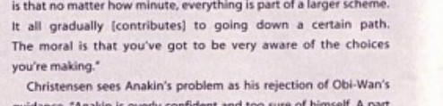
- **Obi-Wan Kenobi** — entry/section: Who's Who: Obi-Wan defies the Council: "On the other hand, he was willing to defy the Jedi Council to train Anakin as a Padawan, and he knew enough about the insular order's limitations to take to the depths of Coruscant to solve the mystery of who killed Zam Wesell. Obi-Wan's youth made this apparent paradox more clear." Source: *Star Wars Insider #62* (2002), scan p.22
  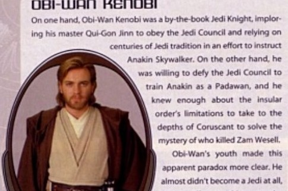
- **Obi-Wan Kenobi** — entry/section: Who's Who: Ewan McGregor measured against Guinness: "From his first scene in Episode I, McGregor was measured against the legendary Sir Alec Guinness, who played Ben Kenobi in the classic trilogy." Source: *Star Wars Insider #62* (2002), scan p.22
  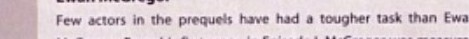
- **Darth Vader (Anakin Skywalker)** — entry/section: Who's Who: Anakin kills a Blood Carver: "When he was 12, Anakin killed an alien Blood Carver in an angry rage during a mission to Zonama Sekot." Source: *Star Wars Insider #62* (2002), scan p.22
  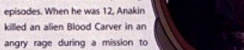
- **Darth Vader (Anakin Skywalker)** — entry/section: Hayden Christensen on Anakin: ""Anakin is overly confident and too sure of himself. A part of his mentality is, if he is the greatest Jedi ever, why does he have to follow anyone's guidance? It's that confidence that makes for his propulsion toward the dark side. I thought it was very well justified how he's going to go bad. I thought in many ways it paralleled how any human being would gradually, through their reaction to certain happenings, actually go bad."" Source: *Star Wars Insider #62* (2002), scan p.22
  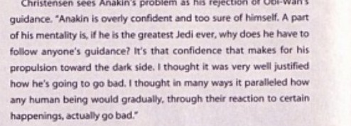

### Stat block notes (game mechanics, not feats)

- Who's Who in the Jedi Order: Obi-Wan Kenobi: On one hand, Obi-Wan Kenobi was a by-the-book Jedi Knight, imploring his master Qui-Gon Jinn to obey the Jedi Council and relying on centuries of Jedi tradition in an effort to instruct Anakin Skywalker. On the other hand, he was willing to defy the Jedi Council to train Anakin as a Padawan, and he knew enough about the insular order's limitations to take to the depths of Coruscant to solve the mystery of who killed Zam Wesell. Obi-Wan's youth made this apparent paradox more clear. He almost didn't become a Jedi at all, shipped off at age thirteen to the Jedi Agricultural Corps when no Master would take him as an apprentice. In time, Qui-Gon Jinn did so—only to see his apprentice renounce the Jedi after falling under the spell of a youth-based revolution on the planet Melida/Daan. Qui-Gon accepted him back, and Obi-Wan worked tirelessly to make himself into a model Jedi, but he inherited some of his master's independence and skepticism. (Star Wars Insider 62, p. 22) (Source: *Star Wars Insider #62* (2002), scan p.22)
- Who's Who in the Jedi Order: Anakin Skywalker: Anakin Skywalker's time in the Jedi Order has been difficult from the beginning. He was much older than other new apprentices, and he knew from the start that Obi-Wan took him as a student only because it had been Qui-Gon's dying wish. And there were the whispers around the Jedi Temple that Anakin was not just a vastly talented Force-user but also the embodiment of an ancient prophecy. Anakin often seemed more interested in tinkering with droids than in pursuing his studies. He snuck out of the Jedi Temple to race parawing gliders in Coruscant's garbage pits. He was careless with his lightsaber and quick to disagree with his Master even in public. Even his dark leather jerkin seemed a calculated rebellion against the Jedi Order and its ways. There were more disquieting episodes. When he was 12, Anakin killed an alien Blood Carver in an angry rage during a mission to Zonama Sekot. Soon after constructing his first lightsaber, he used it to execute the pirate Krayn, whom Anakin knew from his days as a slave. When Anakin received a solo mission—to guard Padmé Amidala—Obi-Wan watched him go anxiously. Would Anakin make his Master proud or yield to his darker impulses? (Star Wars Insider 62, p. 22) (Source: *Star Wars Insider #62* (2002), scan p.22)
- Who's Who in the Jedi Order: Ki-Adi-Mundi: A cone-headed Jedi Knight from Cerea, Ki-Adi-Mundi was one of the few Jedi to marry and have children—a concession made in light of Cereans' low birthrate. As a child, Ki-Adi's ability with the Force attracted the attention of the Jedi; his father agreed to give him up in hopes that a Cerean Jedi would one day stop the raiders who had long tormented Cerea's farmers. After more than two decades of training under Yoda, Ki-Adi returned to Cerea and ended the raiders' reign of terror. (Star Wars Insider 62, p. 22) (Source: *Star Wars Insider #62* (2002), scan p.22)

## scan p.23 (scan page 23)

Page contents: Who's Who cont.: Ki-Adi-Mundi (actor box "Silas Carson": four roles in Episode I, stunt training with Nick Gillard), Plo Koon (boxes "Not Your Father's Walrus Man": name from Nick Dudman's son "Plonkoon"; "Alan Ruscoe & Matt Sloan"), Eeth Koth (box "From Sketch to Screen": originally the Zabrak leader of the Council, Iain McCaig, Hassani Shapi), Even Piell. (hand-read)

- **Ki-Adi-Mundi; Nute Gunray** — entry/section: Who's Who: Silas Carson's four Episode I roles: "Underneath that extra-large cranium is Silas Carson, Star Wars' Man With a Thousand Faces. In Episode I, Carson played no fewer than four roles: Ki-Adi-Mundi, Nute Gunray, Lott Dod, and the pilot of the Naboo Royal Cruiser destroyed at the beginning of the movie—your lone chance to see Carson without a heavy mask or extensive makeup." Source: *Star Wars Insider #62* (2002), scan p.23
  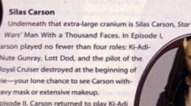

### Stat block notes (game mechanics, not feats)

- Who's Who in the Jedi Order: Ki-Adi-Mundi (cont.): By the Battle of Naboo, Ki-Adi was the only Jedi Knight to serve on the Jedi Council. Later, as a Jedi Master, Ki-Adi fought at the Battle of Geonosis, serving as a key member of a raiding party that was captured even as battle raged in the arena. He was herded into the arena with the other Jedi just in time for the Republic's clone armies to arrive. (Star Wars Insider 62, p. 23) (Source: *Star Wars Insider #62* (2002), scan p.23)
- Who's Who in the Jedi Order: Plo Koon: A Kel Dor Jedi Master from Dorin, a frigid world with a thin and poisonous atmosphere, Plo Koon was never seen in an oxygen-rich environment without his protective goggles and breath mask. Without them, he would have been quickly blinded and ill. The Kel Dor Jedi Master's strict morality and willingness to dish out physical punishment made him well known. He accompanied Ki-Adi-Mundi during the Battle of Geonosis. (Star Wars Insider 62, p. 23) (Source: *Star Wars Insider #62* (2002), scan p.23)
- Who's Who in the Jedi Order: Eeth Koth: A horned Zabrak, Eeth Koth is of the same species as the Sith apprentice Darth Maul, and their childhoods were not without parallels. Darth Sidious took Maul as a baby and brutally trained him to become a fearsome weapon with which he intended to destroy the Jedi. Eeth Koth was born in the slums of Nar Shaddaa and taken into the service of the Force when he was four, but Koth joined the Jedi, and under their tutelage he became a wise and respected Jedi Master serving on the Council. His greatest talent was for Crucitorn, a Jedi technique for transcending physical pain. (Star Wars Insider 62, p. 23) (Source: *Star Wars Insider #62* (2002), scan p.23)
- Who's Who in the Jedi Order: Even Piell: A long-eared, long-lived Lannik, Even Piell lost an eye fighting seven members of the Red Iaro, a terrorist group that attempted to overthrow his planet's government. In that fight, Piell saved not only Lannik's prince but also two Corellian emissaries—the parents of Adi Gallia, who would later serve alongside Piell on the Jedi Council. Shortly after the Battle of Naboo, the Red Iaro sought peace with the government of Lannik. The two groups agreed to meet on the rim world of Malastare, and Piell was one of the Jedi dispatched to oversee the negotiations. Among the Red Iaro was Myk'chur Finux Zug—the very terrorist who cost Piell his eye. As it turned out, the Red Iaro hadn't changed their ways. Piell was forced to battle once again to save a Lannik prince; this time, Zug did not survive. (Star Wars Insider 62, p. 23) (Source: *Star Wars Insider #62* (2002), scan p.23)

## scan p.24 (scan page 24)

Page contents: Who's Who cont.: Even Piell box "Yoda Man?" (Yoda/Yaddle/Piell species; actress Michaela Cottrell), Oppo Rancisis (box "Jerome Blake": Benton Jew's calendar inspiration and Blake's many Episode I roles), Saesee Tiin (box "Khan Bonfils & Jesse Jensen"), Coleman Trebor (box "Rob Coleman": the name as a Tuckerism). (hand-read)

- **Saesee Tiin** — entry/section: Who's Who: Saesee Tiin: "A telepath from Iktotch, the sharp-toothed, horned Saesee Tiin was one of the fiercest-looking Jedi Masters to serve on the Council. An expert pilot, Tiin could often be found behind the controls of his SoroSuub Cutlass-9 starfighter. Tiin's master, the Wol Cabbashite Jedi Omo Bouri, was slain 10 years before the Battle of Naboo, and Tiin was obsessed with using the Force to communicate with his dead master." Source: *Star Wars Insider #62* (2002), scan p.24
  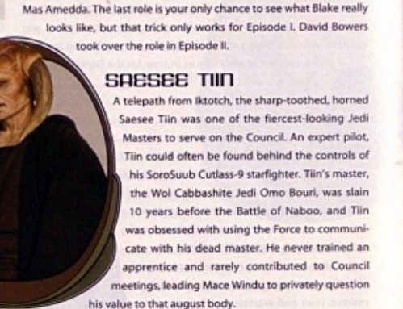

### Stat block notes (game mechanics, not feats)

- Who's Who in the Jedi Order: Oppo Rancisis: Oppo Rancisis' mother was the Blood Monarch of Thisspias, who gave her child to the Jedi Order as an infant. At 20, Rancisis received word that his younger sister had been slain, making him Thisspias' new Blood Monarch, if he chose. He did not do so, deciding to remain in the Jedi Order. By the Battle of Naboo, Rancisis was 174—quite ancient for a Thisspian. His long white hair all but obscured the green skin of his face, and he kept his dagger-tipped fingers folded neatly above his powerful, snake-like tail. (You can see him uncurl his tail in a scene of the Council chamber in Episode II.) He was an expert in the art of malacia, a Jedi technique for inducing nausea and dizziness in opponents. (Star Wars Insider 62, p. 24) (Source: *Star Wars Insider #62* (2002), scan p.24)
- Who's Who in the Jedi Order: Saesee Tiin: A telepath from Iktotch, the sharp-toothed, horned Saesee Tiin was one of the fiercest-looking Jedi Masters to serve on the Council. An expert pilot, Tiin could often be found behind the controls of his SoroSuub Cutlass-9 starfighter. Tiin's master, the Wol Cabbashite Jedi Omo Bouri, was slain 10 years before the Battle of Naboo, and Tiin was obsessed with using the Force to communicate with his dead master. He never trained an apprentice and rarely contributed to Council meetings, leading Mace Windu to privately question his value to that august body. (Star Wars Insider 62, p. 24) (Source: *Star Wars Insider #62* (2002), scan p.24)
- Who's Who in the Jedi Order: Coleman Trebor: If Coleman Trebor had been a little quicker, the Clone Wars might have stopped before they started. Appointed to the Jedi Council after the death of the Quermian Jedi Master Yarael Poof, this Vurk from the watery planet Sembla boasted a distinctive crest that swept up from his nasal passages and back over his gray head. He earned respect among the Jedi for settling a number of interplanetary disputes, though he was considered more a negotiator than a combatant. For a moment during the Battle of Geonosis, that label seemed unfair: During the battle in the arena, Trebor leapt to the viewing box and confronted Count Dooku. But before he could act, his distinguished career and his life were extinguished by the blazing guns of Jango Fett. (Star Wars Insider 62, p. 24) (Source: *Star Wars Insider #62* (2002), scan p.24)

## scan p.25 (scan page 25)

Page contents: Who's Who cont.: Mace Windu (box "Samuel L. Jackson": the name's West End Games origin, Jackson on Mace and Yoda), Yoda (box "Risky Business": Frank Oz puppet, Nick Dudman's Episode I puppet, CGI Yoda in Episode II), start of "Jedi Knights": Kit Fisto. (hand-read)

- **Mace Windu; Yoda** — entry/section: Samuel L. Jackson on Mace and Yoda: ""Mace is pretty much the second baddest guy in the universe," says Jackson. Who could be badder? He answers instantly, "Yoda, of course." Jackson doesn't begrudge the pint-sized Jedi Master the top spot. "Yoda is a mean fighting machine." —Samuel L. Jackson, Star Wars Insider 62, p. 25" Source: *Star Wars Insider #62* (2002), scan p.25
  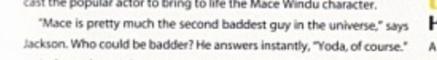
- **Mace Windu** — entry/section: Who's Who: Mace Windu's missions: "Here too he was impressive, fighting with his unique violet-bladed lightsaber. Shortly before the Battle of Naboo, Mace led a team of Jedi that defeated the aggressive Yinchorri; later, he fought off Lannik terrorists on Malastare and traveled to Nar Shaddaa, where he shut down a smuggling ring exporting deadly akk dogs." Source: *Star Wars Insider #62* (2002), scan p.25
  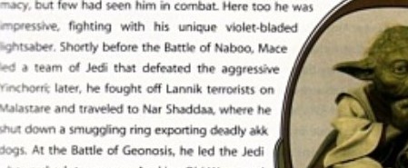
- **Yoda; Count Dooku; Darth Vader (Anakin Skywalker); Obi-Wan Kenobi** — entry/section: Who's Who: Yoda in battle: "The sight of Yoda picking his way along the corridors of the Jedi Temple with his cane left many students skeptical of the Jedi Master's combat abilities—Anakin once laughed out loud at the idea of Yoda in battle. But at the Battle of Geonosis, Yoda proved him wrong by out-dueling Count Dooku, who escaped only because finishing off Dooku would have doomed Anakin and Obi-Wan." Source: *Star Wars Insider #62* (2002), scan p.25
  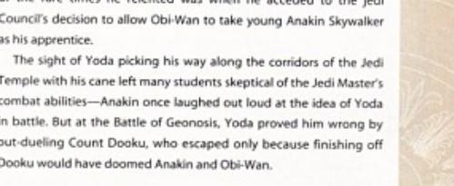

### Stat block notes (game mechanics, not feats)

- Who's Who in the Jedi Order: Mace Windu: If the Jedi had a public face in the waning years of the Republic, it was the tall, striking Mace Windu. Mace often acted as the Council's spokesman and was the Jedi Order's official liaison to the office of the Supreme Chancellor. At Chancellor Finis Valorum's request, Mace dispatched Qui-Gon and Obi-Wan on a secret mission to broker a peace treaty with Trade Federation forces blockading Naboo. Little did Mace know that a seemingly obscure trade dispute would lead to the fall of the Republic. Many knew of Mace Windu's talent for leadership and diplomacy, but few had seen him in combat. Here too he was impressive, fighting with his unique violet-bladed lightsaber. Shortly before the Battle of Naboo, Mace led a team of Jedi that defeated the aggressive Yinchorri; later, he fought off Lannik terrorists on Malastare and traveled to Nar Shaddaa, where he shut down a smuggling ring exporting deadly akk dogs. At the Battle of Geonosis, he led the Jedi who rushed to rescue Anakin, Obi-Wan, and Padmé. There, he dispatched the bounty hunter Jango Fett in single combat. (Star Wars Insider 62, p. 25) (Source: *Star Wars Insider #62* (2002), scan p.25)
- Who's Who in the Jedi Order: Yoda: Yoda had been a member of the Jedi Council for centuries by the time of the Battle of Geonosis. By then, the aged Jedi Master no longer trained Padawans, instead serving as instructor to all the younglings in the Jedi Temple. While Yoda could be gentle with his youngest charges, many older students weren't as fond of him, resenting how hard he drove them and disliking his deep-rooted conservatism. Full-fledged Jedi Knights often felt the same way, but Yoda rarely bent, reminding any doubters that he'd trained Jedi for centuries longer than they'd been alive. One of the rare times he relented was when he acceded to the Jedi Council's decision to allow Obi-Wan to take young Anakin Skywalker as his apprentice. The sight of Yoda picking his way along the corridors of the Jedi Temple with his cane left many students skeptical of the Jedi Master's combat abilities—Anakin once laughed out loud at the idea of Yoda in battle. But at the Battle of Geonosis, Yoda proved him wrong by out-dueling Count Dooku, who escaped only because finishing off Dooku would have doomed Anakin and Obi-Wan. (Star Wars Insider 62, p. 25) (Source: *Star Wars Insider #62* (2002), scan p.25)
- Who's Who in the Jedi Order: Kit Fisto: A Nautolan Jedi Master from the Mid Rim water world of Glee Anselm, Kit Fisto was nearly happy-go-lucky, at least as far as Jedi go. He believed it was his mission to use nature's gifts to help the rest of the galaxy, a philosophy he passed on to his Padawan, the Mon Calamari known as Bant. Kit Fisto's accepting nature and sense of joy could even extend to combat situations: Amid the chaos of the Battle of Geonosis, he found himself confronted by a rather odd battle droid—one topped not with the elongated, Geonosian-style skull one expected, but with the metal dome of a chattering protocol droid. Kit Fisto quickly leveled his attacker, allowing himself a grin at the strangeness of it all before continuing the fight. (Star Wars Insider 62, pp. 25-26) (Source: *Star Wars Insider #62* (2002), scan p.25)

## scan p.26 (scan page 26)

Page contents: Who's Who cont.: Kit Fisto (box "What's He Smiling About?": Dermot Power's design began as a Sith apprentice; set guard Zachariah Jensen), Barriss Offee (box "Nalini Krishan"), Aayla Secura (box "Twist of Fate": added after Dark Horse's Star Wars #33 cover caught Lucas' eye; Amy Allen, Gillian Libbert); sidebar "Chasing Aayla" by Dave Gross on Amy Allen. (hand-read)

### Stat block notes (game mechanics, not feats)

- Who's Who in the Jedi Order: Barriss Offee: Barriss Offee, Luminara Unduli's Padawan, boasted deep blue eyes and tattoos like her Master. Born to unknown parents aboard a passenger liner and taken into the Jedi Order as an infant, Barriss was a by-the-book apprentice: She clashed repeatedly with young Anakin Skywalker, whom she saw as headstrong, during their mission to the planet Ansion. Yet her Master had to wonder if the qualities she objected to in Anakin weren't ones she worried about in herself. After all, Barriss could be tempted by a finely made piece of jewelry or admit that she loved the chance to visit as many worlds as possible. On Ansion, a pair of Alwari, Kyakhta and Bulgan, kidnapped Barriss. She used the Force to heal the two nomads' damaged minds, earning their gratitude and making them allies to the Jedi's mission. (Star Wars Insider 62, p. 26) (Source: *Star Wars Insider #62* (2002), scan p.26)
- Who's Who in the Jedi Order: Aayla Secura: The blue-skinned Twi'lek Aayla Secura entered the Jedi Order as the Padawan of Quinlan Vos, a Jedi from Kiffu. In an effort to solve the puzzle of the drug glitteryll, Aayla and her Master ran afoul of Aayla's uncle Pol Secura, a member of the Twi'lek Ruling Council. The spice wiped both Aayla and Quinlan's memories. Quinlan was abandoned on Nar Shaddaa, while Aayla was disguised and hidden among her uncle's retinue of dancing girls. After the death of Pol Secura, Quinlan asked the Jedi to bring Aayla back to Coruscant for retraining in the Jedi ways. But all Aayla remembered was that Quinlan was responsible for the death of her uncle. Seeking vengeance, she traveled to Kiffu's sister world of Kiffex, where she fell under the sway of a fallen Anzati Jedi, Volfe Karkko. Quinlan had to fend off his apprentice's attacks and defeat Karkko before freeing Aayla and restoring her memories. By the time of the Battle of Geonosis, Aayla had become a Jedi Knight. (Star Wars Insider 62, p. 26) (Source: *Star Wars Insider #62* (2002), scan p.26)

## scan p.27 (scan page 27)

Page contents: Who's Who cont.: Aayla Secura box end (Amy Allen added as a Twi'lek aide to Orn Free Taa in the Episode I DVD), Shaak Ti (box "Life Imitates Art": Dermot Power and Iain McCaig design; Orli Shoshan), Luminara Unduli (box "Mary Oyaya"); "Chasing Aayla" cont. (Amy Allen at Celebration II, Jan Duursema using Allen as a model, "Living in LA, I may be tempted to use the dark side"). (hand-read)

### Stat block notes (game mechanics, not feats)

- Who's Who in the Jedi Order: Shaak Ti: Life as a Jedi was a struggle for Shaak Ti, a striking Jedi with red skin, black eyes, and a blur of patterns on her cranial horns and long head-tails. Her species, the Togruta, hail from Shili, where they live in densely populated tribes. The intricate patterns and colors on their head-tails evolved to confuse predators. These head-tails are called Lekku after the similar organs boasted by the better-known Twi'lek species. Long eons of crowding have given Togrutas the innate ability to sense other bodies close to their own, something that proved a great aid to Togruta Jedi in combat. It has also given them a fear of isolation; Shaak Ti always had to struggle with bouts of loneliness in her solitary life as a Jedi. (Star Wars Insider 62, p. 27) (Source: *Star Wars Insider #62* (2002), scan p.27)
- Who's Who in the Jedi Order: Luminara Unduli: Obi-Wan and Anakin accompanied Luminara and her apprentice Barriss Offee on a mission to Ansion in the early days of the Separatist Crisis. On Ansion's plains, Luminara showed her talents not only with a lightsaber but with the Force as a tool: She demonstrated her power by manipulating thousands of grains of sand into a halo around herself during a dancing exhibition. She also showed her command of less mystical matters, offering Obi-Wan counsel about training a Padawan and impressing the Alwari nomads as a wise speaker and a good listener. (Star Wars Insider 62, p. 27) (Source: *Star Wars Insider #62* (2002), scan p.27)

## scan p.28 (scan page 28)

Page contents: Spread opener "Fight Saber: Jedi Lightsaber Combat" (Geonosis arena still: Anakin, Padmé, Mace Windu and Jedi among battle droids). (hand-read)

## scan p.29 (scan page 29)

Page contents: Spread opener cont.: intro by David West Reynolds on cultural forms of swordplay and the fabled Seven Forms of Jedi lightsaber combat. (hand-read)

### Stat block notes (game mechanics, not feats)

- Fight Saber: intro: Only then can we understand the extraordinary combat moves of Yoda, perhaps the greatest lightsaber master the Jedi Order has ever seen. (Star Wars Insider 62, p. 29) (Source: *Star Wars Insider #62* (2002), scan p.29)

## scan p.30 (scan page 30)

Page contents: Fight Saber: "The Seven Forms" intro, Form I (from ancient sword-fighting traditions), Form II (lightsaber-to-lightsaber dueling, now an archaism), start of Form III (blaster deflection); captions on younglings' Form I training, the Death Star duel and Count Dooku's Form II. (hand-read)

### Stat block notes (game mechanics, not feats)

- Fight Saber: caption, the Death Star duel: During the fateful duel with Darth Vader on board the Death Star, the tall and powerful Sith Lord cannot break old Obi-Wan's defenses until Kenobi voluntarily yields. (Star Wars Insider 62, p. 30) (Source: *Star Wars Insider #62* (2002), scan p.30)
- Fight Saber: caption, Dooku's Form II: Form II is the chosen discipline of the Machiavellian Separatist Count Dooku, who wields it to devastating effect. His utterly precise moves overwhelm Jedi who are not accustomed to the special requirements of lightsaber dueling. With Form II, Dooku holds his own even against Master Yoda. (Star Wars Insider 62, p. 30) (Source: *Star Wars Insider #62* (2002), scan p.30)

## scan p.31 (scan page 31)

Page contents: Fight Saber cont.: Form III (Obi-Wan's dedication after Qui-Gon's death), Form IV (acrobatic; Yoda, Qui-Gon, early Obi-Wan), Form V ("peace through superior firepower"), start of Form VI ("diplomat's Form"); captions on Qui-Gon and Obi-Wan's Form IV against Maul and on Anakin dedicating himself to Form V (caption text cut at the scan's right edge, so not quoted). (hand-read)

### Stat block notes (game mechanics, not feats)

- Fight Saber: Form III and Obi-Wan Kenobi: Obi-Wan Kenobi takes up a dedication to Form III after the death of Qui-Gon Jinn (who favored Form IV), since it was apparent to Kenobi that Jinn's defense was insufficient against the Sith techniques of Darth Maul. True Form III masters are considered invincible. Even in his elder years, Kenobi remains a formidable Form III practitioner. (Star Wars Insider 62, p. 31) (Source: *Star Wars Insider #62* (2002), scan p.31)
- Fight Saber: Form IV: Form IV is the most acrobatic Form, heavily emphasizing Jedi abilities to run, jump, and spin in phenomenal ways by using the Force. Masters of Form IV incorporate all of the ways in which the Force helps them go beyond what is physically possible. Their lightsaber combat is astonishing to watch, filled with elaborate moves in the center of which a Jedi may be all but a blur. Yoda, with his deep emphasis on the Force in all things, is a Form IV master. Form IV was also the chosen discipline of Qui-Gon Jinn and the early choice of his apprentice Obi-Wan Kenobi. (Star Wars Insider 62, p. 31) (Source: *Star Wars Insider #62* (2002), scan p.31)
- Fight Saber: caption, Form IV against Maul: Obi-Wan Kenobi and Qui-Gon Jinn employ acrobatic Form IV work during their battle against Darth Maul in The Phantom Menace. (Star Wars Insider 62, p. 31) (Source: *Star Wars Insider #62* (2002), scan p.31)

## scan p.32 (scan page 32)

Page contents: Fight Saber cont.: Form VI (combination of Forms I, III, IV and V; suits the modern Jedi's political role), Form VII (most demanding; bold, direct, unpredictable); caption on Form VI Jedi dying in the Geonosis arena; caption naming Mace Windu as one of the only current Form VII practitioners. (hand-read)

### Stat block notes (game mechanics, not feats)

- Fight Saber: Form VII: Only high-level masters of multiple Forms can achieve and control the ultimate discipline known as Form VII. This is most difficult and demanding of all Forms, but it can eventually lead to fantastic power and skill. Form VII employs bold, direct movements, more open and kinetic than Form V but not so elaborate in appearance as Form IV. In addition to very advanced Force-assisted jumps and movements, Form VII tactics overwhelm opponents with seemingly unconnected staccato sequences, making the Form highly unpredictable in battle. This trait makes for a much more difficult execution than the graceful, linked move sequences of Form IV. Form VII requires the intensity of Form V, but much greater energy since that focus is wielded more broadly. Form VII draws upon a deeper well of emotion than even Form V, yet masters it more fully. The outward bearing of a Form VII practitioner is one of calm, but the inner pressure verges on explosion. Form VII is still under development since so few can achieve the necessary mastery to advance the art. (Star Wars Insider 62, p. 32) (Source: *Star Wars Insider #62* (2002), scan p.32)
- Fight Saber: caption, Mace Windu and Form VII: This spiritually dangerous regimen cuts perilously close to the Sith intensity of focus on physical combat ability. Mace Windu is one of the only current practitioners of Form VII. (Star Wars Insider 62, p. 32) (Source: *Star Wars Insider #62* (2002), scan p.32)

## scan p.33 (scan page 33)

Page contents: Fight Saber cont.: "The Marks of Contact" (sun djem: damage or destroy weapon; shiim: wound; shiak: stab; cho mai: cut off weapon hand); captions on Dooku's cho mai on Anakin, Vader's cho mai on Luke, Obi-Wan's cho sun, and Obi-Wan's wounds from Dooku. (hand-read)

### Stat block notes (game mechanics, not feats)

- Fight Saber: caption, Dooku's cho mai: Precision swordsman Count Dooku deals an aggressive cho mai (up to the elbow!) upon Anakin Skywalker in Attack of the Clones. (Star Wars Insider 62, p. 33) (Source: *Star Wars Insider #62* (2002), scan p.33)
- Fight Saber: caption, Vader's cho mai: Darth Vader executes cho mai on Luke Skywalker in The Empire Strikes Back. Skywalker returns the gesture in Return of the Jedi, like Vader stopping at this mark of contact because he does not wish to kill his opponent. (Star Wars Insider 62, p. 33) (Source: *Star Wars Insider #62* (2002), scan p.33)
- Fight Saber: caption, Obi-Wan's cho sun: Obi-Wan Kenobi is so well trained to deliver cho sun when ambushed that we see him do it in an instinctive flash in A New Hope and in Attack of the Clones. (Star Wars Insider 62, p. 33) (Source: *Star Wars Insider #62* (2002), scan p.33)
- Fight Saber: caption, Obi-Wan wounded by Dooku: Obi-Wan Kenobi suffers shiim to his arm and shiak to his leg by Count Dooku in Attack of the Clones. (Star Wars Insider 62, p. 33) (Source: *Star Wars Insider #62* (2002), scan p.33)

## scan p.34 (scan page 34)

Page contents: Fight Saber cont.: marks of contact cho sun (cut off weapon arm), sai tok (cut body in half), sai cha (behead), cho mok (otherwise maim); box "The Power of the Dark Side" on red Sith crystals; captions on Kenobi's cho sun and on Obi-Wan's sai tok against Maul. (hand-read)

### Stat block notes (game mechanics, not feats)

- Fight Saber: caption, cho sun: Cho sun is a serious but non-lethal defensive move against an aggressive assailant, typical of Kenobi's chosen lightsaber discipline Form III. (Star Wars Insider 62, p. 34) (Source: *Star Wars Insider #62* (2002), scan p.34)
- Fight Saber: sai tok: Jedi consider the bisection of a living opponent's body a form of butchery, a desecration to be avoided if possible. The savage extreme of sai tok is thus normally used only against battle droids. We see Qui-Gon Jinn and Obi-Wan Kenobi deliver sai tok to many battle droids in Episodes I and II. Sai tok represents a potentially Sith-like desire to destroy one's enemy, whereas the Jedi goal even in combat is an inner focus on defeating the danger of opponents rather than hating them and wishing utter destruction upon them. (Star Wars Insider 62, p. 34) (Source: *Star Wars Insider #62* (2002), scan p.34)
- Fight Saber: box, The Power of the Dark Side: Red crystals are ordinarily unsuitable for lightsabers, since they are less stable than the customary green and blue crystals Jedi use for the blade generators in their lightsabers. However, red crystals glow in harmonic vibration when energized by the dark side of the Force. When energized in this way, red "Sith" crystals can actually produce a stronger blade that has the rare potential to "break the blade" of Jedi lightsabers, overloading the energy matrix and instantly burning out the saber of the unfortunate opponent. This rarely happens, but it is a known and frightening possibility in combat. (Star Wars Insider 62, p. 34) (Source: *Star Wars Insider #62* (2002), scan p.34)
- Fight Saber: caption, sai tok on Maul: Obi-Wan Kenobi resorted to sai tok to kill Darth Maul, a brutal move that arose partly from Obi-Wan's rage at Maul's murder of Qui-Gon Jinn. (Star Wars Insider 62, p. 34) (Source: *Star Wars Insider #62* (2002), scan p.34)

## scan p.35 (scan page 35)

Page contents: Fight Saber cont.: "Lightsaber Combat Through the Star Wars Saga": A New Hope (Kenobi's Form III against Vader's Form V), The Empire Strikes Back (Vader's improved technique); captions on Obi-Wan's slow blade materialization and Luke's sai cha in the Dagobah cave. (hand-read)

- **Obi-Wan Kenobi; Darth Vader (Anakin Skywalker)** — entry/section: Lightsaber forms: Kenobi vs. Vader: "Nonetheless, it is a life-and-death battle pitting Kenobi's defensive Form III mastery against Vader's angry Form V power. Classically, Form III allows Kenobi to hold off the Dark Lord but cannot bring him victory against the more powerful Form V." Source: *Star Wars Insider #62* (2002), scan p.35
  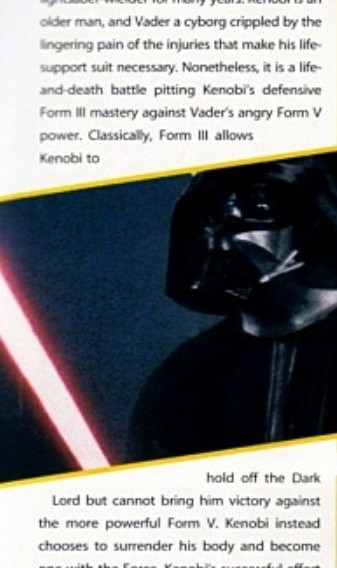
- **Obi-Wan Kenobi; Darth Vader (Anakin Skywalker)** — entry/section: Lightsaber forms: Kenobi becomes one with the Force: "Kenobi instead chooses to surrender his body and become one with the Force. Kenobi's successful effort baffles Vader as his old master's body disappears at the moment of death." Source: *Star Wars Insider #62* (2002), scan p.35
  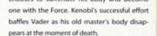

### Stat block notes (game mechanics, not feats)

- Fight Saber: A New Hope: When Obi-Wan Kenobi duels his former apprentice Darth Vader on the Death Star, both combatants know that they are but shadows of their former selves. Neither has fought another lightsaber-wielder for many years. Kenobi is an older man, and Vader a cyborg crippled by the lingering pain of the injuries that make his life-support suit necessary. (Star Wars Insider 62, p. 35) (Source: *Star Wars Insider #62* (2002), scan p.35)
- Fight Saber: caption, Obi-Wan's blade: Obi-Wan deploys his blade using a slow materialization setting for maximum stability, since he is about to face a red Sith blade that could potentially cut through his own. (Star Wars Insider 62, p. 35) (Source: *Star Wars Insider #62* (2002), scan p.35)
- Fight Saber: caption, Luke in the Dagobah cave: Luke Skywalker instinctively uses sai cha on the image of Darth Vader in the cave on Dagobah, an indication of his fear of Vader at the time. (Star Wars Insider 62, p. 35) (Source: *Star Wars Insider #62* (2002), scan p.35)
- Fight Saber: The Empire Strikes Back: By the time of the Battle of Hoth, Darth Vader has consolidated his position within the Empire as the favored agent of the Emperor. Within the armed forces Vader now holds absolute power over the higher Imperial officers who scorned him earlier in his career. This situation reflects Vader's greater mastery over himself and over the Force in the time since the Battle of Yavin, an improvement that is readily apparent in his lightsaber style during the duel with Luke Skywalker on Bespin. Vader has largely freed himself of pain through the Force in the years since the Battle of Yavin and, by practice with living opponents both willing and unwilling, he has advanced his lightsaber technique. Baron Orman Tagge serves as testament to Vader's technique by this era, precisely blinded in both eyes by Vader's blade in a duel. Vader is thus a far more formidable foe on Bespin than he was against Ben Kenobi on the Death Star. His technique lacks the advanced polish of study with lifelong masters, but he wields his Form V power with utter confidence against Luke Skywalker, masterfully taunting Skywalker as he seeks to dominate his spirit in the evil Sith tradition of dun möch. In his duel against Darth Vader on Bespin, Luke Skywalker reveals himself as an extraordinarily gifted artist with the blade who has largely taught himself. After a single brief session with Obi-Wan Kenobi years ago, and only short time with Yoda, Skywalker is able to hold up against a Dark Lord of the Sith at the height of his powers. It is only Vader's much greater experience that gives the Dark Lord the dominant edge in the battle. (Star Wars Insider 62, pp. 35-36) (Source: *Star Wars Insider #62* (2002), scan p.35)

## scan p.36 (scan page 36)

Page contents: Fight Saber cont.: Empire Strikes Back cont., Return of the Jedi (Luke's self-taught skill and self-mastery); box "Yoda's Legacy" (top right); captions on Vader bludgeoning Luke and Luke mirroring Vader's Form V. (hand-read)

### Stat block notes (game mechanics, not feats)

- Fight Saber: box, Yoda's Legacy: As they teach in the Temple, fighting styles are philosophical styles, and all battles are really battles of spirit. It is therefore interesting to observe that it is most of all Yoda's distinctive approach to the Force that determines not only his fighting style but much of the struggle that we see between the Jedi and the Sith. Yoda teaches open-mindedness far more than other Jedi Masters, and this leads to both great and terrible things in his disciples. In identifying what had happened to the "missing" planet Kamino, Yoda's young students are able to imagine a corruption of data in the Jedi Archive that the Archive's own director could not, because they think for themselves. But Yoda's other students—and their successors—pursue independence to other effects: Count Dooku leaves the Jedi Order and falls to the dark side, while Dooku's apprentice Qui-Gon Jinn repeatedly defies the Jedi Council and insists on training the dangerous Anakin Skywalker, to the ruination of the galaxy. Luke Skywalker, paradoxically, absorbs enough of Yoda's philosophy during his brief apprenticeship on Dagobah that Skywalker then defies Yoda's counsel and goes to Bespin to battle Darth Vader. In the end, Yoda's legacy is the greatest triumph of the Force: It is only Yoda's unique focus on open-mindedness that helps Luke Skywalker to see that his own mentors are wrong. He instead trusts his own belief that the only way to defeat Darth Vader is through the very opposite of dun möch. To conquer Darth Vader, Luke Skywalker creates a new kind of victory. Through a resolute validation of his opponent's spirit, a faith that overcomes all obstacles, Luke finally redeems Anakin Skywalker and brings balance to the Force. (Star Wars Insider 62, p. 36) (Source: *Star Wars Insider #62* (2002), scan p.36)
- Fight Saber: Return of the Jedi: By the time of the Battle of Endor, Luke Skywalker has studied some lightsaber technique from Obi-Wan's journal and greatly advanced his abilities. Without a Master, such advancement would be nearly impossible for most, but Skywalker's unparalleled aptitude makes him a match for Darth Vader in their fateful duel onboard the second Death Star. Both are limited, Vader by his cybernetic body parts and Skywalker by his relative lack of experience dueling. But Skywalker's skill at blaster deflection is highly refined, and his lightsaber technique is so superb that he is able to duel the Dark Lord on even footing—and finally able to defeat a man who is a powerful living product of the ancient Jedi sword traditions from time immemorial. Such an achievement with little formal training is a testament to Skywalker's innate abilities and instinctive skill. Tremendously strong with the Force, Skywalker never crosses the line into Sith hatefulness and ceases his attack immediately upon rendering his foe helpless—an even more impressive demonstration of self-mastery than his lightsaber skills. (Star Wars Insider 62, p. 36) (Source: *Star Wars Insider #62* (2002), scan p.36)
- Fight Saber: caption, Vader bludgeons Luke: Vader bludgeons Luke Skywalker with heavy machinery during their duel, a graphic demonstration of Form V's focus on raw power in the hands of a Sith. (Star Wars Insider 62, p. 36) (Source: *Star Wars Insider #62* (2002), scan p.36)
- Fight Saber: caption, Luke's final assault: In his final assault on Vader, Luke Skywalker mirrors Vader's own Form V technique and responds with a furious demonstration of Form V's raw strength. An observing Jedi Master would be astonished at such instantaneous learning in battle. (Star Wars Insider 62, p. 36) (Source: *Star Wars Insider #62* (2002), scan p.36)

## scan p.37 (scan page 37)

Page contents: Fight Saber cont.: The Phantom Menace (Maul's corrupt Form VII), Attack of the Clones (Yoda's Form IV and the su ma rotations), conclusion ("solah, or 'it is enough'"), author's note (David West Reynolds and fencer Jack "Stelen" Bobo; not stunt choreography by Nick Gillard); captions on Yoda's combat strength, Anakin's two-saber Form IV, and Qui-Gon and Obi-Wan's Form IV against Maul's Form VII. (hand-read)

- **Yoda; Count Dooku** — entry/section: Lightsaber forms: Yoda and Form IV: "Yoda's astonishing moves in his epic duel against Count Dooku may be revealed on close examination to be a masterful demonstration of the standard components of Form IV. Yoda's moves flow from one to another in the smooth transitions characteristic of this Form. Three kinds of rotation, or su ma, figure prominently in Yoda's style. They are jung su ma (spinning), ton su ma (somersaults), and en su ma (cartwheels). These three moves represent the three possible axes of rotation in three-dimensional space. Together with flying Force-enhanced jumps, the rotational su ma moves compose most of Yoda's lightsaber fighting technique, making him the ultimate example of Form IV." Source: *Star Wars Insider #62* (2002), scan p.37
  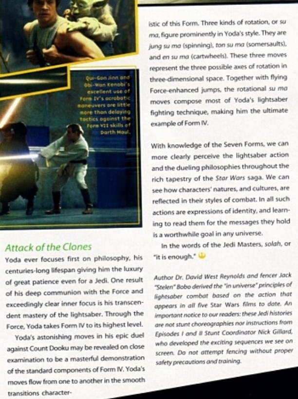

### Stat block notes (game mechanics, not feats)

- Fight Saber: caption, Yoda in combat: Ordinarily Yoda walks with a slight limp, his ancient body wracked with arthritis and the normal infirmities of old age. In combat however, the diminutive Jedi Master presents extraordinary strength and reflexes—entirely the result of focusing the Force through his physical body and not just his spirit as is his usual emphasis. (Star Wars Insider 62, p. 37) (Source: *Star Wars Insider #62* (2002), scan p.37)
- Fight Saber: caption, Anakin against Dooku: Anakin's overconfidence in his own abilities causes him to break out of his usual Form V routine and engage Dooku with the two lightsaber variant of Form IV. (Star Wars Insider 62, p. 37) (Source: *Star Wars Insider #62* (2002), scan p.37)
- Fight Saber: caption, Form IV against Form VII: Qui-Gon Jinn and Obi-Wan Kenobi's excellent use of Form IV's acrobatic maneuvers are little more than delaying tactics against the Form VII skills of Darth Maul. (Star Wars Insider 62, p. 37) (Source: *Star Wars Insider #62* (2002), scan p.37)
- Fight Saber: The Phantom Menace: By the time of the Battle of Naboo, Darth Maul is the product of many years of intense training in physical combat skills, and considers himself a master of a corrupt Sith version of Form VII. Maul's utter devotion to Form VII's physical focus is telling: he remains silent during his battle with the Jedi on Tatooine and Naboo, desiring a purely physical victory instead of pursuing the "higher" Sith tradition of dun möch—domination of his opponent's spirit, which Sith typically achieve through taunts that expose inner doubts and weakness. (Star Wars Insider 62, p. 37) (Source: *Star Wars Insider #62* (2002), scan p.37)
- Fight Saber: Attack of the Clones, Yoda: Yoda ever focuses first on philosophy, his centuries-long lifespan giving him the luxury of great patience even for a Jedi. One result of his deep communion with the Force and exceedingly clear inner focus is his transcendent mastery of the lightsaber. Through the Force, Yoda takes Form IV to its highest level. (Star Wars Insider 62, p. 37) (Source: *Star Wars Insider #62* (2002), scan p.37)

## scan p.38 (scan page 38)

Page contents: "Starships of Episode II" by Daniel Wallace: opener on the Naboo cruiser's destruction, Kamino and Geonosis as military manufacturing centers, and the galaxy's sea change foreshadowing the Empire. (hand-read)

## scan p.39 (scan page 39)

Page contents: Starships: Naboo Cruiser (J-type diplomatic barge lent to Padmé by Queen Jamillia; modeled on the stealth bomber, engine banks a homage to the B-52). (hand-read)

### Stat block notes (game mechanics, not feats)

- Starships of Episode II: Naboo Cruiser: Two years before Episode II, Padmé Amidala accepted the cruiser on loan from Queen Jamillia to transport her between Coruscant and Naboo in her new role as senator. Its silver sheen marks it as royal property. Although it lacks weapons, the cruiser can carry four heavily armed Naboo starfighters in plug-in fueling sockets located on the wings' leading edge. Two other features prove that Padmé learned her lesson from The Phantom Menace: a powerful shield generator (for escaping enemy blockades) and two hyperdrives (in case one fails). (Star Wars Insider 62, p. 39) (Source: *Star Wars Insider #62* (2002), scan p.39)

## scan p.40 (scan page 40)

Page contents: Starships: Jedi Starfighter (Delta-7 Aethersprite-class light interceptor by Kuat Systems Engineering; Hasbro's toy blasters; LucasArts' Jedi Starfighter Force powers per Daron Stinnett; R4-P17). (hand-read)

### Stat block notes (game mechanics, not feats)

- Starships of Episode II: Jedi Starfighter: While it's true that we never see Obi-Wan use any of these abilities in Episode II, Kenobi isn't a Jedi Master yet. Obi-Wan's droid, R4-P17, is the prototype for other Jedi starfighter astromechs. Jedi starfighter droids are half-sized runts who are welded into place and can't easily leave their port-side spots in the ship's narrow fuselage. (Star Wars Insider 62, p. 40) (Source: *Star Wars Insider #62* (2002), scan p.40)

## scan p.41 (scan page 41)

Page contents: Starships: Slave I (seismic charges, twin laser cannons, heat-seeking torpedo; Firespray-class patrol ship; the Bounty Hunter game's jailbreak on Oovo IV). (hand-read)

### Stat block notes (game mechanics, not feats)

- Starships of Episode II: Slave I: That's just one of Slave I's nasty surprises. Obi-Wan also runs afoul of twin laser cannons, which spray streams of lethal energy. Jango hopes to administer the coup de grâce with a heat-seeking torpedo, a wicked thing with points and sharp fins that looks like it could take out an entire city. Slave I is a Kuat Systems Engineering Firespray-class patrol ship. The designers of the LucasArts video game Bounty Hunter wanted Jango Fett's signature vessel to be one-of-a-kind and came up with a way to preserve Slave I's uniqueness despite existing references that painted it as just another Firespray. In the game, Jango steals Slave I during a jailbreak from the prison world Oovo IV, then turns the ship's laser cannons on the other Firesprays, all of them limited-run prototypes. (Star Wars Insider 62, p. 41) (Source: *Star Wars Insider #62* (2002), scan p.41)

## scan p.42 (scan page 42)

Page contents: Starships: Geonosian Starfighter (Nantex-class; pheromone controls, 100 tractor-beam projectors, magnetically suspended engine orb; pilots raised with their flight computers). (hand-read)

## scan p.43 (scan page 43)

Page contents: Starships: Solar Sailer (Count Dooku's Punworcca 116-class interstellar sloop; Curtis Saxton on Gree satellites pushing the sail; FA-4 pilot droid). (hand-read)

### Stat block notes (game mechanics, not feats)

- Starships of Episode II: Solar Sailer: The body of Dooku's solar sailer is a close cousin to that of the Geonosian starfighter, only wider, like an overfed clam. Dooku isn't exactly Han Solo when it comes to flying his own ship, so the ball-shaped cockpit is usually occupied by an FA-4 pilot droid. Dooku can usually be found in the sloop's luxurious living quarters, perusing a text from the on-board library or speaking to his master through a secure HoloNet transceiver. (Star Wars Insider 62, p. 43) (Source: *Star Wars Insider #62* (2002), scan p.43)

## scan p.44 (scan page 44)

Page contents: Starships: Techno Union Transport (Wat Tambor's Hardcell-class transports; 1950s rocket-ship inspiration per Michael Patrick Murnane and Marc Gabbana). (hand-read)

## scan p.45 (scan page 45)

Page contents: Starships: Republic Assault Ship (Acclamator-class transport commissioned by the Kaminoans from Rothana Heavy Engineering; 752 meters; comparison with the Victory-class Star Destroyer). (hand-read)

## scan p.46 (scan page 46)

Page contents: "Return to Endor: The Stars of the Ewok Films Remember Their Adventure" by Rich Handley: The Ewok Adventure (1984, John Korty; Bob Carrau; narrated by Burl Ives; Joe Johnston production design) and Ewoks: The Battle For Endor (Jim and Ken Wheat); both from stories by George Lucas with ILM effects. (hand-read)

## scan p.47 (scan page 47)

Page contents: Return to Endor cont.: full-page still with pull quote on rescuing parents (Fionnula Flanagan, quoted on p. 50). (hand-read)

## scan p.48 (scan page 48)

Page contents: Return to Endor cont.: Warwick Davis (Wicket W. Warrick): getting the role on Jedi, the "W" names, schooling on set, the video camera, Amanda Lucas's visit, the bolas souvenir; Eric Walker (Mace Towani): seeing Jedi in theaters, early acting roles. (hand-read)

- **Wicket W. Warrick** — entry/section: Warwick Davis on becoming Wicket: ""As soon as I saw R2-D2, I went over to him and started acting in an inquisitive nature, as you might do if you haven't seen something . . . being a younger Ewok, I was a bit foolhardy and more curious, and they liked that." Lucas and Marquand were impressed. "While we were in America, Kenny got ill, and they called me in at the last minute to do that scene with Carrie Fisher, and I became Wicket." —Warwick Davis, Star Wars Insider 62, p. 48" Source: *Star Wars Insider #62* (2002), scan p.48
  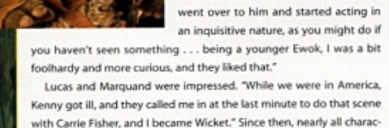

## scan p.49 (scan page 49)

Page contents: Return to Endor cont.: Eric Walker on studying acting, resembling Mark Hamill, his audition monologue, Lucas directing the re-shoot for a week, cut scenes (giant flower); Aubree Miller (Cindel Towani): her only acting work. (hand-read)

## scan p.50 (scan page 50)

Page contents: Return to Endor cont.: Cindel actress's co-stars' praise; Mace's death early in The Battle For Endor; Cindel as an adult journalist in the Black Fleet Crisis trilogy; Fionnula Flanagan (Catarine Towani); Guy Boyd (Jeremitt Towani #1). (hand-read)

- **No single roster character (rules/setting/general)** — entry/section: Ewok films: the Towani family's fate (Mace Towani, not Mace Windu): "Mace and his parents were all killed early on in The Battle For Endor." Source: *Star Wars Insider #62* (2002), scan p.50
  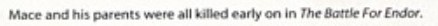

### Stat block notes (game mechanics, not feats)

- Return to Endor: Cindel in the Expanded Universe: The character of Cindel has briefly re-appeared as an adult in Michael Kube-McDowell's Black Fleet Crisis trilogy. The orphaned child, the novels revealed, became a news journalist. (Star Wars Insider 62, p. 50) (Source: *Star Wars Insider #62* (2002), scan p.50)

## scan p.51 (scan page 51)

Page contents: Return to Endor cont.: Guy Boyd cont. (basketball with the Ewok actors); Paul Gleason (Jeremitt Towani #2); Carel Struycken (King Terak); Siân Phillips (Charal). (hand-read)

### Stat block notes (game mechanics, not feats)

- Return to Endor: Charal: But in the Star Wars universe, Phillips was Charal, the mystical witch from The Battle For Endor. Able to turn herself into a raven using a magical ring, she brought new depth to the mysteries of the Force—a mystery explained in Kevin Anderson's Illustrated Star Wars Universe, which identified her as a Nightsister of Dathomir, a band of Force-witches introduced in Dave Wolverton's novel The Courtship of Princess Leia. (Star Wars Insider 62, p. 51) (Source: *Star Wars Insider #62* (2002), scan p.51)

## scan p.52 (scan page 52)

Page contents: "Cardboard Cinema: Topps to Release First Attack of the Clones Widevision Set": Topps history (Len Brown, Gary Gerani), Widevision since 1995, "On the Dotted Line" autograph cards (Matt Saunders, John Williams); sidebar "Simple Things" on the history of chase cards (stickers 1977-83, Star Wars Galaxy foils). (hand-read)

- **Yoda; Count Dooku** — entry/section: Matt Saunders on the Yoda-Dooku duel: ""The final battle between Yoda and Count Dooku was so incredible, and it's thrilling to us—and hopefully will be for fans too—to have such high-caliber talent included as part of this autograph set." —Matt Saunders, Star Wars Insider 62, pp. 52-53" Source: *Star Wars Insider #62* (2002), scan p.52
  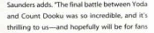

## scan p.53 (scan page 53)

Page contents: Cardboard Cinema cont.: 25 planned autograph cards, "Action-Packed" focus on the Geonosis finale, the October 2002 release (80 cards); "Simple Things" cont. (chrome, laser-cut and 3-Di chase cards; Star Wars Evolution autographs). (hand-read)

## scan p.54 (scan page 54)

Page contents: "Tales From the Great River: Emissary of the Void, Episode IV" by Greg Keyes, illustrated by Dave Dorman (fiction; earlier episodes ran in Star Wars Gamer 8-10): title art of Uldir Lochett and Klin-Fa Gi. (hand-read)

## scan p.55 (scan page 55)

Page contents: Emissary of the Void cont.: Vega Sepen's backstory; the No Luck Required crew (Vega, Leaft the Dug, Vook the Duro, astromech UV002 "Uvee") salvage hyperdrive motivators from a crashed pre-Imperial cruiser in the Wayland system as a Yuuzhan Vong frigate searches for them. (hand-read)

### Stat block notes (game mechanics, not feats)

- Emissary of the Void: Vega Sepen's backstory: Her experience came from hard lessons. She'd been a junior tactician on the pirate vessel Free Lance with Urias Xhaxin when she first laid eyes on the living ships of the Yuuzhan Vong. Back then, the extragalactic race had been little more than a rumor. The battle-hardened crew of the Free Lance had lost the skirmish in seconds, escaping only by making a blind hyperspace jump. (Star Wars Insider 62, p. 55) (Source: *Star Wars Insider #62* (2002), scan p.55)

## scan p.56 (scan page 56)

Page contents: Emissary of the Void cont.: Leaft refuels from the wreck and triggers an attack; on Wayland, Uldir Lochett and Klin-Fa Gi (in Yuuzhan Vong biofacture garb) face Vong warriors beside the Free People. (hand-read)

## scan p.57 (scan page 57)

Page contents: Emissary of the Void cont.: a Psadan sacrifices himself; Uldir and Klin-Fa ride a retracting vapor tube into a Vong mining worm. (hand-read)

## scan p.58 (scan page 58)

Page contents: Emissary of the Void cont.: inside the mining worm; Klin-Fa resets Uldir's shoulder. (hand-read)

## scan p.59 (scan page 59)

Page contents: Emissary of the Void cont.: Klin-Fa explains the stolen qahsa, her partner Bey and the slave convoy. (hand-read)

## scan p.60 (scan page 60)

Page contents: Emissary of the Void cont.: the Yuuzhan Vong hunter Tsaa Qalu decides to trail them to the stars; Vega fights coralskippers and an ancient automated drone ship. (hand-read)

## scan p.61 (scan page 61)

Page contents: Emissary of the Void cont.: Vega powers down so the drone attacks the Vong frigate; Uldir and Klin-Fa arrive in A-wings. (hand-read)

## scan p.62 (scan page 62)

Page contents: Emissary of the Void cont.: Leaft attacks Klin-Fa; Uldir orders a course for the Hydian Way and proposes hitting the slave convoy (continued in a later issue). (hand-read)

## scan p.63 (scan page 63)

Page contents: "The Jawa Trader" (swfan.wizards.com shop): Fan Club exclusive Attack of the Clones baseball cap and T-shirt; contents box (top left). (hand-read)

## scan p.64 (scan page 64)

Page contents: Jawa Trader cont.: Saga/Power of the Jedi action figures, Carbon-Freezing Chamber playset, Stormtrooper Troop Builder Set, action figure stands. (hand-read)

## scan p.65 (scan page 65)

Page contents: Jawa Trader cont.: Star Wars Roleplaying Game books (Arms & Equipment Guide, Revised Core Rulebook, Rebellion Era Sourcebook), Trading Card Game Attack of the Clones and Sith Rising products. (hand-read)

## scan p.66 (scan page 66)

Page contents: Jawa Trader cont.: Attack of the Clones one-sheet poster (Drew Struzan), Fan Club bobblehead set (Vader, Boba Fett, C-3PO with R2-D2), Ki-Adi-Mundi 12" figure, Princess Leia cookie jar, Hardware Wars DVD. (hand-read)

### Stat block notes (game mechanics, not feats)

- Jawa Trader: Ki-Adi-Mundi 12" figure blurb: Ki-Adi-Mundi is the only member of the Jedi Council who is not a Jedi Master; an indication of the high value placed upon his skills and wisdom by the other Council members. This Jedi Knight, a native of the planet Cerea, has a unique ability to control the thoughts, emotions and brain waves of other creatures. (Star Wars Insider 62, p. 66) (Source: *Star Wars Insider #62* (2002), scan p.66)

## scan p.67 (scan page 67)

Page contents: Subscription offer and order form (8 issues plus Fan Club membership). (hand-read)

## scan p.68 (scan page 68)

Page contents: "Behind the Magic: Real or Digital? Computer Generated Actors in Attack of the Clones" by Rob Coleman (ILM animation director): stunt doubles vs digital doubles; "The Big Three" (skin, hair, clothing); Jango Fett captions. (hand-read)

## scan p.69 (scan page 69)

Page contents: Real or Digital? cont.: skin and sub-surface scattering, hair, Yoda's digital Jedi robe; "Rumble in the Rain" (KOJ: Kamino, Obi-Wan, Jango) digital Obi-Wan and Jango shots. (hand-read)

## scan p.70 (scan page 70)

Page contents: Real or Digital? cont.: box "How'd They Do That!?" (10 shots, real or digital; top left, full column); "Face Off" (Padmé's bedroom window stunt, Anakin's droid factory jump). (hand-read)

### Stat block notes (game mechanics, not feats)

- Box "How'd They Do That!?": Jango's death and Anakin thrown by Dooku: 9. Real: For the proper reality of Jango's body slumping to the ground we used a real person and then digitally removed his head. 10. Digital: The jump needed a change of direction and was too far for Hayden or his stunt double to make. Hayden's run was carefully matched so that the digital double moved like him. (Star Wars Insider 62, p. 70) (Source: *Star Wars Insider #62* (2002), scan p.70)

## scan p.71 (scan page 71)

Page contents: Real or Digital? cont.: Dooku-Yoda duel digital double and head replacement of Christopher Lee; "Rough Riders" (Geonosis arena creature riding); "What's Next?" on actors and stunt performers. (hand-read)

- **Count Dooku; Yoda** — entry/section: Effects: digital Dooku in the Yoda duel: "During the climatic lightsaber duel between Count Dooku and Yoda, there were several shots that employed either a complete digital double of Christopher Lee (such as when he leaps at Yoda) or digital head replacements." Source: *Star Wars Insider #62* (2002), scan p.71
  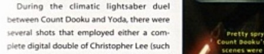

## scan p.72 (scan page 72)

Page contents: "Battle of the Planets: Continue the Fight Against the Confederacy with Star Wars: The Clone Wars" by Brett Rector: the PS2/GameCube game (Pandemic/LucasArts), story after Geonosis, producer Jim Tso, 16 single-player missions on six worlds, four multiplayer modes. (hand-read)

- **Count Dooku; Darth Vader (Anakin Skywalker); Obi-Wan Kenobi; Mace Windu** — entry/section: The Clone Wars game: storyline: "However, this assault is intended simply to sow confusion as Dooku looks for the pieces of an ancient Sith weapon of mass destruction that, once assembled, can destroy the Jedi and anyone else who stands in his way. To stop the Separatists' plot from succeeding, the Republic deploys a massive army of clones lead by Anakin Skywalker, Obi-Wan Kenobi, and Mace Windu." Source: *Star Wars Insider #62* (2002), scan p.72
  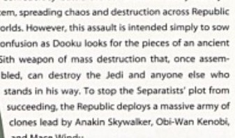

### Stat block notes (game mechanics, not feats)

- The Clone Wars game: storyline: However, this assault is intended simply to sow confusion as Dooku looks for the pieces of an ancient Sith weapon of mass destruction that, once assembled, can destroy the Jedi and anyone else who stands in his way. To stop the Separatists' plot from succeeding, the Republic deploys a massive army of clones lead by Anakin Skywalker, Obi-Wan Kenobi, and Mace Windu. (Star Wars Insider 62, p. 72) (Source: *Star Wars Insider #62* (2002), scan p.72)

## scan p.73 (scan page 73)

Page contents: The Clone Wars game cont.: box "Technological Terrors" (top; TX-130 S Fighter Tank, Hailfire Droid, Commerce Guild Spider Tank, CIS GAT Droid Tank); vehicles, weapons, HUD and controls. (hand-read)

## scan p.74 (scan page 74)

Page contents: The Clone Wars game cont.: worlds (Geonosis, Rhen Var, Alaris, Raxus Prime), third-person Jedi sequences (Mace Windu on Geonosis), multiplayer conquest and Jedi Academy modes, technical merits (Skywalker Sound). (hand-read)

- **Count Dooku; Ulic Qel-Droma; Darth Vader (Anakin Skywalker)** — entry/section: The Clone Wars game: Ulic Qel-Droma's tomb: "In fact, a pivotal plot point revolves around Count Dooku as he journeys to Rhen Var to locate and destroy the tomb of the Jedi Knight Ulic Qel-Droma, who lived 4,000 years before the Clone Wars during the time of the great Jedi-Sith war. If Anakin and company find the tomb first, they can gain knowledge from Ulic's spirit to figure out how to destroy the weapon." Source: *Star Wars Insider #62* (2002), scan p.74
  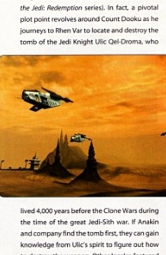

### Stat block notes (game mechanics, not feats)

- The Clone Wars game: Ulic Qel-Droma's tomb on Rhen Var: In fact, a pivotal plot point revolves around Count Dooku as he journeys to Rhen Var to locate and destroy the tomb of the Jedi Knight Ulic Qel-Droma, who lived 4,000 years before the Clone Wars during the time of the great Jedi-Sith war. If Anakin and company find the tomb first, they can gain knowledge from Ulic's spirit to figure out how to destroy the weapon. (Star Wars Insider 62, p. 74) (Source: *Star Wars Insider #62* (2002), scan p.74)

## scan p.75 (scan page 75)

Page contents: "Star Wars Galaxies: Beyond the Movies" by Haden Blackman: An Empire Divided MMOG (Sony Online/LucasArts); eight playable species incl. Zabrak and Bothans (unified Bothan design); skin and fur palettes. (hand-read)

## scan p.76 (scan page 76)

Page contents: Star Wars Galaxies cont.: purple Rodians, speckled Twi'leks; "Galactic Gazetteer" (Tatooine, Yavin 4, Endor, Naboo, Corellia, Dathomir, Lok; Fort Tusken); "The Rise, Fall, and Rise of Mos Espa". (hand-read)

## scan p.77 (scan page 77)

Page contents: Star Wars Galaxies cont.: Mos Espa design; "Star Wars Ewoks" (creatures from the Ewoks cartoon, the hanadak); "Jabba's Soap Opera" (NPCs from Tales from Jabba's Palace). (hand-read)

### Stat block notes (game mechanics, not feats)

- Star Wars Galaxies: Jabba's palace NPCs: To flesh out the interactions in Jabba's palace, the designers relied heavily on the short stories in Tales from Jabba's Palace, which when taken together depict the complex maneuverings of Jabba's cronies. Players can expect to receive missions from a very loyal Ephant Mon, a hungry Max Rebo, and a paranoid Bib Fortuna. (Star Wars Insider 62, p. 77) (Source: *Star Wars Insider #62* (2002), scan p.77)

## scan p.78 (scan page 78)

Page contents: "Arms & Equipment Guide: Not Just Another Gun Book" by Brian Campbell (Star Wars Roleplaying Game): special modifications, tooling up (new ammunition, grenades, exotic melee weapons). (hand-read)

### Stat block notes (game mechanics, not feats)

- Arms & Equipment Guide: Han's blaster: Han Solo is famous for customizing everything on the Millennium Falcon, right down to his sidearm, a modified BlasTech DL-44 Heavy Blaster. (Star Wars Insider 62, p. 78) (Source: *Star Wars Insider #62* (2002), scan p.78)

## scan p.79 (scan page 79)

Page contents: Arms & Equipment Guide cont.: concealed weapons, armor, droids (OOM-9, FX medical, Dark Eye probe, RA-7, M-3PO), vehicles, other gear; pull quote "A hero's personality is sometimes defined by even the most innocuous pieces of equipment" (top right). (hand-read)

## scan p.80 (scan page 80)

Page contents: "Walter Jon Williams, Galactic Historian" by Jason Fry: Williams on writing The New Jedi Order: Destiny's Way (the 14th NJO book; "like writing Chapter 14 of War and Peace"), the relay of NJO authors, learning the Expanded Universe; Jaina, Jacen and Vergere in the story. (hand-read)

### Stat block notes (game mechanics, not feats)

- Destiny's Way: where the story stands: Jaina Solo, now an ace starfighter pilot and an implacable foe of the Yuuzhan Vong, wears the guise of their trickster goddess Yun-Harla. Her twin brother Jacen returns from Yuuzhan Vong captivity with new maturity and understanding of the Force. The strange former Jedi Vergere—Jacen's ruthless tutor in Matthew Stover's Traitor—plays a key role in Destiny's Way, where her history is finally revealed. (Star Wars Insider 62, pp. 80-81) (Source: *Star Wars Insider #62* (2002), scan p.80)

## scan p.81 (scan page 81)

Page contents: Walter Jon Williams cont.: Vergere's story, his historical and SF novels, Dread Empire's Fall, a planned Destiny's Way tie-in e-book; box "In Other Book News..." (Star By Star with Recovery, Force Heretic trilogy, Jody Duncan's Mythmaking, Jedi Quest, Boba Fett: Crossfire, The Star Wars Party Book). (hand-read)

## scan p.82 (scan page 82)

Page contents: "A Universe Like No Other?" Dark Horse comics: Star Wars: Empire launches alongside the prequel series (renamed Star Wars: Republic); editor Randy Stradley and writer Scott Allie; "Betrayal" arc with Grand Moff Trachta (art Ryan Benjamin, covers Brian Horton); Allie on seeing A New Hope at seven. (hand-read)

- **Darth Vader (Anakin Skywalker); Palpatine (Darth Sidious); Trachta** — entry/section: Scott Allie on Star Wars: Empire "Betrayal": ""It's all about the Imperial officers on Coruscant turning on the Sith Lords," he explains, and indeed the story seems as if it will satisfy even the hungriest of Empire-lovers. "Vader and Emperor Palpatine are the focus of 'Betrayal,' but a couple other surprise characters pop up. We've also invented a whole cast of high-ranking Imperial officers and an Imperial hit man. The series has a very dark edge to it." —Scott Allie, Star Wars Insider 62, p. 82" Source: *Star Wars Insider #62* (2002), scan p.82
  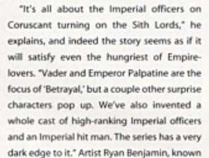

## scan p.83 (scan page 83)

Page contents: Dark Horse cont.: Empire set shortly before A New Hope, moving toward Empire Strikes Back; supporting characters such as Biggs Darklighter and original characters (as with Quinlan Vos in the ongoing series); Stradley: "who says we need to stop at two?" (hand-read)

## scan p.84 (scan page 84)

Page contents: "Set Piece: The Millennium Falcon: Non-Stop to Alderaan, In-Flight Entertainment Included" by Chris Reiff & Christopher Trevas: the Falcon interior at Elstree, Luke's remote training and the lightsaber blade effect (Barry Nolan, VanDerVeer Photo Effects); captions on Han's bunk, R2-D2/Kenny Baker, tool kits, Chewie's keyboard. (hand-read)

### Stat block notes (game mechanics, not feats)

- Millennium Falcon caption: the bunk: Han relaxes in this cozy spot during long hyperspace jumps. Luke recovered in a similar bunk elsewhere onboard after his dismemberment at the hands of Darth Vader in The Empire Strikes Back. (Star Wars Insider 62, p. 84) (Source: *Star Wars Insider #62* (2002), scan p.84)
- Millennium Falcon caption: Chewie's keyboard: Many assume this is Han's keyboard, but it is actually Chewie's. He'd been typing his memoirs in his spare time. It takes a while to put a two hundred-year lifetime into words. (Star Wars Insider 62, p. 84) (Source: *Star Wars Insider #62* (2002), scan p.84)

## scan p.85 (scan page 85)

Page contents: Millennium Falcon cont.: the dejarik game (Phil Tippett, Jon Berg; the Mantellian Savrip); captions on the training remote "kit bashing", smuggling compartments, the blast-shield helmet, salvaged aircraft parts, the lightsaber made from a camera flash handle. (hand-read)

### Stat block notes (game mechanics, not feats)

- Millennium Falcon caption: dejarik: Dejarik was one of Chewie's favorite games until he challenged a fiesty droid. (Star Wars Insider 62, p. 85) (Source: *Star Wars Insider #62* (2002), scan p.85)
- Millennium Falcon caption: the blast-shield helmet: This helmet with a protective blast shield makes a suitable blindfold for young Luke to learn to trust his instincts. The design is based on the RPH-6B U.S. Navy flight helmet and is identical to the Rebel pilot helmets except for the face shield and unique insignia. (Star Wars Insider 62, p. 85) (Source: *Star Wars Insider #62* (2002), scan p.85)
- Millennium Falcon caption: Luke's lightsaber prop: The lightsaber passed down from Luke's father was a modified antique camera flash handle. Press photographers in films set in early Hollywood use this type of flash frequently. With the removal of the reflector dish and the addition of grips, it became a weapon from a "more civilized age." (Star Wars Insider 62, p. 85) (Source: *Star Wars Insider #62* (2002), scan p.85)

## scan p.86 (scan page 86)

Page contents: "Scouting the Galaxy" by Steve Sansweet ("Obi-Wan's saber with a leopard grip, green-eyed Yoda, gangrenous Chewie, and more"): Attack of the Clones merchandise, being a completist, F.A.O. Schwarz presentations; reader collectible questions (reader names not recorded). (hand-read)

## scan p.87 (scan page 87)

Page contents: Scouting the Galaxy cont.: reader questions answered (variant figures, Jedi Master points, a store display poster's origin, damaged vintage figures); reader names not recorded. (hand-read)

## scan p.88 (scan page 88)

Page contents: Scouting the Galaxy cont.: vintage figure care, classic trilogy on DVD expected after Episode III, rolled 1980 Empire Strikes Back "Gone With the Wind" one-sheet (Roger Kastel art), Episode II promotions (Frito Lay, General Mills) and the Canadian Episode I theatrical program; reader names not recorded. (hand-read)

## scan p.89 (scan page 89)

Page contents: Back issues ad: Star Wars Insider and Star Wars Gamer back issue listings and order form. (hand-read)

## scan p.90 (scan page 90)

Page contents: Crossword "A Crash Course in Wookiee" (Kashyyyk and Wookiee clues) with a cartoon panel. (hand-read)

## scan p.91 (scan page 91)

Page contents: "Prequel Update" continued from p. 8: Rick McCallum on concept art for Episode III, Lucas's collage-like process, production logistics (sets, costumes, locations), and Lucas's post-saga plans (experimental and historical films); pull quote "On one level, he's the supreme collage artist, because that's what all film editors do." (hand-read)

## scan p.92 (scan page 92)

Page contents: "Rebel Rumblings" letters cont. from p. 4: Attack of the Clones observations, World Cup campaign, reader photos, "Five Things to Love About Attack of the Clones" sidebar (Jango Fett, humor, battle scenes...); letter-writer names not recorded. (hand-read)

## scan p.93 (scan page 93)

Page contents: Rebel Rumblings cont.: Five Things cont. (Yoda), verdicts on Attack of the Clones, editor replies (Obi-Wan's "descent," favorite fight scenes, Who's Who in the Jedi Order); letter-writer names not recorded. (hand-read)

## scan p.94 (scan page 94)

Page contents: Rebel Rumblings cont.: Timothy Zahn reading Insider at a convention, a celebrity encounter story from Celebration II, a fan-built Tantive IV replica; Index of Advertisers; private individuals not recorded. (hand-read)

## scan p.95 (scan page 95)

Page contents: "Star Sightings 62" by Benjamin Harper: Carrie Fisher honored for mental health advocacy, Mark Hamill in Constricted, Rena Owen in The Water Giant, Ewan McGregor's MTV award, Ian McDiarmid leaving the Almeida, Lindsay Duncan's Tony, Rob Coleman on Entertainment Weekly's IT list; top banner quote from Buffy the Vampire Slayer. (hand-read)

## scan p.96 (scan page 96)

Page contents: "Star Wars Q&A with Pablo Hidalgo": crystal vs electrum lightsabers, Jabba's voice, Padmé's fall on Geonosis, why Jango hired Zam, why Jango didn't kill Obi-Wan and Anakin, Artoo's rockets, Threepio's coverings deleted scene. (hand-read)

- **Padmé Amidala; C-3PO** — entry/section: Q&A: Threepio's coverings fix: "Looking to cut down on the running time of the movie, Lucas removed this scene with Padmé and Threepio, but that left a problem: Threepio would spontaneously generate coverings with no explanation. So, Lucas instead shot bluescreen footage of Anthony Daniels in the silver Threepio costume and digitally replaced the naked Threepio puppet in all the preceding shots." Source: *Star Wars Insider #62* (2002), scan p.96
  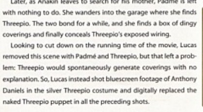

### Stat block notes (game mechanics, not feats)

- Q&A: Mace Windu's electrum lightsaber: Mace's lightsaber, like that of the other Jedi, uses a crystal to refine the energy into a blade. What makes Mace's weapon unique is its cool electrum coating. Since that's what makes it different, it was specifically called out, though it is technically correct also to refer to Mace's as a "crystal lightsaber." (Star Wars Insider 62, p. 96) (Source: *Star Wars Insider #62* (2002), scan p.96)
- Q&A: Jabba's voice: There is a voice credit in The Phantom Menace. Jabba is played by "himself!" In Return of the Jedi, Jabba's voice was provided by Larry Ward, a Berkley, CA-based linguist who also provided the voice of Greedo in A New Hope. (Star Wars Insider 62, p. 96) (Source: *Star Wars Insider #62* (2002), scan p.96)
- Q&A: Padmé's fall on Geonosis: Padmé's one tough senator, but she had a little help. The sand dunes on Geonosis cushioned her fall, but also the planet has a slightly lighter than standard gravity. This also accounts for some of Geonosis' towering topography and the ease of Geonosian flight. (Star Wars Insider 62, p. 96) (Source: *Star Wars Insider #62* (2002), scan p.96)
- Q&A: why Jango hired Zam: Jango has a personal distaste for assassination. More importantly, he sought to distance himself from the Separatists who wanted Padmé dead. Jango was careful not to be directly connected with Count Dooku or Nute Gunray, who made his joining of the Separatists contingent on Padmé's death. (Star Wars Insider 62, p. 96) (Source: *Star Wars Insider #62* (2002), scan p.96)
- Q&A: why Jango didn't kill Obi-Wan and Anakin: Jango didn't get to be the best in the bounty hunting business by being rash. His payment for the Senatorial hit covered subcontracting out to Zam, not eliminating two Jedi. It also didn't cover the risks involved in tangling with two Jedi if it wasn't absolutely necessary. Since he was the one who hired Zam, and she failed, it was his responsibility to clean up that mess. (Star Wars Insider 62, p. 96) (Source: *Star Wars Insider #62* (2002), scan p.96)
- Q&A: Artoo's rockets: A lot can happen in two decades. Artoo has had his tool set swapped out on numerous occasions, and he's constantly undergoing upgrades and modifications to stave off obsolescence. Just because Artoo has a gizmo on one occasion doesn't necessarily mean he has it on the next. Also, the HoloNet News website revealed that Industrial Automaton, Artoo's parent company, limited its factory warranty on astromech rockets to about 20 years. (Star Wars Insider 62, p. 96) (Source: *Star Wars Insider #62* (2002), scan p.96)
- Q&A: Threepio's coverings (deleted scene): Scenes of Threepio receiving his coverings were among the casualties of judicious editing. As it was originally scripted and shot, when Anakin and Padmé arrive at the Lars Homestead looking for Shmi, the skeletal Threepio greets them. The protocol droid then leads the two to the sunken courtyard, where they meet the Lars family. Later, as Anakin leaves to search for his mother, Padmé is left with nothing to do. She wanders into the garage where she finds Threepio. The two bond for a while, and she finds a box of dingy coverings and finally conceals Threepio's exposed wiring. (Star Wars Insider 62, p. 96) (Source: *Star Wars Insider #62* (2002), scan p.96)

## scan p.97 (scan page 97)

Page contents: Q&A cont.: Threepio change late in production; R4-P17's body; Owen as Anakin's stepbrother; Padmé's "shift" button; Jango's head and helmet; Rothana Heavy Engineering's clone army hardware. (hand-read)

### Stat block notes (game mechanics, not feats)

- Q&A: Shmi finished Threepio: The in-universe explanation for Threepio's coverings is nice and poignant. Shmi finished the droid in the years after Anakin's departure, a silent resignation to the fact that her son might not be coming back. (Star Wars Insider 62, p. 97) (Source: *Star Wars Insider #62* (2002), scan p.97)
- Q&A: R4-P17's body: R4-P17 doesn't have the standard meter-tall astromech body that R2-D2 does. R4-P17 is pretty much just a head. The little droid is permanently attached to the starfighter and cannot move about on its own. Early during Episode II's production, there was to have been a scene wherein R4-P17 wanders away from the starfighter and is attacked by nasty little critters called rogas. (Star Wars Insider 62, p. 97) (Source: *Star Wars Insider #62* (2002), scan p.97)
- Q&A: Owen is Anakin's stepbrother: Owen isn't Anakin's half-brother. He introduced himself as Anakin's stepbrother, which is a big difference. Owen is older, having been born to Cliegg and Aika Lars. After Aika died, Cliegg remarried, and Owen became Shmi's stepson. (Star Wars Insider 62, p. 97) (Source: *Star Wars Insider #62* (2002), scan p.97)
- Q&A: Jango's head and helmet: Next time you watch the movie, look very carefully as Jango's helmet hits the dusty arena floor. Only, don't watch the helmet—watch the helmet's shadow. In shadow form, you can see that Jango's head falls out of the helmet before it hits the ground. (Star Wars Insider 62, p. 97) (Source: *Star Wars Insider #62* (2002), scan p.97)
- Q&A: Rothana Heavy Engineering: The clone army and its hardware came as a package deal, but the Kaminoans didn't build the big guns. An army is pretty useless if you can't move it anywhere, so the Kaminoans subcontracted to the inhabitants of the nearby Rothana system to develop the heavy transports and armor seen in the first battle of the Clone Wars. Rothana Heavy Engineering, which is a local subsidiary of Kuat Drive Yards, secretly developed the AT-TE and SPHA-T walkers, the Republic gunships, and the Republic transports. (Star Wars Insider 62, p. 97) (Source: *Star Wars Insider #62* (2002), scan p.97)

## scan p.98 (scan page 98)

Page contents: Full-page illustration by Tony Moseley. (hand-read)

## scan p.99 (scan page 99)

Page contents: Topps ad: Attack of the Clones Widevision movie cards, on sale November, with Episode II autographs. (hand-read)

## scan p.100 (scan page 100)

Page contents: Del Rey ad (outside back cover): Destiny's Way (Walter Jon Williams), Star By Star paperback with Recovery (Troy Denning), The Making of Episode II, The Art of Attack of the Clones. (hand-read)

