# Owner Material 038 — Star Wars Insider #1–153 plus specials (with The Lucasfilm Fan Club Magazine #1–22): Star Wars Insider #63 (2002)

- **Source:** *Star Wars Insider* magazine (issues 23–153, 1994–2014) and its predecessor *The Lucasfilm Fan Club Magazine* (issues 1–22, 1987–1994), plus seven special editions: articles, interviews, comics and short fiction Secondary source (licensed Legends reference). Scan OCR'd on the box; the scan stays box-only and is **not** published.
- **Method:** every scanned page was OCR'd and machine-screened sentence by sentence for power-relevant statements (fights, kills, defeats, Force feats, rankings, superweapons) that name a character on our roster; each kept sentence is quoted verbatim from the OCR text and has a crop of the printed passage directly under it. Pages with nothing power-relevant are still listed with what is on them.
- **Citation:** "*Star Wars Insider #63* (2002), p.X" by printed page ("scan p.X" where no printed number applies). **Weight:** Licensed magazine: a secondary source. Its short fiction and comics are Legends stories; its articles and interviews sum up or discuss lore and rank below the novels, comics and games they describe.

## p.1 (scan page 1)

Page contents: Cover, Star Wars Insider #63 (November 2002): Attack of the Clones creature feature, Dexter Jettster Behind the Magic, Elstree Studios, LEGO Star Destroyer, A New Hope card encyclopedia, Star Wars Galaxies / Bounty Hunter / Knights of the Old Republic previews, Greg Keyes New Jedi Order fiction; exclusive Luke Skywalker card. (hand-read)

## p.2 (scan page 2)

Page contents: Star Wars: The Clone Wars video game ad (left half): "The Clone Wars are far from over." (hand-read)

## p.3 (scan page 3)

Page contents: Clone Wars game ad (right half): campaign as Mace Windu, Anakin Skywalker and Obi-Wan Kenobi. (hand-read)

## p.4 (scan page 4)

Page contents: Contents: features (Prequel Update, Inside Attack of the Clones DVD, Creatures of Episode II, Elstree Studios history, LEGO Imperial Star Destroyer, Emissary of the Void Episode V, A New Hope Card Encyclopedia); cover blurb on the acklay. (hand-read)

## p.5 (scan page 5)

Page contents: Contents departments list; editorial by Dave Gross on Star Wars monsters (dianoga, krayt dragon, wampa, space slug, mynocks, rancor, sarlacc, opee sea killer, arena beasts). (hand-read)

- **Darth Vader (Anakin Skywalker); Grand Moff Tarkin** — entry/section: Editorial: monsters vs. villains: "If the humanoid Tusken Raiders are monsters, is the torturer Darth Vader also one? How about the planet-destroying Grand Moff Tarkin? Including them broadens the definition of “monster” so much that it could include half the Empire. So, let’s call Vader, Tarkin, and other bad people “villains.”" Source: *Star Wars Insider #63* (2002), p.5
  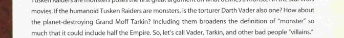

## p.6 (scan page 6)

Page contents: Masthead and Rebel Rumblings letters: new Paizo address; Traitor and Ganner Rhysode letter; Tessek costume photo; letter-writer and fan names not recorded. (hand-read)

## p.7 (scan page 7)

Page contents: Rebel Rumblings cont.: vanity license plates, Ganner Rhysode's appearances and Dan Wallace on the Essential Guide to Characters, Practical Aesthetics correction, Kenobi "so precise" letter; continued on p. 94; letter-writer and fan names not recorded. (hand-read)

### Stat block notes (game mechanics, not feats)

- Editor reply: why Ganner missed the Essential Guide: Dan had to choose characters based on prior works. "Consequently," he writes, "other important The New Jedi Order characters (Vergere, Viqi Shesh, Nom Anor, and Tsavong Lah, for example) took the spot that Ganner could have potentially received had we been able to predict his future importance." (Star Wars Insider 63, p. 7) (Source: *Star Wars Insider #63* (2002), p.7)

## p.8 (scan page 8)

Page contents: Master Replicas ad: Anakin Skywalker Force FX lightsaber replica; top-left film quote. (hand-read)

- **Darth Vader (Anakin Skywalker); Padmé Amidala** — entry/section: Ad film quote (Attack of the Clones): ""I will be the most powerful Jedi ever." —Anakin Skywalker to Padmé Amidala, Star Wars: Attack of the Clones, quoted in Star Wars Insider 63, p. 8" Source: *Star Wars Insider #63* (2002), p.8
  

## p.9 (scan page 9)

Page contents: Master Replicas ad: Darth Vader Force FX lightsaber replica; top-right film quote. (hand-read)

- **Darth Vader (Anakin Skywalker); Obi-Wan Kenobi** — entry/section: Ad film quote (A New Hope): ""The circle is now complete. When I left you, I was but the learner. Now, I am the master." —Darth Vader to Obi-Wan Kenobi, Star Wars: A New Hope, quoted in Star Wars Insider 63, p. 9" Source: *Star Wars Insider #63* (2002), p.9
  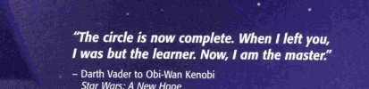

## p.10 (scan page 10)

Page contents: "Prequel Update" interview with Rick McCallum by Dave Gross: Episode III pre-production (Fox Sydney deal, designers starting, JAK Productions concept meetings, Lucas writing, script expected spring). (hand-read)

## p.11 (scan page 11)

Page contents: Prequel Update cont.: location scouting rumors denied, Gavin Bocquet starting, McCallum's travel and preference for location shooting. (hand-read)

## p.12 (scan page 12)

Page contents: Prequel Update cont.: Indy 4 rumors box; Lightsaber Training box; location logistics (Caserta, India). (hand-read)

- **Darth Vader (Anakin Skywalker); Obi-Wan Kenobi** — entry/section: Prequel Update: Episode III lightsaber battles: ""I'm not only expecting it," he says, "I'm looking forward to it." ... "Episode III is the last one. So no-holds barred now." —Rick McCallum, Star Wars Insider 63, p. 12" Source: *Star Wars Insider #63* (2002), p.12
  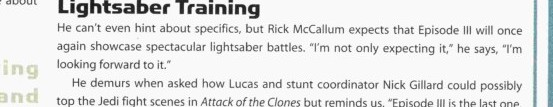
- **Darth Vader (Anakin Skywalker); Obi-Wan Kenobi** — entry/section: Prequel Update: Hayden's training: ""Hayden's doing a small movie," says McCallum, "and he finishes that at the end of September, then goes into some serious training. He's got some serious work to do. He's going to beef up a lot. He changes physically a lot. Our stunt coordinator will start three and a half or four months before shooting, when he'll start working with Hayden and Ewan McGregor." —Rick McCallum, Star Wars Insider 63, p. 12" Source: *Star Wars Insider #63* (2002), p.12
  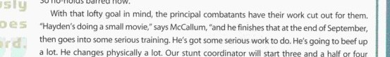

## p.13 (scan page 13)

Page contents: Prequel Update cont.: favorite locations (India, Lake Como, Sydney, Spain, Tunisia, Italy), controlled chaos of location shooting; "The Fall of the Republic" section on Episode III's dark tone, Anakin as the Chosen One, violence from betrayal, deaths of important characters. (hand-read)

- **Darth Vader (Anakin Skywalker); Luke Skywalker** — entry/section: Prequel Update: Anakin's destiny and redemption: ""Most people who know the Star Wars saga know that this is Anakin's destiny. In many ways, he is the Chosen One. Without him, the galaxy would never be saved." ... "I personally see it as Anakin, but you have to work that all the way through. Remember that Darth Vader gives up his life for his son. That's redemption." —Rick McCallum, Star Wars Insider 63, p. 13" Source: *Star Wars Insider #63* (2002), p.13
  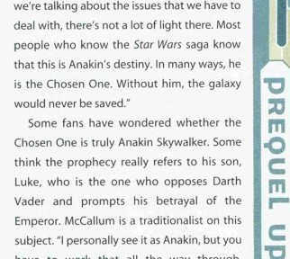

## p.14 (scan page 14)

Page contents: Star Wars Bounty Hunter game ad (left half), ESRB/platform logos. (hand-read)

## p.15 (scan page 15)

Page contents: Star Wars Bounty Hunter ad (right half): "You're Jango Fett, the most ruthless bounty hunter the galaxy has ever seen." (hand-read)

## p.16 (scan page 16)

Page contents: Star News "From the World of Lucasfilm": Attack of the Clones IMAX release beginning November 1, with quotes from Fox and IMAX executives. (hand-read)

## p.17 (scan page 17)

Page contents: Star News cont.: The Phantom Menace wins four DVD Awards; San Diego Comic-Con 2002 (Steve Sansweet presentation, deleted scene preview, celebrity guests); "Mine! Or I Will Help You Not!" box on Yoda as Entertainment Weekly's All-time Best CG Character. (hand-read)

- **Yoda** — entry/section: Entertainment Weekly on CG Yoda: ""After thrice appearing as a puppet, this backwards-speaking midget gets a well-deserved retooling in Episode II as a youthful, high-flying CG Jedi. Freed from the restraints of strings and hands, Yoda seems even more real." —Entertainment Weekly, quoted in Star Wars Insider 63, p. 17" Source: *Star Wars Insider #63* (2002), p.17
  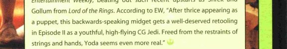

## p.18 (scan page 18)

Page contents: Science Fiction Book Club ad (left page). (hand-read)

## p.19 (scan page 19)

Page contents: Science Fiction Book Club ad (right page) with order form. (hand-read)

## p.20 (scan page 20)

Page contents: Star News cont.: Gen Con Game Fair 2002 (TCG Championships, Living Force, Warwick Davis guest of honor with Return of the Ewok); Star Wars in Thirty Minutes stage show; "Star Sightings 63" by Benjamin Harper (James Earl Jones Kennedy Center honor, Jimmy Smits co-hosts Latin Grammys, Natalie Portman on The Isaac Mizrahi Show, Mark Hamill's Comic Book: The Movie); top banner lyric quote; TCG winner not recorded. (hand-read)

- **Yoda** — entry/section: Star Sightings banner lyric: ""Well, I'm not dumb, but I can't understand; How he can lift me in the air just by raising his hand." —"Yoda," by "Weird" Al Yankovic, quoted in Star Wars Insider 63, p. 20" Source: *Star Wars Insider #63* (2002), p.20
  

## p.21 (scan page 21)

Page contents: Star News cont.: Bantha Tracks returns in Insider #64; Star Sightings cont. (Liam Neeson in Love, Actually and Michael Collins statue; Ewan McGregor's shoes for LEPRA, Big Fish, FilmFour poll; Jay Laga'aia on Big Brother; Hugh Quarshie and Denis Lawson on Holby City; Warwick Davis in Murder Rooms; ILM's Van Helsing and Pirates of the Caribbean). (hand-read)

## p.22 (scan page 22)

Page contents: "Inside the Attack of the Clones" by David West Reynolds: Mos Espa landing bay cutaway with callouts; Docking Bays sidebar (in-universe); Instant Landspeeders (John Goodson's lunch-hour model); John Barry's docking bay design. (hand-read)

### Stat block notes (game mechanics, not feats)

- Inside AotC: Docking Bays (Mos Espa): Expensive, high-end spacecraft like Padmé's starship drop neatly into their landings with focused anti-gravity beams that hardly disturb the dust of a landing field. Most freighters, however, are built for pure utility, and their heavy repulsorlifts "spill" enough a-grav effect to bowl bystanders over, collapse shanty structures, and kick up minor sandstorms when taking off and landing. It's for these messy craft that standard docking bay craters are designed. The docking bays offer clearance for a-grav effects and prevent blast clouds from spreading into nearby streets and shops. Fully licensed docking bays also feature radiation dampers to keep contamination from powerful starship engines down. Since active dampers eat power, most such safety devices on Tatooine are often inactive. (Star Wars Insider 63, p. 22) (Source: *Star Wars Insider #63* (2002), p.22)

## p.23 (scan page 23)

Page contents: Inside AotC cont.: Mos Espa Landing; Cleared for Landing sidebar (in-universe); Mixed Population (Jeroen Lapré's CG crowds and banthas); Rebel Mac unit's Naboo ships; Miniature Mos Espa. (hand-read)

### Stat block notes (game mechanics, not feats)

- Inside AotC: Cleared for Landing (spaceport traffic control): Local spaceport authorities serve as brokers for docking bay proprietors who lease their facilities to arriving ships. Digital code transmissions serve to activate amenities such as landing guidance beams or more-primitive landing lights. Spaceport authorities maintain traffic control by linking ship autopilot systems into master traffic monitors, allowing spacecraft to maneuver rapidly in close proximity without colliding. In outland settlements like Mos Espa, however, only a foolish or inexperienced pilot would trust to such systems, which are often faulty. (Star Wars Insider 63, p. 23) (Source: *Star Wars Insider #63* (2002), p.23)

## p.24 (scan page 24)

Page contents: Attack of the Clones DVD menu screens: the three main menus based on Episode II settings; Obi-Wan with the Jedi Temple analysis droids. (hand-read)

## p.25 (scan page 25)

Page contents: DVD menu screens cont. (Coruscant at lightspeed menu). (hand-read)

## p.26 (scan page 26)

Page contents: "Episode II at Lightspeed" DVD feature: Disc 1 (digital-source transfer, THX mastering per Rick Dean, Rob Coleman on frame-by-frame viewing, the "movie we made"); "Left Turn at Geonosis" random menus. (hand-read)

## p.27 (scan page 27)

Page contents: DVD feature cont.: Van Ling on the three menus and Flo's datapad at Dex's Diner; A Few Comments (commentary with Rob Coleman and VFX supervisors John Knoll, Pablo Helman, Ben Snow); Disc 2: From Puppets to Pixels documentary. (hand-read)

## p.28 (scan page 28)

Page contents: DVD feature cont.: The State of the Art pre-visualization documentary (droid factory sequence), Films Aren't Released, They Escape sound documentary, EPK featurettes, trailers; Deleted Scenes sidebar (Padmé addresses the Senate, Jedi Temple Analysis Room, Obi-Wan and Mace on the landing platform). (hand-read)

### Stat block notes (game mechanics, not feats)

- AotC deleted scene: Obi-Wan and Mace—Jedi Landing Platform: Obi-Wan and Mace—Jedi Landing Platform. This conversation features Obi-Wan expressing his concerns about Anakin's arrogance, while Mace advises him to have more faith in his young Padawan, who could very well be the Chosen One. (Star Wars Insider 63, p. 28) (Source: *Star Wars Insider #63* (2002), p.28)

## p.29 (scan page 29)

Page contents: DVD feature cont.: the "Biggest Action Hero" spot made for Celebration II; Easter eggs (Coleman's Corellian freighters on Naboo); Jim Ward's summary; Deleted Scenes cont. (Extended Arrival on Naboo, Padmé's Parents' House, Padmé's Bedroom, Anakin and Padmé on Trial, Dooku Interrogates Padmé). (hand-read)

- **Yoda** — entry/section: DVD feature: Jim Ward on Yoda: ""And hey, you know, you never get tired of watching Yoda kick butt," adds Ward. "If you're a true fan, that'll never get old." —Jim Ward, Star Wars Insider 63, p. 29" Source: *Star Wars Insider #63* (2002), p.29
  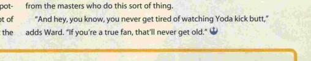

### Stat block notes (game mechanics, not feats)

- AotC deleted scene: Anakin and Padmé on Trial: Anakin and Padmé on Trial. In this short scene set prior to the arena fight, Poggle the Lesser sentences Padmé and Anakin to death. The impatient Nute Gunray can barely wait to see his long-time nemesis executed. (Star Wars Insider 63, p. 29) (Source: *Star Wars Insider #63* (2002), p.29)
- AotC deleted scene: Dooku Interrogates Padmé: Dooku Interrogates Padmé. Before George Lucas envisioned the droid factory sequence, Padmé and Anakin instead encountered Count Dooku, who tries to win the Naboo senator over to his side. When he declares that the Republic is dead and not worth saving, she rebuffs his offer to join the "rebellion," her choice of words foreshadowing the role reversal to come in Episode IV. (Star Wars Insider 63, p. 29) (Source: *Star Wars Insider #63* (2002), p.29)

## p.30 (scan page 30)

Page contents: "Watch Out—They Bite! The Creatures of Episode II" by Daniel Wallace: opening spread art (title page). (hand-read)

## p.31 (scan page 31)

Page contents: Creatures feature intro: Attack of the Clones as a monster movie in the Harryhausen and Toho tradition; Star Wars monsters from dianoga to the acklay, nexu and reek. (hand-read)

## p.32 (scan page 32)

Page contents: Acklay section: the Mysterious Island crab-battle homage, Robert Barnes's design ("dinolobster"), concept sculpt. (hand-read)

- **No single roster character (rules/setting/general)** — entry/section: Creatures: Robert Barnes on the acklay: ""I pictured the acklay as the embodiment of chaos," says Robert Barnes, the creature's chief designer. —Robert Barnes, Star Wars Insider 63, p. 32" Source: *Star Wars Insider #63* (2002), p.32
  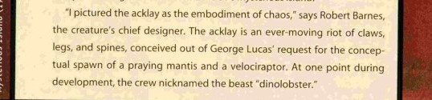

## p.33 (scan page 33)

Page contents: Acklay cont.: Vendaxa biology (silphum, lemnai prey), spread to Geonosis, Hasbro toy "battle damage"; "Which Will Win?" reek vs. nexu sidebar. (hand-read)

### Stat block notes (game mechanics, not feats)

- Creatures: Acklay on Vendaxa and Geonosis: Acklays spread from Vendaxa to Geonosis ages ago, thanks to offworld business executives who learned that the Geonosian archduke would readily accept payment for droid orders in the form of exotic creatures. Acklays became favorite attractions in the arena, and breeding specimens soon escaped into the wastelands where they went feral and slashed their way to the top of the violent Geonosian food chain. Most wild acklays live near the planet's stagnant Ebon Sea when they aren't creeping into the lower tunnels of Geonosian hives to feast on worker drones. (Star Wars Insider 63, p. 33) (Source: *Star Wars Insider #63* (2002), p.33)

## p.34 (scan page 34)

Page contents: Reek section: bullfight parallels, Placerias inspiration, Michael Patrick Murnane's design; differing back stories (Visual Dictionary vs. RPG Revised Core Rulebook); "Reek vs. Nexu: Knockout!" result box. (hand-read)

## p.35 (scan page 35)

Page contents: Reek cont.: JD Wiker and Pablo Hidalgo on continuity fixes; resolved back story (Ylesia, Codian Moon ranches); reek as galactic savior; nexu vs. acklay sidebar. (hand-read)

### Stat block notes (game mechanics, not feats)

- Creatures: the reek as galactic savior: It's hard to believe, but the dimwitted reek could actually be considered a galactic savior. Had the creature not hammered the life out of the nexu, Padmé Amidala would have perished before giving birth to Luke and Leia. Had the creature not steamrollered over Jango Fett, he may have avoided Mace Windu's killing blow or escaped using his otherwise undamaged jetpack. Too bad for the reek, then, that the ticked-off bounty hunter dropped the mighty reek with a single blaster shot to the head. (Star Wars Insider 63, p. 35) (Source: *Star Wars Insider #63* (2002), p.35)

## p.36 (scan page 36)

Page contents: Nexu section ("Bad Kitty"), Robert Barnes's hybrid design; "Nexu vs. Acklay" result box; creature trivia quiz. (hand-read)

## p.37 (scan page 37)

Page contents: Nexu cont.: Hasbro's posable-tail toy, Cholganna homeworld (Indona forest nexu), export for arenas; "Acklay vs. Reek" betting sidebar; quiz answers (printed upside down). (hand-read)

### Stat block notes (game mechanics, not feats)

- Creatures: the nexu of Cholganna: Nexu come from the chilly forests that cover the Indona continent in the northern latitudes of the planet Cholganna. Other breeds exist on other Cholganna continents, but only the forest nexu has four eyes. This animal's extra pair of peepers allows it to see in infrared wavelengths, helping it hunt warm-blooded prey such as bark rats and tree-climbing octopi. Once a nexu hooks its prey with its claws, it bites down and savagely shakes its meal. The creatures aren't common sights in the galaxy—zoos won't keep them because of their viciousness, and they are notoriously difficult to train as watch beasts. Ferocity is a cherished commodity in arena battles, however, and squads of big-game hunters regularly visit the continents of Cholganna to bag live nexu for export. Arena promoters and wealthy eccentrics (including Senator Ask Aak of Malastare) are willing buyers, and they pay dearly for their prizes. Because hunters often die when tracking prides of nexu, a hunter who makes a successful capture can get away with charging nearly a half-million credits per animal. Archduke Poggle the Lesser is among those who treasured the fighting prowess of the nexu, but any pain he may have felt at losing his prize specimen was eclipsed by his catastrophic military losses in the Battle of Geonosis. (Star Wars Insider 63, p. 37) (Source: *Star Wars Insider #63* (2002), p.37)

## p.38 (scan page 38)

Page contents: Orray section (picador's mount, egg-eating wild orrays, capped tails, early sketches became the massiff); Kouhun section (nerve toxin, heat-seeking); "Reek vs. Acklay" result box. (hand-read)

## p.39 (scan page 39)

Page contents: Kouhun cont. (Indoumodo origin, the attack on Padmé); Massiff section (cut Geonosis fight, Tusken pets, pack hunting, name origins). (hand-read)

### Stat block notes (game mechanics, not feats)

- Creatures: the kouhuns sent against Padmé: Kouhuns are found on the planet of Indoumodo and have spread offworld to Geonosis, Tatooine, Gamorr, Corellia, and even the slimy shadows of lower levels of Coruscant. The two kouhuns that attacked Padmé Amidala were brought to the capital planet by Jango Fett, who passed them off to Clawdite assassin Zam Wesell. In a peculiarly effective melding of high- and low-tech, a sophisticated ASN-121 droid cut through the window glass and dropped the writhing chilopods into the room. Their organic signatures fooled all the apartment's security devices—even Artoo-Detoo—but they stood out as black squiggles in the Force to Senator Amidala's Jedi protectors. (Star Wars Insider 63, p. 39) (Source: *Star Wars Insider #63* (2002), p.39)
- Creatures: massiffs among Tuskens and Geonosians: Tatooine's Tusken Raiders use domesticated massiffs as watch beasts and hunting companions. Geonosians train massiffs to root out vermin that infest the lower tunnels of colony hives. Among certain high-caste Geonosian aristocrats, owning multiple massiffs is a status symbol—the more, the better. (Star Wars Insider 63, p. 39) (Source: *Star Wars Insider #63* (2002), p.39)

## p.40 (scan page 40)

Page contents: "A Short History of Elstree Studios": opening spread photo. (hand-read)

## p.41 (scan page 41)

Page contents: Elstree history: Borehamwood ("Boring Wood"), Hollywood of England; A New Hope set photos (Vader and Chief Bast, Guinness/Prowse duel, Falcon cockpit, Chewbacca, Kenny Baker). (hand-read)

## p.42 (scan page 42)

Page contents: Elstree cont.: silent era, Hitchcock's Blackmail, wartime closure, The Dambusters as reference for the ANH dogfight, TV era, Gary Kurtz's 1975 search. (hand-read)

## p.43 (scan page 43)

Page contents: Elstree cont.: Kurtz hires the whole complex for 1976 (Shepperton H stage for the medal ceremony), British cast and crew, union rules; return for Empire. (hand-read)

## p.44 (scan page 44)

Page contents: Elstree cont.: the "Star Wars stage" (Hoth hangar, Dagobah), Stage 3 fire during The Shining, Return of the Jedi (Ewok village, Jabba's palace); Hard Times; photo captions (Edlund, Johnson, Kershner, Kurtz, Billy Dee Williams). (hand-read)

## p.45 (scan page 45)

Page contents: Elstree cont.: 1988 sale and 1994 closure, Hertsmere council rescue, Leavesden for TPM, the 2001 capsule in Watto's junkyard; AotC pick-ups at Elstree in fall 2000 with Kenny Baker, wrap on September 20, 2000, "The George Lucas Stage"; JAK Productions. (hand-read)

### Stat block notes (game mechanics, not feats)

- Elstree: Kenny Baker's AotC return as R2-D2: In addition, it was at Elstree that Kenny Baker made his brief return as R2-D2, making him and Anthony Daniels still the only actors to appear in all installments of the Star Wars saga. All of the previous footage of R2-D2 on Attack of the Clones had been of the radio controlled versions, but Lucas still wanted Baker to bring his humanity to the character for certain shots. (Star Wars Insider 63, p. 45) (Source: *Star Wars Insider #63* (2002), p.45)

## p.46 (scan page 46)

Page contents: "The Largest & Smallest Star Wars LEGO Models": LEGO Star Wars history, Ultimate Collector's Series Imperial Star Destroyer (Devastator, 3,100+ pieces) with mini Tantive IV; Mini Collectors' Series sidebar (X-wing, TIE Advanced, AT-ST, Snowspeeder, Jedi Starfighter, Slave I, TIE bomber); quotes from Brian Bowler. (hand-read)

- **Darth Vader (Anakin Skywalker)** — entry/section: LEGO UCS Star Destroyer: the Devastator: "Ultimate Collector's Series veterans know there are thousands of familiar LEGO pieces arranged in the unique shape of Darth Vader's Star Destroyer from A New Hope, the Devastator." Source: *Star Wars Insider #63* (2002), p.46
  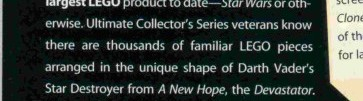

## p.47 (scan page 47)

Page contents: LEGO cont.: actual-size stormtrooper comparison, reader-creation call, podracer and AT-ST mini-model captions. (hand-read)

## p.48 (scan page 48)

Page contents: Fiction title page: "Emissary of the Void" by Greg Keyes (series opening, "A Perilous Plan"), illustrated by Dave Dorman. (hand-read)

## p.49 (scan page 49)

Page contents: Fiction: Vook Gehu adrift in the No Luck Required answers Yuuzhan Vong commander Vintul Qat's hail and threatens his damaged reactor; flashback to the ship's reversion with Uldir. (hand-read)

## p.50 (scan page 50)

Page contents: Fiction cont.: black hole system on the Hydian Way; Uldir, Vega Sepen and the Jedi Klin-Fa Gi await a Yuuzhan Vong slave transport carrying Bey; Klin-Fa's intelligence about relocated warships. (hand-read)

- **Klin-Fa Gi** — entry/section: Emissary of the Void: Klin-Fa on Bey: ""That isn't what this is about. It's not about Bey, or me. Jedi fight, Jedi die. We know the risks." —Klin-Fa Gi, Star Wars Insider 63, p. 50" Source: *Star Wars Insider #63* (2002), p.50
  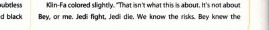

## p.51 (scan page 51)

Page contents: Fiction cont.: Vega pledges support; Uldir talks with the grieving Duro Vook Gehu about his lost homeworld, the Bburru arboretum and anger. (hand-read)

- **Uldir Lochett** — entry/section: Emissary of the Void: Uldir on anger: ""But you can't turn inward and imagine that not all of us have lost something. And you can't give in to your anger. My Jedi training may have been a bust, but I know that much. Anger isn't good for anyone, Jedi or no. It just feels that way." —Uldir Lochett, Star Wars Insider 63, p. 51" Source: *Star Wars Insider #63* (2002), p.51
  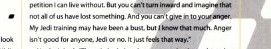

## p.52 (scan page 52)

Page contents: Fiction cont.: Uldir on why he is a rescue pilot; the Yuuzhan Vong slave transport and four coralskippers; Klin-Fa's plan to breach the hull at the dovin basal's dead spot; Vook duels Vintul Qat. (hand-read)

## p.53 (scan page 53)

Page contents: Fiction cont.: Klin-Fa cuts into the transport; living membranes; the team splits up; Klin-Fa kisses Uldir. (hand-read)

## p.54 (scan page 54)

Page contents: Fiction cont.: Leaft and Uldir fight Yuuzhan Vong warriors with thudbugs and amphistaffs; Uldir is caught by the throat. (hand-read)

## p.55 (scan page 55)

Page contents: Fiction cont.: a stray shot from Vook kills the warrior; Uldir's strange luck; Vook's dogfight with the coralskippers; the bridge is taken. (hand-read)

### Stat block notes (game mechanics, not feats)

- Emissary of the Void: Uldir's luck: His luck had always been strange and was frequently unlikely. Most people figured it had some thing to do with his Jedi training, but Uldir knew that couldn't be the case—he hadn't ever been able to lift even a pebble with the Force. (Star Wars Insider 63, p. 55) (Source: *Star Wars Insider #63* (2002), p.55)

## p.56 (scan page 56)

Page contents: Fiction cont.: prisoners freed and Bey found in a coma; the transport falls toward a black hole with its pilot hood severed; Yuuzhan Vong hunter Tsaa Qalu arrives and fires on the No Luck Required (to be continued). (hand-read)

## p.57 (scan page 57)

Page contents: Jawa Trader catalog (Fan Club online store): Queen Amidala figure, Fan Club exclusive Ki-Adi-Mundi figure. (hand-read)

## p.58 (scan page 58)

Page contents: Jawa Trader cont.: AotC figures, bobblehead set, Jedi Starfighter, Carbon-Freezing Chamber playset, stormtrooper troop builder, AotC cap and T-shirt. (hand-read)

## p.59 (scan page 59)

Page contents: Jawa Trader cont.: Star Wars Trading Card Game AotC, Sith Rising and A New Hope expansions; Roleplaying Game Revised Core Rulebook and sourcebooks. (hand-read)

## p.60 (scan page 60)

Page contents: "Behind the Magic: Dexter's Diner" by Rob Coleman, ILM Animation Director: Star Wars meets American Graffiti; Designing Dexter (Skywalker Ranch sculpting jam session, Doug Chiang's maquettes). (hand-read)

## p.61 (scan page 61)

Page contents: Dexter's Diner cont.: Murnane and Dermot Power's four-armed design, Ernest Borgnine as voice hint; the full Stage 6 diner set at Fox Studios Sydney; Double Take sidebar (American Graffiti homage); Clean Plate (voice actor Ronald Falk). (hand-read)

## p.62 (scan page 62)

Page contents: Dexter's Diner cont.: Falk on set with Ewan McGregor, clean-plate shooting, Steve Rawlins's "hug shot," John Knoll. (hand-read)

## p.63 (scan page 63)

Page contents: Dexter's Diner cont.: Dexter's face and air sack (Rawlins, Frank Gravatt's facial library, Jakub Pistecky); The Regulars (Flo the waitress droid, Dugs Manoca and Rednax, Slyther Bushforb, Bogg Tyrell); It's a Wrap (Falk's remote looping session); "Kiss Mah Grits!" Flo/Alice homage box. (hand-read)

- **Dexter Jettster** — entry/section: Behind the Magic: animating Dexter's face: ""The main challenge on Dexter was his face. With his large mouth, small eyes and that bony ridge just above the eyebrows, it was tough to come up with a balance to get the facial expressions to read clearly." —Steve Rawlins, Star Wars Insider 63, p. 63" Source: *Star Wars Insider #63* (2002), p.63
  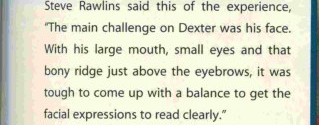

## p.64 (scan page 64)

Page contents: "Walk the Thin Gray Line Between Good & Evil in Star Wars Bounty Hunter" by Brett Rector: To Rule a Galaxy (game premise), A Wretched Galaxy (Joe Brisbois, levels, Jango's weapons). (hand-read)

### Stat block notes (game mechanics, not feats)

- Bounty Hunter game: Dooku's bounty on Komari Vosa: Ten years before the events of Attack of the Clones, Count Dooku, using his alias Darth Tyranus, is in the process of contracting the Kaminoans to begin production of a massive clone army for his master, Darth Sidious. When the army is complete, Sidius can put a stranglehold on the galaxy and overthrow the Republic. Before proceeding with this grand scheme, however, Dooku must overcome two problems. First, he must find a peerless warrior to provide the genetic template for the clone soldiers. Second, he must eliminate Komari Vosa, his rogue apprentice who now threatens to undermine Sidious' plans and carry out her own evil schemes. Dooku decides to kill two mynocks with one stone by placing a huge bounty on Komari's head. Thus, not only will he rid himself of his rival but he will also cull the weak among the bounty hunters and find the prime source for his clones. Enter Jango Fett. (Star Wars Insider 63, p. 64) (Source: *Star Wars Insider #63* (2002), p.64)

## p.65 (scan page 65)

Page contents: Bounty Hunter cont.: ID scanner and secondary bounties, Jango's moves, Battle Scars (story, ILM cut-scenes, color palette), voice cast (Temuera Morrison, Leeanna Walsman, Clancy Brown as Montross, Lucille Bliss as Razzata), Mandalorian Legacy. (hand-read)

- **Jango Fett** — entry/section: Bounty Hunter: Brisbois on Jango as classic character: ""To us, Jango Fett is a classic character. We feel he would fit perfectly in Episodes IV, V, and VI." —Joe Brisbois, Star Wars Insider 63, p. 65" Source: *Star Wars Insider #63* (2002), p.65
  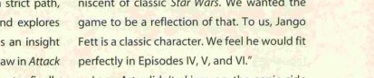

## p.66 (scan page 66)

Page contents: "Knights of the Old Republic" preview by Miguel Lopez: BioWare's d20-based RPG set about 4,000 years before A New Hope; Casey Hudson on story secrecy; fallen Jedi leading a Sith fleet; Kashyyyk, Dantooine, Tatooine, Taris, Korriban. (hand-read)

## p.67 (scan page 67)

Page contents: KotOR cont.: over 50 Force powers and light/dark alignment (Mike Gallo), playable species and party members, the Ebon Hawk, pausable real-time combat; Xbox spring 2003, PC summer. (hand-read)

## p.68 (scan page 68)

Page contents: "Beta Testing in Bestine and Beyond" by Haden Blackman: Star Wars Galaxies beta (test server "Bria," empty Tatooine, chat bubbles and emotes). (hand-read)

## p.69 (scan page 69)

Page contents: Galaxies beta cont.: character creation (eight species), Bestine and its spaceport, the cave, the spawning system ("ronto motels"), creature AI, upcoming ranged combat. (hand-read)

## p.70 (scan page 70)

Page contents: "Man Your Ships, and May the Force Be With You" by Michael Mikaelian: Star Wars Trading Card Game A New Hope card previews (Motti, Praji, Darth Vader, Dannik Jerriko, Death Star technicians and gunners). (hand-read)

## p.71 (scan page 71)

Page contents: TCG A New Hope cont.: card previews (power droid, General Tagge, Imperial pilots, Figrin D'an, Greedo, IT-O interrogator, Jawa leader, LIN demolitionmech); set background. (hand-read)

## p.72 (scan page 72)

Page contents: "A New Hope Card Encyclopedia" (TCG A New Hope set) card gallery: Jedi, Luke, Obi-Wan, Leia, droids. (hand-read)

## p.73 (scan page 73)

Page contents: A New Hope Card Encyclopedia cont.: Rebel and Imperial personnel cards. (hand-read)

## p.74 (scan page 74)

Page contents: A New Hope Card Encyclopedia cont.: ground units (Tuskens, Jawas, Wuher, Death Star guard, banthas, krayt dragon). (hand-read)

## p.75 (scan page 75)

Page contents: A New Hope Card Encyclopedia cont.: ground units and fortifications. (hand-read)

## p.76 (scan page 76)

Page contents: A New Hope Card Encyclopedia cont.: space units (Star Destroyer, Vader's TIE Fighter, Red Five). (hand-read)

## p.77 (scan page 77)

Page contents: A New Hope Card Encyclopedia cont.: Rebel starfighters; sidebar on card images taken from the Special Edition print. (hand-read)

## p.78 (scan page 78)

Page contents: A New Hope Card Encyclopedia cont.: Mission cards; "Stay Sharp!" sidebar on new abilities. (hand-read)

## p.79 (scan page 79)

Page contents: A New Hope Card Encyclopedia cont.: Battle cards; Accuracy ability explained (David Eckelberry). (hand-read)

## p.80 (scan page 80)

Page contents: A New Hope Card Encyclopedia cont.: Battle cards; Intercept ability explained. (hand-read)

## p.81 (scan page 81)

Page contents: A New Hope Card Encyclopedia cont.: Battle cards; Piloting ability explained. (hand-read)

## p.82 (scan page 82)

Page contents: Elstree series: building the Dagobah swamp on the EMI-Elstree stage (August 1979), giant trees, raised floor for Frank Oz; Miss Piggy visits Mark Hamill; captions on R2-D2 and the dragonsnake, field rations, Luke's ESB lightsaber prop. (hand-read)

### Stat block notes (game mechanics, not feats)

- Luke's ESB lightsaber prop: Luke's lightsaber appears slightly different in The Empire Strikes Back. The modified camera flash used a circuit board connector and served as the lightsaber's activation plate, and most copies of the prop had two red buttons. The prop used in the scenes of Luke's first encounter with Yoda had a single red button. It is the oldest Skywalker lightsaber still owned by Lucasfilm and is currently on display at Skywalker Ranch. (Star Wars Insider 63, p. 82) (Source: *Star Wars Insider #63* (2002), p.82)

## p.83 (scan page 83)

Page contents: Dagobah cont.: raising the X-wing, the dragonsnake shot in Lucas's pool, a king snake up Hamill's pant leg, real swamp animals, Kershner's gas mask, Yoda's robe, Luke's Mauser-based blaster. (hand-read)

### Stat block notes (game mechanics, not feats)

- Yoda's robe fabric: Yoda's robe was made of raw silk from India. Kershner liked it so much that he had a jacket from the leftover fabric made for himself. Costume Designer Trisha Biggar chose similar fabrics from India for the Jedi robes in the prequels. (Star Wars Insider 63, p. 83) (Source: *Star Wars Insider #63* (2002), p.83)

## p.84 (scan page 84)

Page contents: "Jody Duncan Takes Fans Behind the Scenes of Attack of the Clones" by Jason Fry: Mythmaking book, late changes to the film, Duncan's method. (hand-read)

## p.85 (scan page 85)

Page contents: Mythmaking cont.: interviews, Ealing reshoots, digital cameras; sidebar on behind-the-scenes books for the Classic trilogy and The Phantom Menace. (hand-read)

## p.86 (scan page 86)

Page contents: "Begun, this Clone War has": Star Wars: Republic #49–50 begin the Clone Wars (Battle of Kamino); Haden Blackman, John Ostrander, Jan Duursema, Randy Stradley; Portland story summit. (hand-read)

## p.87 (scan page 87)

Page contents: Clone Wars comics cont.: Beyond the Story Arc sidebar; Dooku to return; Obi-Wan and Anakin as leads; Quinlan Vos among the Jedi; ties to LucasArts' The Clone Wars game. (hand-read)

- **Obi-Wan Kenobi; Darth Vader (Anakin Skywalker)** — entry/section: Republic comics: Blackman on the Clone Wars leads: ""The main characters in my stories are Obi-Wan and Anakin, two heroes of this era," —Haden Blackman, Star Wars Insider 63, p. 87" Source: *Star Wars Insider #63* (2002), p.87
  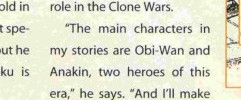

## p.88 (scan page 88)

Page contents: Scouting the Galaxy (collectibles Q&A) by Steve Sansweet: international collecting community, model kits, "All I need to know about life I learned from Star Wars" poster. Reader names omitted. (hand-read)

## p.89 (scan page 89)

Page contents: Scouting the Galaxy cont.: pewter X-wing value, MPC kit, Decipher CCG cards, Don Post life-size Boba Fett, Al Williamson portraits. (hand-read)

## p.90 (scan page 90)

Page contents: Scouting the Galaxy cont.: Williamson lithographs, Empire card backs, Topps card stars explained. (hand-read)

## p.91 (scan page 91)

Page contents: Star Wars Insider and Star Wars Gamer back-issue order page. (hand-read)

## p.92 (scan page 92)

Page contents: Star Wars crossword puzzle. (hand-read)

## p.93 (scan page 93)

Page contents: Dragon magazine subscription ad. (hand-read)

## p.94 (scan page 94)

Page contents: Rebel Rumblings letters continued (costumes via Rubie's and the 501st, dancing stormtrooper in Behind the Magic), Tony Moseley cartoon, index of advertisers, A New Hope promo-card contest and rules. Letter-writer names omitted. (hand-read)

## p.95 (scan page 95)

Page contents: Star Wars Insider subscription form. (hand-read)

## p.96 (scan page 96)

Page contents: Q&A with Pablo Hidalgo: Force lightning is inherently dark side; C-3PO's memory and Owen Lars; Padmé's surname Naberrie vs. Amidala; "Utinni!"; why wampas evade life-form scanners. (hand-read)

- **Yoda; Count Dooku** — entry/section: Q&A: Yoda and Force lightning: "Yoda reflected back Dooku’s Sith lightning and did not generate any of his own." Source: *Star Wars Insider #63* (2002), p.96
  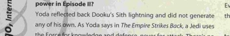

### Stat block notes (game mechanics, not feats)

- Q&A: Naberrie and Amidala: They're both correct. Padmé was born with the surname Naberrie. That's her family name. Her parents still carry that name: Jobal and Ruwee Naberrie. As per Naboo tradition, however, when Padmé entered office, she adopted a "name of state," which is Amidala. Even after stepping down from the position of Queen, she retains that surname. (Star Wars Insider 63, p. 96) (Source: *Star Wars Insider #63* (2002), p.96)

## p.97 (scan page 97)

Page contents: Q&A cont.: Anakin and Padmé's ages, Yoda on Luke's age, Keyan Farlander the Y-wing survivor, identical Rodians (Thuku, Beedo), Naboo is not Dagobah. (hand-read)

- **No single roster character (rules/setting/general)** — entry/section: Q&A: the surviving Y-wing pilot at Yavin: "Expanded Universe sources reveal that mysterious survivor to be Keyan Farlander, a young Rebel pilot originally from the Agamar system." Source: *Star Wars Insider #63* (2002), p.97
  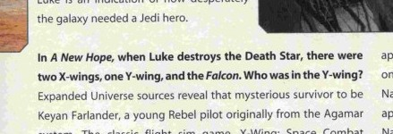

### Stat block notes (game mechanics, not feats)

- Q&A: Anakin and Padmé's ages: When we meet Anakin in Episode I, it's just a few days before his 10TH birthday. He's nine years old, and Amidala is 14. Anakin turns 10 when he begins his Jedi training. When we catch up to them in Episode II, Anakin has just turned 20, and Padmé's 24. (Star Wars Insider 63, p. 97) (Source: *Star Wars Insider #63* (2002), p.97)
- Q&A: Yoda on training Luke: I don't know about that "no one says anything" business. Yoda has been pretty consistent on that rule, and he did remark about Luke's age in his hut on Dagobah while talking to the spectral Obi-Wan: "He is too old. Yes, too old to begin the training." Just the fact that Yoda does turn his back on this rule and goes ahead and trains Luke is an indication of how desperately the galaxy needed a Jedi hero. (Star Wars Insider 63, p. 97) (Source: *Star Wars Insider #63* (2002), p.97)

## p.98 (scan page 98)

Page contents: Illustration by Stan Shaw (full page art). (hand-read)

## p.99 (scan page 99)

Page contents: Babylon 5 season one DVD ad. (hand-read)

## p.100 (scan page 100)

Page contents: Star Wars Trading Card Game A New Hope ad (back cover). (hand-read)

