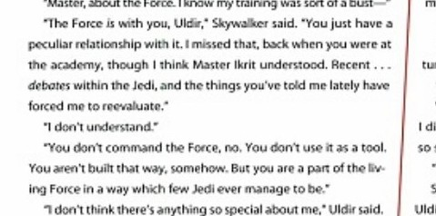
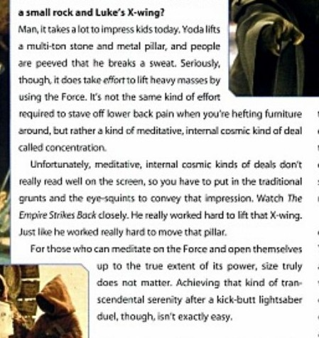

# Owner Material 038 — Star Wars Insider #1–153 plus specials (with The Lucasfilm Fan Club Magazine #1–22): Star Wars Insider #64 (2002)

- **Source:** *Star Wars Insider* magazine (issues 23–153, 1994–2014) and its predecessor *The Lucasfilm Fan Club Magazine* (issues 1–22, 1987–1994), plus seven special editions: articles, interviews, comics and short fiction Secondary source (licensed Legends reference). Scan OCR'd on the box; the scan stays box-only and is **not** published.
- **Method:** every scanned page was OCR'd and machine-screened sentence by sentence for power-relevant statements (fights, kills, defeats, Force feats, rankings, superweapons) that name a character on our roster; each kept sentence is quoted verbatim from the OCR text and has a crop of the printed passage directly under it. Pages with nothing power-relevant are still listed with what is on them.
- **Citation:** "*Star Wars Insider #64* (2002), p.X" by printed page ("scan p.X" where no printed number applies). **Weight:** Licensed magazine: a secondary source. Its short fiction and comics are Legends stories; its articles and interviews sum up or discuss lore and rank below the novels, comics and games they describe.

## scan p.1 (scan page 1)

Page contents: Cover: Insider #64 (Dec 2002/Jan 2003) — holiday gift guide, ILM, Ben Burtt interview, gunships and gondolas of Episode II, Emissary of the Void final chapter, Coruscant and the Core Worlds RPG preview, Dark Horse on Star Wars: Jedi. (hand-read)

## scan p.2 (scan page 2)

Page contents: Bounty Hunter (PlayStation 2) ad, part 1. (hand-read)

## scan p.3 (scan page 3)

Page contents: Star Wars Bounty Hunter ad: Jango Fett as genetic template of the clone army; 18 levels on six worlds. (hand-read)

## scan p.4 (scan page 4)

Page contents: Contents (features): Prequel Update (Rick McCallum on sets and costumes), Clones to the IMAX, Inside Attack of the Clones (Geonosian prison cell), cover digital Jango Fett; Bantha Tracks flip-side introduced. (hand-read)

## scan p.5 (scan page 5)

Page contents: Contents (departments) and editorial by Dave Gross on the Star Wars fan community and the Official Fan Club. (hand-read)

## scan p.6 (scan page 6)

Page contents: Masthead and Rebel Rumblings letters (lightsaber forms article praise, favorite Clones lines, dancing stormtrooper photos). Letter-writer names omitted. (hand-read)

## scan p.7 (scan page 7)

Page contents: Star Wars Armada 25th Anniversary checks ad. (hand-read)

## scan p.8 (scan page 8)

Page contents: The Clone Wars (video game) ad, part 1. (hand-read)

## scan p.9 (scan page 9)

Page contents: The Clone Wars game ad: play as Mace Windu, Anakin Skywalker and Obi-Wan Kenobi. (hand-read)

## scan p.10 (scan page 10)

Page contents: Prequel Update by Dave Gross: Rick McCallum on Episode III preparations (Sydney studio, animatics, no finished script yet), costumes with Trisha Biggar and Iain McCaig (about 1,200 new costumes). (hand-read)

## scan p.11 (scan page 11)

Page contents: Prequel Update cont.: costumes for extras, Lucasfilm costume archive (about 2,400 prequel costumes, original-trilogy costumes as museum pieces), Gavin Bocquet's set work; Indy 4 Update sidebar. (hand-read)

## scan p.12 (scan page 12)

Page contents: Prequel Update cont.: McCallum on planet design logic, building sets on location (Tunisia camp) vs. studio, original-film set remnants found in Tunisia in 1995, the Young Indy Fillmore earthquake. (hand-read)

## scan p.13 (scan page 13)

Page contents: Star Wars: The New Droid Army (Game Boy Advance) ad. (hand-read)

### Stat block notes (game mechanics, not feats)

- Game ad: The New Droid Army premise: With the power of the Force at his command, Anakin must stop Count Dooku from creating a new, more destructive droid army! (Star Wars Insider 64, p. 13) (Source: *Star Wars Insider #64* (2002), scan p.13)

## scan p.14 (scan page 14)

Page contents: Star News by Benjamin Harper: Star Wars: The Magic of Myth at the Powerhouse Museum, Sydney (Episode II props incl. Zam Wesell's and Anakin's airspeeders; Anthony Daniels hosts). (hand-read)

## scan p.15 (scan page 15)

Page contents: Star News cont.: Powerhouse interactive exhibits (Vader mask voice synthesizer, levitating Luke's X-wing); Bay Area Business Council inducts George Lucas, Carrie Fisher speech. (hand-read)

## scan p.16 (scan page 16)

Page contents: Star Sightings: Ewan McGregor awards and Valiant; Mark Hamill voice work (Wolverine); Natalie Portman in Zach Braff's film; Yoda "Most Welcome Comeback" (Premiere); Hayden Christensen in Eco-Challenge; Keira Knightley; Christopher Lee. (hand-read)

## scan p.17 (scan page 17)

Page contents: Star Wars Trading Card Game A New Hope / Jedi Nights tournaments ad. (hand-read)

## scan p.18 (scan page 18)

Page contents: Star News cont.: Zagat Movie Guide ranks Star Wars #3; "Jedi" enters the Shorter Oxford English Dictionary; Episode II soundtrack nomination; Fox summer; Sansweet collection tour; digital-cinema seminar with Rick McCallum. (hand-read)

## scan p.19 (scan page 19)

Page contents: Grand Slam convention ad (Pasadena, March 2003). (hand-read)

## scan p.20 (scan page 20)

Page contents: Clones to the IMAX by David C. Fein: opening on the theatrical experience. (hand-read)

## scan p.21 (scan page 21)

Page contents: Clones to the IMAX cont.: IMAX screens and rolling-loop projection, 44 speakers, DMR process, cut to 120 minutes. (hand-read)

## scan p.22 (scan page 22)

Page contents: Clones to the IMAX cont.: digital source at 1,920 x 1,080, 13-week conversion, film format and screen comparison charts. (hand-read)

## scan p.23 (scan page 23)

Page contents: Neverwinter Nights ad. (hand-read)

## scan p.24 (scan page 24)

Page contents: Inside Attack of the Clones by David West Reynolds: Geonosian prison cell; Obi-Wan held in a levitation field (wirework); Battle of Wills sidebar. (hand-read)

### Stat block notes (game mechanics, not feats)

- Inside AotC: Dooku vs. Kenobi battle of wills: The short interval within the Geonosian cell is actually the scene of a critical battle in Attack of the Clones, a duel for the prize of a Jedi's power and loyalty. As Count Dooku slowly walks around the captive Obi-Wan Kenobi, he reminds Kenobi that his own Jedi mentor was Qui-Gon Jinn, Dooku's former Padawan. Jinn earned his reputation for independence to the point of defying the Jedi Council. Was there not wisdom in this freedom of thought, Dooku suggests? The two men exchange but few words, for the real battle of wills is going on beneath the surface. Dooku's outward grace and polite manner is a form of camouflage that disarms weaker opponents in mental battles. Through the Force, Dooku aggressively and masterfully probes Kenobi's spirit for points of weakness, carefully using truth as a weapon, since he knows Kenobi is Jedi-sensitive to lies. Obi-Wan is astonished at the power of Dooku's influence and can feel the Count's presence in his mind. Kenobi works furiously to maintain the walls of his resistance, yet the Count seems to melt them—Qui-Gon did go against the Council, there are problems with the Jedi leadership, the Republic is failing—all truth. Kenobi is trained to deal with deceivers, not with Force-empowered manipulators, and it takes all his will to maintain his control. He cannot find the strength to argue against the Count, so he focuses his energy on pure, blind resistance. (Star Wars Insider 64, p. 24) (Source: *Star Wars Insider #64* (2002), scan p.24)

## scan p.25 (scan page 25)

Page contents: Inside AotC cont.: smoke-filled prison set and ILM wire removal; multilevel symbolism of Obi-Wan floating above Dooku; Containment Field sidebar. (hand-read)

### Stat block notes (game mechanics, not feats)

- Inside AotC: the Geonosian containment field: Tendrils of static electricity suffuse Obi-Wan Kenobi as he hangs in a Geonosian containment field designed to render dangerous prisoners entirely helpless. It is an effective design, derived from "Magnetic bottle" technology used in Geonosian reactors. Hung by repulsor fields in mid-air, Kenobi has no chance of reaching any part of his cell to effect escape. Immobilized by the effects of the static field, Kenobi cannot move his body to focus the flow of the Force for kinetic effects, such as the manipulation of controls or the assault of a guard. And as Count Dooku knows, the nature of this extremely high-powered containment field is such as to reduce a prisoner's ability to use the Force by affecting the brain's ability to concentrate through electrical interference. This aspect of the field can cause weak individuals to lose all self-control, and it can help a skilled interrogator to get information even from defiant captives. The containment field is a costly and elaborate device unsuited to general incarceration purposes, but it is ideal for the probing of a Jedi's weaknesses. (Star Wars Insider 64, p. 25) (Source: *Star Wars Insider #64* (2002), scan p.25)

## scan p.26 (scan page 26)

Page contents: Industrial Light & Magic feature by Dave Gross: intro on ILM's 1,000 staff and their anonymity. (hand-read)

## scan p.27 (scan page 27)

Page contents: ILM feature title spread: the droid factory sequence is entirely computer-generated apart from the principal actors (including Jango Fett's arrival). (hand-read)

## scan p.28 (scan page 28)

Page contents: ILM: John Knoll, Rocket Man — the 2001 space plane Easter egg, childhood models and effects interest, first visit to ILM via Grant McCune. (hand-read)

## scan p.29 (scan page 29)

Page contents: ILM: Knoll cont. — Photoshop, model maker and camera operator, The Abyss Oscar; more models built for Episode II than ever. (hand-read)

## scan p.30 (scan page 30)

Page contents: ILM: Knoll cont. (advice, Apollo 11 project, the real asteroid Eros in the Jango/Obi-Wan asteroid chase); Paul Huston, Troubleshooter; Episode II DVD Easter eggs sidebar (Wilhelm scream, Jango bumping his head on a door). (hand-read)

## scan p.31 (scan page 31)

Page contents: ILM: Paul Huston cont. — first Star Wars storyboards, Palpatine's office matte, the Naboo waterfall composite of 26 versions. (hand-read)

## scan p.32 (scan page 32)

Page contents: ILM: Huston cont. — Jedi Temple mezzanine deadline, one-man effects work, models vs. CG. (hand-read)

## scan p.33 (scan page 33)

Page contents: ILM: Ben Snow, Film Fan — horror-film roots, inspired by Dennis Muren's Empire interview. (hand-read)

## scan p.34 (scan page 34)

Page contents: ILM: Snow cont. — joining ILM after The Abyss, the Flick film club, pride in the Clone War sequence. (hand-read)

## scan p.35 (scan page 35)

Page contents: ILM: Snow cont. — the Clone War's ~90 image layers, the drop-ship shot nearly cut, working with Dennis Muren on the droid factory; next issue's Behind the Magic on Poggle the Lesser. (hand-read)

## scan p.36 (scan page 36)

Page contents: Feature: Ben Burtt profile by Giles Westly — intro, Special Achievement Award for Star Wars sound. (hand-read)

## scan p.37 (scan page 37)

Page contents: Burtt: childhood tape recorder during illness; academic family; created R2-D2's voice. (hand-read)

## scan p.38 (scan page 38)

Page contents: Burtt: physics at Allegheny College, Yankee Squadron festival win, Genesis film, USC and the sound department, hired for Star Wars in 1975. (hand-read)

## scan p.39 (scan page 39)

Page contents: Burtt: his son recording Sydney sounds for Episode II; keeping six films sounding like one family. (hand-read)

## scan p.40 (scan page 40)

Page contents: Burtt: the seismic-charge sound revived from rejected 1970s "space ether explosions", the "audio black hole" silence; sidebar on 16mm synchronization at Syracuse. (hand-read)

## scan p.41 (scan page 41)

Page contents: Burtt: IMAX directing (Blue Planet, Special Effects), Young Indiana Jones second unit and episode; editing as his favorite role. (hand-read)

## scan p.42 (scan page 42)

Page contents: Feature: The Vehicles of Episode II by Daniel Wallace — repulsorlifts, walkers and the rarity of wheels. (hand-read)

## scan p.43 (scan page 43)

Page contents: Vehicles: style over technology; Episode II vehicles' proto-Imperial look. (hand-read)

## scan p.44 (scan page 44)

Page contents: Vehicles: Owen's and Dooku's speeder bikes — Anakin borrows Owen's swoop. (hand-read)

## scan p.45 (scan page 45)

Page contents: Vehicles: Owen's swoop (Mobquet Zephyr-G) and Dooku's speeder bike. (hand-read)

### Stat block notes (game mechanics, not feats)

- Owen's swoop and the Tusken raiding party: Owen also packs a weapon for scaring away Tusken Raiders—in later years, it will be said that Owen can hold off "a whole Tusken raiding party with one blaster." (Star Wars Insider 64, p. 45) (Source: *Star Wars Insider #64* (2002), scan p.45)
- Dooku's speeder bike and the Geonosian starfighters: Dooku's bike has not been analyzed in spin-off literature to date, but it's probably a spur-of-the moment getaway vehicle rather than Dooku's ride of choice. The way it hugs the terrain gives an indication of its limited flight ceiling. It's plenty fast but clearly not speedy enough to outrun a Republic gunship. Fortunately for the Count, his lofty status allowed him to appropriate two Geonosian starfighters to knock Obi-Wan and Anakin off his tail. (Star Wars Insider 64, p. 45) (Source: *Star Wars Insider #64* (2002), scan p.45)

## scan p.46 (scan page 46)

Page contents: Vehicles: Republic gunship — Jedi attack helicopter concept; a Navy helicopter pilot on its realism. (hand-read)

## scan p.47 (scan page 47)

Page contents: Vehicles: gunship cont. — troop capacity, armament, side-flare move, LAAT/i, LAAT/c variants. (hand-read)

## scan p.48 (scan page 48)

Page contents: Vehicles: AT-TE — six legs, crew, weapons. (hand-read)

## scan p.49 (scan page 49)

Page contents: Vehicles: AT-TE cont. — Rothana Heavy Engineering, Commerce Guild walkers, EU walker designs. (hand-read)

## scan p.50 (scan page 50)

Page contents: Vehicles: SPHA-T self-propelled heavy artillery. (hand-read)

## scan p.51 (scan page 51)

Page contents: Vehicles: Naboo gondola that carries Anakin and Padmé to the lake retreat. (hand-read)

## scan p.52 (scan page 52)

Page contents: Vehicles: Anakin's airspeeder and the Coruscant chase as classic car chase. (hand-read)

## scan p.53 (scan page 53)

Page contents: Vehicles: Zam Wesell's airspeeder — Koro-2 Exodrive, "woody woodpecker ship". (hand-read)

## scan p.54 (scan page 54)

Page contents: Fiction: Emissary of the Void Episode VI by Greg Keyes — title art. (hand-read)

## scan p.55 (scan page 55)

Page contents: Emissary: the No Luck Required crew aboard the Vong slave transport falling toward a black hole; Tsaa Qalu attacks. (hand-read)

## scan p.56 (scan page 56)

Page contents: Emissary: Tsaa Qalu argues with his subordinate and is called away by the Shaper. (hand-read)

## scan p.57 (scan page 57)

Page contents: Emissary: Leaft runs off and takes the transport's cognition hood. (hand-read)

## scan p.58 (scan page 58)

Page contents: Emissary: Leaft pilots the transport away from the event horizon. (hand-read)

## scan p.59 (scan page 59)

Page contents: Emissary: Leaft presumed lost; Vega rouses Uldir; Bey explains the Vong bacta virus. (hand-read)

## scan p.60 (scan page 60)

Page contents: Emissary: Uldir and Klin-Fa talk about Yabaley, the dark side on Bonadan, and the kiss. (hand-read)

### Stat block notes (game mechanics, not feats)

- Uldir's Force sensitivity and luck: Uldir nodded. He had studied at Master Skywalker's Jedi academy but had shown no real talent for the Force. Still, he sometimes had some sensitivity to the Force, and he had an odd sort of luck it was difficult to put down to mere chance. (Star Wars Insider 64, p. 60) (Source: *Star Wars Insider #64* (2002), scan p.60)

## scan p.61 (scan page 61)

Page contents: Emissary: arrival at Thyferra; Luke ordered arrested; the Vratix Xeshen Kra. (hand-read)

## scan p.62 (scan page 62)

Page contents: Emissary: screening the bacta workers; a disguised Vong is shot; Bey vanishes and is revealed as the agent. (hand-read)

### Stat block notes (game mechanics, not feats)

- Vega outdraws the Vong agent: He was fast, Vega was faster. Her blaster rifle came up and whined (Star Wars Insider 64, p. 62) (Source: *Star Wars Insider #64* (2002), scan p.62)

## scan p.63 (scan page 63)

Page contents: Emissary: Tsaa Qalu beats the captive Leaft and boasts of the hunt. (hand-read)

## scan p.64 (scan page 64)

Page contents: Emissary: Bey's duel with Klin-Fa and Vega; Uldir's thrown saber kills him; Leaft breaks free. (hand-read)

### Stat block notes (game mechanics, not feats)

- Klin-Fa duels Bey: Klin-Fa was a whirlwind. Bits of alazhi plants flew everywhere, and her blade was an arcing blur. Bey seemed unconcerned, parrying easily and returning blows that missed Klin-Fa by quantum increments. He was clear for a moment, and Uldir snapped off a shot. The Jedi parried it without even glancing his way, sending the bolt burning off through the underbrush. (Star Wars Insider 64, p. 64) (Source: *Star Wars Insider #64* (2002), scan p.64)
- Uldir's thrown lightsaber kills Bey: The lightsaber hit a tree by the pommel, bounced weirdly, and sheered through Bey from shoulder to hip. He turned to stare at Uldir in utter disbelief for an instant before his body slid apart. (Star Wars Insider 64, p. 64) (Source: *Star Wars Insider #64* (2002), scan p.64)
- Leaft seizes the cognition hood from Tsaa Qalu's pilot: But he'd learned pretty fast. His leap carried him not toward the Yuuzhan Vong hunter, but to the pilot, and with a single brutal yank he ripped the cognition hood free of its tether and just ran, back through the door he had come in by. (Star Wars Insider 64, p. 64) (Source: *Star Wars Insider #64* (2002), scan p.64)

## scan p.65 (scan page 65)

Page contents: Emissary conclusion: Leaft kills Tsaa Qalu; Luke congratulates Uldir; the crew goes on leave. (hand-read)

- **Luke Skywalker; Uldir Lochett** — entry/section: Luke on Uldir's peculiar relationship with the Force: ""The Force is with you, Uldir," Skywalker said. "You just have a peculiar relationship with it. I missed that, back when you were at the academy, though I think Master Ikrit understood. ... You don't command the Force, no. You don't use it as a tool. You aren't built that way, somehow. But you are a part of the living Force in a way which few Jedi ever manage to be." —Luke Skywalker, Star Wars Insider 64, p. 65" Source: *Star Wars Insider #64* (2002), scan p.65
  

### Stat block notes (game mechanics, not feats)

- Leaft crashes the Throat Slasher: He watched from his vantage point a few hundred meters away as Qalu's ship left a nice red smear on the side of a mountain. (Star Wars Insider 64, p. 65) (Source: *Star Wars Insider #64* (2002), scan p.65)

## scan p.66 (scan page 66)

Page contents: Fan Club Jawa Trader catalog: Episode II cap and T-shirt, Ki-Adi-Mundi 12" figure. (hand-read)

## scan p.67 (scan page 67)

Page contents: Jawa Trader: carbon-freezing chamber playset, bobblehead set. (hand-read)

## scan p.68 (scan page 68)

Page contents: Jawa Trader: RPG books, Princess Leia cookie jar, Hardware Wars DVD, Episode II poster. (hand-read)

## scan p.69 (scan page 69)

Page contents: Subscription ad with LEGO offer. (hand-read)

## scan p.70 (scan page 70)

Page contents: Holiday Gift Guide intro; life-size bronze Yoda statue by Larry Noble. (hand-read)

## scan p.71 (scan page 71)

Page contents: Gift Guide: Attakus Jabba the Hutt and Princess Leia statues. (hand-read)

## scan p.72 (scan page 72)

Page contents: Gift Guide: Hallmark Death Star ornament, interactive R2-D2, urban caricature T-shirts; Christmas in the Stars sidebar. (hand-read)

## scan p.73 (scan page 73)

Page contents: Gift Guide: Episode II DVD/VHS, Stormtrooper Retrorocket guitar, Anakin FX lightsaber, deluxe Jango Fett costume. (hand-read)

## scan p.74 (scan page 74)

Page contents: Gift Guide: LEGO UCS Star Destroyer, Bounty Hunter game, Boba Fett watch, Playskool Falcon. (hand-read)

## scan p.75 (scan page 75)

Page contents: Gift Guide: Attack of the Clones novel, MBNA cards, Darth Vader minibust, Jango Fett: Open Seasons. (hand-read)

## scan p.76 (scan page 76)

Page contents: Gift Guide: Mythmaking, The Invisible Art, Skywalker Ranch fire engine model; Lucasfilm holiday cards. (hand-read)

## scan p.77 (scan page 77)

Page contents: Gift Guide: 2003 daily calendar, TCG A New Hope set, talking R2-D2 stand-up. (hand-read)

## scan p.78 (scan page 78)

Page contents: Comics: Star Wars: Jedi series by Ostrander and Duursema; issue 1 features Mace Windu. (hand-read)

## scan p.79 (scan page 79)

Page contents: Comics: issues on Shaak Ti and Aayla Secura vs. Aurra Sing; planned Jedi lineup. (hand-read)

## scan p.80 (scan page 80)

Page contents: Books: Boba Fett chronicles (The Fight to Survive, Crossfire) and Fett's EU history. (hand-read)

## scan p.81 (scan page 81)

Page contents: Books: Fett in Crispin's Han Solo trilogy and Jeter's Bounty Hunter Wars; Maze of Deception preview; Fett tidbits sidebar. (hand-read)

### Stat block notes (game mechanics, not feats)

- Fett saves Han's life by gunning down Teroenza: At the book's end, Fett appears again and saves Han's life: Teroenza is about to blast Han but is gunned down by Fett, who has been hired by a Hutt boss to eliminate the t'landa Til. (Star Wars Insider 64, p. 81) (Source: *Star Wars Insider #64* (2002), scan p.81)
- Fett's long-laid trap in The Mandalorian Armor: Jeter's Fett is cold as space—and supremely calculating. At the heart of The Mandalorian Armor is a taut, exciting mission undertaken by Fett, Bossk, IG-88, and Zuckuss against the Shell Hutts of Circumtore. Fett and his fellows are disarmed and ambushed by mercenaries, yet they win the day thanks to a fiendish trap engineered by Fett years before. (Star Wars Insider 64, p. 81) (Source: *Star Wars Insider #64* (2002), scan p.81)

## scan p.82 (scan page 82)

Page contents: Star Wars Galaxies beta: blaster combat testing and postures. (hand-read)

## scan p.83 (scan page 83)

Page contents: Galaxies beta: krayt dragon, player-vs-player test, cloning facilities. (hand-read)

## scan p.84 (scan page 84)

Page contents: RPG: Coruscant and the Core Worlds sourcebook preview. (hand-read)

## scan p.85 (scan page 85)

Page contents: RPG: Core Worlds sourcebook cont. — world entries, Coruscant history, Z-95 name origin. (hand-read)

## scan p.86 (scan page 86)

Page contents: Set feature: building the Ewok Village on Elstree Stage 3 for Return of the Jedi. (hand-read)

## scan p.87 (scan page 87)

Page contents: Ewok Village captions: Logray, the C-3PO costume, Luke's lightsaber prop, Han's blaster prop. (hand-read)

## scan p.88 (scan page 88)

Page contents: Scouting the Galaxy (Steve Sansweet): the platform-shoe Vader appearance costume; reader names omitted. (hand-read)

## scan p.89 (scan page 89)

Page contents: Scouting: store displays; yellow lightsaber on early Luke figures; reader names omitted. (hand-read)

## scan p.90 (scan page 90)

Page contents: Scouting: Action Figure Archive update; reader names omitted. (hand-read)

## scan p.91 (scan page 91)

Page contents: Back issues order page. (hand-read)

## scan p.92 (scan page 92)

Page contents: Crossword puzzle. (hand-read)

## scan p.93 (scan page 93)

Page contents: Reader letters (fan-built R2 photo, Attack of the Clones observations); letter-writer names omitted. (hand-read)

## scan p.94 (scan page 94)

Page contents: Letters cont.; index of advertisers; letter-writer names omitted. (hand-read)

## scan p.95 (scan page 95)

Page contents: Letters cont. (favorite scenes); Statement of Ownership; letter-writer names omitted. (hand-read)

## scan p.96 (scan page 96)

Page contents: Q&A (Pablo Hidalgo): C-3PO's on/off switch, cyberostasis, Gardulla the Hutt, why Luke calls R5-D4 an R2 unit. (hand-read)

## scan p.97 (scan page 97)

Page contents: Q&A: Red 6 at Yavin, Yoda and the pillar, C-3PO's silver leg, Obi-Wan's lightsaber in A New Hope. (hand-read)

- **Yoda; Obi-Wan Kenobi; Count Dooku** — entry/section: Q&A: Yoda's effort lifting the pillar: "Man, it takes a lot to impress kids today. Yoda lifts a multi-ton stone and metal pillar, and people are peeved that he breaks a sweat. Seriously, though, it does take effort to lift heavy masses by using the Force. It's not the same kind of effort required to stave off lower back pain when you're hefting furniture around, but rather a kind of meditative, internal cosmic kind of deal called concentration." Source: *Star Wars Insider #64* (2002), scan p.97
  

## scan p.98 (scan page 98)

Page contents: Blank/ad page. (hand-read)

## scan p.99 (scan page 99)

Page contents: Del Rey ad for Attack of the Clones books. (hand-read)

## scan p.100 (scan page 100)

Page contents: Jedi Outcast GameCube ad. (hand-read)

## scan p.101 (scan page 101)

Page contents: Bantha Tracks: welcome from the Fan Club president. (hand-read)

## scan p.102 (scan page 102)

Page contents: Bantha Tracks: Celebration II volunteers intro. (hand-read)

## scan p.103 (scan page 103)

Page contents: Bantha Tracks: Mos Eisley diorama build; volunteer/fan names omitted. (hand-read)

## scan p.104 (scan page 104)

Page contents: Bantha Tracks: backstage volunteers and R2-D2 Builders; fan names omitted. (hand-read)

## scan p.105 (scan page 105)

Page contents: Bantha Tracks: R2-D2 Builders' Group, Fan Club Room groups; fan names omitted. (hand-read)

## scan p.106 (scan page 106)

Page contents: Bantha Tracks: Star Wars: The Musical Edition at MIT; Aaron Allston's galactic chain letter parody. (hand-read)

## scan p.107 (scan page 107)

Page contents: Bantha Tracks: giant thank-you card for George Lucas; about Bantha Tracks. (hand-read)

## scan p.108 (scan page 108)

Page contents: Bantha Tracks back cover. (hand-read)

