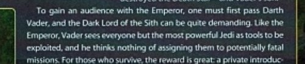
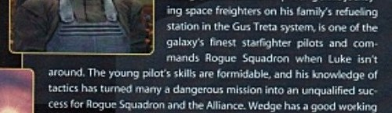

# Owner Material 038 — Star Wars Insider #1–153 plus specials (with The Lucasfilm Fan Club Magazine #1–22): Star Wars Insider #65 (2003)

- **Source:** *Star Wars Insider* magazine (issues 23–153, 1994–2014) and its predecessor *The Lucasfilm Fan Club Magazine* (issues 1–22, 1987–1994), plus seven special editions: articles, interviews, comics and short fiction Secondary source (licensed Legends reference). Scan OCR'd on the box; the scan stays box-only and is **not** published.
- **Method:** every scanned page was OCR'd and machine-screened sentence by sentence for power-relevant statements (fights, kills, defeats, Force feats, rankings, superweapons) that name a character on our roster; each kept sentence is quoted verbatim from the OCR text and has a crop of the printed passage directly under it. Pages with nothing power-relevant are still listed with what is on them.
- **Citation:** "*Star Wars Insider #65* (2003), p.X" by printed page ("scan p.X" where no printed number applies). **Weight:** Licensed magazine: a secondary source. Its short fiction and comics are Legends stories; its articles and interviews sum up or discuss lore and rank below the novels, comics and games they describe.

## scan p.1 (scan page 1)

Page contents: Cover: Star Wars Galaxies "wants you" — 20 character dossiers; LucasArts views; Aaron Allston fiction; Poggle the Lesser; Kevin Rubio; Buffy scribes; Dexter Jettster. (hand-read)

## scan p.2 (scan page 2)

Page contents: Freelancer game ad (spread, left). (hand-read)

## scan p.3 (scan page 3)

Page contents: Freelancer game ad (spread, right). (hand-read)

## scan p.4 (scan page 4)

Page contents: Contents: Making of the Map (Daniel Wallace), Episode III preview. (hand-read)

## scan p.5 (scan page 5)

Page contents: Departments listing: Rebel Rumblings, Star News, Jawa Trader, Behind the Magic (Poggle the Lesser, Philip Metschan), HoloNet News, Gamescape, Bookshelf (Force Heretic I: Remnant), Comics Link. (hand-read)

## scan p.6 (scan page 6)

Page contents: Masthead, Issue 65, Paizo Publishing. (hand-read)

## scan p.7 (scan page 7)

Page contents: Jedi Outcast game ad. (hand-read)

## scan p.8 (scan page 8)

Page contents: Prequel Update: Rick McCallum on Episode III pre-production in London and Sydney. (hand-read)

## scan p.9 (scan page 9)

Page contents: Prequel Update cont.: designing every world, animatics, upgraded digital cameras. (hand-read)

## scan p.10 (scan page 10)

Page contents: Star News: Attack of the Clones IMAX Experience fan-group celebrations and charities; fan names omitted. (hand-read)

## scan p.11 (scan page 11)

Page contents: Star News: worldwide fan club subscriptions, George Lucas PGA Vanguard Award, Looney Tunes Duck Dodgers "Attack of the Drones". (hand-read)

## scan p.12 (scan page 12)

Page contents: Star News: Attack of the Clones wins LEAF award; Star Wars top-selling licensed toys of 2002. (hand-read)

## scan p.13 (scan page 13)

Page contents: Del Rey ad: Force Heretic III: Reunion (New Jedi Order). (hand-read)

## scan p.14 (scan page 14)

Page contents: Star Sightings: George Lucas guest-stars on Just Shoot Me; Hayden Christensen and Natalie Portman film news. (hand-read)

## scan p.15 (scan page 15)

Page contents: Star Sightings cont.: Christopher Lee concert, James Earl Jones Cornell lecture; The Star Wars Trilogy in 30 Minutes stage show. (hand-read)

## scan p.16 (scan page 16)

Page contents: Inside Attack of the Clones (David West Reynolds): Dooku's Solar Sailer and the Dacho executive hangar miniature; ILM Model Shop notes. (hand-read)

### Stat block notes (game mechanics, not feats)

- Dooku's untrackable Solar Sailer: Count Dooku's immense resources and well-placed connections allow him to equip his private space vessel with highly refined electronic countermeasures. Among these are transponders that fill Coruscant's official traffic monitoring systems with an ever-changing stream of disinformation using stolen high-security codes. As a result, the vessel sets off no alerts. More importantly, Dooku's movements cannot be tracked via official records, even if he sails through closely monitored sectors. (Star Wars Insider 65, p. 16) (Source: *Star Wars Insider #65* (2003), scan p.16)

## scan p.17 (scan page 17)

Page contents: Dark Rendezvous cont.: rust techniques, Coruscant industrial gigantism, the Dacho factory Dead Sector. (hand-read)

## scan p.18 (scan page 18)

Page contents: Meet the Makers (Justin Lambros): the people of LucasArts, from Lucasfilm Games onward. (hand-read)

## scan p.19 (scan page 19)

Page contents: Meet the Makers: director Jon Knoles on creating Bounty Hunter and the Jango/Boba backstory. (hand-read)

## scan p.20 (scan page 20)

Page contents: Meet the Makers: producer's role, schedules and Expanded Universe continuity. (hand-read)

## scan p.21 (scan page 21)

Page contents: Meet the Makers: lead designer Tim Longo and lead artist Chris Williams. (hand-read)

## scan p.22 (scan page 22)

Page contents: Meet the Makers: lead programmer Chris Corry; tester Chuck McFadden. (hand-read)

## scan p.23 (scan page 23)

Page contents: Meet the Makers: testing; Mary Bihr on sales and marketing; LucasArts history totals. (hand-read)

## scan p.24 (scan page 24)

Page contents: "Red Five, ..." — The History of Star Wars Video Games opener (Atari vector-graphics screen). (hand-read)

## scan p.25 (scan page 25)

Page contents: Video game history: 1982 Empire Strikes Back (Atari 2600), Jedi Arena, Death Star Battle, 1983 Atari Star Wars arcade. (hand-read)

## scan p.26 (scan page 26)

Page contents: Video game history: home ports, cancelled Ewok Adventure, Return of the Jedi and Empire arcade games, NES era. (hand-read)

## scan p.27 (scan page 27)

Page contents: Video game history: Super Star Wars trilogy (SNES), X-Wing, TIE Fighter, Rebel Assault. (hand-read)

## scan p.28 (scan page 28)

Page contents: Video game history: Star Wars Chess, Star Wars Arcade, Dark Forces, Rebel Assault II. (hand-read)

## scan p.29 (scan page 29)

Page contents: Video game history: Shadows of the Empire, Masters of Teras Kasi, Yoda Stories, Jedi Knight, Mysteries of the Sith, Trilogy Arcade. (hand-read)

## scan p.30 (scan page 30)

Page contents: Video game history: Rogue Squadron, Episode I Racer, Jedi Power Battles, Rebellion, X-Wing Alliance, Force Commander, Starfighter. (hand-read)

## scan p.31 (scan page 31)

Page contents: Video game history: 2001–2002 releases (Jedi Outcast, Galactic Battlegrounds, The Clone Wars, Bounty Hunter); Galaxies and KotOR ahead. (hand-read)

## scan p.32 (scan page 32)

Page contents: Who's Who in Star Wars Galaxies (JD Wiker): Tatooine/Jabba's Palace — Prefect Eugene Talmont, Dera Darklighter. (hand-read)

## scan p.33 (scan page 33)

Page contents: Who's Who: Dera Darklighter cont., TT-8L, Max Rebo. (hand-read)

## scan p.34 (scan page 34)

Page contents: Who's Who: Bib Fortuna, Ephant Mon, Barada. (hand-read)

## scan p.35 (scan page 35)

Page contents: Who's Who: Imperial Guards, Chamberlain Kaja Or'Zee, Darth Vader, Emperor Palpatine, Boss Nass, Gorr Ebelt. (hand-read)

- **Darth Vader (Anakin Skywalker); Palpatine (Darth Sidious)** — entry/section: Galaxies dossier: Vader the gatekeeper: "To gain an audience with the Emperor, one must first pass Darth Vader, and the Dark Lord of the Sith can be quite demanding. Like the Emperor, Vader sees everyone but the most powerful Jedi as tools to be exploited, and he thinks nothing of assigning them to potentially fatal missions." Source: *Star Wars Insider #65* (2003), scan p.35
  

### Stat block notes (game mechanics, not feats)

- Galaxies dossier: the most powerful man in the galaxy: The most powerful—and most evil—man in the entire galaxy is Emperor Palpatine. Known to the citizens of the Galactic Empire as a frail, beloved old man, few know just how vile Palpatine truly is. The Emperor engineered not only the destruction of the Republic but also the annihilation of its protectors, the Jedi Knights. (Star Wars Insider 65, p. 35) (Source: *Star Wars Insider #65* (2003), scan p.35)
- Galaxies dossier: Vader second in power only to the Emperor: The Dark Lord of the Sith, Darth Vader, is the Emperor's personal assistant, and as much of a confidante as the Emperor could ever have. In his distinctive black armor, Vader is an imposing figure. In the entire galaxy, he is second in power only to the Emperor himself. (Star Wars Insider 65, p. 35) (Source: *Star Wars Insider #65* (2003), scan p.35)

## scan p.36 (scan page 36)

Page contents: Who's Who: Gorr Ebelt cont., Corellia rebel hideout (Wedge Antilles, Captain Ackbar), Endor Marauders' Citadel (Marauder Guards, King Terak). (hand-read)

- **Wedge Antilles; Luke Skywalker** — entry/section: Galaxies dossier: Wedge Antilles: "Wedge, who learned his piloting skills jockeying space freighters on his family's refueling station in the Gus Treta system, is one of the galaxy's finest starfighter pilots and commands Rogue Squadron when Luke isn't around. The young pilot's skills are formidable, and his knowledge of tactics has turned many a dangerous mission into an unqualified success for Rogue Squadron and the Alliance." Source: *Star Wars Insider #65* (2003), scan p.36
  

### Stat block notes (game mechanics, not feats)

- Galaxies dossier: Terak rules by size and strength: On a forest moon where the strong survive, Terak is king. Terak rules the Marauders by virtue of his size and strength; he is taller and more powerful than any of them. (Star Wars Insider 65, pp. 36–37) (Source: *Star Wars Insider #65* (2003), scan p.36)

## scan p.37 (scan page 37)

Page contents: Who's Who: Terak and Charal, Dathomir Nightsisters' stronghold (Gethzerion, Nightsister Guardians), Lok: Nym's Lair. (hand-read)

### Stat block notes (game mechanics, not feats)

- Galaxies dossier: Gethzerion controls Imperial minds: Even so, Gethzerion, the leader of the Nightsisters, periodically visits the Imperial base and controls the minds of its troops and even its commanding officer, trying to gain access to a starship, so that she can spread her evil among the stars. (Star Wars Insider 65, p. 37) (Source: *Star Wars Insider #65* (2003), scan p.37)
- Galaxies dossier: Nym stronger, faster, more dangerous: As with all members of his species, the passage of twenty-odd years has only made the Feeorin pirate captain Nym stronger, faster, and more dangerous. The decades since his heroism in the Battle of Naboo, and later the Battle of Geonosis, have not softened him, and he is in fact more shrewd and cunning than ever. (Star Wars Insider 65, p. 37) (Source: *Star Wars Insider #65* (2003), scan p.37)

## scan p.38 (scan page 38)

Page contents: Fiction title page: "The Pengalan Tradeoff" by Aaron Allston (Clone Wars). (hand-read)

## scan p.39 (scan page 39)

Page contents: Fiction: Republic Intelligence observer Joram Kithe aboard a damaged gunship after the Pengalan IV assault; rumored Confederacy missile plant. (hand-read)

## scan p.40 (scan page 40)

Page contents: Fiction: the shield-trap ambush and slaughter of the gunships; the crash. (hand-read)

## scan p.41 (scan page 41)

Page contents: Fiction: surviving clone troopers put Joram in charge by procedure; escape plan. (hand-read)

## scan p.42 (scan page 42)

Page contents: Fiction: troopers' nicknames (Tooth); hiding from a patrol. (hand-read)

## scan p.43 (scan page 43)

Page contents: Fiction: Joram explains nicknames and individuality to the troopers. (hand-read)

## scan p.44 (scan page 44)

Page contents: Fiction: scouting the Tur Lorkin facility; capturing workers. (hand-read)

## scan p.45 (scan page 45)

Page contents: Fiction: discovering the plant really does build the missiles. (hand-read)

## scan p.46 (scan page 46)

Page contents: Fiction: the troopers refuse to leave without destroying the plant. (hand-read)

## scan p.47 (scan page 47)

Page contents: Fiction: Joram joins the raid; infiltrating with missile containers. (hand-read)

## scan p.48 (scan page 48)

Page contents: Fiction: explosion, losses (Tooth), push toward final assembly. (hand-read)

## scan p.49 (scan page 49)

Page contents: Fiction: fighting out past battle droids; finishing the mission. (hand-read)

## scan p.50 (scan page 50)

Page contents: Making the Map (Daniel Wallace): charting the galaxy, from Behind the Magic (1998). (hand-read)

## scan p.51 (scan page 51)

Page contents: Making the Map: conflicting travel times and the West End Games Gazetteer. (hand-read)

## scan p.52 (scan page 52)

Page contents: Making the Map: the Behind the Magic map, then the New Jedi Order map with Jim Luceno. (hand-read)

## scan p.53 (scan page 53)

Page contents: Making the Map: flowcharting sector links; hyperspace routes as roads. (hand-read)

## scan p.54 (scan page 54)

Page contents: Making the Map: the first NJO map and Chris Barbieri's art. (hand-read)

## scan p.55 (scan page 55)

Page contents: Making the Map: Vector Prime frontispiece, later maps, plotting Attack of the Clones worlds (Geonosis, Kamino). (hand-read)

## scan p.56 (scan page 56)

Page contents: Galaxy map spread. (hand-read)

## scan p.57 (scan page 57)

Page contents: Jedi Knights & Vampire Slayers: Buffy the Vampire Slayer writers on Star Wars. (hand-read)

## scan p.58 (scan page 58)

Page contents: Buffy writers' first Star Wars memories. (hand-read)

## scan p.59 (scan page 59)

Page contents: Top 10 Star Wars references in Buffy (#10); favorite films and characters. (hand-read)

## scan p.60 (scan page 60)

Page contents: Buffy references #8–#7; writers on dark-side turns and Star Wars counterparts. (hand-read)

## scan p.61 (scan page 61)

Page contents: Buffy references #6–#5; why so many Star Wars references. (hand-read)

## scan p.62 (scan page 62)

Page contents: Buffy references #4–#3; "a raging bucket of geeks." (hand-read)

## scan p.63 (scan page 63)

Page contents: Buffy references #2; why Star Wars and Buffy fans overlap. (hand-read)

## scan p.64 (scan page 64)

Page contents: Jawa Trader: online keywords, Attack of the Clones fan-club cap and T-shirt. (hand-read)

## scan p.65 (scan page 65)

Page contents: Jawa Trader: action figures and the carbon-freezing chamber playset. (hand-read)

## scan p.66 (scan page 66)

Page contents: Jawa Trader: Star Wars Roleplaying Game books (Revised Core Rulebook, Power of the Jedi, etc.). (hand-read)

## scan p.67 (scan page 67)

Page contents: Dragon/Dungeon magazine subscription ad. (hand-read)

## scan p.68 (scan page 68)

Page contents: Behind the Magic (Rob Coleman et al.): bringing Poggle the Lesser to life; Lucas on Poggle as a power-hungry leader under Sidious and Dooku. (hand-read)

## scan p.69 (scan page 69)

Page contents: Behind the Magic: digital sculpting of Poggle; designed to stand apart from other Geonosians. (hand-read)

## scan p.70 (scan page 70)

Page contents: Behind the Magic: insect motion studies; Poggle's regal walk and affected cane. (hand-read)

## scan p.71 (scan page 71)

Page contents: Behind the Magic: Ben Burtt's Geonosian vocalizations; x-sheet sidebar. (hand-read)

## scan p.72 (scan page 72)

Page contents: Behind the Magic: bracelet simulation bug; the late-added Dooku/Poggle Death Star command center scene. (hand-read)

## scan p.73 (scan page 73)

Page contents: Philip Metschan: screen graphics, Zam's targeting scope, the Lars homestead garage panels. (hand-read)

## scan p.74 (scan page 74)

Page contents: Republic HoloNet News: counter-slicer team formed; CIS jammer prototype destroyed at Balamak; Republic Army liberates Bassadro. (hand-read)

### Stat block notes (game mechanics, not feats)

- HoloNet News: Anakin destroys the Balamak jammer: A Republic task force, led by Jedi Obi-Wan Kenobi and Nanda-Ree Janoo engaged the flotilla with a starfighter attack. It was Kenobi's apprentice, Anakin Skywalker, who delivered the missile volley that destroyed the jamming craft. Victory is also being credited to Adar Tallon, the renowned starfighter tactician who planned the attack. (Star Wars Insider 65, p. 74) (Source: *Star Wars Insider #65* (2003), scan p.74)
- HoloNet News: Brand wins the Battle of Bassadro: AGAO, BASSADRO—Jedi General Empatojayos Brand's twilight push against the Separatists holed in the Agao Ranges has won the twelve-day Battle of Bassadro. Brand led his armored battalion of clone troopers to the rain-slicked obsidian crags of Bassadro's dormant volcanic ranges that offered cover to the Separatist forces. Brand ordered concussive missile strikes against the rock formations, not only destroying the Separatist's cover but also decimating the battle droid infantry with the resulting razor-sharp shrapnel. (Star Wars Insider 65, p. 74) (Source: *Star Wars Insider #65* (2003), scan p.74)

## scan p.75 (scan page 75)

Page contents: CIS Shadowfeed: Republic presence on Aargau; Dooku addresses "spurious" Republic reports. (hand-read)

## scan p.76 (scan page 76)

Page contents: Gamescape: Star Wars Galaxies beta — spawning system. (hand-read)

## scan p.77 (scan page 77)

Page contents: Galaxies beta: womp rat nests, Points of Interest, mission terminals. (hand-read)

## scan p.78 (scan page 78)

Page contents: Bookshelf: Sean Williams and Shane Dix on Force Heretic I: Remnant. (hand-read)

## scan p.79 (scan page 79)

Page contents: Bookshelf: their co-writing method; Long-Range Scanners (Final Prophecy, Unifying Force). (hand-read)

## scan p.80 (scan page 80)

Page contents: Comics Link: Boba Fett's silence in "Sacrifice" (John Wagner, Cam Kennedy), Star Wars: Empire #7. (hand-read)

## scan p.81 (scan page 81)

Page contents: Comics Link cont.: Wagner and Kennedy on Fett; editor Dave Land on Fett's mystery and degraded clone marksmanship. (hand-read)

## scan p.82 (scan page 82)

Page contents: Set feature: building the Outlander nightclub on Coruscant (Fox Studios Australia), 150 extras. (hand-read)

## scan p.83 (scan page 83)

Page contents: Outlander captions: droid numbaball game, Zam Wesell's KYD-21 blaster and mask design. (hand-read)

## scan p.84 (scan page 84)

Page contents: Scouting the Galaxy (Steve Sansweet): collecting knowledge wins a Thai game show; Radko ornaments; reader names omitted. (hand-read)

## scan p.85 (scan page 85)

Page contents: Scouting: double-Han stormtrooper two-pack, most valuable figures; reader names omitted. (hand-read)

## scan p.86 (scan page 86)

Page contents: Scouting: batteries in collectibles, Mexican Episode I sticker set, unused tickets; reader names omitted. (hand-read)

## scan p.87 (scan page 87)

Page contents: IMAX poster and banner offer for subscribers. (hand-read)

## scan p.88 (scan page 88)

Page contents: Crossword puzzle. (hand-read)

## scan p.89 (scan page 89)

Page contents: Subscription order form. (hand-read)

## scan p.90 (scan page 90)

Page contents: Rebel Rumblings: Star Wars wedding, dancing stormtroopers; letter-writer names omitted. (hand-read)

## scan p.91 (scan page 91)

Page contents: Rebel Rumblings cont.: more dancing troopers, Death Star jack-o'-lantern; letter-writer names omitted. (hand-read)

## scan p.92 (scan page 92)

Page contents: Rebel Rumblings cont.: John Williams soundtrack letter; index of advertisers; letter-writer names omitted. (hand-read)

## scan p.93 (scan page 93)

Page contents: Rebel Rumblings cont.: license plate, letter defending Obi-Wan's "certain point of view"; correction; letter-writer names omitted. (hand-read)

## scan p.94 (scan page 94)

Page contents: Insider Interview (Kevin Rubio): Dexter Jettster, "an inside joke"; Besalisk biology, droid and human waitstaff. (hand-read)

## scan p.95 (scan page 95)

Page contents: Dexter Jettster interview cont.: serving every species, how Obi-Wan found the diner. (hand-read)

## scan p.96 (scan page 96)

Page contents: Q&A (Pablo Hidalgo): Snaggletooth figures (Takeel, Zutton), species of Shaak Ti, Luminara, Yoda, Maul. (hand-read)

## scan p.97 (scan page 97)

Page contents: Q&A: Toonbuck Toora's digital face, where the Millennium Falcon's "head" is. (hand-read)

## scan p.98 (scan page 98)

Page contents: Illustration page (Tony Moseley). (hand-read)

## scan p.99 (scan page 99)

Page contents: Back issues order page. (hand-read)

## scan p.100 (scan page 100)

Page contents: Next issue preview: fan club edition costume spectacular. (hand-read)

## scan p.101 (scan page 101)

Page contents: Star Wars Galaxies galaxy map poster (Wizards of the Coast): hyperdrive and galaxy facts. (hand-read)

## scan p.102 (scan page 102)

Page contents: Galaxy map poster cont. (hand-read)

