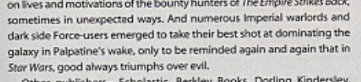
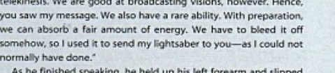
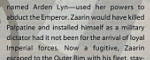
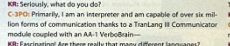

# Owner Material 038 — Star Wars Insider #1–153 plus specials (with The Lucasfilm Fan Club Magazine #1–22): Star Wars Insider #66 (2003)

- **Source:** *Star Wars Insider* magazine (issues 23–153, 1994–2014) and its predecessor *The Lucasfilm Fan Club Magazine* (issues 1–22, 1987–1994), plus seven special editions: articles, interviews, comics and short fiction Secondary source (licensed Legends reference). Scan OCR'd on the box; the scan stays box-only and is **not** published.
- **Method:** every scanned page was OCR'd and machine-screened sentence by sentence for power-relevant statements (fights, kills, defeats, Force feats, rankings, superweapons) that name a character on our roster; each kept sentence is quoted verbatim from the OCR text and has a crop of the printed passage directly under it. Pages with nothing power-relevant are still listed with what is on them.
- **Citation:** "*Star Wars Insider #66* (2003), p.X" by printed page ("scan p.X" where no printed number applies). **Weight:** Licensed magazine: a secondary source. Its short fiction and comics are Legends stories; its articles and interviews sum up or discuss lore and rank below the novels, comics and games they describe.

## scan p.1 (scan page 1)

Page contents: Cover: Star Wars Insider #66 — War Factories of Kamino and Geonosis, Michael A. Stackpole fiction "Elusion Illusion", Imperial Grand Admirals, Troy Denning's Tatooine Ghost. (hand-read)

## scan p.2 (scan page 2)

Page contents: LucasArts PS2 game ad (spread, left). (hand-read)

## scan p.3 (scan page 3)

Page contents: Star Wars: The Clone Wars / Emperor's Tomb game ad (spread, right). (hand-read)

## scan p.4 (scan page 4)

Page contents: Contents: features listing (War Factories, Novel Approach, Elusion Illusion, Grand Admirals, invisible effects). (hand-read)

## scan p.5 (scan page 5)

Page contents: Contents continued: departments listing. (hand-read)

## scan p.6 (scan page 6)

Page contents: Masthead and editorial credits. (hand-read)

## scan p.7 (scan page 7)

Page contents: Master Replicas ad. (hand-read)

## scan p.8 (scan page 8)

Page contents: Freelancer game ad (spread, left). (hand-read)

## scan p.9 (scan page 9)

Page contents: Freelancer game ad (spread, right). (hand-read)

## scan p.10 (scan page 10)

Page contents: Prequel Update: Rick McCallum on Episode III preparations in Sydney. (hand-read)

## scan p.11 (scan page 11)

Page contents: Prequel Update continued: Episode III pre-production in Sydney. (hand-read)

## scan p.12 (scan page 12)

Page contents: Star News: ILM award; George Lucas National Board of Review award. (hand-read)

## scan p.13 (scan page 13)

Page contents: Star News continued: The Science of Star Wars exhibit; Star Wars Weekends. (hand-read)

## scan p.14 (scan page 14)

Page contents: Star Sightings: celebrity and pop-culture Star Wars appearances. (hand-read)

## scan p.15 (scan page 15)

Page contents: Star Sightings continued. (hand-read)

## scan p.16 (scan page 16)

Page contents: Geonosian war chamber cutaway feature (David West Reynolds). (hand-read)

## scan p.17 (scan page 17)

Page contents: Geonosian war chamber feature continued. (hand-read)

## scan p.18 (scan page 18)

Page contents: War Factories: Kamino and Geonosis (Daniel Wallace) — clone and droid production facilities (opening spread). (hand-read)

## scan p.19 (scan page 19)

Page contents: War Factories: Kamino and Geonosis (Daniel Wallace) — clone and droid production facilities continued. (hand-read)

## scan p.20 (scan page 20)

Page contents: War Factories: Kamino and Geonosis (Daniel Wallace) — clone and droid production facilities continued. (hand-read)

## scan p.21 (scan page 21)

Page contents: War Factories: Kamino and Geonosis (Daniel Wallace) — clone and droid production facilities continued. (hand-read)

## scan p.22 (scan page 22)

Page contents: War Factories: Kamino and Geonosis (Daniel Wallace) — clone and droid production facilities continued. (hand-read)

## scan p.23 (scan page 23)

Page contents: War Factories: Kamino and Geonosis (Daniel Wallace) — clone and droid production facilities continued. (hand-read)

## scan p.24 (scan page 24)

Page contents: War Factories: Kamino and Geonosis (Daniel Wallace) — clone and droid production facilities continued. (hand-read)

## scan p.25 (scan page 25)

Page contents: War Factories: Kamino and Geonosis (Daniel Wallace) — clone and droid production facilities continued. (hand-read)

## scan p.26 (scan page 26)

Page contents: War Factories: Kamino and Geonosis (Daniel Wallace) — clone and droid production facilities continued. (hand-read)

## scan p.27 (scan page 27)

Page contents: War Factories: Kamino and Geonosis (Daniel Wallace) — clone and droid production facilities continued. (hand-read)

## scan p.28 (scan page 28)

Page contents: War Factories: Kamino and Geonosis (Daniel Wallace) — clone and droid production facilities continued. (hand-read)

## scan p.29 (scan page 29)

Page contents: Novel Approach (Rich Handley): history of Expanded Universe novels. (hand-read)

## scan p.30 (scan page 30)

Page contents: Novel Approach (Rich Handley): history of Expanded Universe novels. (hand-read)

- **Palpatine (Darth Sidious)** — entry/section: Star Wars Insider 066 (2003): post-Endor warlords: "And numerous Imperial warlords and dark side Force-users emerged to take their best shot at dominating the galaxy in Palpatine's wake, only to be reminded again and again that in Star Wars, good always triumphs over evil." Source: *Star Wars Insider #66* (2003), scan p.30
  

## scan p.31 (scan page 31)

Page contents: Novel Approach (Rich Handley): history of Expanded Universe novels. (hand-read)

## scan p.32 (scan page 32)

Page contents: Novel Approach (Rich Handley): history of Expanded Universe novels, the New Jedi Order and Chewbacca's death. (hand-read)

## scan p.33 (scan page 33)

Page contents: Novel Approach (Rich Handley): history of Expanded Universe novels, the New Jedi Order and Chewbacca's death. (hand-read)

## scan p.34 (scan page 34)

Page contents: Novel Approach (Rich Handley): history of Expanded Universe novels, the New Jedi Order and Chewbacca's death. (hand-read)

## scan p.35 (scan page 35)

Page contents: Fiction: "Elusion Illusion" by Michael A. Stackpole — Aayla Secura, Ylenic It'kla, Nejaa Halcyon and Hal Horn. (hand-read)

## scan p.36 (scan page 36)

Page contents: Fiction: "Elusion Illusion" by Michael A. Stackpole — Aayla Secura, Ylenic It'kla, Nejaa Halcyon and Hal Horn (continued). (hand-read)

## scan p.37 (scan page 37)

Page contents: Fiction: "Elusion Illusion" by Michael A. Stackpole — Aayla Secura, Ylenic It'kla, Nejaa Halcyon and Hal Horn (continued). (hand-read)

## scan p.38 (scan page 38)

Page contents: Fiction: "Elusion Illusion" by Michael A. Stackpole — Aayla Secura, Ylenic It'kla, Nejaa Halcyon and Hal Horn (continued). (hand-read)

## scan p.39 (scan page 39)

Page contents: Fiction: "Elusion Illusion" by Michael A. Stackpole — Aayla Secura, Ylenic It'kla, Nejaa Halcyon and Hal Horn (continued). (hand-read)

## scan p.40 (scan page 40)

Page contents: Fiction: "Elusion Illusion" by Michael A. Stackpole — Aayla Secura, Ylenic It'kla, Nejaa Halcyon and Hal Horn (continued). (hand-read)

## scan p.41 (scan page 41)

Page contents: Fiction: "Elusion Illusion" by Michael A. Stackpole — Aayla Secura, Ylenic It'kla, Nejaa Halcyon and Hal Horn (continued). (hand-read)

### Stat block notes (game mechanics, not feats)

- "Elusion Illusion": Aayla vs. battle droids: Then almost exactly as it had been in her vision, a lightsaber flew across the room. She did snatch it from the air and ignite it. The battle droids started to focus on her, but she gathered the Force and launched herself into the air. She soared to the level of the highest droid, landed, and batted aside one bolt before she swept the blade through its middle and sent the pieces tumbling to the duracrete floor. Aayla leaped away as more scarlet bolts chewed into the shelving and blasted other crates to melting shards. She landed in a crouch and cut the legs from beneath one of the droids. She reversed the blade and stabbed it through the chest of a second as she stood up. With a flick of her left hand, she dumped a third droid backward into the crate from which it had emerged. (Star Wars Insider 66, p. 41) (Source: *Star Wars Insider #66* (2003), scan p.41)

## scan p.42 (scan page 42)

Page contents: Fiction: "Elusion Illusion" by Michael A. Stackpole — Aayla Secura, Ylenic It'kla, Nejaa Halcyon and Hal Horn (continued). (hand-read)

- **Nejaa Halcyon** — entry/section: "Elusion Illusion": the Halcyon energy-absorption ability: ""The Halcyons are weak when it comes to telekinesis. We are good at broadcasting visions, however. Hence, you saw my message. We also have a rare ability. With preparation, we can absorb a fair amount of energy. We have to bleed it off somehow, so I used it to send my lightsaber to you—as I could not normally have done." —Nejaa Halcyon, Star Wars Insider 66, p. 42" Source: *Star Wars Insider #66* (2003), scan p.42
  

### Stat block notes (game mechanics, not feats)

- "Elusion Illusion": Aayla redirects bolts: Yanking the silver blade free of the pierced droid, Aayla spun and redirected a hail of bolts at the droids who fired them. Three shots hit one on the left side, spinning it about wildly before its legs tangled and it went down smoking. Yet another bolt took the head of the last one clean off. (Star Wars Insider 66, p. 42) (Source: *Star Wars Insider #66* (2003), scan p.42)

## scan p.43 (scan page 43)

Page contents: Fiction: "Elusion Illusion" by Michael A. Stackpole — Aayla Secura, Ylenic It'kla, Nejaa Halcyon and Hal Horn (continued). (hand-read)

## scan p.44 (scan page 44)

Page contents: Imperial Grand Admirals (Daniel Wallace and Abel G. Peña): profiles of the twelve Grand Admirals. (hand-read)

## scan p.45 (scan page 45)

Page contents: Imperial Grand Admirals (Daniel Wallace and Abel G. Peña): profiles of the twelve Grand Admirals. (hand-read)

## scan p.46 (scan page 46)

Page contents: Imperial Grand Admirals (Daniel Wallace and Abel G. Peña): profiles of the twelve Grand Admirals including Thrawn and Zaarin. (hand-read)

### Stat block notes (game mechanics, not feats)

- Grand Admirals: Thrawn: Known to his fellow Chiss as Syndic Mitth'raw'nuruodo, Thrawn helmed the Chiss Expansionary Defense Fleet and destroyed the Republic's expeditionary Outbound Flight Project when it treaded on Chiss turf in the Unknown Regions. … After the Battle of Hoth, Palpatine ordered Thrawn to kill the rogue Grand Admiral Zaarin. … Five years after Endor he re-emerged and brought the New Republic to its knees, but he perished in the effort. (Star Wars Insider 66, p. 46) (Source: *Star Wars Insider #66* (2003), scan p.46)

## scan p.47 (scan page 47)

Page contents: Imperial Grand Admirals (Daniel Wallace and Abel G. Peña): profiles of the twelve Grand Admirals. (hand-read)

## scan p.48 (scan page 48)

Page contents: Imperial Grand Admirals (Daniel Wallace and Abel G. Peña): profiles of the twelve Grand Admirals. (hand-read)

## scan p.49 (scan page 49)

Page contents: Imperial Grand Admirals (Daniel Wallace and Abel G. Peña): profiles of the twelve Grand Admirals including Thrawn and Zaarin. (hand-read)

- **Demetrius Zaarin; Palpatine (Darth Sidious)** — entry/section: Star Wars Insider 066 (2003): Zaarin's coup: "Zaarin would have killed Palpatine and installed himself as a military dictator had it not been for the arrival of loyal Imperial forces." Source: *Star Wars Insider #66* (2003), scan p.49
  

## scan p.50 (scan page 50)

Page contents: The invisible effects of The Phantom Menace (Ron Magid): digital set extensions and unnoticed effects work. (hand-read)

## scan p.51 (scan page 51)

Page contents: The invisible effects of The Phantom Menace (Ron Magid): digital set extensions and unnoticed effects work. (hand-read)

## scan p.52 (scan page 52)

Page contents: The invisible effects of The Phantom Menace (Ron Magid): digital set extensions and unnoticed effects work. (hand-read)

## scan p.53 (scan page 53)

Page contents: The invisible effects of The Phantom Menace (Ron Magid): digital set extensions and unnoticed effects work. (hand-read)

## scan p.54 (scan page 54)

Page contents: The invisible effects of The Phantom Menace (Ron Magid): digital set extensions and unnoticed effects work. (hand-read)

## scan p.55 (scan page 55)

Page contents: The invisible effects of The Phantom Menace (Ron Magid): digital set extensions and unnoticed effects work. (hand-read)

## scan p.56 (scan page 56)

Page contents: Star Wars references in other movies. (hand-read)

## scan p.57 (scan page 57)

Page contents: Star Wars references in other movies. (hand-read)

## scan p.58 (scan page 58)

Page contents: Star Wars references in other movies. (hand-read)

## scan p.59 (scan page 59)

Page contents: Star Wars references in other movies. (hand-read)

## scan p.60 (scan page 60)

Page contents: Jawa Trader: new merchandise and collectibles. (hand-read)

## scan p.61 (scan page 61)

Page contents: Jawa Trader: new merchandise and collectibles. (hand-read)

## scan p.62 (scan page 62)

Page contents: Jawa Trader: new merchandise and collectibles. (hand-read)

## scan p.63 (scan page 63)

Page contents: Back issues ad. (hand-read)

## scan p.64 (scan page 64)

Page contents: Behind the Magic: Kaminoans — design and effects of the Kaminoan characters. (hand-read)

## scan p.65 (scan page 65)

Page contents: Behind the Magic: Kaminoans — design and effects of the Kaminoan characters. (hand-read)

## scan p.66 (scan page 66)

Page contents: Behind the Magic: Kaminoans — design and effects of the Kaminoan characters. (hand-read)

## scan p.67 (scan page 67)

Page contents: Behind the Magic: Kaminoans — design and effects of the Kaminoan characters. (hand-read)

## scan p.68 (scan page 68)

Page contents: Behind the Magic: Kaminoans — design and effects of the Kaminoan characters. (hand-read)

## scan p.69 (scan page 69)

Page contents: Poster offer ad. (hand-read)

## scan p.70 (scan page 70)

Page contents: HoloNet News / CIS Shadowfeed in-universe news page. (hand-read)

## scan p.71 (scan page 71)

Page contents: HoloNet News / CIS Shadowfeed continued. (hand-read)

## scan p.72 (scan page 72)

Page contents: Gamescape: Ultimate Alien Anthology roleplaying supplement. (hand-read)

## scan p.73 (scan page 73)

Page contents: Ultimate Alien Anthology continued. (hand-read)

## scan p.74 (scan page 74)

Page contents: TCG: Battle of Yavin expansion. (hand-read)

## scan p.75 (scan page 75)

Page contents: TCG Battle of Yavin continued (build-point records). (hand-read)

## scan p.76 (scan page 76)

Page contents: Star Wars Galaxies beta, phase 2: load testing, pets. (hand-read)

## scan p.77 (scan page 77)

Page contents: Galaxies beta continued: pet training, scouting, dueling in Bestine, planned Battlefield system. (hand-read)

## scan p.78 (scan page 78)

Page contents: Jason Fry on Troy Denning's Tatooine Ghost: researching Leia's transition, Shmi's palm diary, bridging prequel and classic eras. (hand-read)

## scan p.79 (scan page 79)

Page contents: Tatooine Ghost continued: other Tatooine EU books sidebar; Denning wants to write a 'butt-kicking Yoda book'. (hand-read)

## scan p.80 (scan page 80)

Page contents: Biggs Darklighter feature (Daniel Wallace): Biggs' cut scenes and Paul Chadwick's Empire 'Darklighter' arc. (hand-read)

## scan p.81 (scan page 81)

Page contents: Darklighter continued: Doug Wheatley and Chris Chuckry art; 'The Biggs Bang' comics sidebar; whatever happened to Tank. (hand-read)

### Stat block notes (game mechanics, not feats)

- Comics sidebar: "Crucible" (Star Wars #17): Luke Skywalker must save Biggs' life after his friend is wounded by marauding Tusken Raiders in this flashback tale set on the eve of Biggs' enrollment into the Imperial naval academy. (Star Wars Insider 66, p. 81) (Source: *Star Wars Insider #66* (2003), scan p.81)

## scan p.82 (scan page 82)

Page contents: Set Pieces: the Jedi Council Chamber set, Yoda puppet team, Council aliens. (hand-read)

## scan p.83 (scan page 83)

Page contents: Jedi Council Chamber continued: lighting setups, Council lightsaber props, Yoda bust captions. (hand-read)

## scan p.84 (scan page 84)

Page contents: Scouting the Galaxy (collectibles Q&A): bagged C-3PO figure, 1977 Topps wax packs (reader names omitted). (hand-read)

## scan p.85 (scan page 85)

Page contents: Scouting the Galaxy continued: Michael David Ward lithographs, poster framing, card-back photo variations. (hand-read)

## scan p.86 (scan page 86)

Page contents: Scouting the Galaxy continued: mislabeled and misprinted figures, broken Mace Windu lightsaber, SFBC Thrawn hardcovers. (hand-read)

## scan p.87 (scan page 87)

Page contents: Subscription ad. (hand-read)

## scan p.88 (scan page 88)

Page contents: Crossword puzzle. (hand-read)

## scan p.89 (scan page 89)

Page contents: Fan Club ad. (hand-read)

## scan p.90 (scan page 90)

Page contents: Rebel Rumblings (letters; letter-writer names omitted): Rob Coleman column praise, Raiders sound Easter egg, formats of Attack of the Clones. (hand-read)

## scan p.91 (scan page 91)

Page contents: Rebel Rumblings continued: AT-TE, IMAX vs digital vs DVD. (hand-read)

## scan p.92 (scan page 92)

Page contents: Rebel Rumblings continued: defending Obi-Wan, female fans and duels; advertisers index. (hand-read)

## scan p.93 (scan page 93)

Page contents: Rebel Rumblings continued: Padmé vs. nexu, cartoon praise, fan photos. (hand-read)

## scan p.94 (scan page 94)

Page contents: Insider Interview: C-3PO by Kevin Rubio, illustrated by Ken Steacy (humor piece). (hand-read)

## scan p.95 (scan page 95)

Page contents: C-3PO interview continued: six million forms of communication, droids and programming, relationship with R2-D2. (hand-read)

- **C-3PO** — entry/section: C-3PO interview: six million forms of communication: ""Primarily, I am an interpreter and am capable of over six million forms of communication thanks to a TranLang III Communicator module coupled with an AA-1 VerboBrain—" —C-3PO, Star Wars Insider 66, p. 95" Source: *Star Wars Insider #66* (2003), scan p.95
  

## scan p.96 (scan page 96)

Page contents: Q&A with Pablo Hidalgo: Yaddle and Yarael Poof, Leia's memories of Padmé, Jango's motives, Boba not a Jedi, Jedi vanishing. (hand-read)

### Stat block notes (game mechanics, not feats)

- Q&A: why Jango agreed to be cloned: Jango is not a political man. He couldn't care less about Republic vs. Separatist debates. Like most bounty hunters, he's driven by a dangerous combination of greed and vengeance. Fett was paid handsomely for his service, and when Tyranus recruited him, he was offered a chance to get back at the Jedi. (Star Wars Insider 66, p. 96) (Source: *Star Wars Insider #66* (2003), scan p.96)
- Q&A: vanishing at death is a learned discipline: Though you're correct when you say "all the other Jedi," three deaths don't give us a statistical sample big enough to conclude that all Jedi vanish upon death. The prequel trilogy is teaching us that the whole vanishing thing is a learned discipline, and not an automatic response. Of the Jedi that were killed in the Geonosian arena, none vanished. Furthermore, in the novelization of Episode II, Yoda is surprised and confused to hear Qui-Gon's voice return from beyond the grave. Episode III promises to hold more answers about this vanishing phenomenon. (Star Wars Insider 66, p. 96) (Source: *Star Wars Insider #66* (2003), scan p.96)

## scan p.97 (scan page 97)

Page contents: Q&A continued: Podracer look-alikes, Dooku's title, flopped film frames, Mara Jade in Return of the Jedi. (hand-read)

### Stat block notes (game mechanics, not feats)

- Q&A: Dooku's title: Dooku's title is by birthright. He is the count of his home world of Serenno. He is also very wealthy by birth, though Jedi eschew such material possessions. Once Dooku left the Jedi Order, though, he resumed his title and wealth. (Star Wars Insider 66, p. 97) (Source: *Star Wars Insider #66* (2003), scan p.97)

## scan p.98 (scan page 98)

Page contents: Illustration by Tony Moseley. (hand-read)

## scan p.99 (scan page 99)

Page contents: Star Wars Unleashed figures ad. (hand-read)

## scan p.100 (scan page 100)

Page contents: Del Rey ad: Tatooine Ghost and the Attack of the Clones novelization. (hand-read)

