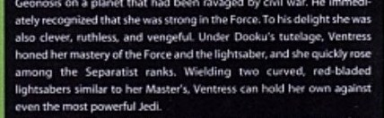
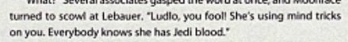
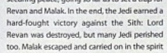
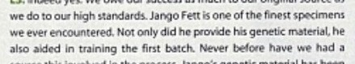
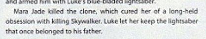

# Owner Material 038 — Star Wars Insider #1–153 plus specials (with The Lucasfilm Fan Club Magazine #1–22): Star Wars Insider #67 (2003)

- **Source:** *Star Wars Insider* magazine (issues 23–153, 1994–2014) and its predecessor *The Lucasfilm Fan Club Magazine* (issues 1–22, 1987–1994), plus seven special editions: articles, interviews, comics and short fiction Secondary source (licensed Legends reference). Scan OCR'd on the box; the scan stays box-only and is **not** published.
- **Method:** every scanned page was OCR'd and machine-screened sentence by sentence for power-relevant statements (fights, kills, defeats, Force feats, rankings, superweapons) that name a character on our roster; each kept sentence is quoted verbatim from the OCR text and has a crop of the printed passage directly under it. Pages with nothing power-relevant are still listed with what is on them.
- **Citation:** "*Star Wars Insider #67* (2003), p.X" by printed page ("scan p.X" where no printed number applies). **Weight:** Licensed magazine: a secondary source. Its short fiction and comics are Legends stories; its articles and interviews sum up or discuss lore and rank below the novels, comics and games they describe.

## scan p.1 (scan page 1)

Page contents: Cover: Return of the Jedi 20th anniversary issue; 100 Jedi secrets, Warwick Davis, Troy Denning short story, Max Rebo Band, Kevin Rubio interviews Lama Su. (hand-read)

## scan p.2 (scan page 2)

Page contents: Advertisement. (hand-read)

## scan p.3 (scan page 3)

Page contents: Advertisement: Star Wars Galaxies. (hand-read)

## scan p.4 (scan page 4)

Page contents: Advertisement. (hand-read)

## scan p.5 (scan page 5)

Page contents: Advertisement: Indiana Jones and the Emperor's Tomb (LucasArts). (hand-read)

## scan p.6 (scan page 6)

Page contents: Advertisement. (hand-read)

## scan p.7 (scan page 7)

Page contents: Advertisement: Knights of the Old Republic. (hand-read)

## scan p.8 (scan page 8)

Page contents: Contents: features. (hand-read)

## scan p.9 (scan page 9)

Page contents: Contents: departments; Fan Club editorial on Return of the Jedi at 20. (hand-read)

## scan p.10 (scan page 10)

Page contents: Masthead and Rebel Rumblings letters (letter-writer names omitted). (hand-read)

## scan p.11 (scan page 11)

Page contents: Advertisement. (hand-read)

## scan p.12 (scan page 12)

Page contents: Prequel Update: Rick McCallum on Episode III pre-production in Sydney. (hand-read)

## scan p.13 (scan page 13)

Page contents: Prequel Update continued. (hand-read)

## scan p.14 (scan page 14)

Page contents: Star News. (hand-read)

## scan p.15 (scan page 15)

Page contents: Prequel Update continued: Episode III art department work. (hand-read)

## scan p.16 (scan page 16)

Page contents: Advertisement: LEGO Star Wars. (hand-read)

## scan p.17 (scan page 17)

Page contents: Star News: "Franchises Flourishing" box-office roundup and other items. (hand-read)

## scan p.18 (scan page 18)

Page contents: Advertisement. (hand-read)

## scan p.19 (scan page 19)

Page contents: Star News continued. (hand-read)

## scan p.20 (scan page 20)

Page contents: Advertisement. (hand-read)

## scan p.21 (scan page 21)

Page contents: Advertisement. (hand-read)

## scan p.22 (scan page 22)

Page contents: Advertisement. (hand-read)

## scan p.23 (scan page 23)

Page contents: Star News: Clone Wars micro-series on Cartoon Network; sidebar "New Faces of Villainy" on Asajj Ventress and Durge. (hand-read)

- **Asajj Ventress; Count Dooku** — entry/section: Star Wars Insider 067 (2003): Asajj Ventress: "He immediately recognized that she was strong in the Force. To his delight she was also clever, ruthless, and vengeful. Under Dooku's tutelage, Ventress honed her mastery of the Force and the lightsaber, and she quickly rose among the Separatist ranks." Source: *Star Wars Insider #67* (2003), scan p.23
  
- **Asajj Ventress; Count Dooku** — entry/section: Star Wars Insider 067 (2003): Ventress's lightsabers: "Wielding two curved, red-bladed lightsabers similar to her Master's, Ventress can hold her own against even the most powerful Jedi." Source: *Star Wars Insider #67* (2003), scan p.23
  

### Stat block notes (game mechanics, not feats)

- "New Faces of Villainy": Durge: Durge. In ancient times, Durge fought alongside the Sith against the Jedi, until the Sith were driven to extinction a millennia before the Battle of Naboo. In the years that followed, Durge established himself as one of the galaxy's greatest bounty hunters until he was defeated by the Mandalorians while attempting to collect a bounty on their leader. Although he was held captive and tortured by the commandos, he escaped and spent a century in hibernation to recover from the ordeal. (Star Wars Insider 67, p. 23) (Source: *Star Wars Insider #67* (2003), scan p.23)

## scan p.24 (scan page 24)

Page contents: Advertisement: Battle of Yavin trading card game. (hand-read)

## scan p.25 (scan page 25)

Page contents: The Ultimate Insider's Guide to Return of the Jedi: opener. (hand-read)

## scan p.26 (scan page 26)

Page contents: Insider's Guide: lost scenes. (hand-read)

## scan p.27 (scan page 27)

Page contents: Insider's Guide: lost scenes and early-draft material (Vader and royal guards; Jabba's Jedi-killing boast). (hand-read)

### Stat block notes (game mechanics, not feats)

- Insider's Guide: Jabba's Jedi-killing boast: Jabba brags that he's killed many Jedi Knights in the script's second draft, a boast that also appears in the novelization. There, Jabba delivers the classic line, "I was killing your kind when being a Jedi meant something." (Star Wars Insider 67, p. 27) (Source: *Star Wars Insider #67* (2003), scan p.27)
- Insider's Guide: deleted throne-room scene: As Vader attempts to enter the Emperor's throne room, two royal guards bar his entrance. Vader responds with his trademark Force choke. (Star Wars Insider 67, p. 27) (Source: *Star Wars Insider #67* (2003), scan p.27)

## scan p.28 (scan page 28)

Page contents: Insider's Guide: abandoned concepts (Had Abbadon, Obi-Wan in the flesh, Yoda's spirit). (hand-read)

### Stat block notes (game mechanics, not feats)

- Insider's Guide: abandoned final-duel concept: During the final contest of good vs. evil the Emperor shoots Force lightning at Obi-Wan and Luke raises an invisible shield to block it. Wherever the lightning bolts hit the shield, the image of Yoda appears. (Star Wars Insider 67, p. 28) (Source: *Star Wars Insider #67* (2003), scan p.28)

## scan p.29 (scan page 29)

Page contents: Insider's Guide: reasons Jedi gets a bad rap; Luke's arrogance. (hand-read)

### Stat block notes (game mechanics, not feats)

- Insider's Guide: Luke's dangerous arrogance: Luke Skywalker left his farm-boy days behind in Jedi, wearing a Vader-esque Jedi outfit and confronting his enemies with dangerous arrogance. Observe how he dispatches Gamorrean guards just by pointing his fingers, and his cocky "last mistake you'll ever make" taunting of Jabba when the Hutt predictably rejects Luke's flimsy counteroffer. (Star Wars Insider 67, p. 29) (Source: *Star Wars Insider #67* (2003), scan p.29)

## scan p.30 (scan page 30)

Page contents: Insider's Guide: Threepio, Wedge's return, the Emperor's enunciation. (hand-read)

### Stat block notes (game mechanics, not feats)

- Insider's Guide: "Six Million": That's how many forms of communication Threepio is fluent in, and in Jedi he actually uses a few of them. From the door in front of Jabba's palace ("Artoo Detoowha . . .") to his sound-effect laden storytelling in the Ewok village, Threepio finally gets to demonstrate the utility of a translator droid. (Star Wars Insider 67, p. 30) (Source: *Star Wars Insider #67* (2003), scan p.30)
- Insider's Guide: "The Return of Wedge": As Red Leader he no longer takes orders from Luke, and in the Battle of Endor he takes partial credit for destroying the second Death Star. (Star Wars Insider 67, p. 30) (Source: *Star Wars Insider #67* (2003), scan p.30)

## scan p.31 (scan page 31)

Page contents: Insider's Guide: bloopers (the teleporting saber). (hand-read)

### Stat block notes (game mechanics, not feats)

- Insider's Guide: the "teleporting saber": In the Jedi novelization, Luke throws his saber aside just before this scene, then uses the Force to call it back from Vader when he leaps out in rage. (Star Wars Insider 67, p. 31) (Source: *Star Wars Insider #67* (2003), scan p.31)

## scan p.32 (scan page 32)

Page contents: Insider's Guide: memorable lines. (hand-read)

## scan p.33 (scan page 33)

Page contents: Insider's Guide: trivia. (hand-read)

## scan p.34 (scan page 34)

Page contents: Insider's Guide: aliens. (hand-read)

## scan p.35 (scan page 35)

Page contents: Insider's Guide: vehicles. (hand-read)

## scan p.36 (scan page 36)

Page contents: Advertisement: Star Wars checks. (hand-read)

## scan p.37 (scan page 37)

Page contents: Interview: Warwick Davis (Wicket) opener. (hand-read)

## scan p.38 (scan page 38)

Page contents: Warwick Davis interview continued. (hand-read)

## scan p.39 (scan page 39)

Page contents: Warwick Davis interview continued. (hand-read)

## scan p.40 (scan page 40)

Page contents: Warwick Davis interview continued. (hand-read)

## scan p.41 (scan page 41)

Page contents: Warwick Davis interview continued. (hand-read)

## scan p.42 (scan page 42)

Page contents: Warwick Davis interview continued. (hand-read)

## scan p.43 (scan page 43)

Page contents: Warwick Davis interview concluded. (hand-read)

## scan p.44 (scan page 44)

Page contents: Advertisement: Star Wars Insider subscription. (hand-read)

## scan p.45 (scan page 45)

Page contents: Full-page art. (hand-read)

## scan p.46 (scan page 46)

Page contents: Who's Who: The Max Rebo Band opener. (hand-read)

## scan p.47 (scan page 47)

Page contents: Who's Who: Max Rebo Band continued (band members including Evar Orbus, Lyn Me, Rystall). (hand-read)

## scan p.48 (scan page 48)

Page contents: Who's Who: Max Rebo Band continued. (hand-read)

## scan p.49 (scan page 49)

Page contents: Who's Who: Max Rebo Band continued (Lyn Me, Rystall, Greeata). (hand-read)

## scan p.50 (scan page 50)

Page contents: Who's Who: Max Rebo Band concluded. (hand-read)

## scan p.51 (scan page 51)

Page contents: FX Karma: Ken Ralston on the Endor space battle. (hand-read)

## scan p.52 (scan page 52)

Page contents: FX Karma continued. (hand-read)

## scan p.53 (scan page 53)

Page contents: FX Karma continued. (hand-read)

## scan p.54 (scan page 54)

Page contents: FX Karma concluded. (hand-read)

## scan p.55 (scan page 55)

Page contents: Seeking Revenge: Revenge of the Jedi collectibles. (hand-read)

## scan p.56 (scan page 56)

Page contents: Seeking Revenge continued (photo spread). (hand-read)

## scan p.57 (scan page 57)

Page contents: Seeking Revenge continued. (hand-read)

## scan p.58 (scan page 58)

Page contents: Seeking Revenge concluded: crew patches and Blue Harvest items; release-date history. (hand-read)

## scan p.59 (scan page 59)

Page contents: Full-page illustration for "The Trouble with Squibs" (Han, Leia, Chewbacca, C-3PO). (hand-read)

## scan p.60 (scan page 60)

Page contents: Fiction: "The Trouble with Squibs" by Troy Denning, illustrated by Russell Walks: Han and Leia come to Pavo Prime for the boasa statues; the Squibs Sligh and Emala. (hand-read)

## scan p.61 (scan page 61)

Page contents: "The Trouble with Squibs" continued. (hand-read)

## scan p.62 (scan page 62)

Page contents: "The Trouble with Squibs" continued: the Squibs and the MS-19 matter. (hand-read)

## scan p.63 (scan page 63)

Page contents: "The Trouble with Squibs" continued. (hand-read)

## scan p.64 (scan page 64)

Page contents: "The Trouble with Squibs" continued: Lebauer and the boasas. (hand-read)

## scan p.65 (scan page 65)

Page contents: "The Trouble with Squibs" continued: Leia learns the truth about "Second Mistake." (hand-read)

## scan p.66 (scan page 66)

Page contents: "The Trouble with Squibs" continued: salvage demands and the Invisible Shell. (hand-read)

## scan p.67 (scan page 67)

Page contents: "The Trouble with Squibs" continued: Lorimar Lebauer; Chewbacca clears two Jenet thugs. (hand-read)

### Stat block notes (game mechanics, not feats)

- "The Trouble with Squibs": Chewbacca and the lounge guards: When the two Jenet thugs stepped out to block Chewbacca's path, he slammed their heads together and caught them by the scruff of their tunics. (Star Wars Insider 67, p. 67) (Source: *Star Wars Insider #67* (2003), scan p.67)

## scan p.68 (scan page 68)

Page contents: "The Trouble with Squibs" continued. (hand-read)

## scan p.69 (scan page 69)

Page contents: "The Trouble with Squibs" continued: Leia senses a trap. (hand-read)

- **Leia Organa Solo** — entry/section: "The Trouble with Squibs": a Jenet on Leia: ""Ludlo, you fool! She's using mind tricks on you. Everybody knows she has Jedi blood." —a Jenet associate (Moonface), Star Wars Insider 67, p. 69" Source: *Star Wars Insider #67* (2003), scan p.69
  

### Stat block notes (game mechanics, not feats)

- "The Trouble with Squibs": Leia senses the trap: "I feel something." She made sure her comlink was active and clipped it to the underside of her collar. "Maybe the Force." (Star Wars Insider 67, p. 69) (Source: *Star Wars Insider #67* (2003), scan p.69)

## scan p.70 (scan page 70)

Page contents: "The Trouble with Squibs" concluded. (hand-read)

## scan p.71 (scan page 71)

Page contents: ILM: The Geonosian Droidworks (the droid factory sequence of Attack of the Clones). (hand-read)

## scan p.72 (scan page 72)

Page contents: Geonosian Droidworks continued: concept sketches and layout. (hand-read)

## scan p.73 (scan page 73)

Page contents: Geonosian Droidworks continued: rigging and animation. (hand-read)

## scan p.74 (scan page 74)

Page contents: Geonosian Droidworks concluded: miniatures, lighting, smoke and steam. (hand-read)

## scan p.75 (scan page 75)

Page contents: HoloNet News: Atraken declared unsalvageable; Sector Rangers enforce rationing. (hand-read)

## scan p.76 (scan page 76)

Page contents: HoloNet News: Wat Tambor liberated; Republic breaks Ando demilitarization pact. (hand-read)

## scan p.77 (scan page 77)

Page contents: Gamescape: Knights of the Old Republic preview (Revan and Malak backstory). (hand-read)

- **Revan; Darth Malak** — entry/section: Star Wars Insider 067 (2003): KotOR backstory: "In the end, the Jedi earned a hard-fought victory against the Sith: Lord Revan was destroyed, but many Jedi perished too." Source: *Star Wars Insider #67* (2003), scan p.77
  

### Stat block notes (game mechanics, not feats)

- KotOR preview: Malak after Revan: Malak escaped and carried on in the spirit of his Master, mercilessly attacking the Republic. (Star Wars Insider 67, p. 77) (Source: *Star Wars Insider #67* (2003), scan p.77)

## scan p.78 (scan page 78)

Page contents: KotOR preview continued (Bastila Shan, Taris). (hand-read)

### Stat block notes (game mechanics, not feats)

- KotOR preview: Bastila Shan: a Jedi Knight by the name of Bastila Shan whose Force powers hold the key to the Republic's success against the Sith. (Star Wars Insider 67, pp. 77-78) (Source: *Star Wars Insider #67* (2003), scan p.78)

## scan p.79 (scan page 79)

Page contents: KotOR preview continued: BioWare as developer. (hand-read)

## scan p.80 (scan page 80)

Page contents: KotOR preview concluded: character skills and choices. (hand-read)

## scan p.81 (scan page 81)

Page contents: Star Wars Galaxies beta report: player-versus-player and the Galactic Civil War. (hand-read)

## scan p.82 (scan page 82)

Page contents: Galaxies beta report concluded: battlefields and planned PvE battlefields. (hand-read)

## scan p.83 (scan page 83)

Page contents: Fiction column (Jason Fry): Darth Vader in the Expanded Universe. (hand-read)

### Stat block notes (game mechanics, not feats)

- Vader in the EU: Splinter of the Mind's Eye: Then comes their confrontation in the Temple of Pomojema, with Vader nearly killing Leia in a duel before he and Luke finally cross sabers. (Star Wars Insider 67, p. 83) (Source: *Star Wars Insider #67* (2003), scan p.83)
- Vader in the EU: Shadows of the Empire: Perry's most striking scene finds Vader in his meditation chamber, alone with one of his deepest beliefs—that he can channel the fury of the dark side to heal his ruined body. He opens his chamber and manages to breathe normally for a moment, but his joy at the accomplishment breaks the spell. (Star Wars Insider 67, p. 83) (Source: *Star Wars Insider #67* (2003), scan p.83)
- Vader in the EU: Shadows of the Empire action: Shadows has no shortage of action: Vader duels droids and climbs into his TIE fighter to dispatch a Rebel squadron. (Star Wars Insider 67, p. 83) (Source: *Star Wars Insider #67* (2003), scan p.83)

## scan p.84 (scan page 84)

Page contents: Vader in the Expanded Universe concluded; Attack of the Clones storyboards book advertisement. (hand-read)

## scan p.85 (scan page 85)

Page contents: Comics: Star Wars: Jedi—Shaak Ti (Dark Horse). (hand-read)

### Stat block notes (game mechanics, not feats)

- Comics: Shaak Ti's Togruta senses: The natural Togruta ability to sense other bodies in near proximity makes Shaak Ti an expert close-quarters combatant and a capable leader (Star Wars Insider 67, p. 85) (Source: *Star Wars Insider #67* (2003), scan p.85)

## scan p.86 (scan page 86)

Page contents: Shaak Ti comics feature concluded; upcoming Jedi issues (Aayla Secura vs. Aurra Sing). (hand-read)

## scan p.87 (scan page 87)

Page contents: Return of the Jedi on location: the sail barge and Pit of Carkoon set in Yuma. (hand-read)

## scan p.88 (scan page 88)

Page contents: Sail barge set continued: prop trivia (Luke's lightsaber prop). (hand-read)

## scan p.89 (scan page 89)

Page contents: Scouting the Galaxy collectibles column (letter-writer names omitted). (hand-read)

## scan p.90 (scan page 90)

Page contents: Scouting the Galaxy continued. (hand-read)

## scan p.91 (scan page 91)

Page contents: Scouting the Galaxy concluded; back issues advertisement. (hand-read)

## scan p.92 (scan page 92)

Page contents: Back issues advertisement continued. (hand-read)

## scan p.93 (scan page 93)

Page contents: Crossword puzzle. (hand-read)

## scan p.94 (scan page 94)

Page contents: Advertisement: subscriber-exclusive fine art print. (hand-read)

## scan p.95 (scan page 95)

Page contents: Rebel Rumblings continued (letter-writer names omitted); index of advertisers. (hand-read)

## scan p.96 (scan page 96)

Page contents: Fan Club store catalog. (hand-read)

## scan p.97 (scan page 97)

Page contents: Insider Interview: Lama Su, by Kevin Rubio, illustrated by Ken Steacy. (hand-read)

### Stat block notes (game mechanics, not feats)

- Lama Su interview: the Kaminoans: While few have heard of the Kaminoans, those in the know recognize them as the preeminent cloners in the galaxy. (Star Wars Insider 67, p. 97) (Source: *Star Wars Insider #67* (2003), scan p.97)

## scan p.98 (scan page 98)

Page contents: Lama Su interview concluded (clone trooper 282; the cloned interviewer). (hand-read)

- **Jango Fett** — entry/section: Star Wars Insider 067 (2003): Lama Su on Jango: "Jango Fett is one of the finest specimens we ever encountered. Not only did he provide his genetic material, he also aided in training the first batch." Source: *Star Wars Insider #67* (2003), scan p.98
  

## scan p.99 (scan page 99)

Page contents: Q&A: Answers to Your Star Wars Questions with Pablo Hidalgo (Jango's vs. Boba's helmet; afterlife; Beggar's Canyon; other questions). (hand-read)

### Stat block notes (game mechanics, not feats)

- Q&A: Beggar's Canyon: The gorge includes such features as the Stone Needle, a natural rock formation that only the most daring pilots attempt to thread. Both Luke and Biggs have threaded the Stone Needle at extreme speeds. (Star Wars Insider 67, p. 99) (Source: *Star Wars Insider #67* (2003), scan p.99)

## scan p.100 (scan page 100)

Page contents: Q&A continued (Luke's lost lightsaber and Mara Jade; Luke and the Imperial Academy; droid pain; restraining bolts; Adi Gallia and Stass Allie). (hand-read)

- **Mara Jade Skywalker; Luke Skywalker** — entry/section: Star Wars Insider 067 (2003): Mara Jade and Luuke: "Mara Jade killed the clone, which cured her of a long-held obsession with killing Skywalker. Luke let her keep the lightsaber that once belonged to his father." Source: *Star Wars Insider #67* (2003), scan p.100
  

## scan p.101 (scan page 101)

Page contents: Return of the Jedi 20th anniversary poster art by Russell Walks. (hand-read)

## scan p.102 (scan page 102)

Page contents: Advertisement: DK Attack of the Clones Incredible Cross-Sections. (hand-read)

## scan p.103 (scan page 103)

Page contents: Advertisement: Star Wars: The Clone Wars on Xbox Live. (hand-read)

