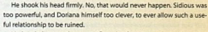
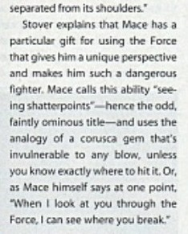
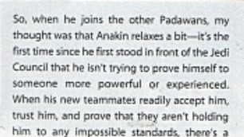

# Owner Material 038 — Star Wars Insider #1–153 plus specials (with The Lucasfilm Fan Club Magazine #1–22): Star Wars Insider #68 (2003)

- **Source:** *Star Wars Insider* magazine (issues 23–153, 1994–2014) and its predecessor *The Lucasfilm Fan Club Magazine* (issues 1–22, 1987–1994), plus seven special editions: articles, interviews, comics and short fiction Secondary source (licensed Legends reference). Scan OCR'd on the box; the scan stays box-only and is **not** published.
- **Method:** every scanned page was OCR'd and machine-screened sentence by sentence for power-relevant statements (fights, kills, defeats, Force feats, rankings, superweapons) that name a character on our roster; each kept sentence is quoted verbatim from the OCR text and has a crop of the printed passage directly under it. Pages with nothing power-relevant are still listed with what is on them.
- **Citation:** "*Star Wars Insider #68* (2003), p.X" by printed page ("scan p.X" where no printed number applies). **Weight:** Licensed magazine: a secondary source. Its short fiction and comics are Legends stories; its articles and interviews sum up or discuss lore and rank below the novels, comics and games they describe.

## scan p.1 (scan page 1)

Page contents: Cover: Clone Wars issue; Genndy Tartakovsky, Carrie Fisher, Timothy Zahn Clone Wars story, Star Wars tattoos. (hand-read)

## scan p.2 (scan page 2)

Page contents: Contents: features and departments. (hand-read)

## scan p.3 (scan page 3)

Page contents: Contents continued; art editor's column on the use of color. (hand-read)

## scan p.4 (scan page 4)

Page contents: Masthead and Rebel Rumblings letters (letter-writer names omitted). (hand-read)

## scan p.5 (scan page 5)

Page contents: Advertisement: Gen Con Indy. (hand-read)

## scan p.6 (scan page 6)

Page contents: Prequel Update: Rick McCallum on Episode III production. (hand-read)

## scan p.7 (scan page 7)

Page contents: Prequel Update continued. (hand-read)

## scan p.8 (scan page 8)

Page contents: Star News: ILM/Skywalker Sound tribute and cast news. (hand-read)

## scan p.9 (scan page 9)

Page contents: Star News: model-making and cast news. (hand-read)

## scan p.10 (scan page 10)

Page contents: Star News: Hasbro exclusive and event news. (hand-read)

## scan p.11 (scan page 11)

Page contents: Advertisement: Star Wars Trading Card Game. (hand-read)

## scan p.12 (scan page 12)

Page contents: Star News continued: pic-fil animatics used to choreograph Yoda's duel with Count Dooku. (hand-read)

## scan p.13 (scan page 13)

Page contents: Advertisement: Star Wars Trading Card Game. (hand-read)

## scan p.14 (scan page 14)

Page contents: Feature opener: "Cartoon Guru" by Eric Moro, photo of Genndy Tartakovsky with Cartoon Network characters (no text). (hand-read)

## scan p.15 (scan page 15)

Page contents: Feature opener: Director Genndy Tartakovsky brings Clone Wars to the small screen; concept art of Ventress, Obi-Wan, Anakin and Yoda. (hand-read)

## scan p.16 (scan page 16)

Page contents: Feature art: Samurai Jack and Powerpuff Girls illustration (no text). (hand-read)

## scan p.17 (scan page 17)

Page contents: Genndy Tartakovsky interview on the Clone Wars micro-series. (hand-read)

## scan p.18 (scan page 18)

Page contents: Tartakovsky interview continued. (hand-read)

## scan p.19 (scan page 19)

Page contents: Tartakovsky interview concluded. (hand-read)

## scan p.20 (scan page 20)

Page contents: Dan Gregoire on Episode III pre-visualization. (hand-read)

## scan p.21 (scan page 21)

Page contents: Pre-viz feature continued. (hand-read)

## scan p.22 (scan page 22)

Page contents: Pre-viz feature continued. (hand-read)

## scan p.23 (scan page 23)

Page contents: Pre-viz feature concluded. (hand-read)

## scan p.24 (scan page 24)

Page contents: Carrie Fisher interview opener. (hand-read)

## scan p.25 (scan page 25)

Page contents: Carrie Fisher interview continued. (hand-read)

## scan p.26 (scan page 26)

Page contents: Carrie Fisher interview continued. (hand-read)

## scan p.27 (scan page 27)

Page contents: Carrie Fisher interview continued. (hand-read)

## scan p.28 (scan page 28)

Page contents: Carrie Fisher interview continued. (hand-read)

## scan p.29 (scan page 29)

Page contents: Carrie Fisher interview concluded. (hand-read)

## scan p.30 (scan page 30)

Page contents: Star Wars poster art feature opener. (hand-read)

## scan p.31 (scan page 31)

Page contents: Poster art feature continued. (hand-read)

## scan p.32 (scan page 32)

Page contents: Poster art feature continued: international poster designs. (hand-read)

## scan p.33 (scan page 33)

Page contents: Poster art feature continued. (hand-read)

## scan p.34 (scan page 34)

Page contents: Poster art feature continued. (hand-read)

## scan p.35 (scan page 35)

Page contents: Poster art feature concluded. (hand-read)

## scan p.36 (scan page 36)

Page contents: David West Reynolds on writing the Cross-Sections and Visual Dictionary books. (hand-read)

## scan p.37 (scan page 37)

Page contents: Reynolds feature continued. (hand-read)

## scan p.38 (scan page 38)

Page contents: Reynolds feature continued. (hand-read)

## scan p.39 (scan page 39)

Page contents: Reynolds feature continued. (hand-read)

## scan p.40 (scan page 40)

Page contents: Reynolds feature continued. (hand-read)

## scan p.41 (scan page 41)

Page contents: Reynolds feature continued. (hand-read)

## scan p.42 (scan page 42)

Page contents: Reynolds feature continued. (hand-read)

## scan p.43 (scan page 43)

Page contents: Reynolds feature concluded: DK library, illustrators Chasemore and Jenssen, Curtis Saxton, Slave I anecdote with Doug Chiang. (hand-read)

## scan p.44 (scan page 44)

Page contents: Star Wars tattoos feature opener (wearer names omitted). (hand-read)

## scan p.45 (scan page 45)

Page contents: Tattoos feature continued. (hand-read)

## scan p.46 (scan page 46)

Page contents: Tattoos feature continued. (hand-read)

## scan p.47 (scan page 47)

Page contents: Tattoos feature continued. (hand-read)

## scan p.48 (scan page 48)

Page contents: Tattoos feature continued. (hand-read)

## scan p.49 (scan page 49)

Page contents: Tattoos feature concluded. (hand-read)

## scan p.50 (scan page 50)

Page contents: Timothy Zahn Clone Wars short story, set one year after Geonosis: Kinman Doriana on Cartao seeks Spaarti Creations' cloning cylinders. (hand-read)

## scan p.51 (scan page 51)

Page contents: Zahn story continued: Lord Binalie, his son Corf, Jedi Jafer Torles and Commander Roshton. (hand-read)

## scan p.52 (scan page 52)

Page contents: Zahn story continued. (hand-read)

## scan p.53 (scan page 53)

Page contents: Zahn story continued. (hand-read)

## scan p.54 (scan page 54)

Page contents: Zahn story continued. (hand-read)

## scan p.55 (scan page 55)

Page contents: Zahn story continued. (hand-read)

## scan p.56 (scan page 56)

Page contents: Zahn story continued: Doriana reflects on his service to Darth Sidious. (hand-read)

- **Palpatine (Darth Sidious); Kinman Doriana** — entry/section: Zahn Clone Wars story: Doriana on Sidious: "He shook his head firmly. No, that would never happen. Sidious was too powerful, and Doriana himself too clever, to ever allow such a useful relationship to be ruined." Source: *Star Wars Insider #68* (2003), scan p.56
  

## scan p.57 (scan page 57)

Page contents: Zahn story continued: Torles uses the Force to stop a stone and throws his lightsaber to down a STAP droid. (hand-read)

### Stat block notes (game mechanics, not feats)

- Zahn Clone Wars story: Jedi Jafer Torles: Torles reached out to the Force, and the stone stopped abruptly in midair. (Star Wars Insider 68, p. 57) (Source: *Star Wars Insider #68* (2003), scan p.57)
- Zahn Clone Wars story: Jedi Jafer Torles: Judging the droid's speed and distance as best he could, he stretched out to the Force and hurled his lightsaber toward it. The droid, its attention on the ground around the plant, probably never even saw it coming. The spinning weapon shot across its STAP, the brilliant green blade slicing through the power cell housing just above the footlocks. With a flat electronic exclamation of surprise, the droid and machine dropped out of the sky and thudded to the ground. (Star Wars Insider 68, p. 57) (Source: *Star Wars Insider #68* (2003), scan p.57)

## scan p.58 (scan page 58)

Page contents: Zahn story continued: Torles deflects blaster bolts and destroys three STAPs. (hand-read)

### Stat block notes (game mechanics, not feats)

- Zahn Clone Wars story: Jedi Jafer Torles: The lightsaber made it back to Torles' hand about half a second before the droids finally found the range. But for a Jedi, half a second was more than enough. The lightsaber blurred in his grip, twisting like a hunting makthier as it intercepted the blaster bolts and sent them bouncing back again. A pair of volleys later, there were three ruined STAPs and droids lying crumpled in the forbidden zone. (Star Wars Insider 68, p. 58) (Source: *Star Wars Insider #68* (2003), scan p.58)

## scan p.59 (scan page 59)

Page contents: Zahn story continued. (hand-read)

## scan p.60 (scan page 60)

Page contents: Zahn story continued: C-9979 landing ship attack; clone troopers destroy an MTT on the ramp. To be continued. (hand-read)

## scan p.61 (scan page 61)

Page contents: Advertisement: LEGO subscription. (hand-read)

## scan p.62 (scan page 62)

Page contents: Hasbro 2003 Clone Wars toy line. (hand-read)

## scan p.63 (scan page 63)

Page contents: Toy Talk Q&A. (hand-read)

## scan p.64 (scan page 64)

Page contents: ILM motion capture of clone troopers (Jeff Light, Sylvia Wong). (hand-read)

## scan p.65 (scan page 65)

Page contents: Motion capture feature continued. (hand-read)

## scan p.66 (scan page 66)

Page contents: Motion capture feature continued. (hand-read)

## scan p.67 (scan page 67)

Page contents: Motion capture feature concluded. (hand-read)

## scan p.68 (scan page 68)

Page contents: HoloNet News: war on Jabiim, Kuat-Neimoidia arms race, cloning decree. (hand-read)

## scan p.69 (scan page 69)

Page contents: HoloNet News continued; Wat Tambor quoted. (hand-read)

## scan p.70 (scan page 70)

Page contents: Roleplaying Game: Hero's Guide. (hand-read)

## scan p.71 (scan page 71)

Page contents: Hero's Guide continued. (hand-read)

## scan p.72 (scan page 72)

Page contents: Star Wars Galaxies: Bestine. (hand-read)

## scan p.73 (scan page 73)

Page contents: Galaxies feature continued. (hand-read)

## scan p.74 (scan page 74)

Page contents: Matthew Stover's Shatterpoint: Mace Windu's shatterpoint gift and Depa Billaba. (hand-read)

- **Mace Windu** — entry/section: Shatterpoint preview: ""When I look at you through the Force, I can see where you break." —Mace Windu, Star Wars Insider 68, p. 74" Source: *Star Wars Insider #68* (2003), scan p.74
  

### Stat block notes (game mechanics, not feats)

- Shatterpoint preview: Mace's shatterpoint gift: Stover explains that Mace has a particular gift for using the Force that gives him a unique perspective and makes him such a dangerous fighter. Mace calls this ability "seeing shatterpoints"—hence the odd, faintly ominous title—and uses the analogy of a corusca gem that's invulnerable to any blow, unless you know exactly where to hit it. Or, as Mace himself says at one point, "When I look at you through the Force, I can see where you break." (Star Wars Insider 68, p. 74) (Source: *Star Wars Insider #68* (2003), scan p.74)
- Shatterpoint preview: Depa Billaba and Vaapad: She's the only other living Jedi Master who practices Vaapad, Mace's lightsaber style—which can bring a Jedi perilously close to the dark side of the Force. That, he says, makes her "exceedingly dangerous in every conceivable way." (Star Wars Insider 68, p. 74) (Source: *Star Wars Insider #68* (2003), scan p.74)

## scan p.75 (scan page 75)

Page contents: Shatterpoint feature continued. (hand-read)

## scan p.76 (scan page 76)

Page contents: Republic comics "Battle of Jabiim" (Haden Blackman, Brian Ching). (hand-read)

### Stat block notes (game mechanics, not feats)

- Republic "Battle of Jabiim": Anakin's power: "Initially, we asserted that Anakin might be controlling when he joins the group, that he would swoop in and take control because he's so powerful and driven," says Blackman. (Star Wars Insider 68, p. 76) (Source: *Star Wars Insider #68* (2003), scan p.76)

## scan p.77 (scan page 77)

Page contents: Republic comics feature continued: Anakin among the Padawans. (hand-read)

- **Darth Vader (Anakin Skywalker)** — entry/section: Republic "Battle of Jabiim": Haden Blackman on Anakin: "So, when he joins the other Padawans, my thought was that Anakin relaxes a bit—it's the first time since he first stood in front of the Jedi Council that he isn't trying to prove himself to someone more powerful or experienced." Source: *Star Wars Insider #68* (2003), scan p.77
  

## scan p.78 (scan page 78)

Page contents: History of the Shepperton Millennium Falcon set. (hand-read)

## scan p.79 (scan page 79)

Page contents: Props: Chewbacca's bowcaster and Han's blaster. (hand-read)

## scan p.80 (scan page 80)

Page contents: Scouting the Galaxy (Steve Sansweet; letter-writer names omitted). (hand-read)

## scan p.81 (scan page 81)

Page contents: Scouting the Galaxy continued. (hand-read)

## scan p.82 (scan page 82)

Page contents: Scouting the Galaxy concluded. (hand-read)

## scan p.83 (scan page 83)

Page contents: Back issues. (hand-read)

## scan p.84 (scan page 84)

Page contents: Crossword. (hand-read)

## scan p.85 (scan page 85)

Page contents: Rebel Rumblings continued (names omitted). (hand-read)

## scan p.86 (scan page 86)

Page contents: Rebel Rumblings continued (names omitted). (hand-read)

## scan p.87 (scan page 87)

Page contents: Reader poetry (names omitted). (hand-read)

## scan p.88 (scan page 88)

Page contents: Ask the Jedi trivia: Victory Star Destroyer, origin of Jabba's rancor. (hand-read)

## scan p.89 (scan page 89)

Page contents: Ask the Jedi continued: clone trooper colors, Mas Amedda. (hand-read)

## scan p.90 (scan page 90)

Page contents: Illustration: Anakin painting a Darth Vader portrait. (hand-read)

## scan p.91 (scan page 91)

Page contents: Advertisement: Master Replicas ("This party's over."). (hand-read)

## scan p.92 (scan page 92)

Page contents: Advertisement: Shatterpoint. (hand-read)

