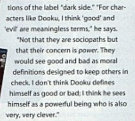

# Owner Material 038 — Star Wars Insider #1–153 plus specials (with The Lucasfilm Fan Club Magazine #1–22): Star Wars Insider #69 (2003)

- **Source:** *Star Wars Insider* magazine (issues 23–153, 1994–2014) and its predecessor *The Lucasfilm Fan Club Magazine* (issues 1–22, 1987–1994), plus seven special editions: articles, interviews, comics and short fiction Secondary source (licensed Legends reference). Scan OCR'd on the box; the scan stays box-only and is **not** published.
- **Method:** every scanned page was OCR'd and machine-screened sentence by sentence for power-relevant statements (fights, kills, defeats, Force feats, rankings, superweapons) that name a character on our roster; each kept sentence is quoted verbatim from the OCR text and has a crop of the printed passage directly under it. Pages with nothing power-relevant are still listed with what is on them.
- **Citation:** "*Star Wars Insider #69* (2003), p.X" by printed page ("scan p.X" where no printed number applies). **Weight:** Licensed magazine: a secondary source. Its short fiction and comics are Legends stories; its articles and interviews sum up or discuss lore and rank below the novels, comics and games they describe.

## scan p.1 (scan page 1)

Page contents: Cover: Star Wars Insider 69; Clone Wars animation (Paul Rudish), American Graffiti 30th anniversary, Timothy Zahn Clone Wars story concluded part, Star Wars music. (hand-read)

## scan p.2 (scan page 2)

Page contents: Contents: features and departments. (hand-read)

## scan p.3 (scan page 3)

Page contents: Contents continued; Fan Club president's one-year editorial. (hand-read)

## scan p.4 (scan page 4)

Page contents: Masthead; Rebel Rumblings letters begin (reader names omitted). (hand-read)

## scan p.5 (scan page 5)

Page contents: LEGO Star Wars subscription ad. (hand-read)

## scan p.6 (scan page 6)

Page contents: Prequel Update by Rick McCallum: Episode III pre-production progress. (hand-read)

## scan p.7 (scan page 7)

Page contents: Prequel Update continued. (hand-read)

## scan p.8 (scan page 8)

Page contents: Indiana Jones DVD trilogy news. (hand-read)

## scan p.9 (scan page 9)

Page contents: Star News: Hyperspace online fan club service announced. (hand-read)

## scan p.10 (scan page 10)

Page contents: Star News: Hyperspace online service continued; Peter Mayhew news. (hand-read)

## scan p.11 (scan page 11)

Page contents: Star News continued: Peter Mayhew's Chewbacca return; Saga of Seven Suns item. (hand-read)

## scan p.12 (scan page 12)

Page contents: Star News: E3 reveal of Rebel Strike; Creation convention news. (hand-read)

## scan p.13 (scan page 13)

Page contents: Star News: Code 3 Millennium Falcon collectible, Republic Commando game, Sony HDC-F950 HD camera. (hand-read)

## scan p.14 (scan page 14)

Page contents: Paul Rudish interview begins: Clone Wars micro-series art direction. (hand-read)

## scan p.15 (scan page 15)

Page contents: Rudish interview: design approach to the characters. (hand-read)

## scan p.16 (scan page 16)

Page contents: Rudish interview continued. (hand-read)

## scan p.17 (scan page 17)

Page contents: Rudish interview continued: character models. (hand-read)

## scan p.18 (scan page 18)

Page contents: Rudish interview continued. (hand-read)

## scan p.19 (scan page 19)

Page contents: Rudish interview: designing Durge and other new characters; Durge's healing powers and alien physiology. (hand-read)

### Stat block notes (game mechanics, not feats)

- Paul Rudish interview: designing Durge: Durge, we're honing in on his alien physique. He's supposed to have these crazy healing powers and weird, obscured alien physiology, so we latched onto that. (Star Wars Insider 69, p. 19) (Source: *Star Wars Insider #69* (2003), scan p.19)

## scan p.20 (scan page 20)

Page contents: Rudish interview continued. (hand-read)

## scan p.21 (scan page 21)

Page contents: Rudish interview concluded. (hand-read)

## scan p.22 (scan page 22)

Page contents: Clone Wars Timeline: events between Episodes II and III. (hand-read)

## scan p.23 (scan page 23)

Page contents: Clone Wars Timeline continued. (hand-read)

## scan p.24 (scan page 24)

Page contents: Gavin Bocquet production designer profile begins. (hand-read)

## scan p.25 (scan page 25)

Page contents: Bocquet profile continued. (hand-read)

## scan p.26 (scan page 26)

Page contents: Bocquet profile continued: set designs. (hand-read)

## scan p.27 (scan page 27)

Page contents: Bocquet profile continued. (hand-read)

## scan p.28 (scan page 28)

Page contents: Bocquet profile continued. (hand-read)

## scan p.29 (scan page 29)

Page contents: Bocquet profile concluded. (hand-read)

## scan p.30 (scan page 30)

Page contents: American Graffiti 30th anniversary feature begins. (hand-read)

## scan p.31 (scan page 31)

Page contents: American Graffiti feature continued. (hand-read)

## scan p.32 (scan page 32)

Page contents: American Graffiti feature continued. (hand-read)

## scan p.33 (scan page 33)

Page contents: American Graffiti feature continued. (hand-read)

## scan p.34 (scan page 34)

Page contents: American Graffiti feature: plot recap and soundtrack review. (hand-read)

## scan p.35 (scan page 35)

Page contents: American Graffiti feature continued. (hand-read)

## scan p.36 (scan page 36)

Page contents: American Graffiti feature continued. (hand-read)

## scan p.37 (scan page 37)

Page contents: American Graffiti feature: how the soundtrack comments on the on-screen action. (hand-read)

## scan p.38 (scan page 38)

Page contents: American Graffiti feature: Wolfman Jack and the soundtrack; sidebar on 1962 science fiction. (hand-read)

## scan p.39 (scan page 39)

Page contents: American Graffiti feature concluded. (hand-read)

## scan p.40 (scan page 40)

Page contents: Skyrockers: Star Wars-inspired music feature begins, Weird Al Yankovic. (hand-read)

## scan p.41 (scan page 41)

Page contents: Skyrockers: Weird Al on "The Saga Begins" video and other Star Wars parodies. (hand-read)

## scan p.42 (scan page 42)

Page contents: Skyrockers: indie band Dianogah; sidebar on Star Wars song resources. (hand-read)

## scan p.43 (scan page 43)

Page contents: Skyrockers concluded: Dianogah on John Williams; other Star Wars-influenced musicians. (hand-read)

## scan p.44 (scan page 44)

Page contents: Timothy Zahn Clone Wars story title art (Hunger for Power continued). (hand-read)

## scan p.45 (scan page 45)

Page contents: Zahn story: Doriana reports to Palpatine on the D-90 droid project and Spaarti Creations. (hand-read)

## scan p.46 (scan page 46)

Page contents: Zahn story: Doriana reports to Sidious; Neimoidians land at the Binalie mansion; Torles with Binalie. (hand-read)

## scan p.47 (scan page 47)

Page contents: Zahn story: Ashel and Gehad take Corf hostage; Torles goes along as "tutor". (hand-read)

## scan p.48 (scan page 48)

Page contents: Zahn story: Roshton's land mines; Torles destroys two assault droids with his lightsaber. (hand-read)

### Stat block notes (game mechanics, not feats)

- Zahn Clone Wars story: Jedi Jafer Torles: And in a single smooth motion, Torles reached beneath his robe, pulled out his lightsaber, and ignited it. Gehad gave a little deep-throated scream, letting go of Corf's arm as if he'd been burned and scuttling away from him. Torles gave the boy a quick shove back through the doorway as he slashed the lightsaber across the upper chest of the droid to his left. The brilliant green blade sliced through the thick acertron armor like it was wrapping plastoid, and the top third of the droid slid off and fell with a crash onto the ground. (Star Wars Insider 69, p. 48) (Source: *Star Wars Insider #69* (2003), scan p.48)
- Zahn Clone Wars story: Jedi Jafer Torles: Torles swiveled to his right to meet it, swinging his lightsaber around and down across the raised forearms above the mounted blasters and dropping them onto the ground. His second cut took off the droid's legs; even before the pieces clattered to the ground, he leaped backward through the doorway into the mansion. (Star Wars Insider 69, p. 48) (Source: *Star Wars Insider #69* (2003), scan p.48)

## scan p.49 (scan page 49)

Page contents: Zahn story: Doriana watches the aftermath; C-9979 reinforcements land; council in the safe room. (hand-read)

### Stat block notes (game mechanics, not feats)

- Zahn Clone Wars story: Doriana on Jafer Torles: "Probably not," Doriana agreed, his eyes still on the remains of the D-60s that had taken Torles maybe half a second to turn to scrap. He'd been around Jedi much of his life, but never before had he actually witnessed one in full combat mode. And for the first time he began to truly see why Sidious wanted them eliminated. (Star Wars Insider 69, p. 49) (Source: *Star Wars Insider #69* (2003), scan p.49)

## scan p.50 (scan page 50)

Page contents: Zahn story: General Tiis's gunships; Torles's plan; Torles clears the mansion of droids. (hand-read)

### Stat block notes (game mechanics, not feats)

- Zahn Clone Wars story: Jedi Jafer Torles: All he knew was that there were eight of them between the three humans and the outside door. Torles dealt with all eight swiftly, efficiently, and amazingly quietly. There were a few others on patrol outside, strutting around in the gathering dusk as if they owned the place. The Jedi dealt with those, too. (Star Wars Insider 69, p. 50) (Source: *Star Wars Insider #69* (2003), scan p.50)

## scan p.51 (scan page 51)

Page contents: Zahn story: staging area; Torles leads the charge on the plant's east door. (hand-read)

## scan p.52 (scan page 52)

Page contents: Zahn story: Torles's Force-speed run, wall climb, and capture of Ashel; six droids felled by their own deflected fire. (hand-read)

### Stat block notes (game mechanics, not feats)

- Zahn Clone Wars story: Jedi Jafer Torles: Jedi were capable of incredible bursts of speed when necessary, at least over short distances. Torles used every bit of that capability, his legs pumping in a blur against the ground as he slipped around the end of the picket line now beginning to close into a semicircle around the beleaguered clone troopers. A pair of droid stragglers suddenly loomed in front of him in the darkness and then collapsed into broken rubble as he used the Force to shove them backward. (Star Wars Insider 69, p. 52) (Source: *Star Wars Insider #69* (2003), scan p.52)
- Zahn Clone Wars story: Jedi Jafer Torles: Torles took a long step away from Ashel and the others, igniting his lightsaber and whipping it against the incoming blaster bolts. Two seconds later, all six droids lay shattered and smoking, destroyed by their own backscattered fire. (Star Wars Insider 69, p. 52) (Source: *Star Wars Insider #69* (2003), scan p.52)

## scan p.53 (scan page 53)

Page contents: Zahn story: control ship destroyed but a backup matrix revives the droid army; Roshton's troops trapped in Spaarti (to be concluded). (hand-read)

## scan p.54 (scan page 54)

Page contents: HoloNet News: Separatists attack Shelter Base on Jabiim; Squibs honor Mace Windu for liberating Metrobig Blastport on Skor II. (hand-read)

### Stat block notes (game mechanics, not feats)

- HoloNet News: Squibs honor Mace Windu: Windu led a contingent of clone troopers in liberating the Metrobig Interplanetary Blastport from an occupational force of Confederacy battle droid infantry. The Separatists had planned on using Skor II as a launch-point for an operation that would have littered the outer Rimma Trade Route with proximity mines. (Star Wars Insider 69, p. 54) (Source: *Star Wars Insider #69* (2003), scan p.54)

## scan p.55 (scan page 55)

Page contents: HoloNet News: Alto Stratus bootleg holos and speech excerpt; friendly fire destroys Sluis sector peace envoy. (hand-read)

## scan p.56 (scan page 56)

Page contents: Behind the Magic: animating the Separatist council of Attack of the Clones; Shu Mai. (hand-read)

## scan p.57 (scan page 57)

Page contents: Behind the Magic: Shu Mai animation; Wat Tambor modeling begins. (hand-read)

## scan p.58 (scan page 58)

Page contents: Behind the Magic: Wat Tambor (droid foundries) and San Hill. (hand-read)

### Stat block notes (game mechanics, not feats)

- Behind the Magic: Wat Tambor: We did know from discussions with Lucas that Tambor was responsible for the droid foundries, crucial to Dooku's power plan. (Star Wars Insider 69, p. 58) (Source: *Star Wars Insider #69* (2003), scan p.58)

## scan p.59 (scan page 59)

Page contents: Behind the Magic concluded: San Hill, Toonbuck Toora's digital head, other council members. (hand-read)

## scan p.60 (scan page 60)

Page contents: Hasbro: Fans' Choice McQuarrie Stormtrooper figure. (hand-read)

## scan p.61 (scan page 61)

Page contents: Hasbro: McQuarrie Stormtrooper figure development process. (hand-read)

## scan p.62 (scan page 62)

Page contents: Star Wars TCG: Jedi Guardians expansion preview begins. (hand-read)

## scan p.63 (scan page 63)

Page contents: Jedi Guardians: Reserves and Overkill abilities; Jedi Council cards; Yoda the most expensive Character unit. (hand-read)

### Stat block notes (game mechanics, not feats)

- Jedi Guardians TCG: Yoda: Yoda, at 13 build points, now holds the title for the most expensive Character unit in the game and proves why no one can rival him as a swordsman. For 8 Force he can untap and attack again with his 8 power. (Star Wars Insider 69, p. 63) (Source: *Star Wars Insider #69* (2003), scan p.63)

## scan p.64 (scan page 64)

Page contents: Star Wars Galaxies update: Naboo beta begins. (hand-read)

## scan p.65 (scan page 65)

Page contents: Star Wars Galaxies: Gungans, reputation system, Naboo's new history, Emperor's Retreat. (hand-read)

## scan p.66 (scan page 66)

Page contents: Legacy of the Jedi (Jude Watson) preview begins. (hand-read)

## scan p.67 (scan page 67)

Page contents: Legacy of the Jedi: Dooku, Qui-Gon, Lorian Nod; four generations of Masters and Padawans. (hand-read)

## scan p.68 (scan page 68)

Page contents: Jedi: Count Dooku comic preview begins (Ostrander, Duursema). (hand-read)

## scan p.69 (scan page 69)

Page contents: Jedi: Count Dooku preview concluded: Dooku as a villain who sees himself as powerful and clever. (hand-read)

- **Count Dooku** — entry/section: Jedi: Count Dooku comic: John Ostrander on Dooku: "For characters like Dooku, I think 'good' and 'evil' are meaningless terms. Not that they are sociopaths but that their concern is power. They would see good and bad as moral definitions designed to keep others in check. I don't think Dooku defines himself as good or bad; I think he sees himself as a powerful being who is also very, very clever." Source: *Star Wars Insider #69* (2003), scan p.69
  

## scan p.70 (scan page 70)

Page contents: Stuck in a Hairy Situation: the wampa on Empire Strikes Back. (hand-read)

## scan p.71 (scan page 71)

Page contents: Wampa behind-the-scenes photos and captions. (hand-read)

## scan p.72 (scan page 72)

Page contents: Scouting the Galaxy collectibles column: Boba Fett collection showdown (reader names omitted). (hand-read)

## scan p.73 (scan page 73)

Page contents: Scouting the Galaxy: fake movie posters, lightsaber repair, Power Lunchbox. (hand-read)

## scan p.74 (scan page 74)

Page contents: Scouting the Galaxy: pyramid shapes in the galaxy far, far away; Jek Porkins CommTech chip figure. (hand-read)

## scan p.75 (scan page 75)

Page contents: Back issue order form. (hand-read)

## scan p.76 (scan page 76)

Page contents: Crossword puzzle. (hand-read)

## scan p.77 (scan page 77)

Page contents: Rebel Rumblings continued (reader names omitted). (hand-read)

## scan p.78 (scan page 78)

Page contents: Rebel Rumblings continued. (hand-read)

## scan p.79 (scan page 79)

Page contents: Rebel Rumblings continued; puzzle answers. (hand-read)

## scan p.80 (scan page 80)

Page contents: Q&A: dragonsnake, space slug, super battle droids, Dooku vs. Maul. (hand-read)

### Stat block notes (game mechanics, not feats)

- Q&A: Dooku vs. Maul: At the risk of getting a slew of Maul-loving mail, the short answer is that Count Dooku is more skillful than Maul. Think of Maul as a bulldog of a Jedi-killer. He attacks at full speed, full tilt, holding nothing back. That approach has its merits, but it doesn't always apply. Dooku was much more restrained and sophisticated, and he had a much better grasp of Jedi techniques and tactics. Maul was an impressive flurry of fury, barely giving his opponent time to think. Dooku, on the other hand, countered Kenobi's moves almost effortlessly because he knew precisely where to block. This left Dooku with the energy to deliver the surprise blows when his opponent dropped his guard. (Star Wars Insider 69, p. 80) (Source: *Star Wars Insider #69* (2003), scan p.80)

## scan p.81 (scan page 81)

Page contents: Q&A continued: R3-T7, Obi-Wan's message relay, galaxy map, Luke and Mara's marriage. (hand-read)

## scan p.82 (scan page 82)

Page contents: Full-page ad (image only). (hand-read)

## scan p.83 (scan page 83)

Page contents: Star Wars checks ad. (hand-read)

## scan p.84 (scan page 84)

Page contents: Art prints ad. (hand-read)

