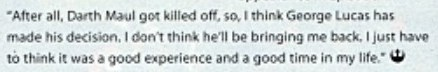
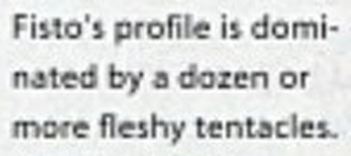
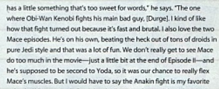
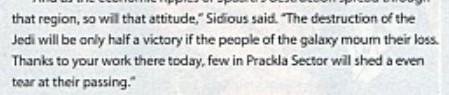
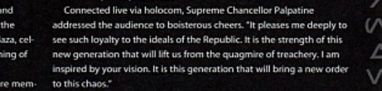
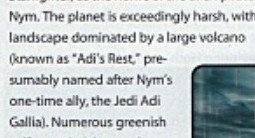

# Owner Material 038 — Star Wars Insider #1–153 plus specials (with The Lucasfilm Fan Club Magazine #1–22): Star Wars Insider #70 (2003)

- **Source:** *Star Wars Insider* magazine (issues 23–153, 1994–2014) and its predecessor *The Lucasfilm Fan Club Magazine* (issues 1–22, 1987–1994), plus seven special editions: articles, interviews, comics and short fiction Secondary source (licensed Legends reference). Scan OCR'd on the box; the scan stays box-only and is **not** published.
- **Method:** every scanned page was OCR'd and machine-screened sentence by sentence for power-relevant statements (fights, kills, defeats, Force feats, rankings, superweapons) that name a character on our roster; each kept sentence is quoted verbatim from the OCR text and has a crop of the printed passage directly under it. Pages with nothing power-relevant are still listed with what is on them.
- **Citation:** "*Star Wars Insider #70* (2003), p.X" by printed page ("scan p.X" where no printed number applies). **Weight:** Licensed magazine: a secondary source. Its short fiction and comics are Legends stories; its articles and interviews sum up or discuss lore and rank below the novels, comics and games they describe.

## scan p.1 (scan page 1)

Page contents: Cover: Star Wars Insider 70; Darth Maul (Ray Park face off), aliens of Episode II, Clone Wars day at Cartoon Network, makeup genius Stuart Freeborn, Timothy Zahn's Hero of Cartao, Star Wars Galaxies launch, best of Hyperspace. (hand-read)

## scan p.2 (scan page 2)

Page contents: Contents: Ray Park interview, Rick McCallum report, Alienation, Stuart Freeborn, Clone Wars field report and departments. (hand-read)

## scan p.3 (scan page 3)

Page contents: Editorial on the editor's top-ten alien species. (hand-read)

## scan p.4 (scan page 4)

Page contents: Rebel Rumblings letters begin and masthead (staff and letter-writer names omitted). (hand-read)

## scan p.5 (scan page 5)

Page contents: Ad: Jedi Guardians trading card game ("Never Outnumbered"). (hand-read)

## scan p.6 (scan page 6)

Page contents: Rick McCallum's production report on the last days before Episode III shooting: schedule and preparation. (hand-read)

## scan p.7 (scan page 7)

Page contents: McCallum report continued: Jimmy Smits's expanded role, Jar Jar "very small", 62 sets and some 300 extras. (hand-read)

## scan p.8 (scan page 8)

Page contents: Star Wars Weekends at Disney-MGM Studios: history of the event since 2000 and its 2003 return with five weekends. (hand-read)

## scan p.9 (scan page 9)

Page contents: Star Wars Weekends continued: Hasbro's Jedi Training Academy, the Padawan Mind Challenge, Tatooine Trivia Trials and a making-of documentary screening. (hand-read)

## scan p.10 (scan page 10)

Page contents: Star Wars Weekends Fan Club breakfast with Jeremy Bulloch and Peter Mayhew and new Hasbro figures (fan names omitted); Star News celebrity column. (hand-read)

## scan p.11 (scan page 11)

Page contents: Hasbro/Disney Star Wars Weekends sweepstakes story (winner name omitted); Star News items incl. Ewan McGregor charity T-shirts. (hand-read)

## scan p.12 (scan page 12)

Page contents: Ray Park interview opens: Maul, Headless Horseman and Toad roles; born 1974 in Glasgow, moved to London; Bruce Lee fandom. (hand-read)

## scan p.13 (scan page 13)

Page contents: Ray Park interview: martial-arts training from age seven (Northern Shaolin Kung Fu, Wushu, kickboxing), national championship at 16, his accent. (hand-read)

## scan p.14 (scan page 14)

Page contents: Ray Park interview: attacked by a knife-wielding gang at 18; stunt work on Mortal Kombat 2: Annihilation. (hand-read)

## scan p.15 (scan page 15)

Page contents: Ray Park interview: week-long rehearsal for the Maul audition fight, McCallum's call, memories of the Phantom Menace shoot. (hand-read)

## scan p.16 (scan page 16)

Page contents: Ray Park interview: first speaking role as Toad in X-Men (2000) and being given a stunt double; Sleepy Hollow and Ballistic. (hand-read)

## scan p.17 (scan page 17)

Page contents: Ray Park interview ends: Iron Fist; Park says Maul was killed off and he doesn't expect to return. (hand-read)

- **Darth Maul** — entry/section: Ray Park on Maul being killed off: ""After all, Darth Maul got killed off, so, I think George Lucas has made his decision. I don't think he'll be bringing me back. I just have to think it was a good experience and a good time in my life." —Ray Park, Star Wars Insider 70, p. 17" Source: *Star Wars Insider #70* (2003), scan p.17
  

## scan p.18 (scan page 18)

Page contents: Hyperspace launch and a McCallum online chat (fan usernames omitted). (hand-read)

## scan p.19 (scan page 19)

Page contents: Production notes: Nick Gillard's Jedi duel rehearsals with Hayden Christensen and sparring partner Michael Byrne; a quick no-frills test shoot; Mon Mothma casting. (hand-read)

## scan p.20 (scan page 20)

Page contents: Alienation feature on Attack of the Clones aliens opens. (hand-read)

## scan p.21 (scan page 21)

Page contents: Alienation: Kaminoans (Rena Owen as Taun We; Lucas on Close Encounters). (hand-read)

## scan p.22 (scan page 22)

Page contents: Alienation: Kaminoans continued (Anthony Phelan as Lama Su). (hand-read)

## scan p.23 (scan page 23)

Page contents: Alienation: Geonosians (termite inspiration; Ben Burtt's clicks for Poggle). (hand-read)

## scan p.24 (scan page 24)

Page contents: Alienation: Zam Wesell and the Clawdites; Dexter Jettster and the Besalisks. (hand-read)

## scan p.25 (scan page 25)

Page contents: Alienation: Kit Fisto and the Nautolans. (hand-read)

- **Kit Fisto**: "Fisto's profile is dominated by a dozen or more fleshy tentacles." Source: *Star Wars Insider #70* (2003), scan p.25
  

## scan p.26 (scan page 26)

Page contents: Alienation: Sly Moore and the Umbarans; Elan Sleazebaggano and the Balosars. (hand-read)

## scan p.27 (scan page 27)

Page contents: Alienation: Shu Mai and the Gossams. (hand-read)

## scan p.28 (scan page 28)

Page contents: Alienation: Shaak Ti and the Togruta (Ashla youngling). (hand-read)

## scan p.29 (scan page 29)

Page contents: Alienation: Wat Tambor and the Skakoans (pressure suit, feedback squeal). (hand-read)

## scan p.30 (scan page 30)

Page contents: Clone Wars Field Report title spread (left), notebook-style art: photos of Genndy Tartakovsky, Paul Rudish, Scott Wills and Bryan Andrews with sketched figures holding lightsabers. (hand-read)

## scan p.31 (scan page 31)

Page contents: Clone Wars Field Report title spread (right): 'A Day Inside the Star Wars Animated Production'; intro on the four studios, two continents and the 20-episode series debuting in November. (hand-read)

## scan p.32 (scan page 32)

Page contents: Clone Wars field report: visit to Cartoon Network headquarters in Burbank; André Sogliuzzo records battle-droid lines. (hand-read)

## scan p.33 (scan page 33)

Page contents: Clone Wars field report: Sogliuzzo voices Captain Typho and Grey DeLisle voices Padmé; DeLisle on matching an existing character. (hand-read)

## scan p.34 (scan page 34)

Page contents: Clone Wars field report: Sogliuzzo on adding passion to Typho; co-art director Scott Wills's office and his job designing environments, backgrounds and lighting. (hand-read)

## scan p.35 (scan page 35)

Page contents: Clone Wars field report: Wills on lack of time, simplifying the Star Wars look for TV, and stylized color schemes. (hand-read)

## scan p.36 (scan page 36)

Page contents: Clone Wars field report: Tartakovsky on choosing 2-D or 3-D; Rough Draft compositing 3-D over 2-D backgrounds; storyboarding begins. (hand-read)

## scan p.37 (scan page 37)

Page contents: Clone Wars field report ends: Bryan Andrews's storyboard process, Jedi blur-running as a combat tactic, and his favorite episodes (Obi-Wan vs. Durge, the two Mace episodes). (hand-read)

- **Mace Windu; Obi-Wan Kenobi; Durge** — entry/section: Clone Wars field report: Bryan Andrews on the Durge and Mace episodes: ""The one where Obi-Wan Kenobi fights his main bad guy, [Durge]. I kind of like how that fight turned out because it's fast and brutal. I also love the two Mace episodes. He's on his own, beating the heck out of tons of droids in pure Jedi style and that was a lot of fun. We don't really get to see Mace do too much in the movie—just a little bit at the end of Episode II—and he's supposed to be second to Yoda, so it was our chance to really flex Mace's muscles." —Bryan Andrews, Star Wars Insider 70, p. 37" Source: *Star Wars Insider #70* (2003), scan p.37
  

## scan p.38 (scan page 38)

Page contents: Stuart Freeborn profile opens: makeup for 2001's apes. (hand-read)

## scan p.39 (scan page 39)

Page contents: Freeborn profile: Chewbacca and finding Peter Mayhew. (hand-read)

## scan p.40 (scan page 40)

Page contents: Freeborn profile: Yoda modeled partly on Einstein, the thimble-shaped frown. (hand-read)

## scan p.41 (scan page 41)

Page contents: Freeborn profile ends: Jabba the Hutt with Kenny Baker in the tail. (hand-read)

## scan p.42 (scan page 42)

Page contents: Title art for Timothy Zahn's Hero of Cartao concluding part ("Hero's End"): Jedi with lightsaber against a battle tank. (hand-read)

## scan p.43 (scan page 43)

Page contents: Zahn story: Doriana searches the war-torn streets of Foulahn City, takes a datacard from a dead clone lieutenant and is stopped by a droid patrol. (hand-read)

## scan p.44 (scan page 44)

Page contents: Zahn story: Doriana freezes the patrol with Sidious's backdoor lockout code; Torles finds him; Binalie and Corf hide in the estate greenhouse. (hand-read)

## scan p.45 (scan page 45)

Page contents: Zahn story: Doriana's contingency deployment datacard; Torles and Binalie find Lieutenant Laytron's surviving clone force at the hydroelectric plant. (hand-read)

## scan p.46 (scan page 46)

Page contents: Zahn story: plan to rescue Roshton's people through the unmapped Outlink Four tunnel while Laytron stages a diversion against the droid control ship. (hand-read)

## scan p.47 (scan page 47)

Page contents: Zahn story: Torles cuts into the plant from the tunnel; Roshton's troops come through but he says nothing about cover to the west. (hand-read)

### Stat block notes (game mechanics, not feats)

- Zahn Clone Wars story: Jedi Jafer Torles: A minute later had carved a man-sized rectangle. Closing down the lightsaber, he stretched out with the Force and deftly pulled away the half-meter-thick section of wall. (Star Wars Insider 70, p. 47) (Source: *Star Wars Insider #70* (2003), scan p.47)

## scan p.48 (scan page 48)

Page contents: Zahn story: Laytron's landspeeder diversion and hilltop ambush; Binalie realizes Roshton never meant to bring the techs out. (hand-read)

## scan p.49 (scan page 49)

Page contents: Zahn story: Roshton attacks the landing ship; Torles disables two AAT tanks and a droideka. (hand-read)

### Stat block notes (game mechanics, not feats)

- Zahn Clone Wars story: Jedi Jafer Torles: He reached the nearest AAT and jumped up onto the front. Positioning himself in front of the air intake where he was out of reach of both defensive blasters, he stabbed his lightsaber downward through the heavy armor into the forward repulsor disk. The vehicle pitched forward, its nose slamming into the ground like a quadruped that had had both front legs kicked out from under it. Torles leaped straight up as it dug itself half a meter into the dirt, landing just in front of the top hatch, and with three quick slashes sliced off the primary laser cannon and the two side-mounted secondary laser guns. (Star Wars Insider 70, p. 49) (Source: *Star Wars Insider #70* (2003), scan p.49)
- Zahn Clone Wars story: Jedi Jafer Torles: A droideka appeared from around the landing ramp, bouncing a little as it rolled across the uneven ground. Stretching out to the Force, Torles lifted one of the two secondary laser guns he'd cut off the first AAT and sent it flying into the center of the wheel shape. There was a screech of stressed metal, and the droideka came to an abrupt halt. For another second it held position, its micro-repulsors fighting to keep it balanced. Then, something inside it failed, and it toppled ignominiously over onto its side. (Star Wars Insider 70, p. 49) (Source: *Star Wars Insider #70* (2003), scan p.49)

## scan p.50 (scan page 50)

Page contents: Zahn story: a "Jedi" assault transport fires on and crashes into the plant, destroying Spaarti Creations and the control ship; Binalie turns on Torles. (hand-read)

## scan p.51 (scan page 51)

Page contents: Zahn story ends: Torles vows to find who sent the Jedi; Sidious tells Doriana the remote-controlled transport and Jedi props turned Cartao against the Jedi, and lets Palpatine keep the clone cylinders on Wayland. (hand-read)

- **Palpatine (Darth Sidious)** — entry/section: Zahn Clone Wars story: Sidious on turning the galaxy against the Jedi: ""The destruction of the Jedi will be only half a victory if the people of the galaxy mourn their loss." —Darth Sidious, Star Wars Insider 70, p. 51" Source: *Star Wars Insider #70* (2003), scan p.51
  

## scan p.52 (scan page 52)

Page contents: HoloNet News: COMPOR youth group SAGroup march at Monument Plaza; Palpatine addresses the youths by holocom; criticism of the group's mostly human membership. (hand-read)

- **Palpatine (Darth Sidious)** — entry/section: HoloNet News: Palpatine addresses the SAGroup youths: ""It pleases me deeply to see such loyalty to the ideals of the Republic. It is the strength of this new generation that will lift us from the quagmire of treachery. I am inspired by your vision. It is this generation that will bring a new order to this chaos." —Supreme Chancellor Palpatine, Star Wars Insider 70, p. 52" Source: *Star Wars Insider #70* (2003), scan p.52
  

## scan p.53 (scan page 53)

Page contents: HoloNet News: Jerrod Maclain installed as governor of Brentaal; droid reclamation plant on Gyndine; Olgreen Intelligence Guild raid. (hand-read)

## scan p.54 (scan page 54)

Page contents: Star Wars Galaxies update: beta testers on Endor (Duloks, Marauders, Ewok lake village) and Dantooine (Dantari). (hand-read)

## scan p.55 (scan page 55)

Page contents: Star Wars Galaxies update: Gray Talon on Dantooine, Lok (Nym's fortress, kimogila), Dathomir witches and rancors, Yavin 4 temples. (hand-read)

- **Adi Gallia** — entry/section: Star Wars Galaxies: Lok: "The planet is exceedingly harsh, with the landscape dominated by a large volcano (known as "Adi's Rest," presumably named after Nym's one-time ally, the Jedi Adi Gallia)." Source: *Star Wars Insider #70* (2003), scan p.55
  

## scan p.56 (scan page 56)

Page contents: Jedi Academy preview: Raven/LucasArts game, custom apprentice under Kyle Katarn, Force powers. (hand-read)

## scan p.57 (scan page 57)

Page contents: Jedi Academy preview ends; quick Q&A with producer Brett Tosti. (hand-read)

## scan p.58 (scan page 58)

Page contents: Galactic Campaign Guide roleplaying article: campaign creation, adventure seeds, encounters. (hand-read)

## scan p.59 (scan page 59)

Page contents: Galactic Campaign Guide article ends: locations, environment rules, name tables. (hand-read)

## scan p.60 (scan page 60)

Page contents: Set piece: Padmé's Coruscant apartment set at Fox Studios Sydney (Bocquet, Walpole; window-crash stunt). (hand-read)

## scan p.61 (scan page 61)

Page contents: Set piece continued: captions on Anakin's lightsaber, the bedroom, Naboo keepsakes and the assassin droid prop. (hand-read)

## scan p.62 (scan page 62)

Page contents: Haden Blackman profile and The New Essential Guide to Vehicles and Vessels. (hand-read)

## scan p.63 (scan page 63)

Page contents: Blackman profile ends: favorite ships, writing schedule. (hand-read)

## scan p.64 (scan page 64)

Page contents: Republic #59 preview: A'Sharad Hett meets Anakin after the Tusken massacre (Ostrander, Duursema). (hand-read)

### Stat block notes (game mechanics, not feats)

- Republic #59 preview: Anakin and the Tuskens: "They're like animals, and I slaughtered them like animals. I hate them!" Words on a page can't convey the brimming venom of Anakin Skywalker's confession, delivered shortly after he beheaded the Tusken Raiders responsible for the torture and death of his mother. Pity the Tusken who ever again crosses paths with Anakin. (Star Wars Insider 70, p. 64) (Source: *Star Wars Insider #70* (2003), scan p.64)

## scan p.65 (scan page 65)

Page contents: Republic #59 preview ends: Ostrander and Duursema on Tusken culture and A'Sharad. (hand-read)

## scan p.66 (scan page 66)

Page contents: Scouting the Galaxy collecting column (reader names omitted): Return of the Jedi making-of book, figure wants, lighting. (hand-read)

## scan p.67 (scan page 67)

Page contents: Scouting the Galaxy continued: posters, 12-inch Vader, tissue box, sticky figures, uncut Topps sheets. (hand-read)

## scan p.68 (scan page 68)

Page contents: Scouting the Galaxy ends: Revenge of the Jedi foldout, Kenner plush Chewbacca. (hand-read)

## scan p.69 (scan page 69)

Page contents: Back-issue order form for Insider and Gamer. (hand-read)

## scan p.70 (scan page 70)

Page contents: Hasbro Clone Wars toy line: Jedi figures, Durge, Asajj Ventress, ARC trooper. (hand-read)

### Stat block notes (game mechanics, not feats)

- Hasbro Clone Wars toys: Durge: Since Jango Fett was killed at the end of Episode II, Count Dooku is in need of a new bounty hunter. He finds his man in Durge, a mysterious, fearsome warrior with regenerative powers. (Star Wars Insider 70, p. 70) (Source: *Star Wars Insider #70* (2003), scan p.70)

## scan p.71 (scan page 71)

Page contents: Hasbro Clone Wars toys continued: vehicles; fan questions to Hasbro. (hand-read)

## scan p.72 (scan page 72)

Page contents: Crossword puzzle. (hand-read)

## scan p.73 (scan page 73)

Page contents: Rebel Rumblings letters continued: fan creations and photos (names omitted). (hand-read)

## scan p.74 (scan page 74)

Page contents: Rebel Rumblings: Plaza de España location photo; the tennis-shoe asteroid theory. (hand-read)

## scan p.75 (scan page 75)

Page contents: Rebel Rumblings: SlamBall and a Star Wars Weekends quiz win (names omitted). (hand-read)

## scan p.76 (scan page 76)

Page contents: Rebel Rumblings ends; ad for The Tao of Star Wars. (hand-read)

## scan p.77 (scan page 77)

Page contents: Fan Club offer: Holiday Edition Santa Yoda figure based on McQuarrie art. (hand-read)

## scan p.78 (scan page 78)

Page contents: Star Wars Q&A: no Dooku two-saber "scene"; Blue vs. Red Squadron; gunship weapons; Ewokese; Vader's age. (hand-read)

### Stat block notes (game mechanics, not feats)

- Q&A: Dooku with two lightsabers: Shooting Dooku with two lightsabers was a form of "insurance," just in case that was needed for the duel. (Star Wars Insider 70, p. 78) (Source: *Star Wars Insider #70* (2003), scan p.78)

## scan p.79 (scan page 79)

Page contents: Star Wars Q&A ends: Jedi timeline, how Boba Fett beat the Falcon to Bespin, Leia's reaction, Mace Windu's purple lightsaber. (hand-read)

### Stat block notes (game mechanics, not feats)

- Q&A: how Boba Fett reached Bespin first: Boba Fett spotted them making their departure. The crafty bounty hunter figured that since the Falcon wasn't on the other side of the galaxy by now, its hyperdrive must have been faulty. Armed with that supposition, he was able to calculate their likely destination: Bespin. Slave I had no engine problem, so Fett was able to make the short jump to Bespin, case the planet, inform Vader, await the Dark Lord's arrival, and plan his trap with time to spare. (Star Wars Insider 70, p. 79) (Source: *Star Wars Insider #70* (2003), scan p.79)
- Q&A: Mace Windu's purple lightsaber: A young Mace Windu meets the rocky natives of the planet Hurikane during his first solo mission. He learns an important lesson in responsibility, and as a show of gratitude, the crystalline beings offered some of their purple-hued crystals as a gift. Windu may have made his lightsaber from these crystals. (Star Wars Insider 70, p. 79) (Source: *Star Wars Insider #70* (2003), scan p.79)

## scan p.80 (scan page 80)

Page contents: Comic art: Padmé and Anakin cartoon illustration. (hand-read)

## scan p.81 (scan page 81)

Page contents: Ad: Scholastic Jedi Quest books. (hand-read)

## scan p.82 (scan page 82)

Page contents: Back cover: Code 3 Millennium Falcon collectible ad. (hand-read)

