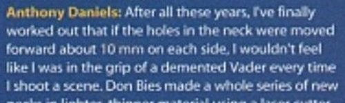
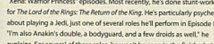
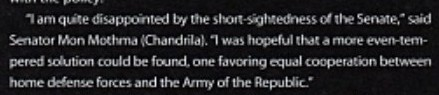
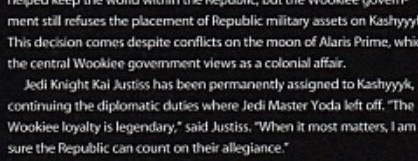
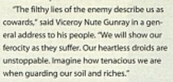
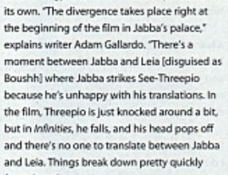
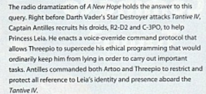
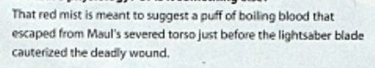

# Owner Material 038 — Star Wars Insider #1–153 plus specials (with The Lucasfilm Fan Club Magazine #1–22): Star Wars Insider #71 (2003)

- **Source:** *Star Wars Insider* magazine (issues 23–153, 1994–2014) and its predecessor *The Lucasfilm Fan Club Magazine* (issues 1–22, 1987–1994), plus seven special editions: articles, interviews, comics and short fiction Secondary source (licensed Legends reference). Scan OCR'd on the box; the scan stays box-only and is **not** published.
- **Method:** every scanned page was OCR'd and machine-screened sentence by sentence for power-relevant statements (fights, kills, defeats, Force feats, rankings, superweapons) that name a character on our roster; each kept sentence is quoted verbatim from the OCR text and has a crop of the printed passage directly under it. Pages with nothing power-relevant are still listed with what is on them.
- **Citation:** "*Star Wars Insider #71* (2003), p.X" by printed page ("scan p.X" where no printed number applies). **Weight:** Licensed magazine: a secondary source. Its short fiction and comics are Legends stories; its articles and interviews sum up or discuss lore and rank below the novels, comics and games they describe.

## scan p.1 (scan page 1)

Page contents: Cover: Star Wars Insider 71; first new photos from the set of Episode III, first-ever Collector Challenge, heroes from Solo to Jones, exclusive tour of a colossal collection, gift guide. (hand-read)

## scan p.2 (scan page 2)

Page contents: Contents: Han Solo/Harrison Ford feature, Indiana Jones on DVD, Lorne Peterson on Indiana Jones effects, Greg Keyes on The New Jedi Order, Gamescape and departments. (hand-read)

## scan p.3 (scan page 3)

Page contents: Editorial "It's about the Stories": collecting stories (a Kenner proof card's traveling owner list, a stick-and-bark Ewok Village mock-up, Mos Eisley Cantina barware, a Boba Fett figure that restarted a collection, a Princess Leia ceremony necklace found in Steve Sansweet's collection). (hand-read)

## scan p.4 (scan page 4)

Page contents: Rebel Rumblings letters and masthead: convention-season thanks, Bantha Tracks editor Mary Franklin, a "Desperately Seeking" plea and a YODA license plate (letter-writer names omitted). (hand-read)

## scan p.5 (scan page 5)

Page contents: Prequel Update 71 opener: Episode III creature-shop photos (Wookiee costume fitting, Aqualish hands). (hand-read)

## scan p.6 (scan page 6)

Page contents: Prequel Update: Episode III set photos from Fox Studios Sydney; Rob Coleman, John Knoll and Gavin Bocquet discuss designs in the art department. (hand-read)

## scan p.7 (scan page 7)

Page contents: Prequel Update photos: watching the director read his script; a camera test on the rebuilt Padmé apartment set on Stage 1. (hand-read)

## scan p.8 (scan page 8)

Page contents: Prequel Update photos: Trade Federation cruiser set on Stage 2, greenscreen setup with crew, a grimy R2-D2 awaiting his close-up. (hand-read)

## scan p.9 (scan page 9)

Page contents: Prequel Update photos: Giddean Danu and Bana Breemu visit Padmé's apartment; C-3PO (Anthony Daniels) on the veranda set; handmaidens Ellé and Moteé; Jay Laga'aia (Captain Typho) in makeup. (hand-read)

## scan p.10 (scan page 10)

Page contents: Prequel Update photos: John Knoll at a clone landing set; Chancellor Palpatine's office complex set and its decorators. (hand-read)

## scan p.11 (scan page 11)

Page contents: From the World of Lucasfilm: Comic-Con International; Fan Club-exclusive silver Boba Fett figure; Jeremy Bulloch signing; LucasArts games, Hyperspace, Tartakovsky and Rudish signing a Clone Wars poster. (hand-read)

## scan p.12 (scan page 12)

Page contents: Comic-Con continued: Code 3 Falcon, Fossil watches, MBNA, Master Replicas booth celebrities, Gentle Giant clone bust, DK, Rubies, Del Rey and Dark Horse. (hand-read)

## scan p.13 (scan page 13)

Page contents: Comic-Con continued: Fan Film Awards, Star Wars Day panels, Holiday Yoda figure, Clone Wars rough cut, Fan Club breakfast; Gen Con Indianapolis autograph guests and TCG championships (winner name omitted). (hand-read)

## scan p.14 (scan page 14)

Page contents: Star News photo page "Look who's reading Star Wars Insider!": actors and crew (Jensen brothers, Tartakovsky and Rudish, Bulloch, Kenny Baker, Amy Allen, Ray Park, Daniel Logan, Dave Prowse) holding the magazine. (hand-read)

## scan p.15 (scan page 15)

Page contents: Star News: Temuera Morrison in a music video; Natalie Portman graduates from Harvard; Ewan McGregor's film Stay; Brian Blessed's horror role; Ian McDiarmid in Charles II. (hand-read)

## scan p.16 (scan page 16)

Page contents: Star News continued: McDiarmid in Charles II; Harrison Ford's Young Hollywood award and Hollywood Walk of Fame star; John Williams to score Harry Potter and the Prisoner of Azkaban plus Indiana Jones 4 and Episode III; an Exorcist prequel; Lindsay Duncan in Under the Tuscan Sun. (hand-read)

## scan p.17 (scan page 17)

Page contents: Hyperspace column: the Episode III webcam and set diaries; excerpts from an online chat with Anthony Daniels (fan usernames omitted) on the Clone Wars cartoon, watching lightsaber duels, and new C-3PO neck pieces. (hand-read)

- **C-3PO** — entry/section: Hyperspace chat: Anthony Daniels on the C-3PO suit: ""After all these years, I've finally worked out that if the holes in the neck were moved forward about 10 mm on each side, I wouldn't feel like I was in the grip of a demented Vader every time I shoot a scene." —Anthony Daniels, Star Wars Insider 71, p. 17" Source: *Star Wars Insider #71* (2003), scan p.17
  

## scan p.18 (scan page 18)

Page contents: Set Diary excerpts from Pablo Hidalgo's Episode III journal: Ben Cooke as the new Kit Fisto; Ian McDiarmid's first day; Jimmy Smits's busy day as Bail Organa; Nash Edgerton and a dummy Obi-Wan double. (hand-read)

- **Kit Fisto** — entry/section: Set Diary: Ben Cooke, the new Kit Fisto: ""I'm also Anakin's double, a bodyguard, and a few droids as well." —Ben Cooke, Star Wars Insider 71, p. 18" Source: *Star Wars Insider #71* (2003), scan p.18
  

## scan p.19 (scan page 19)

Page contents: Holiday gift guide opens (75 products): Fernandes Yoda and Boba Fett Retrorocket guitars; Fossil watches. (hand-read)

## scan p.20 (scan page 20)

Page contents: Gift guide: key to the Jedi/Sith "how good you must be" ratings; Hallmark ornaments. (hand-read)

## scan p.21 (scan page 21)

Page contents: Gift guide: Code 3 die-cast Falcon and X-wing; Classico mugs; Rubie's helmets and Yoda bust; Gentle Giant Tarkin and Greedo mini-busts. (hand-read)

## scan p.22 (scan page 22)

Page contents: Gift guide: Kotobukiya/Dark Horse vinyl model kits; Master Replicas Force FX sabers; Rebel Strike, Galaxies, KOTOR and Jedi Academy games; TCG Empire Strikes Back expansion. (hand-read)

## scan p.23 (scan page 23)

Page contents: Gift guide: The Unifying Force and NJO boxed set; Clone Wars Victories and Sacrifices and the Count Dooku one-shot; New Essential Guide to Vehicles and Vessels; Indiana Jones DVDs; Scholastic Boba Fett and Jedi Quest books. (hand-read)

## scan p.24 (scan page 24)

Page contents: Gift guide: Fan Club and Hyperspace memberships; DK Inside the Worlds of Attack of the Clones; Cedco calendars; Young Jedi Knights omnibuses. (hand-read)

## scan p.25 (scan page 25)

Page contents: Gift guide: Hasbro Clone Wars toys, electronic lightsabers, LEGO AT-AT, Hailfire droid and mini-vehicles, Medicom Kubrick figures. (hand-read)

## scan p.26 (scan page 26)

Page contents: Gift guide ends: Holiday Edition Yoda, Hasbro Scene Packs, 2003 action figures, 12-inch figures, Disney Indiana Jones figures, Unleashed. (hand-read)

## scan p.27 (scan page 27)

Page contents: Sansweet collection tour opens: Steve Sansweet's start as a Wall Street Journal reporter in 1976, moving the collection to a former chicken ranch near Skywalker Ranch. (hand-read)

## scan p.28 (scan page 28)

Page contents: Sansweet collection tour: entrance with a life-size Vader (mostly original Empire costume), carbonite Han and a Don Post Boba Fett prototype; models from the classic films. (hand-read)

## scan p.29 (scan page 29)

Page contents: Sansweet collection tour: movie artifacts (krayt dragon skeleton pieces, Cantina masks, C-3PO head and hands, a biker scout helmet, Han's stunt blaster, 4-LOM's crotch); the toy room. (hand-read)

## scan p.30 (scan page 30)

Page contents: Sansweet collection tour photo captions; prototype shelf of unproduced Droids and Ewoks figures; the Gentle Giant Sansweet figure on an Obi-Wan body ("Rancho Obi-Wan"); classic posters and the Russian three-sheet. (hand-read)

## scan p.31 (scan page 31)

Page contents: Sansweet collection tour: the birthday poster and the missing Jawa; the withdrawn Empire "Gone with the Wind" poster; 1976 convention banner; Loew's Orpheum marquee letters; Death Star surface pieces. (hand-read)

## scan p.32 (scan page 32)

Page contents: Sansweet collection tour ends: the library and magazines, the arcade (German Vader slot machine), the art gallery (Larry Noble bronze Yoda, Joe Johnston Boba Fett sketches), Cantina doors, Leia necklace. (hand-read)

## scan p.33 (scan page 33)

Page contents: Collector's Challenge opens: Insider gave five collectors $109 each (participant names omitted); first entrant's eBay finds (Meco Christmas in the Stars display card, Tenth Anniversary patch, Dixie Cup box flats). (hand-read)

## scan p.34 (scan page 34)

Page contents: Collector's Challenge continued: Sears 1980 toy catalog; a collecting pair's finds (Celebration I staff shirt, Star Tours SK-238 pre-recall prototype, Decipher tournament shirt and Jedi Knights league kit, Star Wars Weekends staff shirt, Magic of Myth press kit); a Canadian panelist's online buys begin (panelist names omitted). (hand-read)

## scan p.35 (scan page 35)

Page contents: Collector's Challenge continued: Canadian Pit of Carkoon Boba Fett, U.K. Episode II Monopoly, metal lunch box, Australian stamp sheet, sealed Poster Painting Set, Asian mini Naboo fighter; a completist's Kane County Toy Show finds (Cheerios die-cast racecar, Palitoy stormtrooper, Data East Vader pinball topper). (hand-read)

## scan p.36 (scan page 36)

Page contents: Collector's Challenge ends: Venezuelan Escape from the Death Star game, Action Fleet snowspeeder; a longtime collector's Jawa Bop Bag, Kez-Iban coin dash variants and the 1981 Rebel Recruiter button; closing call for collectors. (hand-read)

## scan p.37 (scan page 37)

Page contents: A Short History of Star Wars Model Kits opens: kit parts in the original models; MPC's first kits (C-3PO, R2-D2, Vader figure and Action Model, X-wing, TIE, Millennium Falcon). (hand-read)

## scan p.38 (scan page 38)

Page contents: Model kit history: MPC vans, Empire kits (snowspeeder, AT-AT, Slave I, Hoth and Rebel Base dioramas, Dagobah), Jedi kits (Structors, Mirr-A-Kits), Ertl's 1989 reissues and the H. Ed Cox box art. (hand-read)

## scan p.39 (scan page 39)

Page contents: Model kit history: Estes rockets sidebar; Cut-Away Falcon; Special Edition-era kits (1/48 TIE, Virago, Cantina diorama, Death Star, Pro Shop X-wing); vinyl figure kits; Episode I kits and cancellations. (hand-read)

## scan p.40 (scan page 40)

Page contents: Model kit history ends: Gungan sub; international kits (Canada, England, Europe, Revell Takara, Tsukuda, Argonauts, Kaiyodo); Fine Molds 1/72 kits and Kotobukiya vinyl. (hand-read)

## scan p.41 (scan page 41)

Page contents: Indiana Jones DVD feature opens: The Complete DVD Movie Collection release, bonus disc with Laurent Bouzereau's interviews; Lowry Digital Images restoration. (hand-read)

## scan p.42 (scan page 42)

Page contents: Indiana Jones DVD feature: John Lowry on restoring the films (the Raiders scratch and blue line, removing dirt frame by frame). (hand-read)

## scan p.43 (scan page 43)

Page contents: Indiana Jones DVD feature: Lowry on fixing blue fringing without altering the image; Laurent Bouzereau profile begins (Annotated Screenplays, documentaries for Spielberg); bonus-disc contents list. (hand-read)

## scan p.44 (scan page 44)

Page contents: Bouzereau profile: Spielberg's documentarian; researching in the Lucasfilm archives with curator Sterling Hedgpeth; the Grail diary prop; Indiana Jones trivia quiz (Raiders). (hand-read)

## scan p.45 (scan page 45)

Page contents: Bouzereau profile: triggering memories in interviews, Dennis Muren and the Temple of Doom animatics; Temple of Doom/Last Crusade trivia and photo captions. (hand-read)

## scan p.46 (scan page 46)

Page contents: Bouzereau profile ends: first seeing Raiders in Paris and his snake phobia; how documenting the films changed his view of them. (hand-read)

## scan p.47 (scan page 47)

Page contents: Title page "Keep It Moving": ILM veteran Lorne Peterson remembers the effects of Indiana Jones (by Ron Magid), with his portrait. (hand-read)

## scan p.48 (scan page 48)

Page contents: ILM on Indiana Jones (Lorne Peterson feature) opens: Raiders as ILM's first "real world" effects film; Richard Edlund and Peterson on the U-boat, the flashbulb harnesses for the Nazis burned by the Ark, retro-reflective glasses. (hand-read)

## scan p.49 (scan page 49)

Page contents: ILM on Indiana Jones: flaming G.I. Joe Nazis, melting wax heads, Steve Gawley's silk water-tank ghost puppet, the trapeze "hero" ghost; sidebar on Temple of Doom's miniature mine chase and the sonotube water tunnel (Peterson's Oscar). (hand-read)

## scan p.50 (scan page 50)

Page contents: ILM on Indiana Jones: the skull transformation, close-ups of Ford and Karen Allen at the stake; sidebar on Last Crusade's Messerschmitt tunnel crash miniature. (hand-read)

## scan p.51 (scan page 51)

Page contents: Full-page photo of Harrison Ford at a premiere, opening the Harrison Ford feature. (hand-read)

## scan p.52 (scan page 52)

Page contents: Harrison Ford feature opens: AFI heroes list (Han Solo #14, Indiana Jones #2); Ford on why the films endure; Hollywood Homicide; the fourth Indiana Jones film's development. (hand-read)

## scan p.53 (scan page 53)

Page contents: Harrison Ford feature: films "like the Grimm's fairytales of their age"; Raiders reviews and box office; Temple of Doom and Last Crusade reception. (hand-read)

## scan p.54 (scan page 54)

Page contents: Harrison Ford feature: speculation about Indiana Jones 4 (a female sidekick, Lucas on Indy's ex-girlfriends); Ford on the paparazzi; character-rating sidebar. (hand-read)

## scan p.55 (scan page 55)

Page contents: Harrison Ford feature: Calista Flockhart; "I like to believe that audiences trust me"; no interest in directing. (hand-read)

## scan p.56 (scan page 56)

Page contents: Harrison Ford feature: preferring complicated characters and comedies; looking forward to an older Indy. (hand-read)

## scan p.57 (scan page 57)

Page contents: HoloNet News: the Senate ratifies Emergency Amendment 121b (the "reflex amendment"), Mon Mothma objects, Chandrilan fleet moved from Hiram Drayson; Senator Yarua of Kashyyyk refuses Confederacy secession offer; Kai Justiss assigned to Kashyyyk. (hand-read)

- **Mon Mothma** — entry/section: HoloNet News: Mon Mothma on the reflex amendment: ""I am quite disappointed by the short-sightedness of the Senate. I was hopeful that a more even-tempered solution could be found, one favoring equal cooperation between home defense forces and the Army of the Republic." —Mon Mothma, Star Wars Insider 71, p. 57" Source: *Star Wars Insider #71* (2003), scan p.57
  
- **Kai Justiss** — entry/section: HoloNet News: Kai Justiss on Kashyyyk: ""The Wookiee loyalty is legendary. When it most matters, I am sure the Republic can count on their allegiance." —Kai Justiss, Star Wars Insider 71, p. 57" Source: *Star Wars Insider #71* (2003), scan p.57
  

### Stat block notes (game mechanics, not feats)

- HoloNet News: the "reflex amendment": This morning the Senate ratified Emergency Amendment 121b, giving Supreme Chancellor Palpatine unprecedented control in maneuvering military assets across areas of overlapping jurisdiction. (Star Wars Insider 71, p. 57) (Source: *Star Wars Insider #71* (2003), scan p.57)

## scan p.58 (scan page 58)

Page contents: HoloNet News: Neimoidian Home Defense Legions double conscription, Nute Gunray's address; the grassroots Jedi watchgroup The People's Inquest resumes HoloNet broadcasts under Thrynka Padaunete; Clone Wars Volume 2 trade paperback note. (hand-read)

- **Nute Gunray** — entry/section: HoloNet News: Gunray's address to Neimoidia: ""The filthy lies of the enemy describe us as cowards. We will show our ferocity as they suffer. Our heartless droids are unstoppable. Imagine how tenacious we are when guarding our soil and riches." —Nute Gunray, Star Wars Insider 71, p. 58" Source: *Star Wars Insider #71* (2003), scan p.58
  

## scan p.59 (scan page 59)

Page contents: Star Wars Galaxies community column: launch June 26, 2003, 200,000 players; player-run recruitment drives, Imperial News Network raids, Avian Nest Casino creature tournament, battle of the bands begins (player and username names omitted). (hand-read)

## scan p.60 (scan page 60)

Page contents: Star Wars Galaxies column ends: a player-run entertainers' academy on Naboo, parties, PvP tournaments, beauty pageant, economic summit, hunting parties; next issue previews player cities, mounts and vehicles (player and character names omitted). (hand-read)

## scan p.61 (scan page 61)

Page contents: Behind the Magic, Anakin's home: the Leavesden Stage D hovel set ("home sweet home" for Lucas), found-object set dressing, toned-down bedroom; C-3PO as a "man of wires" rod puppet operated by Michael Lynch; the painted backdrop outside the door. (hand-read)

### Stat block notes (game mechanics, not feats)

- Behind the Magic: Threepio as a rod puppet: The ILM model shop brought Threepio to life as a full-size rod puppet. Chief Modelmaker Michael Lynch operated the droid in a manner similar to a form of Japanese puppet theater called bunraku. Fourteen rods linked a suit worn by the operator to key points on the puppet just in front of him. Since a single person would support the full weight of the droid, it was kept to less than 100 pounds. (Star Wars Insider 71, p. 61) (Source: *Star Wars Insider #71* (2003), scan p.61)

## scan p.62 (scan page 62)

Page contents: Behind the Magic photo captions: Qui-Gon's ration capsules made from pen caps, Anakin's costume echoing Luke's farm clothes, Threepio's inner workings and spinning brain. (hand-read)

## scan p.63 (scan page 63)

Page contents: Greg Keyes profile opens: his Chosen of the Changeling, Age of Unreason and Kingdoms of Thorn and Bone series; The Final Prophecy (Nen Yim, Harrar, Yu'shaa with Corran Horn and Tahiri seeking Zonama Sekot; Wedge at Bilbringi; Yu'shaa really Nom Anor). (hand-read)

## scan p.64 (scan page 64)

Page contents: Greg Keyes profile: Edge of Victory books, Tahiri and Nen Yim ("She was entirely my own invention"), last NJO manuscript turned in, faith vs. science; his road to publication with The Waterborn; sidebar on upcoming Clone Wars and other novels. (hand-read)

### Stat block notes (game mechanics, not feats)

- Caption: Edge of Victory: Keyes' Edge of Victory novels included Anakin's creation of a purple lightsaber (eat your heart out, Mace Windu) and the birth of Ben Skywalker. (Star Wars Insider 71, p. 64) (Source: *Star Wars Insider #71* (2003), scan p.64)

## scan p.65 (scan page 65)

Page contents: Infinities: Return of the Jedi preview opens: alternate-history premise; writer Adam Gallardo on the divergence in Jabba's palace when Threepio's head pops off; Fett flees Tatooine with Han; how Gallardo pitched the story. (hand-read)

- **C-3PO; Jabba the Hutt; Leia Organa Solo** — entry/section: Infinities: Return of the Jedi divergence: ""The divergence takes place right at the beginning of the film in Jabba's palace. There's a moment between Jabba and Leia [disguised as Boushh] where Jabba strikes See-Threepio because he's unhappy with his translations. In the film, Threepio is just knocked around a bit, but in Infinities, he falls, and his head pops off and there's no one to translate between Jabba and Leia." —Adam Gallardo, Star Wars Insider 71, p. 65" Source: *Star Wars Insider #71* (2003), scan p.65
  

## scan p.66 (scan page 66)

Page contents: Infinities: Return of the Jedi preview ends: Gallardo on more one-shot Infinities; artist Ryan Benjamin (Chewbacca his favorite to draw); "Now with 99% fewer Ewoks"; sidebar recapping Infinities: A New Hope, The Empire Strikes Back and the Vader's Quest-era tales. (hand-read)

## scan p.67 (scan page 67)

Page contents: Collecting column: Comic-Con and the Mexican Fan Club's first authorized collectors' convention, signing the silver Boba Fett exclusive; reader Q&A on Weingeroff Enterprises' 1977 metal jewelry (Vader head, R2-D2, C-3PO necklaces). (hand-read)

## scan p.68 (scan page 68)

Page contents: Collecting column Q&A: expanded universe figures (Shadows of the Empire line, Mara Jade, Thrawn, Kyle Katarn); the Mara Jade comic trade paperback; Koosh "ages 3-137"; Kenner's 1981 Survival Kit mail-away (reader names omitted). (hand-read)

## scan p.69 (scan page 69)

Page contents: Collecting column Q&A ends: spotting bootleg posters (styles A, B, C, Revenge of the Jedi); the 1985 Spanish Droids trading cards by Pacosa Dos (224 cards). (hand-read)

## scan p.70 (scan page 70)

Page contents: Back issue order form for Star Wars Insider and Star Wars Gamer (Paizo Publishing), with prices and shipping table. (hand-read)

## scan p.71 (scan page 71)

Page contents: Hasbro column: Jedi Master Points eBay auction program (Jorg Sacul, Toy Fair Vader); 2004 basic figures in monthly themed waves; the Ultra line (wampa with cave, Ultra Jabba); Comic-Con Clone Wars figures (Asajj Ventress). (hand-read)

## scan p.72 (scan page 72)

Page contents: Hasbro column ends: Clone Wars figures for the Cartoon Network micro-series (Nov. 7), Durge and clone trooper speeder bike packs, Collection 2 figures (Bail Organa, Padme, Janus Greejatus), Jedi High Council and Geonosian War Room Scene Packs; retailer guide. (hand-read)

## scan p.73 (scan page 73)

Page contents: Crossword puzzle (clues on the Star Wars saga, X-wing novels, Mara Jade, Yoda's "rest I will"). (hand-read)

## scan p.74 (scan page 74)

Page contents: Rebel Rumblings letters continued: the X-wing pilot on the Rebel Dream cover is Wedge Antilles; a Fett fan vs. Mace (editors predict Mace a glorious end in Episode III); a soldier's Star Wars nicknames in Baghdad; Asterix et Obelix Vader tribute; fan art; Warwick Davis photo (letter-writer names omitted). (hand-read)

## scan p.75 (scan page 75)

Page contents: Rebel Rumblings letters continued: requests for fan art, bounty hunter and Star Wars author "Who's Who" features and more classic trilogy coverage; the American Graffiti caption error (Wolfman Jack advised Curt); favorite Jedi line (letter-writer names omitted). (hand-read)

## scan p.76 (scan page 76)

Page contents: Rebel Rumblings letters: family photos with Carrie Fisher at Star Wars Weekends; requests for a Christopher Lee Dooku interview and Clone Wars issue (editors promise the Lee interview and a new collecting column); ad for The New Essential Guide to Vehicles and Vessels (letter-writer names omitted). (hand-read)

## scan p.77 (scan page 77)

Page contents: Rebel Rumblings letters ends: generational fan photos; corrections and additions to the "Skyrockers" Star Wars music article (Cibo Matto's "Sci-Fi Wasabi", the band Next Season); whether the 501st accepts Rebels (letter-writer names omitted). (hand-read)

## scan p.78 (scan page 78)

Page contents: Fan Club offer: Star Wars Holiday Edition Yoda dressed as Santa, from Ralph McQuarrie artwork, with Lightspeed Pass ordering details. (hand-read)

## scan p.79 (scan page 79)

Page contents: Q&A: the three Lars tombstones; TC protocol droid designations; Leia's and Padme's "court voice" accents; why C-3PO didn't recognize Leia (radio drama override by Captain Antilles); Obi-Wan's rebuilt lightsaber. (hand-read)

- **Darth Vader (Anakin Skywalker); Leia Organa Solo** — entry/section: Q&A: why Threepio didn't recognize Leia: "The radio dramatization of A New Hope holds the answer to this query. Right before Darth Vader's Star Destroyer attacks Tantive IV, Captain Antilles recruits his droids, R2-D2 and C-3PO, to help Princess Leia." Source: *Star Wars Insider #71* (2003), scan p.79
  

### Stat block notes (game mechanics, not feats)

- Q&A: the Lars tombstones: Inside Attack of the Clones, published by DK, revealed the three tombstones belonged to members of Cliegg's family. Gredda and Lef Lars, his parents, share a grave, while his younger brother Edern, who died at the age of 14, has the smaller tombstone. Later, Owen Lars removed the tombstones to help keep some of these tragedies away from Luke. (Star Wars Insider 71, p. 79) (Source: *Star Wars Insider #71* (2003), scan p.79)
- Q&A: why Threepio didn't recognize Leia: Captain Antilles recruits his droids, R2-D2 and C-3PO, to help Princess Leia. He enacts a voice-override command protocol that allows Threepio to supercede his ethical programming that would ordinarily keep him from lying in order to carry out important tasks. Antilles commanded both Artoo and Threepio to restrict and protect all reference to Leia's identity and presence aboard the Tantive IV. (Star Wars Insider 71, p. 79) (Source: *Star Wars Insider #71* (2003), scan p.79)
- Q&A: Obi-Wan's lightsaber: The Attack of the Clones Scrapbook from Scholastic reveals that Obi-Wan reconstructed his lightsaber to his favored specifications, so the one he has in Episode II is a near-duplicate of his Episode I weapon. (Star Wars Insider 71, p. 79) (Source: *Star Wars Insider #71* (2003), scan p.79)

## scan p.80 (scan page 80)

Page contents: Q&A continued: orange toy lightsabers; the Special Edition troop transport lost in full-screen video; the red mist from Maul; "you are a wonderful human being" as Solo sarcasm; the two cantina wolfmen (a Defel and Lak Sivrak) replaced in the Special Edition. (hand-read)

- **Darth Maul** — entry/section: Q&A: the red mist from Maul: "That red mist is meant to suggest a puff of boiling blood that escaped from Maul's severed torso just before the lightsaber blade cauterized the deadly wound." Source: *Star Wars Insider #71* (2003), scan p.80
  

### Stat block notes (game mechanics, not feats)

- Q&A: the red mist from Maul: That red mist is meant to suggest a puff of boiling blood that escaped from Maul's severed torso just before the lightsaber blade cauterized the deadly wound. (Star Wars Insider 71, p. 80) (Source: *Star Wars Insider #71* (2003), scan p.80)

## scan p.81 (scan page 81)

Page contents: Back-page illustration by Randy Martinez: Darth Vader in a Max Rebo Band T-shirt in a fan's bedroom covered with Max Rebo Band posters and memorabilia. (hand-read)

## scan p.82 (scan page 82)

Page contents: Ad: The Unifying Force by James Luceno, the New Jedi Order finale (Del Rey/LucasBooks hardcover, on sale November 4), with CD-ROM bonus. (hand-read)

## scan p.83 (scan page 83)

Page contents: Hasbro ad: Star Wars Unleashed Boba Fett ("New style. New scale. New attitude."). (hand-read)

