# Owner Material 038 — Star Wars Insider #1–153 plus specials (with The Lucasfilm Fan Club Magazine #1–22): Star Wars Insider #72 (2003)

- **Source:** *Star Wars Insider* magazine (issues 23–153, 1994–2014) and its predecessor *The Lucasfilm Fan Club Magazine* (issues 1–22, 1987–1994), plus seven special editions: articles, interviews, comics and short fiction Secondary source (licensed Legends reference). Scan OCR'd on the box; the scan stays box-only and is **not** published.
- **Method:** every scanned page was OCR'd and machine-screened sentence by sentence for power-relevant statements (fights, kills, defeats, Force feats, rankings, superweapons) that name a character on our roster; each kept sentence is quoted verbatim from the OCR text and has a crop of the printed passage directly under it. Pages with nothing power-relevant are still listed with what is on them.
- **Citation:** "*Star Wars Insider #72* (2003), p.X" by printed page ("scan p.X" where no printed number applies). **Weight:** Licensed magazine: a secondary source. Its short fiction and comics are Legends stories; its articles and interviews sum up or discuss lore and rank below the novels, comics and games they describe.

## scan p.1 (scan page 1)

Page contents: Cover: Ewan McGregor exclusive interview; secrets of the Fan Film Award winners; Clone Wars action figures and Force FX lightsabers. (hand-read)

## scan p.2 (scan page 2)

Page contents: Contents: Ewan McGregor interview (Alec Guinness and fans), Episode III set visit, Star Sightings, Trisha Biggar on prequel costumes, the 2003 Fan Film Awards, Christopher Lee on Count Dooku, Set Piece on the Emperor's throne room, James Luceno on The Unifying Force. (hand-read)

## scan p.3 (scan page 3)

Page contents: Editorial "What kind of fan are you?": the variety of fans at San Diego Comic-Con and the magazine's commitment to covering every kind of Star Wars interest ("Yeah, Han definitely shot first."). (hand-read)

## scan p.4 (scan page 4)

Page contents: Rebel Rumblings: readers' favorite aliens (Trandoshans, Wookiees, Yoda's species, Arcona, Hutts, Sullustans, Barabels); masthead (letter-writer names omitted). (hand-read)

## scan p.5 (scan page 5)

Page contents: Ad: The Anthony Grandio Company Star Wars Characters and Armada personal checks with order form. (hand-read)

## scan p.6 (scan page 6)

Page contents: Episode III set visit at Fox Studios Sydney (by Dave Gross): interview with Rick McCallum nearly halfway through production; final draft two days early ("I think [George] really cracked it on this one"); pure action after Natalie Portman left; Hayden vs. Ewan; the webcam. (hand-read)

- **Darth Vader (Anakin Skywalker); Obi-Wan Kenobi** — entry/section: Episode III set visit: who would win, Hayden or Ewan?: ""Hayden. He's had more time [to train], and he's out for blood now." —Rick McCallum, Star Wars Insider 72, p. 6" Source: *Star Wars Insider #72* (2003), scan p.6
  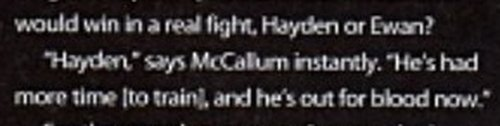

## scan p.7 (scan page 7)

Page contents: "From the Set of Episode III" photo page: key hairdresser Annette Miles styling Ewan McGregor toward Alec Guinness's look; Hayden Christensen and McGregor rehearsing their climactic duel under Nick Gillard. (hand-read)

### Stat block notes (game mechanics, not feats)

- Episode III set photo caption: Key Hairdresser Annette Miles got to work on the much shorter locks of actor Ewan McGregor every morning, as the Jedi Master's hair style evolved toward the look of Sir Alec Guinness in Episode IV. (Star Wars Insider 72, p. 7) (Source: *Star Wars Insider #72* (2003), scan p.7)

## scan p.8 (scan page 8)

Page contents: Episode III set photos: Obi-Wan and Anakin cross the lobby of a Trade Federation cruiser; Hayden Christensen in Hair and Make-Up; Anakin and Palpatine confer in Palpatine's office. (hand-read)

## scan p.9 (scan page 9)

Page contents: Episode III set photos: Padme's handmaidens Elle (Chantal Freer) and Motee (Kristy Wright) on her Coruscant veranda; stunt doubles Nash Edgerton and Bob Bowles rehearse before bluescreen; a props table of do-it-yourself lightsaber parts. (hand-read)

### Stat block notes (game mechanics, not feats)

- Episode III set photo caption: Taking a short stroll on the veranda of Padmé Amidala's Coruscant apartment are the Senator's handmaidens, Ellé (left, actress Chantal Freer) and Moteé (actress Kristy Wright). (Star Wars Insider 72, p. 9) (Source: *Star Wars Insider #72* (2003), scan p.9)

## scan p.10 (scan page 10)

Page contents: Episode III set photos: the Trade Federation cruiser bridge set under construction; the electronic clapper board; Palpatine's new transport vehicle under construction. (hand-read)

## scan p.11 (scan page 11)

Page contents: Episode III set photos: Anakin suspicious of everyone; Senator Fema Baab (actress Olive Levi) with hairdresser Pip Lund; Ben Cooke fitted for his Kit Fisto mask. (hand-read)

### Stat block notes (game mechanics, not feats)

- Episode III set photo caption: Who's smiling now? Jedi Kit Fisto, who always seemed to be smiling in Episode II, is less likely to be smiling at the end of Episode III, we fear. He's also being played by a new actor, stuntman Ben Cooke, who gets fitted for his mask in the Hair and Make-Up Department. (Star Wars Insider 72, p. 11) (Source: *Star Wars Insider #72* (2003), scan p.11)

## scan p.12 (scan page 12)

Page contents: Fan Club editors' Episode III set diary: three days at Fox Studios Australia with Steve Sansweet and the international Fan Club editors; Gavin Bocquet's set models; Nick Gillard on the Anakin-Obi-Wan duel; property master Ty Teiger's "hero" lightsabers (fan and contest-winner names omitted). (hand-read)

## scan p.13 (scan page 13)

Page contents: Set diary continued: holding the hero lightsabers; stunt doubles in a sparking duel; Trisha Biggar and assistant Gillian Libbert's costume warehouse (Padme's new gowns, Palpatine and Bail Organa costumes); costume props supervisor Ivo Coveney; Rick McCallum; John Knoll and the "Knoll Sphere"; special effects supervisor Dave Young. (hand-read)

## scan p.14 (scan page 14)

Page contents: Set diary continued: Dave Young's revolving gimbal set and wet-Jedi water tank; greenscreen filming of the Anakin-Obi-Wan duel; Dave Elsey's creature shop (Rodians, Quarren, Ishi Tib, Wookiees, the "Fauxbi-Wan" dummy, singing Neimoidian heads); 40 minutes with George Lucas. Star Sightings: Keira Knightley, Samuel L. Jackson in The Incredibles, Daniel Logan, Doug Chiang's Robota, John Williams at the Hollywood Bowl. (hand-read)

### Stat block notes (game mechanics, not feats)

- Episode III creature shop visit: We also saw a dummy that had a great likeness of an unconscious Obi-Wan, dubbed Fauxbi-Wan by the crew. (Star Wars Insider 72, p. 14) (Source: *Star Wars Insider #72* (2003), scan p.14)

## scan p.15 (scan page 15)

Page contents: Set diary ends: editor Roger Barton told to "make his own Star Wars movie"; the editors' webcam chair-rocking routine directed by John Knoll amuses George Lucas. Star Sightings: Natalie Portman, Hugh Quarshie, Celia Imrie, Warwick Davis. (hand-read)

## scan p.16 (scan page 16)

Page contents: Full-page portrait photo of Ewan McGregor opening the interview. (hand-read)

## scan p.17 (scan page 17)

Page contents: Ewan McGregor interview "The Jedi Knight Talks Star Wars, Edgy Characters, and Nude Scenes" (by Gabriela Tscharner-Patao): choosing roles by instinct; no Episode III script before shooting; learning of Chewbacca's return from a fan; building Obi-Wan on Alec Guinness; uncle Denis Lawson as Wedge Antilles. (hand-read)

- **Obi-Wan Kenobi; Darth Vader (Anakin Skywalker); Chewbacca** — entry/section: Ewan McGregor before Episode III filming: ""I hear that me and Hayden will have some big kickoff fight. But until some fan told me about it, I didn't even know Chewbacca was back." —Ewan McGregor, Star Wars Insider 72, p. 17" Source: *Star Wars Insider #72* (2003), scan p.17
  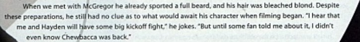

## scan p.18 (scan page 18)

Page contents: McGregor interview continued: his uncle inspired him to act; giving up alcohol after Attack of the Clones; family life with wife Eve Mavrakis and daughters Clara and Esther; the family tattoo after Down With Love; fatherhood. (hand-read)

## scan p.19 (scan page 19)

Page contents: McGregor interview continued: born 1971 in Crieff, Scotland; Perth Repertory Theatre at 16; Danny Boyle films (Shallow Grave, Trainspotting); independent films and his view of nude scenes; a mellowed view of Hollywood; Young Adam; James Bond rumors. (hand-read)

## scan p.20 (scan page 20)

Page contents: McGregor interview concluded: no official Bond approach; early fears about Star Wars fanatics unrealized; children asking how lightsabers turn on; the films haven't changed his life or career. (hand-read)

- **Obi-Wan Kenobi** — entry/section: Ewan McGregor on fans: ""It's fantastic the way children ask you how a lightsaber turns on. It's only when adults come up to me and ask where they can apply to be a Jedi that I don't get it. They should really know better." —Ewan McGregor, Star Wars Insider 72, p. 20" Source: *Star Wars Insider #72* (2003), scan p.20
  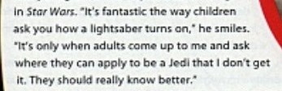

## scan p.21 (scan page 21)

Page contents: Ewan McGregor filmography sidebar, through The Phantom Menace (1999), Attack of the Clones (2002) and Star Wars: Episode III (2005). (hand-read)

## scan p.22 (scan page 22)

Page contents: Fan Film Awards feature, written by a finalist fan filmmaker (fan-filmmaker names omitted): the Lucasfilm/AtomFilms "license lifting" arrangement; the history of Star Wars parodies from "Hardware Wars" (1977), which George Lucas called his favorite parody, to "TROOPS" and "George Lucas in Love." (hand-read)

## scan p.23 (scan page 23)

Page contents: Fan Film Awards continued: the 2002 ceremony at Celebration II and the 2003 return at Comic-Con; three kinds of fan filmmakers; choosing a genre with the Internet-voted audience award in mind. (hand-read)

## scan p.24 (scan page 24)

Page contents: Fan Film Awards continued: aiming for the George Lucas Selects award, which Lucas described as recognizing a "diamond in the rough"; the 2002 winner "Christmas Tauntauns"; the core themes of the saga; brainstorming premises such as Boba Fett going grocery shopping. (hand-read)

## scan p.25 (scan page 25)

Page contents: Fan Film Awards continued: writing a concise script ("If it ain't on the page, then it ain't on the stage"); keeping shorts under five minutes, within AtomFilms' 15-minute limit; pre-production choices and competing with animation and independent effects. (hand-read)

## scan p.26 (scan page 26)

Page contents: Fan Film Awards continued: film vs. video; crews who are both fans and filmmakers; scheduling around Murphy's Law; editing in post-production. (hand-read)

## scan p.27 (scan page 27)

Page contents: Fan Film Awards concluded: the legal paperwork (submission contract, talent clearance, music licenses, cue sheets, Form PA and copyright registration); a glossary sidebar; the author's later award noted (author name omitted as a fan contest participant). (hand-read)

## scan p.28 (scan page 28)

Page contents: Full-page photo opening the speeder bike feature: two scout troopers on speeder bikes in the Endor forest. (hand-read)

## scan p.29 (scan page 29)

Page contents: "The Need for Speed: Behind the Endor Chase Scene in Return of the Jedi" (by Ron Magid): Jedi as the most elaborate photochemical effects film; Richard Edlund: "I think that Jedi is certainly the most complicated photochemical movie ever done." (hand-read)

## scan p.30 (scan page 30)

Page contents: Speeder bike feature continued: the Oscar-winning ILM crew (Edlund, Muren, Ralston, Tippett); Jedi's roughly one-year schedule and ILM's "assembly line"; Dennis Muren handed the speeder bike chase; the problem of shooting the forest backgrounds. (hand-read)

## scan p.31 (scan page 31)

Page contents: Speeder bike feature continued: Muren on deadlines; Edlund's solution of shooting SteadiCam at one frame a second; Garrett Brown's SteadiCam; captions on the Go-Motion rig, Ralph McQuarrie art and a speeder bike model. (hand-read)

- **Luke Skywalker; Leia Organa Solo** — entry/section: Shooting the Endor speeder bike background plates: ""I thought, 'Well, this'll be really fast to do: why don't we shoot SteadiCam at one frame a second, and try that?' And that's what we did, and that's what ultimately ended up working." —Richard Edlund, Star Wars Insider 72, p. 31" Source: *Star Wars Insider #72* (2003), scan p.31
  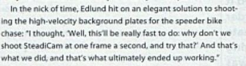

## scan p.32 (scan page 32)

Page contents: Speeder bike feature continued: Muren and Brown's string-guided background shoot; Go-Motion, its stop-motion lineage (Willis O'Brien, Ray Harryhausen) and first use on the tauntauns; 1/6-scale Luke, Leia and pilot puppets moved by hand on rods against bluescreen. (hand-read)

## scan p.33 (scan page 33)

Page contents: Speeder bike feature concluded: Muren's animatics and documentary approach to the chase; Edlund left ILM after Jedi to found Boss Film ("Jedi was our pièce de résistance"). (hand-read)

## scan p.34 (scan page 34)

Page contents: "Evolving down" costumes feature on Trisha Biggar: work crews for Episode III all in Australia; her task of advancing characters while moving costumes back toward Episode IV. (hand-read)

## scan p.35 (scan page 35)

Page contents: Biggar feature continued: Anakin's move from Tatooine clothes to Jedi-type clothing; George Lucas wanted "a hint of what was to come"; all Jedi in shades of brown and beige, with no two outfits the same. (hand-read)

## scan p.36 (scan page 36)

Page contents: Biggar feature continued: Anakin in the darkest browns, almost black in poor light, and leather tabs hinting at Vader; Obi-Wan's lighter costume, unchanged from Episode I to II and reverse-designed from A New Hope. (hand-read)

### Stat block notes (game mechanics, not feats)

- Trisha Biggar on Anakin's Episode II costume: "We also wanted to reflect some of the qualities of Darth Vader's costume," she says. "He's one of the only Jedi to wear leather. All the Jedi have tabs hanging from the front of their tunics, in a variety of fabrics, but Anakin's were leather." ... "But again, the darkness of his leather tabs," says Biggar, "was a hint of the shiny [armor] Vader wears. It lets us know where Anakin's going to end up. Maybe as a subconscious suggestion." (Star Wars Insider 72, p. 36) (Source: *Star Wars Insider #72* (2003), scan p.36)

## scan p.37 (scan page 37)

Page contents: Biggar feature continued: matching the original Alec Guinness costume's color and texture; the "same cloak" idea for Obi-Wan; accentuating Padme's growth from girl to woman; the black corset-type top by the fire on Naboo. (hand-read)

### Stat block notes (game mechanics, not feats)

- Trisha Biggar on Obi-Wan's cloak: "He's been wearing that cloak since Episode I," Biggar says. "In theory, obviously. But the idea was always that it was the same cloak we were seeing him wear in Episodes I and II, not a different set of clothes [that all looked alike]. He's kept it and maintained it, and he's always worn it." (Star Wars Insider 72, p. 37) (Source: *Star Wars Insider #72* (2003), scan p.37)

## scan p.38 (scan page 38)

Page contents: Biggar feature continued: Padme's fireside cape giving way to the fitted strapless top as she falls for Anakin; her change from Queen to Senator relaxes her wardrobe; a young woman's new confidence. (hand-read)

## scan p.39 (scan page 39)

Page contents: Biggar feature continued: letting actors be comfortable and not directed by costumes; Episode I's massive headpieces and the special seats built for the handmaidens; captions on Queen Amidala headpieces and Padme's wedding gown concept by Dermot Power. (hand-read)

## scan p.40 (scan page 40)

Page contents: Biggar feature continued: Padme's simple, pre-Raphaelite wedding dress, one of the most complicated to make; Count Dooku's dark brown costume hinting at the Imperial army and his Jedi past; foam-and-leather stunt versions of Naboo armor. (hand-read)

### Stat block notes (game mechanics, not feats)

- Trisha Biggar on Dooku's costume: "The costume for Count Dooku was a very dark brown," Biggar says, "and it had a sort of formality about it. A little hint of the Imperial army in the future . . . although that wasn't initially a thought." (Star Wars Insider 72, p. 40) (Source: *Star Wars Insider #72* (2003), scan p.40)

## scan p.41 (scan page 41)

Page contents: Biggar feature concluded: Jango Fett's stunt-friendly costume; Anakin made darker in Episode III, "black-brown"; simplicity is hard-earned. Sidebar Q&A on high-definition digital cameras picking up fine costume detail and textured fabrics. (hand-read)

### Stat block notes (game mechanics, not feats)

- Trisha Biggar on Anakin's Episode III costume: Anakin Skywalker will be hurtling toward his destiny: the black-armored Darth Vader. The Jedi is not a Sith Lord yet, but he's on his way. "We make him much darker this time," explains Biggar. "He was quite dark already, but we've completely made him sort of vague, dark brown; it almost ends up black-brown so that when we see him in black, everyone had been led there." (Star Wars Insider 72, p. 41) (Source: *Star Wars Insider #72* (2003), scan p.41)

## scan p.42 (scan page 42)

Page contents: 2003 Fan Film Awards winners feature: from "Hardware Wars" and "TROOPS" to the Lucasfilm-AtomFilms partnership, explained by AtomShockwave's Scott Roesch ("Please don't sue me, Mr. Lucas"); the Sci-Fi Channel special; the awards as a step into professional filmmaking (fan-filmmaker names omitted). (hand-read)

## scan p.43 (scan page 43)

Page contents: Fan Film Awards winners feature continued: Scott Roesch on letting in rough films with a spark of creativity; early favorites "Jedi Hunter" (Boba Fett as the "Crocodile Hunter") and "Pink Five"; family members helping make fan films (fan-filmmaker names omitted). (hand-read)

## scan p.44 (scan page 44)

Page contents: Fan Film Awards winners feature continued: sibling and friend filmmaking teams behind "TK 409 and Me," "How I Learned to Stop Worrying and Love the Superlaser," "Crazy Watto" and "Silent But Deadly"; photo captions of "Jedi Hunter" cast and winners (fan names omitted). (hand-read)

## scan p.45 (scan page 45)

Page contents: Fan Film Awards winners feature continued: rival filmmakers who became friends; amateurs making music videos and "Intergalactic Idol" with action-figure roots; "Pink Five" shot against bluescreen in one afternoon (fan names omitted). (hand-read)

## scan p.46 (scan page 46)

Page contents: Fan Film Awards winners feature continued: a sidebar on how a dinner with Peter Mayhew led to "Jedi Hunter" being dedicated to him; equipment struggles in the desert; a complete editing system for $5,000; film vs. digital (fan names omitted). (hand-read)

## scan p.47 (scan page 47)

Page contents: Fan Film Awards winners feature continued: staying true to the characters in parody; the 2002 "Jar Jar's Walking Papers" award showing Lucasfilm isn't censorious; the cruder "Trooper Clerks" accepted; parodies of TV commercials (fan names omitted). (hand-read)

## scan p.48 (scan page 48)

Page contents: Fan Film Awards winners feature continued: "TIE TV Spot" (Boba Fett dancing while Vader flies), two Apple "Switch" parodies including the Dark Side campaign built around Darth Vader's change of heart, Flash animation; plans for next year's films (fan names omitted). (hand-read)

## scan p.49 (scan page 49)

Page contents: Fan Film Awards winners feature concluded: return entries planned, a third "Silent But Deadly"; the awards give amateurs a deadline and a George Lucas judge ("better than film school"); sidebar on the "Pink Five" lead who had never seen the films (fan names omitted). (hand-read)

## scan p.50 (scan page 50)

Page contents: Full-page portrait photo of Christopher Lee opening the Count Dooku interview. (hand-read)

## scan p.51 (scan page 51)

Page contents: "Christopher Lee on Count Dooku and a Villainous Career" (by Marcus Hearn): Lee jokes that he can't find Dooku's homeworld Serenno on the galactic map; his Hammer horror legacy. (hand-read)

- **Count Dooku** — entry/section: Christopher Lee on Dooku's homeworld: ""I've been looking for Serenno on the galactic map," muses Christopher Lee. "I can't find it anywhere." (Star Wars Insider 72, p. 51)" Source: *Star Wars Insider #72* (2003), scan p.51
  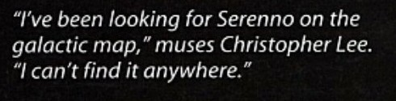
- **Count Dooku; Obi-Wan Kenobi** — entry/section: Christopher Lee on Dooku's character: ""I think Dooku is a typical product of a military academy," says Lee. "He is a soldier, but he is also a formidable politician. You only have to look at the way he convinces his allies to go along with his scheme, and the way he fools Obi-Wan Kenobi, to realize that he is a man of some genius. "Dooku means 'poison' in Japanese, but I don't necessarily see him as evil. I think he is a loyal servant to his master, and he employs methods that he considers appropriate to replace what he sees as a corrupt Republic. What he intends to replace it with is perhaps a different matter . . . ." —Christopher Lee, Star Wars Insider 72, p. 51" Source: *Star Wars Insider #72* (2003), scan p.51
  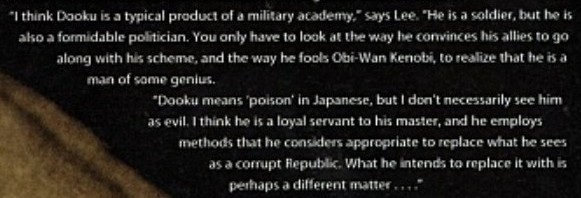

## scan p.52 (scan page 52)

Page contents: Lee interview continued: his layered villains; asking Lucas "What exactly are the Sith?" and learning of the "Lost 20"; hoping Dooku becomes Darth Tyranus permanently; meeting Lucas in 1979; Young Indiana Jones; Peter Cushing and Donald Pleasence; his favorite Star Wars line from Leia to Tarkin. (hand-read)

- **Count Dooku** — entry/section: Christopher Lee on Dooku's fate: ""I'd like it if he was transformed into Darth Tyranus on a more permanent basis," he chuckles, referring to Dooku's Machiavellian alter ego. "I think it sounds much grander." (Star Wars Insider 72, p. 52)" Source: *Star Wars Insider #72* (2003), scan p.52
  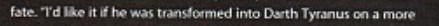

### Stat block notes (game mechanics, not feats)

- Christopher Lee on the Sith and the Lost Twenty: "... but I was intrigued by Dooku and told George that I didn't really know anything about the character's background. I asked him, 'What exactly are the Sith?' Filming was held up by a good 10 or 15 minutes while George told me about the Sith, how many there were and how I become one of the 'Lost 20' when I left the Jedi." (Star Wars Insider 72, p. 52) (Source: *Star Wars Insider #72* (2003), scan p.52)

## scan p.53 (scan page 53)

Page contents: Lee interview continued: his "graveyard period"; Francis Ford Coppola teasing him after his first scene, Dooku's speeder bike escape; acting against bluescreen with Lucas's brief descriptions; the Method; John Knoll's reference spheres; not watching playback. (hand-read)

## scan p.54 (scan page 54)

Page contents: Lee interview continued: synchronizing with the spinning Obi-Wan in the interrogation scene; the Geonosis hangar duel shot in Australia and Ealing; cut moments (Dooku flicking up Obi-Wan's discarded saber; Yoda leaping onto Dooku's back); Lucas's direction and editing; Lucas as a polymath. (hand-read)

### Stat block notes (game mechanics, not feats)

- Christopher Lee on cut duel moments: Among the scenes that didn't make it into the finished film was the moment where Dooku brandishes both his and Obi-Wan's discarded lightsaber and flicks one up to strike Obi-Wan. The shooting script also called for Yoda to jump onto Dooku's back. "There was some concern about that scene," says Lee. "I remember saying, 'I think we're in danger of an unintentional laugh here.'" (Star Wars Insider 72, p. 54) (Source: *Star Wars Insider #72* (2003), scan p.54)

## scan p.55 (scan page 55)

Page contents: Lee interview continued: Lucas staying for a drink before flying home ("a will of steel"); Lee's work on The Return of the King and rereading Tolkien yearly; cut Saruman scenes; King Kong, Forbidden Planet and Star Wars as milestones. (hand-read)

## scan p.56 (scan page 56)

Page contents: HoloNet News (art by Joe Corroney): Anakin Skywalker named "Warrior of the Infinite" on Virujansi after he and Obi-Wan break a Separatist occupation using cave dogfights in the Mallow Mountains; Jedi accolades as possible propaganda; slicers steal Mon Calamari shipyard data, blamed on the Techno Union. (hand-read)

### Stat block notes (game mechanics, not feats)

- HoloNet News: Warrior of the Infinite: The nameless Rajah, speaking through the royal court's Mouth of the Ancestors, read the ancient text of proclamation. "There seem to be no limits to this remarkable young man," said the Rajah, switching to modern Basic as he ended his speech. "Jedi Skywalker has already rightly earned the title 'Hero With No Fear' in his exploits in battle. He is an unparalleled leader and a pilot without equal." Although the title offers Skywalker no practical benefits on Virujansi or elsewhere, it is a revered rank only bestowed 29 times in the 6,000-year history of the royal court. (Star Wars Insider 72, p. 56) (Source: *Star Wars Insider #72* (2003), scan p.56)

## scan p.57 (scan page 57)

Page contents: HoloNet News Year's Start Fete Day edition: a sliced partial transcript of Count Dooku's carrier-wave broadcast attacking the Republic, claiming the Jedi have been deceived and vowing revenge for Muunilinst and Metalorn. (hand-read)

- **Count Dooku** — entry/section: Dooku's Fete Day broadcast: ""The Jedi have been deceived. They are too close to the Senate to see otherwise. I know, for in my time within the order, I saw the rampant abuses in the corridors of power. Now, the Jedi have had their hands soiled by this bid for control." —Count Dooku, Star Wars Insider 72, p. 57" Source: *Star Wars Insider #72* (2003), scan p.57
  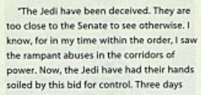

## scan p.58 (scan page 58)

Page contents: Star Wars Galaxies update "House Hunting and Used Bantha Salesmen": over 300,000 players; new content (Dathomir, Lok's Sulfur Lake Pirates, "The Warren"); player-run cities built around a city hall from the new city planner profession (player and player-city names omitted). (hand-read)

## scan p.59 (scan page 59)

Page contents: Galaxies update continued: player cities as waystations; the new politician profession and weekly mayoral elections; mayors' powers, city militias, ranks from Outpost to Metropolis; city taxes. (hand-read)

## scan p.60 (scan page 60)

Page contents: Galaxies update concluded: voting out unfair mayors; future businesses; player mounts (dewbacks, banthas, kaadu, later fambaa and tortons) with crafted "wearables"; landspeeders and speeder bikes due by the 2003 holidays; players nearing the secret of becoming Jedi. (hand-read)

## scan p.61 (scan page 61)

Page contents: Ad: Star Wars Insider subscriptions and renewals online, with Bantha Tracks and Official Star Wars Fan Club membership. (hand-read)

## scan p.62 (scan page 62)

Page contents: Knights of the Old Republic PC port: producer Mike Gallo on revamped controls, high-resolution textures and scalable specs, keeping the story experience identical and avoiding spoilers, and why LucasArts released first on the Xbox. (hand-read)

## scan p.63 (scan page 63)

Page contents: KOTOR PC port continued: why the first Star Wars RPG took so long (no internal RPG team until BioWare was available); its strengths of graphics, voice acting and story; KOTOR and Galaxies serving separate audiences. (hand-read)

## scan p.64 (scan page 64)

Page contents: Set Piece: the Emperor's throne room (Return of the Jedi), filmed on Elstree Stage 4 in March 1982 with black felt in the windows for ILM's later starfield; Lucas insisting on two-handed lightsaber grips; the three-stage Luke-Vader duel; Lucas directing the Emperor's demise himself, with Ian McDiarmid lifted on a hoist over Dave Prowse. (hand-read)

- **Luke Skywalker** — entry/section: Set Piece: the duel's mental battle: "He explained that it didn't have to be bigger, because basically it couldn't be; it was the mental battle that would make the Return of the Jedi duel greater. A three-stage fight begins when Luke first draws his weapon in anger." Source: *Star Wars Insider #72* (2003), scan p.64
  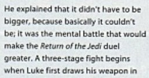

### Stat block notes (game mechanics, not feats)

- Set Piece: Luke's weak point: The shooting script had been vague about Luke's motivation to resume the fight at that pivotal moment, only alluding to his father saying something to anger him. While blocking out the fight on set and getting ready to shoot, inspiration struck. With the importance of Luke's family history it became clear that his devotion to his sister would be his weak point. (Star Wars Insider 72, p. 64) (Source: *Star Wars Insider #72* (2003), scan p.64)

## scan p.65 (scan page 65)

Page contents: Set Piece captions: Luke's lightsaber on the throne was a reused Obi-Wan stunt prop; Mark Hamill's "Vaderish" attire; Peter Diamond choreographed the duel; the Imperial Royal Guard's crimson costumes from Nilo Rodis-Jamero sketches. (hand-read)

### Stat block notes (game mechanics, not feats)

- Set Piece caption: the stunt lightsaber: The Luke Skywalker lightsaber sitting on the Emperor's throne was originally an Obi-Wan Kenobi lightsaber used in filming A New Hope. It served as a stunt prop in both films, standing in for the more detailed "Hero" props seen in close-ups. (Star Wars Insider 72, p. 65) (Source: *Star Wars Insider #72* (2003), scan p.65)

## scan p.66 (scan page 66)

Page contents: James Luceno on writing The Unifying Force, the New Jedi Order finale: his Robotech background, the plot (Han and Leia's rescue mission, Zonama Sekot, a ruined Coruscant, Alpha Red), the Yuuzhan Vong as tragic wanderers modeled on the Maya and Aztec, and Luke's debate with the priest Harrar. (hand-read)

- **Luke Skywalker** — entry/section: Luceno on the Yuuzhan Vong: ""I wanted to give [the Yuuzhan Vong] more depth; I thought the only way to do it would be contrasting their truth with the Jedi truth," Luceno says. "The idea is it's not as black and white as the usual villainy. . . . The Unifying Force has a lot of gray in it." —James Luceno, Star Wars Insider 72, p. 66" Source: *Star Wars Insider #72* (2003), scan p.66
  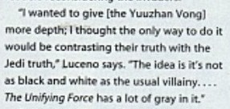

## scan p.67 (scan page 67)

Page contents: Luceno continued: the old Jedi order dooming itself, the series as a story about redefining the Force, a Lord of the Rings-style bittersweet ending, and his next projects (a thatched casita in the Yucatan and DK's classic trilogy Inside the Worlds book). (hand-read)

- **Luke Skywalker** — entry/section: Luceno on the Jedi: ""It took what George Lucas was doing in the prequels to see that the old Jedi order had in some ways doomed itself by separating itself and enslaving itself to the whims of the Old Republic," Luceno says. "I do think that the story is really in large measure about the Force and redefining the Force. . . . The series is very much about the Jedi struggling to find their way through this. I like that we were able to play with the Jedi philosophy a bit." —James Luceno, Star Wars Insider 72, p. 67" Source: *Star Wars Insider #72* (2003), scan p.67
  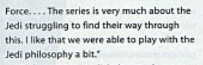

### Stat block notes (game mechanics, not feats)

- A Tale of Two Anakins sidebar: Rogue Planet foreshadows Anakin's later years, from his rebellion against the Jedi order to the darkness that will consume him—and its echoes fill the New Jedi Order: Vergere leaves with the "Far Outsiders," later revealed as the Yuuzhan Vong, and will return to confront Anakin Solo and tutor his brother Jacen. (Star Wars Insider 72, p. 67) (Source: *Star Wars Insider #72* (2003), scan p.67)

## scan p.68 (scan page 68)

Page contents: Star Wars Empire's "To the Last Man" (issues #16-18, written by Welles Hartley, art by Davide Fabri): a Fort Apache-style siege in which an isolated Imperial outpost faces Amanin headhunters; Hartley on getting inside the heads of ordinary Imperials. (hand-read)

## scan p.69 (scan page 69)

Page contents: "To the Last Man" continued: rank-and-file Imperials who believe they are the good guys; set just after Yavin; still-green Lt. Janek Sunber as the central figure; Hartley's earlier Dark Horse Presents story; Randy Stradley on the "few against many" pitch; Fabri's art. (hand-read)

- **Janek Sunber; Darth Vader (Anakin Skywalker); Luke Skywalker** — entry/section: Stradley on Sunber: ""You have to keep in mind that the Empire might not exist without Anakin, and the Alliance might not be successful without Luke. They're the pillars that hold up the tent. What happens with Janek Sunber in 'To the Last Man' won't greatly affect the Empire or the Alliance, but the events definitely affect Sunber." —Randy Stradley, Star Wars Insider 72, p. 69" Source: *Star Wars Insider #72* (2003), scan p.69
  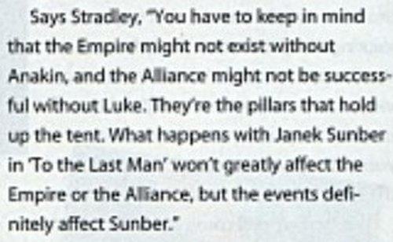

## scan p.70 (scan page 70)

Page contents: Steve Sansweet's collectibles Q&A: the Episode III set visit at Fox Studios Australia; the Illusive Concepts "Vader Revealed" bust sculpted by Mario Chiodo; From Concept to Screen to Collectible still in print; a 1983 Revenge of the Jedi mini-poster from a yard sale (reader names omitted). (hand-read)

## scan p.71 (scan page 71)

Page contents: Collectibles Q&A continued: the mini-poster was one of a set of 12 by Sales Corp.; an unlicensed neon-framed Ralph McQuarrie Luke-vs.-Vader poster sold through Spencer Gifts (reader names omitted). (hand-read)

## scan p.72 (scan page 72)

Page contents: Collectibles Q&A concluded: vintage Imperial Chemicals Star Wars wallpaper value; ideas for a Star Wars item in a freshwater aquarium (Episode I "Bottle Bags," the 1995 Wonder World gel tank); changing the batteries in the 2001 Hallmark R2-D2 ornament (reader names omitted). (hand-read)

## scan p.73 (scan page 73)

Page contents: Ad/order form: Star Wars Insider and Star Wars Gamer back issues from Paizo. (hand-read)

## scan p.74 (scan page 74)

Page contents: Toy Box (Hasbro): the Jedi Master Points Auction; a preview of 2004 basic and deluxe figures (Hoth Trooper, R-3PO, Luke Hoth Attack, Wampa with cave, General Rieekan, C-3PO with escape pod); the late-2003 Outlander Club wave (Ayy Vida, Elan Sleazebaggano, Obi-Wan); animated Clone Wars figures for spring 2004. (hand-read)

## scan p.75 (scan page 75)

Page contents: Toy Box photo page (printed p. 79): numbered captions for the new figures, including R-3PO's first action figure, the Outlander Club bar pieces, the Clone Wars animated Yoda and Anakin, General Rieekan and C-3PO's escape pod. (hand-read)

## scan p.76 (scan page 76)

Page contents: Toy Box (printed p. 80): Master Replicas' Darth Vader and Luke Skywalker Force FX lightsabers, Jango Fett's WESTAR-34 blasters, Palpatine's cane, and three Thermal Detonator editions. (hand-read)

## scan p.77 (scan page 77)

Page contents: Toy Box (printed p. 81): LEGO's Cloud City playset with the first Lando minifigure, the redesigned X-wing with a Dagobah theme, and the Ultimate Collector's Series Snowspeeder. (hand-read)

## scan p.78 (scan page 78)

Page contents: Star Wars crossword puzzle. (hand-read)

## scan p.79 (scan page 79)

Page contents: Letters ("Alien Encounters" reader picks of favorite aliens, praise for HoloNet News and the CIS ShadowFeed, a gym encounter with Ray Park); letter-writer names omitted. (hand-read)

## scan p.80 (scan page 80)

Page contents: Rumblings/fan photos continued: a reader on HoloNet News as a mirror of real-world war reporting, with an editors' Murdoch/Sidious joke; fan photos (a dog nicknamed Vader, a Halloween party, toothbrush bracelets, a Darth Maul jack-o'-lantern); all reader and fan names omitted. (hand-read)

## scan p.81 (scan page 81)

Page contents: Fan photos and letters: a teacher's annual Star Wars bulletin boards; a reader's trips to filming locations (redwoods for Endor, Seville's Plaza de Espana and the Caserta palace for Naboo); a stormtrooper group at a charity walk; then-and-now costume photos; a landspeeder bed (names omitted). (hand-read)

## scan p.82 (scan page 82)

Page contents: Fan mail art and costumes (Obi-Wan and Anakin costumes, a pumpkin), with an editors' plea for illustrated envelopes ("or we'll start telling everyone Greedo shot first"); the magazine's 2003 Statement of Ownership, Management, and Circulation (fan names omitted). (hand-read)

## scan p.83 (scan page 83)

Page contents: Ad: Cloud City Toys (new Saga and Clone Wars items, vintage toys, prototypes and rarities). (hand-read)

## scan p.84 (scan page 84)

Page contents: Star Wars Q&A (Pablo Hidalgo): why Vader's lightsaber casts a shadow in Jedi; why Sidious hasn't shown a lightsaber; why Luke entered Jabba's palace unarmed; how Anakin's Episode II saber differs from Luke's; Mace Windu's three hilt designs and purple blade. (hand-read)

- **Count Dooku** — entry/section: Q&A: lightsaber lighting: "Except for a section of the duel scene in Dooku's hidden hangar in Episode II, lightsabers never cast interactive lighting as they should." Source: *Star Wars Insider #72* (2003), scan p.84
  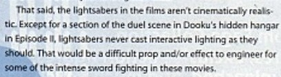
- **Darth Vader (Anakin Skywalker)** — entry/section: Q&A: Anakin's Episode II lightsaber: "The big tip off that the Episode II lightsaber isn't the Episode IV lightsaber is that Anakin's is destroyed in the Geonosian droid factory. By Episode III, he'll have a new weapon, and we'll start to see how all these lightsabers are connected." Source: *Star Wars Insider #72* (2003), scan p.84
  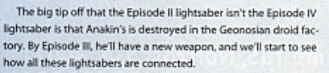

### Stat block notes (game mechanics, not feats)

- Q&A: Sidious and the lightsaber: The short answer is that so far, he hasn't had need to. Sidious' style focuses on plotting, not combat. That's what he has an apprentice for. (Star Wars Insider 72, p. 84) (Source: *Star Wars Insider #72* (2003), scan p.84)
- Q&A: Luke's lightsaber in Jabba's palace: Luke's lightsaber was, at the time, in a sensor-proof compartment inside Artoo-Detoo's silvery dome, and the little astromech was being reassigned to Jabba the Hutt's sail barge. (Star Wars Insider 72, p. 84) (Source: *Star Wars Insider #72* (2003), scan p.84)
- Q&A: Mace's purple blade: He made a rare exception for Mace. As a personal favor to Samuel L. Jackson, he let Mace carry a blade with Jackson's favorite color, purple. (Star Wars Insider 72, p. 84) (Source: *Star Wars Insider #72* (2003), scan p.84)

## scan p.85 (scan page 85)

Page contents: Q&A continued: why Luke holds his own against Vader in Jedi; how Yoda knew the Sith Rule of Two (Darth Bane); the PK worker droids behind Sidious's hologram; why emerging from hyperspace too close to Hoth was a problem (Ozzel, not Veers). (hand-read)

- **Luke Skywalker** — entry/section: Star Wars Insider 072 (2003): "What explains Luke’s remarkable ability to challenge the most feared Sith Lord in the galaxy?" Source: *Star Wars Insider #72* (2003), scan p.85
  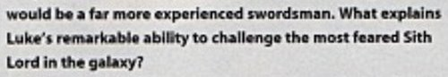
- **Luke Skywalker; Darth Vader (Anakin Skywalker)** — entry/section: Star Wars Insider 072 (2003): "Luke, though not as skilful or acrobatic as the young Jedi of the prequels, & still a formidable opponent, and he is very strong in the Force," Source: *Star Wars Insider #72* (2003), scan p.85
  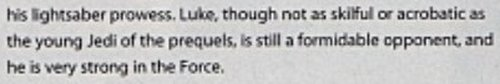

### Stat block notes (game mechanics, not feats)

- Q&A: Luke vs. Vader: In other words, the skill and power that Anakin shows as a young man is greater than what we see in the classic films. As Vader, Anakin is more machine than man, and being a half-droid construct has seriously hampered his lightsaber prowess. Luke, though not as skilful or acrobatic as the young Jedi of the prequels, is still a formidable opponent, and he is very strong in the Force. (Star Wars Insider 72, p. 85) (Source: *Star Wars Insider #72* (2003), scan p.85)
- Q&A: Ozzel at Hoth: Ozzel (not Veers) brought the fleet out within Rebel sensor range, before the Imperials had organized for bombardment, thinking that the surprise would allow the Empire to easily defeat the Rebels. The Rebels were alerted to the Imperial presence and raised their planetary shields. What was to have been an easy orbital bombardment then became a costly and prolonged ground engagement. Vader corrected the strategic flaw by removing Ozzel from command, permanently. (Star Wars Insider 72, p. 85) (Source: *Star Wars Insider #72* (2003), scan p.85)

## scan p.86 (scan page 86)

Page contents: Back-page illustration by Tony Moseley, "Episode III": Darth Vader stands before a Tatooine hut, his shadow that of the young Anakin with hands raised. (hand-read)

## scan p.87 (scan page 87)

Page contents: Ad: Code 3 Collectibles die-cast X-wing Starfighter replica with removable R2-D2. (hand-read)

## scan p.88 (scan page 88)

Page contents: Ad (back cover): Star Wars Trading Card Game, The Empire Strikes Back set (Armor ability, Location cards). (hand-read)

