# Owner Material 038 — Star Wars Insider #1–153 plus specials (with The Lucasfilm Fan Club Magazine #1–22): Star Wars Insider #73 (2004)

- **Source:** *Star Wars Insider* magazine (issues 23–153, 1994–2014) and its predecessor *The Lucasfilm Fan Club Magazine* (issues 1–22, 1987–1994), plus seven special editions: articles, interviews, comics and short fiction Secondary source (licensed Legends reference). Scan OCR'd on the box; the scan stays box-only and is **not** published.
- **Method:** every scanned page was OCR'd and machine-screened sentence by sentence for power-relevant statements (fights, kills, defeats, Force feats, rankings, superweapons) that name a character on our roster; each kept sentence is quoted verbatim from the OCR text and has a crop of the printed passage directly under it. Pages with nothing power-relevant are still listed with what is on them.
- **Citation:** "*Star Wars Insider #73* (2004), p.X" by printed page ("scan p.X" where no printed number applies). **Weight:** Licensed magazine: a secondary source. Its short fiction and comics are Legends stories; its articles and interviews sum up or discuss lore and rank below the novels, comics and games they describe.

## scan p.1 (scan page 1)

Page contents: Cover, Star Wars Insider 73 (February 2004): first look at new Episode III photos; the League of Spies; Clone Wars animation. (hand-read)

## scan p.2 (scan page 2)

Page contents: Contents: Episode III update from the producer; Mark Hamill on stage in Six Dance Lessons in Six Weeks and his voice work; Clone Wars animated series; behind the scenes of Obi-Wan's first Sith duel; the NPR Star Wars radio dramas; the League of Spies (Clone Wars military intelligence); Star Wars Galaxies; HoloNet News. (hand-read)

## scan p.3 (scan page 3)

Page contents: Editorial by starwars.com's content developer on the Episode III Hyperspace webcams at Fox Studios Australia: the Creature Shop, an online community watching 12 hours a day, and Ewan McGregor and Hayden Christensen asking what fans were saying. (hand-read)

### Stat block notes (game mechanics, not feats)

- Editorial: the Hyperspace webcam: I knew it had been accepted when Producer Rick McCallum called me and said, "Ewan wants the webcam in stunts right now." Hayden Christensen and Ewan McGregor were practicing their big duel, and I guess they wanted to show off their incredible moves. (Star Wars Insider 73, p. 3) (Source: *Star Wars Insider #73* (2004), scan p.3)

## scan p.4 (scan page 4)

Page contents: Rebel Rumblings: a call for Star Wars haiku on postcards; a Darth Maul costumer honored by Ray Park at Dragon*Con; meeting Mark Hamill after Six Dance Lessons in Six Weeks on Broadway (letter-writer and costumer names omitted); masthead. (hand-read)

## scan p.5 (scan page 5)

Page contents: Contributors: Aaron Allston, Rich Handley, Benjamin Harper, Ron Magid, Shane Turgeon, Daniel Wallace and others. (hand-read)

## scan p.6 (scan page 6)

Page contents: Episode III update: Rick McCallum at Skywalker Ranch in November 2003 on the rough-cut schedule (Lucas editing with Ben Burtt and Roger Barton, the Art and Animatics Departments), March pick-up shooting at Elstree, and how Episode II's droid-factory scene was added during pick-ups. (hand-read)

- **Darth Vader (Anakin Skywalker); Padmé Amidala; C-3PO; R2-D2** — entry/section: McCallum on the droid factory: ""What happened with the droid factory is we realized—after reviewing the film during the pick-up shooting in London—that there was just too much plot. The [characters] arrived at the planet and were instantly captured. It wasn't exciting. So instead of saying, 'Well, we screwed up,' we decided to do something about it." —Rick McCallum, Star Wars Insider 73, p. 6" Source: *Star Wars Insider #73* (2004), scan p.6
  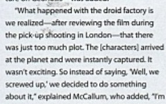

## scan p.7 (scan page 7)

Page contents: Episode III update concluded: Ben Burtt moving from animatics editor to sound designer; John Williams to begin composing in September 2004 and record in London in early 2005; McCallum "very happy" with progress. (hand-read)

## scan p.8 (scan page 8)

Page contents: First look at Episode III photos: Ki-Adi-Mundi's prosthetic make-up; an armored Neimoidian gunner; Mace Windu in the Jedi Council chamber; Hayden Christensen and Ian McDiarmid discussing a scene in the Chancellor's office with George Lucas. (hand-read)

### Stat block notes (game mechanics, not feats)

- Episode III photo caption: Somewhat older, definitely wiser, but still pondering the fate of the galaxy, Jedi Master Mace Windu (Samuel L. Jackson) takes a moment for reflection in the Jedi Council chamber. (Star Wars Insider 73, p. 8) (Source: *Star Wars Insider #73* (2004), scan p.8)

## scan p.9 (scan page 9)

Page contents: Prequel Update photos (printed p. 13): Mace Windu seated in the Jedi Council chamber; Hayden Christensen and Ian McDiarmid with George Lucas on the Chancellor's office set. (hand-read)

## scan p.10 (scan page 10)

Page contents: Prequel Update photos (printed p. 14): George Lucas arm in arm with two crew members costumed as senators; Hayden Christensen as Anakin in a starfighter cockpit. (hand-read)

## scan p.11 (scan page 11)

Page contents: Prequel Update captions: Obi-Wan with Commander Cody (Temuera Morrison), another clone and R4-G9 on a Republic cruiser landing platform; Obi-Wan's plunge aboard a Trade Federation cruiser; two production staffers' senator walk-ons; Anakin in his own starfighter. (hand-read)

### Stat block notes (game mechanics, not feats)

- Prequel Update caption: Obi-Wan Kenobi (Ewan McGregor) talks to Commander Cody (Temuera Morrison) and another clone trooper (Bodie Taylor) in front of his new Jedi starfighter—complete with droid R4-G9. The set, on Fox Studios Australia's Stage 5, represents a landing platform aboard a Republic battle cruiser. In Episode III, only Morrison's and Taylor's heads will be seen above CG-clone trooper-armored bodies. (Star Wars Insider 73, p. 11) (Source: *Star Wars Insider #73* (2004), scan p.11)

## scan p.12 (scan page 12)

Page contents: Prequel Update captions: underwater photography in the Stage 2 tank doubling as a flooded Trade Federation generator room; an aide to Passel Argente of the Corporate Alliance; Silas Carson's animatronic Nute Gunray mask; a solitary figure in the General's Quarters set on Stage 7. (hand-read)

## scan p.13 (scan page 13)

Page contents: Prequel Update photos (printed p. 17): technicians fitting the animatronic Neimoidian mask; the General's Quarters set aboard the Trade Federation cruiser. (hand-read)

## scan p.14 (scan page 14)

Page contents: From the World of Lucasfilm: the Adventures of Indiana Jones four-disc DVD set preview at the American Film Institute, hosted by Lucasfilm's Jim Ward, with Frank Marshall on collecting behind-the-scenes footage and the Dolby Digital 5.1 remixes. (hand-read)

## scan p.15 (scan page 15)

Page contents: Indiana Jones DVD event continued: Frank Marshall on making Raiders for $20 million in the spirit of B-movie serials, learning second-unit directing from Spielberg, and the films' logistical challenges. (hand-read)

## scan p.16 (scan page 16)

Page contents: Indiana Jones DVD event continued: the AFI heroes poll; Harrison Ford's surprise heckling appearance; Karen Allen on Marion Ravenwood and Spielberg's dead-python prank; sidebar review of Star Wars Vintage Action Figures—A Guide for Collectors (U.S. Kenner figures). (hand-read)

## scan p.17 (scan page 17)

Page contents: Indiana Jones DVD event continued: Kate Capshaw discovering the snakes and bugs in Sri Lanka; Alison Doody nearly hitting the pier while driving the boat in Last Crusade. (hand-read)

## scan p.18 (scan page 18)

Page contents: Star Wars Stars: Samuel L. Jackson in talks for a basketball-coach film; Keira Knightley cast opposite Adrien Brody in The Jacket; Liam Neeson in Asylum; Ewan McGregor's Scottish milk-moustache ad and Big Fish release move. (hand-read)

## scan p.19 (scan page 19)

Page contents: Star Wars Stars continued: Saruman wins an Empire Online "grandfather" poll; Jimmy Smits in Angel; Jack Thompson in The Assassination of Richard Nixon; Episode III senators Christopher Kirby and Bai Ling in new films. (hand-read)

## scan p.20 (scan page 20)

Page contents: Hyperspace report: postproduction webcam at Skywalker Ranch; Trisha Biggar chat (8/27/03) on disguising Padmé's pregnancy, Jimmy Smits and Ian McDiarmid's many costumes, and costuming an Expanded Universe character for the film (chat-user names omitted). (hand-read)

- **Padmé Amidala** — entry/section: Biggar on Padmé's pregnancy costumes: ""Basically, the challenges were in certain scenes to disguise the fact that she was pregnant, to enable her to fulfill her duty as a Senator without anyone being aware of the belly." —Trisha Biggar, Star Wars Insider 73, p. 20" Source: *Star Wars Insider #73* (2004), scan p.20
  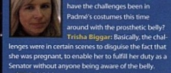

## scan p.21 (scan page 21)

Page contents: Set Diary (Pablo Hidalgo), August 11, 2003: Hayden Christensen in the gimbal-mounted starfighter cockpit with George Lucas calling out battle ad-libs; Anakin and Obi-Wan fighting side by side in an earlier, adventure-serial-style lightsaber scene. (hand-read)

### Stat block notes (game mechanics, not feats)

- Set Diary: the best starpilot: "He was the best starpilot in the galaxy," Obi-Wan Kenobi said to Luke in A New Hope, describing Anakin's skills. While I'm not about to take anything Old Ben says at face value anymore, he seems to be telling the truth for once. Today's shooting concentrated on the piloting skills of our Jedi heroes. (Star Wars Insider 73, p. 21) (Source: *Star Wars Insider #73* (2004), scan p.21)

## scan p.22 (scan page 22)

Page contents: Feature opener "Return of Mark Hamill: Comes Back to Broadway, the Big Screen, and Prime Time," by Dave Gross & Jenny Scott, with Hamill's portrait and three Luke Skywalker film stills. (hand-read)

## scan p.23 (scan page 23)

Page contents: Mark Hamill interview: his stage, video-game (Wing Commander, Jedi Academy's Luke) and voice-acting career (the Joker); the differences between media; starring as dance instructor Michael Minetti in Six Dance Lessons in Six Weeks at Broadway's Belasco Theatre. (hand-read)

## scan p.24 (scan page 24)

Page contents: Hamill interview continued: Minetti as a chameleon in each dance; Polly Bergen's Lily Harrison; learning choreography and teaching it "upside down and backward"; contrasting co-stars Rue McClanahan and Polly Bergen. (hand-read)

## scan p.25 (scan page 25)

Page contents: Hamill interview continued: the "haunted" Belasco and opening-night mishaps; his long friendship with a Star Wars production assistant met on the Tunisia shoot; the play's closing on November 23 and movie rights sale; his directorial debut Comic Book: The Movie. (hand-read)

## scan p.26 (scan page 26)

Page contents: Hamill interview continued: how Comic Book: The Movie grew out of a pitch for his Dark Horse miniseries The Black Pearl and a Star Trek documentary; Hamill on untold Star Wars anecdotes (alone on the Empire glacier), shying away from Star Wars, his son appropriating his collection, and creating Comic Book: The Movie as a Comic-Con mockumentary in which he plays a comic-book historian. (hand-read)

## scan p.27 (scan page 27)

Page contents: Hamill interview continued: the voice-acting cast and unscripted approach of Comic Book: The Movie; his comics fandom; the economy of the original Star Wars as his model; 12 years voicing the Joker. (hand-read)

## scan p.28 (scan page 28)

Page contents: Hamill interview continued: voice-acting physicality, The Wrong Coast on AMC, collaborative directing; "The Circle Is Now Complete": loving Luke, imagining an older Luke modeled on Obi-Wan for a once-planned Episode IX cameo, and Mara Jade. (hand-read)

- **Luke Skywalker** — entry/section: Hamill on loving Luke: ""There's something in all of them. I loved Luke. I loved the fact that he was so callow and came full circle to become someone who was a full grownup person. He's fated, of course, I think, to be lonely." —Mark Hamill, Star Wars Insider 73, p. 28" Source: *Star Wars Insider #73* (2004), scan p.28
  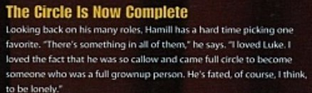
- **Luke Skywalker; Obi-Wan Kenobi; Mara Jade Skywalker** — entry/section: Hamill on an older Luke: ""I knew they were going to be about other characters with a possibility of my doing a cameo in the ninth one. I would imagine that [Luke] would model his life after Obi-Wan. I mean, the shock of finding out his best girl is his sister would be enough alone to send him to the monastery. You could see him whittling lightsaber holders out in the desert of Tatooine somewhere." —Mark Hamill, Star Wars Insider 73, p. 28" Source: *Star Wars Insider #73* (2004), scan p.28
  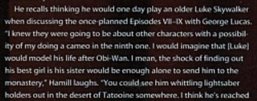

## scan p.29 (scan page 29)

Page contents: Hamill interview concluded: seeing the Special Editions with his kids; admiring Lucas's autonomy as writer, director and studio; his dream projects (The Black Pearl film and a theater ghost story); acting as "just a job." (hand-read)

## scan p.30 (scan page 30)

Page contents: Nelvana history: the Toronto studio founded in 1971 by Michael Hirsh, Patrick Loubert and Clive Smith; its first animated special A Cosmic Christmas (1977) and its later Droids and Ewoks work for Lucasfilm. (hand-read)

## scan p.31 (scan page 31)

Page contents: Nelvana history continued: Lucasfilm seeks an independent studio in early 1978 for the 10-minute animated segment of the Star Wars Holiday Special. (hand-read)

## scan p.32 (scan page 32)

Page contents: Nelvana history continued: The Story of the Faithful Wookiee introduces Boba Fett; Nelvana's series experience leads to the Droids and Ewoks Adventure Hour (ABC, September 1985, 13 episodes each plus "The Great Heep"); sidebar on Droids connections to the prequels. (hand-read)

### Stat block notes (game mechanics, not feats)

- Droids and the Prequel Trilogy sidebar: Perhaps the most significant of these comes in "A Race to the Finish," in which speeder racers Thall Joben and Jord Dusat take their speeder, the White Witch, to the Boonta Speeder Races, which is also the name of the Podrace that young Anakin wins in The Phantom Menace. Another Podrace theme is echoed in the episode "The Roon Games" when a two-man announcer team simultaneously comments on the Games in two different languages, much like the two-headed Podrace announcer does during Anakin's big race on Tatooine. (Star Wars Insider 73, p. 32) (Source: *Star Wars Insider #73* (2004), scan p.32)

## scan p.33 (scan page 33)

Page contents: Nelvana history continued: Lucas keeps Luke, Leia, Vader and Han off-limits for Droids, so Nelvana creates Thall Joben, Jord Dusat, Jann Tosh, Kez-Iban, Mungo Baobab and new villains; multiple writers including Ben Burtt. (hand-read)

## scan p.34 (scan page 34)

Page contents: Nelvana history continued: Droids cancelled after one season due to cost; Ewoks (Wicket, Kneesaa, Teebo, Latara) designed after a Muir Woods trip, with the Duloks as villains and Paul Dini and Bob Carrau writing the first season, renewed for another half-season. (hand-read)

## scan p.35 (scan page 35)

Page contents: Nelvana history continued: Ewoks Season Two (fall 1986) with 22 new episodes, shorter stories and a new opening theme; the 1994 Sci-Fi Channel reruns; "After the Flood": what became of the production material after a Toronto warehouse flood. (hand-read)

## scan p.36 (scan page 36)

Page contents: Nelvana history concluded: Royal Animated Art and Sunday Funnies distribute surviving cels and seri-cels; Droids and Ewoks make Nelvana an ABC supplier; later Nelvana series and its 2000 purchase by Corus Entertainment. (hand-read)

## scan p.37 (scan page 37)

Page contents: Collecting the Droids and Ewoks Adventure Hour: production cels and artwork, VHS releases, Star Comics' Droids and Ewoks comics, Kenner's 1985 toy lines and the cancelled second series, and international collectibles. (hand-read)

## scan p.38 (scan page 38)

Page contents: Set Piece: The Phantom Menace's Theed generator complex duel, with visual effects supervisor Scott Squires on his roughly 600 shots and the small set pieces for the energy corridor and walkway; digital fixes to Qui-Gon's head, Maul's CG legs and Obi-Wan's hanging body. (hand-read)

### Stat block notes (game mechanics, not feats)

- Set Piece: Duel of the Fates bluescreen fixes: "For example," Squires says, "when Obi-Wan and Qui-Gon leap across the chasm to the walkway, the top of Liam's head went out of frame, so we had to animate his head back in. In the shot where Darth Maul leaps and spins in the air, he actually flew into a blue landing pad, so we had to lose his legs at the impact point, which meant we switched over to CG legs while he was in midair until he landed." (Star Wars Insider 73, p. 38) (Source: *Star Wars Insider #73* (2004), scan p.38)

## scan p.39 (scan page 39)

Page contents: Set Piece continued: matching CG lighting to the hanging Obi-Wan; sets built with little headroom that had to be extended digitally. (hand-read)

## scan p.40 (scan page 40)

Page contents: Set Piece continued: redesigning the generator tubes' light after Lucas found it "sprayed too much," rotoscoping and redoing wide and medium shots; the three-way duel shot independently and combined; concept models of Theed buildings. (hand-read)

## scan p.41 (scan page 41)

Page contents: Set Piece continued: moving the duelists closer together digitally; stunt-double face replacements and wire removal; photo captions of Maul leaping off the control bay and Nick Gillard rehearsing with Liam Neeson. (hand-read)

### Stat block notes (game mechanics, not feats)

- Set Piece: Maul's kicks: "...to make the fight more dynamic, we moved the actors tighter together to make their connections more obvious, like when Darth Maul kicks Obi-Wan a couple of times in the face. Well, they didn't actually connect, and that was evident in the shot, so we had to split Ewan out from his set, push him over, and do some paintwork shadowing on his face to create the impact of the foot." (Star Wars Insider 73, p. 41) (Source: *Star Wars Insider #73* (2004), scan p.41)

## scan p.42 (scan page 42)

Page contents: Set Piece continued: painting out bent aluminum lightsaber tubes and estimating blade length on stunt shots; adding scuffed reflections to the CG floor; captions of Qui-Gon and Maul in the energy-beam hallway and Maul continuing the fight with Obi-Wan after killing Qui-Gon. (hand-read)

## scan p.43 (scan page 43)

Page contents: Set Piece concluded ("Aftermath"): the duel's synthetic environment sets a new standard; Squires, usually an animated-character supervisor (The Mask, Dragonheart), on handling any role; hangar droid-fight rehearsal caption. (hand-read)

## scan p.44 (scan page 44)

Page contents: Star Wars radio dramas feature: Brian Daley scripts the 13-part NPR adaptation (recorded in Los Angeles in 1980), expanding the film with lost and new scenes; Lucas sells the rights to KUSC-FM for a dollar. (hand-read)

### Stat block notes (game mechanics, not feats)

- Radio drama's added material: Those who tuned in learned of Leia's life on Alderaan and how she became custodian to the Death Star plans; they also learned of the droids' activities on the Tantive IV, Luke's adventures with Biggs and others on Tatooine, Han Solo's encounter with an enforcer for Jabba the Hutt named Big Bunji, Leia's violent interrogation at the hands of Darth Vader, and much more. (Star Wars Insider 73, p. 44) (Source: *Star Wars Insider #73* (2004), scan p.44)

## scan p.45 (scan page 45)

Page contents: Radio dramas continued: the cast (Mark Hamill, Anthony Daniels, Perry King, Ann Sachs, Brock Peters, Bernard Behrens, Keene Curtis); record NPR ratings; the 10-episode Empire drama (1983) with John Lithgow's Yoda; HighBridge Audio's 1996 Jedi adaptation with Ed Asner's Jabba, and Daley's death after recording concluded. (hand-read)

## scan p.46 (scan page 46)

Page contents: Radio dramas continued: interviews with cast members; Ann Sachs on radio acting, director John Madden, and playing Leia's bluntness rather than imitating Carrie Fisher; Perry King on auditioning for Han in the film. (hand-read)

- **Leia Organa Solo; Han Solo** — entry/section: Sachs on playing Leia: ""What I realized, when I saw Star Wars on film, is that Carrie had a marvelous sort of bluntness about her, and that's what I tried to focus on with my reading—she was no-nonsense blunt and not easily wooed by Han." —Ann Sachs, Star Wars Insider 73, p. 46" Source: *Star Wars Insider #73* (2004), scan p.46
  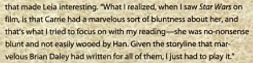

## scan p.47 (scan page 47)

Page contents: Radio dramas continued: Perry King on Lucas's "kids' movie for kids of any age," playing his own take on Han, and saying goodbye to Brian Daley; Arye Gross takes over as Lando for the Jedi radio show. (hand-read)

## scan p.48 (scan page 48)

Page contents: Radio dramas continued: Arye Gross on radio acting ("create the world with your voice"); Joshua Fardon on taking over Luke from Mark Hamill, his awe of Anthony Daniels, his treble-boosted voice, and voicing Luke again for Disney's book-and-record adaptations. (hand-read)

## scan p.49 (scan page 49)

Page contents: Radio dramas continued: Paul Hecht, the Emperor in all three dramatizations, on radio, being influenced by Ian McDiarmid, and his sons' pride; Fardon recalls acting out the Emperor's lightning; Edward Asner introduced as Jabba. (hand-read)

### Stat block notes (game mechanics, not feats)

- Fardon on recording the Emperor's lightning: "He was just this guy in a sweater, and all of a sudden we were doing the thing where Palpatine is firing these bolts of lightning, and literally, I was on the ground, screaming, while John Madden was mime-throwing bolts of lightning at me. And every time he did it, I would scream louder, while Paul Hecht was doing his routine. You'd be surprised how physical a lot of it was and how much we really had to act all of this stuff out!" —Joshua Fardon (Star Wars Insider 73, p. 49) (Source: *Star Wars Insider #73* (2004), scan p.49)

## scan p.50 (scan page 50)

Page contents: Radio dramas continued: Edward Asner voicing Jabba without electronic aid, his love of radio and wish to do the prequels; David Alan Grier, a Yale student of John Madden, as Stormtrooper #2; cast photo captions. (hand-read)

- **Jabba the Hutt** — entry/section: Asner on playing Jabba: ""I blew myself up in bullfrog fashion each time I spoke," adding, "man, you can really get stretch marks." … "I wanted to emulate the movie-Jabba as closely as possible, so I gained 5,000 pounds. Didn't do much for my love life, though." —Edward Asner, Star Wars Insider 73, p. 50" Source: *Star Wars Insider #73* (2004), scan p.50
  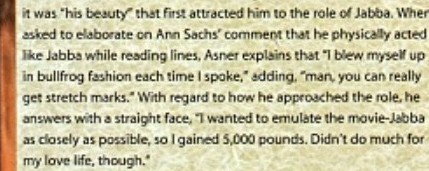

## scan p.51 (scan page 51)

Page contents: Radio dramas concluded: David Alan Grier on Mark Hamill's Star Wars room and their friendship; Jerry Hardin on playing assorted pilots and officers, his friendship with Ann Sachs, and the drama's revived life on CD; recording-session photo captions (John Lithgow as Yoda, Billy Dee Williams as Lando). (hand-read)

## scan p.52 (scan page 52)

Page contents: Full-page illustration for the Clone Wars fiction "League of Spies": Joram Kithe and companions under blaster fire. (hand-read)

## scan p.53 (scan page 53)

Page contents: Fiction, The Clone Wars: "League of Spies" (by Aaron Allston) opens on Tarhassan, where Joram Kithe, holdout blaster in hand, trades countersigns with his new mission commander while his partner Mapper covers him with a laser rifle from across the lane. (hand-read)

## scan p.54 (scan page 54)

Page contents: "League of Spies" continued: the team—commander Cherek Tuhm, Tinian Hanther and the Falleen Livintius Sazes—meets Joram and Mapper, an enhanced clone trooper secretly serving as Joram's bodyguard; Tarhassan has declared for the Separatists and the lone Republic Intelligence agent, Edbit Teeks, has vanished; Livintius hands out a printed agenda. (hand-read)

## scan p.55 (scan page 55)

Page contents: "League of Spies" continued: Joram points out the security risk of a printed agenda; Tinian explains the team of non-intelligence experts is a pilot program inspired by Joram's success on Pengalan, where the former Finance accountant helped clone troopers escape. (hand-read)

## scan p.56 (scan page 56)

Page contents: "League of Spies" continued: the committee votes on everything; the team flies over the city of Nehass in a cramped rented airspeeder, argues over where the "prisoner of war" will sit, and crash-lands outside Zazana Renkel's residence, Werder Towers. (hand-read)

## scan p.57 (scan page 57)

Page contents: "League of Spies" continued: while the committee plans an elaborate break-in, Renkel walks by; Mapper plays a lost tourist and Joram stuns her from the airspeeder; Cherek threatens to send Joram home and forces his word of honor not to countermand orders again. (hand-read)

## scan p.58 (scan page 58)

Page contents: "League of Spies" continued: the masked team interrogates Renkel, bound to an overstuffed chair with binder-tape; Joram pulls Cherek aside after Cherek reveals Teeks was the only Intelligence officer on-world. (hand-read)

## scan p.59 (scan page 59)

Page contents: "League of Spies" continued: Joram persuades the committee to leave Renkel to the "merciless" Mapper, who learns gently that she loves Teeks and knows nothing; Joram stuns and sedates her for safekeeping, and Mapper drops him at Teeks' home while the committee plans a raid on PlanSec headquarters. (hand-read)

## scan p.60 (scan page 60)

Page contents: "League of Spies" continued: Joram bypasses a PlanSec seal on Teeks' ransacked quarters, signals with Teeks' swing-arm lamp, and meets the local informant code-named Tharb, a restaurant server at Corgan's Gustatorium. (hand-read)

## scan p.61 (scan page 61)

Page contents: "League of Spies" continued: Tharb confirms Teeks is held at PlanSec's main office and passes partial building plans; Joram and Mapper return, falsely report Renkel dead, and hand the committee the plans as if from her datapad. (hand-read)

## scan p.62 (scan page 62)

Page contents: "League of Spies" continued: Tinian, in a captured PlanSec uniform, slips into the basement and disables a monitored door with Mapper's coaching; Joram proposes that she escort him in as a disreputable "prisoner" behind a real PlanSec prisoner detail. (hand-read)

## scan p.63 (scan page 63)

Page contents: "League of Spies" continued: Joram and Tinian overpower a PlanSec officer in his office; Joram tells Tinian that Renkel is alive; they stun two cell-block guards, blast Teeks' cell door after Livintius's basement distraction, and Joram deduces PlanSec has access to Teeks' reports to Intelligence. (hand-read)

## scan p.64 (scan page 64)

Page contents: "League of Spies" continued: the escape through the blown-out wall; a young PlanSec guard shoots Cherek before Tinian stuns him; Teeks offers to hide the wounded Cherek in his safe houses as the team lifts off Tarhassan. (hand-read)

## scan p.65 (scan page 65)

Page contents: Advertisement: subscribe to or renew Star Wars Insider at starwars.paizo.com (issues, Bantha Tracks, Official Star Wars Fan Club membership kit). (hand-read)

## scan p.66 (scan page 66)

Page contents: HoloNet News (illustrations by Joe Corroney): a new Mon Calamari accord overseen by Jedi Master Kit Fisto, signed by Quarren Senator Tundra Dowmeia, restructures the Council; the delayed Finis Valorum Memorial unveiled in Coruscant's Jrade District amid heavy security, with remarks by Mon Mothma and a dedication by Bail Organa. (hand-read)

## scan p.67 (scan page 67)

Page contents: HoloNet News continued: Asajj Ventress issues new CIS bounty postings dominated by Jedi warrants, with bounties on Republic loyalist senators; the Republic recruits Givin astrogators, per Yag'Dhul Senator Daggibus Scoritoles and Wat Tambor. (hand-read)

- **Asajj Ventress** — entry/section: Ventress Issues New Jedi Bounties: "This latest update of 82 notices of remandation comes from Commander Asajj Ventress and is dominated by Jedi warrants." Source: *Star Wars Insider #73* (2004), scan p.67
  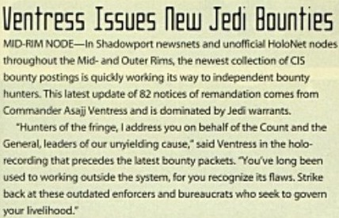

### Stat block notes (game mechanics, not feats)

- HoloNet News: Ventress's bounty postings: This latest update of 82 notices of remandation comes from Commander Asajj Ventress and is dominated by Jedi warrants. "Hunters of the fringe, I address you on behalf of the Count and the General, leaders of our unyielding cause," said Ventress in the holo-recording that precedes the latest bounty packets. "You've long been used to working outside the system, for you recognize its flaws. Strike back at these outdated enforcers and bureaucrats who seek to govern your livelihood." (Star Wars Insider 73, p. 67) (Source: *Star Wars Insider #73* (2004), scan p.67)
- HoloNet News: CIS bounty list: Topping this bounty list are Jedi Generals Mace Windu and Yoda, each valued at 1,250,000 credits. Notable additions and increases to the list include General Obi-Wan Kenobi (350,000 credits), General Ki-Adi-Mundi (350,000 credits), and General Shaak Ti (300,000 credits). The highest-valued non-General is Padawan Anakin Skywalker (225,000 credits), who gained notoriety following his exploits on Skye, Virujansi, and Aargonar. … Senator Padmé Amidala of Naboo has the highest bounty of the loyalists, although her extraordinary death mark of 22,000,000 credits comes direct from Viceroy Nute Gunray of the Trade Federation. (Star Wars Insider 73, p. 67) (Source: *Star Wars Insider #73* (2004), scan p.67)

## scan p.68 (scan page 68)

Page contents: Set Piece-style feature on A New Hope's Yavin Rebel base at Shepperton Studios' Stage H: a single full X-wing and partial Y-wing among cutouts; John Stears' Zeslous tower-crane X-wing liftoff; ILM second-unit jungle-canopy shots from a model-shop tower in Tikal. (hand-read)

## scan p.69 (scan page 69)

Page contents: Yavin hangar feature continued: captions on the incomplete full-size Y-wing, the matte-painting-combined hangar views, the Incom T-65 X-wing's proton torpedoes, flare-equipped flight suits after WWII pilots, and Rebel pilot helmets. (hand-read)

### Stat block notes (game mechanics, not feats)

- Rebel pilot helmets caption: Each Rebel pilot helmet displayed its own distinct markings. Though many of the helmets would later be reissued to new pilots in The Empire Strikes Back and Return of the Jedi, Biggs Darklighter's checkered helmet was never used again. (Star Wars Insider 73, p. 69) (Source: *Star Wars Insider #73* (2004), scan p.69)

## scan p.70 (scan page 70)

Page contents: Profile: Veronica Whitney-Robinson, author of Star Wars Galaxies: The Ruins of Dantooine (Del Rey), on her speed-writing career—co-writing Spectre of the Black Rose in six weeks, Forgotten Realms Sembia novels—and the rush schedule for the Galaxies tie-in. (hand-read)

## scan p.71 (scan page 71)

Page contents: Whitney-Robinson profile continued: heroine Dusque Mistflyer, a bio-engineer recruited by Rebel spy Finn Darktrin to find a Holocron listing Rebel sympathizers; crossovers with Galaxies settings and creatures; her Peace Corps years in Cameroon; sidebar on earlier videogame-tie-in novels (X-wing, Dark Forces). (hand-read)

## scan p.72 (scan page 72)

Page contents: Comics preview: Star Wars Republic #60 "Hate and Fear" by Haden Blackman and Brian Ching tells Asajj Ventress's backstory and ties into the Cartoon Network Clone Wars microseries; "Meanwhile, Back on Coruscant..." introduces Republic #61. (hand-read)

- **Asajj Ventress** — entry/section: Blackman on Ventress's backstory: ""Basically, we hear Ventress' backstory from one of her enemies … It explains how she was trained in the Force and why she believes Obi-Wan and the other Coruscant Jedi are 'false Jedi.' It should give readers much greater insight into her motivations." —Haden Blackman, Star Wars Insider 73, p. 72" Source: *Star Wars Insider #73* (2004), scan p.72
  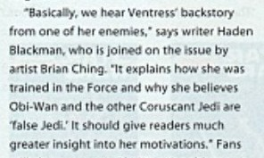
- **Asajj Ventress** — entry/section: Blackman on Ventress as villain: ""Visually, she was based on some Episode II concept art, but then I worked up her backstory to make her something other than Komari [Vosa, the female antagonist of LucasArts' Bounty Hunter video game] or Darth Maul. She's not a Sith and doesn't even consider herself a Dark Jedi. She thinks she's living up to the Jedi ideals in ways that Obi-Wan could never do." —Haden Blackman, Star Wars Insider 73, p. 72" Source: *Star Wars Insider #73* (2004), scan p.72
  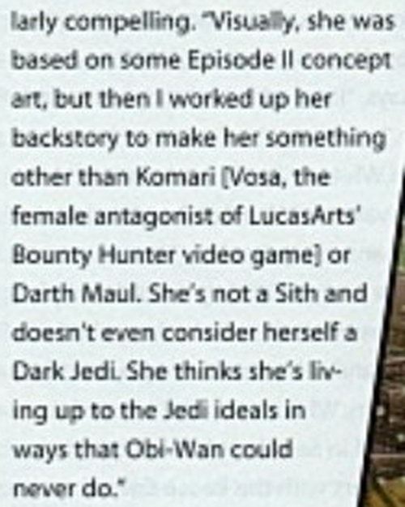

## scan p.73 (scan page 73)

Page contents: Comics preview continued: Republic #61 by John Ostrander and Brandon Badeaux centers on Bail Organa, Mon Mothma and ex-chancellor Valorum amid a pirate attack and Palpatine's push for security measures; Republic #62 sends bounty hunters after Obi-Wan and clone trooper Alpha while Anakin, temporarily Ki-Adi-Mundi's Padawan, dreams of Obi-Wan in danger. (hand-read)

- **Finis Valorum** — entry/section: Ostrander on Valorum: ""He was an honest and capable politician up against an insidious adversary and a bureaucracy that couldn't be managed … And he has changed since we've last seen him. He's less naive. You'll get a glimpse of the sort of role he could play." —John Ostrander, Star Wars Insider 73, p. 73" Source: *Star Wars Insider #73* (2004), scan p.73
  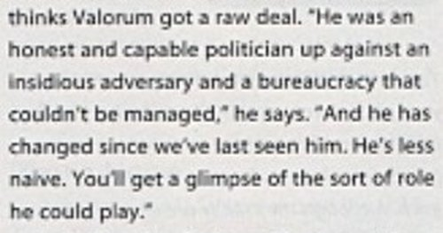
- **Darth Vader (Anakin Skywalker); Ki-Adi-Mundi; Obi-Wan Kenobi** — entry/section: Ostrander on Anakin in Republic #62: ""Anakin is now the Padawan, at least temporarily, to Ki-Adi-Mundi … He's having dreams—visions—of Obi-Wan still being alive but in pain or danger. The last time he had that was when his mother died. We all know how he reacted to that. Will Anakin abandon his duty to look for his Master and friend? He wouldn't be Anakin if he didn't." —John Ostrander, Star Wars Insider 73, p. 73" Source: *Star Wars Insider #73* (2004), scan p.73
  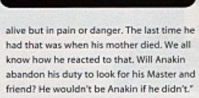

## scan p.74 (scan page 74)

Page contents: Collectors' column: the columnist on answering awkward letters and gentle humor; reader questions (names omitted) on a limited-edition Frito Lay plush Ewok's value and an unscarred 12-inch battle-damaged Luke and Tauntaun figure (a missed deco step lowers value). (hand-read)

## scan p.75 (scan page 75)

Page contents: Collectors' column continued: Episode I phone cards from Asia as a peripheral collectible; 1997 Hallmark ornaments bought at a garage sale; the Rawcliffe Anakin pewter figure with Vader's helmet, a pack-in with the Star Wars Monopoly CD-ROM collector edition. (hand-read)

## scan p.76 (scan page 76)

Page contents: Collectors' column continued (reader names omitted): a purported Empire Strikes Back "fourth draft shooting script" with Red Coding Numbers is identified as a 1981 convention-circuit forgery; the B'omarr Monk was a Hasbro Internet exclusive due for regular release; a flea-market Revenge of the Jedi T-shirt is a bootleg; the 1977 20th Century Records soundtrack LP. (hand-read)

## scan p.77 (scan page 77)

Page contents: Collectors' column continued: soundtrack LP values; a sealed box of Phantom Menace tie-in Japanese curry; how to send questions to Scouting the Galaxy; sidebar listing Timothy Zahn's Survivor's Quest bookstore signing tour in February 2004 and an e-signing. (hand-read)

## scan p.78 (scan page 78)

Page contents: Toy Box: Hasbro's visit to the Episode III set in Sydney with Gentle Giant scanning for 2005 toys; first-half 2004 plans—themed Basic waves (Wave 6 Battle of Endor: Han as AT-ST driver, General Madine, General Lando), six Ultra figures, new and repackaged Unleashed figures, lightsabers. (hand-read)

## scan p.79 (scan page 79)

Page contents: Toy Box continued: Target-exclusive Clone Wars animated figures, a Red Leader X-wing, Toys "R" Us Jedi Council scene packs (Yoda, Qui-Gon Jinn, Ki-Adi-Mundi), glasses-style four-packs and the Skirmish at Carkoon set; reader Q&A (names omitted) on Expanded Universe figures such as Quinlan Vos, 12-inch vehicles, and "retread" figures. (hand-read)

## scan p.80 (scan page 80)

Page contents: Toy Box photos, Basic Wave 3 Jabba's Palace: J'Quille ("Tooth Face"), holographic Luke, Lando as the skiff guard Tamtel Skreej, and Tanus Spijek, an Elom and former Rebel spy. (hand-read)

### Stat block notes (game mechanics, not feats)

- Toy Box caption: Lando as skiff guard: Lando Calrissian disguised himself as the skiff guard Tamtel Skreej to gain access to Jabba's Palace to help rescue Han Solo. (Star Wars Insider 73, p. 80) (Source: *Star Wars Insider #73* (2004), scan p.80)

## scan p.81 (scan page 81)

Page contents: Toy Box photos continued: Rappertunie with his growdi harmonique; Ultra Wave 2 Jabba the Hutt with the Court Denizens three-pack (Bubo, Wol Cabasshite, a B'omarr Monk). (hand-read)

## scan p.82 (scan page 82)

Page contents: Crossword puzzle (Keeping Score theme: film and TV productions and portrayers). (hand-read)

## scan p.83 (scan page 83)

Page contents: Letters (writer names omitted): a fan's convention story of Mark Hamill declining to sign a Star Wars poster because of eBay scalpers; a mock personals ad in reply to issue 71's "Desperately Seeking Bruce" letter; praise for issue 71's Episode III photos; a Farscape fan on the Creature Shop's Dave and Lou Elsey; a 13-year-old's homemade Boba Fett costume. (hand-read)

## scan p.84 (scan page 84)

Page contents: Letters continued (names omitted): a parent on sharing Star Wars with a daughter; beadwork; an architect on ILM's practical effects for the Indiana Jones films and kit-bashing; an Imperial Star Destroyer bridge diorama; a Rogue Squadron tattoo, with the editors inviting an Asajj Ventress tattoo. (hand-read)

## scan p.85 (scan page 85)

Page contents: Collectors' stories from readers (names omitted): winning a Target-exclusive LEGO Yoda display by entering over 100 guesses; a public-radio Star Wars poster; a Jeremy Bulloch-signed Boba Fett figure from a collectors' group; a book-focused collection. (hand-read)

## scan p.86 (scan page 86)

Page contents: Reader commentary page (names omitted): praise for issue 71, KOTOR and Galaxies; the Kohl Seerdon question; a Jango Fett costume at a disco-dance night. (hand-read)

### Stat block notes (game mechanics, not feats)

- Kohl Seerdon is Moff Seerdon: Affirmation: Kohl Seerdon is indeed also Moff Seerdon. (Star Wars Insider 73, p. 86) (Source: *Star Wars Insider #73* (2004), scan p.86)

## scan p.87 (scan page 87)

Page contents: Back-issue order form for Star Wars Insider and Star Wars Gamer (Paizo Publishing). (hand-read)

## scan p.88 (scan page 88)

Page contents: Q&A with Pablo Hidalgo: Coruscant's entertainment district isn't its lowest level; why Luke threw away his lightsaber; why Vader died from the lightning; Palpatine's withered appearance; why Death Star II was bigger; Endor's primary. (hand-read)

- **Darth Vader (Anakin Skywalker)** — entry/section: Star Wars Insider 073 (2004): "Vader's suit, which kept him alive following his injuries sustained in Episode Ill, could mot with Stand the destructive energies of the Emperor's Force lightning on to his demise." Source: *Star Wars Insider #73* (2004), scan p.88
  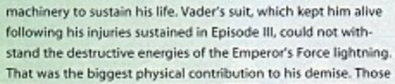

### Stat block notes (game mechanics, not feats)

- Q&A: Luke casts away his lightsaber: There's no reason to believe that Luke knew the Emperor could hurl lightning. We don't know whether Yoda elaborated upon his warning not to underestimate the powers of the Emperor. Regardless of whether Luke knew or not, his casting away of his weapon had nothing to do with tactics or strategy, and had everything to do with making a point. His gesture showed Palpatine that he could throw away his aggression, and thus, that the Emperor would not be able to use that approach to lure him to the dark side as he did Anakin. (Star Wars Insider 73, p. 88) (Source: *Star Wars Insider #73* (2004), scan p.88)
- Q&A: why Vader died: Keep in mind that Luke did not rely on sensitive electronic machinery to sustain his life. Vader's suit, which kept him alive following his injuries sustained in Episode III, could not withstand the destructive energies of the Emperor's Force lightning. That was the biggest physical contribution to his demise. … keep in mind that Vader's final release of the rage and loathing that sustained him for two decades also factored into his end. (Star Wars Insider 73, p. 88) (Source: *Star Wars Insider #73* (2004), scan p.88)
- Q&A: Death Star II's size: The Death Star's size is dictated by the power of its superlaser. The majority of the Death Star's volume is made up of the prime weapon and the systems that support it. Because the second Death Star has an even more powerful superlaser than the first Death Star, it had to be bigger. (Star Wars Insider 73, p. 88) (Source: *Star Wars Insider #73* (2004), scan p.88)

## scan p.89 (scan page 89)

Page contents: Q&A continued: Endor orbits a gas giant (the Kahn novelization's vanished-planet claim and the Dark Force Rising Sourcebook's no-primary claim are superseded); a moon isn't a standard size; Jabba doesn't appear in a film asked about; Rieekan's "death mark" line; how Leia knew to find Obi-Wan on Tatooine through Bail Organa. (hand-read)

## scan p.90 (scan page 90)

Page contents: Back-page illustration by Tony Moseley: Darth Vader and a female Vader-armored companion run hand in hand with a picnic basket beneath the Death Star. (hand-read)

## scan p.91 (scan page 91)

Page contents: Advertisement: Comic Book: The Movie on DVD (Mark Hamill's film). (hand-read)

