# Owner Material 038 — Star Wars Insider #1–153 plus specials (with The Lucasfilm Fan Club Magazine #1–22): Star Wars Insider #74 (2004)

- **Source:** *Star Wars Insider* magazine (issues 23–153, 1994–2014) and its predecessor *The Lucasfilm Fan Club Magazine* (issues 1–22, 1987–1994), plus seven special editions: articles, interviews, comics and short fiction Secondary source (licensed Legends reference). Scan OCR'd on the box; the scan stays box-only and is **not** published.
- **Method:** every scanned page was OCR'd and machine-screened sentence by sentence for power-relevant statements (fights, kills, defeats, Force feats, rankings, superweapons) that name a character on our roster; each kept sentence is quoted verbatim from the OCR text and has a crop of the printed passage directly under it. Pages with nothing power-relevant are still listed with what is on them.
- **Citation:** "*Star Wars Insider #74* (2004), p.X" by printed page ("scan p.X" where no printed number applies). **Weight:** Licensed magazine: a secondary source. Its short fiction and comics are Legends stories; its articles and interviews sum up or discuss lore and rank below the novels, comics and games they describe.

## scan p.1 (scan page 1)

Page contents: Cover, issue 74: First Look! Episode III clone trooper; Timothy Zahn returns with Mara Jade; The New Jedi Order in 100 need-to-know facts; Kid Stuff: Star Wars storybooks; Hoth Freezes Over: Who's Who in Echo Base; new fiction (dragon hunting) and a new column, Action Figure Archive. (hand-read)

## scan p.2 (scan page 2)

Page contents: Contents (printed p. 4): Prequel Update (Rick McCallum on the rough cut and the new clone trooper), The New Jedi Order in 100 Easy Lessons, Wasaka Berries and Monster Ships (storybooks), In Focus (Attack of the Clones miniatures), Who's Who in Echo Base, fiction "Pearls in the Sand" by Veronica Whitney-Robinson; departments including Star News, Star Sightings, Best of Hyperspace, HoloNet News (Operation Durge's Lance), Set Piece (Dooku's solar sailer hangar), Bookshelf (Zahn's Survivor's Quest). (hand-read)

## scan p.3 (scan page 3)

Page contents: Guest editorial by Betsy Mitchell, Editor-in-Chief of Del Rey Books: how she suggested Timothy Zahn for Bantam's first Star Wars novel, Heir to the Empire, and the "Betsy Mitchell Memorial Bathroom" in the Zahns' Oregon home. (hand-read)

- **Mara Jade Skywalker** — entry/section: Zahn on coming full circle: ""I had the movie soundtracks, and I played them while I was writing, back when I was an unknown … I remember thinking that if George [Lucas] could come out of nowhere to become such a huge success, then so could I. It's ironic that he's the reason it happened." —Timothy Zahn, Star Wars Insider 74, p. 3" Source: *Star Wars Insider #74* (2004), scan p.3
  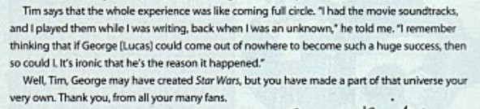

## scan p.4 (scan page 4)

Page contents: Rebel Rumblings letters (writer names omitted): a movies-toys-Insider fan praising Set Piece and the Stuart Freeborn and costume articles; a fan who came to Star Wars through the Special Editions and prefers the books; masthead and staff credits. (hand-read)

## scan p.5 (scan page 5)

Page contents: Contributors: Jason Fry, Craig R. Carey, Josh Radke, Veronica Whitney-Robinson, guest editor Betsy Mitchell (Nebraska journalism degree, Omaha World-Herald, Analog, Baen, Bantam Spectra, Aspect, Del Rey editor-in-chief since 2002) and puzzle designer Mike Selinker, among others. (hand-read)

## scan p.6 (scan page 6)

Page contents: Prequel Update (Jane Irene Kelly) begins: McCallum on the first rough cut of Episode III being "75 percent done" on January 6, the post-cut "soul-searching" period, April pickup shooting at Elstree, and ILM receiving the first major action sequence (the Republic–Separatist space battle) on January 8. (hand-read)

## scan p.7 (scan page 7)

Page contents: Prequel Update continued: Lucas reviews the 20-minute space-battle sequence at ILM's "C Theater" with John Knoll ("I've seen this (sequence) before, but not as big as this"), 52 more scenes go to the Animatics Department, ILM staffing toward about 150 workstations, Frank Oz to record "the first guide track for Yoda," and Lucas's daily animatics sessions with Ryan Church and Erik Tiemens choosing vehicles for a late-film Jedi sequence; McCallum says the team is three weeks behind on the rough cut. (hand-read)

## scan p.8 (scan page 8)

Page contents: Prequel Update photos: a reversible Tarnab mask (Senator Mot Not Rab's species) whose back was never used; Emperor's Royal Guards costumes; Ewan McGregor emerging from a cave-like set; Padmé confiding in Anakin in her Coruscant apartment. (hand-read)

### Stat block notes (game mechanics, not feats)

- Padmé confides in Anakin: Senator Padmé Amidala pours out her fears and concerns to her husband, Anakin Skywalker, in a touching moment in the Senator's apartment on the planet Coruscant. (Star Wars Insider 74, p. 8) (Source: *Star Wars Insider #74* (2004), scan p.8)

## scan p.9 (scan page 9)

Page contents: Prequel Update photos: crew watching Ewan McGregor in the cave-set opening; Padmé and Anakin in her apartment. (hand-read)

## scan p.10 (scan page 10)

Page contents: Prequel Update photos: Ewan McGregor as a bearded Obi-Wan Kenobi; Natalie Portman as Padmé on a bluescreen set with George Lucas. (hand-read)

## scan p.11 (scan page 11)

Page contents: Prequel Update photos: the cabin of Bail Organa's speeder; the Trade Federation cruiser bridge set; Ewan McGregor preparing a confrontation scene with Padmé in her apartment; Natalie Portman chatting with George Lucas on the veranda set. (hand-read)

## scan p.12 (scan page 12)

Page contents: Prequel Update photos: Trade Federation cruiser steering controls; an unnamed alien Senator (Nicholas Ferguson) whose mask began as Dave Elsey's exploration for Darth Sidious; a Jedi Temple holographic-projector control panel; a cramped vent shaft in the Trade Federation cruiser. (hand-read)

### Stat block notes (game mechanics, not feats)

- Sidious mask repurposed: This as-yet unnamed alien Senator (played by Nicholas Ferguson) was derived from an initial exploration by Creature Shop Creative Supervisor Dave Elsey for Darth Sidious. After he found out the look that George Lucas wanted for the man under the hood, he repainted and repurposed the mask for the senator. (Star Wars Insider 74, p. 12) (Source: *Star Wars Insider #74* (2004), scan p.12)

## scan p.13 (scan page 13)

Page contents: Prequel Update photos: a close-up control panel and the Trade Federation cruiser vent-shaft set. (hand-read)

## scan p.14 (scan page 14)

Page contents: Star News (Benjamin Harper and Jenny Scott): Ewan McGregor plans to record more songs toward an album. (hand-read)

- **Obi-Wan Kenobi** — entry/section: McGregor on singing: ""I love to sing … I've always sung, but I've never considered myself a professional singer." —Ewan McGregor, Star Wars Insider 74, p. 14" Source: *Star Wars Insider #74* (2004), scan p.14
  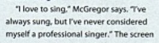

## scan p.15 (scan page 15)

Page contents: Star News continued: McGregor on marketing an album, a rap song by Simon Boswell criticizing rock-star excess, the Long Way Round motorbike docu-series with Charley Boorman (about 20,000 miles), and the Faster Grand Prix documentary he narrates. (hand-read)

## scan p.16 (scan page 16)

Page contents: Star News: Natalie Portman at the Kids for Kids Celebrity Carnival and donating ballet slippers to the Shoes for Orphan Souls auction; another cast member's charity autographs; Temuera Morrison leading the Warriors rugby team onto the field in Sydney with a Maori ritual. (hand-read)

## scan p.17 (scan page 17)

Page contents: Star News: Knights of the Old Republic named Game of the Year by GameSpy.com and others (Golden Joystick, SpikeTV, Amazon.com); GameRankings averages of 94 and 92 percent; set 4,000 years before the Empire; reviewers praise its d20-based play, NPCs and graphics; more than 270,000 Xbox units sold in two weeks. (hand-read)

## scan p.18 (scan page 18)

Page contents: Star Sightings (Benjamin Harper): Hayden Christensen's growing toy-frog collection and his set table-tennis habit; a cast member in Spike Lee's She Hate Me; Keira Knightley (Sabé) sent a script for a Knightmare film. (hand-read)

## scan p.19 (scan page 19)

Page contents: Star Sightings: Drew Struzan paints the Hellboy theatrical poster; Christopher Lee narrates on a Rhapsody heavy-metal album; John Williams Grand Marshal of the 2004 Rose Parade; Brian Blessed in The Legend of the Tamworth Two; other voice-cast news. (hand-read)

## scan p.20 (scan page 20)

Page contents: The Best of Hyperspace (Pablo Hidalgo): starwars.com premium features, webcam highlights (John Knoll mugging), and a chat with Rick McCallum (chat-user names omitted): Episode III has Empire's emotional depth with many new planets; the opening battle is in space; Palpatine/Darth Sidious gets a dark-side display ("Yes, most definitely"). (hand-read)

- **Darth Vader (Anakin Skywalker)** — entry/section: McCallum on Episode III's ending: ""On the surface, the film ends on a sad note (and for me, a personally gloomy one, because I'll be out of a job), but of course we know where the story goes from there. Anakin is the Chosen One, after all." —Rick McCallum, Star Wars Insider 74, p. 20" Source: *Star Wars Insider #74* (2004), scan p.20
  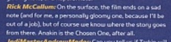

## scan p.21 (scan page 21)

Page contents: Set Diary excerpts (Pablo Hidalgo): actors slide down a tilting blue ramp on an empty soundstage; reflective-lubricant glare problems; script supervisor Jayne-Ann Tenggren's themed slate letters ("Penguins up," "Chewie's up," "Darths," "Eopies," "Goodbyes up!"); slate 177G is the last shot of principal photography, wrapping at 6:42 p.m.; Lucas tells the crew "this is actually the funnest film I've ever worked on … This is the best crew I've ever worked with." (hand-read)

## scan p.22 (scan page 22)

Page contents: The New Jedi Order in 100 Easy Lessons (Jason Fry) opens: 100 facts on the 19-novel Del Rey saga (spoilers warned); Japanese editions split each book into two volumes (Star by Star into four) with covers that form a single image; synopses of Vector Prime and Dark Tide I: Onslaught. (hand-read)

### Stat block notes (game mechanics, not feats)

- Vector Prime: Chewbacca's death: The massacre of a research crew on remote Belkadan is the first warning that the Yuuzhan Vong have invaded the Star Wars galaxy. On Sernpidal, Chewbacca dies saving Anakin Solo. (Star Wars Insider 74, p. 22) (Source: *Star Wars Insider #74* (2004), scan p.22)

## scan p.23 (scan page 23)

Page contents: NJO synopses: Dark Tide II: Ruin (Elegos A'Kla dies as emissary; Corran Horn duels Shedao Shai over Ithor; Jagged Fel and Tsavong Lah introduced); the author's five favourite books (Vector Prime, Hero's Trial, Star by Star, Traitor, The Unifying Force); Agents of Chaos I: Hero's Trial (a grieving Han, Droma, Vergere introduced). (hand-read)

- **Corran Horn** — entry/section: Star Wars Insider 074 (2004): "Corran Horn and the invaders’ warmaster, Shedac Shai, duel, with the fate of the planet Ithor in the balance." Source: *Star Wars Insider #74* (2004), scan p.23
  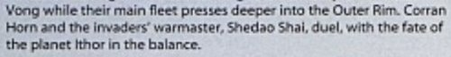

## scan p.24 (scan page 24)

Page contents: NJO synopses: Agents of Chaos II: Jedi Eclipse (Viqi Shesh; Thrackan Sal-Solo fires Centerpoint Station at Fondor, destroying much of the Hapan fleet), Balance Point (Battle of Duro; Jacen vs. Tsavong Lah); related works: the Chewbacca comic miniseries, Greg Bear's Rogue Planet (introducing Zonama Sekot and Vergere) and the e-book "Recovery". (hand-read)

## scan p.25 (scan page 25)

Page contents: NJO synopses: Edge of Victory I: Conquest (Anakin rescues Tahiri on occupied Yavin 4; the Jeedai cult), the "Ylesia" e-book and Jag Fel Gamer story, Edge of Victory II: Rebirth (Onimi, Shimrra, Ben Skywalker introduced), and Gamer serial addenda. (hand-read)

- **Thrackan Sal-Solo; Jaina Solo** — entry/section: Ylesia e-book: "In this e-book set at the same time as Destiny's Way, Thrackan Sal-Solo finds himself the leader of the Peace Brigade, and Jaina's task force of Force-melded Jedi pilots become a formidable fighting force." Source: *Star Wars Insider #74* (2004), scan p.25
  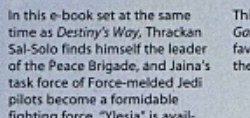

### Stat block notes (game mechanics, not feats)

- Rebirth: Ben Skywalker born: The heretic shaper Nen Yim finds herself drawn into the service of Yuuzhan Vong Supreme Overlord Shimrra and his jester, Onimi. Luke and a gravely ill Mara Jade flee arrest on Coruscant; their son Ben is born soon after their escape. (Star Wars Insider 74, p. 25) (Source: *Star Wars Insider #74* (2004), scan p.25)

## scan p.26 (scan page 26)

Page contents: NJO: Star by Star synopsis; memorable beasties and ideas (voxyn, slashrats, YVH droids, grutchins, the Krizlaws, Alpha Red, Threepio's mortality, the seedship nursery, Jacen's homecoming, Zonama Sekot's defence). (hand-read)

### Stat block notes (game mechanics, not feats)

- Star by Star: Anakin's death: With the New Republic crumbling, Anakin, Jacen, Jaina and Tahiri lead a Jedi raid on a Yuuzhan Vong worldship over Myrkr – the source of Jedi killing beasts called voxyn. Anakin dies, Jaina opens herself to the dark side, and Jacen is captured after killing the voxyn queen. Chief of State Borsk Fey'lya dies fighting the invaders on Coruscant. (Star Wars Insider 74, p. 26) (Source: *Star Wars Insider #74* (2004), scan p.26)

## scan p.27 (scan page 27)

Page contents: NJO synopses: Dark Journey (fall of Coruscant; Harrar pursues Jaina) and Enemy Lines I: Rebel Dream (Wedge Antilles at Borleias; the Inner Circle resistance); Yuuzhan Vong Who's Who: Nom Anor, Shimrra, Tsavong Lah, Nas Choka, Onimi, Shedao Shai, Yomin Carr (killed by Mara Jade), Harrar, Nen Yim, Vua Rapuung. (hand-read)

- **Tsavong Lah** — entry/section: Star Wars Insider 074 (2004): "Nas Choka Thied in the Yuuzhan Vong hierarchy behind Shimrra and Tsavong Lah, Nas Choka wins many early victories and is one of the few high-ranking Yuuzhan Vong to survive the war." Source: *Star Wars Insider #74* (2004), scan p.27
  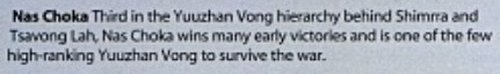
- **Corran Horn; Shedao Shai** — entry/section: Star Wars Insider 074 (2004): "Horn then kills Shedao Shai in a duel" Source: *Star Wars Insider #74* (2004), scan p.27
  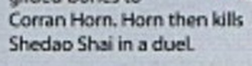

## scan p.28 (scan page 28)

Page contents: NJO: Enemy Lines II: Rebel Stand (Wedge uses the Lusankya against a worldship) and Traitor (Jacen tutored by Vergere on Yuuzhan'tar) synopses; returning characters and cameos: Roa, Bossk, Belindi Kalenda, Bollux, Thrackan Sal-Solo, Isolder, Qorl, Keyan Farlander, Soontir Fel, Irek Ismaren as Lord Nyax, Malinza Thanas, Sekot taking Anakin Skywalker's form, and Boba Fett (not the Sernpidal mayor) in The Unifying Force. (hand-read)

- **Wedge Antilles** — entry/section: Star Wars Insider 074 (2004): "Wedge uses the Super Star Destroyer Lusankya to destroy @ Yuuzhan Vong worldship at the climax of a shattering battle over Borieias." Source: *Star Wars Insider #74* (2004), scan p.28
  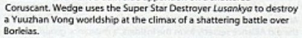
- **Soontir Fel; Wedge Antilles** — entry/section: Star Wars Insider 074 (2004): "Soontir Fel Jag’s dad and Wedge's brother-in-law, this legendary baron flew with the New Republic and various incarnations of the Empire before throwing im his lot with the Chiss." Source: *Star Wars Insider #74* (2004), scan p.28
  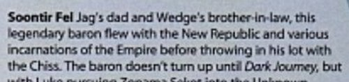

## scan p.29 (scan page 29)

Page contents: NJO: Destiny's Way synopsis; fallen heroes: Chewbacca, Anakin Solo, Ganner Rhysode, Vergere, Elegos A'Kla, Borsk Fey'lya, Ikrit and Admiral Ackbar; Force Heretic I: Remnant synopsis (Nom Anor as the Prophet Yu'shaa). (hand-read)

- **Jaina Solo; Tsavong Lah** — entry/section: Star Wars Insider 074 (2004): "Tsavong Lah nearly succeeds in killing Jaina but is instead slain by ber." Source: *Star Wars Insider #74* (2004), scan p.29
  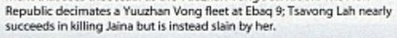

### Stat block notes (game mechanics, not feats)

- Destiny's Way: Tsavong Lah slain: Returning to the New Republic with Jacen, Vergere tells of the living world Zonama Sekot and its connection to the Yuuzhan Vong. Shimrra arrives to claim Yuuzhan'tar, and Nom Anor infiltrates a heretical movement that sees the Jeedai as the Yuuzhan Vong's salvation. The New Republic decimates a Yuuzhan Vong fleet at Ebaq 9; Tsavong Lah nearly succeeds in killing Jaina but is instead slain by her. (Star Wars Insider 74, p. 29) (Source: *Star Wars Insider #74* (2004), scan p.29)
- Vergere's death: Vergere The Fosh Jedi, once a contemporary of Obi-Wan Kenobi and Anakin Skywalker, returns with the Yuuzhan Vong to heal Mara Jade and complete Jacen's training. She dies at Ebaq 9 to save the Solo twins. (Star Wars Insider 74, p. 29) (Source: *Star Wars Insider #74* (2004), scan p.29)

## scan p.30 (scan page 30)

Page contents: NJO: Force Heretic II: Refugee (Bakura, the Ssi-Ruuk) and III: Reunion (Zonama Sekot rediscovered) synopses; great showdowns: Chewie vs. Dobido, Luke wading into a Vong camp in Onslaught, Corran Horn vs. Shedao Shai, the Falcon vs. Tsavong Lah's Sunulok, Fey'lya's fusillade, Anakin's sacrifice, Jacen in arms, Ganner's last stand, the endgame at Ebaq 9. (hand-read)

- **Chewbacca** — entry/section: Star Wars Insider 074 (2004): "Chewie’s father provides a fitting epitaph in Dark Horse's Chewbacca: “How <an 4 meré moon be a match for my son?" Source: *Star Wars Insider #74* (2004), scan p.30
  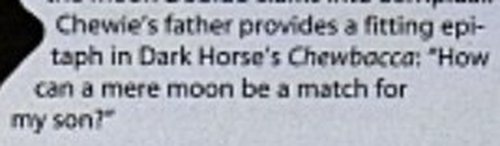
- **Jaina Solo; Tahiri Veila** — entry/section: Key Event: Battle of Bakura: "At Bakura, our heroes find that the Ssi-Ruuk have returned, promising peace; Jaina and Tahiri – who is still struggling with her half-Jedi, half-Yuuzhan Vong nature – foil a plot to enslave the planet." Source: *Star Wars Insider #74* (2004), scan p.30
  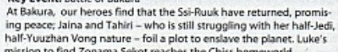
- **Tsavong Lah; Jaina Solo; Jacen Solo (Darth Caedus)** — entry/section: Endgame at Ebaq 9: "Endgame at Ebaq 9 In the final pages of Destiny's Way, a defeated Tsavong Lah sees a chance for revenge, seizing the chance for a harrowing showdown with Jaina and Jacen in Ebaq 9's twisting tunnels." Source: *Star Wars Insider #74* (2004), scan p.30
  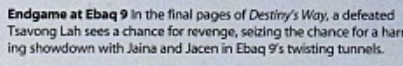

## scan p.31 (scan page 31)

Page contents: NJO: The Final Prophecy and The Unifying Force synopses; abandoned concepts and inside jokes: killing Luke (vetoed by Lucas), the Vong as biotech users rather than dark-siders, the name from the Vong restaurant and Yunnan tea, the hardcover/paperback plan, the Dark Tide trilogy compressed to two, Droma as Han's sidekick, Vergere meant to survive, Ben Skywalker's early arrival, Anakin and Jacen swapping roles, and the GFFA acronym. (hand-read)

### Stat block notes (game mechanics, not feats)

- Luke Skywalker, R.I.P. (rejected): Luke Skywalker, R.I.P. The New Jedi Order creators were determined to shake things up by killing a major character, but it took a while to decide who would die. One early target was Luke – an idea also considered for Return of the Jedi. Then as now, George Lucas said no. (Star Wars Insider 74, p. 31) (Source: *Star Wars Insider #74* (2004), scan p.31)
- Anakin Solo's original role: Anakin and Jacen Anakin was supposed to be the series' hero and Luke's successor as leader of the Jedi. That would have been a nice counterpoint to Anakin Skywalker's rise and fall two generations before, but the plan was rejected. Among other things, Lucasfilm worried that it would be confusing to have the adventures of two different Anakins unfold at the same time. The result: Jacen and Anakin essentially switched roles. (Star Wars Insider 74, p. 31) (Source: *Star Wars Insider #74* (2004), scan p.31)

## scan p.32 (scan page 32)

Page contents: Opening spread of "Wasaka Berries and Monster Ships" (Craig R. Carey) with Splinter of the Mind's Eye covers. (hand-read)

## scan p.33 (scan page 33)

Page contents: Storybooks feature: between 1978 and 1986 only seven original adult novels appeared, while young readers had many storybooks (The Maverick Moon, Ewok tales); Random House is considering reissues. (hand-read)

## scan p.34 (scan page 34)

Page contents: Storybooks: Random House line editor Lisa Findlay on continuity issues; publicity director Judith Haut on nostalgia; primer begins with The Maverick Moon (Luke at the New Academy for Space Pilots uses Zukonium rays to blow a maverick moon off course) and The Mystery of the Rebellious Robot. (hand-read)

### Stat block notes (game mechanics, not feats)

- The Maverick Moon: For example, how would today's relentlessly continuity-conscious fans regard The Maverick Moon, wherein (warning: spoilers ahead) academy student and planetary pioneer Luke Skywalker, helped by his good friend Princess Leia, destroys a rogue moon that threatens to crash into their world? (Star Wars Insider 74, p. 34) (Source: *Star Wars Insider #74* (2004), scan p.34)

## scan p.35 (scan page 35)

Page contents: Storybooks: The Mystery of the Rebellious Robot (Artoo goes berserk from oil contaminated by Jawa saboteurs; Chewie captures the Jawas and gets his medal from Leia); the gap after 1979, the Rebel Mission to Ord Mantell record and read-alongs; the 1984 wave of Ewok books; Joe Johnston's The Adventures of Teebo. (hand-read)

### Stat block notes (game mechanics, not feats)

- Chewbacca's storybook medal: Now, if you thought Chewbacca had to wait to receive his medal at the MTV awards a few years ago, you are sadly mistaken: For his heroics against the Jawa saboteurs, Princess Leia presents the Millennium Falcon's first mate with the medal he deserved all along. (Star Wars Insider 74, p. 35) (Source: *Star Wars Insider #74* (2004), scan p.35)

## scan p.36 (scan page 36)

Page contents: Storybooks: The Adventures of Teebo plot (Duloks led by Vulgarr kidnap Ewok children; Teebo, the Grudakk guardian of the Father Tree); dozens of Ewok titles in 1984–85, recalled by former Random House editor Stephanie Spinner. (hand-read)

- **No single roster character (rules/setting/general)** — entry/section: Ewoks cartoon: the Father Tree (no character slug): "The Ewok hunting party and Teebo, assisted by the magical forces of the forest, battle and defeat the cowardly Duloks. Vulgarr takes Teebo hostage only to be foiled by the Grudakk, who is revealed to be the guardian of the Father Tree." Source: *Star Wars Insider #74* (2004), scan p.36
  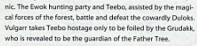

## scan p.37 (scan page 37)

Page contents: Storybooks: synopses of How the Ewoks Saved the Trees (Wicket and Kneesaa scare off the Phlogs with Logray's powder), The Baby Ewoks' Picnic Surprise (rainbow berries), Three Cheers for Kneesaa, The Ewoks' Hang-Gliding Adventure; 1985–86 cartoon adaptations; sidebar on The Wookiee Storybook (1979) with illustrator Patricia Wynne (sketches sent straight to Lucas; Itchy and Malla; Chewbacca's telepathy). (hand-read)

### Stat block notes (game mechanics, not feats)

- Chewbacca's storybook telepathy: The Wookiee Storybook also introduced a new power for Chewbacca – his amazing telepathy, with which he and his wife, Malla, converse over the vast distances of the galaxy. "The telepathic connection was the idea of the author, Eleanor Ehrhardt," Wynne says. "We discussed it, and it seemed so natural to any species living in a nontechnological world. As I recall, we thought our pets did the same thing." (Star Wars Insider 74, p. 37) (Source: *Star Wars Insider #74* (2004), scan p.37)

## scan p.38 (scan page 38)

Page contents: Storybooks: Tyrant's Test recasts the Wookiee Storybook tale as a family fable; Lumpy's later appearances; synopses of the Wicket apprenticeship, Wicket Goes Fishing and The Ewok Who Was Afraid; 1986 Touch and Feel books; storybooks resume in 1996; sidebar on the phantom titles The Droid Dilemma and School Days planted in the Tomart guide to catch copiers (Steve Sansweet comments). (hand-read)

- **Chewbacca** — entry/section: Kube-McDowell on Chewbacca's vetoed wives: ""In my original outline for the Black Fleet Crisis, I proposed that one of the reasons Chewbacca returned to [his hometown of] Rwookrrorro was to find a mate, and that when the Millennium Falcon reappeared for the rescue in Book Three, it would be crewed by Chewbacca and his several wives. This was the only major story point that was vetoed by Lucasfilm, and the reason it was vetoed was that – unbeknownst to me – Chewbacca already had a family in the official Star Wars chronology." —Michael P. Kube-McDowell, Star Wars Insider 74, p. 38" Source: *Star Wars Insider #74* (2004), scan p.38
  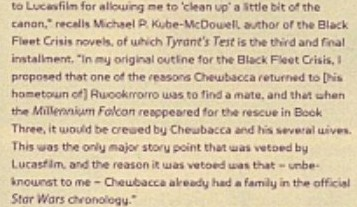

## scan p.39 (scan page 39)

Page contents: Storybooks checklist: the original storybooks from The Wookiee Storybook and The Maverick Moon (Eleanor Ehrhardt) through Teebo and the 1984–86 Ewok and droid titles (Random House). (hand-read)

## scan p.40 (scan page 40)

Page contents: In Focus (Ron Magid): Attack of the Clones digital-effects cinematography; ILM effects DPs Pat Sweeney, Marty Rosenberg and Carl Miller had to shoot miniatures with Sony HDC-F950 24p HD cameras. (hand-read)

## scan p.41 (scan page 41)

Page contents: In Focus continued: Sweeney on Lucas's push for digital and John Knoll's "Let's just go for it"; Miller on three motion-control shots a day with instant full-res review and onstage composites; digital's depth of field made models look like toys, so more detail had to be added; the cameras could not shoot slower than 24p. (hand-read)

## scan p.42 (scan page 42)

Page contents: In Focus continued: Rosenberg on needing slower frame rates and five times less light; bigger models and 5K–20K lights; Sweeney's Kamino sets "almost melting" and the overheating camera on the 35-to-40-foot arena miniature. (hand-read)

## scan p.43 (scan page 43)

Page contents: In Focus continued: simulating slower frame rates for motion control by synchronizing rigs to the 24p camera and merging or skipping frames (digital supervisor Fred Meyers); captions on the Tusken Raider village miniature. (hand-read)

## scan p.44 (scan page 44)

Page contents: In Focus continued: real-time 24p playback of slow motion-control moves; multiple focus planes (Sweeney's seven planes in the desert sequences, Rosenberg's Droid Factory, Miller's three passes on the Coruscant bar exterior where Obi-Wan and Anakin stand at the door). (hand-read)

## scan p.45 (scan page 45)

Page contents: In Focus concludes: HD gives effects DPs "a fighting chance" against CG (Miller); wish list for future cameras; Rosenberg: "Ninety nine years from now, we'll be on the verge of a new technology"; glossary of 24p, depth of field, HD, lighting terms, match-move, motion control and videotap; captions on Count Dooku's box in the Execution Arena miniature. (hand-read)

## scan p.46 (scan page 46)

Page contents: Who's Who in Echo Base (Josh Radke) opens: Battle of Hoth losses (more than 600 Rebel SpecForce troopers, 180 base personnel, 42 pilots) against General Maximilian Veers's Blizzard Force. (hand-read)

### Stat block notes (game mechanics, not feats)

- Hoth losses vs. Blizzard Force: The Battle of Hoth remains one of the Rebellion's most costly battles – and one of the Empire's most celebrated. More than 600 Rebel SpecForce troopers, 180 base personnel, and 42 pilots fell in the fierce battle. That's not to mention the hundreds of wounded and missing Rebel fighters and untold credits worth of lost equipment – all this compared to the fractional losses incurred by the Empire's aptly named Blizzard Force, commanded by the Imperial Army's most efficient and cunning senior officer, General Maximilian Veers. (Star Wars Insider 74, p. 46) (Source: *Star Wars Insider #74* (2004), scan p.46)

## scan p.47 (scan page 47)

Page contents: Echo Base: the defeat blamed on bad luck (a probe droid's findings brought to Vader by then-Captain Piett) and a competent Imperial officer; General McQuarrie (Ralltiir, Operation Skyhook; the Decipher card shows artist Ralph McQuarrie); General Carlist Rieekan (Bruce Boa). (hand-read)

### Stat block notes (game mechanics, not feats)

- Rieekan's career: Nicknamed "The Somber General," Carlist Rieekan was one of the founding leaders of the Rebel Alliance. A native of Alderaan, Rieekan joined the Army of the Republic and quickly jumped through the ranks. When the Emperor formed the New Order, the idealist Rieekan joined the Alliance, where, tied to the House of Organa, he headed Rebel operations in the Alderaan system. After the Alderaan tragedy, Rieekan bounced between being a senior advisor in Alliance High Command and assigning sector commanders in the field. As commander of the main Rebel base on Hoth, General Rieekan had the unenviable task of getting the base operational on a system that refused to cooperate. After the Battle of Hoth, General Rieekan became a permanent member of High Command as Chief of Sector Command. (Star Wars Insider 74, p. 47) (Source: *Star Wars Insider #74* (2004), scan p.47)

## scan p.48 (scan page 48)

Page contents: Echo Base: Major Bren Derlin (John Ratzenberger), Commander Beryl Chiffonage (Attack Pattern Delta and the harpoon tactic; Veers had buried that weakness years earlier), and Commander Rey (docking bay; insisted no ship leave before the shield was up). (hand-read)

### Stat block notes (game mechanics, not feats)

- Derlin's Echo Base role: General Rieekan knew that keeping Echo Base running consistently and efficiently would be no easy task, which is exactly why he chose the burly Major Bren Derlin. Having worked with Rieekan several times before at the sector level, Captain Derlin had garnered a reputation for being intelligent and resourceful. His biggest moment came during a critical evacuation of a Rebel base on Nentan that housed several hundred refugees. Rieekan promoted him to major and attached him to Major Monnon's Corps of Engineers as a supervisor. After the base was completed, it was a natural choice to make Derlin the head of Echo Base's security and operations. (Star Wars Insider 74, p. 48) (Source: *Star Wars Insider #74* (2004), scan p.48)

## scan p.49 (scan page 49)

Page contents: Echo Base: chief controller Toryn Farr (gave the retreat code, took command of the disabled Bright Hope, promoted to commander with the Kalidor Crescent), personnel officer Tigran Jamiro of Onderon (later a general at Ylesia against the Yuuzhan Vong), and Lt. Romas "Lock" Navander (escorted four transports, captured; actor Jerry Harte). (hand-read)

## scan p.50 (scan page 50)

Page contents: Echo Base: gunner Kesin (with Hobbie Klivian), evacuation officer Captain Valdez (more than 86 percent of personnel evacuated; Decipher named the character after a young card-game player who died of leukemia, name omitted) and Sergeant Major Trey Callum (confirmed the walkers, killed in the opening barrage). (hand-read)

## scan p.51 (scan page 51)

Page contents: Echo Base: Sergeant Hollis of Naboo (Kenobi Medallion), forward scout Lieutenant Alder (led the search party for Luke; DarkStryder Campaign) and Corporal Blin (killed when a snowspeeder pilot destroyed the walker Wedge tripped). (hand-read)

## scan p.52 (scan page 52)

Page contents: Echo Base: Corporal Quien (tauntaun handler, trampled during the battle), intelligence officer Captain Serper (killed by Vader's snowtroopers) and K-3PO (droid-pool coordinator, played by Chris Parsons, who also played 4-LOM). (hand-read)

- **No single roster character (rules/setting/general)** — entry/section: Who's Who: Captain Serper (no character slug): "Unfortunately, just a few days later, Death Squadron received new information and turned back toward Hoth's direction. While waiting for his new assignment from Intelligence, Captain Serper served as one of Echo Base's scanners – specifically, deciding what was an asteroid and what could be an Imperial scout ship." Source: *Star Wars Insider #74* (2004), scan p.52
  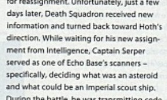

## scan p.53 (scan page 53)

Page contents: Echo Base: R-3PO (red protocol droid reprogrammed as a spy-hunter), 2-1B (chief surgeon, gave Luke his artificial hand) and the FX-7 "Fixit" medical assistant droid. (hand-read)

### Stat block notes (game mechanics, not feats)

- 2-1B's career: Too-Onebee belongs to a fiercely independent series of droids. He spent several years in the service of the Empire on the planet of Firro as personal physician to Lord Cuvir before becoming part of the Alliance. The droid was the chief surgeon at Echo Base. He also aided in an investigation that led to the discovery and capture of several wampas from a nearby wampa cave. He was assigned to the Bright Hope and later the medical frigate Redemption, where he performed the surgery that gave Commander Skywalker his artificial hand. (Star Wars Insider 74, p. 53) (Source: *Star Wars Insider #74* (2004), scan p.53)

## scan p.54 (scan page 54)

Page contents: Full-page illustration for "Pearls in the Sand": a krayt dragon looming over a young woman and an alien companion among giant bones. (hand-read)

## scan p.55 (scan page 55)

Page contents: Fiction "Pearls in the Sand" by Veronica Whitney-Robinson, illustrated by Dave Dorman: in a Mos Taike cantina a drunken Mon Calamarian, Ackli, claims to have found where krayt dragons go to die; Imperial bioengineer Dusque Mistflier overhears, as do two Zabraks. (hand-read)

## scan p.56 (scan page 56)

Page contents: "Pearls in the Sand": Dusque persuades her Ithorian colleague Tendau to follow the treasure hunters into the desert for canyon krayt genetic samples; their friendship as outsiders among the Empire's bioengineers. (hand-read)

## scan p.57 (scan page 57)

Page contents: "Pearls in the Sand": Dusque prefers asking forgiveness to permission; the hunters stumble into a Tusken Raider camp and Dusque and Tendau stampede the banthas to break up the attack. (hand-read)

## scan p.58 (scan page 58)

Page contents: "Pearls in the Sand": the Zabraks catch Dusque and Tendau, learn they are Imperial bioengineers, and leave them bound in the desert as a sandstorm hits; Dusque frees herself on a jagged rock. (hand-read)

## scan p.59 (scan page 59)

Page contents: "Pearls in the Sand": Dusque finds Tendau, who insists they go on; they sight the krayt bones as three krayt dragons chase the fleeing treasure hunters. (hand-read)

## scan p.60 (scan page 60)

Page contents: "Pearls in the Sand" concludes: hundreds of skeletons in the boneyard; Dusque finds a glowing gizzard stone (a krayt "pearl"); later, in a cantina, she reveals the pearl to scoffing patrons. (hand-read)

## scan p.61 (scan page 61)

Page contents: HoloNet News (illustrations by Joe Corroney): Tipoca City, Kamino — the first 100 clone commanders graduate from an ARC-trooper-run officer program, with given names officially recognized; Baron Orman Tagge, 17, named to chair a Republic Intelligence tech steering committee. (hand-read)

- **Alpha-17** — entry/section: Alpha-17 on training clone commanders: ""The canned edu-packs can teach a soldier only so much," said Alpha-17, lead instructor at the Tipoca City training facility. "These commanders need the guidance only seasoned combat veterans can provide." —Alpha-17, Star Wars Insider 74, p. 61" Source: *Star Wars Insider #74* (2004), scan p.61
  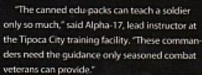
- **Lama Su** — entry/section: Lama Su on clone names: ""In the past, a desire for individuality led to the spontaneous creation of combat nicknames in the field," explains Kaminoan Prime Minister Lama Su. "A name was once considered a flaw, but we have found that allowing names produces the desired effects of initiative and goal-setting. In command units, these unofficial nicknames are formally recognized as a mark of distinction and excellence among our most capable products." —Lama Su, Star Wars Insider 74, p. 61" Source: *Star Wars Insider #74* (2004), scan p.61
  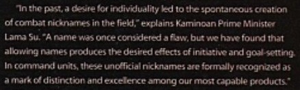
- **Armand Isard** — entry/section: Isard on the Techno Union: ""Too long has the enemy benefited from the research and innovation of the Techno Union," said Armand Isard, director of the Senate Bureau of Intelligence, via holocomm. —Armand Isard, Star Wars Insider 74, p. 61" Source: *Star Wars Insider #74* (2004), scan p.61
  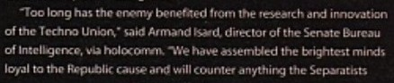
- **Orman Tagge** — entry/section: Orman Tagge's vow: ""The bold ideas of the House of Tagge have kept us leaders for generations," said Tagge. "I vow to put aside any past competitive differences we may have had with other firms that are still loyal to the Republic, and I extend an invitation to the best engineers and scientists from Sienar, Kuat, Rendili and Corellian Engineering to counter the growing threat." —Orman Tagge, Star Wars Insider 74, p. 61" Source: *Star Wars Insider #74* (2004), scan p.61
  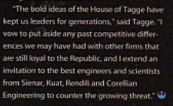

## scan p.62 (scan page 62)

Page contents: HoloNet News (CIS Shadowfeed): Operation Durge's Lance breaks Duro's outer defenses, destroying Golan platforms and Republic Acclamators; Jyvus space city surrenders and Representative Hoolidan Keggle is missing; Corellia predicted as the next target. (hand-read)

## scan p.63 (scan page 63)

Page contents: Set Piece, Attack of the Clones Geonosis hangar: built on Stage 2 at Fox Studios Australia, earlier used as the arena entrance; the 70-foot solar sailer took eight weeks to build; Christopher Lee on swordfights and on imagining Yoda; stunt double Kyle Rowling. (hand-read)

- **Count Dooku; Yoda; Obi-Wan Kenobi; Darth Vader (Anakin Skywalker)** — entry/section: Star Wars Insider 074 (2004): "Obviously outmatched, Count Docku distracted his smaller rival by toppling a large digital addition to the environment over the fallen OSi-Wan and Anakin." Source: *Star Wars Insider #74* (2004), scan p.63
  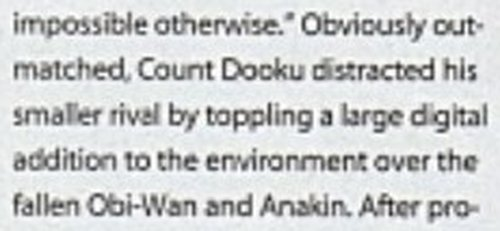
- **Count Dooku** — entry/section: Lee on the Dooku duel: ""I've probably done more swordfights and dagger fights on celluloid than any actor in history," says Lee, "but this fight was greater than anything I've ever been involved in. I wasn't able to do that much of it – physically, I couldn't." —Christopher Lee, Star Wars Insider 74, p. 63" Source: *Star Wars Insider #74* (2004), scan p.63
  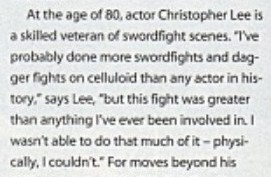
- **Count Dooku; Yoda** — entry/section: Lee on fighting Yoda: ""My eye lines for Yoda were all over the place," Lee recalls. "I was told what's happening – 'He's up! He's down! He's fighting back!' It was actually very clear. It would have been impossible otherwise." —Christopher Lee, Star Wars Insider 74, p. 63" Source: *Star Wars Insider #74* (2004), scan p.63
  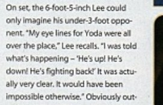
- **Count Dooku; Yoda; Obi-Wan Kenobi; Darth Vader (Anakin Skywalker)** — entry/section: Set Piece: Dooku's escape: "Obviously outmatched, Count Dooku distracted his smaller rival by toppling a large digital addition to the environment over the fallen Obi-Wan and Anakin." Source: *Star Wars Insider #74* (2004), scan p.63
  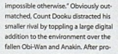

## scan p.64 (scan page 64)

Page contents: Set Piece continued: annotated hangar photo — rocklike walls carved from foam rise 25 feet; only one side built, the rest blue screen and ILM matte paintings; a full-sized solar sail would be a mile across; captions on Obi-Wan's borrowed saber, Anakin's green saber and Yoda's saber. (hand-read)

### Stat block notes (game mechanics, not feats)

- Obi-Wan's borrowed saber: The new blue lightsaber Obi-Wan borrowed from a helpful Jedi colleague is based on the design favored by Adi Gallia and others. Unique details like the two red buttons on this model set it apart. (Star Wars Insider 74, p. 64) (Source: *Star Wars Insider #74* (2004), scan p.64)
- Anakin's green saber on Geonosis: The green-bladed lightsaber Anakin wields at the beginning of this fight is based on the design used by Ki-Adi-Mundi. The Props Department made a special "smoking" battle-damaged version for close-up work. (Star Wars Insider 74, p. 64) (Source: *Star Wars Insider #74* (2004), scan p.64)
- Yoda's saber prop: The design of Yoda's lightsaber was based on a small camera flashgun similar to the larger ones used as lightsabers in the original trilogy. ILM re-created it, with some minor changes, as a computer model. (Star Wars Insider 74, p. 64) (Source: *Star Wars Insider #74* (2004), scan p.64)

## scan p.65 (scan page 65)

Page contents: Timothy Zahn returns with Survivor's Quest (Del Rey): Luke and Mara Jade Skywalker travel into Chiss Space to find the remains of Outbound Flight; half of a two-part story. (hand-read)

### Stat block notes (game mechanics, not feats)

- Survivor's Quest premise: Survivor's Quest begins with Luke and Mara Jade Skywalker embarking on a mysterious errand into Chiss Space to survey the remains of Outbound Flight, the mission destroyed by Thrawn in prequel days. (Veteran readers will remember that the insane Joruus C'baoth was cloned from a Jedi Master who perished on Outbound Flight.) (Star Wars Insider 74, p. 65) (Source: *Star Wars Insider #74* (2004), scan p.65)

## scan p.66 (scan page 66)

Page contents: Zahn on his puzzle-box plotting rules, the coming Outbound Flight prequel novel, Luke and Mara as newlyweds, and how Bantam proposed the post-Jedi trilogy in 1988 and Lucasfilm picked him. (hand-read)

- **Luke Skywalker; Mara Jade Skywalker** — entry/section: Zahn on clues: ""The reader should catch on no more than a page ahead of the characters, but you try to be fair enough that they can do that. I like to write a book so you can read it twice and watch the clues being set up." —Timothy Zahn, Star Wars Insider 74, p. 66" Source: *Star Wars Insider #74* (2004), scan p.66
  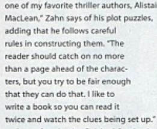

## scan p.67 (scan page 67)

Page contents: Zahn feature concludes: ysalamiri, naming Coruscant, discarded ideas (C'baoth as an Obi-Wan clone, Noghri as the Sith), Mara Jade's popularity, the Hand of Thrawn duology request to pair Luke and Mara, and his 1977 Star Destroyer memory; Zahn bibliography sidebar. (hand-read)

- **Mara Jade Skywalker** — entry/section: Zahn on other authors' Mara: ""I get possessive," Zahn admits when asked about other authors' takes on Mara, but then jokingly adds, "It's nice that everyone considers her so much a part of the Star Wars universe that they're stuck with her whether they like it or not." —Timothy Zahn, Star Wars Insider 74, p. 67" Source: *Star Wars Insider #74* (2004), scan p.67
  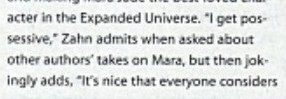
- **Darth Vader (Anakin Skywalker)** — entry/section: Zahn's Star Destroyer awe: "Rest assured it'll be something that conjures up the awe with which Zahn himself greeted that first shot of Darth Vader's Star Destroyer back in 1977." Source: *Star Wars Insider #74* (2004), scan p.67
  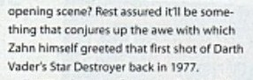

### Stat block notes (game mechanics, not feats)

- Zahn's discarded ideas: Other ideas didn't survive: Originally Joruus C'baoth was an insane clone of Obi-Wan Kenobi, and the Noghri were the Sith. (Star Wars Insider 74, p. 67) (Source: *Star Wars Insider #74* (2004), scan p.67)

## scan p.68 (scan page 68)

Page contents: Republic 63 ("Striking from the Shadows") preview: fallen heroes and redemption; Quinlan Vos, now in Count Dooku's inner circle after the Jedi – Dooku comic, believes he is still deceiving Dooku (Jan Duursema, John Ostrander). (hand-read)

- **Quinlan Vos; Count Dooku** — entry/section: Duursema on Quin undercover: ""Quin is like the cop who goes underground to ferret out drug dealers and gets caught up in their world," says artist Jan Duursema. "He was playing up the darker aspects of his nature and pretending to be [on the] dark side, but he's gotten in way too deep. He believes he is still deceiving Dooku. He thinks he has everything under control – that he can tap into the dark side and still remain a Jedi. By the end of the story, it's up to the reader to decide which side Quin is truly on." —Jan Duursema, Star Wars Insider 74, p. 68" Source: *Star Wars Insider #74* (2004), scan p.68
  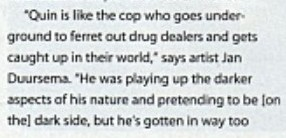

## scan p.69 (scan page 69)

Page contents: Vos feature continued: Duursema and Ostrander on taking Quin to the dark side, his flaws, and whether Sidious or Dooku could be redeemed; sidebar of fallen-and-redeemed heroes. (hand-read)

- **Palpatine (Darth Sidious); Count Dooku** — entry/section: Duursema on redemption: ""I think it's possible for someone to be so unredeemable and so tainted by the dark side that they can never come back to the light," says Duursema. "[Darth] Sidious could never come back. The dark side corrupted him beyond redemption. It's my feeling that Dooku does not consider himself to be evil. Disillusioned with what he saw in the Republic, he took another path: the wrong path. I think Dooku could come back from the dark side because it's his ideals that tempted him there. And Quin, like Dooku, has taken the wrong path for all the right reasons." —Jan Duursema, Star Wars Insider 74, pp. 69–70" Source: *Star Wars Insider #74* (2004), scan p.69
  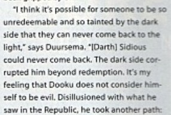

## scan p.70 (scan page 70)

Page contents: Vos feature concludes: Ostrander on the trap of seeking power; Republic 63 told in first person from Quin's perspective; where Vos goes before Episode III. (hand-read)

## scan p.71 (scan page 71)

Page contents: Collecting column by Steve Sansweet: Rancho Obi-Wan coverage; reader question on Applause 12-inch figures (questioner names omitted throughout). (hand-read)

## scan p.72 (scan page 72)

Page contents: Collecting answers: "limited edition" overuse and Applause vinyl values; no licensed sabacc deck exists; red vs. green COMMTech displays; Starbles marbles; vintage figures with Jedi stickers. (hand-read)

### Stat block notes (game mechanics, not feats)

- Sabacc: While West End Games and Wizards of the Coast (in the recent Star Wars: Galactic Campaign Guide hardcover book) have spelled out the rules for sabacc – the infamous game that Han Solo played to win the Millennium Falcon from Lando Calrissian – there has never been a licensed deck of sabacc [cards]... (Star Wars Insider 74, p. 72) (Source: *Star Wars Insider #74* (2004), scan p.72)

## scan p.73 (scan page 73)

Page contents: Collecting answers continued: Starbles value; Canadian Empire-carded figures with Jedi stickers covering the Ackbar offer (per James T. McCallum); a reader complaint about value questions answered — no E.T. Senator figure likely and why Hasbro makes multiple character versions (questioner names omitted). (hand-read)

## scan p.74 (scan page 74)

Page contents: Collecting answers concluded: empty blister packs; Willits Designs film-cel registration never followed through; a Jedi storybook signed by David Prowse and Jeremy Bulloch worth maybe $35 tops. (hand-read)

## scan p.75 (scan page 75)

Page contents: Toy Box: Hasbro Unleashed figures (15 offered by end of 2003, character-specific packaging, rereleases of Leia, Luke, Obi-Wan and Sidious in 2004) and new Clone Wars Animated-style figures; Unleashed checklist. (hand-read)

## scan p.76 (scan page 76)

Page contents: Toy Box continued: Animated wave of Yoda, a Clone Trooper, Count Dooku and Durge (exclusive to Target); Fans' Choice Figure #5 winner Captain Antilles, whose neck stretches to recreate Vader's grip. (hand-read)

### Stat block notes (game mechanics, not feats)

- Captain Antilles figure: The latest winner that is currently in production and will soon be arriving to a store near you is Captain Antilles. The ill-fated leader of the Tantive IV gasps for his life at the hand of Darth Vader in Star Wars: A New Hope. To re-create the likeness of this character and the scene with Darth Vader, the figure's neck will stretch to simulate the firm grasp that the Dark Lord exerts, which ultimately leads to Captain Antilles' demise. (Star Wars Insider 74, p. 76) (Source: *Star Wars Insider #74* (2004), scan p.76)

## scan p.77 (scan page 77)

Page contents: Toy Box photos: Animated Wave 2 (February/March 2004) — Durge, Count Dooku, Yoda and a Clone Trooper. (hand-read)

## scan p.78 (scan page 78)

Page contents: Toy Box: 2004 themed Basic and Ultra waves; Wave 5 from the Empire Star Destroyer bridge scene — Dengar with removable backpack, Bossk and Admiral Ozzel. (hand-read)

## scan p.79 (scan page 79)

Page contents: The Action Figure Archive (Vic Wertz and Dan Curto): FlashBack Photo figures linking the original trilogy to The Phantom Menace, the first with the Hasbro logo — Luke with blaster rifle and electrobinoculars, Princess Leia in ceremonial dress with medal, Yoda with cane and boiling pot, R2-D2 with launching lightsaber. (hand-read)

## scan p.80 (scan page 80)

Page contents: Action Figure Archive continued: FlashBack Wave 1 Ben (Obi-Wan) Kenobi with lightsaber, Emperor Palpatine with Force lightning (first with individually sculpted legs), Darth Vader ("double cape"), Hoth Chewbacca with bowcaster. (hand-read)

## scan p.81 (scan page 81)

Page contents: Action Figure Archive: the nine 1998 European Long Photo Card figures in multilingual packaging (Ackbar, Endor Rebel soldier, Ewoks, Emperor's Royal Guard, Bespin Han, Bespin Luke, Snowtrooper, Grand Moff Tarkin, Weequay skiff guard). (hand-read)

## scan p.82 (scan page 82)

Page contents: Crossword puzzle (clues include Hayden Christensen's birthplace and Monty Python's knights). (hand-read)

## scan p.83 (scan page 83)

Page contents: Rebel Rumblings letters continued: "What kind of fan are you?" replies, a fan-group Halloween parade photo, a gift lightsaber, a sand X-wing (letter-writer names omitted). (hand-read)

## scan p.84 (scan page 84)

Page contents: Letters continued: LEGO Star Wars article request, missing Anthony Daniels' column, middle names Luke and Owen, the "Lost 20" of the Jedi, a reader who finished Knights of the Old Republic about 12 times (letter-writer names omitted). (hand-read)

## scan p.85 (scan page 85)

Page contents: Letters continued: a Vader birthday cake and county-fair collection display, Han and Greedo, a homemade hardware lightsaber, a request for a working Yoda puppet replica, a fan-film DVD request (letter-writer names omitted). (hand-read)

- **Yoda; Count Dooku** — entry/section: Yoda puppet replica reply: "We'd love one, too, but we shudder to think of all the back injuries that would result when fans of a certain age tried – as you know they would – to re-enact the Dooku-Yoda duel." Source: *Star Wars Insider #74* (2004), scan p.85
  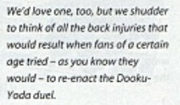

## scan p.86 (scan page 86)

Page contents: Letters concluded: a "Light Speed" motorcycle plate, a request for an updated Expanded Universe book list, a Star Wars wedding photo, a fan since Episode I (letter-writer names omitted). (hand-read)

## scan p.87 (scan page 87)

Page contents: Q&A (Answers to Your Star Wars Questions): Anakin, not Luke, is the Chosen One; Artoo lies about belonging to Kenobi; the AT-AT's power plant ruptures (NPR radio drama); the remembered Luke-Wedge Hoth line is from Marvel's Star Wars 40; Chewbacca's cowardly side and the dianoga. (hand-read)

### Stat block notes (game mechanics, not feats)

- The Chosen One: George Lucas has stated in interviews that Anakin Skywalker is indeed the Chosen One. As far as the prophecy goes, Anakin brings balance to the Force since it is he who disposes of the imbalance. That is, he kills Emperor Palpatine in Return of the Jedi. Sure, Luke is the catalyst for this turn of events, but it is ultimately Anakin who makes the choice. (Star Wars Insider 74, p. 87) (Source: *Star Wars Insider #74* (2004), scan p.87)
- Artoo lies: Artoo lies when he says that. He also lies to Luke about the restraining bolt interfering with his holographic Leia recording. Artoo's a sneaky little droid, especially once Leia programs him to seek out Obi-Wan Kenobi. She instructs him to override all other programming. This also allows Artoo to enter the restricted escape-pod bay, something he would not be able to do otherwise. (Star Wars Insider 74, p. 87) (Source: *Star Wars Insider #74* (2004), scan p.87)
- Chewbacca's cowardly side: A character trait that was abandoned early in the Star Wars films was Chewbacca's cowardly side. In this case, he is scared of the dianoga, the garbage squid that can be heard bellowing as the heroes emerge from the trash compactor. (Star Wars Insider 74, p. 87) (Source: *Star Wars Insider #74* (2004), scan p.87)

## scan p.88 (scan page 88)

Page contents: Q&A continued: Lucas's notes on Kashyyyk's murky underworld; how Qui-Gon and Obi-Wan stay dry entering Otoh Gunga; the E.T. Senate cameo and Luceno's Senator Grebleips; no Sullustans in Jabba's court; why Jedi robes look like common robes (and Uncle Owen's). (hand-read)

- **Chewbacca** — entry/section: Lucas on Kashyyyk's underworld: ""Underneath the trees, it's very murky down there. Very dark and very swampy and very dreary and mucky and all kinds of ugly little creatures ... a lot of white, soggy things live down there. ... Balls of ugly white pasty flesh with no eyes that absorb things like giant amoebas ... especially Wookiees." —George Lucas (developmental notes), Star Wars Insider 74, p. 88" Source: *Star Wars Insider #74* (2004), scan p.88
  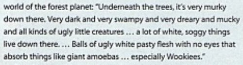

## scan p.89 (scan page 89)

Page contents: Back-page art "Dark Lord of the Riff": Darth Maul shredding a Sith-styled guitar (artist name omitted). (hand-read)

## scan p.90 (scan page 90)

Page contents: Back cover: Hasbro Star Wars Unleashed ad — Clone Trooper standing over a fallen battle droid, with Luke Skywalker and Chewbacca. (hand-read)

