# Owner Material 038 — Star Wars Insider #1–153 plus specials (with The Lucasfilm Fan Club Magazine #1–22): Star Wars Insider #75 (2004)

- **Source:** *Star Wars Insider* magazine (issues 23–153, 1994–2014) and its predecessor *The Lucasfilm Fan Club Magazine* (issues 1–22, 1987–1994), plus seven special editions: articles, interviews, comics and short fiction Secondary source (licensed Legends reference). Scan OCR'd on the box; the scan stays box-only and is **not** published.
- **Method:** every scanned page was OCR'd and machine-screened sentence by sentence for power-relevant statements (fights, kills, defeats, Force feats, rankings, superweapons) that name a character on our roster; each kept sentence is quoted verbatim from the OCR text and has a crop of the printed passage directly under it. Pages with nothing power-relevant are still listed with what is on them.
- **Citation:** "*Star Wars Insider #75* (2004), p.X" by printed page ("scan p.X" where no printed number applies). **Weight:** Licensed magazine: a secondary source. Its short fiction and comics are Legends stories; its articles and interviews sum up or discuss lore and rank below the novels, comics and games they describe.

## scan p.1 (scan page 1)

Page contents: Cover, issue 75 (May 2004): the women of Star Wars – Jedi, royalty, bounty hunters, aliens; Original Trilogy on DVD coming soon. (hand-read)

## scan p.2 (scan page 2)

Page contents: Advertisement: Cloud City Collectibles, modern Star Wars toys (1995–present) and Clone Wars and Saga figures. (hand-read)

## scan p.3 (scan page 3)

Page contents: Advertisement: Cloud City Collectibles, vintage Star Wars toys (pre-1990) and prototype collectibles. (hand-read)

## scan p.4 (scan page 4)

Page contents: Contents (printed p. 4): Prequel Update (late-February "first assembly" of Episode III), Keira Knightley and the women of Star Wars, Who's Who in the Outlander Club, Tantive IV vs. the Millennium Falcon, likenesses cast in resin, General Grievous introduced, fiction "Or Die Trying" by Sean Williams with Shane Dix (Jaina Solo), reader haiku, Star News (Original Trilogy DVD, Indy 4 script), Star Sightings, Best of Hyperspace, HoloNet News, Set Piece, Mara Jade's greatest hits, Princess Leia comics. (hand-read)

## scan p.5 (scan page 5)

Page contents: Contents continued (Q&A on collecting, Original Trilogy Collection releases, Flashback Wave 2, Clone Wars set) and guest editorial by Amy Allen on being cast as Aayla Secura in Attack of the Clones while a visual-effects production assistant at ILM in 2002. (hand-read)

- **Aayla Secura** — entry/section: Amy Allen on becoming Aayla: ""Jedi Knight Aayla Secura was already a well-established character within the Dark Horse Star Wars comics. But on that day in 2002, a striking cover drawing of Aayla caught George's eye, and before long I found myself transformed through the magic of makeup and wardrobe from production assistant to Twi'lek Jedi Knight." —Amy Allen, Star Wars Insider 75, p. 5" Source: *Star Wars Insider #75* (2004), scan p.5
  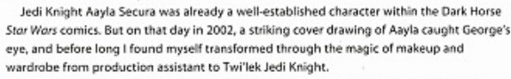
- **Aayla Secura** — entry/section: Amy Allen on Aayla in Episode II: ""In Episode II, Aayla joins the ranks of those who wage war against the forces of evil, and as a Jedi Knight she exudes grace and dignity." —Amy Allen, Star Wars Insider 75, p. 5" Source: *Star Wars Insider #75* (2004), scan p.5
  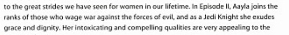

## scan p.6 (scan page 6)

Page contents: Contributors: Gabriela Tscharner-Patao, Chris Trevas, Sean Williams, Shane Dix (co-authors of the Force Heretic trilogy), Benjamin Harper, Tony Moseley, Eric Moro, Pablo Hidalgo. (hand-read)

## scan p.7 (scan page 7)

Page contents: Advertisement: Anthony Grandio Company Star Wars character checks, Armada starship checks and Rebel Alliance/Galactic Empire leather checkbook covers. (hand-read)

## scan p.8 (scan page 8)

Page contents: Rebel Rumblings letters (writer names omitted): Japanese NJO cover art (reply: more Jacen and Jaina in post-NJO books, Jaina stars in "Or Die Trying" on p. 66); a reader worried about a "topless" scene mentioned for Episode III (reply: the character in question is male and unlikely to offend); praise for the fiction; masthead and staff credits. (hand-read)

## scan p.9 (scan page 9)

Page contents: Advertisement: Babylon 5 Season 5 DVD. (hand-read)

## scan p.10 (scan page 10)

Page contents: Rebel Rumblings continued (reader and child names omitted): a young fan's photos with Amy Allen and Michonne Bourriague at a comic convention; request for a "Creature Feature" column; a non-reader won over by the short fiction; a baby named Luke Lucas. (hand-read)

## scan p.11 (scan page 11)

Page contents: Advertisement: Star Wars Trading Card Game Rogues and Scoundrels expansion (105 Neutral cards, bounty mechanic). (hand-read)

## scan p.12 (scan page 12)

Page contents: Rebel Rumblings continued (reader names omitted): Clone Wars micro-series praise and the Durge vs. Obi-Wan duel; a clone-trooper-costumed child and X-wing-costumed dog (reply: money on "Duke Skywalker"); note that Robert Barnes, sculptor of the General Grievous maquette, also designed Durge; reader haiku; a portfolio cover of Qui-Gon vs. Maul made of construction paper. (hand-read)

## scan p.13 (scan page 13)

Page contents: Advertisement: Third Annual Star Wars TCG Championship at Gen Con 2004 (August 21) and its Qualifiers. (hand-read)

## scan p.14 (scan page 14)

Page contents: Rebel Rumblings continued (reader names omitted): a Jar Jar "Christmas tree"; a question whether conventions end after Episode III (reply quotes Steve Sansweet: "Star Wars is forever," and points to Celebration III); more reader haiku. (hand-read)

## scan p.15 (scan page 15)

Page contents: Advertisement: Topps Star Wars Clone Wars trading cards (90 cards based on the Cartoon Network micro-series; season two spring 2004). (hand-read)

## scan p.16 (scan page 16)

Page contents: Star News: the Star Wars original trilogy on DVD, September 21, 2004, digitally restored by THX with Dolby Digital 5.1 Surround EX and a bonus documentary disc, quotes from Lucasfilm's Jim Ward; Indiana Jones IV delayed for a new script draft (production unlikely before 2005). (hand-read)

## scan p.17 (scan page 17)

Page contents: Star News: GameSpy names Knights of the Old Republic 2003 Game of the Year (100+ awards); Star Wars Battlefront details (four factions, 20+ soldier types, 15+ environments on 10 planets, Conquest mode, from Pandemic Studios); Star Wars Republic Commando (Clone Commando special ops) due fall. (hand-read)

## scan p.18 (scan page 18)

Page contents: Star News: Celebration III at the Indiana Convention Center April 21–24, 2005, run by Gen Con LLC (quotes Steve Sansweet and Peter Adkison); Mary Franklin returns to Lucasfilm as fan-events coordinator; StarWarsShop.com opens March 10 with exclusives (Gentle Giant clone sergeant mini-bust, $15,000 life-size bronze Yoda by Lawrence Noble, Clone Wars items, Cinemacast Vader). (hand-read)

## scan p.19 (scan page 19)

Page contents: Star News: "Red Five" Star Wars tattoo-artist painting show in Ottawa (Yoda and Darth Vader the most popular subjects); "a major presence" at Comic-Con International, July 21–25, 2004; British survey: 77 percent of 25-to-44-year-olds identified Darth Vader's "If you only knew the power of the dark side" but only 10 percent knew Shakespeare's Richard III line; Star Wars Galaxies website livethesaga.com. (hand-read)

## scan p.20 (scan page 20)

Page contents: Star Sightings: Ewan McGregor's Glenfiddich Spirit of Scotland award, Long Way Round motorcycle trip, voicing the wood pigeon in Valiant; Sofia Coppola's Lost in Translation awards; Liam Neeson in Love Actually. (hand-read)

## scan p.21 (scan page 21)

Page contents: Star Sightings continued: McGregor on playing James Bond ("It would take a bigger man to turn it down"); Natalie Portman rumored for Lois Lane and reprising Mathilda in a Léon sequel; Keisha Castle-Hughes (Whale Rider) the youngest Best Actress Oscar nominee, to play the Queen of Naboo in Episode III. (hand-read)

## scan p.22 (scan page 22)

Page contents: Star Sightings continued: Carrie Fisher on Bravo's Celebrity Poker Showdown and her novel The Best Awful (sequel to Postcards from the Edge); other cast credits; ILM's Christophe Hery, Ken McGaugh and Joe Letteri win a Scientific and Technical Academy Award for subsurface scattering, begun during Attack of the Clones; ILM's Pirates of the Caribbean nominations. (hand-read)

## scan p.23 (scan page 23)

Page contents: Star Sightings continued: Ewan McGregor in Big Fish; John Ratzenberger (Major Derlin) and Bruce Spence (Episode III) voice characters in Finding Nemo (Spence as the shark Chum); Natalie Portman in Cold Mountain; other cast news. (hand-read)

## scan p.24 (scan page 24)

Page contents: Prequel Update by Jane Irene Kelly: Rick McCallum at Skywalker Ranch in late February on the Episode III "first assembly," to be viewed by a small team including George Lucas and editors Roger Barton and Ben Burtt; pickup shooting in London pushed to summer because of digital work and actors' schedules. (hand-read)

## scan p.25 (scan page 25)

Page contents: Prequel Update continued: McCallum on losing 20 or 30 minutes after the first assembly; photos of Ian McDiarmid, Hayden Christensen and Ewan McGregor at Fox Studios Australia, and C-3PO with photographer Ralph Nelson's cap. (hand-read)

### Stat block notes (game mechanics, not feats)

- The three characters at the heart of Episode III: Friends? Enemies? Undecided? Only on screen, of course! The plot of Star Wars: Episode III revolves around the relationships of the three characters played by (from left) actors Ian McDiarmid (who plays Supreme Chancellor Palpatine), Hayden Christensen (Anakin Skywalker), and Ewan McGregor (Obi-Wan Kenobi), photographed in a small park between soundstages at Fox Studios Australia. (Star Wars Insider 75, p. 25) (Source: *Star Wars Insider #75* (2004), scan p.25)
- Threepio and the dairy-cow cap: See-Threepio (actor Anthony Daniels) may be proficient in more than six million forms of communications, but he seems perplexed about what to say regarding photographer Ralph Nelson's dairy-cow cap. It might come in handy on Threepio's next trip to Tatooine. (Star Wars Insider 75, p. 25) (Source: *Star Wars Insider #75* (2004), scan p.25)

## scan p.26 (scan page 26)

Page contents: Full-page photo: Hayden Christensen as Anakin Skywalker with a red-bladed lightsaber prop on the Episode III set. (hand-read)

### Stat block notes (game mechanics, not feats)

- Anakin between takes of the duel: Actor Hayden Christensen, who plays troubled young Jedi Anakin Skywalker, takes a break during a grueling lightsaber fight with his onetime mentor, Obi-Wan Kenobi, played by Ewan McGregor. (Star Wars Insider 75, p. 26) (Source: *Star Wars Insider #75* (2004), scan p.26)

## scan p.27 (scan page 27)

Page contents: Prequel Update continued: editors Ben Burtt (action sequences, the opening space battle, Obi-Wan vs. General Grievous) and Roger Barton (the rest, including a crucial Obi-Wan/Anakin scene) work with Lucas daily; the Animatics Department; Burtt likens editing to writing. (hand-read)

### Stat block notes (game mechanics, not feats)

- Episode III editing split: Burtt has been focused on fine-tuning select action sequences – including the opening space-battle sequence and a dramatic encounter between Obi-Wan Kenobi and the film's newly introduced villain, General Grievous. The rest of the film – including a crucial and emotional scene featuring Obi-Wan and Anakin Skywalker – is pretty much in Barton's hands. (Star Wars Insider 75, p. 27) (Source: *Star Wars Insider #75* (2004), scan p.27)

## scan p.28 (scan page 28)

Page contents: Photos: Episode III senators Mon Mothma (Genevieve O'Reilly), Bail Organa (Jimmy Smits) and Fang Zar (Warren Owens). (hand-read)

### Stat block notes (game mechanics, not feats)

- Mon Mothma in Episode III: Senator Mon Mothma (played by actress Genevieve O'Reilly) speaks her mind in the Coruscant office of a compatriot, Senator Bail Organa of Alderaan. (Star Wars Insider 75, p. 28) (Source: *Star Wars Insider #75* (2004), scan p.28)
- Bail Organa's office: Senator Bail Organa (actor Jimmy Smits) is pleased to see friends and confidants in his office in the Senate building on Coruscant. (Star Wars Insider 75, p. 28) (Source: *Star Wars Insider #75* (2004), scan p.28)
- Fang Zar alarmed: Senator Fang Zar (actor Warren Owens) is alarmed by what he hears in the office of Supreme Chancellor Palpatine. (Star Wars Insider 75, p. 28) (Source: *Star Wars Insider #75* (2004), scan p.28)

## scan p.29 (scan page 29)

Page contents: Full-page photo: Ewan McGregor as Obi-Wan Kenobi, hand to chin, in a Coruscant apartment set. (hand-read)

### Stat block notes (game mechanics, not feats)

- Obi-Wan's burden: Sometimes Jedi Obi-Wan Kenobi (actor Ewan McGregor) appears to have the weight of the world on his shoulders. In Star Wars: Episode III, he will bear the weight of an entire galaxy. (Star Wars Insider 75, p. 29) (Source: *Star Wars Insider #75* (2004), scan p.29)

## scan p.30 (scan page 30)

Page contents: Prequel Update concluded: Burtt adds background elements to a greenscreen shot of Obi-Wan jumping behind two not-yet-CG characters ("at least eight layers of video elements"); Barton adds lightsaber and placeholder music to an Obi-Wan/Anakin action sequence; dailies in ILM's "C Theater" with John Knoll and Rob Coleman; McCallum expects 50 or 60 animators by May. (hand-read)

## scan p.31 (scan page 31)

Page contents: Photos: Natalie Portman and Kristy Wright (Moteé) on a Senate floating platform; Phillip Broadstone and Keith Ree remove a silicone mold for a new Neimoidian blaster rifle; cinematographer David Tattersall lights a Trade Federation cruiser elevator. (hand-read)

### Stat block notes (game mechanics, not feats)

- Padmé and Moteé on the Senate platform: Actress Natalie Portman (front) prepares for action in a Senate chamber floating platform, joined by her handmaiden Motee (actress Kristy Wright). (Star Wars Insider 75, p. 31) (Source: *Star Wars Insider #75* (2004), scan p.31)

## scan p.32 (scan page 32)

Page contents: Best of Hyperspace by Pablo Hidalgo (chat-user names omitted): Episode III webcam at Skywalker Ranch and ILM; Ben Burtt chat on TIE-fighter precursor sounds, reusing unused Chewbacca vocals, processing the new villain's voice, recording rusty nails, a musically silent duel, and 5,500 Star Wars sound effects. (hand-read)

- **Chewbacca** — entry/section: Burtt on Chewbacca's dialogue: ""I'm always amazed when I go back and find that we have plenty of unused Chewbacca that we can use. (Thank goodness for the "Holiday Special"!) There will probably be some new stuff as well." —Ben Burtt, Star Wars Insider 75, p. 32" Source: *Star Wars Insider #75* (2004), scan p.32
  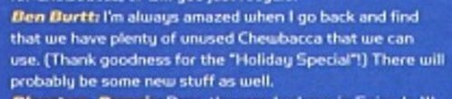
- **General Grievous** — entry/section: Burtt on the new villain's voice: ""He will definitely have some kind of processing to his voice. I don't know just what yet." —Ben Burtt, Star Wars Insider 75, p. 32" Source: *Star Wars Insider #75* (2004), scan p.32
  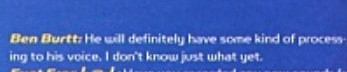

## scan p.33 (scan page 33)

Page contents: Best of Hyperspace continued: Temuera Morrison and Bodie Taylor play clones from different batches, with Lucas and John Knoll on blending their faces digitally; animating Yoda walking with Bail Organa and Obi-Wan, paced by a little-person stand-in in Sydney; "Making Episode III" webdocs. (hand-read)

### Stat block notes (game mechanics, not feats)

- Yoda "walking with grown-ups": One of the recurring challenges in animating Yoda is determining what's going on with his legs. On several occasions in Episode II, there were to be scenes where Yoda was walking alongside his full-sized Jedi companions. Obi-Wan Kenobi and Mace Windu cover such distance with their long strides that the little green Master couldn't keep up, and a workaround solution was his hovering chair seen in Attack of the Clones. In Episode III, there will be several scenes wherein Yoda walks in similarly lofty company – he walks and talks alongside Bail Organa and Obi-Wan Kenobi. (Star Wars Insider 75, p. 33) (Source: *Star Wars Insider #75* (2004), scan p.33)

## scan p.34 (scan page 34)

Page contents: "Keira Knightley and the Women of Star Wars" by Gabriela Tscharner-Patao: Knightley on her resemblance to Natalie Portman, cast at 12 as the decoy queen Sabé, kept secret by Lucas; casting director Robin Gurland on finding her. (hand-read)

- **Sabé** — entry/section: Knightley on playing Sabé: ""I was basically an extra. I can't even remember George Lucas talking to me." —Keira Knightley, Star Wars Insider 75, p. 34" Source: *Star Wars Insider #75* (2004), scan p.34
  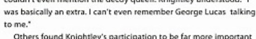

## scan p.35 (scan page 35)

Page contents: Full-page photo of Keira Knightley. (hand-read)

## scan p.36 (scan page 36)

Page contents: Knightley continued: the Queen's costumes, the secrecy agreement, learning on the last day she was a decoy, Portman's mother mistaking her for Natalie; her childhood. Sidebar on Alethea McGrath (Jocasta Nu): no lightsaber, meeting Ewan McGregor, and a cut scene about Count Dooku. (hand-read)

- **Jocasta Nu; Count Dooku** — entry/section: McGrath on Jocasta Nu's cut Dooku scene: ""It was a lovely bit," she says. "I got quite sentimental about it because [our characters had] been in love at one stage. I was almost tearful, you know. I touched his bronze face and thought of happy times, and I ended up by saying, 'It was sad that he turned to evil.'" —Alethea McGrath, Star Wars Insider 75, p. 36" Source: *Star Wars Insider #75* (2004), scan p.36
  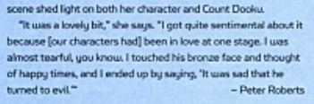

## scan p.37 (scan page 37)

Page contents: Knightley continued: dyslexia and her first agent, first part at seven, acting only in school holidays. Sidebar on Rena Owen (Taun We in Episode II, Senator Nee Alavar in Episode III) on the women of Star Wars and working with Temuera Morrison. (hand-read)

- **Taun We** — entry/section: Rena Owen on Taun We: ""I see quite a lot of myself in Taun We," she says proudly. "I loved that she had no limits, no backstory. I could take all the dramatic freedom I wanted with her." —Rena Owen, Star Wars Insider 75, p. 37" Source: *Star Wars Insider #75* (2004), scan p.37
  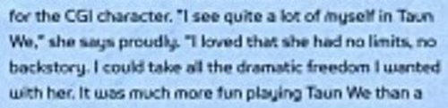

## scan p.38 (scan page 38)

Page contents: Knightley continued: Bend It Like Beckham, watching English soccer while filming Pirates of the Caribbean. Sidebar on Amy Allen (Aayla Secura, Episodes I, II and III): from ILM production assistant to Aayla in the Episode I DVD's Orn Free Taa pod, fighting beside Mace Windu in Attack of the Clones, and girls dressing as Aayla at conventions. (hand-read)

- **Aayla Secura** — entry/section: Amy Allen on what makes Aayla unique: ""They are tough and have an overwhelming sense of purpose in a male-dominated world," says Allen. "Their impressive minds are absolutely comparable to their male counterparts. However, what makes my character unique is her ability to follow her heart. She dives right into a situation before thinking about the potential consequences." —Amy Allen, Star Wars Insider 75, p. 38" Source: *Star Wars Insider #75* (2004), scan p.38
  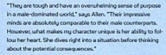

## scan p.39 (scan page 39)

Page contents: Knightley continued: Pirates of the Caribbean's Elizabeth Swann, corsets, "schizophrenic hair," Hollywood pressures. Sidebars on Ayesha Dharker (Queen Jamillia, Episode II: found via The Terrorist and Samuel L. Jackson's screening copy; Sio Bibble shot later and inserted) and Bai Ling (Senator Bana Breemu: met Katie Lucas, then George Lucas, at the MTV Video Music Awards). (hand-read)

## scan p.40 (scan page 40)

Page contents: Knightley concluded: Guinevere in King Arthur, not returning to college, and mixed feelings about Star Wars ("The lightsabers weren't real, and that annoyed me"). Sidebar on Caroline Blakiston (Mon Mothma, Return of the Jedi): a rewritten speech on the day of filming and the name as "Moon Mother." (hand-read)

- **Mon Mothma; Darth Vader (Anakin Skywalker); Obi-Wan Kenobi** — entry/section: Blakiston on Mon Mothma as archetype: "Blakiston saw the derivation of Mon Mothma's name as "Moon Mother." "I took that as an image to hold on to – she needed to come from somewhere, and those words evoked someone cool and calm. She's an archetype, just as Darth Vader and Obi-Wan Kenobi are." —Caroline Blakiston, Star Wars Insider 75, p. 40" Source: *Star Wars Insider #75* (2004), scan p.40
  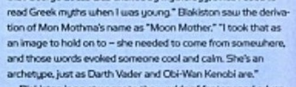

## scan p.41 (scan page 41)

Page contents: Knightley filmography; Episode III hair department (Reeby and Miles): hairpieces for each look and stunt double, a $13,000 Jedi Master's hair, Commander Cody wears his own hair, hand-laced human hair. (hand-read)

- **Padmé Amidala; Leia Organa Solo** — entry/section: Reeby on Padmé's "buns" hairpiece: ""It took us 11 days to get the right look for a hairpiece for Senator Amidala that looks similar to the 'buns' style Leia wore in Star Wars," says Reeby. "George [Lucas] said he wanted a look similar to a traditional native Hopi style. When he came in to see what we had done, he was pleased. 'I've been trying for 26 years to get that look right, and you have it,' he said. That was extremely gratifying." —Reeby, Star Wars Insider 75, p. 41" Source: *Star Wars Insider #75* (2004), scan p.41
  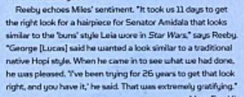

## scan p.42 (scan page 42)

Page contents: "Who's Who in the Outlander Club" (with special thanks to Pablo Hidalgo): the Attack of the Clones nightclub vs. the Mos Eisley cantina, its patrons, Lucasfilm naming every bit player (Momaw Nadon took a decade to get his name), and Tuckerisms such as the "Jorg Sacul" figure. (hand-read)

## scan p.43 (scan page 43)

Page contents: Outlander Club: bartender Bufon Taire (name a homonym for "bouffant hair"); owner Volven Rloxe, Shistavanen "spice lord of the undercity" (per the Coruscant and the Core Worlds sourcebook); assistant bartender Ganwick Trag. (hand-read)

## scan p.44 (scan page 44)

Page contents: Outlander Club: Ganwick Trag; waitress Jynne Celwik; no droids served; Ayy Vida, the first tiger-striped Twi'lek (consort of Hat Lo, hoped Dannl Faytonni would rescue her; played by Karina Wakefield); Sef Maa; Rodian Nardi Shodu; Ithorian Ror Ithh. (hand-read)

- **No single roster character (rules/setting/general)** — entry/section: Ayy Vida action figure (no character slug): "She has also been immortalized as an action figure." Source: *Star Wars Insider #75* (2004), scan p.44
  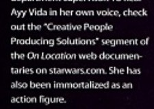

## scan p.45 (scan page 45)

Page contents: Outlander Club: Katie Lucas's purple-skinned character with Achk Med-Beq and Ayy Vida (Jett Lucas cameos as a Jedi initiate); Booton Pilon; Seib Nod (anagram of Don Bies); Di Mantid near Elan Sleazebaggano's pitch to Obi-Wan; Oakie Dokes the Swokes Swokes (named for Nick Dudman's wife Sue Oakes). (hand-read)

## scan p.46 (scan page 46)

Page contents: Outlander Club: Kell Borean at the gaming tables; Weequay enforcer Tas Kee; Hayde Gofai eyeing Anakin; Necil Sing ("Licensing" reversed); Sneve Wo ("Owens"); Ame Llom ("Mollema"); dancer Wilst Molan; Nyrat Agira and her friends Immi Danoo and Rosha Vess. (hand-read)

## scan p.47 (scan page 47)

Page contents: Outlander Club: Nyrat Agira's Zealots of Psusan tattoo; Immi Danoo (Dermot Power concept); Rosha Vess; Whimper Save ("Best Name in Episode II," with Dannl Faytonni); armored Katyn Farnmir (Tuckerized anagram of Mary Franklin, per Pablo Hidalgo) and Cian Shee; Gillian Libbert's Lillea Bringbit witnessing Zam Wesell's speeder crash; a chain-mail-veiled patron. (hand-read)

## scan p.48 (scan page 48)

Page contents: Outlander Club: Ahmed Best (Achk Med-Beq) and Anthony Daniels (Dannl Faytonni) in on-screen cameos; their backstory as partners in crime posing as Republic Security officers (Daniels invented most of Faytonni's history); musician type Daro Willits; crime lord Hat Lo; Quarren "Q'Mahr." (hand-read)

## scan p.49 (scan page 49)

Page contents: Outlander Club: Gran gambler Nic Whoma (Mawhonic costume); Elan Sleazebaggano, Balosar death-stick dealer played by Matt Doran, the only patron with lines; goggled Yee Moh; Tarnab alien; Droid Unit cameos by Zeynep, Don Bies, Justin Dix and Trevor Tighe. (hand-read)

## scan p.50 (scan page 50)

Page contents: "Building the Millennium Falcon" (ILM model supervisor Steve Gawley): Gawley's classmate Joe Johnston, hired in June 1975 by John Dykstra and Bob Shepherd, brings him in to draw orthographic blueprints; Star Wars ship designs credited to Dykstra, Johnston and Lucas. (hand-read)

## scan p.51 (scan page 51)

Page contents: Gawley continued: early ILM crew averaged 25 or 26, with industrial-design students from Cal State Long Beach, animators from Cal Arts and USC people; his pickup truck secured his place. (hand-read)

## scan p.52 (scan page 52)

Page contents: Gawley continued: his truck carried a high-speed camera past the miniature Death Star trench in ILM's parking lot at 40 mph; his credits (15 Academy Award-winning effects films, a cameo in Star Tours); Gary Kurtz reports the original pirate-ship design looked like Space: 1999. Caption: the original "pirate ship" became the Rebel Blockade Runner. (hand-read)

## scan p.53 (scan page 53)

Page contents: Gawley continued: the original Falcon design became the Rebel Blockade Runner; its cockpit and radar dish moved to the new design; a rotating cockpit once considered; Dykstra orders a model about four feet across and five feet long. (hand-read)

### Stat block notes (game mechanics, not feats)

- The first Falcon became the Blockade Runner: In fact, the design for the prototype Millennium Falcon evolved into the first spaceship audiences ever saw in the Star Wars fleet: the Rebel Blockade Runner. While undoubtedly a terrific design in itself, the Blockade Runner was arguably a more conventional-looking spaceship, not quite worthy of the swashbuckling Han Solo. "That was exactly why it was changed," Gawley says. (Star Wars Insider 75, p. 53) (Source: *Star Wars Insider #75* (2004), scan p.53)

## scan p.54 (scan page 54)

Page contents: Gawley continued: vacuum-formed Plexiglas domes over a metal armature with handles; a near-zero budget (screening-room furniture from Goodwill); Monogram and Tamiya kit parts (a Formula One kit), a body-shop "nibbler," and two-dollar surplus fans to cool the lights. (hand-read)

## scan p.55 (scan page 55)

Page contents: Gawley concluded: the Falcon built in four or five weeks with Joe Johnston critiquing and painting; the same model reused in Empire (with landing gear for Cloud City) and Jedi; secrecy, seeing his name in the credits, finishing his degree. (hand-read)

## scan p.56 (scan page 56)

Page contents: Full-page image, no article text. (hand-read)

## scan p.57 (scan page 57)

Page contents: "Small Wonders" tour of Gentle Giant Studios (Burbank; founder Karl Meyer; marketing and sales manager Eric Lyga): from Disney prototypes to laser-scanning-based collectibles; relationship with Lucasfilm begins on the Attack of the Clones set with Hasbro. (hand-read)

## scan p.58 (scan page 58)

Page contents: Gentle Giant: scanning on the Episode III set; a two-day digital archive scan of hundreds of items at the Lucasfilm Archives; about 10 months from concept to mini-bust on shelves; the Digital Department. (hand-read)

## scan p.59 (scan page 59)

Page contents: Gentle Giant: scanning size doesn't matter; actors scanned repeatedly (Jeremy Bulloch scanned at Comic-Con); digital cleanup (Navarrete) of a sandtrooper-on-dewback file; sculptor Joseph Jung's 12-inch Chewbacca carrying a disassembled C-3PO. (hand-read)

## scan p.60 (scan page 60)

Page contents: Jung on the "hairy" Chewbacca project and his favorite piece, Grand Moff Tarkin (from a life mask); Lyga hopes to scan Carrie Fisher, Mark Hamill and Harrison Ford and "de-age" them; head painter Mireya Romo on a Royal Guard bust-up. (hand-read)

- **Grand Moff Tarkin** — entry/section: Jung on the Tarkin mini-bust: ""I like the way that piece came together," says Jung "He looks very powerful sitting in his chair. There are no guns or weapons, nothing exciting in that way – but there's something about the way the piece comes together. He looks lost in thought." —Joseph Jung, Star Wars Insider 75, p. 60" Source: *Star Wars Insider #75* (2004), scan p.60
  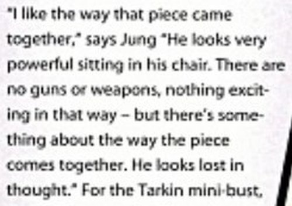

## scan p.61 (scan page 61)

Page contents: Romo on painting humans vs. nonhumans and the Peter Cushing bust; Toy Fair 2004 plans: eight mini-busts a year, 12-inch statues (Boba Fett, Darth Vader), 6-inch environments, 8-inch Clone Wars statues (Asajj Ventress), Bust-Ups micro-busts, and the "Armory Collection" of die-cast helmets. (hand-read)

### Stat block notes (game mechanics, not feats)

- Chewbacca's 15-inch "12-inch" statue: though Lyga notes that the term "12-inch" may be a misnomer in the case of the enormous Wookiee. "Chewbacca will be 15 inches tall because 12-inch scale means that a 6-foot character would be 12 inches tall. Chewbacca is 7 feet 6 inches tall, so that means he's 15 inches tall in scale." (Star Wars Insider 75, p. 61) (Source: *Star Wars Insider #75* (2004), scan p.61)

## scan p.62 (scan page 62)

Page contents: "Evolution of Evil" opener: concept illustrations of General Grievous, including paintings by Erik Tiemens. (hand-read)

## scan p.63 (scan page 63)

Page contents: Grievous design: Lucas gives the concept artists only the words "droid general" (Ryan Church, Iain McCaig); a joke version of the animatics had Darth Maul's eyes; McCaig's "new 'icon of evil'"; Warren Fu's cloaked cyborg with empty eye sockets (later Grievous's henchmen); Fu's organic-mechanical face with armadillo plates and insectlike mandibles. (hand-read)

## scan p.64 (scan page 64)

Page contents: Lucas picks Fu's revised sketch as Grievous's official face; Church does three new body versions; Grievous as a vain droid who designed himself; sculptor Robert Barnes's six weeks on the clay maquette. (hand-read)

- **General Grievous; Darth Vader (Anakin Skywalker)** — entry/section: Fu: "Darth Vader's mask will always be the best": ""Congratulations," Iain McCaig told the young artist. "You've created a new icon of evil." "Maybe so," says Fu, "but Darth Vader's mask will always be the best." —Warren Fu, Star Wars Insider 75, p. 64" Source: *Star Wars Insider #75* (2004), scan p.64
  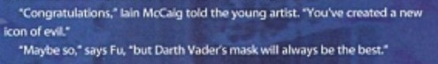
- **General Grievous** — entry/section: Church and Barnes on Grievous's vanity: ""A droid is just built," Church explains, "but this guy, we thought, has an ego – probably a very big ego. We thought he would be the first droid who cares how he looks. We wanted to give him a look that he'd designed himself. He's not this extruded, metallic, clunky thing; he's a very aesthetic thing." "He's actually developed a sense of vanity," suggests Barnes, "a pride in how he looks, but he also considers the mechanical to be the ideal, so he's redesigned himself over time. No component of him is off the shelf." —Ryan Church and Robert Barnes, Star Wars Insider 75, p. 64" Source: *Star Wars Insider #75* (2004), scan p.64
  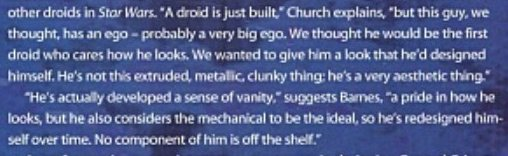

## scan p.65 (scan page 65)

Page contents: Barnes's "mechanical decadence" (no visible circles, cylinders or spheres) and Star Wars iconography; Grievous debuts in the Clone Wars micro-series finale (Genndy Tartakovsky, art director Paul Rudish: a "Boba-Fett-with-the-Holiday-Special" sneak preview); hoof-like grasping feet; capoeira sidebar. (hand-read)

- **General Grievous** — entry/section: Star Wars Insider 075 (2004): "“General Grievous is a master strategist and the greatest hand-tohand Jedi killer the galaxy has ever known,” warns Star Wars producer Rick McCallum." Source: *Star Wars Insider #75* (2004), scan p.65
  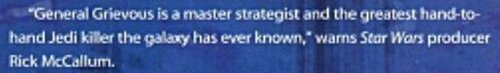
- **General Grievous** — entry/section: Barnes: "mechanical decadence": ""We wanted to avoid established mechanical devices – hydraulic cylinders, circular joints for elbows and knees and so on," says Barnes. "In fact, we wanted to avoid any visible circles, cylinders and spheres in his body. "The term that I gave it was 'mechanical decadence.'" —Robert Barnes, Star Wars Insider 75, p. 65" Source: *Star Wars Insider #75* (2004), scan p.65
  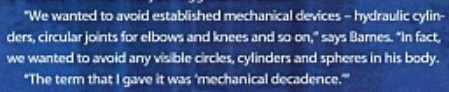

## scan p.66 (scan page 66)

Page contents: Full-page illustration for "Or Die Trying": Jaina Solo with lightsaber amid combat droids. (hand-read)

## scan p.67 (scan page 67)

Page contents: "Or Die Trying" by Sean Williams with Shane Dix (illustrated by Leanne Buckley): after the events at Bakura, Jaina infiltrates the ODT compound on dusty Onadax, mind-tricking Jenet guards into seeing pests, hunting the makers of Human Replica Droids after Prime Minister Cundertol's betrayal; Captain Rufarr's associate gave her the name. (hand-read)

## scan p.68 (scan page 68)

Page contents: Or Die Trying: using a Yarkora guard's pass, Jaina enters the droid research center; a Corellian man in his thirties whose mind isn't a person's waits among Loronar Self-Regulating Droidmakers. (hand-read)

## scan p.69 (scan page 69)

Page contents: Or Die Trying: the man defends ODT's business and Cundertol as a client; history of HRDs (Project Decoy, Simonelle, Massad Thrumble); Guri survives as the template for all their HRDs; he is Stanton, brother of Dash Rendar. (hand-read)

### Stat block notes (game mechanics, not feats)

- Guri, "our mother": "Your uncle thought she deserved a chance at a decent life. His attitude was, to our minds, absolutely correct. She had every right to live, as does every sapient being. The fact that she was built rather than born should make no difference whatsoever." Jaina stepped further into the room, her saber still held at the ready. She knew how fast HRDs could move. "I'm not saying I disagree with that. I'd apply the same principles to her – or yourself – as I would any human or alien. But if she's working as an assassin, or engaging in any form of criminal activity, then it's my job to bring her down." "I can assure you she's not," he said, adding smoothly, "so your rough justice won't be necessary. Guri has nothing to do with our business venture now. All she did was allow herself to be used as the template on which our subsequent HRDs were modeled. There are parts based on hers in me, as well as all of our clients. She is our mother, if you like, and is held in great reverence." (Star Wars Insider 75, p. 69) (Source: *Star Wars Insider #75* (2004), scan p.69)
- Stanton's brother is Dash Rendar: "You may have heard of him. His name is Dash Rendar." She blinked, surprised. "But Dash Rendar's dead." (Star Wars Insider 75, p. 69) (Source: *Star Wars Insider #75* (2004), scan p.69)

## scan p.70 (scan page 70)

Page contents: Or Die Trying: Stanton offers Jaina an HRD body retaining the Force via Ssi-ruuk entechment, pitching an HRD army against the Yuuzhan Vong and All-Species Replica Droids; she thinks of Tahiri, her dead brother Anakin and Keeramak, then refuses. (hand-read)

### Stat block notes (game mechanics, not feats)

- Jaina refuses immortality: She thought of an invincible Emperor, an immortal Darth Vader, and shuddered. "No," she said. "And this time I have thought about it. The Jedi have seen too often what happens when people have nothing to keep them in check. That you're giving this technology to criminals gives me even less reassurance that your motives are pure." (Star Wars Insider 75, p. 70) (Source: *Star Wars Insider #75* (2004), scan p.70)

## scan p.71 (scan page 71)

Page contents: Or Die Trying concluded: Stanton escapes by shuttle while 20 combat droids attack; Jaina destroys them and escapes the compound before it explodes, then returns to her parents on the Millennium Falcon. (hand-read)

### Stat block notes (game mechanics, not feats)

- "Or I'll die trying myself": I hope you're right, Stanton, she thought, relishing the twinge in her big toe that told her she was still alive, still her. I hope we do meet again some day. Because when we do, I'm going to make you pay for everything that happened back on Bakura! Or I'll die trying myself. ... (Star Wars Insider 75, p. 71) (Source: *Star Wars Insider #75* (2004), scan p.71)

## scan p.72 (scan page 72)

Page contents: Republic HoloNet News feature "Duro Falls to Grievous: Confederacy Now Controls Vital System" (illustrations by Joe Corroney) — Grievous takes Duro after destroying the Acclamator-class Founder, Anteater and Doughty; Jyvus Space City captured, planetary shields dropped. (hand-read)

### Stat block notes (game mechanics, not feats)

- Grievous's Duro transmission: "So, the Republic would have the galaxy believe that its heart is secure," said Grievous in a Confederacy HoloNet transmission released by the Senate Bureau of Intelligence earlier today. "Today's events, however, show that there is nothing that can stop our forces from total victory." (Star Wars Insider 75, p. 72) (Source: *Star Wars Insider #75* (2004), scan p.72)

## scan p.73 (scan page 73)

Page contents: Duro coverage continued: Grievous forces Duro Chief Representative Officer Hoolidan Keggle to sign capitulation; SBI Director-General Armand Isard; Corellia may take a more active role (Senator Fang Zar defends Garm Bel Iblis; Orn Free Taa criticizes him); Senator Onaconda Farr resigns from the Senate Action Subcommittee for Corellian Trade Spine Defense; Mas Amedda: "There will come a time for retribution when the war is over." (hand-read)

## scan p.74 (scan page 74)

Page contents: Return of the Jedi location feature: the redwood shoot on private lumber-company land in northern California; the full-size 25-foot AT-ST stored by a field of curious Jersey cows; bunker filming in early May 1982 with lumberjacks as stormtroopers; Carrie Fisher's "squib"; Harrison Ford recalled for Han running from the exploding bunker. (hand-read)

## scan p.75 (scan page 75)

Page contents: Endor bunker photo callouts: Threepio programmed for etiquette, not breaking and entering; blast doors; the hole beneath the bunker for the stairs; Han's lock-picking; Artoo rigged with the Hoth scanner antenna; Han's and Leia's blasters. (hand-read)

### Stat block notes (game mechanics, not feats)

- Han's Jedi blaster: Continuing the tradition of Han's signature sidearm, this blaster pistol was fashioned from a replica 1896 German Mauser pistol. It was finished off with a new muzzle, scope and several other machined bits. An additional prop was rigged to fire blanks during the battle. (Star Wars Insider 75, p. 75) (Source: *Star Wars Insider #75* (2004), scan p.75)
- Leia's Jedi blaster: As in Episode IV, Leia's blaster is a modified Russian Margolin target pistol. This one is much shorter than her previous pistol, but it takes down stormtroopers just as well. Carrie Fisher was given another one that fired blanks for effect. (Star Wars Insider 75, p. 75) (Source: *Star Wars Insider #75* (2004), scan p.75)

## scan p.76 (scan page 76)

Page contents: "The Emperor's Hand" Mara Jade profile: Zahn's 1991 Heir to the Empire creation (Talon Karrde's lieutenant; "Mara" means "bitter" in Hebrew, "Jade" for her green eyes); model Shannon Baksa-McRandle; Mara at Jabba's palace with orders to kill Luke; her parallels with Luke, Han, Leia, Lando and Vader. (hand-read)

### Stat block notes (game mechanics, not feats)

- Mara's common ground with the saga's heroes: As crafted by Zahn, Mara has common ground with the saga's major characters: She has Luke's skill with a lightsaber, Han's touch with a blaster, Leia's indomitable will, and Lando's gift for improvisation. Her story also echoes Darth Vader's: The dark side of the Force and the years spent serving the Emperor have warped her, yet she isn't beyond redemption. (Star Wars Insider 75, p. 76) (Source: *Star Wars Insider #75* (2004), scan p.76)

## scan p.77 (scan page 77)

Page contents: Mara Jade continued: the Myrkr reveal, the Chimaera jailbreak, killing Joruus C'baoth's clone Luuke at the climax of The Last Command; marriage in Vision of the Future; Corellian Trilogy escape with Leia from Corona House; "Jade Solitaire"; the Vong disease, first blood against Yomin Carr in Vector Prime; Survivor's Quest. Sidebar "Recognize This Book?": the December 1976 first edition of the novelization, ghostwritten by Alan Dean Foster under George Lucas's name, with Ralph McQuarrie cover art, six months before the film. (hand-read)

- **Mara Jade Skywalker; Luke Skywalker; Joruus C'baoth; Grand Admiral Thrawn; Palpatine (Darth Sidious)** — entry/section: Mara kills Luuke: "The rest of the Thrawn Trilogy tells how Mara comes to terms with her past, but along the way there's action galore: Mara and Luke team up for a thrilling jailbreak aboard the Star Destroyer Chimaera in Dark Force Rising, and she faces down Joruus C'baoth and kills the clone Luuke Skywalker at the climax of The Last Command, simultaneously saving Luke and freeing herself from the Emperor's hold." Source: *Star Wars Insider #75* (2004), scan p.77
  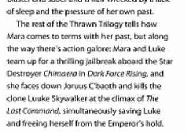
- **Mara Jade Skywalker; Luke Skywalker** — entry/section: Survivor's Quest team: "The latest opportunity to see Mara and Luke wielding lightsabers? It's Zahn's Survivor's Quest, set before the New Jedi Order. It's an opportunity Zahn clearly relishes and that Mara fans will love: She and Luke make a formidable team, drawing on the bonds they share in the Force and as husband and wife." Source: *Star Wars Insider #75* (2004), scan p.77
  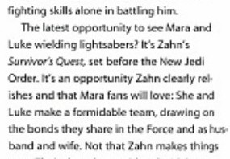

## scan p.78 (scan page 78)

Page contents: Comics preview: Ron Marz's two-part Princess Leia story in Star Wars: Empire 20 and 21, set between A New Hope and Empire — Leia seeks a new Rebel base on a moon owned by two Alderaanian brothers, one of whom she used to date; Marz's career (Silver Surfer, Green Lantern, CrossGen); art by Tomas Giorello. (hand-read)

## scan p.79 (scan page 79)

Page contents: Marz on the comics industry and a planned Han and Chewbacca two-parter. Sidebar "Marz, Bringer of War": Empire 19 (Vader vs. the Falleen), Jango Fett and Zam Wesell (March 2002, Tom Fowler and Ted Naifeh), "Resurrection" in Star Wars Tales 9 (Vader vs. Maul), Darth Maul 1–4 (Black Sun, Jan Duursema). (hand-read)

- **Darth Vader (Anakin Skywalker); Darth Maul** — entry/section: Marz on the Vader-Maul fight in "Resurrection": ""Resurrection" in Star Wars Tales 9 (October 2001). In the match-up you never thought you'd see, Darth Vader and Darth Maul square off against one another in a violent and surprisingly moving showdown. Says Marz, "I think that was the longest continual fight scene I ever wrote, well over 20 pages, but I wanted to give it everything it was worth." —Ron Marz, Star Wars Insider 75, p. 79" Source: *Star Wars Insider #75* (2004), scan p.79
  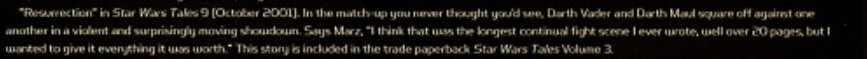

## scan p.80 (scan page 80)

Page contents: "Scouting the Galaxy" collecting column: the new Hasbro Clone Wars animated figures recall Kenner's 1985 Ewoks and Droids Adventure Hour line (the unproduced second wave, the rare Brazilian Vlix) and Boba Fett's animated Holiday Special debut; reader question on Galoob mini transforming head playsets. (hand-read)

## scan p.81 (scan page 81)

Page contents: Scouting the Galaxy: Galoob made nine mini-head sets, the last five not carried by U.S. retailers (sets V–IX listed); Hallmark's 1998 Boba Fett ornament has the Mandalorian skull upside-down on all units (no value effect, about its $14.95 retail); follow-up from readers on figures in fish tanks. (hand-read)

## scan p.82 (scan page 82)

Page contents: Scouting the Galaxy: aquarium-forum advice on figures in fish tanks; buying on eBay (columnist duped only twice in more than 700 purchases); Hamilton Collection plates selling for $6 to $110. (hand-read)

## scan p.83 (scan page 83)

Page contents: Scouting the Galaxy: preserving boxed ships and beasts (sunlight, UV sleeves, steady temperature and low humidity); Senator Palpatine was never produced in Rawcliffe pewter because the Episode I second wave was cancelled. (hand-read)

## scan p.84 (scan page 84)

Page contents: Hasbro's Original Trilogy Collection (OTC) for the September 2004 trilogy DVD release: black-and-silver retro cards; Dagobah wave (handstanding Luke, Yoda, spirit of Obi-Wan, screaming R2-D2) and Bespin wave (Leia, cloud-car pilot, Lobot); vintage-card figures; 12-inch Luke, Boba Fett and stormtrooper; the Millennium Falcon returns. (hand-read)

## scan p.85 (scan page 85)

Page contents: OTC continued: the Falcon with a firing missile and hyperdrive lights and sounds; X-wing and TIE fighter; lightsabers; a new Ask Yoda; Unleashed keeps its own packaging. (hand-read)

## scan p.86 (scan page 86)

Page contents: OTC continued: Toys "R" Us vehicles (Vader's TIE fighter, Y-wing), Target's Slave I and sandcrawler, Endor Ambush four-pack; back-issue listing of Insider and Gamer contents. (hand-read)

## scan p.87 (scan page 87)

Page contents: Back-issue listing continued and order form (Paizo Publishing, Bellevue, WA). (hand-read)

## scan p.88 (scan page 88)

Page contents: "The Action Figure Archive" by Vic Wertz and Dan Curto: late-1998 items not photographed for Chronicle Books' Action Figure Archive, plus the last FlashBack wave from early 1999 — Escape from the Death Star Action-Figure Game and the Action-Figure Carry Case. (hand-read)

## scan p.89 (scan page 89)

Page contents: Action Figure Archive continued ("Expanding Your Collection"): the column picks up where the 1999 book left off; 3-D Display Dioramas (Cantina Aliens, Jabba's Palace) and an Internet-exclusive Muftak figure set. (hand-read)

## scan p.90 (scan page 90)

Page contents: Action Figure Archive continued: FlashBack Wave 2 figures and other late-1990s figure listings. (hand-read)

## scan p.91 (scan page 91)

Page contents: Subscription advertisement (Paizo). (hand-read)

## scan p.92 (scan page 92)

Page contents: Topps Clone Wars trading cards (editor Matt Saunders): images from Lucasfilm's Clone Wars style guide, episode captures and Dark Horse art; promo cards P1–P3; nine Character Cards, 63 Episode Cards, 16 Dark Horse Cover Gallery Cards, an Episode III Clone Trooper Preview Card, checklist, 10 die-cut stickers. (hand-read)

## scan p.93 (scan page 93)

Page contents: Topps Clone Wars continued: puzzle-back stickers, 10 lenticular Battle Motion Cards, Artist Sketch inserts (artists including Genndy Tartakovsky, Paul Rudish, Davide Fabbri, Doug Wheatley, Joe Corroney, Dave Dorman); late Attack of the Clones autograph cards of Jack Thompson (Cliegg Lars) and Anthony Phelan (Lama Su). (hand-read)

## scan p.94 (scan page 94)

Page contents: Crossword puzzle "Must Be Love, Cuz Hate Don't Hurt Like That." (hand-read)

## scan p.95 (scan page 95)

Page contents: Subscription advertisement and order form. (hand-read)

## scan p.96 (scan page 96)

Page contents: "Answers to Your Star Wars Questions" with Pablo Hidalgo (starwars.com): why Tuskens charged Anakin; Boba Fett's old Jaster Mereel backstory replaced by Jango Fett: Open Seasons and The New Essential Guide to Characters; why Vader stopped Fett shooting Chewbacca; Obi-Wan's Episode III lightsaber belt clip. Questioner names omitted. (hand-read)

### Stat block notes (game mechanics, not feats)

- Why Vader stopped Fett: Although a stirring short story that appeared in Star Wars Tales 6 suggests that Vader did indeed recognize C-3PO on Cloud City, there really was no connection between the Dark Lord and the golden droid back when Empire was made. Vader's restriction of Fett was primarily meant to show just who was in charge and that no one fires a shot without Vader's say-so. Granted, it's hard to read expressions through immovable plasteel armor, but it looks more as if Vader is reminding Fett about his "no disintegrations" order than as if he's having gooey memories about a protocol droid he once built. (Star Wars Insider 75, p. 96) (Source: *Star Wars Insider #75* (2004), scan p.96)

## scan p.97 (scan page 97)

Page contents: Q&A continued: Kenobi's saber "transitions"; why the Emperor says "Much like your father's" (to goad Luke); the carbonite block's frame and sensors; the Rancor Keeper Malakili and his Nikto friend Giran. (hand-read)

### Stat block notes (game mechanics, not feats)

- The Rancor Keeper: If you were into the action figures of the time, you would have known the burly guy simply as "Rancor Keeper" and that his tears are shed over the loss of a beloved pet. Subsequent fiction named the man Malakili and identified him as a Corellian; a short story in Tales from Jabba's Palace sweetly describes how he raised the rancor from a whelp. Malakili's sympathetic pal is a green Nikto by the name of Giran, who helped the rancor keeper raise the beast. (Star Wars Insider 75, p. 97) (Source: *Star Wars Insider #75* (2004), scan p.97)

## scan p.98 (scan page 98)

Page contents: Back-page cartoon: "I changed my mind, honey. Let's enroll Leia in that diplomacy class immediately!" (hand-read)

## scan p.99 (scan page 99)

Page contents: Advertisement: limited-edition (5,000) Slave I model with Han Solo in carbonite. (hand-read)

## scan p.100 (scan page 100)

Page contents: Hasbro back-cover advertisement (starwars.hasbro.com). (hand-read)

