# Owner Material 038 — Star Wars Insider #1–153 plus specials (with The Lucasfilm Fan Club Magazine #1–22): Star Wars Insider #76 (2004)

- **Source:** *Star Wars Insider* magazine (issues 23–153, 1994–2014) and its predecessor *The Lucasfilm Fan Club Magazine* (issues 1–22, 1987–1994), plus seven special editions: articles, interviews, comics and short fiction Secondary source (licensed Legends reference). Scan OCR'd on the box; the scan stays box-only and is **not** published.
- **Method:** every scanned page was OCR'd and machine-screened sentence by sentence for power-relevant statements (fights, kills, defeats, Force feats, rankings, superweapons) that name a character on our roster; each kept sentence is quoted verbatim from the OCR text and has a crop of the printed passage directly under it. Pages with nothing power-relevant are still listed with what is on them.
- **Citation:** "*Star Wars Insider #76* (2004), p.X" by printed page ("scan p.X" where no printed number applies). **Weight:** Licensed magazine: a secondary source. Its short fiction and comics are Legends stories; its articles and interviews sum up or discuss lore and rank below the novels, comics and games they describe.

## scan p.1 (scan page 1)

Page contents: Cover: Star Wars Insider issue 76 (June/July 2004), "Artists of Episode III" ($5.99 U.S.). (hand-read)

## scan p.2 (scan page 2)

Page contents: Cloud City collectible toys advertisement (modern Star Wars toys, 1995–present; Norcross, GA). (hand-read)

## scan p.3 (scan page 3)

Page contents: Cloud City collectible toys advertisement (vintage pre-1990 toys and prototypes). (hand-read)

## scan p.4 (scan page 4)

Page contents: Contents, Features: Prequel Update (Jane Irene Kelly; Rick McCallum back in Australia for Episode III's Wookiee scene); Blue Sky Minds (Jenny Scott; Episode III concept artists); Looks Good on Paper (Christopher Alexander; origami); The Old Master (Ron Magid; Ralph McQuarrie); Feng Shmi (Sandy Clark; decorating); Changing Seasons Part 1: Guardian of the People (Timothy Zahn; Obi-Wan). Departments: Rebel Rumblings, Star News, Star Sightings, The Best of Hyperspace, HoloNet News (Duro), Set Piece (Hoth), Bookshelf (young Boba Fett), Comics Link (Clone Wars). Cover by concept artists Ryan Church, Mike Murnane, Yanick Dusseault, Erik Tiemens, Iain McCaig and Derek Thompson. (hand-read)

## scan p.5 (scan page 5)

Page contents: Editorial by Lisa Stevens, President, Official Star Wars Fan Club (22 March 2004): this is the last Insider published by Paizo; the Fan Club returns to Lucasfilm and she stays on as president; thanks to Dave Gross, Vic Wertz, Mike Mikaelian, Jenny Scott, Theresa Cummins and Scott Okumura; Comic-Con 2004 plans. (hand-read)

- **none** — entry/section: Paizo's last issue: ""As with most journeys, there is an end. This is the last issue of Insider published by Paizo Publishing, as it moves on to a new publisher. As for the Fan Club, it isn't going away; it's going back home to Lucasfilm, the place where it started and thrived for the first 10 years of the Star Wars era." —Lisa Stevens, Star Wars Insider 76, p. 5" Source: *Star Wars Insider #76* (2004), scan p.5
  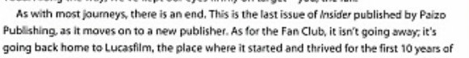

## scan p.6 (scan page 6)

Page contents: Contributors: Timothy Zahn (Survivor's Quest his sixth Star Wars novel), Christopher Alexander (origami), Sandy Clark ("Crazy Watto," Jedi Hunter), Pablo Hidalgo, Mike Selinker, Jenny Scott, Daniel Wallace, Chris Trevas. (hand-read)

## scan p.7 (scan page 7)

Page contents: Anthony Grandio Company Star Wars checks advertisement (Characters, Armada and Rebel Alliance/Galactic Empire designs). (hand-read)

## scan p.8 (scan page 8)

Page contents: Rebel Rumblings letters column: the outgoing letters editor's farewell after two years; masthead (Paizo, Lisa Stevens publisher); letters on Scouting the Galaxy and on sons named Owen and Luke Walker and a dog named Anakin (letter-writer names omitted). (hand-read)

## scan p.9 (scan page 9)

Page contents: Star Wars TCG Third Annual Championship advertisement (Gen Con 2004, 21 August; Wizards of the Coast). (hand-read)

## scan p.10 (scan page 10)

Page contents: Rebel Rumblings continued: a son who always plays Yoda in the Yoda–Dooku duel; a homemade Dagobah diorama; a young Padawan in lightsaber training; a ceramic Chewbacca smashed in a fall, which a father called a "Jawa" (writer names omitted). (hand-read)

## scan p.11 (scan page 11)

Page contents: Rebel Rumblings continued: the father redeems himself with a ceramic Darth Vader bust; an online fan group; Carolina Garrison of the 501st at a Greenville Grrrowl hockey game for Make-A-Wish (trooper names omitted); praise for Jason Fry's New Jedi Order coverage. (hand-read)

## scan p.12 (scan page 12)

Page contents: Rebel Rumblings continued: Insider 73 and the Japanese New Jedi Order cover art; a collector's 31 footlockers of toys and a MicroLEGO Sebulba (writer names omitted). (hand-read)

## scan p.13 (scan page 13)

Page contents: Official Star Wars Fan Club advertisement: the club comes home to Lucasfilm for the first time since 1987 ($39.95; six issues, membership kit, twelve months of Hyperspace). (hand-read)

## scan p.14 (scan page 14)

Page contents: Star News: Keisha Castle-Hughes (Whale Rider, youngest Best Actress Oscar nominee) plays the Queen of Naboo in Episode III after a one-day shoot (by Gabriela Tscharner-Patao; photo by Keith Hamshere). (hand-read)

- **none** — entry/section: Castle-Hughes on the saga: ""I liked them," she says, hesitating. "They seem to be boys' movies, though, with all the action and such. Nevertheless, they are lots of fun. Personally, I prefer romantic movies that make me cry." —Keisha Castle-Hughes, Star Wars Insider 76, p. 14" Source: *Star Wars Insider #76* (2004), scan p.14
  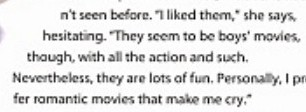

## scan p.15 (scan page 15)

Page contents: Star News: Carrie Fisher interview on The Best Awful, sequel to Postcards from the Edge (Suzanne Vale, bipolar disorder); her favorite words, screenplays, a dream Jeopardy category; Padmé compared with Debbie Reynolds; playing an older Leia "making soup." (hand-read)

## scan p.16 (scan page 16)

Page contents: Star News: LucasArts' Star Wars Republic Commando announced (Republic Special Ops squad, General Grievous); Gary Rydstrom's Cinema Audio Society career award; obituary for stuntman Peter Diamond (born 1929; Tusken Raider, Garouf Lafoe, Corporal Prescott, Endor biker scout; Raiders of the Lost Ark stunt coordinator). (hand-read)

## scan p.17 (scan page 17)

Page contents: Star News: first Official Star Wars Fan Club dinner in Seattle with Michonne Bourriague (Aurra Sing) and Amy Allen (Aayla Secura); George Lucas receives the Visual Effects Society's first Lifetime Achievement Award (tributes from Steve Jobs and James Cameron). (hand-read)

## scan p.18 (scan page 18)

Page contents: Star Sightings (Benjamin Harper with Vic Wertz): Liam Neeson in Batman Begins and Kingdom of Heaven; Keira Knightley possibly as Jeannie in I Dream of Jeannie and in The Jacket; Ewan McGregor's charity Lazer Tag game and Long Way Round book; Garrick Hagon in a Doctor Who audio drama. (hand-read)

## scan p.19 (scan page 19)

Page contents: Star Sightings continued: Natalie Portman in Garden State; Hagon as the Jester in "The Axis"; Carrie Fisher third in Celebrity Poker; Mark Hamill in Through the Moebius Strip; a pastor who calls Star Wars "the greatest movie of all time." (hand-read)

## scan p.20 (scan page 20)

Page contents: Prequel Update "They Did It All for the Wookiee" (Jane Irene Kelly): Rick McCallum on post-production, the first assembly of Episode III and ILM's first space-battle shots viewed with George Lucas, John Knoll and Rob Coleman. (hand-read)

## scan p.21 (scan page 21)

Page contents: Prequel Update continued: Wookiee animatics; the Sydney "Wookiee shoot" with seven Australian basketball players, planned for mid-May (Peter Mayhew as Chewbacca); Hayden Christensen with stunt coordinator Nick Gillard. (hand-read)

- **Chewbacca** — entry/section: Casting the Wookiees: ""No Wookiee footage was done when we were in Sydney last year," said McCallum. "We just weren't ready to do it. First, we had to find people tall enough to play the Wookiees, which we did, eventually – we hired some basketball players. After that, it took six months to build their Wookiee suits." —Rick McCallum, Star Wars Insider 76, p. 21" Source: *Star Wars Insider #76* (2004), scan p.21
  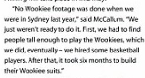

## scan p.22 (scan page 22)

Page contents: Full-page Episode III photo: Padmé Amidala in Palpatine's office with a Mon Calamari official. (hand-read)

## scan p.23 (scan page 23)

Page contents: Prequel Update photos: in Palpatine's office complex, Padmé (Natalie Portman), a Mon Calamari official (Paul Davies), Senator Fang Zar (Warren Owens) and Senator Male-Dee (Kee Chan); Neimoidian officials. (hand-read)

## scan p.24 (scan page 24)

Page contents: Prequel Update continued: Temuera Morrison asked to join the May Sydney shoot; London pickups in August (two six-day weeks) with Hayden Christensen, Samuel L. Jackson, Ian McDiarmid, Ewan McGregor and Christopher Lee — "additional material," not reshoots; Ron Fricke (Baraka) and Carl Miller filming background plates in Thailand. (hand-read)

## scan p.25 (scan page 25)

Page contents: Prequel Update continued: more plates planned in Switzerland and possibly China; Lucas's daily routine with editors Roger Barton and Ben Burtt; Episode III release date announced as May 19, 2005 (Japan in July); captions on a pregnant Padmé and the Jedi Temple briefing-room holoprojector. (hand-read)

## scan p.26 (scan page 26)

Page contents: Prequel Update photos: the "video village" at Fox Studios Australia; costume prop maker Adam Johansen on one of Padmé's headpieces (photo by Paul Tiller). (hand-read)

## scan p.27 (scan page 27)

Page contents: Full-page photo of the Episode III crew watching playback in the Fox Studios Australia video village. (hand-read)

## scan p.28 (scan page 28)

Page contents: The Best of Hyperspace (Pablo Hidalgo, edited by Paul Ens): the Episode III webcam at Skywalker Ranch and ILM; chat with Genndy Tartakovsky and Paul Rudish on the Clone Wars micro-series (few limits from Lucasfilm, Anakin the hardest character, no cels, a possible Indiana Jones and DVD) (chat-user names omitted). (hand-read)

- **Darth Vader (Anakin Skywalker); Obi-Wan Kenobi** — entry/section: Tartakovsky on Anakin: ""It was a really fine line that we had to walk. Also, because of Anakin's personality, he's a little rebellious or bratty, and that's always a harder character trait to portray. Obi-Wan is heroic and stoic and a natural hero, but Anakin is almost an antihero." —Genndy Tartakovsky, Star Wars Insider 76, p. 28" Source: *Star Wars Insider #76* (2004), scan p.28
  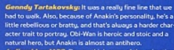

## scan p.29 (scan page 29)

Page contents: Best of Hyperspace: Episode III set diaries — the "Opening Battle" (Jan. 14, 2004; temporary music and animatics; Republic "triangles" vs. Separatist "circles," Trade Federation "donut ships") and "Filmed in Holoscope" (Jan. 21, 2004; John Knoll on holograms with a hint of color and curved scan lines). (hand-read)

- **Obi-Wan Kenobi** — entry/section: Lucas on colored holograms: "As for why holograms have suddenly become more colorful, no one seems to be sweating it too much. "This is a different model," explains Lucas, referring to Obi-Wan's transmitter. "This is a Sony." —George Lucas, Star Wars Insider 76, p. 29" Source: *Star Wars Insider #76* (2004), scan p.29
  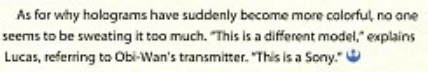

## scan p.30 (scan page 30)

Page contents: "Blue Sky Minds" (Jenny Scott): the Episode III concept artists Ryan Church, Sang Jun Lee, Iain McCaig, Erik Tiemens and Derek Thompson on collective creation; the "blue sky" phase with concept design supervisors Tiemens and Church; Church designed the AT-TE and hailfire droid for Episode II. (hand-read)

- **none** — entry/section: McCaig on collaboration: ""I'm not sure that picking a film apart to tell who did what is a good thing," says Star Wars Episode III concept artist Iain McCaig. "It defeats the collaborative nature of the enterprise." —Iain McCaig, Star Wars Insider 76, p. 30" Source: *Star Wars Insider #76* (2004), scan p.30
  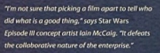

## scan p.31 (scan page 31)

Page contents: Blue Sky Minds continued: Sang Jun Lee's weekly routine (rough sketches, 7–15 drawings, Photoshop and Painter); traditional vs. electronic tools; Derek Thompson calls himself "pretty much a Luddite." (hand-read)

## scan p.32 (scan page 32)

Page contents: Blue Sky Minds continued: Church and Tiemens paint electronically; Thompson's Post-it sketches; brainstorming sessions; McCaig calls Lucas "probably the most collaborative director I've ever known." (hand-read)

## scan p.33 (scan page 33)

Page contents: Blue Sky Minds continued: McCaig responsible "only to George"; Church on Lucas pushing for "something completely new"; Lee contrasts Lucas with other directors (Men in Black II, The Hulk, Peter Pan). (hand-read)

## scan p.34 (scan page 34)

Page contents: Blue Sky Minds continued (art by Ryan Church): Lucas phoning in a creature idea from his car; Friday approval meetings; Tiemens's "visual script"; Church on designs readable "at just a glance." (hand-read)

## scan p.35 (scan page 35)

Page contents: Blue Sky Minds continued (art by Iain McCaig): seeing "the movie through his eyes"; Tiemens on pre-production inside post-production (the droid factory and the end battle in Episode II); the film "like a sketchbook." (hand-read)

## scan p.36 (scan page 36)

Page contents: Blue Sky Minds continued (art by Derek Thompson): Church on living up to the earlier films; Lee on more than 5,000 pieces of concept art in a year; McCaig on bridging Episodes III and IV through Anakin, Obi-Wan and Padmé; Church's many worlds; Lee's favorite new race; Tiemens on seeing a designed shot on screen. (hand-read)

- **Darth Vader (Anakin Skywalker); Obi-Wan Kenobi; Padmé Amidala** — entry/section: Bridging to Episode IV: "Lee agrees. "Every day you constantly have to keep bringing new and unique ideas. That's the tough part. In one year we created more than 5,000 pieces of concept art for the movie. In all my years of working in this industry, I have never seen this amount of art work for one feature film." Another challenge for the Art Department was providing a visual "bridge" between Episodes III and IV. In McCaig's case, those "bridges" were major characters in the story. "Helping Anakin and Obi-Wan age and transform has been a designer's delight," he says, "but Padmé's final incarnation was one of the most emotional creative challenges I've ever had to face." —Sang Jun Lee and Iain McCaig, Star Wars Insider 76, p. 36" Source: *Star Wars Insider #76* (2004), scan p.36
  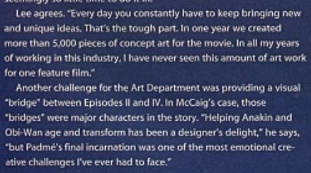

## scan p.37 (scan page 37)

Page contents: Blue Sky Minds conclusion (art by Sang Jun Lee): McCaig "proud to have been a part of the saga, period"; Tiemens begged for a Star Wars sketchbook as a boy; the artists' personal websites. (hand-read)

## scan p.38 (scan page 38)

Page contents: "Looks Good on Paper: Mastering the Art of Star Wars Origami" (Christopher Alexander): origami's history from A.D. 600; tips on paper and diagrams. (hand-read)

## scan p.39 (scan page 39)

Page contents: Origami continued: folding tips, making a square from a rectangle, key to folding symbols, valley and mountain folds. (hand-read)

## scan p.40 (scan page 40)

Page contents: Origami continued: mark, outside reverse, pleat, rabbit-ear, reverse and sink folds. (hand-read)

## scan p.41 (scan page 41)

Page contents: Origami continued: squash fold; "Two Basic Origami Shapes," the preliminary fold and the bird base. (hand-read)

## scan p.42 (scan page 42)

Page contents: Origami: step-by-step diagrams for Boba Fett's helmet. (hand-read)

## scan p.43 (scan page 43)

Page contents: Origami: Boba Fett's helmet, final steps, with a profile of Fett (armor weapons, beating the Falcon to Cloud City). (hand-read)

### Stat block notes (game mechanics, not feats)

- Fett's cunning: Boba Fett is the most notorious bounty hunter in the galaxy. While his armor may look battered and worn, it holds many surprises for his prey. Among its hidden weapons are rocket darts, a flamethrower and a whipcord launcher. It even has a rocket pack with a guided missile, but Fett's most effective weapon is his cunning. He prefers to outwit and trap his quarry. When the Millennium Falcon escaped the Imperial starfleet, Fett anticipated Captain Solo's ploy. He led Darth Vader to Bespin, beating the Falcon to Cloud City. (Star Wars Insider 76, p. 43) (Source: *Star Wars Insider #76* (2004), scan p.43)

## scan p.44 (scan page 44)

Page contents: Origami: step-by-step diagrams for a bantha, starting from a bird base. (hand-read)

## scan p.45 (scan page 45)

Page contents: Origami: the bantha's final steps, with a note that banthas roam Tatooine's Jundland Wastes in herds of 15 or more and that the Sand People ride them single file to hide their numbers. (hand-read)

## scan p.46 (scan page 46)

Page contents: Origami: step-by-step diagrams for Darth Vader's TIE fighter, starting from a bird base. (hand-read)

## scan p.47 (scan page 47)

Page contents: Origami: Darth Vader's TIE fighter, final steps, with a note on the prototype ship. (hand-read)

- **Darth Vader (Anakin Skywalker)** — entry/section: Star Wars Insider 076 (2004): "Flying thes ship, Darth Vader destroyed sx Rebel starfighters in defense of the Death Star during the Battle of Yavin." Source: *Star Wars Insider #76* (2004), scan p.47
  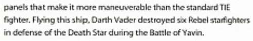

### Stat block notes (game mechanics, not feats)

- Vader's TIE prototype: This TIE fighter is the prototype for the next generation of TIE fighter. Flown by Darth Vader, it has hyperdrive capability, and angled solar panels that make it more maneuverable than the standard TIE fighter. Flying this ship, Darth Vader destroyed six Rebel starfighters in defense of the Death Star during the Battle of Yavin. (Star Wars Insider 76, p. 47) (Source: *Star Wars Insider #76* (2004), scan p.47)

## scan p.48 (scan page 48)

Page contents: Origami: step-by-step diagrams for the Millennium Falcon, starting from a bird base. (hand-read)

## scan p.49 (scan page 49)

Page contents: Origami: the Millennium Falcon, final steps, with a note on the ship ("the fastest hunk of junk in the galaxy"); closing advice to crumple messy models and call them pieces of the exploded Death Star. (hand-read)

### Stat block notes (game mechanics, not feats)

- The Falcon: Called "a piece of junk," "a bucket of bolts," "that thing" and "the fastest hunk of junk in the galaxy," the Millennium Falcon always breaks down at the wrong time, yet it always comes through in the end. Capable of reaching "point five" past light speed, she made the Kessel run in less than 12 parsecs, outran Imperial starships, escaped Imperial blockades, dodged through asteroid fields and played a prominent role in the destruction of two Death Stars. In the words of her captain, Han Solo, "She may not look like much, but she's got it where it counts." (Star Wars Insider 76, p. 49) (Source: *Star Wars Insider #76* (2004), scan p.49)

## scan p.50 (scan page 50)

Page contents: "The Old Master" (Ron Magid): Ralph McQuarrie, from Gary, Ind., painted Apollo coverage art at Reel Three; Hal Barwood and Matthew Robbins led him to George Lucas; his 1972 proposal for a film called Galaxy; his Return of the Jedi painting inspired Episode III designers. (hand-read)

## scan p.51 (scan page 51)

Page contents: The Old Master continued: Lucas calls after American Graffiti; "Never Trust Anyone Over 30" — McQuarrie, who once worked for Boeing, was 45 while most of the crew were young industrial designers (Joe Johnston, Steve Gawley); he worked from home until the matte paintings. (hand-read)

## scan p.52 (scan page 52)

Page contents: The Old Master continued: rejections at United Artists and Universal; pitching to Fox with McQuarrie paintings (Alan Ladd Jr.); weekly sessions with Lucas; the Tatooine painting of C-3PO and R2-D2; C-3PO inspired by Maria from Fritz Lang's Metropolis. (hand-read)

## scan p.53 (scan page 53)

Page contents: The Old Master continued: Threepio made "a boy"; the droid's final look with Liz Moore; Chewbacca designs and Stuart Freeborn's lemur-like Wookiee. (hand-read)

## scan p.54 (scan page 54)

Page contents: The Old Master continued: Chewbacca from a 1930s illustration of an ape-like beast; Freeborn's chin from a 2001 ape; Tusken Raiders' eyes caricatured; stormtrooper helmets "somewhat grotesque"; World War II influences; Vader as a Japanese-warrior figure in black silk. (hand-read)

- **none** — entry/section: McQuarrie on stormtroopers: ""It was supposed to be a tooled army that was very efficient, in a sense like the German army," McQuarrie says. "They can't hit a damn thing with their laser guns, but they're very efficient!" he laughs. —Ralph McQuarrie, Star Wars Insider 76, p. 54" Source: *Star Wars Insider #76* (2004), scan p.54
  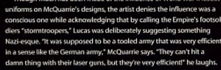

## scan p.55 (scan page 55)

Page contents: The Old Master continued: Vader's mask came from the need to survive vacuum while boarding the Blockade Runner; the English costume crew made Vader towering; William Cameron Menzies and the "production designer" title; stormtrooper and Rebel fleet-trooper helmets evolved from the same designs. (hand-read)

- **Darth Vader (Anakin Skywalker)** — entry/section: Vader's mask: ""I thought, 'Gee, Darth Vader has to function in a vacuum,' so I suggested to George that [Vader] might have some sort of spacesuit to enable him to survive this trip through the vacuum, and George said, 'Well, okay, give him some kind of a breathing apparatus.' So along with the big helmet, I put a mask on him." —Ralph McQuarrie, Star Wars Insider 76, p. 55" Source: *Star Wars Insider #76* (2004), scan p.55
  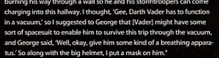

## scan p.56 (scan page 56)

Page contents: The Old Master continued: McQuarrie doesn't consider himself a designer; his paintings hung on the wall of the English crew's workshop; his favorite Vader is the novelization book-jacket art. (hand-read)

## scan p.57 (scan page 57)

Page contents: The Old Master conclusion: "my work is in there"; a mockup poster with credits lifted from Where the Red Fern Grows; his greatest contribution was the paintings on hand at the Fox meeting. (hand-read)

- **none** — entry/section: McQuarrie's greatest contribution: ""Well, the paintings that I did were on hand the day that George had a meeting with the directors at Fox. The decision was made to go ahead with the film on the strength of George's idea and my compositions. That was my contribution right there." —Ralph McQuarrie, Star Wars Insider 76, p. 57" Source: *Star Wars Insider #76* (2004), scan p.57
  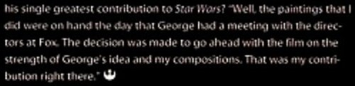

## scan p.58 (scan page 58)

Page contents: "Feng Shmi: Star Wars Decor (and the People Who Live with It)" (Sandy Clark): fitting a collection into a livable home; HGTV Ultimate Collectors producer Cyndi Haas ("Star Wars fans have a real talent for turning any item into art"); start with a blank slate, take time, respect the room's function, keep a design notebook (collector names omitted). (hand-read)

## scan p.59 (scan page 59)

Page contents: Feng Shmi continued: choosing colors from a focal piece; Haas: "There are no hard rules"; balancing display with livability; "Making It Small: A Child's Star Wars Room" — childhood bedrooms where collecting began (collector names omitted). (hand-read)

## scan p.60 (scan page 60)

Page contents: Feng Shmi continued: a child's room built around play, a focal point and space for the child's own art; "At the Academy: Decorating the Dorm Room." (hand-read)

## scan p.61 (scan page 61)

Page contents: Feng Shmi continued: dorm advice — bring few, larger items (a single Unleashed figure), protect posters in small spaces (student name omitted). (hand-read)

## scan p.62 (scan page 62)

Page contents: Feng Shmi continued: "All Grown Up: The Star Wars First Home" — negotiating with nonfan spouses, a closet turned display case, an editor's note on UV-filtering sleeves for fluorescent lights, Han in carbonite in the entryway; Haas on varied displays such as a vintage hutch or a three-tiered table (fan names omitted). (hand-read)

## scan p.63 (scan page 63)

Page contents: Feng Shmi conclusion: play-and-display, bookshelves near the ceiling, costumes and mannequins as "pillars"; preserving collections from bugs, moisture, sunlight and dust; nod to Steve Sansweet's Rancho Obi-Wan (Insider 71) (collector names omitted). (hand-read)

## scan p.64 (scan page 64)

Page contents: "Changing Seasons Part 1: Guardian of the People" (Timothy Zahn): Obi-Wan in a Faraway-class scout ship with R3 unit "Arthree" over farmland on Dagro, attacked by three STAP battle droids, uses Anakin's climb-and-dive stunt. (hand-read)

### Stat block notes (game mechanics, not feats)

- Anakin's stunt: It was a stunt he'd first seen Anakin pull several months ago, and he'd taken the brash young Padawan to task about it afterward. The younger man had countered with the unassailable logic that, first, he'd survived and, second, the trick had worked. Since then he'd used it at least three more times, with the same record of success. Anakin would be highly amused if he ever found out Obi-Wan had tried it himself. Fortunately, Anakin was a dozen light-years away. (Star Wars Insider 76, p. 64) (Source: *Star Wars Insider #76* (2004), scan p.64)

## scan p.65 (scan page 65)

Page contents: Guardian of the People continued: a Separatist base confirmed; Obi-Wan's scout loses its starboard wing and crashes in a grain field; Anakin confronts the Barabel Task Force Commander Fivvic over Obi-Wan going on ahead. (hand-read)

## scan p.66 (scan page 66)

Page contents: Guardian of the People continued: Fivvic needs three or four days for repairs; Anakin's unease; Obi-Wan wakes among sargheet stalks, meets the children Kit and Zizzy Swens; his R3 droid has gone dormant; their father arrives by zele cart and suggests Vale City. (hand-read)

### Stat block notes (game mechanics, not feats)

- "Make it three": Anakin took a deep breath, trying hard to cultivate the patience Obi-Wan was always on his case about. "How soon?" "Three days. Possibly four." Anakin felt his throat tighten as he watched the maintenance team moving purposefully among the damaged scouts. Three days. An eternity, particularly in the middle of a war. Still, Obi-Wan was a Jedi Knight, and there were only rumors that the Separatists had moved into Dagro in the first place. There was a fair chance that the rumors were wrong and that Obi-Wan was wasting his time looking. So why was Anakin getting an uncomfortable tingle up his spine? "I presume," Fivvic went on with only a trace of sarcasm, "that four days will be acceptable?" Gently, Anakin stroked his mechanical right hand. "Make it three," he said, "and you've got a deal." (Star Wars Insider 76, p. 66) (Source: *Star Wars Insider #76* (2004), scan p.66)

## scan p.67 (scan page 67)

Page contents: Guardian of the People continued: farmer Kirlan Swens resents Coruscant's neglect and the collapse of the sargheet market ("Landspeeders eat money and excrete debt"); STAPs search the homestead while Obi-Wan hides in a harvester's cab-engine; after dark Kirlan has invited neighbors. (hand-read)

## scan p.68 (scan page 68)

Page contents: Guardian of the People continued: Obi-Wan admits he is a general of the Republic army; the farmer Hanco blames him for bringing the war; he asks only not to be betrayed; Trissa Swens fears the threat; he sleeps in the barn to keep any fight away from the house. (hand-read)

## scan p.69 (scan page 69)

Page contents: Guardian of the People continued: Obi-Wan strips blue bristles from sargheet crop stubble and finds the simple work soothing; droids patrol high overhead; his Padawan Anakin is delayed; a plan to barn-hop between neighbors' homesteads. (hand-read)

## scan p.70 (scan page 70)

Page contents: Guardian of the People continued: the droids notice the farm's changed routine and arrest Obi-Wan ("Marsh Fixter") and the Swenses; seeing the children's trust, he Force-throws the droid officer to draw the droids' fire. (hand-read)

### Stat block notes (game mechanics, not feats)

- Guardian of the people: And then he focused on the children's faces and saw the trust and calm adding a sheen of hope to the fear in their eyes. He was a Jedi, one of those who claimed to be guardians of the people; and for all the cynicism of their elders, they still believed in him. Still believed that he could and would save them. There was a flicker in the Force … and suddenly he knew what he had to do. "No," he said, taking a step forward as the droids started to close in on the family. "Leave them alone." "Or?" the officer countered. Smiling tightly, Obi-Wan lifted a hand, stretched out to the Force, and threw the droid backward to slam hard against the ground. (Star Wars Insider 76, p. 70) (Source: *Star Wars Insider #76* (2004), scan p.70)

## scan p.71 (scan page 71)

Page contents: Guardian of the People conclusion: Anakin's Jedi starfighter strafes the STAPs out of the rising sun; "Three minutes later, it was over"; Obi-Wan suspects a weapons-development facility in the gorge and decides he and Anakin will investigate. (hand-read)

### Stat block notes (game mechanics, not feats)

- "Now, there are two of us": "Wait a second," Trissa put in, starting to sound alarmed. "You're the one who told us a Jedi couldn't take on a whole enemy base." "I said a Jedi couldn't take on a base alone," Obi-Wan corrected, smiling tightly. "Now, there are two of us." Kirlan shook his head. "Why," he said, "do I suddenly have a bad feeling about this?" (Star Wars Insider 76, p. 71) (Source: *Star Wars Insider #76* (2004), scan p.71)

## scan p.72 (scan page 72)

Page contents: Republic HoloNet News (Core Edition 15:3:29): Senator Ronet Coor of Iseno resigns and Onaconda Farr of Rodia is censured after an SBI report finds the three Venator-class Star Destroyers assigned to Duro were diverted to the Rodia-Ando front; Senators Lexi Dio and Padmé Amidala warn against sweeping changes. (hand-read)

### Stat block notes (game mechanics, not feats)

- Amidala on Duro: "While we join our colleagues in shock and disapproval of these Senators' acts, we do not want to hear the Senate's voice silenced in these trying times," said Senator Amidala. "Already there are cries for the Chancellor to directly steer the war; today, I heard esteemed Duros leaders demand that a human be placed in charge of battlefronts that overlap rival homeworlds; I cannot believe that these short-sighted reactionary cries could become policy." (Star Wars Insider 76, p. 72) (Source: *Star Wars Insider #76* (2004), scan p.72)

## scan p.73 (scan page 73)

Page contents: HoloNet News continued: General Grievous declares Operation Durge's Lance a success, with Duro under Confederacy control and Givin engineers blocking the Corellian Trade Spine; an unattributed Separatist message; Shu Mai on defending Mooria with organic troops because ion storms block battle droids. (hand-read)

## scan p.74 (scan page 74)

Page contents: "Battlefront: Fighting Mother Nature and Imaginary Foes" (Chris Trevas): the Hoth shoot at Finse, Norway, in March 1979 — its worst recorded weather, a ski lodge base, 35 Norwegian Red Cross rescue skiers as Rebel troops, brittle cables for the explosive charges, and an avalanche on the April 3 wrap day. (hand-read)

## scan p.75 (scan page 75)

Page contents: Battlefront continued: captioned views of the Rebel gun turret, the dish-shaped laser cannon, a tripod blaster, and Hoth troopers' pistols built from a cut-down Charter Arms AR-7 survival rifle. (hand-read)

## scan p.76 (scan page 76)

Page contents: "Hunter's Bounty: Elizabeth Hand Takes on Young Boba Fett's Adventures" (Jason Fry): Scholastic's Boba Fett series (Terry Bisson's first two books, then Hand); April's A New Threat sends Boba after Wat Tambor on Xagobah and offers a first look at General Grievous. (hand-read)

- **Boba Fett; Wat Tambor; Jabba the Hutt; Count Dooku** — entry/section: Boba's first big assignment: "In A New Threat, Jabba gives Boba his first big assignment: to capture Wat Tambor. Fans will remember Wat Tambor as one of the Separatist conspirators who meets with Dooku in Episode II. After escaping a Republic prison, Tambor has fled to Xagobah, a strange, fogbound world covered with toxic fungi and dominated by the eerie Mazariyan Citadel." Source: *Star Wars Insider #76* (2004), scan p.76
  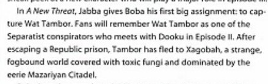

## scan p.77 (scan page 77)

Page contents: Hunter's Bounty continued: Hand's novelizations (The X-Files: Fight the Future, Twelve Monkeys); she sees Boba as an antihero, with Anakin as a mirror; her son's Boba Fett helmet; "We are a Boba Fett family." (hand-read)

- **Boba Fett** — entry/section: Hand on Boba: ""As a reader but also as a writer, I tend to be drawn to dark subjects and to dark characters," Hand muses. "Part of what a writer does – hopefully – is to enable readers to identify with a character, even a flawed character." … As Hand observes, "Very few kids stand out as evil people. Hannibal Lecter might have been a very nice kid." —Elizabeth Hand, Star Wars Insider 76, p. 77" Source: *Star Wars Insider #76* (2004), scan p.77
  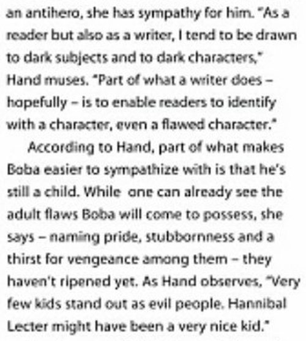
- **Boba Fett** — entry/section: "A Boba Fett family": ""He asked, 'Do you know about Boba Fett?' And I said, 'I know all about Boba Fett. We are a Boba Fett family.'" —Elizabeth Hand, Star Wars Insider 76, p. 77" Source: *Star Wars Insider #76* (2004), scan p.77
  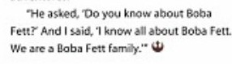

## scan p.78 (scan page 78)

Page contents: "Clone Wars Adventures" — the Cartoon Network Clone Wars micro-series comes to Dark Horse comics: a digest-sized series debuting in April in the cartoon's art style, written by Haden Blackman with artist Ben Caldwell; "These will be original stories…" (hand-read)

## scan p.79 (scan page 79)

Page contents: Clone Wars Adventures continued: Blackman developed the backstories of Durge and Asajj Ventress; three-story "vignette" issues; issue 1 features Obi-Wan and Anakin on a planet of eternal night, Mace Windu on Saesee Tiin's homeworld Iktotch and Kit Fisto underwater. (hand-read)

## scan p.80 (scan page 80)

Page contents: Clone Wars Adventures conclusion: Yoda in later issues, with at least one Obi-Wan and Anakin story per issue; Caldwell, a toy designer and children's-book illustrator, landed the job through a 2002 Comic-Con portfolio review (editors Chris Warner, Randy Stradley); the house style from Tartakovsky's team (Insider 69). (hand-read)

## scan p.81 (scan page 81)

Page contents: Paizo back-issue order form for Star Wars Insider and Star Wars Gamer, with shipping rates. (hand-read)

## scan p.82 (scan page 82)

Page contents: "Scouting the Galaxy" (Steve Sansweet's collecting column): convention season — Jedi-Con 2004 in Düsseldorf, WonderCon, Star Wars Weekends at Walt Disney World, Star Wars Encuentros in Mexico and Comic-Con International (July 22–25); reader questions on a Special Edition VHS hanging display and the Executor Box (letter-writer names omitted). (hand-read)

## scan p.83 (scan page 83)

Page contents: Scouting the Galaxy continued: the UK Executor Box (recent eBay sales about $125); Cargo Bay listings for a "Smithsonian Exhibit" video and an "Episode I Storybook" CD-ROM that never existed — the Antenna Audio tour for the Magic of Myth exhibition was never sold. (hand-read)

## scan p.84 (scan page 84)

Page contents: Scouting the Galaxy continued: a Jeremy Bulloch–signed Silver Convention Exclusive Boba Fett (the bubble will yellow before the ink harms the card; whether autographs help value); an uncredited poster is almost certainly a $5–$10 reprint; a correction that a sabacc deck came in West End Games' Crisis on Cloud City. (hand-read)

## scan p.85 (scan page 85)

Page contents: Scouting the Galaxy conclusion: the "real" sabacc has 76 chip-shaped cards; a Bespin Luke on the wrong card is "a mistake," not a variation; a loose, damaged ROTJ Luke is worth $10 at most; submission address. (hand-read)

## scan p.86 (scan page 86)

Page contents: "Toy Box": Hasbro's Original Trilogy Collection Vintage figures — premium decoration and articulation, soft goods, reproduced card fronts (with the original Kenner logo but not the original legal text) and a protective clamshell. (hand-read)

## scan p.87 (scan page 87)

Page contents: Toy Box continued: the 12 Vintage 3 3/4-inch figures (Luke in farm tunic, Ben Kenobi, Han, Leia, Vader, Lando, C-3PO, a stormtrooper, Boba Fett, Chewbacca, R2-D2, and more) and three Vintage 12-inch figures (Luke, Boba Fett and a stormtrooper; a new vintage-style ROTJ box); basic-line rereleases. (hand-read)

## scan p.88 (scan page 88)

Page contents: Toy Box continued: four Unleashed figures repackaged with new character-specific artwork (Luke from ROTJ and Darth Sidious shown, Obi-Wan and Leia to come). (hand-read)

## scan p.89 (scan page 89)

Page contents: Toy Box continued: Playskool's Galactic Heroes return at Wal-Mart this fall as movie-themed two-packs (Wave 1 ANH, Wave 2 AOTC, Wave 3 ESB); a note on retail exclusives. (hand-read)

## scan p.90 (scan page 90)

Page contents: Checklist (Vic Wertz with Dan Curto): Hasbro figures and vehicles, including the sneak-preview STAP & battle droid and Mace Windu. (hand-read)

## scan p.91 (scan page 91)

Page contents: Checklist continued: it picks up where Chronicle Books' 1999 Star Wars: The Action Figure Archive left off. (hand-read)

## scan p.92 (scan page 92)

Page contents: Checklist continued: Saga Collection figures. (hand-read)

## scan p.93 (scan page 93)

Page contents: Ad: Amazing Stories charter subscription. (hand-read)

## scan p.94 (scan page 94)

Page contents: Crossword puzzle with Star Wars clues. (hand-read)

## scan p.95 (scan page 95)

Page contents: Ad: subscription to a Paizo gaming magazine. (hand-read)

## scan p.96 (scan page 96)

Page contents: "Q&A": stormtroopers blasting the turbolift doors; why stormtroopers differ (Lucas: by Episode IV they are drawn from several clone hosts); why only three Council members speak (Silas Carson, Samuel L. Jackson, Frank Oz); Zam Wesell's last words; Twi'lek lekku. (hand-read)

### Stat block notes (game mechanics, not feats)

- Stormtroopers from multiple sources: However, there is also an in-universe explanation, provided by none other than George Lucas himself. During the production of Episode III, Lucas told crewmembers that the stormtroopers seen in Episode IV are – in the story world – made from multiple sources. That is, they're not all Jango clones. By that time in the saga, other clone hosts have been selected. Lucas intimated that the selection process has become more political than strategic in some cases – a highly placed officer's cousin might be selected over a more capable specimen, for example. This politicization results in less-than-ideal candidates, which could explain some of the embarrassing marksmanship witnessed in the original trilogy. (Star Wars Insider 76, p. 96) (Source: *Star Wars Insider #76* (2004), scan p.96)
- Zam's last words: Those who own a copy of Ben Burtt's entertaining Star Wars Galactic Phrasebook and Travel Guide should be able to piece together Zam's last words. They're Huttese. She says "Murashani sleemo," which translates into "Bounty hunter slimeball." It seems that Zam didn't quite agree with Jango's methods of silencing her. (Star Wars Insider 76, p. 96) (Source: *Star Wars Insider #76* (2004), scan p.96)
- Memories in her lekku: Finally, the head-tails themselves are actually extensions of Twi'lek brain tissue. Sometimes crudely called "brain tails," this tissue doesn't control any vital functions but can contain long-term memories. When Aayla Secura was robbed of her memory, Jedi therapists were able to restore many of them since they were stored in her lekku. (Star Wars Insider 76, p. 96) (Source: *Star Wars Insider #76* (2004), scan p.96)

## scan p.97 (scan page 97)

Page contents: Q&A continued: Jabba's Gamorrean guards; no Endor holocaust (The Glove of Darth Vader's wormhole); why Jar Jar was banished; Luke's changed line in the ESB Special Edition; Luke and Asajj Ventress are not Sith Lords. (hand-read)

### Stat block notes (game mechanics, not feats)

- Jabba's blindfolded match: Jabba knows full well about his guards' intellectual shortcomings. Gamorrean tradition holds that in order to win a pig guard's respect, you have to beat the snot out of him. Jabba one-ups this custom by challenging several Gamorreans to a blindfolded match. When it comes time to spar, all the Gamorreans are blindfolded, so they can't see that it is Jabba's other underlings who knock them senseless, while the Hutt reclines and watches the whole thing unfold. (Star Wars Insider 76, p. 97) (Source: *Star Wars Insider #76* (2004), scan p.97)
- Not Sith Lords: The simple answer is that Luke and Asajj are not Sith Lords. There is a difference between a dark-side user and a Sith Lord. That is, not all dark siders are Sith Lords – the teaching of the Sith is a specific discipline with specific lessons, which adheres to the covenant of two Sith Lords at a time. Asajj is a dark-side user who exists outside of Darth Tyranus and Darth Sidious. Though she longs to be recognized as Sith, she's not. (Star Wars Insider 76, p. 97) (Source: *Star Wars Insider #76* (2004), scan p.97)

## scan p.98 (scan page 98)

Page contents: Back-page art: a museum-gallery parody in which a Twi'lek docent leads aliens past Star Wars takes on famous paintings (a Van Gogh-style Yoda, a Toulouse-Lautrec-style "Troupe de Clone Clone," a Picasso-style piece, a Han and Leia portrait), while Greedo blasts a bust. (hand-read)

## scan p.99 (scan page 99)

Page contents: Ad: Code 3 Collectibles' Slave I model signed by Jeremy Bulloch. (hand-read)

## scan p.100 (scan page 100)

Page contents: Back cover: Hasbro toy ad. (hand-read)

