# Owner Material 038 — Star Wars Insider #1–153 plus specials (with The Lucasfilm Fan Club Magazine #1–22): Star Wars Insider #77 (2004)

- **Source:** *Star Wars Insider* magazine (issues 23–153, 1994–2014) and its predecessor *The Lucasfilm Fan Club Magazine* (issues 1–22, 1987–1994), plus seven special editions: articles, interviews, comics and short fiction Secondary source (licensed Legends reference). Scan OCR'd on the box; the scan stays box-only and is **not** published.
- **Method:** every scanned page was OCR'd and machine-screened sentence by sentence for power-relevant statements (fights, kills, defeats, Force feats, rankings, superweapons) that name a character on our roster; each kept sentence is quoted verbatim from the OCR text and has a crop of the printed passage directly under it. Pages with nothing power-relevant are still listed with what is on them.
- **Citation:** "*Star Wars Insider #77* (2004), p.X" by printed page ("scan p.X" where no printed number applies). **Weight:** Licensed magazine: a secondary source. Its short fiction and comics are Legends stories; its articles and interviews sum up or discuss lore and rank below the novels, comics and games they describe.

## scan p.1 (scan page 1)

Page contents: Cover (September/October 2004, first IDG Entertainment issue): Exclusive Episode III report and photos, exclusive fiction, Bantha Tracks, Episode III webcam, Amy Allen chats with fans, rare and never-before-seen photos; "The Magazine of Hyperspace: The Official Star Wars Fan Club." (hand-read)

## scan p.2 (scan page 2)

Page contents: Ad: Cloud City Collectibles (modern Star Wars toys). (hand-read)

## scan p.3 (scan page 3)

Page contents: Ad: Cloud City Collectibles (vintage Star Wars toys). (hand-read)

## scan p.4 (scan page 4)

Page contents: Contents: Prequel Update (Jane Irene Kelly), Skywalking, the Top 10 greatest moments of the classic trilogy (Dan Amrich), "The Guardian" fiction conclusion (Timothy Zahn), Battlefront, Ask the Master (Pablo Hidalgo), Laugh It Up, Fuzzball; the Hyperspace logo as a cue to go online. (hand-read)

## scan p.5 (scan page 5)

Page contents: Ad: Hasbro toys. (hand-read)

## scan p.6 (scan page 6)

Page contents: Editor's letter (Brett Rector): Lucasfilm and IDG Entertainment (GamePro's publisher) take over Insider; "Bookshelf" becomes "Jedi Library" and "Toy Box" becomes "Jabba's Collection"; Hyperspace access with each subscription; Bantha Tracks in every issue; staff box. (hand-read)

- **none** — entry/section: By the fans and for the fans: ""Insider is truly a magazine by the fans and for the fans." —Brett Rector, Star Wars Insider 77, p. 6" Source: *Star Wars Insider #77* (2004), scan p.6
  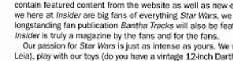

## scan p.7 (scan page 7)

Page contents: Ad: Topps Star Wars Heritage trading cards. (hand-read)

## scan p.8 (scan page 8)

Page contents: "Comlink," the renamed letters section: why the name; replies on an Expanded Universe chronology, the Zahn fiction conclusion "Changing Seasons Part II: People of the Guardian," Grievous in the Clone Wars cartoon and five 12-minute episodes coming in March 2005 (letter-writer names omitted). (hand-read)

- **General Grievous** — entry/section: Star Wars Insider 077 (2004): "We too were very shocked to see General Grievous mow down so many powerful Jedi and with such relative" Source: *Star Wars Insider #77* (2004), scan p.8
  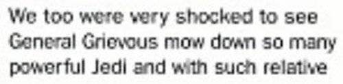

## scan p.9 (scan page 9)

Page contents: Comlink continued: the Aurebesh in Republic HoloNet News; Bantha Tracks will carry fan stories and photos; a reply on the Anakin and Padmé love story (letter-writer names omitted); ad for Kevin J. Anderson's Saga of Seven Suns. (hand-read)

## scan p.10 (scan page 10)

Page contents: Bantha Tracks "By the Fans, for the Fans": the total fan experience; a fan who had watched A New Hope 3,012 times by June 1, 2004, starting at a one-screen theater in Yuba City, California, in 1977 (fan names omitted). (hand-read)

## scan p.11 (scan page 11)

Page contents: Bantha Tracks continued: the same fan's favorite scenes and his viewing totals for the other films; a fan writer's thank-you letter to George Lucas, the cast and crew (fan names omitted). (hand-read)

## scan p.12 (scan page 12)

Page contents: Bantha Tracks continued: a Hyperspace member wins a contest trip to the Episode III set at Fox Studios, Sydney, with an entry about Natalie Portman's first fitting with a prosthetic belly, and sits near George Lucas at "video village" (fan names omitted). (hand-read)

## scan p.13 (scan page 13)

Page contents: Ad: Babylon 5 DVD. (hand-read)

## scan p.14 (scan page 14)

Page contents: Bantha Tracks continued: the set visit (meeting Pablo Hidalgo, the prop room with property master Ty Teiger) and questions the fan wants Episode III to answer; Chicago Force's backyard drive-in; a call for Halloween costume photos for Insider 78 (fan names omitted). (hand-read)

## scan p.15 (scan page 15)

Page contents: Bantha Tracks Art Galaxy: fan illustrations of Jawas, a bantha and rider, Boba Fett, and Bib Fortuna with R2-D2; Star Wars fan films 2002–2004 at starwars.atomfilms.com (fan artist names omitted). (hand-read)

## scan p.16 (scan page 16)

Page contents: Bantha Tracks: the first Star Wars Galaxies Fan Fest in Anaheim on June 4–5 with 1,200 players; developers' panels, a scavenger hunt and the "Jump to Lightspeed" expansion debut; half a million copies sold and 1.2 million characters created (player and guild names omitted). (hand-read)

## scan p.17 (scan page 17)

Page contents: Ad: Scholastic Star Wars Jedi novels for kids and Mark Cotta Vaz's Complete Star Wars Trilogy Scrapbook. (hand-read)

## scan p.18 (scan page 18)

Page contents: Bantha Tracks club news: a San Francisco "Unity" evening honoring a late fan, with actor Mike Quinn; the 501st's Midwest Garrison makes John Williams an honorary member at his Chicago concert; a San Antonio society joins "Read Across America" (fan names omitted). (hand-read)

## scan p.19 (scan page 19)

Page contents: Ad: Code 3 Collectibles die-cast vehicles. (hand-read)

## scan p.20 (scan page 20)

Page contents: Bantha Tracks: the Official Star Wars Fan Club moves "home to Lucasfilm" (Hyperspace, StarWarsShop.com discounts, Insider, Fan Club breakfasts, Celebration III); thanks to Lisa Stevens of Paizo; submission guidelines. (hand-read)

## scan p.21 (scan page 21)

Page contents: Ad: Star Wars Trading Card Game "The Phantom Menace" expansion. (hand-read)

## scan p.22 (scan page 22)

Page contents: Skywalking news: the original trilogy DVDs due September 21, 2004, restored by Lowry Digital with commentaries and the Empire of Dreams documentary (Jim Ward quoted); Episode III opens worldwide on May 19, 2005, with Japan in July. (hand-read)

## scan p.23 (scan page 23)

Page contents: Skywalking continued: a new 12-minute-per-episode Clone Wars miniseries from Genndy Tartakovsky (Howard Roffman, Jim Samples) with an expanded role for General Grievous; the London Symphony Orchestra plays the Star Wars theme at its centenary concert before the Queen; THX 1138 comes to DVD September 14. (hand-read)

- **none** — entry/section: Lucas on THX 1138: ""THX 1138 is how I saw 1970. It was designed as a metaphor for the way we were living at the time," Lucas said. "The world has taken a strange twist from there, but I think the ideas that we examined in THX 1138 are still valid in the 21st century." —George Lucas, Star Wars Insider 77, p. 23" Source: *Star Wars Insider #77* (2004), scan p.23
  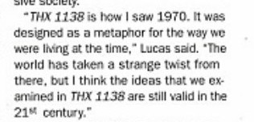

## scan p.24 (scan page 24)

Page contents: Skywalking continued: THX 1138 Director's Cut DVD extras (A Legacy of Filmmakers) and a September 10 theatrical run; LucasArts' Eric Johnston and Make-A-Wish build "Ben's Game," a free cancer-fighting game designed with a nine-year-old leukemia patient. (hand-read)

- **none** — entry/section: Lucas on THX 1138 on DVD: "Lucas said, "We wanted to make a different kind of film, and I hope that when audiences see it today on DVD they will find it to be as intriguing as we envisioned." —George Lucas, Star Wars Insider 77, p. 24" Source: *Star Wars Insider #77* (2004), scan p.24
  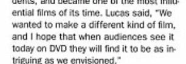

## scan p.25 (scan page 25)

Page contents: Ad: Gen Con So Cal at the Anaheim Convention Center. (hand-read)

## scan p.26 (scan page 26)

Page contents: Skywalking "Star News" (Benjamin Harper): Hayden Christensen's Best Actor award for Shattered Glass and a rumored role in Possession; Samuel L. Jackson in The Man; Carrie Fisher lends her house for Selma Blair's wedding; Ayesha Dharker in Colour Me Kubrick and Bombay Dreams; Anthony Phelan, Rena Owen and Ewan McGregor projects; Jeremy Bulloch's autobiography Flying Solo: Tales of a Bounty Hunter. (hand-read)

## scan p.27 (scan page 27)

Page contents: Ad: technology college degree ("You plan on playing in the real world?"). (hand-read)

## scan p.28 (scan page 28)

Page contents: Prequel Update (Jane Irene Kelly): Rick McCallum on the second cut of Episode III; Roger Guyett joins ILM as a visual effects supervisor; the mid-May Wookiee shoot in Sydney with basketball players in the suits; pickup shooting with Temuera Morrison; photo of George Lucas and actor Bruce Spence. (hand-read)

- **Chewbacca** — entry/section: The Wookiee shoot: ""The Wookiee shoot was a fabulous experience," said McCallum. "We did the whole thing in two days. The actors were in fantastic shape—mentally and physically, they were ready for the shoot, and everything went really well." —Rick McCallum, Star Wars Insider 77, p. 28" Source: *Star Wars Insider #77* (2004), scan p.28
  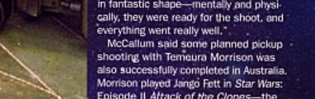

## scan p.29 (scan page 29)

Page contents: Prequel Update continued: London pickups planned for late August and early September with Ewan McGregor, Hayden Christensen and Natalie Portman; Ron Fricke's background plates in Phuket, China and Switzerland (for Alderaan); Hayden Christensen on the Alderaan Diplomatic Cruiser set. (hand-read)

### Stat block notes (game mechanics, not feats)

- The Tantive IV in Episode III: (2–3) Actor Hayden Christensen (Anakin Skywalker) stands in the hallway of a familiar-looking ship, the Alderaan Diplomatic Cruiser to be seen in Episode III, as if to get a feel and sense of place for where his alter-ego will stride many years later. Darth Vader storms aboard what has become the Rebel Blockade Runner, or Tantive IV, in Star Wars: Episode IV A New Hope. The circle draws closer to completion. (Star Wars Insider 77, p. 29) (Source: *Star Wars Insider #77* (2004), scan p.29)

## scan p.30 (scan page 30)

Page contents: Prequel Update continued: Ryan Church on designing a newer Tantive IV; photos of Anakin's and Obi-Wan's Episode III Jedi starfighters, with R2-D2 and a new R4 unit. (hand-read)

- **Bail Organa** — entry/section: Designing the Tantive IV: ""The Tantive IV had a few design considerations," said Episode III concept design supervisor, Ryan Church. "Clearly, it's the same ship we see in Episode IV, but in this film, we wanted to show how it appeared when it was newer, cleaner, and sleeker." —Ryan Church, Star Wars Insider 77, p. 30" Source: *Star Wars Insider #77* (2004), scan p.30
  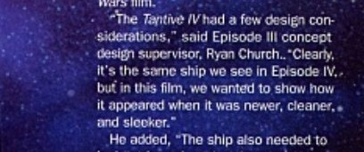

## scan p.31 (scan page 31)

Page contents: Ad: Treasure Chest Foundation breakfast and the Chicagoland Entertainment Collectors Expo, September 10–12, Ramada O'Hare, Rosemont, Illinois. (hand-read)

## scan p.32 (scan page 32)

Page contents: Prequel Update continued: Bail Organa uses the ship often in Episode III; Church's Jedi starfighter as a precursor to the TIE fighter; photo of Padmé and Anakin kissing in her Coruscant apartment. (hand-read)

## scan p.33 (scan page 33)

Page contents: Prequel Update photos: a stagehand clearing Episode III sets; Mas Amedda (David Bowers) leads Palpatine's guards in front of the chancellor's transporter. (hand-read)

## scan p.34 (scan page 34)

Page contents: Prequel Update continued: Ryan Church on the TIE-like Jedi starfighter and Anakin's custom yellow paint scheme; photos of Hayden Christensen and Ewan McGregor rehearsing their lightsaber duel with stunt coordinator Nick Gillard. (hand-read)

### Stat block notes (game mechanics, not feats)

- Anakin's Episode III starfighter: He explained, "Anakin's ship wears a customized paint job of yellow and unpainted metal, which saves weight and hearkens back to his 'first' combat experience with a Naboo fighter in Episode I." (Star Wars Insider 77, p. 34) (Source: *Star Wars Insider #77* (2004), scan p.34)
- Faster than his Master: Anakin's and Obi-Wan's Jedi starfighters are featured in the opening sequence of Star Wars: Episode III—then we'll be able to see if Anakin's customized paint job really does help him to fly faster than his Master! (Star Wars Insider 77, p. 34) (Source: *Star Wars Insider #77* (2004), scan p.34)

## scan p.35 (scan page 35)

Page contents: Ad: Anthony Grandio Company Star Wars checks. (hand-read)

## scan p.36 (scan page 36)

Page contents: Prequel Update photos: Anakin and Obi-Wan rescue the imprisoned Chancellor Palpatine; warrior Wookiees from Kashyyyk (Axel Dench, Michael Kingma, David Stiff, Steven Foy, James Rowland, Julian Khazzouh, Robert Cope). (hand-read)

### Stat block notes (game mechanics, not feats)

- The chancellor's rescue: (11) This is some rescue! As this shot begins, an imprisoned Chancellor Palpatine looks to two strapping Jedi, Anakin Skywalker (Hayden Christensen) and Obi-Wan Kenobi (Ewan McGregor) to free him from his shackles. But first, they have to take care of some business. (Star Wars Insider 77, p. 36) (Source: *Star Wars Insider #77* (2004), scan p.36)

## scan p.37 (scan page 37)

Page contents: Ad: Brian's Toys. (hand-read)

## scan p.38 (scan page 38)

Page contents: Prequel Update photos: Bail Organa (Jimmy Smits), Yoda and Obi-Wan on the Alderaan Diplomatic Cruiser; Hayden Christensen and Ewan McGregor on the Padmé apartment set. (hand-read)

### Stat block notes (game mechanics, not feats)

- Strategy aboard the cruiser: (13) Bail Organa (Jimmy Smits), Yoda, and Obi-Wan Kenobi (Ewan McGregor) discuss strategy in the conference room of the Alderaan Diplomatic Cruiser in Episode III. (Star Wars Insider 77, p. 38) (Source: *Star Wars Insider #77* (2004), scan p.38)

## scan p.39 (scan page 39)

Page contents: Ad: Hyperspace: The Official Star Wars Fan Club membership. (hand-read)

## scan p.40 (scan page 40)

Page contents: Webcam report: Amy Allen films Aayla Secura's Episode III pickups on May 7 with George Lucas and John Knoll, painted by ILM's Danny Wagner and dressed by Gillian Libbert; her single line to Mace Windu; Aayla leads clone troopers on a bizarre alien world. (hand-read)

- **Aayla Secura** — entry/section: Not for Twi'leks: ""It's lunchtime," proclaims George, "but not for Twi'leks." —George Lucas, Star Wars Insider 77, p. 40" Source: *Star Wars Insider #77* (2004), scan p.40
  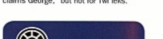

### Stat block notes (game mechanics, not feats)

- Aayla's one line: In Episode III, she finally has dialogue, a single line (cut down from two in the script) as she checks in with the Jedi Council. The original line written for her, "You asked for my report, Master Windu?" has been changed to, "I'm sorry I'm late, Master Windu. Would you like my report?" (Star Wars Insider 77, p. 40) (Source: *Star Wars Insider #77* (2004), scan p.40)
- Aayla in battle: For Episode III, Aayla won't just be an extra-blue hologram. We'll see her on a very alien world leading her clone troopers against the Separatists. (Star Wars Insider 77, p. 40) (Source: *Star Wars Insider #77* (2004), scan p.40)

## scan p.41 (scan page 41)

Page contents: Chat excerpts (fan usernames omitted): Amy Allen on playing Aayla, the head-tail tentacles, her grandmother in Gone with the Wind, her Unleashed figure and Jan Duursema; Mark Hamill on the "Obi-Wan killed your father!" decoy line, the severed-hand effect, his deleted entrance scene and Alec Guinness. (hand-read)

- **Darth Vader (Anakin Skywalker); Luke Skywalker** — entry/section: The decoy line: "Mark Hamill: "Obi-Wan killed your father!" It was misinformation to throw off the secret leaking out, which it did. —Mark Hamill, Star Wars Insider 77, p. 41" Source: *Star Wars Insider #77* (2004), scan p.41
  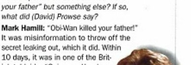
- **Luke Skywalker** — entry/section: Luke's lost entrance: ""Luke was just as anxious to join the Empire as he was to join the Rebellion." —Mark Hamill, Star Wars Insider 77, p. 41" Source: *Star Wars Insider #77* (2004), scan p.41
  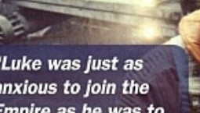
- **Obi-Wan Kenobi** — entry/section: Alec Guinness: ""I want to be known by my name, not my accolades." So I said, "Do you want me to call you Big Al?" And he loved that! He loved irreverence. —Mark Hamill, Star Wars Insider 77, p. 41" Source: *Star Wars Insider #77* (2004), scan p.41
  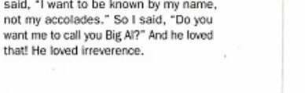

## scan p.42 (scan page 42)

Page contents: Best of Hyperspace: Hamill chat continued (two-handed lightsaber style, the props he kept, talking to Yoda, his stunts and the Empire swordfight; usernames omitted); "Photoreceptor" rare photos: Vader confronts Luke in the carbon-freezing chamber, a Vader publicity still, Luke and Leia, Gary Kurtz in Vader's meditation chamber, Carrie Fisher clowning in false braids, Han and Lando, Ackmena (Bea Arthur) in the Holiday Special. (hand-read)

- **Yoda** — entry/section: Talking to a puppet: ""I'm proud of the fact that most of the reviewers never mentioned Yoda was a puppet. He was just so real to me, even when reading the script." —Mark Hamill, Star Wars Insider 77, p. 42" Source: *Star Wars Insider #77* (2004), scan p.42
  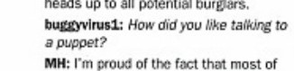
- **Luke Skywalker; Darth Vader (Anakin Skywalker)** — entry/section: The Empire swordfight: ""I remember the swordfight in Empire being the most grueling thing. It took weeks to shoot, and no matter how much choreography you do, you end up being scraped and bumped and cut." —Mark Hamill, Star Wars Insider 77, p. 42" Source: *Star Wars Insider #77* (2004), scan p.42
  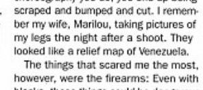

### Stat block notes (game mechanics, not feats)

- Father vs. Son: In the steam-shrouded darkness of the carbon-freezing chamber, Darth Vader (David Prowse) confronts Luke Skywalker (Mark Hamill). This rare still from the making of Empire shows the lightsaber prop before ILM adds its scintillating glow. (Star Wars Insider 77, p. 42) (Source: *Star Wars Insider #77* (2004), scan p.42)
- A Strange Connection: Both Luke Skywalker (Mark Hamill) and Princess Leia (Carrie Fisher) feel an undeniably strong connection, but what it truly means, neither can yet say. (Star Wars Insider 77, p. 42) (Source: *Star Wars Insider #77* (2004), scan p.42)

## scan p.43 (scan page 43)

Page contents: Photoreceptor photos: Vader in smoke, Luke and Leia, the meditation chamber, Carrie Fisher in braids, Han and Lando, Ackmena and an Ithorian. (hand-read)

## scan p.44 (scan page 44)

Page contents: Webdocs ("Making of Episode III" documentaries): George Lucas on weapons and conflict and on Episode III's electrostaffs; HD "video village" comments from Lucas, Christopher Lee, Jimmy Smits and David Tattersall. (hand-read)

- **none** — entry/section: Superman without Kryptonite: ""I had to think of something that you could fight with a laser sword that we haven't done before, but it wasn't a laser sword. So, we came up with these staffs that are electric staffs that the laser sword can't cut through. If you have a laser sword that can do anything and cut through anything, then you're sort of stuck. It's like Superman. Superman without Kryptonite wouldn't work." —George Lucas, Star Wars Insider 77, p. 44" Source: *Star Wars Insider #77* (2004), scan p.44
  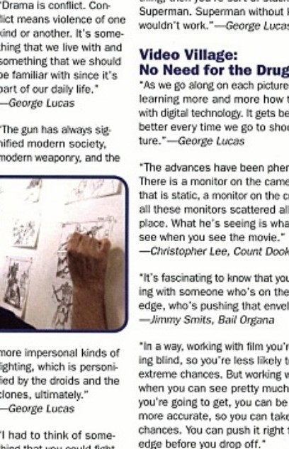
- **none** — entry/section: Drama is conflict: ""Drama is conflict. Conflict means violence of one kind or another. It's something that we live with and something that we should be familiar with since it's part of our daily life." —George Lucas, Star Wars Insider 77, p. 44" Source: *Star Wars Insider #77* (2004), scan p.44
  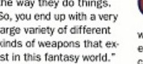
- **Bail Organa** — entry/section: The cutting edge: ""It's fascinating to know that you're working with someone who's on the cutting edge, who's pushing that envelope." —Jimmy Smits, Bail Organa, Star Wars Insider 77, p. 44" Source: *Star Wars Insider #77* (2004), scan p.44
  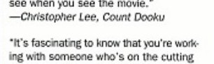

## scan p.45 (scan page 45)

Page contents: Webdocs continued: Lucas and Rick McCallum on Trisha Biggar's costumes, including the color-shifting "peacock dress"; Ian McDiarmid and Bruce Spence on their costumes; webcam summer plans (edited by Paul Ens, content by Pablo Hidalgo and Bonnie Burton); starwars.com Kids "Getting into the Original Trilogy" feature. (hand-read)

- **Palpatine (Darth Sidious)** — entry/section: It feels reptilian: ""To wear the costume to play the character I'm playing is wonderfully empowering. The colors, the textures...people keep coming up to me and saying, 'Is it rubber? Is it leather?' Well, it's neither rubber nor leather. I don't quite know what it is. It feels reptilian, which is exactly right." —Ian McDiarmid, Supreme Chancellor Palpatine, Star Wars Insider 77, p. 45" Source: *Star Wars Insider #77* (2004), scan p.45
  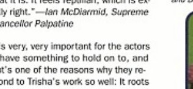
- **Tion Medon** — entry/section: Administrator of this planet: ""I felt almost priestlike when it was on, and that's when I thought, I'm the administrator of this planet, but that role carries extra responsibilities." —Bruce Spence, Tion Medan, Star Wars Insider 77, p. 45" Source: *Star Wars Insider #77* (2004), scan p.45
  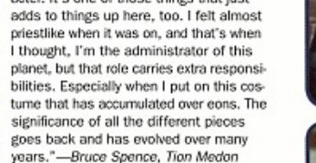

## scan p.46 (scan page 46)

Page contents: Feature opener: "Top Tens: The 10 Greatest Moments of the Classic Trilogy." (hand-read)

## scan p.47 (scan page 47)

Page contents: Top 10 introduction (Dan Amrich): Insider ranks the ten crucial moments of the classic trilogy ahead of the September 21 DVD release. (hand-read)

## scan p.48 (scan page 48)

Page contents: No. 10, "It is a period of civil war. The Crawl / Tantive IV Chase" (A New Hope): the opening crawl, John Williams' score and the Star Destroyer Devastator filling the frame. (hand-read)

## scan p.49 (scan page 49)

Page contents: No. 10 continued: Star Destroyer art. (hand-read)

## scan p.50 (scan page 50)

Page contents: No. 9, "We Have Spotted Imperial Walkers!" (The Empire Strikes Back): the AT-ATs' first appearance on Hoth. (hand-read)

## scan p.51 (scan page 51)

Page contents: No. 9 continued: AT-AT image with the pull quote "...it might be our only chance of stopping them." (hand-read)

## scan p.52 (scan page 52)

Page contents: No. 8 opener: Luke on Tatooine. (hand-read)

## scan p.53 (scan page 53)

Page contents: No. 8, "Luke Returns Home... For the Last Time" (A New Hope): Luke finds the homestead burned and Owen and Beru killed. (hand-read)

### Stat block notes (game mechanics, not feats)

- Where their lives end: It's ironic that where their lives end, Luke's truly begins—the shock of seeing the charred corpses of his loved ones suddenly snaps things into sharp focus. This is not a joke. Luke and millions of innocents like him are in imminent danger. And it's in that moment that Luke embraces his destiny—there's nothing left to lose. His hero's quest is officially about to begin. (Star Wars Insider 77, p. 53) (Source: *Star Wars Insider #77* (2004), scan p.53)

## scan p.54 (scan page 54)

Page contents: No. 7, "Darth Vader Unmasked" (Return of the Jedi): Lucas on what was under the mask; Anakin's redemption. (hand-read)

- **Darth Vader (Anakin Skywalker)** — entry/section: Under the mask: ""I didn't have a very specific idea about what Vader might look like underneath the mask," he says in Laurent Bouzereau's Star Wars: The Annotated Screenplays. "Until [Return of the Jedi] I just knew that he was pretty messed up simply because he could barely breathe or speak." —George Lucas, Star Wars Insider 77, p. 54" Source: *Star Wars Insider #77* (2004), scan p.54
  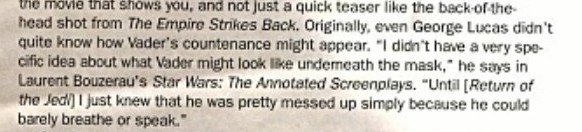

### Stat block notes (game mechanics, not feats)

- Vader unmasked: It's a tender moment instead of a gruesome one, a son rescuing his father; when the withered, gray flesh of Anakin Skywalker is revealed, he looks weak, frail, humble...all too human. He's more man than machine now. And it's this moment of ultimate redemption upon which the entire Star Wars saga is based. (Star Wars Insider 77, p. 54) (Source: *Star Wars Insider #77* (2004), scan p.54)

## scan p.55 (scan page 55)

Page contents: No. 7 continued: Luke at Vader's side (pull quote "You were right about me... Tell your sister... you were right"). (hand-read)

## scan p.56 (scan page 56)

Page contents: No. 6 opener: Luke and Vader in the Dagobah cave (pull quote "What's in there?" "Only what you take with you"). (hand-read)

## scan p.57 (scan page 57)

Page contents: No. 6, "Luke Faces Vader on Dagobah" (The Empire Strikes Back): the cave vision as the trilogy's best foreshadowing. (hand-read)

### Stat block notes (game mechanics, not feats)

- The cave on Dagobah: It almost goes without saying that Luke's horror at seeing his own face behind the mask is easily the best and most powerful foreshadowing of the entire classic trilogy. (Star Wars Insider 77, p. 57) (Source: *Star Wars Insider #77* (2004), scan p.57)

## scan p.58 (scan page 58)

Page contents: No. 5, "Yoda Makes X-wing Take Flight" (The Empire Strikes Back). (hand-read)

### Stat block notes (game mechanics, not feats)

- You couldn't deny the Force: Yoda simply shows him what he cannot believe, levitating the X-wing with ease and focus, leaving Red Five, standing by, utterly amazed. For any moviegoers who were also waiting for a big event to "prove" the mystical power that binds the galaxy together, this scene was it. Maybe you couldn't see the Force, maybe you couldn't control the Force, but after Yoda's example, you couldn't deny the Force. (Star Wars Insider 77, p. 58) (Source: *Star Wars Insider #77* (2004), scan p.58)

## scan p.59 (scan page 59)

Page contents: No. 5 continued: the X-wing over the swamp (pull quote "Do or do not. There is no try."). (hand-read)

## scan p.60 (scan page 60)

Page contents: No. 4 opener: Death Star images (pull quote "Great shot, kid, that was one in a million!"). (hand-read)

## scan p.61 (scan page 61)

Page contents: No. 4, "Destruction of the First Death Star" (A New Hope): the climax; Red Leader Garven Dreis and Jek Porkins. (hand-read)

## scan p.62 (scan page 62)

Page contents: No. 3, "Darth Vader Overthrows the Emperor (Literally)" (Return of the Jedi). (hand-read)

### Stat block notes (game mechanics, not feats)

- Vader's hero moment: However, seeing his son tortured by the Emperor's lightning bolts, writhing in pain on the floor, the Dark Lord of the Sith's own hero moment has come. As the Emperor's willing servant, Vader has brought about the situation before him, but he realizes that he also has the power to change it with decisive action. This is when he must decide between light and dark, between Anakin and Vader, between redemption and damnation. (Star Wars Insider 77, p. 62) (Source: *Star Wars Insider #77* (2004), scan p.62)

## scan p.63 (scan page 63)

Page contents: No. 3 continued: the Emperor's Force lightning (pull quote "So be it... Jedi."). (hand-read)

## scan p.64 (scan page 64)

Page contents: No. 2, "Han Solo's Deep Freeze" (The Empire Strikes Back): "I love you." "I know." in the carbon-freezing chamber. (hand-read)

### Stat block notes (game mechanics, not feats)

- "I know.": Solo's a man of action, as quick with his blaster as he is with his mouth, so it's entirely and perfectly within Han's character to answer Leia's heartfelt "I love you" with the sly, sincere reply "I know." (Star Wars Insider 77, p. 64) (Source: *Star Wars Insider #77* (2004), scan p.64)

## scan p.65 (scan page 65)

Page contents: No. 2 continued: carbonite images. (hand-read)

## scan p.66 (scan page 66)

Page contents: No. 1, "No—I Am Your Father." (The Empire Strikes Back): the biggest twist of the saga. (hand-read)

- **Luke Skywalker** — entry/section: Star Wars Insider 077 (2004): "Luke has been bested; not yet a Jedi, his brash nature leads to the lightsaber duel that ends The Empire Strikes Back, but thé confrontation is premature as Luke's skills are still immature." Source: *Star Wars Insider #77* (2004), scan p.66
  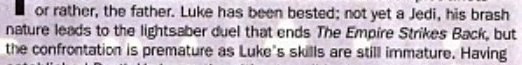

### Stat block notes (game mechanics, not feats)

- The ultimate surprise: Vader's bold claim of parentage (not to mention his resulting suggestion that together, father and son could overthrow the Emperor and rule the galaxy) was so shocking, so unbelievable, that many fans felt it was a lie or a gambit—an ambiguity intentionally created by George Lucas as "an escape hatch for the kids psychologically, so they can deny it." (Star Wars Insider 77, p. 66) (Source: *Star Wars Insider #77* (2004), scan p.66)

## scan p.67 (scan page 67)

Page contents: No. 1 continued: Luke on the gantry (pull quote "Search your feelings... you know it to be true."). (hand-read)

## scan p.68 (scan page 68)

Page contents: Fiction opener: "Changing Seasons Part 2: People of the Guardian" by Timothy Zahn, illustrated by Andrew Robinson; Part 1 on Hyperspace. (hand-read)

## scan p.69 (scan page 69)

Page contents: "Changing Seasons Part 2" begins: synopsis of Part 1; Obi-Wan and Anakin on Dagro plan with the Swens family to slip into a Separatist-held gorge by "underwater rappelling" along cables. (hand-read)

## scan p.70 (scan page 70)

Page contents: "Changing Seasons" continued: Anakin on risking family for a stranger; Obi-Wan's Aquata breather recalls Naboo and Qui-Gon; they enter the river. (hand-read)

### Stat block notes (game mechanics, not feats)

- The ache in his Padawan's heart: "Well, I sure wouldn't want to risk my family for a stranger," Anakin said darkly. "I mean...if I had a family." Obi-Wan's throat tightened as he felt the ache in his Padawan's heart. It was 12 years after his mother's death, yet her absence was still as fresh as the day Anakin had lost her. (Star Wars Insider 77, p. 70) (Source: *Star Wars Insider #77* (2004), scan p.70)

## scan p.71 (scan page 71)

Page contents: "Changing Seasons" continued: the Jedi find a large Neimoidian research base carved into the gorge, slip into a fabrication building, and spot the captured R3 unit "Arthree"; Anakin drops to the floor and Obi-Wan swings down to stop the Neimoidians. (hand-read)

## scan p.72 (scan page 72)

Page contents: "Changing Seasons" continued: a booby-trapped mat releases explosive disks, acid droids and winged shock spheres; Obi-Wan is wounded and Anakin saves him. (hand-read)

## scan p.73 (scan page 73)

Page contents: "Changing Seasons" continued: the shock leaves Anakin's artificial hand trembling; the Jedi make a boat from the mat, cut the platform's pillars and destroy the base's power generator while fleeing STAP droids. (hand-read)

### Stat block notes (game mechanics, not feats)

- Rule number two: "Rule number two," Anakin went on, his voice suddenly tight as he held up his right hand. "Don't have an artificial hand when you do it." A hand, Obi-Wan saw, that was visibly trembling. (Star Wars Insider 77, p. 73) (Source: *Star Wars Insider #77* (2004), scan p.73)

## scan p.74 (scan page 74)

Page contents: "Changing Seasons" continued: the "crawl-carrier," an experimental, slow-moving Separatist terror weapon, is still loose and heading for Vale City; the Dagro farmers who once distrusted Obi-Wan offer to help hunt it. (hand-read)

## scan p.75 (scan page 75)

Page contents: "Changing Seasons" conclusion: the farmers' harvesters box in the crawl-carrier and bury it under hidden gravel; a reward for the captured Separatist equipment; the Jedi leave Dagro ("And may the Jedi be with us"). (hand-read)

## scan p.76 (scan page 76)

Page contents: Scouting the Galaxy (Steve Sansweet), "Elliott Finds My Holy Grail": the column under IDG Entertainment, a new "Pick of the Letter" feature, a Tiger 12-inch Boba Fett room alarm, and collecting pins on eBay (letter-writer names omitted). (hand-read)

## scan p.77 (scan page 77)

Page contents: Scouting the Galaxy continued: a vinyl-cape Jawa whose cape a dog ate, a smeared Star Wars TCG card, and an R2-D2 vinyl lunch pail (letter-writer names omitted). (hand-read)

## scan p.78 (scan page 78)

Page contents: Scouting the Galaxy continued: the Thermos R2-D2 vinyl lunch pail, a 1978 salesman's sample Sansweet tracked down for ten years (estimated at $1,500–$2,000 plus); the Death Squad Commander renamed "Star Destroyer Commander"; Sigma placemats; blueprints (letter-writer names omitted). (hand-read)

## scan p.79 (scan page 79)

Page contents: Scouting the Galaxy continued: valuing blueprints; why storing figures in a hot Florida garage is a bad idea (letter-writer names omitted); submission address. (hand-read)

## scan p.80 (scan page 80)

Page contents: Toy coverage (with Paul Ens), "What's Old Is New Again": Hasbro's Original Trilogy Collection with vintage-style cards and a checklist; a redesigned OTC Millennium Falcon; X-wing and TIE fighter; Darth Vader's TIE Advanced. (hand-read)

## scan p.81 (scan page 81)

Page contents: OTC continued: a Toys "R" Us Vader TIE fighter and Y-wing with Gold Leader; a Target Slave I with Boba Fett; DVD-themed multipacks; a Kay Bee 12-inch Chewbacca. (hand-read)

## scan p.82 (scan page 82)

Page contents: Drawn by the Force comics, "Clash of the Titans": Star Wars Republic #68, "Armor" (John Ostrander, Jan Duursema), in which Aayla Secura faces her fallen former Master Quinlan Vos on Honoghr two years into the Clone Wars, with an early look at Episode III clone armor; "Talking Head" on the Infinities: Return of the Jedi trade paperback. (hand-read)

- **Quinlan Vos; Aayla Secura** — entry/section: A shadowed path: ""Quin has been walking a shadowed path and has not admitted to himself that he is falling to the dark side," says artist Jan Duursema. "He thinks he can handle the situation as long as he uses what he has learned of the dark side to help win the war for the Republic." —Jan Duursema, Star Wars Insider 77, p. 82" Source: *Star Wars Insider #77* (2004), scan p.82
  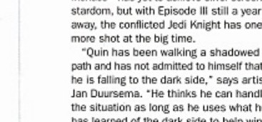
- **Aayla Secura; Quinlan Vos** — entry/section: The Jedi's armor is the Force: ""A clone's armor is visible and tangible. The Jedi's armor is the Force. Aayla's faith and trust in Quin seems to be part of her armor—or is it the flaw in it?" —Jan Duursema, Star Wars Insider 77, p. 82" Source: *Star Wars Insider #77* (2004), scan p.82
  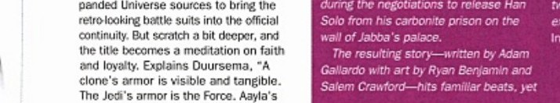
- **Aayla Secura; Quinlan Vos** — entry/section: Aayla had to open Quin's eyes: ""We knew there had to be a confrontation between them," says Duursema, speaking of the straight-arrow Jedi student and her deeply flawed mentor. "Aayla had to be the one to open Quin's eyes. She is very in tune with the light side of the Force, yet she has a deep understanding of the dark side since she once fell under the thrall of the Dark Anzati Jedi, Volfe Karkko." —Jan Duursema, Star Wars Insider 77, p. 82" Source: *Star Wars Insider #77* (2004), scan p.82
  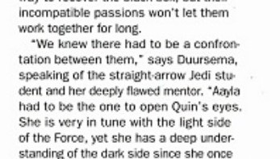

## scan p.83 (scan page 83)

Page contents: "Armor" continued: the parallel with Obi-Wan and Anakin; whether Quinlan can be redeemed; the debut of Clone Commander Bly, a new breed of clone with more independence, from whose point of view Republic #68 is told (Daniel Wallace). (hand-read)

- **Quinlan Vos; Darth Vader (Anakin Skywalker)** — entry/section: Many possibilities for Quin: ""We know that Anakin/Vader is redeemed," says Ostrander. "But the ending hasn't been written yet for Quin, so there are many possibilities—good/bad, dead/alive, redeemed/damned." —John Ostrander, Star Wars Insider 77, p. 83" Source: *Star Wars Insider #77* (2004), scan p.83
  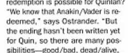
- **Aayla Secura; Quinlan Vos** — entry/section: The flaw in her armor: ""Aayla usually trusts her instincts, but her emotional attachment to her former Master is clouding her judgment," says Duursema. "Quin is part of her armor—her faith in him and all that he taught her protects her. Her attachment to him is also the flaw in her armor." —Jan Duursema, Star Wars Insider 77, p. 83" Source: *Star Wars Insider #77* (2004), scan p.83
  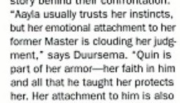
- **Quinlan Vos** — entry/section: Is the dark side still wrong?: ""Is the dark side still wrong if it is used to win a war for the 'good guys'?" she asks. —Jan Duursema, Star Wars Insider 77, p. 83" Source: *Star Wars Insider #77* (2004), scan p.83
  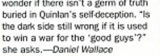

### Stat block notes (game mechanics, not feats)

- Clone Commander Bly: The story also introduces Clone Commander Bly, a high-ranking clone soldier working under the command of Aayla. One of a new breed of clones, he sports the latest style of armor and has more independence than many of his brethren. (Star Wars Insider 77, p. 83) (Source: *Star Wars Insider #77* (2004), scan p.83)

## scan p.84 (scan page 84)

Page contents: Jedi Library (Jason Fry): Steven Barnes on The Cestus Deception, the clone ARC trooper "Nate" (CT-96/298), Ventress and the insectile X'Ting; a sidebar on upcoming Del Rey books (MedStar, Jedi Trial, Yoda: Dark Rendezvous, Labyrinth of Evil, a post-NJO trilogy, the original trilogy omnibus). (hand-read)

- **Nate (ARC trooper)** — entry/section: Independent hopes and dreams: ""I wanted to give one of those characters independent hopes and dreams and see what happened," says Steven Barnes of The Cestus Deception (Del Rey, $25.95). That character is CT-96/298, nicknamed "Nate," an ARC Trooper dispatched to Ord Cestus as part of a unit supporting Jedi Knights Obi-Wan Kenobi and Kit Fisto. —Steven Barnes, Star Wars Insider 77, p. 84" Source: *Star Wars Insider #77* (2004), scan p.84
  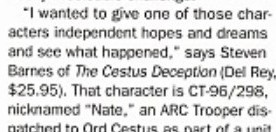

### Stat block notes (game mechanics, not feats)

- Ventress's controlled lethality: Barnes describes that first effort as more catlike than snakelike—but from the beginning, he got Ventress's "sense of controlled lethality" and her passion and near-sensuality… (Star Wars Insider 77, p. 84) (Source: *Star Wars Insider #77* (2004), scan p.84)

## scan p.85 (scan page 85)

Page contents: Advertisement (computer retailer offering free Star Wars figures). (hand-read)

## scan p.86 (scan page 86)

Page contents: Games (Frank Parisi): LucasArts/Pandemic's Star Wars Battlefront, which covers battles from all six films, offers playable factions and five soldier classes each, AI third factions (Ewoks, Geonosians, Wookiees), and a nonlinear "what if?" approach (producer Jim Tso). (hand-read)

## scan p.87 (scan page 87)

Page contents: Battlefront continued: more than 30 vehicles, the Galactic Conquest mode, and Jedi hero bonuses (Vader, Luke, Mace Windu); release in September alongside the trilogy DVD. Also Star Wars Galaxies' Jump to Lightspeed space expansion unveiled at the SWG Fan Fest in Anaheim (Hugh Sterbakov). (hand-read)

### Stat block notes (game mechanics, not feats)

- Battlefront Jedi heroes: If you're playing for the Empire, you get to summon Darth Vader; Rebels get Luke Skywalker; the Republic forces get to call in Mace Windu; Separatists will unleash Count Dooku. (Star Wars Insider 77, p. 87) (Source: *Star Wars Insider #77* (2004), scan p.87)

## scan p.88 (scan page 88)

Page contents: Ask the Master (questioner names omitted): Ventress, Aurra Sing and Sly Moore are not the same species; the species of Ephant Mon, Salacious Crumb and Yak Face; the Neimoidian beside Nute Gunray in Episode II (the Daultay Dofine mask, Gilramos Libkath vs. Lott Dod); Boba Fett's jetpack and the Sarlacc. (hand-read)

### Stat block notes (game mechanics, not feats)

- Not related by species: During the past few years, Star Wars storytellers have produced a trio of compelling female aliens that all share a chalk-white pallor, a hairless head, and a mysterious past. Yet, none of them are related by species. (Star Wars Insider 77, p. 88) (Source: *Star Wars Insider #77* (2004), scan p.88)
- Native of Rattatak: In 2003, Asajj Ventress appeared in a number of Clone Wars sources. She is a native of the planet Rattatak. (Star Wars Insider 77, p. 88) (Source: *Star Wars Insider #77* (2004), scan p.88)

## scan p.89 (scan page 89)

Page contents: Ask the Master continued: no Sequel Trilogy (the saga is six episodes, and Dark Empire and the Thrawn Trilogy are not Episodes VII–IX); Anakin's hyperdrive-modified Delta-7; closure for Grievous's arc and a new Clone Wars cartoon series; Mandalorian armor inspiring the Royal Guard. (hand-read)

### Stat block notes (game mechanics, not feats)

- Anakin's modified Delta-7: Anakin took his Delta-7 and stripped out the power plant, refurbished it to support TransGalMeg drives, and added the drives directly to his fighter's structure. Those big Podracer-style engines at the front of his starfighter are the hyperdrive engines. These fighters are still too small to carry a dedicated nav computer, so Anakin had to rely on his astromech droid—or in dire instances, the Force—to safely plot courses through hyperspace. (Star Wars Insider 77, p. 89) (Source: *Star Wars Insider #77* (2004), scan p.89)

## scan p.90 (scan page 90)

Page contents: Ask the Master continued: older Mandalorian designs inspired the Senate guard helmets and so the Royal Guard; arena Jedi Nicanas Tassu and Sephjet Josall named for postproduction crew; Boushh's Ubese subfrequency phrases; why Zam Wesell speaks Huttese. (hand-read)

### Stat block notes (game mechanics, not feats)

- The Ubese tongue: To our untrained human ears, we don't hear much variance in Boushh's phrases. But the Ubese tongue, as filtered through metallic breath masks, spans a greater range of frequencies than human language. There are subfrequency phrases beyond our range of hearing that color and embellish what we can hear, offering much more information than a few simple syllables. (Star Wars Insider 77, p. 90) (Source: *Star Wars Insider #77* (2004), scan p.90)

## scan p.91 (scan page 91)

Page contents: Ask the Master continued: Vader's red-tinted eyes and the order of cape and shoulder armor as clues to which film a costume is from; the Cloud City scan grid used to torture Han; how to send trivia questions. (hand-read)

### Stat block notes (game mechanics, not feats)

- Vader's eyes in Episode IV: Believe it or not, Vader's eyes are red in Episode IV, but it's hard to spot. It'd be more accurate to say they have a reddish tint. (Star Wars Insider 77, p. 91) (Source: *Star Wars Insider #77* (2004), scan p.91)
- The scan grid on Cloud City: Vader had a scan grid on Cloud City specially modified into an interrogation array for the torture of Han Solo. While it is extremely painful, it does not leave any long-term physical damage. Vader was torturing Han in a bid to attract Luke to Cloud City through disturbances in the Force. Had he desired, the torture could have been much worse, but Vader did not want to risk killing the bait. (Star Wars Insider 77, p. 91) (Source: *Star Wars Insider #77* (2004), scan p.91)

## scan p.92 (scan page 92)

Page contents: Laugh It Up, Fuzzball humor, "Top 5 (Rejected) Moments from the Classic Trilogy" cartoon: Luke drops Leia at the chasm, Leia's slave costume malfunctions, an Ewok-tossing contest, a one-legged AT-AT, Han and Chewie with swapped script pages (cartoonist name omitted). (hand-read)

## scan p.93 (scan page 93)

Page contents: StarWarsShop.com ad: the exclusive Silver Saga Edition silver sandtrooper at Comic-Con 2004. (hand-read)

## scan p.94 (scan page 94)

Page contents: StarWarsShop "Collector's Picks" from Steve Sansweet (Lucasfilm Fan Relations): the Noble Yoda bronze statue, a McQuarrie Vader lithograph, a Rawcliffe pewter AT-AT, a Clone Wars giclée, and a check proof set. (hand-read)

## scan p.95 (scan page 95)

Page contents: StarWarsShop catalog: a Yoda statue, a Gentle Giant Asajj Ventress maquette, a metallic Vader sculpture, a vinyl clone trooper. (hand-read)

## scan p.96 (scan page 96)

Page contents: StarWarsShop catalog: a Master Replicas AT-AT, a Mace Windu Force FX lightsaber, the "Anakin vs. Asajj" cel, mugs, lobby cards, a signed Billy Dee Williams litho. (hand-read)

## scan p.97 (scan page 97)

Page contents: StarWarsShop catalog: Clone Wars pins, a Rawcliffe Vader, an Obi-Wan blueprint litho, a talking Vader wall mount, a manga trilogy litho, a Code 3 Falcon, Galactic Heroes. (hand-read)

## scan p.98 (scan page 98)

Page contents: StarWarsShop catalog: patches, Hasbro 12-inch figures, pins, a Jedi robe, a Luke lightsaber replica, an Obi-Wan maquette, a Jango/Boba mug set, the Thermos R2-D2 lunch kit. (hand-read)

## scan p.99 (scan page 99)

Page contents: Advertisement: Gen Con Indy, August 19–22, 2004. (hand-read)

## scan p.100 (scan page 100)

Page contents: Advertisement: Blockbuster Flip Card game rental (back cover). (hand-read)

