# Owner Material 038 — Star Wars Insider #1–153 plus specials (with The Lucasfilm Fan Club Magazine #1–22): Star Wars Insider #78 (2004)

- **Source:** *Star Wars Insider* magazine (issues 23–153, 1994–2014) and its predecessor *The Lucasfilm Fan Club Magazine* (issues 1–22, 1987–1994), plus seven special editions: articles, interviews, comics and short fiction Secondary source (licensed Legends reference). Scan OCR'd on the box; the scan stays box-only and is **not** published.
- **Method:** every scanned page was OCR'd and machine-screened sentence by sentence for power-relevant statements (fights, kills, defeats, Force feats, rankings, superweapons) that name a character on our roster; each kept sentence is quoted verbatim from the OCR text and has a crop of the printed passage directly under it. Pages with nothing power-relevant are still listed with what is on them.
- **Citation:** "*Star Wars Insider #78* (2004), p.X" by printed page ("scan p.X" where no printed number applies). **Weight:** Licensed magazine: a secondary source. Its short fiction and comics are Legends stories; its articles and interviews sum up or discuss lore and rank below the novels, comics and games they describe.

## scan p.1 (scan page 1)

Page contents: Cover (November/December 2004): Luke, Leia and Darth Vader "Restored for a New Generation"; Comic-Con International 2004 report; Episode III webcam; the return of the Wookiee; Bantha Tracks Star Wars Halloween. (hand-read)

## scan p.2 (scan page 2)

Page contents: Advertisement (collectibles retailer). (hand-read)

## scan p.3 (scan page 3)

Page contents: Contents: Prequel Update (Pablo Hidalgo), 50 Factoids about the Original Trilogy (Daniel Wallace), The Restoration of Star Wars, Battlefront, DVD menus, Ralph McQuarrie part 2 (Ron Magid), THX 1138, Jedi Library, Drawn by the Force, Ask the Master, Scouting the Galaxy, Jabba's Collectibles, Anchorhead Arcade (KOTOR II), Bantha Tracks. (hand-read)

## scan p.4 (scan page 4)

Page contents: Editorial by Brett Rector on the trilogy's DVD release and first seeing Star Wars in 1977; masthead. (hand-read)

- **Darth Vader (Anakin Skywalker)** — entry/section: And then he appeared: ""The scene that really put me in the moment happened just seconds later when the stormtroopers breached the doomed Corellian corvette, blasting everything in sight...and then he appeared. As Darth Vader strode aboard the freshly conquered vessel, my flesh rippled with goose bumps, and it was right then that I knew I was hooked." —Brett Rector, Star Wars Insider 78, p. 4" Source: *Star Wars Insider #78* (2004), scan p.4
  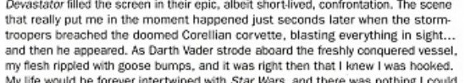

## scan p.5 (scan page 5)

Page contents: Advertisement: THX 1138, The George Lucas Director's Cut (theaters September 10, DVD September 14). (hand-read)

## scan p.6 (scan page 6)

Page contents: Comlink letters (letter-writer names omitted): praise for issue 77's Top 10, the crossword's planned return, fan club welcome kits, Insider and Hyperspace continuing after Episode III, Lucasfilm Animation Singapore, the new Clone Wars series airing March 21, 2005. (hand-read)

## scan p.7 (scan page 7)

Page contents: Advertisement: Star Wars TCG Return of the Jedi expansion (110 cards, Hidden Cost mechanic). (hand-read)

## scan p.8 (scan page 8)

Page contents: Advertisement: Star Wars Galaxies: Jump to Lightspeed expansion. (hand-read)

## scan p.9 (scan page 9)

Page contents: Advertisement art (image only): the Millennium Falcon and an X-wing among TIE fighters (Jump to Lightspeed artwork). (hand-read)

## scan p.10 (scan page 10)

Page contents: Prequel Update with producer Rick McCallum (Pablo Hidalgo): Episode III pickups at Shepperton; McCallum's day trip to Comic-Con 2004, where the title Revenge of the Sith was revealed; a photo of Lucas showing Shaak Ti and Mace Windu actors a fight on a miniature set. (hand-read)

## scan p.11 (scan page 11)

Page contents: Prequel Update photo: Padmé and Anakin; "Misunderstanding and mistrust cloud the conversation" caption. (hand-read)

## scan p.12 (scan page 12)

Page contents: Prequel Update continued: a two-week Shepperton shoot (August 23–September 3) of about 400 mostly insert shots; Obi-Wan handing R2-D2 a comlink as an example; only one or two new scenes; Anthony Daniels with the ILM silver ball. (hand-read)

- **Darth Vader (Anakin Skywalker); Padmé Amidala** — entry/section: A new Anakin and Padmé scene: ""There's a new scene between Anakin and Padmé, which has to do with their relationship, their love," says McCallum. —Rick McCallum, Star Wars Insider 78, p. 12" Source: *Star Wars Insider #78* (2004), scan p.12
  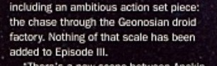

## scan p.13 (scan page 13)

Page contents: Prequel Update continued: photo of Anthony Daniels; the Anakin–Yoda scene; a crew of about 60 (120 with construction); mostly bluescreen and greenscreen sets. (hand-read)

- **Darth Vader (Anakin Skywalker); Yoda** — entry/section: Yoda on attachments: ""And there is a scene between Anakin and Yoda, wherein Yoda again tells him about how a Jedi shouldn't have personal attachments, such as love." —Rick McCallum, Star Wars Insider 78, p. 13" Source: *Star Wars Insider #78* (2004), scan p.13
  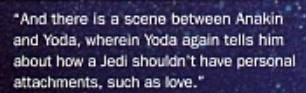

## scan p.14 (scan page 14)

Page contents: Prequel Update continued: Nash Edgerton (Obi-Wan's stunt double) on wires; Padmé photo; the largest new pickup set, a huge staircase for Anakin's visit to the opera on Coruscant; returning crew list. (hand-read)

### Stat block notes (game mechanics, not feats)

- The opera staircase: "The largest new set is probably a huge staircase, where Anakin is going to the opera on Coruscant," says McCallum. (Star Wars Insider 78, p. 14) (Source: *Star Wars Insider #78* (2004), scan p.14)

## scan p.15 (scan page 15)

Page contents: Advertisement: Hasbro Original Trilogy Collection figures in vintage-style packaging ("Han could've escaped from that carbonite"). (hand-read)

## scan p.16 (scan page 16)

Page contents: Prequel Update continued: a hallway in Palpatine's office complex; Director of Photography Giles Nuttgens; why Shepperton and not Sydney (actor availability, two days with Natalie Portman); Oliver Ford Davies returns as Sio Bibble; a Wookiee suit fitting on a 6-foot-11 basketball player; pull quote about the cut being ready for John Williams in February. (hand-read)

## scan p.17 (scan page 17)

Page contents: Advertisement: Anthony Grandio Company Star Wars checks. (hand-read)

## scan p.18 (scan page 18)

Page contents: Prequel Update images: Ki-Adi-Mundi (Silas Carson) as a hologram at a Jedi Council meeting with Yoda and Obi-Wan; a battle over Coruscant; foreboding clouds over the Jedi Temple. (hand-read)

### Stat block notes (game mechanics, not feats)

- Ki-Adi-Mundi by hologram: Jedi Ki-Adi-Mundi (played by actor Silas Carson) appears as a hologram from a distant planet during an important meeting of the Jedi Council attended by, among others, Yoda and Obi-Wan Kenobi (played by actor Ewan McGregor). (Star Wars Insider 78, p. 18) (Source: *Star Wars Insider #78* (2004), scan p.18)

## scan p.19 (scan page 19)

Page contents: Advertisement: Pelican game accessories. (hand-read)

## scan p.20 (scan page 20)

Page contents: Prequel Update conclusion: Anakin tries to stop buzz droids attacking Obi-Wan's starfighter over Coruscant; Aqualish extras; more pickups possible in January (Elstree or Shepperton); John Williams to start scoring in February; the first Episode III trailer being cut. (hand-read)

### Stat block notes (game mechanics, not feats)

- Buzz droids over Coruscant: Anakin Skywalker tries a risky maneuver to stop insidious buzz droids launched by Separatist ships from destroying Obi-Wan Kenobi's Jedi starfighter in the skies over Coruscant. (Star Wars Insider 78, p. 20) (Source: *Star Wars Insider #78* (2004), scan p.20)

## scan p.21 (scan page 21)

Page contents: Advertisement: Fossil Star Wars watches and collectibles. (hand-read)

## scan p.22 (scan page 22)

Page contents: Comic-Con International 2004 report: the Lucasfilm pavilion; Steve Sansweet reveals the Episode III title "Revenge of the Sith" by peeling off an overshirt before more than 6,500 fans; LucasArts games (Jump to Lightspeed, KOTOR II, Battlefront, Republic Commando, Mercenaries); the autograph booth with actors (fan names omitted). (hand-read)

## scan p.23 (scan page 23)

Page contents: Advertisement: Code 3 die-cast Star Wars vehicles (Slave I, Millennium Falcon, X-wing). (hand-read)

## scan p.24 (scan page 24)

Page contents: Comic-Con report continued: more actors signing (Jeremy Bulloch at the Grandio booth, Billy Dee Williams); Gentle Giant's Luke stormtrooper-disguise minibust and Bust-Ups; Hasbro exclusives and the OTC vintage figure lineup (Vader's left hand made to grip Captain Antilles's throat). (hand-read)

## scan p.25 (scan page 25)

Page contents: Advertisement: Master Replicas offer for Vader lightsabers and the Sith Lightsaber Collection (quoting "The circle is now complete..."). (hand-read)

## scan p.26 (scan page 26)

Page contents: Comic-Con report continued: Master Replicas lightsabers, blasters, Boushh's thermal detonator, and the studio-scale AT-AT; Topps Star Wars Heritage cards; the Insider/Hyperspace booth (Francis Mao, Brett Rector); StarWarsShop exclusives. (hand-read)

## scan p.27 (scan page 27)

Page contents: Advertisement: Hyperspace fan club and Insider subscription ($39.95). (hand-read)

## scan p.28 (scan page 28)

Page contents: Skywalking news: Lucasfilm Animation Singapore announced (George Lucas, Micheline Chau, Teo Ming Kian; led by Gail Currey); Lucas to be inducted into the TEC Awards Hall of Fame on October 30; Ewoks and Droids animated features and the two live-action Ewok films on DVD November 23. (hand-read)

- **none** — entry/section: Asian animation: ""I've been a fan of Asian animation and illustration all my life," said George Lucas. "Asian cinema has had a particularly big impact on a lot of my work. When we began thinking about developing new ways to explore the craft of animation, it seemed a natural step to combine the two," he added. "By having a base in Singapore, we can create a new style of animation that will blend east and west—and offer something not seen before." —George Lucas, Star Wars Insider 78, p. 28" Source: *Star Wars Insider #78* (2004), scan p.28
  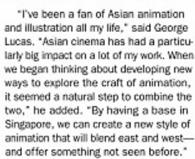

## scan p.29 (scan page 29)

Page contents: Skywalking continued: Ewoks/Droids DVDs at $14.98 (Jim Ward); The Cinema of George Lucas by Marcus Hearn (Abrams, January 2005; foreword by Ron Howard); the George Lucas Educational Foundation launches Edutopia magazine; a Muscular Dystrophy charity print ad (artist name omitted). (hand-read)

## scan p.30 (scan page 30)

Page contents: Jedi Library, "Where's Wuher?": Inside the Worlds of Star Wars Trilogy (DK, $19.99): Richard Chasemore and Hans Jenssen's cutaways of more than 20 original-trilogy locales; breaking a laserdisc player during research; up to 600 hours per artwork; mapping Echo Base for a four-page gatefold. (hand-read)

## scan p.31 (scan page 31)

Page contents: Advertisement: Sony Classical Star Wars soundtrack trilogy 2-CD special editions. (hand-read)

## scan p.32 (scan page 32)

Page contents: Jedi Library continued: the little scenarios hidden in the art (Jawas making mischief); Chasemore and Jenssen now on Episode III Incredible Cross-Sections; James Luceno praises the artists; The New Essential Guide to Weapons and Technology (W. Haden Blackman, art by Ian Fullwood). (hand-read)

## scan p.33 (scan page 33)

Page contents: Advertisement: Star Wars Trilogy: Apprentice of the Force handheld game (LucasArts). (hand-read)

## scan p.34 (scan page 34)

Page contents: Comics feature on the Star Wars Tales relaunch with issue #21: editor Jeremy Barlow on longer stories, new-reader friendliness, the end of the "Infinities" label, and "Nomad" (Rob Williams and Brandon Badeaux), a prequel-era Jedi on a revenge hunt; future tales inspired by KOTOR and Republic Commando, and one by Lucas Marangon. (hand-read)

## scan p.35 (scan page 35)

Page contents: Advertisement: Gentle Giant Star Wars mini-busts (Series One, September 2004). (hand-read)

## scan p.36 (scan page 36)

Page contents: Star Wars Tales continued: "Black Eight," about the formation of a feared TIE squadron (Shane McCarthy, Thomas Andrews, Michel Lacombe, Serge LaPointe); a Kyle Katarn story set late in the New Jedi Order (Nathan Butler); Barlow says Tales will fit seamlessly into the rest of the line. (hand-read)

### Stat block notes (game mechanics, not feats)

- An aging Katarn: An aging Katarn faces a new enemy—the alien Yuuzhan Vong—in this late-period New Jedi Order story written by Nathan Butler... (Star Wars Insider 78, p. 36) (Source: *Star Wars Insider #78* (2004), scan p.36)

## scan p.37 (scan page 37)

Page contents: Advertisement: GamePro EX subscription. (hand-read)

## scan p.38 (scan page 38)

Page contents: Feature opener: "50 Things You'll Want to Know" about the Original Star Wars Trilogy, timed to the DVD release, by Daniel Wallace. (hand-read)

## scan p.39 (scan page 39)

Page contents: Factoids 1–3: the 1973 "Journal of the Whills" outline and its recycled names (Mace Windy, Padawaan learner, Dai Noga, Towani, Count Sandage); abandoned concepts (33rd century, a green-skinned Han, casting the leads as little people); the cut Biggs scenes and Lucas's linear flow (Garrick Hagon on his lost wardrobe). (hand-read)

- **Luke Skywalker; Obi-Wan Kenobi; Han Solo; Leia Organa Solo** — entry/section: The clean line: ""I really wanted to have this clean line of the robots taking you to Luke, Luke taking you to Ben, Ben taking you to Han, Han taking you to Princess Leia," he said. —George Lucas, Star Wars Insider 78, p. 39" Source: *Star Wars Insider #78* (2004), scan p.39
  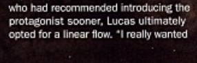

### Stat block notes (game mechanics, not feats)

- Mace Windy: "Mace Windy" became Samuel L. Jackson's prequel character, and the term "Padawaan learner" survived with only minor respelling. (Star Wars Insider 78, p. 39) (Source: *Star Wars Insider #78* (2004), scan p.39)
- A green-skinned Han: Some of Lucas' abandoned concepts included setting the story in the 33rd century and making Han Solo a "green-skinned monster with no nose and large gills." (Star Wars Insider 78, p. 39) (Source: *Star Wars Insider #78* (2004), scan p.39)

## scan p.40 (scan page 40)

Page contents: Factoids 4–9: Declan Mulholland's Jabba scene, restored with CG for the Special Edition; differences in the opening-day print (Aunt Beru's original voice; the "Episode IV" label added in 1981); the lava-sea climax of an early Return of the Jedi draft; ILM's Howie Weed and the cantina's lizard/elephant aliens (the same mask); alternative rebel-base planets; the new wampa footage. (hand-read)

### Stat block notes (game mechanics, not feats)

- Declan Mulholland's Jabba: Hired to play Jabba for the Docking Bay 94 confrontation in A New Hope (with the intention of replacing him later with a stop-motion creature), Mulholland wore a fur vest and boasted an improbable Irish accent. (Star Wars Insider 78, p. 40) (Source: *Star Wars Insider #78* (2004), scan p.40)
- Lava Light: In the revised rough draft, Luke is a prisoner of the Empire in the middle of a sea of boiling lava in the bowels of the Imperial capital Had Abbadon (i.e. Coruscant). During Luke's final showdown with the Emperor, Obi-Wan comes back as a flesh-and-blood warrior while Yoda lends a hand as a spirit from the Netherworld. Lucas jettisoned the superfluous players when he decided that a solo confrontation between Luke and Vader packed more power. (Star Wars Insider 78, p. 40) (Source: *Star Wars Insider #78* (2004), scan p.40)

## scan p.41 (scan page 41)

Page contents: Factoids continued: the wampa suit (worn by Howie Weed) and unfilmed wampa ideas; Hobbie and Veers in the Empire novelization; freeze-frame finds (the cantina flipper hand, R2 on the stairs, the "Ice Cream Guy," a TIE pilot hit by an asteroid, Leia shutting her eyes as she fires, Threepio's sticky pad, the Greedo mannequin). (hand-read)

### Stat block notes (game mechanics, not feats)

- Nine Lives: The novelization of Empire features a scene where snowspeeder pilot Hobbie crashes into the head of General Veers' AT-AT, killing both combatants. Fans have often wondered if this was a hint of an excised scene, but no such footage exists. In spinoff fiction published after the fact, both Hobbie and Veers were shown to have survived the incident. (Star Wars Insider 78, p. 41) (Source: *Star Wars Insider #78* (2004), scan p.41)

## scan p.42 (scan page 42)

Page contents: Factoids continued: four films connected to Star Wars (Carrie's joint casting call, the western Lucas screened, The Shining's Hoth snow, a bit-player nexus); Ben Burtt on sound for Alderaan; Luke's oil bath; Chewie on a platform in the trash compactor; yellow X-wing visors; the Norway "steps away from a ski lodge" shoot. (hand-read)

### Stat block notes (game mechanics, not feats)

- Keeping the fur dry: Because no one wanted to damage Chewie's yak-fur costume by getting it wet, the mighty Wookiee spends A New Hope's garbage-masher scene standing on a tiny platform in the corner. (Star Wars Insider 78, p. 42) (Source: *Star Wars Insider #78* (2004), scan p.42)

## scan p.43 (scan page 43)

Page contents: Factoids continued: a monkey considered for Yoda; the Sarlacc filmed in Buttercup Valley, Yuma; rented miniature trees burned for the Endor shield dish; Special Edition scurriers; Lucas on "A long time ago" as a fairy-tale opening; Everlasting In-Jokes: 1138 (TK-421 originally THX-1138). (hand-read)

- **none** — entry/section: A fairy tale: "As George Lucas explains, "That was my way of saying this is really more like a fairy tale than it is a piece of science-fiction. And I really thought you needed to do that, to say 'Don't worry about the scientific part of this, 'cause there isn't any.'" —George Lucas, Star Wars Insider 78, p. 43" Source: *Star Wars Insider #78* (2004), scan p.43
  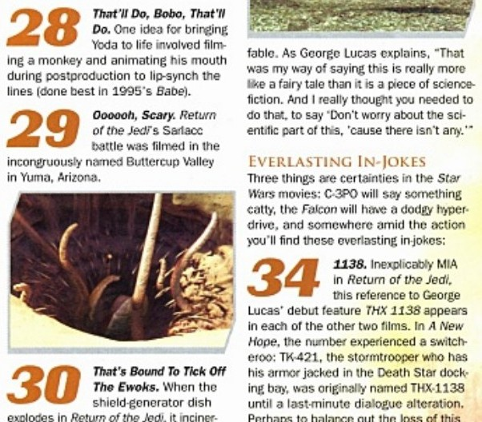

### Stat block notes (game mechanics, not feats)

- A monkey Yoda: One idea for bringing Yoda to life involved filming a monkey and animating his mouth during postproduction to lip-synch the lines (done best in 1995's Babe). (Star Wars Insider 78, p. 43) (Source: *Star Wars Insider #78* (2004), scan p.43)

## scan p.44 (scan page 44)

Page contents: "The Making of the Star Wars Trilogy DVDs": Lowry Digital Images (John Lowry) removes "sandstorms of dirt" from the negatives (more than 8 million pieces in the desert scenes alone) using 600 Power Mac G5s; ILM digital color timing with Lucas (Mike Blanchard). (hand-read)

## scan p.45 (scan page 45)

Page contents: Restoration continued: review on a 40-foot screen; matching softer optical-effects shots and adding grain to 1997 shots; THX (Rick Dean) supervises DVD compression; McCallum calls it one of the most extensive restoration projects in movie history. (hand-read)

## scan p.46 (scan page 46)

Page contents: Star Wars Battlefront Xbox demo on the trilogy bonus disc: Pandemic's Greg Borrud on finishing the demo nine months early; Endor chosen over Hoth; gameplay is to destroy or protect the shield bunker. (hand-read)

## scan p.47 (scan page 47)

Page contents: Battlefront continued: planets in the full game (Rhen Var, Kashyyyk); single-player and split-screen; Rebel classes (Rebel Trooper, Wookiee Smuggler, Rebel Vanguard) and Imperial classes (Stormtrooper, Scout Trooper, Imperial Pilot); 20 classes in the final game; Borrud on being faithful to the films. (hand-read)

## scan p.48 (scan page 48)

Page contents: "The Menus of the Star Wars Trilogy" by Brett Rector: Van Ling on DVD menus as the preshow, planet-themed menu sets, making Yavin 4 interesting, and three menu sets per film. (hand-read)

## scan p.49 (scan page 49)

Page contents: Menus continued: Ling avoids fan speculation while he works; menus started in January 2004 before the restoration was done; a 20-second loop of Luke swinging in the wampa cave from the original dailies; an animated AT-AT loop on Hoth. (hand-read)

## scan p.50 (scan page 50)

Page contents: "What's on the DVDs" by the Insider staff: A New Hope (record-breaking 1977 opening; commentary by Lucas, Burtt, Muren, Fisher); Empire (a $25 million loan, the Finse shoot, a puppet as a main character; Kershner commentary); Return of the Jedi (the Revenge of the Jedi title history). (hand-read)

- **none** — entry/section: Not expecting a hit: ""I expected not to ever make a hit movie; that wasn't my agenda. I certainly didn't expect Star Wars to be a giant hit." —George Lucas, Star Wars Insider 78, p. 50" Source: *Star Wars Insider #78* (2004), scan p.50
  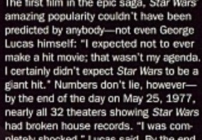

## scan p.51 (scan page 51)

Page contents: DVD bonus-disc rundown: Empire of Dreams documentary; The Characters of Star Wars; The Birth of the Lightsaber; The Force Is With Them; the Episode III preview on Anakin's descent and the new Vader costume; the Battlefront demo; the Episode III game; trailers, a photo gallery, posters, and DVD-ROM content. (hand-read)

### Stat block notes (game mechanics, not feats)

- Anakin's descent preview: In this exclusive preview, hear George Lucas talk about Anakin's descent, see the new Vader costume forged for the final Star Wars film, and experience firsthand how Hayden Christensen and Ewan McGregor have prepared for the epic lightsaber battle that has been anticipated for over two decades—the climactic showdown between Anakin Skywalker and Obi-Wan Kenobi. (Star Wars Insider 78, p. 51) (Source: *Star Wars Insider #78* (2004), scan p.51)

## scan p.52 (scan page 52)

Page contents: Anatomy of a scene (Chris Trevas): the Jawa sandcrawler shoot in Tunisia: the first winter rain in 50 years; the two-story, 90-foot partial sandcrawler blown apart by a sandstorm; John Stears's steam effects; the Jawas played by Jack Purvis and children (names omitted); a droid knocking over Kenny Baker in R2; the burned-out husk; the ILM model and the Disney dinosaur skeleton. (hand-read)

## scan p.53 (scan page 53)

Page contents: Anatomy continued (illustrated cutaway with C-3PO's "I can't abide these Jawas" header): the "Umbrella" droid (WED 15 Septoid 2); R1-G4; R5-D4 built from an R2 head; Owen (Phil Brown) haggling with the head Jawa (Jack Purvis); the "Dome" droid LIN-V8K; Tatooine's name from Tataouine; the Jawa ion gun made from a Lee-Enfield rifle. (hand-read)

- **C-3PO** — entry/section: Jawas: ""I can't abide these Jawas. Disgusting creatures." —C-3PO, Star Wars Insider 78, p. 53" Source: *Star Wars Insider #78* (2004), scan p.53
  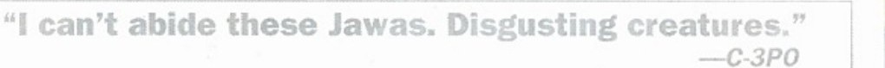

### Stat block notes (game mechanics, not feats)

- R5-D4's two bodies: By replacing the head of R2-D2 and swapping out some panels, R5-D4 was created. Two different bodies were used for R5, one for Kenny Baker to operate from inside and another remote-controlled model with a third leg to roll away after Luke. (Star Wars Insider 78, p. 53) (Source: *Star Wars Insider #78* (2004), scan p.53)
- Haggling with the Jawa: Luke's uncle Owen (Phil Brown) tries to haggle prices, but the head Jawa (Jack Purvis) stands firm. (Star Wars Insider 78, p. 53) (Source: *Star Wars Insider #78* (2004), scan p.53)
- The Jawa ion gun: The ion gun used by the Jawas to incapacitate Artoo-Detoo was made from a Lee-Enfield No.1 Mk III rifle fitted with a discharger cup. (Star Wars Insider 78, p. 53) (Source: *Star Wars Insider #78* (2004), scan p.53)
- Naming Tatooine: Aquilae, Townowl, and Utapau were a few of the names considered for the desert planet in early drafts of Star Wars. The name Tatooine was derived from the southern Tunisian city of Tataouine. Although spelled differently, the pronunciation is the same. (Star Wars Insider 78, p. 53) (Source: *Star Wars Insider #78* (2004), scan p.53)

## scan p.54 (scan page 54)

Page contents: "Ralph McQuarrie, Part 2" by Ron Magid: after Star Wars opened, McQuarrie's art became famous via Judy-Lynn del Rey's Ballantine portfolio; Lucasfilm and Fox kept the rights ("I'd be very rich"); Lucas called about a sequel in 1977; Empire as the pivot for Luke. (hand-read)

## scan p.55 (scan page 55)

Page contents: McQuarrie continued: contrasts as his mantra (Vader in a clean white dining room, Yoda in a murky swamp); a discarded metal castle on Hoth; early scaly tauntaun sketches. (hand-read)

- **none** — entry/section: Contrasts: ""You have to simplify ideas down," McQuarrie explains of his unique approach to illustrating Lucas' concepts. "Surprises are very dramatic, they're a great idea, and the Star Wars films work very well because of those contrasts." —Ralph McQuarrie, Star Wars Insider 78, p. 55" Source: *Star Wars Insider #78* (2004), scan p.55
  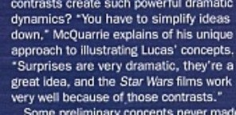

## scan p.56 (scan page 56)

Page contents: McQuarrie continued: the tauntaun's evolution; Joe Johnston's AT-AT; McQuarrie's idea for the snowspeeder; the probot design; the single-eye-slit helmet that became Boba Fett. (hand-read)

- **none** — entry/section: The snowspeeder idea: ""It was my idea that the Rebels should have this small craft that could dart in and out between the AT-ATs' legs," McQuarrie says proudly of the unforgettable images of these tiny flying craft flitting amongst the elephantine vehicles. "That contrast was what I was looking for." —Ralph McQuarrie, Star Wars Insider 78, p. 56" Source: *Star Wars Insider #78* (2004), scan p.56
  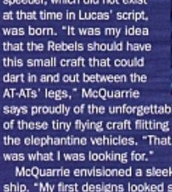
- **Boba Fett; Han Solo** — entry/section: Let's make him a bounty hunter: ""I did this helmet with a single eye slit, and George said, 'Let's make him a bounty hunter,'" recalls McQuarrie... —Ralph McQuarrie, Star Wars Insider 78, p. 56" Source: *Star Wars Insider #78* (2004), scan p.56
  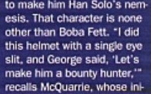

## scan p.57 (scan page 57)

Page contents: McQuarrie continued: Boba Fett's final Johnston helmet; the sinister-looking medical droid Too-Onebee; Yoda's look and Stuart Freeborn's Einstein-like face; Yoda's mud-hut house; pull quote on Vader in the all-white dining room. (hand-read)

- **2-1B** — entry/section: Fond of that robot: ""I'm kind of fond of that robot." —Ralph McQuarrie, Star Wars Insider 78, p. 57" Source: *Star Wars Insider #78* (2004), scan p.57
  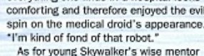
- **Yoda** — entry/section: A sagely guy: ""I never had any other ideas," McQuarrie says. "I drew what I thought was a more ascetic look, a sagely guy with a lot of bony structures." —Ralph McQuarrie, Star Wars Insider 78, p. 57" Source: *Star Wars Insider #78* (2004), scan p.57
  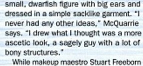

### Stat block notes (game mechanics, not feats)

- Vader in the white dining room: McQuarrie's relentless pursuit of contrasts produced perhaps the most striking image in The Empire Strikes Back: the jet-black armor and leather-clad Lord of the Sith, Darth Vader, seated in an all-white dining room in Cloud City. (Star Wars Insider 78, p. 57) (Source: *Star Wars Insider #78* (2004), scan p.57)

## scan p.58 (scan page 58)

Page contents: McQuarrie continued: Dagobah as "the bog planet" with cypress-knee roots; the Cloud City dining room (Kershner inverted the shot); the Close Encounters mothership; the round airshaft window that echoes Vader's TIE fighter; catwalk pull quote. (hand-read)

- **Yoda** — entry/section: Why he stays there: ""It's not a place you'd want to live," McQuarrie agrees while acknowledging it must be one of the greatest spots in the universe for deep meditation. "I guess so! But Yoda lives there, he cooks there, he does everything there. I can't imagine why he stays there!" —Ralph McQuarrie, Star Wars Insider 78, p. 58" Source: *Star Wars Insider #78* (2004), scan p.58
  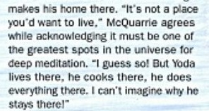
- **Luke Skywalker; Darth Vader (Anakin Skywalker)** — entry/section: A place for a cliffhanger: ""George said, 'We've got to have a place for a cliffhanger,' so I thought of a little catwalk hanging out over a great big tube where Luke would look down and see it went on almost to infinity. I certainly wouldn't go out on it!" —Ralph McQuarrie, Star Wars Insider 78, p. 58" Source: *Star Wars Insider #78* (2004), scan p.58
  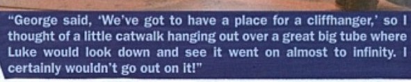

## scan p.59 (scan page 59)

Page contents: McQuarrie conclusion: the round airshaft window Lucas insisted on keeping; the vast Cloud City reactor shaft and catwalk for the climactic duel; "I just dream them in my head." (hand-read)

- **none** — entry/section: Dreaming ideas: ""I just dream them in my head. I don't make too many scientific assumptions. I did most of these things sort of in a dream state, free of anything—the more fantasy the better." —Ralph McQuarrie, Star Wars Insider 78, p. 59" Source: *Star Wars Insider #78* (2004), scan p.59
  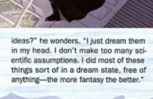

## scan p.60 (scan page 60)

Page contents: Ask the Master Q&A by Pablo Hidalgo (questioner names omitted), "Clone Troopers Are Welcome Anytime, But Your Droids Must Wait Outside": why the Sith want revenge; planetary seasons (Coruscant's weather-control network); Grievous and Shaak Ti in Clone Wars Chapter 20. (hand-read)

- **Ki-Adi-Mundi** — entry/section: Ask the Master: the Sith extinct for a millennium: "As Ki-Adi-Mundi states in Episode I, the Sith have been extinct for a millennium; however, not all were wiped out." Source: *Star Wars Insider #78* (2004), scan p.60
  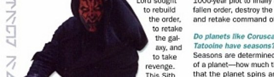

### Stat block notes (game mechanics, not feats)

- The 1000-year plot: By Episode III, the Sith are ready to reveal themselves. There's no more need for subterfuge, no more need for skulking in the shadows. Darth Sidious, the Sith mastermind, will make good on a 1000-year plot to finally avenge the fallen order, destroy the Jedi Knights, and retake command of the galaxy. (Star Wars Insider 78, p. 60) (Source: *Star Wars Insider #78* (2004), scan p.60)
- Grievous is not a Force-user: General Grievous is not a Force-user. He's about to hit Shaak Ti with his lightsaber, and she attempts to Force-block the blow. But she's not strong enough to stop it entirely. She prevents the blade from making contact with her, but the kinetic energy of the hit is transferred to her nonetheless, transmitted through the "Force shield," and the energy throws her across the room. (Star Wars Insider 78, p. 60) (Source: *Star Wars Insider #78* (2004), scan p.60)

## scan p.61 (scan page 61)

Page contents: Q&A continued: C-3PO's color in the Clone Wars microseries; Spotlight Question "The Vest Is Yet to Come" on Han's sleeveless vest in the carbon-freeze close-ups (fixed by ILM on the DVD) and flipped rank badges aboard the Executor; klicks and parsecs. (hand-read)

### Stat block notes (game mechanics, not feats)

- The vest is yet to come: Given that Han wasn't meant to be shirtless in this scene, the "shirt" that Harrison and Irvin are referring to is the outer jacket. The wardrobe department delivered a sleeveless vest that day. ... In fact, the DVD edition of Episode V has done just that. Digital artists at ILM have painted out the black vest and dressed Han's shoulders in the correct white shirt, thus preserving continuity with the rest of the sequence. (Star Wars Insider 78, p. 61) (Source: *Star Wars Insider #78* (2004), scan p.61)

## scan p.62 (scan page 62)

Page contents: Q&A continued: the five Fire Rings of Fornax; the clone mess hall's glass noodles (Pablo Helman); Yoda moves offscreen on Dagobah; Oppo Rancisis cut from pan-and-scan copies of Episode II. (hand-read)

### Stat block notes (game mechanics, not feats)

- The five Fire Rings of Fornax: Nonetheless, Han Solo's line still appears in the novelization of A New Hope: "Getting back to the ship's going to be like flying through the five Fire Rings… (Star Wars Insider 78, p. 62) (Source: *Star Wars Insider #78* (2004), scan p.62)
- Yoda moves offscreen: Yoda moves when he is offscreen. When the little green Jedi Master gives the stirring "luminous beings" speech, both he and Luke are on flat ground. ... Yoda moved while the camera was trained on Luke, which was a very common cheat in the days when he was a puppet. (Star Wars Insider 78, p. 62) (Source: *Star Wars Insider #78* (2004), scan p.62)

## scan p.63 (scan page 63)

Page contents: Q&A continued: Home One and the Independence are separate ships; why droids are barred from the cantina ("We don't serve their kind here"); two-legged walker predecessors of the AT-ST (the AT-XT). (hand-read)

### Stat block notes (game mechanics, not feats)

- Wuher and droids: For the most part, Wuher is a sourpuss, though it doesn't appear that he has a personal vendetta against droids. ... Wuher would rather have a thirsty organic sentient sitting on a barstool than have that space occupied by a protocol or astromech droid. (Star Wars Insider 78, p. 63) (Source: *Star Wars Insider #78* (2004), scan p.63)

## scan p.64 (scan page 64)

Page contents: Feature "THX 1138" by Abel G. Peña on the restored DVD of George Lucas's first feature (released September 14, 2004; limited theatrical run Sept. 10); Robert Duvall in the title role. (hand-read)

- **none** — entry/section: A metaphor for 1970: ""I have been struck by just how much it reflects how I saw the world in 1970," says George Lucas of his first film. "It was designed as a metaphor for the way we were living at the time." —George Lucas, Star Wars Insider 78, p. 64" Source: *Star Wars Insider #78* (2004), scan p.64
  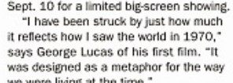

## scan p.65 (scan page 65)

Page contents: THX 1138 continued: American Zoetrope's flagship production; Walter Murch's sound design ("a film from the future, rather than about the future"); standard and two-disc collector's DVD editions with Lucas/Murch commentary. (hand-read)

## scan p.66 (scan page 66)

Page contents: THX 1138 continued: Mike Blanchard on the flashing fluorescent light nearly "fixed" in restoration; Techniscope grain; Lowry Digital Images and the white prison sequence; sidebar trivia (Coppola's lucky-number $777,777 budget, Lalo Schifrin score, THX Ltd. founded 1983, Captain Eo). (hand-read)

## scan p.67 (scan page 67)

Page contents: Full-page THX 1138 still with pull quote "I have been struck by just how much it reflects how I saw the world in 1970." —George Lucas. (hand-read)

## scan p.68 (scan page 68)

Page contents: THX 1138 concluded: the short Bald (casting director Ron Colby), the trailers, Lucas's reflection; sidebar "I Have Foreseen It: The Electronic Labyrinth vs. a Galaxy Far, Far Away" comparing tyranny, faceless enforcers, holograms, chases and comic relief. (hand-read)

### Stat block notes (game mechanics, not feats)

- The Faceless Enemy: At first glance, the masked stormtroopers of Star Wars look like distant relations of the steely robotic enforcers of the Electronic Labyrinth. Though the Empire's stormtroopers proved not to be automatons, THX 1138's soft-voiced bullies clearly foreshadowed the stormtrooper's prequel progenitors: the battle droid armies of the Separatists and the clone troopers of the Old Republic. (Star Wars Insider 78, p. 68) (Source: *Star Wars Insider #78* (2004), scan p.68)

## scan p.69 (scan page 69)

Page contents: Full-page THX 1138 still: "Let us be thankful we have commerce. Buy more. Buy more now. Buy more and be happy." (hand-read)

## scan p.70 (scan page 70)

Page contents: Scouting the Galaxy by Steve Sansweet, "This will be a spelling..." (letter-writer names omitted): Comic-Con 2004 Star Wars pavilion and the Episode III title reveal (Revenge of the Sith) with Carrie Fisher, Rick McCallum and Hayden Christensen; Mexico fan convention; Elan Sleazebaggano figure's ears vs. antennae; Lucasfilm-archive lobby cards and key-set photos. (hand-read)

### Stat block notes (game mechanics, not feats)

- Ears or antennae: What happened is a little something called Director's Choice. It's George Lucas' movie, so he gets to say whether someone or something has ears, antennae, both, or neither. In this case, he made the decision to add the antennae well into production, after all the scenes with actor Matt Doran in the gambling club were shot. (Star Wars Insider 78, p. 70) (Source: *Star Wars Insider #78* (2004), scan p.70)

## scan p.71 (scan page 71)

Page contents: Scouting continued: no licensed photos yet (planned); no current Star Wars bedding; the two versions of Greg Aronowitz's Boba Fett bust (Jedi vs. Empire backpack colors). (hand-read)

## scan p.72 (scan page 72)

Page contents: Scouting continued: Wal-Mart's cancelled second cantina wave (Wuher, Dr. Evazan, Kitik Keed'kak) reissued as Kmart Cantina three-packs; identifying a childhood Empire program. (hand-read)

## scan p.73 (scan page 73)

Page contents: Scouting concluded: The Empire Strikes Back Official Collectors Edition (Paradise Press) back-cover painting; the misspelled "Darth Vadar Lives" button from Factors Inc.; submission address. (hand-read)

### Stat block notes (game mechanics, not feats)

- Darth Vadar Lives: Factors Inc., one of the first Star Wars licensees, did in fact botch the spelling of the name of the Dark Lord of the Sith. And it wasn't only on millions of badges; this same design appeared on a pocket mirror, cloth patch, and transfers used on everything from T-shirts to cloth shopping bags. What is surprising is that the company never put out a corrected version of any of these items. (Star Wars Insider 78, p. 73) (Source: *Star Wars Insider #78* (2004), scan p.73)

## scan p.74 (scan page 74)

Page contents: Hasbro feature "A Force To Be Reckoned With" at Comic-Con 2004: 2005 Saga figure previews (Sly Moore, Yarua, Jedi, a Geonosis Jedi, Queen Amidala in her parade gown, a handmaiden, Feltipern Trevagg, Myo, Dannik Jerriko) and Clone Wars animated figures (General Grievous, Anakin Skywalker, ARC Trooper). (hand-read)

### Stat block notes (game mechanics, not feats)

- Sly Moore: She is the staff aide for Supreme Chancellor Palpatine. Her species, the Umbarans, is rumored to be able to influence and even control the minds of others. (Star Wars Insider 78, p. 74) (Source: *Star Wars Insider #78* (2004), scan p.74)
- Yarua: He represents his home world of Kashyyyk in the Galactic Senate. Yarua is an imposing presence due to his great height and fierce demeanor. (Star Wars Insider 78, p. 74) (Source: *Star Wars Insider #78* (2004), scan p.74)
- General Grievous figure: Introduced in Chapter 20 of the Clone Wars microseries, this brand-new bad guy will be a central figure in Episode III and a major thorn in the side of all Jedi! He is certainly an imposing figure. (Star Wars Insider 78, p. 74) (Source: *Star Wars Insider #78* (2004), scan p.74)

## scan p.75 (scan page 75)

Page contents: Hasbro continued: Galactic Heroes wave (Luke and Gamorrean Guard, Lando and Skiff Guard, etc.); Revenge of the Sith packaging preview with the orange logo; the Darth Vader Voice Changer. (hand-read)

## scan p.76 (scan page 76)

Page contents: Games feature "Star Wars Knights of the Old Republic II: The Sith Lords": Obsidian Entertainment develops; set nearly 4000 years before the films and five years after KOTOR; Peragus mining colony opening; Ebon Hawk returns; producer Mike Gallo. (hand-read)

### Stat block notes (game mechanics, not feats)

- Hunted as the last Jedi: "The story revolves around several Sith Lords that are hunting your character because they believe that he/she is the last of the Jedi order," Gallo says. (Star Wars Insider 78, p. 76) (Source: *Star Wars Insider #78* (2004), scan p.76)

## scan p.77 (scan page 77)

Page contents: KOTOR II continued: Force powers and feats, party reactions to light and dark choices, side quests and mini-games; byline Justin Lambros. (hand-read)

## scan p.78 (scan page 78)

Page contents: Feature "He's Big, and He's Back" by Pablo Hidalgo: Chewbacca's and Tarfful's Revenge of the Sith pickup shoot (Peter Mayhew; Michael Kingma as Tarfful); the Wookiee extras led by Axel Dench (Rebecca Hunt); scenes with Yoda shot MOS. (hand-read)

### Stat block notes (game mechanics, not feats)

- Chewbacca and Tarfful suits: It must have been a profound trip down memory lane for Peter Mayhew, who returns to the role of Chewbacca. The Wookiee suit is new but faithful to the classic incarnation, and it sports a new arterial system that can pump ice cold [water to help cool down the actor]. ... Though both characters stand about the same height, Tarfful is definitely the beefier of the two (Star Wars Insider 78, p. 78) (Source: *Star Wars Insider #78* (2004), scan p.78)

## scan p.79 (scan page 79)

Page contents: Wookiee shoot continued: greenscreen with stand-ins; the Kashyyyk tree-city miniature at ILM; digital Wookiee extras via motion capture with Kingma. (hand-read)

## scan p.80 (scan page 80)

Page contents: Wookiee motion capture with Doug Griffin of ILM; lagoon battle animatics; sidebar "George Lucas on Revenge of the Sith" on who the Sith are; Hyperspace webcam Comic-Con 2004 transcript begins (Steve Sansweet, Rick McCallum). (hand-read)

- **Palpatine (Darth Sidious); Darth Vader (Anakin Skywalker); Darth Maul; Count Dooku** — entry/section: Who are the Sith: ""The Sith are the archenemies of the Jedi, and for a long time, they ruled the universe until the Jedi came along and got rid of them. The Sith characters in the previous Star Wars films were Darth Vader and the other apprentices—Darth Maul from Episode I and Count Dooku, or Darth Tyrannus, from Episode II and the soon-to-be released Episode III. The evil master Sith in all of the films is Darth Sidious, who becomes Emperor of the universe." —George Lucas, Star Wars Insider 78, p. 80" Source: *Star Wars Insider #78* (2004), scan p.80
  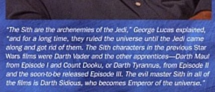

## scan p.81 (scan page 81)

Page contents: Comic-Con panel transcript continued with Hayden Christensen and Rick McCallum (audience questioners unnamed): first wearing the Vader helmet, lightsaber training with Nick Gillard and Ewan McGregor, first trailer in November, Mace Windu's role. (hand-read)

- **Darth Vader (Anakin Skywalker)** — entry/section: Donning the helmet: ""It was overwhelming. That's always been the sort of exclamation mark in the back of my head throughout the entire process of making these past two films: putting on the dark helmet and getting all done up as Vader. It was...it was...orgasmic. It was too much." —Hayden Christensen, Star Wars Insider 78, p. 81" Source: *Star Wars Insider #78* (2004), scan p.81
  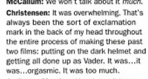
- **Mace Windu; Darth Vader (Anakin Skywalker)** — entry/section: Mace turns Anakin: ""Yes, definitely. Mace is actually the pivotal point that starts to turn this young lad into Darth." —Rick McCallum, Star Wars Insider 78, p. 81" Source: *Star Wars Insider #78* (2004), scan p.81
  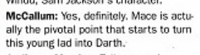

## scan p.82 (scan page 82)

Page contents: Panel concluded: getting into character through the costume, about four hours to suit up, heels and lifts, the bittersweet end; "Making of Episode III" documentary quotes from crew (David Tattersall, Pablo Hidalgo). (hand-read)

- **Darth Vader (Anakin Skywalker)** — entry/section: Walking in heels: ""Plus, I'm not nearly as tall as the original Darth Vader, so I was walking around in heels! They had to put lifts on the shoes, and I had a few falls, but [I was all right]." —Hayden Christensen, Star Wars Insider 78, p. 82" Source: *Star Wars Insider #78* (2004), scan p.82
  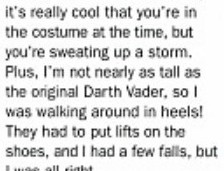

## scan p.83 (scan page 83)

Page contents: Hyperspace "From the Archives" photo page (edited by Paul Ens; content by Pablo Hidalgo): C-3PO and Oola; Robert Watts on the tauntaun prop; Episode I Senate delegations; the blasted wampa at Echo Base; Massassi Base maquette; the Luke/Biggs reunion; Jabba's Special Edition dancers. (hand-read)

### Stat block notes (game mechanics, not feats)

- Wampa infestations: The blasted remains of a wampa ice creature that broke its way into Echo Base. In the original shooting script of The Empire Strikes Back, there was a subplot about wampa infestations in the ice tunnels, but the lackluster creature effects of the scenes meant these sequences were cut. (Star Wars Insider 78, p. 83) (Source: *Star Wars Insider #78* (2004), scan p.83)
- Yavin Base Reunion: Luke Skywalker is reunited with Biggs Darklighter just before the Battle of Yavin. This scene was reinserted into A New Hope for the Special Edition, but a line from Red Leader regarding Luke's father was craftily edited out. (Star Wars Insider 78, p. 83) (Source: *Star Wars Insider #78* (2004), scan p.83)

## scan p.84 (scan page 84)

Page contents: Bantha Tracks "Celebrating a Star Wars Halloween" (all fan, trooper and child names omitted): introduction on Star Wars costuming since 1977; a 501st "KISS Troopers" group photo; a child's Boba Fett costume on a school-fair Darth Vader's knee (1980). (hand-read)

## scan p.85 (scan page 85)

Page contents: Bantha Tracks continued: a college Yoda costume prize; handmade vs. Ben Cooper store-bought vintage costumes; a 1981 homemade Luke costume. (hand-read)

## scan p.86 (scan page 86)

Page contents: Bantha Tracks continued: long-time costumers then and now (Darth Vader since 1977, stormtroopers, a C-3PO family photo, a bandaged 1977 Luke); "Star Wars is a pop culture marvel." (hand-read)

## scan p.87 (scan page 87)

Page contents: Bantha Tracks Fan.Tastic (volunteer names omitted): the Rocky Mountain Fan Force restores Lucasfilm's X-wing model from the Wings Over the Rockies museum in Denver and the San Diego Fan Force reassembles it for Comic-Con 2004. (hand-read)

## scan p.88 (scan page 88)

Page contents: Bantha Tracks fan art pages and submission guidelines (artist names omitted). (hand-read)

## scan p.89 (scan page 89)

Page contents: Bantha Tracks column by Mary Franklin thanking Comic-Con 2004 volunteers (the list of volunteer names omitted): the 180' x 60' pavilion, the Fan Film Awards, the Episode III title reveal. (hand-read)

## scan p.90 (scan page 90)

Page contents: Laugh It Up, Fuzzball humor "On the Desk of George Lucas...": a legal pad of crossed-out Episode III titles ("Jar Jar Triumphant!", "Darth Moon Rising", "Mr. Palpatine's Neighborhood", "Whatta Whole Lotta Wookiees", "Dawn of the Darth", "The Sith Hits the Fan", "Th-th-th-that's All Folks!", "Sith Happens", "Revenge of the Jedi (oops!)") ending in "Revenge of the Sith"; phone speed-dial labels Steven, Marty, Francis, Licensing Dept., Star Wars Insider. (hand-read)

## scan p.91 (scan page 91)

Page contents: StarWarsShop.com ad: Original Trilogy Collection exclusive holographic Emperor Palpatine figure from The Empire Strikes Back. (hand-read)

### Stat block notes (game mechanics, not feats)

- Hologram Emperor figure: Emperor Palpatine is presented as seen in Episode V The Empire Strikes Back as an action figure for the very first time. The ghastly visage of the twisted Emperor peers from beneath his cowl as he contacts Darth Vader via hologram to inform him of a new threat. (Star Wars Insider 78, p. 91) (Source: *Star Wars Insider #78* (2004), scan p.91)

## scan p.92 (scan page 92)

Page contents: StarWarsShop.com catalog with a collector's picks (collector name omitted): Tsuneo Sanda Darth Vader giclée, Clone Wars uncut card sheet, Revenge of the Sith logo T-shirt, Billy Dee Williams litho. (hand-read)

## scan p.93 (scan page 93)

Page contents: StarWarsShop.com catalog: Star Wars Trilogy soundtrack six-CD box, one-sheet posters, pin set. (hand-read)

## scan p.94 (scan page 94)

Page contents: StarWarsShop.com catalog: Clone Wars giclée, Revenge of the Sith sweatshirt, Master Replicas scaled Count Dooku and Darth Vader lightsabers, Battlefront scout trooper figure, Team Sith jersey. (hand-read)

## scan p.95 (scan page 95)

Page contents: StarWarsShop.com catalog: Jango Fett collector's helmet, Tsuneo Sanda fine art, Hasbro vintage 12" case, Attakus clone trooper statue, Dark Side jersey, A New Hope lunch box, Unleashed wave 4. (hand-read)

## scan p.96 (scan page 96)

Page contents: StarWarsShop.com order page. (hand-read)

## scan p.97 (scan page 97)

Page contents: Ad: Gen Con So Cal 2005. (hand-read)

## scan p.98 (scan page 98)

Page contents: Ad: Star Wars Battlefront (back cover). (hand-read)

