# Owner Material 038 — Star Wars Insider #1–153 plus specials (with The Lucasfilm Fan Club Magazine #1–22): Star Wars Insider #79 (2005)

- **Source:** *Star Wars Insider* magazine (issues 23–153, 1994–2014) and its predecessor *The Lucasfilm Fan Club Magazine* (issues 1–22, 1987–1994), plus seven special editions: articles, interviews, comics and short fiction Secondary source (licensed Legends reference). Scan OCR'd on the box; the scan stays box-only and is **not** published.
- **Method:** every scanned page was OCR'd and machine-screened sentence by sentence for power-relevant statements (fights, kills, defeats, Force feats, rankings, superweapons) that name a character on our roster; each kept sentence is quoted verbatim from the OCR text and has a crop of the printed passage directly under it. Pages with nothing power-relevant are still listed with what is on them.
- **Citation:** "*Star Wars Insider #79* (2005), p.X" by printed page ("scan p.X" where no printed number applies). **Weight:** Licensed magazine: a secondary source. Its short fiction and comics are Legends stories; its articles and interviews sum up or discuss lore and rank below the novels, comics and games they describe.

## scan p.1 (scan page 1)

Page contents: Cover, Star Wars Insider 79 (January/February 2005): Exclusive Episode III update, Peter Mayhew interview, Bantha Tracks, "A Day at Shepperton" never-seen-before photos. (hand-read)

## scan p.2 (scan page 2)

Page contents: Ad: Cloud City Collectibles (cromalins and proofs, AFA-graded and loose figures). (hand-read)

## scan p.3 (scan page 3)

Page contents: Ad: Cloud City Collectibles gift certificate and holiday shopping. (hand-read)

## scan p.4 (scan page 4)

Page contents: Contents: Episode III postproduction at ILM, "The Wookiees Walk Amongst Us" (Peter Mayhew), Lucas's AFI Life Achievement Award, Celebration III updates, Clone Wars villains, Technical Readout, Yoda's species, eBay collecting, Jump to Lightspeed, Jabba's Collectibles (Episode III Sneak Preview figures; behind the scenes at Hasbro), The Best of Hyperspace (Pablo Hidalgo and Bonnie Burton), a day on the Revenge of the Sith set. (hand-read)

## scan p.5 (scan page 5)

Page contents: Ad: Master Replicas Rebel Fleet Trooper blaster ("Echo Station 5-7, we're on our way."). (hand-read)

## scan p.6 (scan page 6)

Page contents: Editorial by Brett Rector on holiday collecting since 1978 and the original trilogy DVD release (September 21); "Happy Life Day!"; masthead. (hand-read)

## scan p.7 (scan page 7)

Page contents: Toy column (by a toy columnist) on the Entertainment Earth exclusive 2004 Holiday Edition Jawas based on Ralph McQuarrie's holiday card art; red and green Jawa prototypes considered before the final brown; Entertainment Earth ad. (hand-read)

## scan p.8 (scan page 8)

Page contents: Letters "Star Words" (letter-writer names omitted): the Hayden Christensen Force ghost in the DVD Return of the Jedi; Rush's "The Body Electric" and THX 1138; DVD bloopers (crewmember in the Falcon doorway, Vader's chin piece); Sidious and Palpatine; Mara Jade cameo request. (hand-read)

### Stat block notes (game mechanics, not feats)

- Hayden in the ghost scene: When the photo of that shot was circulated on the Internet, many fans were upset that Hayden had been inserted, mostly because they just didn't see the connection. However, there is a very reasonable explanation—but it can't be revealed until next spring when a certain new film opens in a theater near you. (Star Wars Insider 79, p. 8) (Source: *Star Wars Insider #79* (2005), scan p.8)
- Mara Jade and canon: Mara Jade is an outstanding character, and we here at Insider thank Timothy Zahn every day for creating her. However, stories from the Expanded Universe books are not part of the canon of the films, and therefore it is doubtful she'll make an appearance. (Star Wars Insider 79, p. 8) (Source: *Star Wars Insider #79* (2005), scan p.8)

## scan p.9 (scan page 9)

Page contents: Ad: Code 3 Collectibles die-cast original trilogy vehicles. (hand-read)

## scan p.10 (scan page 10)

Page contents: Ad: Knights of the Old Republic II: The Sith Lords (light side spread). (hand-read)

## scan p.11 (scan page 11)

Page contents: Ad: Knights of the Old Republic II: The Sith Lords (dark side spread; "Together you will destroy the Jedi Order."). (hand-read)

## scan p.12 (scan page 12)

Page contents: Episode III Update with Producer Rick McCallum by Brett Rector at Skywalker Ranch, seven months before release: postproduction schedule, Ben Burtt as sound designer and co-editor. (hand-read)

- **none** — entry/section: Coffee intake: ""My coffee intake has gone up to about four or five cups a day—it's pretty insane around here at the moment," McCallum says. —Rick McCallum, Star Wars Insider 79, p. 12" Source: *Star Wars Insider #79* (2005), scan p.12
  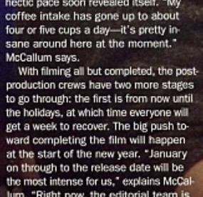

## scan p.13 (scan page 13)

Page contents: Full-page Episode III photo by Keith Hamshere: George Lucas directs Samuel L. Jackson (Mace Windu) and Silas Carson (Ki-Adi-Mundi). (hand-read)

### Stat block notes (game mechanics, not feats)

- The fight of their lives: Director George Lucas gestures as he explains to Samuel L. Jackson (who plays Mace Windu) and Silas Carson (who plays Ki-Adi-Mundi) that the two members of the Jedi Council are about to engage in the fight of their lives. (Star Wars Insider 79, p. 13) (Source: *Star Wars Insider #79* (2005), scan p.13)

## scan p.14 (scan page 14)

Page contents: Episode III Update continued: full-page set photo of a hooded, sequin-veiled alien creature costume with a crew member at Shepperton Studios (no caption on this page). (hand-read)

## scan p.15 (scan page 15)

Page contents: Episode III Update continued: dailies every Tuesday and Thursday, averaging about 50 to 60 shots a week; the cut runs about 10 minutes long; pickup shoots at Shepperton in late August/early September 2004. Caption: alien creatures at Shepperton (photo by Keith Hamshere). (hand-read)

- **none** — entry/section: Length of the cut: ""We're really, really happy with the latest cut of the film," says McCallum, "but (as far as length) we are about 10 minutes over where we want to be. The goal is to trim the feature to about two hours and fifteen minutes." —Rick McCallum, Star Wars Insider 79, p. 15" Source: *Star Wars Insider #79* (2005), scan p.15
  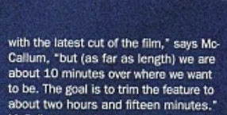

## scan p.16 (scan page 16)

Page contents: Episode III Update continued: possible shooting in January; looping in London in early December. Photos: Christopher Lee as Count Dooku; Hayden Christensen leaping onto a crash mat; children playing Jedi younglings training under Yoda. (hand-read)

### Stat block notes (game mechanics, not feats)

- Dooku's dark side power: A sinister-looking Christopher Lee, who plays Separatist leader Count Dooku (and secretly, the Sith Lord Darth Tyranus), uses every dark side power he has in a battle near the beginning of Revenge of the Sith. (Star Wars Insider 79, p. 16) (Source: *Star Wars Insider #79* (2005), scan p.16)

## scan p.17 (scan page 17)

Page contents: Episode III Update continued: looping (ADR) explained. Photos: Jeremy Bulloch as an Alderaan starship pilot; Lucas with Ian McDiarmid at Shepperton. (hand-read)

### Stat block notes (game mechanics, not feats)

- Bulloch returns: Where have we seen that face before? Actor Jeremy Bulloch, the original trilogy's Boba Fett, is back in Episode III as an Alderaan starship pilot. (Star Wars Insider 79, p. 17) (Source: *Star Wars Insider #79* (2005), scan p.17)
- McDiarmid's largest role: Director George Lucas discusses a shot at England's Shepperton Studios with actor Ian McDiarmid, who has his largest role yet in a Star Wars movie in Episode III. (Star Wars Insider 79, p. 17) (Source: *Star Wars Insider #79* (2005), scan p.17)

## scan p.18 (scan page 18)

Page contents: Episode III Update continued: casting for 25 foreign-language versions; John Williams spotting the film with Music Editor Kenny Wannberg and recording with the London Symphony Orchestra in February. Images: Anakin and Obi-Wan's Jedi starfighters over Coruscant; Yoda deep in thought (ILM). (hand-read)

## scan p.19 (scan page 19)

Page contents: Episode III Update concludes: super battle droids aboard a Trade Federation cruiser; R2-D2 joins the fight on the cruiser's bridge; Anakin (Hayden Christensen) faces momentous choices. (hand-read)

### Stat block notes (game mechanics, not feats)

- Anakin's momentous choices: Anakin Skywalker, played by actor Hayden Christensen, faces some momentous choices in Episode III: Does he remain true to the Jedi Order...or is the allure of the dark side just too strong to resist? (Star Wars Insider 79, p. 19) (Source: *Star Wars Insider #79* (2005), scan p.19)

## scan p.20 (scan page 20)

Page contents: Ad (rotated spread, left): EverQuest II, with press quotes from GMR, PC Gamer and GameSpy. (hand-read)

## scan p.21 (scan page 21)

Page contents: Ad (rotated spread, right): EverQuest II, "Where Adventure Comes Alive", starring Heather Graham as Antonia Bayle and Christopher Lee as Lucan D'Lere. (hand-read)

## scan p.22 (scan page 22)

Page contents: Skywalking News "Star News From Around the Galaxy": AFI Life Achievement Award for George Lucas (June 2005 gala); C-3PO joins R2-D2 in Carnegie Mellon's Robot Hall of Fame (inducted Oct. 11, 2004, with Anthony Daniels present); "Luke, I am your father" ranked eighth on Sky One's Ultimate Sci-Fi Top 10; Darth Vader wins careerone.com's "Which villain most resembles your boss?" poll with 39.66 percent. (hand-read)

- **none** — entry/section: AFI honor: ""I've been very fortunate to have had a long career doing what I love to do, and being recognized by the AFI for it is really an honor," Lucas stated. —George Lucas, Star Wars Insider 79, p. 22" Source: *Star Wars Insider #79* (2005), scan p.22
  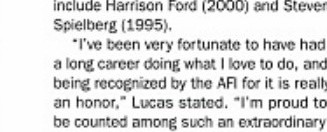
- **C-3PO** — entry/section: Robot Hall of Fame: ""C-3PO is one of the most memorable characters from...Star Wars," said Professor James H. Morris... "He demonstrates many appealing human traits—and he received the most nominations from the public on the Robot Hall of Fame website." —James H. Morris, Star Wars Insider 79, p. 22" Source: *Star Wars Insider #79* (2005), scan p.22
  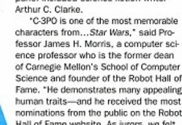

## scan p.23 (scan page 23)

Page contents: Star News continued: Star Wars content for Orange mobile customers (15-month deal); Clone Wars microseries wins the Emmy for Outstanding Animated Program (credits Genndy Tartakovsky and team); Shaun of the Dead's Star Wars references (Simon Pegg; flatmate Peter Serafinowicz, voice of Darth Maul); Celebration III Update begins (Indiana Convention Center, April 21-24, 2005; registration opened Sept. 27). (hand-read)

- **Leia Organa Solo** — entry/section: Pegg meets Carrie Fisher: ""I told her that when I was a kid, I used to kiss her picture every night before I went to bed. She looked at me as though I was weird—and I realized I probably was." —Simon Pegg, Star Wars Insider 79, p. 23" Source: *Star Wars Insider #79* (2005), scan p.23
  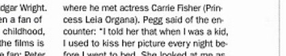

## scan p.24 (scan page 24)

Page contents: Celebration III Update continued (Mary Franklin): Darth Vader "three-in-one topper" exclusive for advance four-day badges; news to come on starwars.com/c3; fan group exhibit applications due Dec. 9, 2004; Hyperspace fan club benefits; shorter lines. Sidebar: fourth annual Star Wars Fan Film Awards with AtomFilms (submission deadline March 8, 2005). (hand-read)

## scan p.25 (scan page 25)

Page contents: Full-page Episode III teaser poster image: Darth Vader's helmet looming behind a scarred Anakin with a red lightsaber. (hand-read)

## scan p.26 (scan page 26)

Page contents: Jedi Library "One Picture at a Time" (Jane Irene Kelly): Marcus Hearn's The Cinema of George Lucas (Abrams, early 2005), a scrapbook-style chronological retrospective of more than 500 images, foreword by Ron Howard; access to the Lucasfilm archives and the first and second drafts of Star Wars. (hand-read)

- **none** — entry/section: Why Lucas went away: ""I thought it was important to explain why he went away in the first place and to discuss just how painful and risky Star Wars actually was for him," says Hearn. "Yes, it was a huge success, but it could've failed. The Empire Strikes Back could have failed, as well. George could've lost everything. Even The Phantom Menace could've failed." —Marcus Hearn, Star Wars Insider 79, p. 26" Source: *Star Wars Insider #79* (2005), scan p.26
  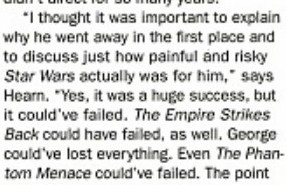

## scan p.27 (scan page 27)

Page contents: Ad: "Give the Galaxy" Hyperspace/Insider gift membership ($39.95), with Ralph McQuarrie's holiday Jawas art. (hand-read)

## scan p.28 (scan page 28)

Page contents: Jedi Library continued: Lucas as documentary filmmaker at heart; thematic links across THX 1138, American Graffiti and Star Wars; influences (Kurosawa's The Hidden Fortress, Slavko Vorkapich, Coppola, A Hard Day's Night, Dr. Strangelove); book design by Iain Morris inspired by Skywalker Ranch and the Arts and Crafts Movement; Erik Tiemens paintings; Luke-and-twin-suns cover. (hand-read)

- **Darth Vader (Anakin Skywalker)** — entry/section: Walking away: ""On a thematic level, there is little difference between what Anakin Skywalker says to his mother in a movie made in 1999 and what THX 1138 says to the character SEN 5241 in a movie made in 1971. They each have to find the courage to walk away [from something or someone]." —Marcus Hearn, Star Wars Insider 79, p. 28" Source: *Star Wars Insider #79* (2005), scan p.28
  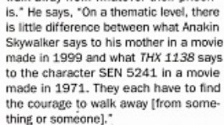
- **Luke Skywalker** — entry/section: The cover image: ""George identifies with Luke, so what better image to have on the cover, really, than Luke with his back to us, looking at Tatooine's twin suns setting." —Iain Morris, Star Wars Insider 79, p. 28" Source: *Star Wars Insider #79* (2005), scan p.28
  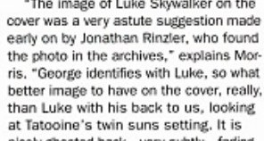

## scan p.29 (scan page 29)

Page contents: Ad: Ubisoft handheld Star Wars Trilogy game (play as Luke Skywalker; dogfight and capture-the-flag multiplayer). (hand-read)

## scan p.30 (scan page 30)

Page contents: Ad (spread, left): Star Wars Galaxies: Jump to Lightspeed expansion. (hand-read)

## scan p.31 (scan page 31)

Page contents: Ad (spread, right): Star Wars Galaxies: Jump to Lightspeed, starship combat for An Empire Divided. (hand-read)

## scan p.32 (scan page 32)

Page contents: Drawn by the Force comics "Days of Reckoning": Dark Horse's five-issue Star Wars: Obsession (November) by Haden Blackman, Obi-Wan's pursuit of Asajj Ventress to Boz Pity; originally conceived as 10-issue countdown series (editor Randy Stradley). (hand-read)

- **Obi-Wan Kenobi; Asajj Ventress** — entry/section: Obsession: ""Obi-Wan is obsessed with a personal quest, which is a headspace we don't normally see him in," says writer Haden Blackman... "Ventress is obsessed with power and revenge and becoming Dooku's apprentice. Because of this, in some ways, the relationship between Obi-Wan and Anakin flips. While Obi-Wan is acting on impulse, Anakin is trying to be the rational one." —Haden Blackman, Star Wars Insider 79, p. 32" Source: *Star Wars Insider #79* (2005), scan p.32
  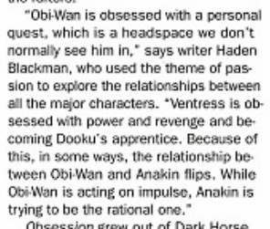

## scan p.33 (scan page 33)

Page contents: Ad: Brian's Toys (vintage and modern Star Wars toys, maquettes, prop replicas, vintage carded items). (hand-read)

## scan p.34 (scan page 34)

Page contents: Drawn by the Force continued (Daniel Wallace): Obsession ties up loose ends for Asajj Ventress, Durge and ARC trooper Alpha; artist Brian Ching on Revenge of the Sith reference art; post-Episode III plans fluid. Sidebar "Battles, Bite-Sized": Clone Wars Adventures digest series (Haden Blackman, Welles Hartley, the Fillbach Brothers, Ben Caldwell). (hand-read)

- **none** — entry/section: Vehicle designs: ""Dark Horse sent me [reference art] from every possible angle, and I was just blown away. I haven't been that excited about the vehicle designs since seeing the snowspeeders in The Empire Strikes Back—probably my favorite vehicles of all time." —Brian Ching, Star Wars Insider 79, p. 34" Source: *Star Wars Insider #79* (2005), scan p.34
  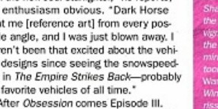

## scan p.35 (scan page 35)

Page contents: Ad: Afterglow Pro controllers for Xbox, PlayStation 2 and GameCube. (hand-read)

## scan p.36 (scan page 36)

Page contents: Feature "The Wookiees Walk Amongst Us" by Brett Rector (photos Derryck Menere and Paul Tiller): Revenge of the Sith's Kashyyyk; interviews with Peter Mayhew and newcomer Axel Dench. Opening spread of Wookiee warriors with bowcasters. (hand-read)

## scan p.37 (scan page 37)

Page contents: Peter Mayhew interview: called by Rick McCallum; costume fittings with McCallum "the ultimate fanboy"; reprising Chewbacca. (hand-read)

- **Chewbacca** — entry/section: Now that's a Wookiee: ""When we finally got the costume done, we went to George to get his approval and Rick walked in and said, 'There he is—now that's a Wookiee.'" —Peter Mayhew, Star Wars Insider 79, p. 37" Source: *Star Wars Insider #79* (2005), scan p.37
  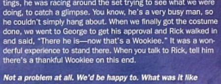
- **Chewbacca** — entry/section: Bridging the trilogies: ""He's a very comforting character. Chewie is one of the connections that helps bridge the gap between Episodes III and IV." —Peter Mayhew, Star Wars Insider 79, p. 37" Source: *Star Wars Insider #79* (2005), scan p.37
  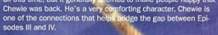

## scan p.38 (scan page 38)

Page contents: Mayhew interview continued: prequels vs. original films, bluescreen acting from memory, instant digital replay; getting into character; photos of Mayhew in makeup and the Chewbacca suit. (hand-read)

- **Chewbacca** — entry/section: Chewie came alive: ""As soon as I put the costume on, the character came out... The moment I put on the mask, I became the character—Chewie literally came alive. It was quite amazing." —Peter Mayhew, Star Wars Insider 79, p. 38" Source: *Star Wars Insider #79* (2005), scan p.38
  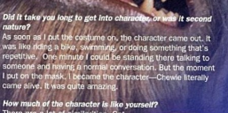
- **Chewbacca; Han Solo** — entry/section: Han's conscience: ""Like me, Chewie is very tolerant. I would never do anything unless I have a pretty good reason to do it. Not only that, he is also Han [Solo's] conscience." —Peter Mayhew, Star Wars Insider 79, p. 38" Source: *Star Wars Insider #79* (2005), scan p.38
  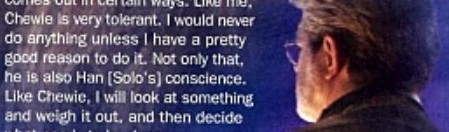

## scan p.39 (scan page 39)

Page contents: Mayhew interview concludes: the new suit's water-cooling tubes vs. the unventilated original; Lucas more assertive yet more relaxed; fans' reactions; Comic-Con title announcement by Steve Sansweet. Sidebar "The Wookiee From Down Under" begins: Australian basketball player Axel Dench (Wollongong Hawks) cast as a Wookiee for the Sydney shoot. (hand-read)

### Stat block notes (game mechanics, not feats)

- The new Chewbacca suit: For the new suit, there was a water-cooling system. There were two tubes that would wrap around my body that could be plugged into an ice pack with cold water in it. (Star Wars Insider 79, p. 39) (Source: *Star Wars Insider #79* (2005), scan p.39)

## scan p.40 (scan page 40)

Page contents: Axel Dench interview continued: a fan since childhood, favorite film A New Hope; no acting experience; body cast in plaster and the mask cast; favorite character growing up was Han Solo. (hand-read)

- **Han Solo** — entry/section: Dench on Han: ""Actually, no—my favorite character growing up was Han Solo. I mean, Luke had command of the Force, but Han lived the life—he teetered on the edge, in that gray area." —Axel Dench, Star Wars Insider 79, p. 40" Source: *Star Wars Insider #79* (2005), scan p.40
  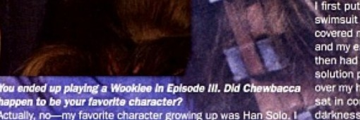

## scan p.41 (scan page 41)

Page contents: Dench interview concludes: the suit scared a creature-shop worker to tears; filming pushed from September 2003 to May 2004 so Lucas could expand the Wookiee roles; standing ovation; blasters up to five feet long and a 9-foot staff; as chief Wookiee he was later stripped of chieftain armor and filmed as a generic Wookiee in groups of six; worked with First Assistant Director Colin Fletcher. (hand-read)

### Stat block notes (game mechanics, not feats)

- Wookiee chieftain multiplied: As the chief Wookiee, I did most of my scenes alone. However, I was stripped of my chieftain armor and made into a generic Wookiee. For that, there were six of us filmed at a time, in varying positions, so that we could be morphed at a later date into a pack—we'll be made to look like there are hundreds of us. (Star Wars Insider 79, p. 41) (Source: *Star Wars Insider #79* (2005), scan p.41)

## scan p.42 (scan page 42)

Page contents: Feature "Kashyyyk Realized" by Brett Rector: Senior Concept Designer Ryan Church on designing the Wookiee homeworld; his path from ILM Digital Features to Attack of the Clones (AT-TE and Hailfire droid tank designs); working with Erik Tiemens. (hand-read)

## scan p.43 (scan page 43)

Page contents: Kashyyyk Realized continued: full-page concept art of a Wookiee warrior swinging on a vine with a staff over a treehouse village; Lucas's request for Clone Wars planets. (hand-read)

- **none** — entry/section: Kashyyyk's first painting: ""We immediately asked if Kashyyyk could be one of them, and he said 'Sure, show me something.' So that first week I did a painting that showed a big leaning tree adorned with wooden architecture hanging over a river with little waterfalls." —Ryan Church, Star Wars Insider 79, p. 43" Source: *Star Wars Insider #79* (2005), scan p.43
  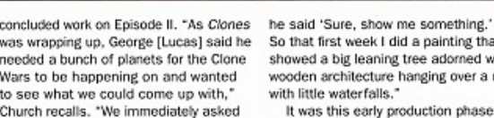

## scan p.44 (scan page 44)

Page contents: Kashyyyk Realized continued: freeform team process; initial tropical Tahiti/Hawaii concept shifted to a colder, more monochromatic look; science fantasy referring to Earth; Wookiees are technologically advanced, not primitive. Concept art of Wookiee catamaran-style craft and interiors. (hand-read)

- **none** — entry/section: Wookiee architecture: ""I imagined that they would be like Frank Lloyd Wright—master craftsmen—and that their architecture would be brushed aluminum integrated into wood, similar to what you'd find in the interior of a nice luxury car." —Ryan Church, Star Wars Insider 79, p. 44" Source: *Star Wars Insider #79* (2005), scan p.44
  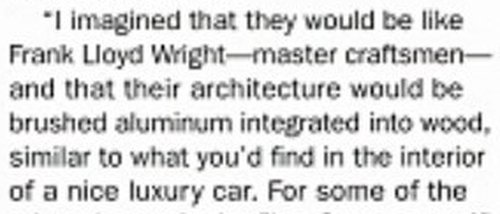

### Stat block notes (game mechanics, not feats)

- Wookiee technology: First and foremost, the Wookiees are very technologically advanced and very high-tech in every way. They're not supposed to be primitive, which meant no torches or huts. (Star Wars Insider 79, p. 44) (Source: *Star Wars Insider #79* (2005), scan p.44)

## scan p.45 (scan page 45)

Page contents: Ad: Gizmotech.com computers and electronics with Star Wars rewards program. (hand-read)

## scan p.46 (scan page 46)

Page contents: Kashyyyk Realized concludes: no right angles or panel lines, asymmetrical oval floor plans; the saxophone as design filter; the Wookiee Dragonfly ornithopter inspired by 1930s speedboats and American Chopper, crewed by two Wookiees; a city built around a thousand-foot-tall tree. (hand-read)

- **none** — entry/section: Kashyyyk's tree city: ""I wanted to create something I would think was cool when I was a kid, and I can't think of anything cooler than a city built around a thousand-foot-tall tree—it's like the ultimate treehouse." —Ryan Church, Star Wars Insider 79, p. 46" Source: *Star Wars Insider #79* (2005), scan p.46
  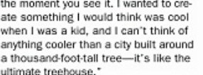

### Stat block notes (game mechanics, not feats)

- Wookiee Dragonfly: "The Dragonfly is basically a flying motorcycle, but it has its own aesthetic," complete with chrome, brushed aluminum, and wood. (Star Wars Insider 79, p. 46) (Source: *Star Wars Insider #79* (2005), scan p.46)

## scan p.47 (scan page 47)

Page contents: Ad: The Anthony Grandio Company Star Wars checks, checkbook covers and address labels. (hand-read)

## scan p.48 (scan page 48)

Page contents: Technical Readout Set Piece "Theed Royal Palace: A Marble-ous Place To Live!" (Chris Trevas): Reggia Palace in Caserta, Italy, filmed July 1997 for Episode I and again September 2000 for Episode II; pressure-fitted doors, digital removal of candelabras; Gavin Bocquet's studio hallway for the final firefight. Sidebars: Ed Natividad's throne and table; battle droid walk. (hand-read)

- **none** — entry/section: Choosing Caserta: ""When we started to scout for locations, we looked in various countries and cities, but Caserta was one of the most beautiful palaces on the planet, and once we saw this, there was no question that we wanted to shoot here," said Lucas at a Caserta press conference. —George Lucas, Star Wars Insider 79, p. 48" Source: *Star Wars Insider #79* (2005), scan p.48
  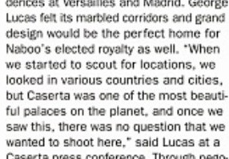

### Stat block notes (game mechanics, not feats)

- Battle droid duck walk: The somewhat bowlegged walk of the battle droids was based on the gait of Sound Designer Ben Burtt. Burtt wore a motion capture suit at ILM to record movement for the droids. When his actions were applied to the computer model, the rotation of the tiny droid waist exaggerated them into a "duck walk" that George Lucas liked. (Star Wars Insider 79, p. 48) (Source: *Star Wars Insider #79* (2005), scan p.48)

## scan p.49 (scan page 49)

Page contents: Set Piece continued (header quote "Now Viceroy, we will discuss a new treaty." —Queen Amidala): annotated throne room scene; security battle droids with maroon markings; Panaka's "radishlike" comlink holder; Portman's sprained ankle; only a handful of the palace's 1200 rooms used. (hand-read)

### Stat block notes (game mechanics, not feats)

- The Queen's pistol: George Lucas himself designed the Queen's pistol. During the prop department's first week, he drew a sketch right on the workbench, and the team created it that day. Alternate versions with shorter barrels were made for concealment within the throne. (Star Wars Insider 79, p. 49) (Source: *Star Wars Insider #79* (2005), scan p.49)
- Cooling the Neimoidians: Between takes, the masked actors Silas Carson and Jerome Blake (Nute Gunray and Rune Haako respectively) were cooled by air pumped through a tube into their Neimoidian mouths. (Star Wars Insider 79, p. 49) (Source: *Star Wars Insider #79* (2005), scan p.49)
- The Queen's throne: The Queen's throne is the ultimate seat of power with built-in remote control and hidden compartments in case of emergency. (Star Wars Insider 79, p. 49) (Source: *Star Wars Insider #79* (2005), scan p.49)

## scan p.50 (scan page 50)

Page contents: Artist's Profile "An Interview with Ralph McQuarrie—Part 3" (opening text): McQuarrie's matte painting work on A New Hope and Empire; prior CBS 1969 moon landing paintings; teamed with Harrison Ellenshaw. (hand-read)

## scan p.51 (scan page 51)

Page contents: McQuarrie Part 3 title page: Return of the Jedi painting of Jabba's throne room (Jabba, Salacious Crumb, Bib Fortuna, a Gamorrean guard) with an inset photo of McQuarrie painting. (hand-read)

## scan p.52 (scan page 52)

Page contents: McQuarrie Part 3 continues: matte paintings kept impressionistic; the opening Star Destroyer Devastator over Tatooine; painted small (about four inches wide) versus the six-foot standard; drove paintings strapped to his car roof to ILM in Van Nuys; detailed matte process; the Death Star approach shot problem. (hand-read)

## scan p.53 (scan page 53)

Page contents: McQuarrie Part 3: the Death Star approach solved with a painted plastic sphere and 3D dish model; upwards of 40 Empire mattes painted at ILM in northern California; his favorite matte (Han's arrival in Cloud City); no mattes for Return of the Jedi; Jabba's domain, speeder bikes and Ewoks from his imagination. (hand-read)

- **Han Solo** — entry/section: McQuarrie's favorite matte painting: ""It's the one that shows the arrival of Han Solo in Cloud City at twilight with the Millennium Falcon in the center of that big ramp that's extending out of [one of the landing platforms]," he says fondly. —Ralph McQuarrie, Star Wars Insider 79, p. 53" Source: *Star Wars Insider #79* (2005), scan p.53
  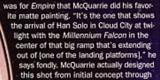

## scan p.54 (scan page 54)

Page contents: McQuarrie Part 3: Jabba's castle design (cylindrical forms; inspiration from Gene Autry serial The Phantom Empire and The Wizard of Oz); interior drawings; Jabba's sail barge evolved from a Mississippi riverboat idea; subconscious design process. (hand-read)

## scan p.55 (scan page 55)

Page contents: McQuarrie Part 3 concludes: the original plank-walk barge illustration; where Tatooine's wood came from; speeder bike sketches; the redwood speeder chase painting inspired by Dennis Muren's undercranked Steadicam Muir Woods plate; his early Ewok designs; retired with palsy; legacy. (hand-read)

- **Wicket W. Warrick** — entry/section: McQuarrie's Ewoks: ""I'd drawn some little creatures with long-haired, fuzzy, golden-furred heads and doglike snouts that I liked pretty well," he recalls. "I think the animal forms I had in mind were perhaps a problem to animate, but I thought that they would be a little more believable." —Ralph McQuarrie, Star Wars Insider 79, p. 55" Source: *Star Wars Insider #79* (2005), scan p.55
  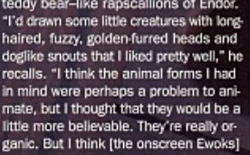
- **none** — entry/section: McQuarrie's legacy: ""I think it's a permanent fixture in the history of film. It was the most important thing I did." —Ralph McQuarrie, Star Wars Insider 79, p. 55" Source: *Star Wars Insider #79* (2005), scan p.55
  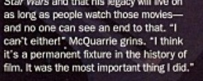

## scan p.56 (scan page 56)

Page contents: Ask the Master Q&A by Pablo Hidalgo, "Six Degrees of Antilles, and You Must Unlearn What You Have Learned": correction on Han's carbon-freezing shirt (correct on set, a lighting issue; Sterling Hedgpeth's dailies); Qui-Gon's voice in Yoda's Episode II meditation; Yuzzum vs. Yuzzem. (hand-read)

### Stat block notes (game mechanics, not feats)

- Qui-Gon's voice in Episode II: The voice is indeed Qui-Gon Jinn's—including the pained cry of "noooooo!" at the end. Somehow, the Jedi hero of Episode I has been able to retain his spirit in the netherworld as we see Obi-Wan, Yoda, and Anakin do in the original trilogy. (Star Wars Insider 79, p. 56) (Source: *Star Wars Insider #79* (2005), scan p.56)

## scan p.57 (scan page 57)

Page contents: Ask the Master continued: Yuzzem debuted in Splinter of the Mind's Eye and the wampa was once called a Yuzzem; the single Yuzzum puppet in Jabba's palace and CG Joh Yowza; Spotlight Question "Where There's a Whill..." (Yoda's species unknown; Journal of the Whills). (hand-read)

### Stat block notes (game mechanics, not feats)

- The wampa as Yuzzem: A callout points to a scored section of wall and says "Yuzzem to break through dotted area." The wampa ice creature was at one time called a Yuzzem. (Star Wars Insider 79, p. 57) (Source: *Star Wars Insider #79* (2005), scan p.57)
- Yoda's species: George Lucas, and he has been very consistent in keeping Yoda's backstory a mystery. He has not shared any information about Yoda's home planet or his species. ... When pressed on the subject, George will say Yoda is a frog and leave it at that. (Star Wars Insider 79, p. 57) (Source: *Star Wars Insider #79* (2005), scan p.57)
- Not a Whill: It's still too early to say just who or what the Whills really are, but we can say definitively that Yoda is not one of them. (Star Wars Insider 79, p. 57) (Source: *Star Wars Insider #79* (2005), scan p.57)

## scan p.58 (scan page 58)

Page contents: Ask the Master continued: the Empire crawl naming Luke (Rieekan technically in charge); the IT-O interrogation droid and the NPR radio dramatization of Leia's interrogation (Brock Peters, Ann Sachs); Sith synthetic lightsaber crystals; Obi-Wan aware of Leia; Lorne Peterson's Massassi lookout cameo. (hand-read)

### Stat block notes (game mechanics, not feats)

- The IT-O droid: Imperial designers would beam with pride at reading your letter—they designed the IT-O to look so terrifying that many of its victims confess before it ever lays a tool on them! There is a wide array of devices on the little floating orb, including sonic torture devices that inflict pain through sound waves (Star Wars Insider 79, p. 58) (Source: *Star Wars Insider #79* (2005), scan p.58)
- Sith lightsaber crystals: The more holistic Jedi prefer the strong connection to the Force created by the naturally occurring crystals. The Sith instead forge their crystals in furnaces, focusing their rage to affect the growth of the crystals, creating weapons better suited to their dark designs. (Star Wars Insider 79, p. 58) (Source: *Star Wars Insider #79* (2005), scan p.58)
- "That boy is our only hope": As you'll find out in Episode III, Obi-Wan Kenobi is fully aware of Leia's existence. His gloomy statement has more to do with the faith he had put in Luke. Knowing Leia's strengths in the political arenas, he had profound doubts about her abilities to become a Jedi (Star Wars Insider 79, p. 58) (Source: *Star Wars Insider #79* (2005), scan p.58)

## scan p.59 (scan page 59)

Page contents: Ask the Master concludes: Lorne Peterson's Episode I Podrace cameo; a Rebel in scout trooper armor outside the Endor bunker; reflected lights in an Empire shot (a controller, not Rieekan); Mara Jade's coomb spore infection by Nom Anor on Monor II; the Antilles surname; contact box. (hand-read)

### Stat block notes (game mechanics, not feats)

- Casting Captain Antilles: Captain Antilles is Alderaanian; Wedge Antilles is Corellian. No direct bloodline connects them. However, this was almost turned on its ear in Episode III. ... George Lucas entertained the idea of casting Lawson as Antilles, even though it didn't really line up with years of spin-off lore. Ewan McGregor called Lawson, his uncle, to discuss the part, but Lawson ultimately turned it down. (Star Wars Insider 79, p. 59) (Source: *Star Wars Insider #79* (2005), scan p.59)

## scan p.60 (scan page 60)

Page contents: Fiction title spread "Death in the Catacombs" by Mike W. Barr: illustration of a Jedi woman with green lightsaber and an armed man over a dead spiny beast in a cavern. (hand-read)

## scan p.61 (scan page 61)

Page contents: Death in the Catacombs: Jedi Knight Jyl Somtay, newly promoted after the Battle of Geonosis, survives a booby-trapped tunnel that kills a clone trooper; meditates in the Arena for her Master Lura Tranor and Coleman Trebor. (hand-read)

## scan p.62 (scan page 62)

Page contents: Death in the Catacombs: Jyl meets the scientist Dr. Frayne, who found processed metals (possible Geonosian technology) and gives her a gas-trapped prototype helmet. (hand-read)

## scan p.63 (scan page 63)

Page contents: Death in the Catacombs: Jyl wakes bound; Frayne introduces smuggler Naj Pandoor, then shoots him and Jyl; the two wake tied back-to-back underground. (hand-read)

## scan p.64 (scan page 64)

Page contents: Death in the Catacombs: in the dark pit Geonosians close in; Jyl springs up and swings the shackled Pandoor into the attackers; sonic blasters flash. (hand-read)

## scan p.65 (scan page 65)

Page contents: Death in the Catacombs: an overloaded sonic staff blasts them free; Pandoor bargains (a former Xenoarchaeology grad student at the University of Ketaris); at the empty lab they find Frayne's true coordinates. (hand-read)

## scan p.66 (scan page 66)

Page contents: Death in the Catacombs: they enter a hidden crevice beneath a stalagmite; find Frayne's head, rogas insects swarming her blood; Pandoor briefly holds Jyl's lightsaber before returning it. (hand-read)

## scan p.67 (scan page 67)

Page contents: Death in the Catacombs: a nexu attacks and wounds Jyl; Pandoor's blaster drives it off; they reach a hidden Geonosian weapons lab holding a strange device under transparisteel. (hand-read)

## scan p.68 (scan page 68)

Page contents: Death in the Catacombs: Frayne's gnawed skeleton; a litter of ten nexu cubs attack; Jyl kills one so the litter feeds on it. (hand-read)

## scan p.69 (scan page 69)

Page contents: Death in the Catacombs concludes: the device is a frequency-varying sonic weapon; Pandoor kisses Jyl then turns it on her; the rogas-maddened mother nexu attacks him; Jyl stuns both and drags Pandoor out, keeping her promise of a good word. (hand-read)

## scan p.70 (scan page 70)

Page contents: Scouting the Galaxy by Steve Sansweet, "Would I Take a Trip On The Way-Back Machine? Plus: How To Handle Dusty Vaders and Elan's Ears": fall DVD-tie-in retail exclusives (Wal-Mart, Sam's Club, Costco, Target), Playskool Galaxy Heroes and Jedi Force; Episode III toys on April 2; Revenge of the Sith promotional partners teased. (hand-read)

## scan p.71 (scan page 71)

Page contents: Scouting the Galaxy: 1994 A.H. Prismatic Millennium Falcon hologram and other hologram licensees (2-D Arts, Fantasma); Master Replicas' Luke ROTJ lightsaber (2500 made, $299 original, $500–$836 on eBay; a 750-piece version sold out in under half a day). (hand-read)

## scan p.72 (scan page 72)

Page contents: Scouting the Galaxy: how collecting changed from store visits and Starlog dealer catalogs (and Japanese friend Eimei Takeda) to online and eBay; dusting open-air Vader displays with a feather duster and compressed gas. (hand-read)

- **none** — entry/section: Collecting goes online: ""Today, time is more compressed, we're all a lot busier, and most collecting is done online. I find out the latest news of what's on the shelves by going online—and eBay is my nightly entertainment, not television." —Steve Sansweet, Star Wars Insider 79, p. 72" Source: *Star Wars Insider #79* (2005), scan p.72
  

## scan p.73 (scan page 73)

Page contents: Scouting the Galaxy concludes: correction that Hasbro resculpted Elan Sleazebaggano's head so hair covered his ears; fan-made costumes via the 501st Legion and Rebel group; contact box. (hand-read)

- **Elan Sleazebaggano** — entry/section: Elan's ears correction: ""I hang my head low, but it's true that I hadn't remembered that Hasbro did indeed resculpt Elan's head so hair covered his ears...so wasn't I right for the wrong reasons?" —Steve Sansweet, Star Wars Insider 79, p. 73" Source: *Star Wars Insider #79* (2005), scan p.73
  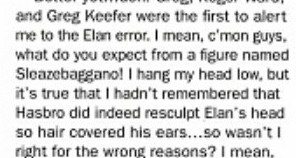

## scan p.74 (scan page 74)

Page contents: Anchorhead Arcade, "Star Wars Galaxies: Jump To Lightspeed": space expansion with four professions (Rebel/Imperial pilots, Privateers, Shipwrights), ship crafting and customization, loot-driven space, new ships (TIE Oppressor, TIE Aggressor), non-flyable capital ships, real-time combat, newbie zones; associate producer Julio Torres. (hand-read)

- **none** — entry/section: New ships become canon: ""If the concept gets approved, we then move to the model phase. An artist creates something that ends up as a Maya model, and then that model goes to the Ranch as well. If they approve that, then it becomes part of the game, and once it becomes published, it becomes part of the canon." —Julio Torres, Star Wars Insider 79, p. 74" Source: *Star Wars Insider #79* (2005), scan p.74
  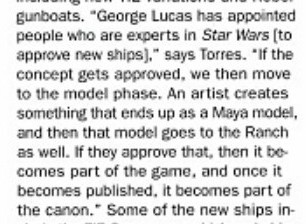

## scan p.75 (scan page 75)

Page contents: Jump to Lightspeed concludes (by Aki Sugawara): screenshots; pull quote on space combat; ground and space combined; top-right box "Go to starwars.com for more information on Star Wars games." (hand-read)

## scan p.76 (scan page 76)

Page contents: Jabba's Collection, "Episode III Toys: The Frenzy Is About To Begin": sneak preview products due February 1 ahead of the April 2005 line; Anakin's Jedi starfighter; Wookiee Super-Soaker blaster (35 feet); sneak preview action figures beginning with fan-chosen-color R4-G9. (hand-read)

### Stat block notes (game mechanics, not feats)

- Wookiee Super-Soaker: Even if you don't happen to be seven feet tall and covered with hair, you can still act like a Wookiee while wielding this blaster, which has been modeled after one of the weapons seen during the epic battle on Kashyyyk. (Star Wars Insider 79, p. 76) (Source: *Star Wars Insider #79* (2005), scan p.76)

## scan p.77 (scan page 77)

Page contents: Ad: GamePro ex subscription ($29.97). (hand-read)

## scan p.78 (scan page 78)

Page contents: Jabba's Collection continues: sneak preview figures (R4-G9 with Obi-Wan; a new film-based General Grievous; Tion Medon of Utapau; Wookiee Warrior), and sidebar "Making the Figure, Part I" (concept and development phases; squeeze-legs action features); top-right box "Go to starwars.com to see more Hasbro collectibles!" (hand-read)

### Stat block notes (game mechanics, not feats)

- Squeeze-leg action features: For the Revenge of the Sith products, squeezing the figures' legs together will activate most action features, which means no more buttons protruding from their bodies to mar the aesthetics. (Star Wars Insider 79, p. 78) (Source: *Star Wars Insider #79* (2005), scan p.78)
- Grievous figure resculpt: This sculpt is different than the one seen in Star Wars Insider 78 as it's based on the film version of the saga's latest bad guy. (Star Wars Insider 79, p. 78) (Source: *Star Wars Insider #79* (2005), scan p.78)
- Tion Medon figure: This figure is of an alien administrator from Utapau, one of several new planets seen in Episode III. (Star Wars Insider 79, p. 78) (Source: *Star Wars Insider #79* (2005), scan p.78)

## scan p.79 (scan page 79)

Page contents: Crossword "Headlines From The Tatooine Times Sports Page" (Star Wars sports-pun clues). (hand-read)

## scan p.80 (scan page 80)

Page contents: Best of Hyperspace "Didn't We Just Leave This Party?": Pablo Hidalgo's set diary of Episode III pickups in the U.K., August 23–September 3, 2004; Jonathan Rinzler; Hayden Christensen's catwalk "long walks" with the TechnoCrane; pull quote from Yoda on the dark path. (hand-read)

## scan p.81 (scan page 81)

Page contents: Hyperspace diary: Hayden's walks and the lightsaber-drag joke; Anakin running a new corridor; Ian McDiarmid reshoot for wardrobe continuity; Sidious shot; Jedi Masters Agen Kolar, Kit Fisto and Saesee Tiin on a gunship rostrum; Ewan with Yoda's lines; Tantive IV corridor intro; top-right box "Go to starwars.com for more Hyperspace." (hand-read)

- **Darth Vader (Anakin Skywalker)** — entry/section: "Wanton vandalism": ""How about I drag my lightsaber on the ground?" asks Hayden, trying to find a way to make this walkthrough more extreme or dangerous. "No, because then that would just be wanton vandalism," laughs George. —George Lucas, Star Wars Insider 79, p. 81" Source: *Star Wars Insider #79* (2005), scan p.81
  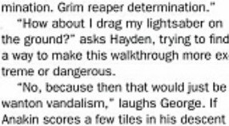
- **none** — entry/section: Episode III's structure: ""The first hour of the film is all fighting. The last hour of the film is all fighting. The middle is the gushy stuff," he smiles. —George Lucas, Star Wars Insider 79, p. 81" Source: *Star Wars Insider #79* (2005), scan p.81
  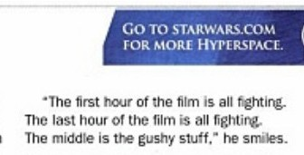

## scan p.82 (scan page 82)

Page contents: Hyperspace diary: the cramped 3168-square-foot Tantive IV cockpit set; Jeremy Bulloch as an Alderaanian pilot with Jimmy Smits and Ewan McGregor; Bail's Senate landing platform scene; Anthony Daniels pulled the stage vacuum as an R2 stand-in; Smits and Daniels wrap. (hand-read)

- **C-3PO** — entry/section: Daniels wraps: ""Thanks for the 30 years of adventure," says George Lucas to him, as they shake hands after Daniels' last take. —George Lucas, Star Wars Insider 79, p. 82" Source: *Star Wars Insider #79* (2005), scan p.82
  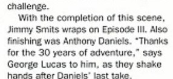

### Stat block notes (game mechanics, not feats)

- Bulloch's Alderaanian pilot: Jeremy Bulloch is the Alderaanian pilot for this shot. He has a single line of dialogue informing Senator Organa of an incoming transmission. ... Bulloch played Boba Fett in Episode V and VI, though his face wasn't seen in that role. (Star Wars Insider 79, p. 82) (Source: *Star Wars Insider #79* (2005), scan p.82)

## scan p.83 (scan page 83)

Page contents: Webdocs, "C-3PO: His Moment To Shine": quotes from Lucas, Anthony Daniels and Ewan McGregor on Threepio in Episode III. (hand-read)

- **C-3PO** — entry/section: Threepio's darker episode: ""Threepio has been the fall guy or sort of the funny guy throughout all of these movies. And humor has been very important to the saga. And in this one, there really isn't that much because this is a pretty dark episode." —Anthony Daniels, Star Wars Insider 79, p. 83" Source: *Star Wars Insider #79* (2005), scan p.83
  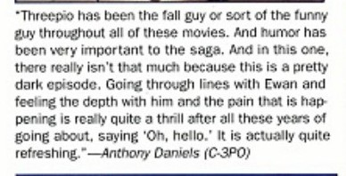
- **C-3PO** — entry/section: In his milieu: ""The great thing about Episode III is that he is in his milieu, for the first time he is golden." —Anthony Daniels, Star Wars Insider 79, p. 83" Source: *Star Wars Insider #79* (2005), scan p.83
  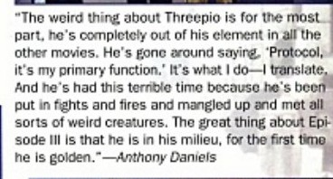

## scan p.84 (scan page 84)

Page contents: Best of Hyperspace: Webcam (pickup shoots at Shepperton Studios) and Photoreceptor archive photos (Fisher and Hamill's chasm swing; Chewbacca in Cloud City; Gary Kurtz and a cut Jedi test; Vader's single viewport set; Bob Anderson dueling Hamill; Owen Lars and the Jawas; Fisher on the sail barge), edited by Paul Ens, content by Pablo Hidalgo and Bonnie Burton; crossword answers. (hand-read)

### Stat block notes (game mechanics, not feats)

- Cut Jedi test: Producer Gary Kurtz inspects the filming of a Jedi test that would ultimately be cut out of Episode V. During Luke's training, Yoda would throw out metal bars that the young Jedi initiate would have to cut into pieces with his lightsaber before the object hit the ground. (Star Wars Insider 79, p. 84) (Source: *Star Wars Insider #79* (2005), scan p.84)
- Vader's viewport set: The minimal set used in Episode V had only a single viewport built into its upper deck, a design closely copied for a similar shot in Episode III. (Star Wars Insider 79, p. 84) (Source: *Star Wars Insider #79* (2005), scan p.84)

## scan p.85 (scan page 85)

Page contents: Photoreceptor photos (Luke and Leia; Vader vs. Luke on Bespin; Owen and Jawas; Leia on the sail barge). (hand-read)

## scan p.86 (scan page 86)

Page contents: Bantha Tracks Vol. 10 "Fan.Tastic Look at 2004": the first Star Wars Fan Club dinner in Seattle with Amy Allen and Michonne Bourriague; the relaunched Official Fan Club; Jedi-Con in Düsseldorf (Billy Dee Williams, Jay Laga'aia, Amy Allen) with Steve Sansweet. (hand-read)

## scan p.87 (scan page 87)

Page contents: Bantha Tracks 2004: Star Wars Encuentros in Mexico; WonderCon San Francisco; Toronto convention with Ray Park, Daniel Logan, Amy Allen, Michonne Bourriague, Shannon Baksa-McRandle; San Diego Comic-Con Lucasfilm pavilion. (hand-read)

## scan p.88 (scan page 88)

Page contents: Bantha Tracks 2004: Comic-Con Lucasfilm presentation announcing the Episode III title; fan X-wing reassembly; Fan Club breakfast with Howard Roffman, Steve Sansweet, Daniel Logan and Hasbro's Jeff Popper. (hand-read)

### Stat block notes (game mechanics, not feats)

- Revenge of the Sith title announced: Hayden Christensen, the actor who portrays Anakin Skywalker and Darth Vader, Producer Rick McCallum, and actress Carrie Fisher, who played Princess Leia Organa, all appeared onstage during Lucasfilm's presentation. Host Steve Sansweet capped the presentation by announcing the title of Episode III—Revenge of the Sith—to a thunderous welcome by the attending fans. (Star Wars Insider 79, p. 88) (Source: *Star Wars Insider #79* (2005), scan p.88)

## scan p.89 (scan page 89)

Page contents: Bantha Tracks 2004: Wizard World Chicago; Gen Con Indianapolis (Timothy Zahn and Michael Stackpole); Dragon*Con Atlanta; THX 1138 theatrical rerelease and DVD (September 10 and 14). (hand-read)

## scan p.90 (scan page 90)

Page contents: Bantha Tracks 2004: original trilogy DVD release September 21 with Best Buy midnight openings and boxed-set records; Darth Vader and stormtroopers at an Oakland Raiders game; photo credits. (hand-read)

## scan p.91 (scan page 91)

Page contents: Bantha Tracks: "November... More To Come!" (teaser trailer, Celebration III April 21–24, 2005, Indianapolis); The Way We Were (Chris Trevas with a 1981 Kenner Death Star Space Station); Editorial "The Saga Gets Better with Age" by Mary Franklin, Editor; submission guidelines. (hand-read)

- **none** — entry/section: The saga gets better with age: ""the film series cemented itself as a cultural icon. It's an icon that in the ensuing years has not gotten tired, but has grown richer and better with age." —Mary Franklin, Star Wars Insider 79, p. 91" Source: *Star Wars Insider #79* (2005), scan p.91
  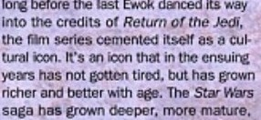

## scan p.92 (scan page 92)

Page contents: Laugh It Up, Fuzzball humor art: "Mos Eisley Cantina Presents Karaoke Night" with Chewbacca singing as Han, Luke, Ben and cantina aliens cover their ears. (hand-read)

## scan p.93 (scan page 93)

Page contents: StarWarsShop.com: limited-edition Jango Fett chrome mini-bust (formerly a Star Wars Credit Card Galactic Credits redemption). (hand-read)

- **Jango Fett** — entry/section: Star Wars Insider 079 (2005): "In the final years of the Republic, Jango Fett was regarded as the best bounty hunter In the galaxy." Source: *Star Wars Insider #79* (2005), scan p.93
  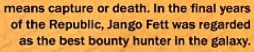

### Stat block notes (game mechanics, not feats)

- Jango chrome mini-bust copy: To those with the credits to hire him, his name is synonymous with success. To those with reasons to fear, Fett means capture or death. In the final years of the Republic, Jango Fett was regarded as the best bounty hunter in the galaxy. (Star Wars Insider 79, p. 93) (Source: *Star Wars Insider #79* (2005), scan p.93)

## scan p.94 (scan page 94)

Page contents: StarWarsShop.com Collector's Picks by a collector: Clone Wars Padmé maquette, Master Replicas stormtrooper blaster, Ewoks and Droids DVDs, rare Revenge of the Jedi pins, Clone Wars checkbook cover. (hand-read)

## scan p.95 (scan page 95)

Page contents: StarWarsShop.com catalog: LEGO set, Holiday Yoda figure, guitar, original trilogy game and more. (hand-read)

## scan p.96 (scan page 96)

Page contents: StarWarsShop.com catalog: Empire Fossil watch (500 made), framed 1983 Empire re-release one-sheet, Acme Archives "General Kenobi" Clone Wars sericel, KOTOR II, Dufex print, Master Replicas Luke X-wing helmet, Revenge of the Sith hat. (hand-read)

## scan p.97 (scan page 97)

Page contents: StarWarsShop.com catalog: Battlefront, Classic Star Wars box set, Revenge of the Sith sweatshirt, Vader and Maul .45 scale lightsabers, Yoda child's T-shirt, Vader mask. (hand-read)

## scan p.98 (scan page 98)

Page contents: StarWarsShop.com catalog: pens, key chains, Yoda PEZ, LEGO Millennium Falcon, Java Yoda mug, Unleashed wave 5, Chewbacca standee, pewter X-wing, trilogy DVD. (hand-read)

## scan p.99 (scan page 99)

Page contents: Ad: Star Wars Celebration III ("It Is Your Destiny"), April 21–24, 2005, with a free Darth Vader 3-in-1 topper for pre-registration. (hand-read)

## scan p.100 (scan page 100)

Page contents: Back cover ad: Wizards of the Coast Star Wars Trading Card Game Return of the Jedi expansion (110 cards, Hidden Cost mechanic). (hand-read)

