# Owner Material 038 — Star Wars Insider #1–153 plus specials (with The Lucasfilm Fan Club Magazine #1–22): Star Wars Insider #80 (2005)

- **Source:** *Star Wars Insider* magazine (issues 23–153, 1994–2014) and its predecessor *The Lucasfilm Fan Club Magazine* (issues 1–22, 1987–1994), plus seven special editions: articles, interviews, comics and short fiction Secondary source (licensed Legends reference). Scan OCR'd on the box; the scan stays box-only and is **not** published.
- **Method:** every scanned page was OCR'd and machine-screened sentence by sentence for power-relevant statements (fights, kills, defeats, Force feats, rankings, superweapons) that name a character on our roster; each kept sentence is quoted verbatim from the OCR text and has a crop of the printed passage directly under it. Pages with nothing power-relevant are still listed with what is on them.
- **Citation:** "*Star Wars Insider #80* (2005), p.X" by printed page ("scan p.X" where no printed number applies). **Weight:** Licensed magazine: a secondary source. Its short fiction and comics are Legends stories; its articles and interviews sum up or discuss lore and rank below the novels, comics and games they describe.

## scan p.1 (scan page 1)

Page contents: Cover, issue 80, March/April 2005: Clone Wars Season 2 (Anakin and Obi-Wan) with Genndy Tartakovsky and Paul Rudish interview; Episode III Update; Jedi vs. Sith (Samuel L. Jackson and Christopher Lee interviews); Mandalorian 101; Republic Commando banner; Bantha Tracks fan art; display until March 28, 2005. (hand-read)

## scan p.2 (scan page 2)

Page contents: Ad: Cloud City Collectibles (rare figures and Star Wars items), Norcross, GA. (hand-read)

## scan p.3 (scan page 3)

Page contents: Contents: Clone Wars art interview (Genndy Tartakovsky, Paul Rudish), Episode III update, History of the Mandalorians, General Grievous by Chuck Dixon, Samuel L. Jackson ("Straight from the Hip" by Brett Rector), The Journey of Count Dooku (Christopher Lee), The Unseen Planets by Daniel Wallace, Drawn by the Force, Technical Readout, Ask the Master, Scouting the Galaxy, Hasbro Toy Fair 2005 preview, Republic Commando. (hand-read)

## scan p.4 (scan page 4)

Page contents: Editorial by Brett Rector, Editor-in-Chief (2005: Revenge of the Sith, Celebration III, Clone Wars season two starting March 24; Lucas says the saga will live on in other media); masthead; statement of ownership. (hand-read)

- **Mace Windu; Obi-Wan Kenobi** — entry/section: Rector on Clone Wars season one: ""It really doesn't get much better than seeing Obi-Wan Kenobi take to the battlefield dressed in clone trooper armor or witnessing Mace Windu barehandedly beat the bolts out of a few thousand super battle droids." —Brett Rector, Star Wars Insider 80, p. 4" Source: *Star Wars Insider #80* (2005), scan p.4
  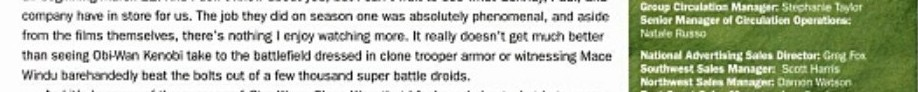

## scan p.5 (scan page 5)

Page contents: Ad: 3 Day Blinds Star Wars custom window coverings. (hand-read)

## scan p.6 (scan page 6)

Page contents: Letters (Comlink): handmade Star Wars quilt; "Set Piece" praise (Lott Dod in the Geonosian war room); C-3PO keeps getting taken apart (Anthony Daniels is fine); requests to revive Rob Coleman's "Behind the Magic"; Holiday Special on DVD (no magic could correct its ailments); crossword reprint apology, two puzzles promised for issue 81. Letter writers' names omitted. (hand-read)

## scan p.7 (scan page 7)

Page contents: Ad: Hasbro Unleashed IG-88, Aurra Sing, Stormtrooper. (hand-read)

## scan p.8 (scan page 8)

Page contents: Ad: Star Wars Republic Commando (lead an elite squad of Republic Commandos). (hand-read)

## scan p.9 (scan page 9)

Page contents: Ad: Republic Commando continued (15+ levels, single/multiplayer, from the upcoming film). (hand-read)

## scan p.10 (scan page 10)

Page contents: Prequel Update: interview with Producer Rick McCallum — final cut One and final cut Two, about 1000 ILM shots left, 60–70 dailies a week; Roger Guyett supervised filming of the Mustafar volcano miniature for the final duel. (hand-read)

- **none** — entry/section: Final cut One and Two: ""George has finished the final-cut of the film, which is what he refers to as final cut One, and the next one will be final cut Two. It's a system that doesn't make sense on any level other than the fact that George still wants to make various adjustments here and there." —Rick McCallum, Star Wars Insider 80, p. 10" Source: *Star Wars Insider #80* (2005), scan p.10
  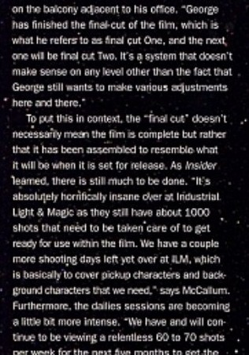
- **none** — entry/section: 1000 shots left at ILM: ""It's absolutely horrifically insane over at Industrial Light & Magic as they still have about 1000 shots that need to be taken care of to get ready for use within the film." —Rick McCallum, Star Wars Insider 80, p. 10" Source: *Star Wars Insider #80* (2005), scan p.10
  

### Stat block notes (game mechanics, not feats)

- Mustafar volcano shoot: If that weren't enough, it also fell on ILM's shoulders to film the lava-spewing Mustafar volcano, which will serve as the setting for the final epic lightsaber duel between Anakin Skywalker and Obi-Wan Kenobi. (Star Wars Insider 80, p. 10) (Source: *Star Wars Insider #80* (2005), scan p.10)

## scan p.11 (scan page 11)

Page contents: Photo: Anakin's and Obi-Wan's Jedi starfighters lead the charge against Separatist forces above Coruscant. (hand-read)

## scan p.12 (scan page 12)

Page contents: McCallum on the volcano miniatures and lava work; Kashyyyk backdrops and tree model completed with a crew sent halfway around the world. (hand-read)

- **none** — entry/section: ILM's lava work: ""The miniatures looked spectacular—it was beautifully photographed. The team came through with the most outstanding lava work I've ever seen. Without a doubt, it was ILM at its absolute finest" —Rick McCallum, Star Wars Insider 80, p. 12" Source: *Star Wars Insider #80* (2005), scan p.12
  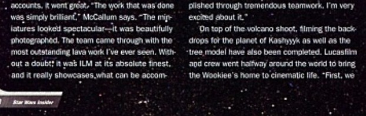

## scan p.13 (scan page 13)

Page contents: McCallum: Kashyyyk aerials shot in Thailand (cinematographer Ron Fricke) and backgrounds in China; Guyett headed the tree-model shoot; pickups with Hayden Christensen and Natalie Portman at Elstree Studios at the end of January. Captions: Obi-Wan lands on Mustafar; Anakin fights aboard the Trade Federation cruiser. (hand-read)

- **Chewbacca** — entry/section: Kashyyyk shoot: ""we shot in Thailand for the aerial views, then we shot in China for all the backgrounds—and they look absolutely fantastic. I think audiences will be very happy with the work we're putting into bringing Kashyyyk alive. It's a great little sequence," —Rick McCallum, Star Wars Insider 80, p. 13" Source: *Star Wars Insider #80* (2005), scan p.13
  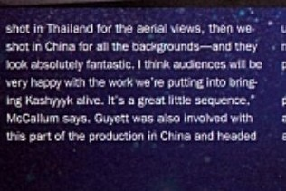

## scan p.14 (scan page 14)

Page contents: Episode III photos: Palpatine freed from his shackles in the General's Quarters; Anakin wakes from a nightmare about his pregnant wife Padmé; a Trade Federation cruiser crash-lands on Coruscant with fire ships nearby. (hand-read)

## scan p.15 (scan page 15)

Page contents: Episode III photos: Bail Organa (Jimmy Smits) in the Senate; Anakin and Obi-Wan fight battle droids in a cruiser hangar; Republic cruiser under fire. (hand-read)

## scan p.16 (scan page 16)

Page contents: Episode III photos: Tion Medon (Bruce Spence) with Obi-Wan; General Grievous and his bodyguards. McCallum on continuity pickups, Ben Burtt finalizing effects at Skywalker Sound, and John Williams writing the score, with scoring in early February. (hand-read)

- **none** — entry/section: John Williams writing: ""He's writing like mad. Actually, that's another front that's kicking it into high gear. He will write right up until they start the actual scoring of the film, which will happen at the very beginning of February," explains McCallum. "He's crazed and in the middle of it right now." —Rick McCallum, Star Wars Insider 80, p. 16" Source: *Star Wars Insider #80* (2005), scan p.16
  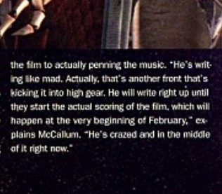

### Stat block notes (game mechanics, not feats)

- Tion Medon caption: Tion Medon (Bruce Spence), the prime minister of Utapau, gives some important information to Jedi Obi-Wan Kenobi.—Digital work by ILM (Star Wars Insider 80, p. 16) (Source: *Star Wars Insider #80* (2005), scan p.16)

## scan p.17 (scan page 17)

Page contents: Pull quote on Skywalker Sound; issue 81 will carry McCallum's last update; caption: Obi-Wan finds super battle droids are no pushovers. (hand-read)

## scan p.18 (scan page 18)

Page contents: News: ten charities for Episode III benefit premieres on May 12 (release May 19); THQ Wireless multiyear mobile deal (Casey Collins quote); Clone Wars Volume One DVD March 22 and season two premiere March 21–25; Lucasfilm at Comic-Con 2005; Harrison Ford visits a Renton, Washington company after a charity auction. (hand-read)

- **none** — entry/section: Lucas on premiere charities: ""These charitable organizations are the leaders in direct services and advocacy for children and families," said George Lucas. "I'm delighted that the screenings can help these amazing organizations, which do such important work." —George Lucas, Star Wars Insider 80, p. 18" Source: *Star Wars Insider #80* (2005), scan p.18
  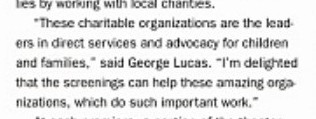

## scan p.19 (scan page 19)

Page contents: Ad: Hyperspace / Official Star Wars Fan Club membership (letter from George Lucas in the kit). (hand-read)

## scan p.20 (scan page 20)

Page contents: Celebration III news (April 21–24, 2005, Indiana Convention Center): Charlie Ross's "One Man Star Wars Trilogy"; Kids' Room (Iain McCaig drawing classes); autograph hall in Exhibit Hall A (Daniel Logan, Jeremy Bulloch); checklist (badges, hotel, Fan Film Awards, free Darth Vader topper). (hand-read)

## scan p.21 (scan page 21)

Page contents: Ad: Master Replicas — Princess Leia blaster LE ($399, 2500 pieces), Rebel snowspeeder ($599, 1500 pieces), Rebel fleet blaster LE ($449); "Echo Station 5-7, we're on our way." —Luke Skywalker. (hand-read)

## scan p.22 (scan page 22)

Page contents: Books: James Luceno on Labyrinth of Evil (Del Rey, $25.95) — Obi-Wan and Anakin, Jedi investigators hunting Sidious on Coruscant, Grievous's raid; Matthew Stover's Revenge of the Sith novelization; Lucas answers via Stover; Grievous changed from first conception; light moments as homage to the original trilogy; Dark Lord upcoming; by Jason Fry. (hand-read)

- **none** — entry/section: Luceno on homage: ""I wanted to pay homage to the original trilogy," he says, noting that Labyrinth was the overall saga's last chance for a smile or two: There's "not a lot of room for humor or lightness" in Revenge of the Sith, he says. —James Luceno, Star Wars Insider 80, p. 22" Source: *Star Wars Insider #80* (2005), scan p.22
  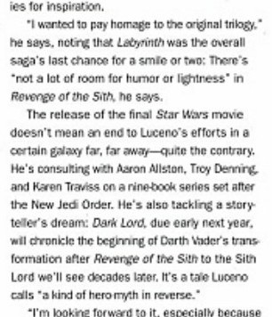

### Stat block notes (game mechanics, not feats)

- Dark Lord announced: He's also tackling a storyteller's dream: Dark Lord, due early next year, will chronicle the beginning of Darth Vader's transformation after Revenge of the Sith to the Sith Lord we'll see decades later. It's a tale Luceno calls "a kind of hero-myth in reverse." (Star Wars Insider 80, p. 22) (Source: *Star Wars Insider #80* (2005), scan p.22)

## scan p.23 (scan page 23)

Page contents: Ad: Star Wars Celebration III, April 21–24, 2005 (free Darth Vader topper with a 4-day badge). (hand-read)

## scan p.24 (scan page 24)

Page contents: Comics: "Here Comes General Grievous" — Chuck Dixon writes the four-issue Dark Horse General Grievous series (art by Rick Leonardi), Grievous razing the Ugnaught homeworld and battling vigilante Jedi; sidebars on Empire Volume 4 (Leia) and Clone Wars Adventures Volume 3; by Daniel Wallace. (hand-read)

- **General Grievous; Darth Vader (Anakin Skywalker)** — entry/section: Dixon: truly mean: ""He's truly, truly mean," says Dixon of his subject. "I think Darth Vader at least had some redeeming characteristics. After all, his fondest wish was for his kids to come into the family business. What's so bad about that?" —Chuck Dixon, Star Wars Insider 80, p. 24" Source: *Star Wars Insider #80* (2005), scan p.24
  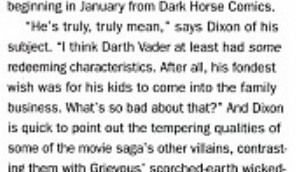
- **General Grievous** — entry/section: Dixon: Terminator and Phantom: ""I suppose he's somewhat like the Terminator but with more free will and lots more personality," he muses. "[And] a touch of the Phantom of the Opera. He also seems to be more of his own man than other Star Wars villains. Well, half of his own man." —Chuck Dixon, Star Wars Insider 80, p. 24" Source: *Star Wars Insider #80* (2005), scan p.24
  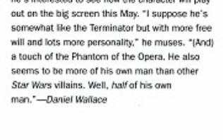

## scan p.25 (scan page 25)

Page contents: Grievous comic art with pull quote on Grievous enjoying being nasty; link to starwars.com comics. (hand-read)

## scan p.26 (scan page 26)

Page contents: "The History of the Mandalorians: Exploring the evolution of a mighty race of warriors" by Abel G. Peña, illustrated by Joe Corroney: Empire Strikes Back novelization armor line; original gray-skinned species possibly descended from the Taung; Mandalore the First and the mythosaurs; crest is not a bantha skull; Mandalorian Crusaders 4000–5000 BBY and the Canons of Honor. (hand-read)

### Stat block notes (game mechanics, not feats)

- Fett's armor in the ESB novelization: Then The Empire Strikes Back novelization teased us when it described Fett's armor as "the kind worn by a group of evil warriors defeated by the Jedi Knights during the Clone Wars." (Star Wars Insider 80, p. 26) (Source: *Star Wars Insider #80* (2005), scan p.26)

## scan p.27 (scan page 27)

Page contents: Mandalorian title art by Joe Corroney (Jango Fett, Boba Fett, Slave I, and others). (hand-read)

## scan p.28 (scan page 28)

Page contents: Mandalorian Crusaders' crusades (Fenelar, Tlinians, Kuarans, Ithullans eradicated; Mandallian Giants survived), the Great Sith War, Neo-Crusaders accepting other species. (hand-read)

## scan p.29 (scan page 29)

Page contents: Mandalorian Wars and the Mandalorian Mercs (Canderous Ordo, Ung Kusp); Jaster Mereel and the supercommando Codex; Vizsla and the Death Watch; the civil war and Galidraan; Jango as the sole True Mandalorian; Alpha-02's Mandalorian Protectors in the Clone Wars; Tobbi Dala and Fenn Shysa. (hand-read)

- **Jango Fett** — entry/section: The Mandalorian tradition survives: "Jango died as the Clone Wars began, but thanks to one of his clones, the Mandalorian tradition survived." Source: *Star Wars Insider #80* (2005), scan p.29
  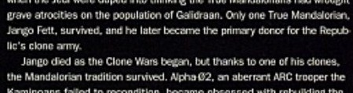

### Stat block notes (game mechanics, not feats)

- Jaster Mereel and the Codex: As a former Journeyman Protector, Mereel brought a strong ethic that extended far beyond the limited Mandalorian ideology of fighting for credits. His prowess in combat earned him the respect of his peers, and when Mereel fought tooth-and-nail to become reigning Mandalore and unite the disparate clans, his ideals became the foundation of a new creed: the supercommando Codex. (Star Wars Insider 80, p. 29) (Source: *Star Wars Insider #80* (2005), scan p.29)
- Galidraan: The latter, though, were totally wiped out when the Jedi were duped into thinking the True Mandalorians had wrought grave atrocities on the population of Galidraan. Only one True Mandalorian, Jango Fett, survived, and he later became the primary donor for the Republic's clone army. (Star Wars Insider 80, p. 29) (Source: *Star Wars Insider #80* (2005), scan p.29)

## scan p.30 (scan page 30)

Page contents: Character profiles: Alyn Vel; Alpha-02 "Spar" (aberrant ARC trooper, Mandalore the Resurrector); Tobbi Dala and Fenn Shysa; Alfreda Goot and Feskitt Bobb. (hand-read)

### Stat block notes (game mechanics, not feats)

- Spar the aberrant clone: An average of 3.5 in every 100 Kaminoan clones manifest abnormal mental or emotional tendencies. These aberrant clones always undergo careful reconditioning. Always, that is, except in the case of ARC trooper Alpha-02. (Star Wars Insider 80, p. 30) (Source: *Star Wars Insider #80* (2005), scan p.30)
- Shysa's death: After almost 20 years, an aging Fenn Shysa finally rejoined his childhood chum when, in an unexpected turn of events, Shysa gave his life on the planet Shogun saving Boba Fett from death. (Star Wars Insider 80, p. 30) (Source: *Star Wars Insider #80* (2005), scan p.30)

## scan p.31 (scan page 31)

Page contents: Profiles: Feskitt Bobb, Jodo Kast (impersonated Boba Fett); Mandalorian shock trooper armor (Crusader armor, Zim Systems rocket pack, Mitrinomon Z-6 jetpack). (hand-read)

### Stat block notes (game mechanics, not feats)

- Crusader armor and the Senate Guard: Crusader armor was organic in appearance and could vary considerably from one soldier to the next. However, for their holy wars on the Republic, Mandalorian armor became more uniform. Still lacking the plethora of weaponry of later shock trooper generations, the bulky armor of the Mandalorian Wars' Neo-Crusaders was sleek and seen in a variety of colors. Ironically, this armor later inspired Republic Senate Guard designs. (Star Wars Insider 80, p. 31) (Source: *Star Wars Insider #80* (2005), scan p.31)

## scan p.32 (scan page 32)

Page contents: Set Piece: Jango Fett's apartment on Kamino ("A Stark Space for a Simple Man") — the set at Fox Studios Australia; Lucas directs Daniel Logan's suspicious look (McGregor's whispered advice); furniture built slightly higher for seven-foot Kaminoans (set decorator Peter Walpole: not "the Land of the Giants"); white decor ties to clone and stormtrooper armor; Lucas rejected white armor for Jango. (hand-read)

- **Jango Fett; Boba Fett** — entry/section: Lucas on Jango's armor: "Lucas soon felt that white still wasn't right for Jango in this film: "It looked too slick. I needed something a little rougher than that but still reminiscent of the stormtroopers." —George Lucas, Star Wars Insider 80, p. 32" Source: *Star Wars Insider #80* (2005), scan p.32
  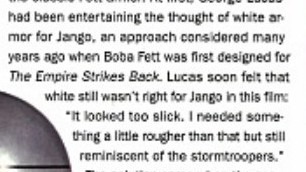

## scan p.33 (scan page 33)

Page contents: Set Piece captions: Daniel Logan (13, New Zealand) on McGregor; Obi-Wan's grown hair and beard; Temuera Morrison once chased Harrison Ford in Six Days Seven Nights; Jango was not the first name considered; armor finish and hero suits. (hand-read)

### Stat block notes (game mechanics, not feats)

- Jango's armor build: The costume department achieved the brushed metal finish of Jango's armor by adding aluminum powder to fiberglass. A total of four hero versions of the armor were made for close-ups, each consisting of 25 separate pieces. (Star Wars Insider 80, p. 33) (Source: *Star Wars Insider #80* (2005), scan p.33)

## scan p.34 (scan page 34)

Page contents: "Drawn by the Force" by Brett Rector: interview with Genndy Tartakovsky and Paul Rudish — Emmy Award for the 20-episode Clone Wars microseries; season two airs March 21–25 in five 12-minute episodes; Genndy's 1996 dream-project answer; freedom from Lucasfilm. (hand-read)

## scan p.35 (scan page 35)

Page contents: Interview continued: working with Howard Roffman; challenges of the first 20 episodes; Rudish told to put away reference ("turned off my targeting computer"); favorite: the Mace Windu segment, Episode 13. (hand-read)

## scan p.36 (scan page 36)

Page contents: Interview continued: Obi-Wan in clone armor and the space joust idea; introducing Grievous in Episode 20 with little reference; place in continuity ("Episode 2.1"); deciding on a second series after Lucas asked for a story leading into Episode III. (hand-read)

- **none** — entry/section: Clone Wars as "Episode 2.1": ""We really hope that the series does feel like you can bridge the gap between the films [Episode II and Episode III] and that you really see that it is like watching a movie. And this is especially true of the new episodes we're working on, even more so I would say, because they're longer and they tie directly into the beginning of Episode III. It's almost starting to feel like Episode 2.1." —Genndy Tartakovsky, Star Wars Insider 80, p. 36" Source: *Star Wars Insider #80* (2005), scan p.36
  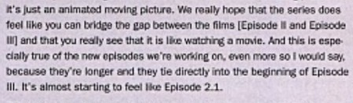

## scan p.37 (scan page 37)

Page contents: Interview concluded: 12-minute episodes allow character development; season two previews Ki-Adi-Mundi's rescue with ARC troopers, Mace flying, Yoda's lightsaber abilities, Anakin and Obi-Wan's friendship, Anakin and Padmé. (hand-read)

- **Ki-Adi-Mundi; General Grievous** — entry/section: Season two opens with Ki-Adi-Mundi's rescue: ""We have the rescue of Ki-Adi-Mundi, so we start where we left off with him and Grievous. And it's a pretty cool rescue because it involves ARC Troopers, which is very reminiscent of the first episodes." —Genndy Tartakovsky, Star Wars Insider 80, p. 37" Source: *Star Wars Insider #80* (2005), scan p.37
  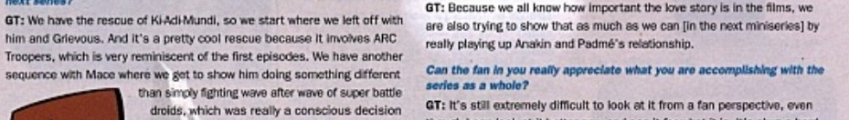

## scan p.38 (scan page 38)

Page contents: Ask the Master by Pablo Hidalgo: Obi-Wan's age (57 in Episode IV); why Dr. Evazan gets mad; the Star Destroyer conning tower hit during Vader's hologram meeting (cropped on pan-and-scan video); Tatooine's Hutt currency; trilogy DVD Easter egg (R2-D2 box, 11-3-8). (hand-read)

### Stat block notes (game mechanics, not feats)

- Obi-Wan's age: In Episode I, Obi-Wan Kenobi is 25 standard years old. Advancing the time line, he's 35 in Episode II (plus 10 years) and 38 in Episode III (plus three years), and already starting to show gray hairs. The Clone Wars will do that to you. This would make him about 57 years old in Episode IV. (Star Wars Insider 80, p. 38) (Source: *Star Wars Insider #80* (2005), scan p.38)
- The smashed conning tower: Well spotted. That is indeed what happens—the Star Destroyer's conning tower gets smashed in the preceding establishing shot. For an entire generation, the punch line to that destruction was cropped out of Empire. (Star Wars Insider 80, p. 38) (Source: *Star Wars Insider #80* (2005), scan p.38)
- Hutt currency: It's a Hutt world, and as such, Tatooine uses Hutt currency. The base unit is the peggat. One peggat is worth four truguts or 64 wupiupi. The base-four reckoning stems from the Hutt's counting system, which in turn derives from their four-fingered hands. One peggat is worth about 40 Republic credits. (Star Wars Insider 80, p. 38) (Source: *Star Wars Insider #80* (2005), scan p.38)

## scan p.39 (scan page 39)

Page contents: Ask the Master continued: why Obi-Wan's ghost sits down (Hamlet's father comparison); comics vs. Clone Wars accuracy and Asajj's fate; Palpatine's yellow eyes; why Bodie Taylor played the adult clones. (hand-read)

- **Mace Windu** — entry/section: Star Wars Insider 080 (2005): "Did Mace Windy really wipe out an emire drokl army unarmed? Maybe. but|suspect exactly how be did that grew in the teling." Source: *Star Wars Insider #80* (2005), scan p.39
  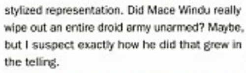

### Stat block notes (game mechanics, not feats)

- Asajj's fate left vague: Firstly, we never see Anakin destroy Asajj in the micro-series. It was deliberately left vague because it was known that Asajj was to come back elsewhere in the Expanded Universe. As the old maxim says, unless you see a body, don't count on anyone being dead. (Star Wars Insider 80, p. 39) (Source: *Star Wars Insider #80* (2005), scan p.39)
- Yellow eyes: No change at all. Emperor Palpatine always had the sickly yellow eyes like that—contact lenses worn by Ian McDiarmid for his scenes. The design of Darth Maul's eyes and, ultimately, Anakin's eyes, are based on the Emperor's original contact lenses. (Star Wars Insider 80, p. 39) (Source: *Star Wars Insider #80* (2005), scan p.39)

## scan p.40 (scan page 40)

Page contents: Ask the Master continued: the graves beside Shmi's on the Lars homestead; the RA-7 "Death Star droids" and their ISB spy programming; the nexu's meow; R4-P17's fate; the Naboo blockade lines cut from Episode I (Panaka and Obi-Wan); whether Vader can use Force lightning through his mechanical arm (Splinter of the Mind's Eye "kinetite"). (hand-read)

- **Darth Vader (Anakin Skywalker)** — entry/section: Star Wars Insider 080 (2005): "Raising an arm toward a target in this case ts realy more of a mental focusing esercise—you'll note that Vader had no problems Stranging Ozzel without lifting a finger, There are examples of telekinesis in the films with and without gestunng, strongly suggesting that the ges: lures afe not 4 prerequisite but rather indications af concentration of even personal style- Powers like Force lightning." Source: *Star Wars Insider #80* (2005), scan p.40
  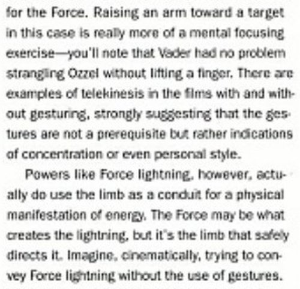
- **Darth Vader (Anakin Skywalker)** — entry/section: Telekinesis without gestures: "Raising an arm toward a target in this case is really more of a mental focusing exercise—you'll note that Vader had no problem strangling Ozzel without lifting a finger." Source: *Star Wars Insider #80* (2005), scan p.40
  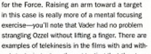

### Stat block notes (game mechanics, not feats)

- The Lars family graves: Next to Shmi's headstone is a grave shared by both of Cliegg Lars's parents, Gredda and Lef. The smallest headstone marks the grave of Edern Lars, Cliegg's younger brother who died at age 14 when he lost control of the family landspeeder. Owen Lars removed the headstones to stave off any awkward questions from Luke. (Star Wars Insider 80, p. 40) (Source: *Star Wars Insider #80* (2005), scan p.40)
- RA-7 droids as ISB spies: There's also a secret buried in an RA-7's programming. The ever-paranoid Imperial Security Bureau gave Arakyd Industries the task of manufacturing a supply of innocuous spies to keep tabs on Imperial officers and nobles. The droid has hidden programming that allowed it to make contact with the ISB via scrambled transmissions. (Star Wars Insider 80, p. 40) (Source: *Star Wars Insider #80* (2005), scan p.40)
- R4-P17 after Geonosis: R4-P17 continued to serve Obi-Wan loyally. She even got a new and proper body when Obi-Wan switched to the [...] Jedi starfighter seen in Episode III. (Star Wars Insider 80, p. 40) (Source: *Star Wars Insider #80* (2005), scan p.40)
- No lightning from the mechanical arm: George Lucas himself has stated that Anakin cannot create lightning with his mechanical limb. (Star Wars Insider 80, p. 40) (Source: *Star Wars Insider #80* (2005), scan p.40)

## scan p.41 (scan page 41)

Page contents: "Use the Force" photo-grid page of Force-using scenes from all five films, with the Ask the Master pull quote ("The arm is not acting as a conduit for the Force..."). (hand-read)

## scan p.42 (scan page 42)

Page contents: "Straight from the Hip" Samuel L. Jackson interview by Brett Rector opens: Jackson's post-AotC films (xXx, S.W.A.T., Kill Bill Vol. 2, Frozone voice, GTA); returning to Sydney and Fox Studios. (hand-read)

## scan p.43 (scan page 43)

Page contents: Jackson interview continued: meeting Silas Carson (Ki-Adi-Mundi) out of costume; Star Wars as his "everlasting" project; a satisfying death in RotS; learning some 97 moves from Nick Gillard in two or three days; how Mace got a purple lightsaber. (hand-read)

- **Mace Windu** — entry/section: The purple lightsaber: ""One day I just kinda asked George if I could have a different-colored lightsaber. He asked me what color I wanted, so I said purple. He then asked me why. I said, 'Well, I just want a different color because I am like high up on the Jedi Council and have a bit more power, second to Yoda, and I think I should have a different color.' George said there are only two colors, but that he would think about it. When I came back later, he said he had something to show me, and there it was." —Samuel L. Jackson, Star Wars Insider 80, pp. 43–44" Source: *Star Wars Insider #80* (2005), scan p.43
  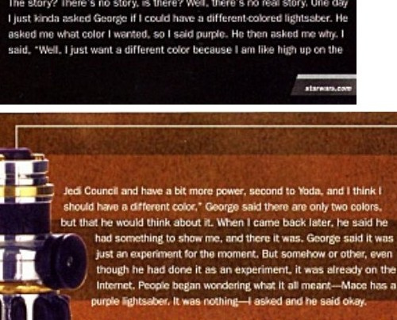

## scan p.44 (scan page 44)

Page contents: Jackson interview concluded: keeping his lightsaber; comparing himself with Mace; acting before bluescreen; imagination; young filmmakers; RotS as darker but for kids ("Sleeping Beauty of the Star Wars set"). (hand-read)

## scan p.45 (scan page 45)

Page contents: Full-page photo of Jackson as Mace Windu with "Filmography: Career Highlights of Samuel L. Jackson" (1989 Do the Right Thing through 2005 Revenge of the Sith). (hand-read)

## scan p.46 (scan page 46)

Page contents: "The Journey of Count Dooku: Inside the Mind of a Fallen Jedi" by Brett Rector — opening page with Dooku and clone troopers; intro on Christopher Lee ("a gentleman's gentleman"). (hand-read)

## scan p.47 (scan page 47)

Page contents: Christopher Lee interview: Dooku's name; Space: 1999; Lucas on the saga's time frame; bluescreen work and movie magic; Lord of the Rings comparison; on McGregor and Christensen. (hand-read)

- **Count Dooku** — entry/section: Star Wars Insider 080 (2005): "Dooku & also an antagenist-—a Sith Lord, And there aren't many of them either, Being a SR suggests that he has im mense powers, both ptrysical and meal, and that he's unstoppable." Source: *Star Wars Insider #80* (2005), scan p.47
  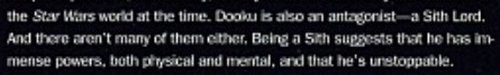
- **Count Dooku** — entry/section: Lee on Dooku: ""For one, his name, which means 'poison' in Japanese. Something I'm sure George probably knew. It's a very appropriate name because he's very lethal. The character himself is fascinating in many respects because he's a Jedi, one of what they call the Last 20." —Christopher Lee, Star Wars Insider 80, p. 47" Source: *Star Wars Insider #80* (2005), scan p.47
  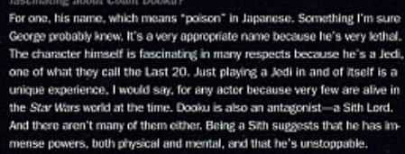

## scan p.48 (scan page 48)

Page contents: Lee interview concluded: advice to Hayden Christensen; Dooku's conversion vs. Anakin's; the Emperor's lust for power; Dooku not simply a bad guy. (hand-read)

- **Count Dooku; Darth Vader (Anakin Skywalker); Palpatine (Darth Sidious)** — entry/section: Dooku's fall vs. Anakin's: ""[Dooku] crossed over for personal reasons and became a Separatist because he was disgusted with the way the Republic was functioning. But Dooku makes the switch on his own accord—nobody makes him do it, no one suggests that he do it, which is different from Anakin. He does so without knowing it or even wanting it and becomes enmeshed in a trap by the Emperor." —Christopher Lee, Star Wars Insider 80, p. 48" Source: *Star Wars Insider #80* (2005), scan p.48
  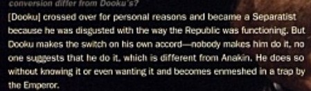

## scan p.49 (scan page 49)

Page contents: Ad: Revenge of the Sith Prima/IDG behind-the-scenes guide, $39.95 limited print run. (hand-read)

## scan p.50 (scan page 50)

Page contents: "Unseen Planets" of Attack of the Clones by Daniel Wallace, illustrated by Chris Trevas — opener with Jocasta Nu's "If an item does not appear in our records" and Yoda's "Too sure of themselves they are"; previous installments in Insider 36 and 56; this tour: Ansion, Shadda-Bi-Boran, Bogden, Subterrel, and the Rishi Maze. (hand-read)

## scan p.51 (scan page 51)

Page contents: Ansion (border dispute; The Approaching Storm by Alan Dean Foster; Alwari nomads, Gwurran); Shadda-Bi-Boran (deleted Padmé bedroom scene, the alien "Na-keetula"); Bogden begins (from the 1985 Droids cartoon). (hand-read)

### Stat block notes (game mechanics, not feats)

- Ansion in the Expanded Universe first: By the time the film saw release, the "border dispute on Ansion" had already been chronicled in The Approaching Storm, a novel by old-school Star Wars scribe Alan Dean Foster. (Star Wars Insider 80, p. 51) (Source: *Star Wars Insider #80* (2005), scan p.51)

## scan p.52 (scan page 52)

Page contents: Bogden continued: the "Bodgen" misspelling; Droids episode with Kybo Ren; dozens of moons (Bogg 4, Bogg 11); shadow port for smugglers; Bounty Hunter video game tie-in. (hand-read)

### Stat block notes (game mechanics, not feats)

- Bogden's spelling restored: Episode II reset the original spelling when the script gave Jango Fett the line that he was "recruited by a man called Tyranus on one of the moons of Bogden." (Star Wars Insider 80, p. 52) (Source: *Star Wars Insider #80* (2005), scan p.52)

## scan p.53 (scan page 53)

Page contents: Bogden's moon Kohima in Bounty Hunter (Komari Vosa, Bando Gora); Subterrel (Dexter Jettster's prospecting, Kaminoan clone miners); Sullust and Slave Ship comparisons; Rishi (Dark Force Rising, Talon Karrde and Mara Jade) and the Rishi Maze; SagDEG. (hand-read)

### Stat block notes (game mechanics, not feats)

- Subterrel's clone miners: The Attack of the Clones Scrapbook explains how a Kamino saberdart might wind up in such a remote spot by revealing that the powers-that-be on Subterrel employ a labor force of Kaminoan clones in the planet's mines. (Star Wars Insider 80, p. 53) (Source: *Star Wars Insider #80* (2005), scan p.53)
- The Rishi Maze: The latter, as seen on the Jedi library's viewscreen and explained in Inside the Worlds of Attack of the Clones, is an "irregular dwarf galaxy" gravitationally locked to the galaxy far, far away. (Star Wars Insider 80, p. 53) (Source: *Star Wars Insider #80* (2005), scan p.53)

## scan p.54 (scan page 54)

Page contents: Scouting the Galaxy by Steve Sansweet ("Find What Your Heart Desires"): Celebration III countdown (April 21–24, Indianapolis) with exclusive merchandise; reader letter on Canadian-carded figures and the Toy Fair Darth Vader (writer not named here). (hand-read)

## scan p.55 (scan page 55)

Page contents: Scouting answers: the 2002 Toy Fair Vader given at Toy Fair International for the 25th anniversary; foreign-carded figures; Hasbro and retail buyers. (hand-read)

## scan p.56 (scan page 56)

Page contents: Scouting continued: autograph fraud and certificates of authenticity; C2 Ventures licensed autographs; 1980 Burger King ESB glasses ($5–$10 each); Tomart's guide out of print; announcement of The Star Wars Poster Book (Sansweet and Pete Vilmur, Chronicle, Sept. 2005) and Teaser Style "B" bootlegs. (hand-read)

## scan p.57 (scan page 57)

Page contents: Scouting concluded: GAU union "bug" check on posters; 1999 Taco Bell/KFC/Pizza Hut Episode I planet toys by Applause; mailing address. (hand-read)

## scan p.58 (scan page 58)

Page contents: "Coming to a Galaxy Near You: Hasbro 2005" — sneak-preview product Feb. 1, Episode III product April 2, New York Toy Fair unveiling; launching Attacktix battle-figure game; 3¾-inch Action System lines, vehicle assortments, battle arena playsets. (hand-read)

## scan p.59 (scan page 59)

Page contents: "Making of a Toy" part two (from starwars.hasbro.com): sculpting the Episode III Anakin and Obi-Wan figures, Lucasfilm approvals at Skywalker Ranch, model shop casting, deco master, photo samples (May 2004), and steel tooling ("first shots"). (hand-read)

## scan p.60 (scan page 60)

Page contents: Star Wars: Republic Commando preview — squad-based FPS; producer Chris Williams; Delta Squad of three commandos; DC-17m blaster; one-touch squad control; reviving squadmates; bridges Episodes II and III. (hand-read)

- **none** — entry/section: Republic Commando's premise: ""This game is all about being a clone—a nameless faceless grunt—that isn't here to save the galaxy but rather to do a job and do it well." —Chris Williams, Star Wars Insider 80, p. 60" Source: *Star Wars Insider #80* (2005), scan p.60
  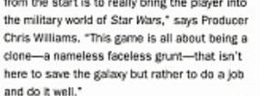
- **none** — entry/section: Republic Commando bridges the films: ""So what we ended up doing was connecting the events. The game begins where Attack of the Clones concluded and ends just before the events of Revenge of the Sith." —Chris Williams, Star Wars Insider 80, p. 60" Source: *Star Wars Insider #80* (2005), scan p.60
  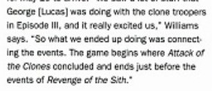

## scan p.61 (scan page 61)

Page contents: Republic Commando concluded: each commando given a name, personality and distinct armor markings; single-player and 16-player online multiplayer; release in March on Xbox and PC (by Brett Rector). (hand-read)

## scan p.62 (scan page 62)

Page contents: Hyperspace "Dailies" by Pablo Hidalgo (ILM postproduction reviews): Obi-Wan's somersault from his Jedi starfighter and the CG hood billowing up; Rob Coleman and John Knoll vs. Lucas on dropping the hood; Rick McCallum's "Let it go"; Java the Hutt coffee machine. (hand-read)

- **none** — entry/section: Lucas yields on the hood: ""Alright," says George. "I'll let you have it. Just don't say I haven't tried to go easy on you." Then he grins with a glint in his eye. "Especially considering what I've got in store for you next." —George Lucas, Star Wars Insider 80, p. 62" Source: *Star Wars Insider #80* (2005), scan p.62
  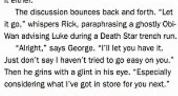

### Stat block notes (game mechanics, not feats)

- Obi-Wan as "a grim specter of destruction": His Jedi starfighter comes to an abrupt halt, its cockpit canopy springs open, and Obi-Wan Kenobi continues his forward momentum, somersaulting through the air to land in a combat stance. He whirls his lightsaber around him, cutting down battle droids left and right. "What I liked about this was that as he emerges, he's spooky, like a grim specter of destruction," describes George Lucas (Star Wars Insider 80, p. 62) (Source: *Star Wars Insider #80* (2005), scan p.62)

## scan p.63 (scan page 63)

Page contents: Dailies continued: McCallum's pride in digital matte painting; Force lightning physics ("angle of incidence will equal the angle of reflection"); Grievous's cape, R2-D2's rolling, Wookiees' eyelines; battle droids distracted; Making of Episode III preview from the Shepperton pickups (Roger Barton, Lucas, John Knoll quotes on filling "potholes"). (hand-read)

- **none** — entry/section: Battle droids "like turkeys": ""The battle droids are working off an old Commodore," explained Lucas, who suggested that the droids simply be distracted by the fast-paced activity. "When in doubt, just confuse them. New orders don't come very quickly. They're like turkeys. If you wave your hand in front of them, they get confused." —George Lucas, Star Wars Insider 80, p. 63" Source: *Star Wars Insider #80* (2005), scan p.63
  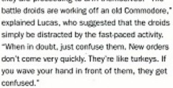

## scan p.64 (scan page 64)

Page contents: Hyperspace "Set Snaps" from the Shepperton pickups: Jerome Blake as Mas Amedda with crew; Plo Koon costume (Philip Wade); Christopher Lee with lightsaber on greenscreen; a scrap-built R2-D2; the Kit Fisto mask. (hand-read)

### Stat block notes (game mechanics, not feats)

- Kit Fisto's heavy head: The Kit Fisto mask used in Sydney had detachable tentacles that allowed for the head tails at the center of the cluster to be removed, making the head lighter for stunt work. James Corlis, who played Fisto for the Shepperton pickups, didn't have that luxury and had to carry a full head of tentacles for the shoot. (Star Wars Insider 80, p. 64) (Source: *Star Wars Insider #80* (2005), scan p.64)

## scan p.65 (scan page 65)

Page contents: Photoreceptor (edited by Paul Ens; content by Pablo Hidalgo and Bonnie Burton): Luke vs. the spectral Vader in the Dagobah cave; Carrie Fisher with a Gamorrean extra; Yoda with the power lamp (Kathryn Mullen assisting Frank Oz); C-3PO behind Yak Face and Ree-Yees; a mining droid on Mos Espa's outskirts. (hand-read)

## scan p.66 (scan page 66)

Page contents: Bantha Tracks Presents Fan Art: introduction and reader artwork (a whimsical Star Wars-themed navigation piece; a pencil Yoda) — fan artists not named here. (hand-read)

## scan p.67 (scan page 67)

Page contents: Fan art continued: "Wampas Rage" colored-pencil piece imagining the aftermath of the cut ESB wampa scene with C-3PO, Han and Leia; mixed-media "The Phantom Face"; CG droid renders; stained-glass R2-D2. (hand-read)

## scan p.68 (scan page 68)

Page contents: Fan art continued: an Original Trilogy collage painting, envelope art of Boba Fett, and a painted Episode III Anakin ("Soon We Will Have Revenge"). (hand-read)

## scan p.69 (scan page 69)

Page contents: Bantha Tracks: Rebel Legion/501st costumers at a charity "Strike Against Child Abuse" bowling event (Darth Vader bowling). (hand-read)

## scan p.70 (scan page 70)

Page contents: Bantha Tracks: a 501st garrison's Star Wars Christmas tree for a children's hospital Festival of Trees (sold for $2,000); a local collecting club's limited charity pin with Yoda and the Washington Monument. (hand-read)

## scan p.71 (scan page 71)

Page contents: Bantha Tracks "The Way We Were": Lucasfilm Internet Production Coordinator Dennis VonGalle in a Darth Vader mask with his BMX bike, 1979; Mary Franklin's "Creative Juices from the Editor" with a "Naboo Princess" cocktail recipe; submission guidelines. (hand-read)

## scan p.72 (scan page 72)

Page contents: Ad: GamePro EX subscription, $29.97. (hand-read)

## scan p.73 (scan page 73)

Page contents: StarWarsShop.com: exclusive Gentle Giant chrome stormtrooper mini-bust (worldwide edition 2,500; following Jango Fett and Darth Vader); Revenge of the Sith teaser poster, t-shirts, and more. (hand-read)

## scan p.74 (scan page 74)

Page contents: StarWarsShop.com staff picks: Clone Wars postcard set, ESB foil (Dufex) poster, Gentle Giant IG-88 mini-bust, Yoda pewter figure, vintage ESB patch set. (hand-read)

## scan p.75 (scan page 75)

Page contents: StarWarsShop.com Darth Vader page: chrome Vader mini-bust (formerly MBNA), pewter lightsaber replica, Sith Series .45-scale Vader replica, exclusive mug, Tsuneo Sanda piece. (hand-read)

## scan p.76 (scan page 76)

Page contents: StarWarsShop.com: figure display stand, Kotobukiya sandtrooper corporal and sergeant (edition 1,500, 500 in U.S.), Episode III teaser T-shirt and mug, LucasArts Mercenaries game, Comic-Con 2004 staff item. (hand-read)

## scan p.77 (scan page 77)

Page contents: StarWarsShop.com: Unleashed wave 1 case, KotOR II: The Sith Lords (Xbox), Fossil droids watch, Episode II lunchbox, cartoon mug, Clone Wars Padmé maquette (1,000), 6'2" Boba Fett standee, LEGO pens. (hand-read)

## scan p.78 (scan page 78)

Page contents: StarWarsShop.com: Luke pewter figure, Empire Vol. 3 TPB, LEGO Y-wing, stormtrooper blaster replica ($499), PEZ set, Trivia 2005 calendar, 1983 Fan Club poster, Battlefront, RotS mug. (hand-read)

## scan p.79 (scan page 79)

Page contents: Ad: Creation Entertainment Grand Slam XIII "The Sci-Fi Summit," March 11–13, 2005, Pasadena Center (Star Trek, Stargate, Firefly guests; Star Wars guests to be announced). (hand-read)

## scan p.80 (scan page 80)

Page contents: Back cover ad: Code 3 Collectibles die-cast Republic Gunship, limited edition 2,500 worldwide. (hand-read)

