# Owner Material 038 — Star Wars Insider #1–153 plus specials (with The Lucasfilm Fan Club Magazine #1–22): Star Wars Insider #81 (2005)

- **Source:** *Star Wars Insider* magazine (issues 23–153, 1994–2014) and its predecessor *The Lucasfilm Fan Club Magazine* (issues 1–22, 1987–1994), plus seven special editions: articles, interviews, comics and short fiction Secondary source (licensed Legends reference). Scan OCR'd on the box; the scan stays box-only and is **not** published.
- **Method:** every scanned page was OCR'd and machine-screened sentence by sentence for power-relevant statements (fights, kills, defeats, Force feats, rankings, superweapons) that name a character on our roster; each kept sentence is quoted verbatim from the OCR text and has a crop of the printed passage directly under it. Pages with nothing power-relevant are still listed with what is on them.
- **Citation:** "*Star Wars Insider #81* (2005), p.X" by printed page ("scan p.X" where no printed number applies). **Weight:** Licensed magazine: a secondary source. Its short fiction and comics are Legends stories; its articles and interviews sum up or discuss lore and rank below the novels, comics and games they describe.

## scan p.1 (scan page 1)

Page contents: Cover, issue 81 (May/June 2005): "Obi-Wan Strikes Back," exclusive interview with Ewan McGregor; The Droids of Episode III; Celebration III; new Clone Wars fiction Omega Squad: Targets; starwars.com online content and Bantha Tracks teasers. (hand-read)

## scan p.2 (scan page 2)

Page contents: Ad: Cloud City (cloudcity.com) toy dealer, latest and vintage Star Wars toys, prototypes and rarities, pre-1990 action figures. (hand-read)

## scan p.3 (scan page 3)

Page contents: Ad: Cloud City Collectibles, Star Wars memorabilia at Celebration III (Norcross, GA address). (hand-read)

## scan p.4 (scan page 4)

Page contents: Contents, Insider 81: features Prequel Update (Rector), The Droids of Episode III (Daniel Wallace), I, Jedi (McGregor, Rector), Material World (Trisha Biggar costumes, Rector), Omega Squad: Targets (Karen Traviss); departments Comlink, Skywalking, Jedi Library (Jason Fry on Stover's novelization), Drawn by the Force (Wallace on Dark Horse RotS comic), Technical Readout (Chris Trevas), Ask the Master (Hidalgo), Scouting the Galaxy (Sansweet), Jabba's Collection, Anchorhead Arcade (RotS video game), Best of Hyperspace, Laugh It Up Fuzzball (Gregory Harsh), Bantha Tracks (Mary Franklin). (hand-read)

## scan p.5 (scan page 5)

Page contents: Ad: officially licensed Star Wars photographs and autographs from the Lucasfilm archives, images from all six films, certificates of authenticity. (hand-read)

## scan p.6 (scan page 6)

Page contents: Editorial by Brett Rector on Obi-Wan Kenobi: Alec Guinness's portrayal defined the Jedi; McGregor carries it forward; masthead. (hand-read)

### Stat block notes (game mechanics, not feats)

- Kenobi in all six films: For starters, Kenobi is in exclusive company in that he is one of only four characters to have been in all six films, along with R2-D2, C-3PO, and Anakin (technically speaking, that is). (Star Wars Insider 81, p. 6) (Source: *Star Wars Insider #81* (2005), scan p.6)

## scan p.7 (scan page 7)

Page contents: Ad: 3 Day Blinds Star Wars custom window coverings (offer code SWIB). (hand-read)

## scan p.8 (scan page 8)

Page contents: Comlink letters (writers omitted): praise for Abel Peña's Mandalorian article (an EU piece by him coming soon); fiction only by previously published Star Wars authors, fiction and crosswords every other issue, next in Issue 83; future field guide to clone trooper ranks and colors; Holiday Special bootleg tape. (hand-read)

## scan p.9 (scan page 9)

Page contents: Ad: Star Wars Celebration III, "Party of a Lifetime," April 21–24, 2005. (hand-read)

## scan p.10 (scan page 10)

Page contents: Ad: Master Replicas "Choose Your Weapon," Obi-Wan and Anakin Episode III lightsabers. (hand-read)

## scan p.11 (scan page 11)

Page contents: Ad: Master Replicas Revenge of the Sith Force FX lightsabers (Vader, Anakin), Yoda lightsaber, Han Solo and Rebel Fleet blasters. (hand-read)

## scan p.12 (scan page 12)

Page contents: Prequel Update with producer Rick McCallum (Rector): London pickups at Elstree in late January (Christensen, Portman filming; Jackson, McDiarmid, Daniels looping), half-day bluescreen shoot. (hand-read)

- **none** — entry/section: The pace of the final push: ""We've been locked in a room for the last four or five weeks to get things finalized so we can make our final push and get the film done," says McCallum. "The pace we're working at right now is simply blistering." —Rick McCallum, Star Wars Insider 81, p. 12" Source: *Star Wars Insider #81* (2005), scan p.12
  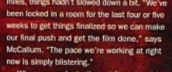

## scan p.13 (scan page 13)

Page contents: Prequel Update photo: Obi-Wan and Anakin duel on a balcony over a river of molten lava (digital work by ILM). (hand-read)

## scan p.14 (scan page 14)

Page contents: Prequel Update photos: Anakin in Palpatine's box at the Coruscant opera house; Aayla Secura (Amy Allen) with clone squad on Felucia; McCallum on Tuesday/Thursday satellite reviews with ILM, about 80 shots per week, 300–400 left. (hand-read)

- **none** — entry/section: Shots left to finalize: ""We're up to about 80 shots per week at this stage, and we have about five more weeks to go," he says. "We have a ballpark figure of 300 or 400 shots left to finalize, which is very normal for a huge film such as this. I estimate we'll be done in early April," says McCallum. —Rick McCallum, Star Wars Insider 81, p. 14" Source: *Star Wars Insider #81* (2005), scan p.14
  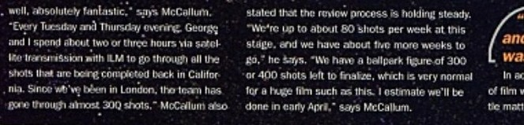

## scan p.15 (scan page 15)

Page contents: Prequel Update cont.: Palpatine in the Senate chambers; Utapau sinkhole landing platforms with Obi-Wan's Jedi starfighter; John Williams recorded the score at Abbey Road from February 2, finished a day early, then left to score War of the Worlds. (hand-read)

- **none** — entry/section: John Williams' score: ""The sessions went great, and the work John did for us was just truly phenomenal—really, fantastic as always," explains McCallum. "Things went so well, in fact, that he finished up a day early." —Rick McCallum, Star Wars Insider 81, p. 15" Source: *Star Wars Insider #81* (2005), scan p.15
  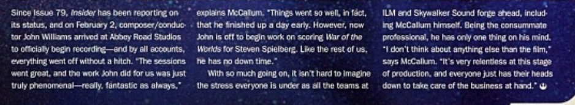
- **none** — entry/section: Relentless final stage: ""I don't think about anything else than the film," says McCallum. "It's very relentless at this stage of production, and everyone just has their heads down to take care of the business at hand." —Rick McCallum, Star Wars Insider 81, p. 15" Source: *Star Wars Insider #81* (2005), scan p.15
  

## scan p.16 (scan page 16)

Page contents: Prequel Update photos: battle for Kashyyyk with Wookiees and clone troopers; Vader caption "Darth Vader!" "Yes, master?" "Ri-i-i-i-se!"; Mace Windu, Saesee Tiin, Agen Kolar, Kit Fisto confront Palpatine. (hand-read)

### Stat block notes (game mechanics, not feats)

- Four Jedi confront Palpatine: Jedi Master Mace Windu (Samuel L. Jackson, third from left) has backup help from fellow Jedi (from left) Saesee Tiin (Kenji Oates), Agen Kolar (Tux Akindoyeni), and Kit Fisto (Ben Cooke) as they confront Supreme Chancellor Palpatine. (Star Wars Insider 81, p. 16) (Source: *Star Wars Insider #81* (2005), scan p.16)

## scan p.17 (scan page 17)

Page contents: Prequel Update photos: Yoda ("Wars not make one great"); Obi-Wan's Jedi starfighter lands in a Utapau sinkhole seeking General Grievous; McCallum, Christensen, Lucas and Trisha Biggar on one of the last shots, January 31 at Elstree (photo Pablo Hidalgo). (hand-read)

### Stat block notes (game mechanics, not feats)

- Last shots at Elstree: Producer Rick McCallum, actor Hayden Christensen, director George Lucas, and costume designer Trisha Biggar look on at one of the very last shots for Revenge of the Sith on January 31 at Elstree Studios in England, where the original Star Wars was made nearly three decades before. (Star Wars Insider 81, p. 17) (Source: *Star Wars Insider #81* (2005), scan p.17)

## scan p.18 (scan page 18)

Page contents: Prequel Update photos: Mace Windu on the attack with purple lightsaber in Palpatine's office; General Obi-Wan and clone troopers study a holographic battle projection aboard a Republic cruiser. (hand-read)

- **Mace Windu; Palpatine (Darth Sidious)** — entry/section: Mace Windu on the attack: "There's no mistaking Jedi Master Mace Windu on the attack, his purple lightsaber blade sparking in the office of Supreme Chancellor Palpatine." Source: *Star Wars Insider #81* (2005), scan p.18
  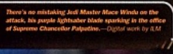

## scan p.19 (scan page 19)

Page contents: Prequel Update photo: Hayden Christensen as Anakin and Ewan McGregor as Obi-Wan in the final film of the saga. (hand-read)

## scan p.20 (scan page 20)

Page contents: Ad: Empire Earth II (PC strategy game), page 1. (hand-read)

## scan p.21 (scan page 21)

Page contents: Ad: Empire Earth II, page 2. (hand-read)

## scan p.22 (scan page 22)

Page contents: Skywalking News: Liningup.net fans line up from April 6 outside Grauman's Chinese Theatre for Starlight Children's Foundation (about $50,000 raised for the previous two films; group's members omitted); ILM/Skywalker Sound five Oscar nominations (Roger Guyett, Bill George for Harry Potter VFX; Randy Thom four sound noms); Lucasfilm employees raise funds for tsunami relief; obituary of Amrish Puri (Mola Ram in Temple of Doom). (hand-read)

- **none** — entry/section: Lucasfilm tsunami relief: ""The contributions came from every corner of the company at every campus," said Lucasfilm President Mich Chau. "I'm happy to say that with Lucasfilm's match we will provide a total of $126,562 in relief funds to the millions of people affected by this unprecedented disaster." —Micheline Chau, Star Wars Insider 81, p. 22" Source: *Star Wars Insider #81* (2005), scan p.22
  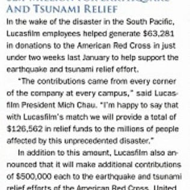

## scan p.23 (scan page 23)

Page contents: Skywalking News: LucasArts announces Star Wars: Empire at War RTS (Rebel Alliance's creation, Vader's rise, battles on Hoth, Tatooine, Dagobah); NYLine Standa-Thon outside the Ziegfeld Theatre for Starlight Starbright; a Seattle line-sitter moved off the sidewalk (fan not named); ad for signed Celebration II convention photos. (hand-read)

## scan p.24 (scan page 24)

Page contents: Celebration III news: celebrity MCs Jay Laga'aia (Captain Typho) and Warwick Davis (Wicket, Willow, Professor Flitwick) host the Saga Stage and Sagamore Ballroom, Indiana Convention Center, April 21–24, 2005. (hand-read)

## scan p.25 (scan page 25)

Page contents: Celebration III: C2 Ventures (Ben Stevens, Philip Wise), Lucasfilm's photo/autograph licensee, runs the autograph hall in Exhibit Hall A; guests from all six films. (hand-read)

## scan p.26 (scan page 26)

Page contents: Celebration III: exclusive Darth Vader action figure with new James Earl Jones phrases ($15, limits per badge); collecting panels April 22–24 in the White River Ballroom; Dave and Lou Elsey (Episode III creature shop) from Sydney; Nick Gillard teaser. (hand-read)

### Stat block notes (game mechanics, not feats)

- Vader's Celebration III voice figure: None other than James Earl Jones, the legendary voice of Darth Vader, recorded new phrases exclusively for this special figure, including, "The dark side of the Force is strong with you;" "Your journey to the dark side is now complete;" "Prepare to experience the Revenge of the Sith. It is your destiny;" and the soon-to-be-legendary "Welcome to Star Wars Celebration III. Never will you find a more wretched hive of scum and villainy." (Star Wars Insider 81, p. 26) (Source: *Star Wars Insider #81* (2005), scan p.26)

## scan p.27 (scan page 27)

Page contents: Ad: Jakks Pacific Star Wars Plug It In & Play TV Games, Vader-head controller with five built-in games. (hand-read)

## scan p.28 (scan page 28)

Page contents: Celebration III: Costume Pageant and Costume Cabaret; Diorama Builders' room building a Death Star diorama (organizer not named); R2-D2 Builders return; Clone Wars Volume 2 screenings incl. members-only with autographed posters (Mary Franklin). (hand-read)

## scan p.29 (scan page 29)

Page contents: Ad: The Official Episode III Movie Guide (IDG Entertainment), 100 pages, $5.95 (sic, "S3-95" OCR), not available in stores. (hand-read)

## scan p.30 (scan page 30)

Page contents: Jedi Library (Jason Fry): Matthew Stover on his Revenge of the Sith novelization — "a companion piece, rather than a retelling"; restructuring when Lucas moved a Jedi's death; talking with Lucas; Obi-Wan his favorite; would love to write Luke/Han/Leia's final adventure; Nick Rostu from Shatterpoint. (hand-read)

- **none** — entry/section: Novelization approach: ""Rather than trying to re-create the film in book form, I was trying to write it as though it were a novel the movie was being made from." —Matthew Stover, Star Wars Insider 81, p. 30" Source: *Star Wars Insider #81* (2005), scan p.30
  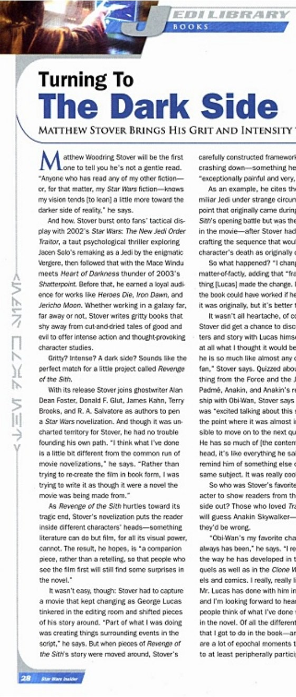
- **Obi-Wan Kenobi** — entry/section: Stover's favorite character: ""Obi-Wan's my favorite character, always has been," he says. "I really like the way he has developed in the prequels as well as in the Clone Wars novels and comics." —Matthew Stover, Star Wars Insider 81, p. 30" Source: *Star Wars Insider #81* (2005), scan p.30
  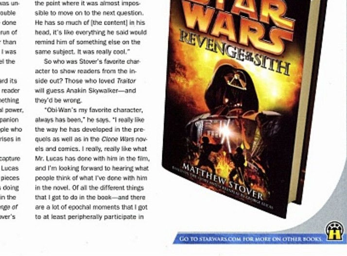
- **none** — entry/section: Nick Rostu: ""Put a few more years on him, and he's basically Han Solo who can use the Force," he says. "What's not to like?" —Matthew Stover, Star Wars Insider 81, p. 30" Source: *Star Wars Insider #81* (2005), scan p.30
  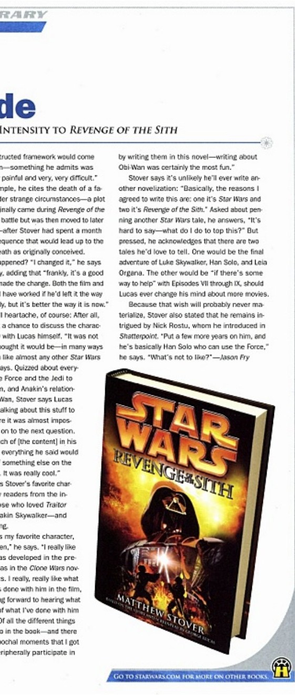

## scan p.31 (scan page 31)

Page contents: Ad: Code 3 Collectibles die-cast AT-ST from Return of the Jedi, limited to 1,500 worldwide, 12 inches tall. (hand-read)

## scan p.32 (scan page 32)

Page contents: Drawn by the Force (Daniel Wallace): Revenge of the Sith comic adaptation by Miles Lane and Doug Wheatley, completing a 28-year cycle; sidebar on prior adaptations (Chaykin/Thomas ANH, Goodwin/Williamson ESB and ROTJ, Gilroy/Damaggio TPM, Gilroy/Duursema AOTC). (hand-read)

- **Darth Vader (Anakin Skywalker)** — entry/section: Wheatley on Vader: "Says Wheatley, "I saw A New Hope when I was eight, and I dressed in black almost exclusively until I reached the age of 20. Johnny Cash? Nope—Darth Vader. I was obsessed with him as a child." —Doug Wheatley, Star Wars Insider 81, p. 32" Source: *Star Wars Insider #81* (2005), scan p.32
  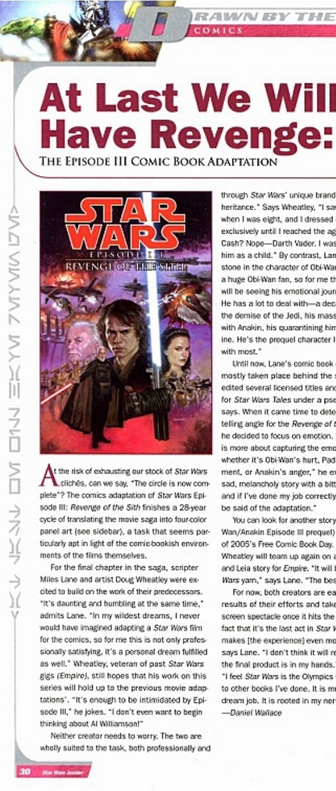

## scan p.33 (scan page 33)

Page contents: Preview pages of the Revenge of the Sith comic adaptation: Obi-Wan arrives at Utapau, speaks with Tion Medon, rides Boga. (hand-read)

## scan p.34 (scan page 34)

Page contents: The Droids of Episode III (Daniel Wallace) intro: a hypothetical robot war; "when people have a problem, they build a droid." (hand-read)

## scan p.35 (scan page 35)

Page contents: Droids of Episode III: buzz droid, the "metallic melon" fired in discord missiles by tri-droid fighters to dismantle enemy starfighters, used against Obi-Wan and Anakin at Coruscant. (hand-read)

### Stat block notes (game mechanics, not feats)

- Buzz droids at Coruscant: During the Battle of Coruscant in Episode III, General Grievous' Separatist navy launches buzz droids against two of the Republic's top aces—Obi-Wan Kenobi and Anakin Skywalker—hoping to leave their Jedi interceptors dead in space. (Star Wars Insider 81, p. 35) (Source: *Star Wars Insider #81* (2005), scan p.35)

## scan p.36 (scan page 36)

Page contents: Droids of Episode III: Arakyd Prowler 1000 ("Probot 1.0") pursuing a fugitive Jedi; Cybot Galactica ordnance lifter (3 m tall), civilian binary load lifter. (hand-read)

### Stat block notes (game mechanics, not feats)

- Prowler 1000 = Probot 1.0: It may not look like much right now, but just wait a couple decades. The Arakyd Prowler 1000 is really "Probot 1.0." After 22 years of improvements and refinements, the droid will re-emerge as the crab-legged, spider-eyed probe droid that menaced Echo Base in The Empire Strikes Back. (Star Wars Insider 81, p. 36) (Source: *Star Wars Insider #81* (2005), scan p.36)
- Threepio's "first job": We've never seen that model on the movie screen, but remember that See-Threepio claimed, during A New Hope's droid auction, that his "first job was programming binary load lifters." Considering that Threepio's real first job was helping Shmi Skywalker take care of her Tatooine slave hovel, one wonders if Threepio wasn't engaging in a bit of creative salesmanship. (Star Wars Insider 81, p. 36) (Source: *Star Wars Insider #81* (2005), scan p.36)

## scan p.37 (scan page 37)

Page contents: Droids of Episode III: IW-37 pincer loader (Salvager), hover loader; Corporate Alliance tank droid (amphibious, cut from Episode II); crab droid "Muckracker" at Utapau. (hand-read)

### Stat block notes (game mechanics, not feats)

- Tank droid's long road: The tank droid might seem curiously familiar to Star Wars fans. Developed years ago for inclusion in Episode II, the treaded war machine was cut from the final version of the film. But eager licensees included it in a variety of movie tie-ins anyway, including several guidebooks and the LucasArts computer game Star Wars Galactic Battlegrounds: Clone Campaigns (where it packed the punch of an AT-AT). (Star Wars Insider 81, p. 37) (Source: *Star Wars Insider #81* (2005), scan p.37)

## scan p.38 (scan page 38)

Page contents: Droids of Episode III: Galactic Chopper (Uhrkikian DD-13) cybernetic-implant surgeon; Medtech FX-6 surgical assistant, linked to Empire's FX-7. (hand-read)

## scan p.39 (scan page 39)

Page contents: Ad: Wizards of the Coast Revenge of the Sith Trading Card Game. (hand-read)

## scan p.40 (scan page 40)

Page contents: Droids of Episode III: IG-100 MagnaGuard, Grievous' bodyguards built by Dooku; electrostaffs of phrik metal (debut in Dark Forces); head cloths recall Kaleesh guards; IG lancer droids from Clone Wars. (hand-read)

### Stat block notes (game mechanics, not feats)

- Origin of the MagnaGuards: Grievous wasn't always a cyborg. Prior to a near-fatal shuttle crash, the Kaleesh warlord conquered whole worlds belonging to his people's traditional enemies, the Huk. The bodyguards who accompanied Grievous as he oversaw these battles became such an integral part of his staff that he insisted on replacements once he became the hybridized commander of the Separatist army. When battle droids proved unfit for the task, Count Dooku had the MagnaGuard series built from scratch. (Star Wars Insider 81, p. 40) (Source: *Star Wars Insider #81* (2005), scan p.40)
- Phrik: The body of each electrostaff is composed of rare Phrik metal, one of the few substances (Mandalorian iron is another) introduced in the Expanded Universe to stand up to the effect of a lightsaber strike. (Star Wars Insider 81, p. 40) (Source: *Star Wars Insider #81* (2005), scan p.40)

## scan p.41 (scan page 41)

Page contents: Ad: Wizards of the Coast Star Wars Miniatures, "Stage Your Own Epic Battles." (hand-read)

## scan p.42 (scan page 42)

Page contents: Technical Readout (Chris Trevas): Obi-Wan vs. Vader in ANH, shot on Stage H at Shepperton; rotating reflective wooden rod blades; fight choreographer Peter Diamond; cloak collapse done optically; Vader's saber from an antique camera flash handle. (hand-read)

- **Obi-Wan Kenobi; Darth Vader (Anakin Skywalker)** — entry/section: Fragile blades: ""We broke so many blades—they just kept snapping," said Diamond. —Peter Diamond, Star Wars Insider 81, p. 42" Source: *Star Wars Insider #81* (2005), scan p.42
  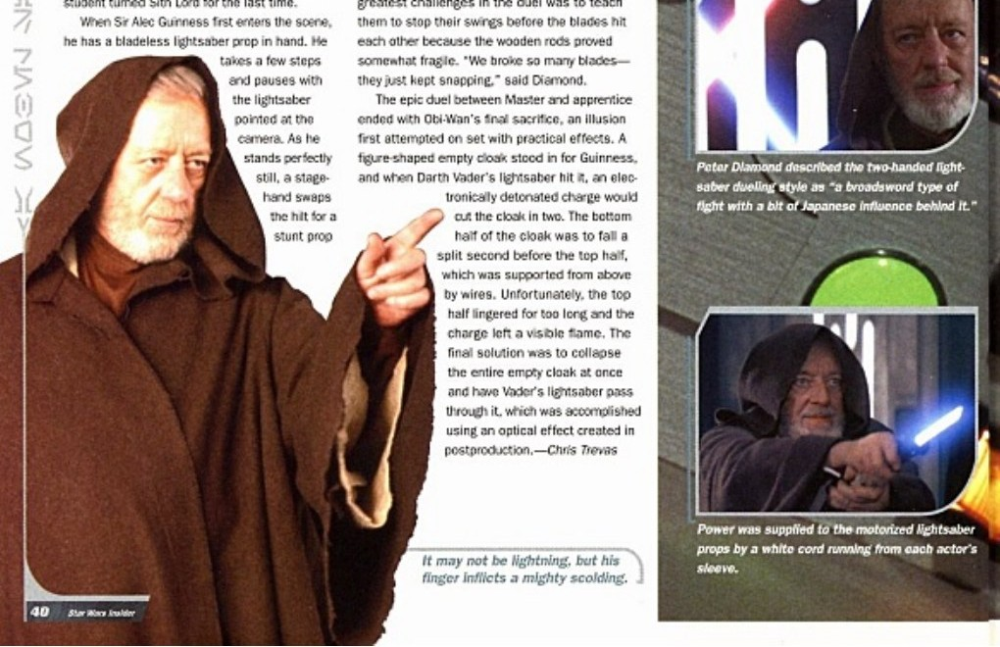
- **Obi-Wan Kenobi; Darth Vader (Anakin Skywalker)** — entry/section: Obi-Wan's final sacrifice: "The epic duel between Master and apprentice ended with Obi-Wan's final sacrifice, an illusion first attempted on set with practical effects. A figure-shaped empty cloak stood in for Guinness." Source: *Star Wars Insider #81* (2005), scan p.42
  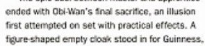

### Stat block notes (game mechanics, not feats)

- Vader's lightsaber prop: The chrome flash handle from an antique camera made in England was the basis for Darth Vader's lightsaber. After removing the large reflector from the top, the prop department added black grips and a D-ring for it to hang from his belt. (Star Wars Insider 81, p. 42) (Source: *Star Wars Insider #81* (2005), scan p.42)

## scan p.43 (scan page 43)

Page contents: Technical Readout cont.: padded, hot Vader helmet; half the Millennium Falcon built; lightsaber sounds from metal on dry ice and carbon arc lamps; Prowse once sent Guinness flying; Obi-Wan's saber from a WWI rifle grenade, Graflex clamp, faucet handle. (hand-read)

### Stat block notes (game mechanics, not feats)

- Obi-Wan's lightsaber prop: Obi-Wan's lightsaber was assembled from a variety of items, including a World War I-era British rifle grenade, the mounting clamp from a Graflex camera flash unit, and a faucet handle. (Star Wars Insider 81, p. 43) (Source: *Star Wars Insider #81* (2005), scan p.43)

## scan p.44 (scan page 44)

Page contents: Ask the Master (Pablo Hidalgo; questioners omitted): C-3PO's "joints are almost frozen" on Tatooine (Anthony Daniels on the cold shoot day); Vader carrying two lightsabers in ROTJ is the remnant of a cut script sequence where he takes Luke's saber. (hand-read)

- **C-3PO** — entry/section: "My joints were almost frozen!": ""I was so cold," said Daniels to an audience of fans at Dragon*Con a few years back. "If you look at any shots of the crew that day, they're wearing parkas and goggles. I am in a tin can and a pair of knickers. The curious thing is that in the script it was written, 'My joints are almost frozen.' My joints were almost frozen! George had obviously planned this thing way ahead of time." —Anthony Daniels, Star Wars Insider 81, p. 44" Source: *Star Wars Insider #81* (2005), scan p.44
  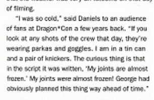

## scan p.45 (scan page 45)

Page contents: Ask the Master: why the Trade Federation blockaded Naboo (taxation of trade routes; Palpatine's homeworld; Sidious' intelligence); "old folks' home" code; "Clone Wars" as a plural name like the World Wars; "Think the saber in your hand" was in the ESB shooting script, novelization, storybook, and Marvel adaptation, not the film. (hand-read)

### Stat block notes (game mechanics, not feats)

- "Old folks' home": The Jedi use code words to thwart automated listening devices that scour the subspace bands for key words. Certain code words are retired frequently to throw off any eavesdroppers. In this case, "old folks' home" is code for the Jedi Temple, specifically the Jedi Council. The scramble code indicates the importance of the message. Other comlink codes that have been used in the past are "Shooting Star," Adi Gallia's call sign and "Guiding Light," Obi-Wan's call sign. (Star Wars Insider 81, p. 45) (Source: *Star Wars Insider #81* (2005), scan p.45)

## scan p.46 (scan page 46)

Page contents: Ask the Master: "General Motti" credit error (Motti is an admiral; other ANH credit misspellings); Vader's chest-plate controls explained; how Vader knew Luke's name; two YT-1300s at Theed in AOTC are digital models from the Special Edition Falcon; Grievous won't be dramatically unmasked; aquatic vehicles in Galactic Battlegrounds. (hand-read)

### Stat block notes (game mechanics, not feats)

- How Vader learned Luke's name: Vader had some opportunity to do some fact checking in the three years between A New Hope and The Empire Strikes Back. According to the Marvel Comics series, he found out Skywalker's identity from a captive Rebel pilot undergoing interrogation. This scene is also retold in the Vader's Quest comics' series from Dark Horse. (Star Wars Insider 81, p. 46) (Source: *Star Wars Insider #81* (2005), scan p.46)

## scan p.47 (scan page 47)

Page contents: Ask the Master: aquatic craft in EU sources (Battle for the Golden Sun, Dark Empire, Clone Wars Mon Calamari episode with Kit Fisto); lightsaber colors ("not mood rings"); Even Piell (Lannik), played by Michaela Cottrell. (hand-read)

- **none** — entry/section: "They're lightsabers, not mood rings": "As someone on the Episode III crew recounted when asked a similar question, "They're lightsabers, not mood rings." The internal crystal is what determines the color of the lightsaber, not the allegiance of the user. When Anakin Skywalker succumbs to the dark side and still carries his Jedi blade, it still shines blue. (Star Wars Insider 81, p. 47)" Source: *Star Wars Insider #81* (2005), scan p.47
  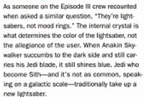

### Stat block notes (game mechanics, not feats)

- Even Piell: No, that is Even Piell, fellow member of the Jedi Council. He is a member of the Lannik species. Unlike Yoda, who is depicted either as a puppet or a digital character, an actress—Michaela Cottrell, to be specific—with makeup played Piell. (Star Wars Insider 81, p. 47) (Source: *Star Wars Insider #81* (2005), scan p.47)

## scan p.48 (scan page 48)

Page contents: "I, Jedi": Ewan McGregor interview (Rector): his uncle Denis Lawson (Wedge); Guildhall training; career; RotS action starts after the crawl with a 35-minute sequence in the first cut; on Alec Guinness; Guinness look and hair. (hand-read)

- **Obi-Wan Kenobi** — entry/section: Opening action: "There's an enormous amount of fighting, and it starts right after the [text crawl] with a massive sequence that in the first cut lasted about 35 minutes. Because it's the last film, we've really pulled out all the stops—no holds barred. —Ewan McGregor, Star Wars Insider 81, p. 48" Source: *Star Wars Insider #81* (2005), scan p.48
  
- **Obi-Wan Kenobi** — entry/section: It all goes back to Alec: ""You know, it all goes back to him really—I feel my job is very easy. I just think about Alec Guinness and how he played his scenes in Episode IV. Really, the choices he made for the character are still his today." —Ewan McGregor, Star Wars Insider 81, p. 48" Source: *Star Wars Insider #81* (2005), scan p.48
  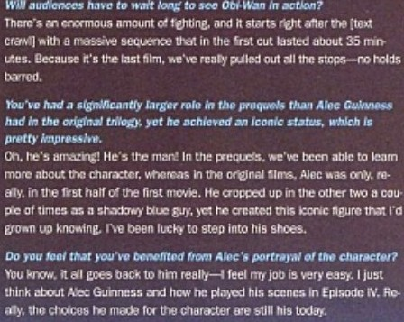
- **Obi-Wan Kenobi** — entry/section: The mullet passes to Hayden: ""It's no longer a mullet, which I sported beautifully in Episode II. I've now passed [that] on to Hayden—he now carries the mullet flame through Episode III." —Ewan McGregor, Star Wars Insider 81, p. 48" Source: *Star Wars Insider #81* (2005), scan p.48
  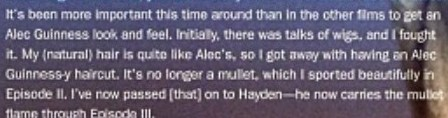

## scan p.49 (scan page 49)

Page contents: Full-page photo: Ewan McGregor as Obi-Wan with ignited lightsaber (mag p. 47). (hand-read)

## scan p.50 (scan page 50)

Page contents: McGregor interview continued: Obi-Wan/Anakin from father figure to brothers; working with Hayden Christensen; expositional dialogue; the bond that sets up the betrayal; Obi-Wan's feelings for Anakin across the prequels. (hand-read)

- **Obi-Wan Kenobi; Darth Vader (Anakin Skywalker)** — entry/section: Brothers in RotS: ""In Revenge of the Sith, we have a more brotherly relationship—but certainly older brother to younger brother—and I refer to Anakin as being like my brother. Their relationship is complete now. You will notice this from the way we deal with situations—in battle, we're still joking with one another and looking out for one another. Very often, Anakin is saving my bacon when I'm knocked unconscious or whatever, or he steps in to help out when I've screwed up." —Ewan McGregor, Star Wars Insider 81, p. 50" Source: *Star Wars Insider #81* (2005), scan p.50
  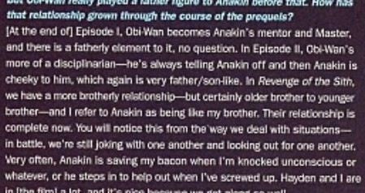

## scan p.51 (scan page 51)

Page contents: Full-page photo: McGregor in Obi-Wan robes and belt (mag p. 49). (hand-read)

## scan p.52 (scan page 52)

Page contents: McGregor interview concluded: late-to-the-lecture scene showing Obi-Wan's disappointment "for Anakin, not at him"; scenes with Natalie Portman and Ian McDiarmid; exhausting fight scenes and stamina; two weeks to regain style; Tantive IV set, C-3PO and R2-D2; on Vader. (hand-read)

- **Obi-Wan Kenobi; C-3PO; R2-D2** — entry/section: Tantive IV set: ""[Lucasfilm] re-created the original corridor that Darth Vader stepped onto at the beginning of [A New Hope]. I've had a few moments while filming Revenge of the Sith that have taken me back to my childhood, and both have been while filming with Anthony Daniels. Being on set with C-3PO made me remember what it was like to be seven [years old] and watching the original films. ... I was also in a scene with R2-D2, which was a bit weird as I found myself quite choked up about it, about this robot. It was quite a moment." —Ewan McGregor, Star Wars Insider 81, p. 52" Source: *Star Wars Insider #81* (2005), scan p.52
  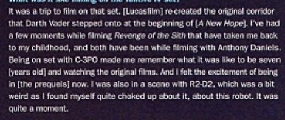
- **Obi-Wan Kenobi; Darth Vader (Anakin Skywalker)** — entry/section: "He wasn't Darth Vader yet": ""No, I never thought I was working with Darth Vader because he wasn't Darth Vader yet, really. Right up to the end, I think Obi-Wan still had hope that Anakin would come back. However, there's a certain point where he realizes (that) there is no hope and then the cloak comes off." —Ewan McGregor, Star Wars Insider 81, p. 52" Source: *Star Wars Insider #81* (2005), scan p.52
  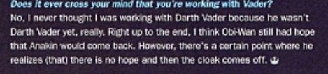

## scan p.53 (scan page 53)

Page contents: Ad: Brian's Toys (brianstoys.com) Star Wars toy price list incl. Revenge of the Sith items available in April. (hand-read)

## scan p.54 (scan page 54)

Page contents: Photo page with pull quote from McGregor ("Being on set with C-3PO made me remember..."). (hand-read)

## scan p.55 (scan page 55)

Page contents: Ad: The Anthony Grandio Company Star Wars checks, checkbook covers, and address labels. (hand-read)

## scan p.56 (scan page 56)

Page contents: "Dressed to Kill"-style costume feature (Brett Rector) intro: Trisha Biggar interview; history of SW costume designers (John Mollo, Aggie Guerard Rodgers, Nilo Rodis-Jamero); inspiration from any culture; about 80 people in Costume Department and Costume Props vs 120–130 on Episode II. (hand-read)

## scan p.57 (scan page 57)

Page contents: Biggar interview: Sydney-only workshop ready by January 2003; work began April 2002 at the Ranch; fabrics sourced worldwide incl. Paris trade show and vintage fabrics; story-day breakdowns for costume changes; "George fancies costume changes"; stunt costumes (Neimoidian gunners, Palpatine copies). (hand-read)

## scan p.58 (scan page 58)

Page contents: Biggar: weighted lightweight cloaks for Obi-Wan's water scenes; fireproofing for pyrotechnics; Padmé's pregnancy concealed in public (shoulder-hung costumes over crinoline shape); 12 costumes for Padmé; bump variants; color for Padmé. (hand-read)

### Stat block notes (game mechanics, not feats)

- Weighted cloaks: We also made some lightweight cloaks for Obi-Wan's water scenes, which involved using metal weights to fit into different parts (of the cloaks) to keep them from becoming like a parachute and floating up. —Trisha Biggar (Star Wars Insider 81, p. 58) (Source: *Star Wars Insider #81* (2005), scan p.58)
- Twelve costumes: Of course, we're all very aware that she's pregnant then, roughly seven months. All told, Padmé ended up with 12 costumes in this film. —Trisha Biggar (Star Wars Insider 81, p. 58) (Source: *Star Wars Insider #81* (2005), scan p.58)

## scan p.59 (scan page 59)

Page contents: Ad: Scholastic Revenge of the Sith books ("A vow is broken. A Jedi falls."). (hand-read)

## scan p.60 (scan page 60)

Page contents: Biggar: Padmé's senatorial fabrics; Palpatine's costumes show his deterioration (wool with latex-type overlay); Anakin darker; Vader costume made to fit Hayden, helmet made symmetrical; Hayden in the suit "spine tingling." (hand-read)

- **Palpatine (Darth Sidious)** — entry/section: Palpatine's decaying costumes: ""[In Episode III], because of all the different situations we'll see him in—like fighting, escaping from crashing spaceships, and so forth—he needed more costumes to show (that) his powers had increased. It was nice because we could use textures and lots of dark colors to show the audience the deterioration of his character. The first costume you see him in on the Trade Federation starship [is made of a] kind of wool with a latex-type material over the top, which gives an almost crumbling-animal sort of feel to the fabric and helps show the inner decay of his character." —Trisha Biggar, Star Wars Insider 81, p. 60" Source: *Star Wars Insider #81* (2005), scan p.60
  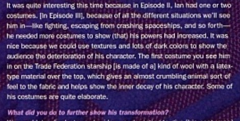
- **Darth Vader (Anakin Skywalker)** — entry/section: Symmetrical helmet: ""There are some things that we've [corrected], however, like the helmet—the original was completely uneven, both halves were totally uneven. When it was first sculpted, it was obviously done by hand, and one side of the face is slightly at an angle. We made it so it was symmetrical. It allowed Hayden a lot of extra head movement that wasn't possible before." —Trisha Biggar, Star Wars Insider 81, p. 60" Source: *Star Wars Insider #81* (2005), scan p.60
  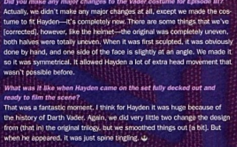
- **Darth Vader (Anakin Skywalker)** — entry/section: "Spine tingling": ""That was a fantastic moment. I think for Hayden it was huge because of the history of Darth Vader. ... But when he appeared, it was just spine tingling." —Trisha Biggar, Star Wars Insider 81, p. 60" Source: *Star Wars Insider #81* (2005), scan p.60
  

## scan p.61 (scan page 61)

Page contents: Ad: Topps Revenge of the Sith Movie Cards ("He's Back!"), 90 foil-stamped cards celebrating the return of Darth Vader, on sale April 2005. (hand-read)

## scan p.62 (scan page 62)

Page contents: Fiction: "Omega Squad: Targets" by Karen Traviss, illustrations by Robert Hendrickson; opens at Special Operations HQ, Coruscant, Arca Company Barracks, Fi and Atin testing upgraded armor against a Verpine shatter gun. (hand-read)

## scan p.63 (scan page 63)

Page contents: "Omega Squad: Targets" continued: HoloNet bulletins report Senator Meena Tills among six hostages seized at Galactic City spaceport by a Naruun Kal group; Omega Squad (Niner, Fi, Darman, Atin) rappels in from a CSF assault ship; Fi shoots a news holocam; CSF Commander Obrim at the cordon. (hand-read)

## scan p.64 (scan page 64)

Page contents: Fiction continued: dispute with CSF incident commander Dovel over storming; Niner's "there is no happy ending" briefing; strip-cams; Jedi negotiator Kaim arrives with an ARC trooper captain, a man in a business suit (Rugeyan), a young Twi'lek Jedi, and Kal Skirata, "the man who taught us all we know." (hand-read)

## scan p.65 (scan page 65)

Page contents: Fiction continued: Kaim goes in to negotiate and places a strip-cam; the gang (color-coded Gray, Green, Tan, Brown) exposes him and detonates a booby trap killing him; Fi smothers a blast with his armor; Skirata scolds him; ARC captain Ordo. (hand-read)

### Stat block notes (game mechanics, not feats)

- Fi smothers the blast: It hadn't been a big device, just enough to kill or maim a couple of people, but not enough to breach Katarn armor. He'd smothered the blast and the shrapnel that went with it. Fi hadn't been 100 percent sure at the time that the armor would absorb the energy from the blast, and now that the adrenaline had finished coursing through his veins he felt shaky. (Star Wars Insider 81, p. 65) (Source: *Star Wars Insider #81* (2005), scan p.65)

## scan p.66 (scan page 66)

Page contents: Fiction continued: Ordo's EMP knocks out holocams; Skirata intimidates Rugeyan for calling his boys "grunts"; CSF officers bring caf; planning the assault on the oblong room. (hand-read)

## scan p.67 (scan page 67)

Page contents: Fiction continued: Skirata goes in with food and water wearing a hearing enhancer to feed clues; the assault—flashbangs, Fi drops Green, Atin drops Gray; Skirata throws himself over a tan-clad hostage Fi nearly shoots; assault under 30 seconds. (hand-read)

## scan p.68 (scan page 68)

Page contents: Fiction continued: aftermath; a suited man with a blaster among the hostages; Fi notes the assault took less than 30 seconds. (hand-read)

## scan p.69 (scan page 69)

Page contents: Fiction concluded: the tan-clad hostage is N'zaet Nir of the CorSec Direx Board—the real lure; Ordo: "very mouthy, very annoying, and stupidly brave"; Holonews reports Senator Tills rescued; the explosives were a hoax; Rugeyan spins it; Omega Squad ships out on new deployment; Skirata promises a drink. (hand-read)

- **none** — entry/section: Ordo on Fi: ""We're not supposed to be in the public eye," said Ordo. "But it doesn't do the Republic's citizens any harm to know what we do." He was staring intently at Fi. "And you, brother, are very mouthy, very annoying, and stupidly brave. I forgive you for the crack about the kama. This time, anyway." —Karen Traviss, "Omega Squad: Targets," Star Wars Insider 81, p. 69" Source: *Star Wars Insider #81* (2005), scan p.69
  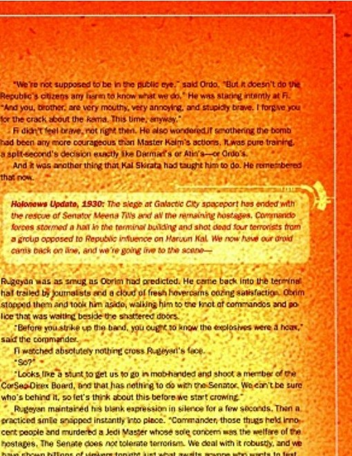

## scan p.70 (scan page 70)

Page contents: Scouting the Galaxy (Steve Sansweet; questioners omitted): choosing the Celebration III exclusive figure with Hasbro and Lucas Licensing (Howard Roffman, Derek Stothard, Darren Phillipson)—after Jorg Sacul, the focus became a special talking Darth Vader; Celebration III April 21–24, Indiana Convention Center; 1977 souvenir program booklet ($1.50, now $25–40). (hand-read)

- **none** — entry/section: Jorg Sacul: ""Three years ago, it was Jorg Sacul (blame me for the name), which was George Lucas in a Rebel pilot's outfit with an appropriate "biography" on the card back. I wrote the first draft of the bio...and I think there were a few words of mine left after the deft rewrite by Lucas Licensing President Howard Roffman!" —Steve Sansweet, Star Wars Insider 81, p. 70" Source: *Star Wars Insider #81* (2005), scan p.70
  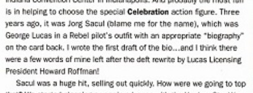

## scan p.71 (scan page 71)

Page contents: Scouting the Galaxy: Marvel oversized Special Editions values ($3–6); Celebration badge counts and Celebration II badge characters; Avalon Hill's The Queen's Gambit (2000), 155 pieces, three-level Theed Palace. (hand-read)

### Stat block notes (game mechanics, not feats)

- Celebration badges: There were 10 different ones for Celebration I, and I'm sorry to say 14 for Celebration II. But there are 16 for Celebration III! ... The badges at Celebration II were: Licensee: Mace Windu; Associate: Clone Trooper; Exhibitor: C-3PO; VIP Guest: Yoda; Staff: Zam Wesell; Press: Count Dooku; Three-Day Adult & Child (different color type): Anakin Skywalker; Friday Adult & Child: Obi-Wan Kenobi; Saturday Adult & Child: Jango Fett; Sunday Adult & Child: Padmé Amidala (Star Wars Insider 81, p. 71) (Source: *Star Wars Insider #81* (2005), scan p.71)

## scan p.72 (scan page 72)

Page contents: Scouting the Galaxy: Jedi costume patterns (licensed patterns; Rubie's deluxe Jedi capes); a collector's letter on completing every figure since the 1995 relaunch (writer omitted); column address. (hand-read)

## scan p.73 (scan page 73)

Page contents: Ad: DK Publishing Episode III reference books (Visual Dictionary, Cross-Sections etc.). (hand-read)

## scan p.74 (scan page 74)

Page contents: Hasbro Revenge of the Sith toy feature "The Force of a Lifetime!": line launches April 2; Randy Shoemaker quotes; Obi-Wan on Boga, Obi-Wan and Anakin's ARC-170 fighter, Jedi starfighters. (hand-read)

## scan p.75 (scan page 75)

Page contents: Hasbro toy feature continued: Mustafar battle playset, electronic lightsabers (Yoda training mode), blasters incl. Chewbacca bowcaster, Galactic Heroes, Darth Tater Mr. Potato Head; how the Lucasfilm/Hasbro teams chose Vader's rise as the key packaging message. (hand-read)

## scan p.76 (scan page 76)

Page contents: Revenge of the Sith video game preview (Brett Rector): release May 5; Associate Producer Justin Lambros; 16 missions plus 17th "what if" ending; skill meter; The Collective with Nick Gillard; movie footage cutscenes; 10 bonus missions; Versus Duel mode. (hand-read)

- **Darth Vader (Anakin Skywalker); Obi-Wan Kenobi** — entry/section: Episode III game story: ""The focus of our game is to interactively tell the core story of Anakin and Obi-Wan," says Associate Producer Justin Lambros. "Within that context, we will also expand and go beyond the film experience." To that end, the fast-paced single-player mode comes complete with 16 missions ... There is even a special 17th mission, which provides a "what if" alternate ending that is exclusive to the game. —Justin Lambros, Star Wars Insider 81, p. 76" Source: *Star Wars Insider #81* (2005), scan p.76
  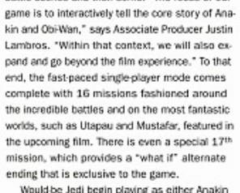

## scan p.77 (scan page 77)

Page contents: Ad: Starlog.com ("The home for horror on the Interrornet!"), Starlog store. (hand-read)

## scan p.78 (scan page 78)

Page contents: Puzzle page: "Lucas Films" crossword (solutions on p. 80 of the magazine). (hand-read)

## scan p.79 (scan page 79)

Page contents: Ad: Official Star Wars Fan Club / Hyperspace and Insider membership ("Get exclusive inside access to the making of the final Star Wars movie"). (hand-read)

## scan p.80 (scan page 80)

Page contents: Hyperspace "Jedi pickups" report: January greenscreen shoot of background Jedi's final moments; Stass Allie on a BARC speeder on Saleucami (VFX Supervisor John Knoll), played by ILM's Nina Fallon—third Stass performer; multiple performers for Plo Koon, Saesee Tiin, Luminara, Shaak Ti, Kit Fisto; bigger fans to blow robes. (hand-read)

### Stat block notes (game mechanics, not feats)

- Stass Allie recast: For this brief shot, Stass Allie is played by Nina Fallon, production coordinator at ILM. This marks no less than the third performer to fill Stass Allie's tall boots (including Lily Nyamwasa and Tace Bayliss). If you factor in that Stass is essentially Adi Gallia recast, then that number jumps up to four to account for Gin, who played Gallia in Episode I. (Star Wars Insider 81, p. 80) (Source: *Star Wars Insider #81* (2005), scan p.80)
- Many performers: It's nothing new. There are at least three Plo Koons, four Saesee Tiins, three Luminara Undulis, three Shaak Tis, and four Kit Fistos scattered throughout the prequel trilogy (Star Wars Insider 81, p. 80) (Source: *Star Wars Insider #81* (2005), scan p.80)

## scan p.81 (scan page 81)

Page contents: Hyperspace continued: Knoll on windshield-less speeders; Agen Kolar (Tux Akindoyeni) and Saesee Tiin (Kenji Oates) death close-ups, Lucas directing the falls; Matt Rowan returns as Orn Free Taa ("Rick should play him"; "Why don't you look on eBay?"); Obi-Wan tribute with Lucas and McGregor quotes. (hand-read)

- **Orn Free Taa** — entry/section: "Rick should play him": ""Rick should play him," said Lucas. "Of all the characters you could play, this should be the one." At the time, VFX Producer Janet Lewin was updating Lucas on the status of Orn Free Taa's makeup appliances since some of the pieces had gone missing. "Why don't you look on eBay?" deadpanned Lucas. —George Lucas, Star Wars Insider 81, p. 81" Source: *Star Wars Insider #81* (2005), scan p.81
  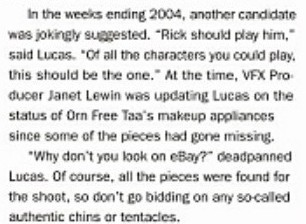
- **Obi-Wan Kenobi** — entry/section: Casting Obi-Wan: ""The first criteria for casting Obi-Wan Kenobi was somebody who was complementary to Alec Guinness—not copy it but create an addition to that character. Because he is younger and in a completely different place, he's a very active Jedi, so we needed someone very physical, a fantastic actor, and who could pick up the mannerisms and the essence of the Alec Guinness performance." —George Lucas, Star Wars Insider 81, p. 81" Source: *Star Wars Insider #81* (2005), scan p.81
  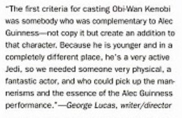
- **Darth Vader (Anakin Skywalker)** — entry/section: Podrace winds: ""You have to figure there's a force field or something there to help them out," he says. "I remember saying that in Episode I, Anakin's head would have been ripped off by the 600 mile-per-hour winds in the Podrace. We tried to bring in bigger fans to blow at the cockpit, but it didn't work. Jake couldn't hear George when we were shooting it."" Source: *Star Wars Insider #81* (2005), scan p.81
  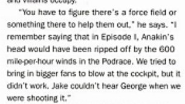

### Stat block notes (game mechanics, not feats)

- Grim final moments: Agen Kolar and Saesee Tiin required close-ups for their grim final moments, something that necessitated bringing in the real faces—in this case, Tux Akindoyeni as Kolar and Kenji Oates as Tiin. (Star Wars Insider 81, p. 81) (Source: *Star Wars Insider #81* (2005), scan p.81)

## scan p.82 (scan page 82)

Page contents: Hyperspace continued: McCallum and Lucas on McGregor; Nick Gillard Hyperspace Q&A; Photoreceptor archive photos (Koo Stark as Camie; Vader's spectral helmet; the Fixer [Tony Forrest]; Mandalorian sigils on early Boba Fett helmet; Paploo [Kenny Baker]); crossword solutions. (hand-read)

- **Darth Vader (Anakin Skywalker)** — entry/section: Anakin goes down swinging: "Q. Help us settle the fan debate: Does Anakin go down swinging, or does he resign himself to defeat? NG. He goes down like the biggest swinger in town. —Nick Gillard, Star Wars Insider 81, p. 82" Source: *Star Wars Insider #81* (2005), scan p.82
  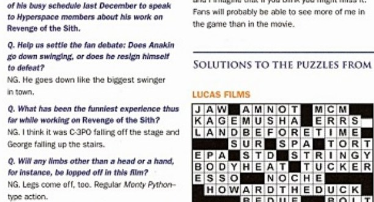
- **Mace Windu** — entry/section: Mace fights for his life: "NG. In Episode III, Mace has to use every ounce of his ability, which he really didn't have to do in Episode II. He has to fight for his life this time. —Nick Gillard, Star Wars Insider 81, p. 82" Source: *Star Wars Insider #81* (2005), scan p.82
  
- **Palpatine (Darth Sidious)** — entry/section: Sidious' fighting style: "NG. It took me a really long time to work out his style, and he has a style that's constantly changing, but I did it in a way that you'll never get the better of him. The style is ambiguous—he'll fight less than you and draw you in. You're a sucker if you think you're going to better him. —Nick Gillard, Star Wars Insider 81, p. 82" Source: *Star Wars Insider #81* (2005), scan p.82
  
- **Darth Vader (Anakin Skywalker); Obi-Wan Kenobi** — entry/section: Rehearsing the final duel: "NG. It took eight weeks—Hayden for eight weeks and Ewan for six weeks. There were a few sore fingers. —Nick Gillard, Star Wars Insider 81, p. 82" Source: *Star Wars Insider #81* (2005), scan p.82
  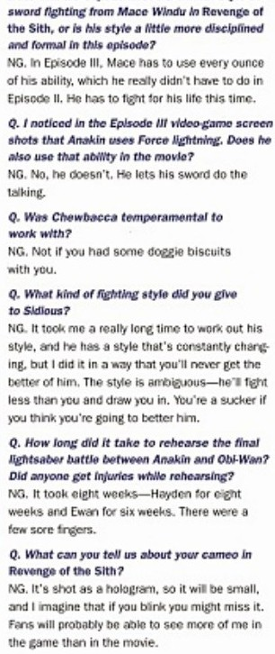

### Stat block notes (game mechanics, not feats)

- Mandalorian Eyes: Early paint explorations on Boba Fett's costume included organizational sigils of the Mandalorian supercommandos, an idea that was abandoned during the development of The Empire Strikes Back. (Star Wars Insider 81, p. 82) (Source: *Star Wars Insider #81* (2005), scan p.82)

## scan p.83 (scan page 83)

Page contents: Photoreceptor photos 1–6 (Camie, Vader helmet in Dagobah cave, Anchorhead group, an embrace beside a landspeeder ("Uh, Move Along"), Boba Fett helmet, Paploo on speeder bike) (mag p. 81). (hand-read)

## scan p.84 (scan page 84)

Page contents: "Line gear" humor feature (Gregory Harsh) for fans waiting in line for Revenge of the Sith (May 19): parody products (Jabba Slabba, Lite Side Sipper, Obi-Wand flashlight, R2-D2 Roll-On Deodorant). (hand-read)

## scan p.85 (scan page 85)

Page contents: Line gear humor continued: sleeping bag, Sabacc on Game Droid, Jawa Breakers, RotS cap and shirt, "C-3POD." (hand-read)

## scan p.86 (scan page 86)

Page contents: Skywalking/fan feature: a 501st Legion stormtrooper costumer ran the New York City Marathon in full armor in 2003 and 2004 for charity (costumer and memorialized members not named per policy). (hand-read)

## scan p.87 (scan page 87)

Page contents: Marathon feature continued: 2004 race, charities, support from 501st garrisons (names omitted). (hand-read)

## scan p.88 (scan page 88)

Page contents: Marathon feature concluded (501st record for consecutive time in armor at Dragon*Con 2003); "Star Wars Tattoo Art Draws Enduring Fandom": tattoosandtoys.com fan galleries (fan and wearer names omitted). (hand-read)

## scan p.89 (scan page 89)

Page contents: Tattoo feature continued: fan tattoos (Vader in Flames, Yoda, Darth Maul); custom vs flash work; reference to a tattoo article in Insider #26; Celebration III tattoo plans (names omitted). (hand-read)

## scan p.90 (scan page 90)

Page contents: Tattoo feature concluded (Imperial brand; fan names omitted); sidebar profile of Lucasfilm International Publicity Manager John Singh, photographed in 1978: saw Star Wars at age 10, lined up at San Diego's Valley Circle theater, filmed a Super-8 remake with friends. (hand-read)

## scan p.91 (scan page 91)

Page contents: Bantha Tracks editorial on fan "commitment" (marathon in armor, tattoos, brands, Celebration III volunteers); Bantha Tracks Online (every other Thursday on starwars.com for Hyperspace members) and Print; submission calls: Celebration III memories, line stories for Revenge of the Sith, Star Wars Kids drawings (how-to-draw by Randy Martinez, Thomas Hodges, Cynthia Cummens, Chris Trevas, Joe Corroney), Darth Vader art; submission guidelines. (hand-read)

## scan p.92 (scan page 92)

Page contents: StarWarsShop.com ad: Revenge of the Sith 15' x 10' vinyl theatrical teaser banners (Anakin's cloak casting Vader's shadow), sold as-is; poster art products. (hand-read)

## scan p.93 (scan page 93)

Page contents: StarWarsShop.com "Shop picks" by Lisa Stevens (CEO, Paizo Publishing; President, Star Wars Fan Club; favorite area: Star Wars arcade machines): #1 Gentle Giant 14" Darth Vader statue; #2 ESB photobusta set; #3 Code 3 Signature Edition Slave I; #4 Paul Jorden print for Muscular Dystrophy Association. (hand-read)

## scan p.94 (scan page 94)

Page contents: StarWarsShop.com products: gamer T-shirt, Clone Wars model sheet, Darth Vader FX lightsaber, framed prints. (hand-read)

## scan p.95 (scan page 95)

Page contents: StarWarsShop.com: LEGO ARC-170 Clone Fighter (three clone pilots), LEGO Connect and Build pen set, Vader framed pin set, Lightsaber Battle TV game, Vader chopper hat. (hand-read)

## scan p.96 (scan page 96)

Page contents: StarWarsShop.com: LEGO Wookiee Catamaran and Swamp Speeder (two Wookiees, two clone troopers, Yoda, Luminara Unduli), giant PEZ, Vader emblem pins, Anakin .45-scale Episode III lightsaber, Vader lunch kit. (hand-read)

## scan p.97 (scan page 97)

Page contents: StarWarsShop.com: Assassins basketball jersey, Republic and Separatist checkbook covers, Clone Wars Vol. 1 DVD, Yoda lunchbox, Vader manga mug, Kotobukiya Chewbacca vinyl kit, Vader life-size standee, Jedi trucker cap, Leia kid's T-shirt, Original Trilogy Vintage figure assortment Wave 2 and 12" case; free Topps RotS card with every purchase. (hand-read)

## scan p.98 (scan page 98)

Page contents: Hasbro Revenge of the Sith action figure gatefold ad (part 1). (hand-read)

## scan p.99 (scan page 99)

Page contents: Hasbro RotS figure gatefold (lineup photo: Sidious, Palpatine, Grievous, clone troopers, Aayla Secura, Shaak Ti, C-3PO, Padmé, Obi-Wan, etc.). (hand-read)

## scan p.100 (scan page 100)

Page contents: Hasbro RotS figure gatefold ("Celebrate Revenge of the Sith with the most incredible collection of Star Wars action figures the galaxy has ever seen"). (hand-read)

## scan p.101 (scan page 101)

Page contents: Hasbro 3 3/4" basic figure checklist (Anakin Skywalker, Super Battle Droid, Grievous's Bodyguard, General Grievous, Chancellor Palpatine, Vader's Medical Droid, Neimoidian Warrior, Commander Bacara, Anakin on Mustafar, Captain Antilles, Obi-Wan, etc.). (hand-read)

## scan p.102 (scan page 102)

Page contents: Back cover ad: Advent Rising (Majesco/GlyphX; Xbox, PC) — "It will be a great victory, if any human survives..." (non-Star Wars). (hand-read)

