# Owner Material 038 — Star Wars Insider #1–153 plus specials (with The Lucasfilm Fan Club Magazine #1–22): Star Wars Insider #82 (2005)

- **Source:** *Star Wars Insider* magazine (issues 23–153, 1994–2014) and its predecessor *The Lucasfilm Fan Club Magazine* (issues 1–22, 1987–1994), plus seven special editions: articles, interviews, comics and short fiction Secondary source (licensed Legends reference). Scan OCR'd on the box; the scan stays box-only and is **not** published.
- **Method:** every scanned page was OCR'd and machine-screened sentence by sentence for power-relevant statements (fights, kills, defeats, Force feats, rankings, superweapons) that name a character on our roster; each kept sentence is quoted verbatim from the OCR text and has a crop of the printed passage directly under it. Pages with nothing power-relevant are still listed with what is on them.
- **Citation:** "*Star Wars Insider #82* (2005), p.X" by printed page ("scan p.X" where no printed number applies). **Weight:** Licensed magazine: a secondary source. Its short fiction and comics are Legends stories; its articles and interviews sum up or discuss lore and rank below the novels, comics and games they describe.

## scan p.1 (scan page 1)

Page contents: Cover, Insider #82 (July/August 2005): Revealed—The Making of Star Wars: Episode III book; exclusive interview with Hayden Christensen; George Lucas takes center stage; making the jump to lightspeed; the last set diary; Bantha Tracks; exclusive online content. (hand-read)

## scan p.2 (scan page 2)

Page contents: Ad: Advent Rising (Majesco; Orson Scott Card story, Gideon Wyeth; $1,000,000 hidden-items contest; Xbox Live). (hand-read)

## scan p.3 (scan page 3)

Page contents: Ad continued (contest rules fine print, non-Star Wars). (hand-read)

## scan p.4 (scan page 4)

Page contents: Contents (July/August 2005): features The Starships of Episode III (Daniel Wallace), The Dark Lord Cometh (Hayden Christensen, Brett Rector), The Evil Within (Ian McDiarmid, Rector), Queen Mother of the Galaxy (Natalie Portman, Rector); departments Comlink, Skywalking (Mary Franklin and Brett Rector), Jedi Library (Jason Fry), Drawn by the Force (Wallace), Technical Readout (Chris Trevas), Ask the Master (Pablo Hidalgo), Anchorhead Arcade (Sid Shuman), Scouting the Galaxy (Steve Sansweet), Jabba's Collection (Rector), Best of Hyperspace (Hidalgo and Bonnie Burton), Bantha Tracks (Mary Franklin), Laugh It Up, Fuzzball (Randy Martinez). (hand-read)

## scan p.5 (scan page 5)

Page contents: Ad: vintage action figure buyer (pre-1990 toys, prototypes and rarities). (hand-read)

## scan p.6 (scan page 6)

Page contents: Editor's letter "A Story 28 Years in the Making" (Brett Rector): May 2005 and the final film; first issue in more than 10 years without a Prequel Update; TV series and fourth Indiana Jones confirmed; 48 Hours of the Force (April 2); Celebration III in Indianapolis; Lucas live on stage for first time at a convention since 1987; masthead. (hand-read)

## scan p.7 (scan page 7)

Page contents: Ad: Star Wars Republic Commando / Jedi video game ("Protect the Republic and join the Jedi in their struggle against the dark side"). (hand-read)

## scan p.8 (scan page 8)

Page contents: Comlink letters (writer names omitted): a deployed soldier praises Karen Traviss' commando fiction; Insider replies that Traviss served as a defense correspondent and in the Royal Naval Auxiliary and Territorial Army, recommends Republic Commando: Hard Contact, and notes a costume exhibition in September at the Fashion Institute of Design & Merchandising in Los Angeles; letters on the new Insider, Mandalorian history, role-playing content. (hand-read)

## scan p.9 (scan page 9)

Page contents: Comlink continued: Star Wars TV series to be set between Episodes III and IV; clones become stormtroopers by A New Hope (see Ask the Master); original trilogy CD-ROM (Behind the Magic) and LucasArts' Insider's Guide to The Phantom Menace; Master Replicas Darth Vader sweepstakes (ends August 31, 2005). (hand-read)

## scan p.10 (scan page 10)

Page contents: Skywalking: Celebration III report opener "The Dark Side Invades Indianapolis!" (Mary Franklin and Brett Rector). (hand-read)

## scan p.11 (scan page 11)

Page contents: Celebration III: an estimated 32,000 fans at the Indiana Convention Center; Lucasfilm Archive exhibit, celebrity hosts Jay Laga'aia and Warwick Davis, Fan Fair hall. (hand-read)

## scan p.12 (scan page 12)

Page contents: "Jedi Master: George Lucas": first Star Wars convention appearance since 1987; three capacity Saturday sessions; Rick McCallum and host Jay Laga'aia introduce Lucas' children Jett (Zett Jukassa) and Katie (Chi Eekway); Lucas on the animated Clone Wars series and a live-action spin-off series. (hand-read)

- **none** — entry/section: Clone Wars pilot: ""You know, we're doing a pilot television series now called Clone Wars," responded Lucas when asked about the possibility of Star Wars coming to television. "We're going to take that and turn it into a 3D animated version series." —George Lucas, Star Wars Insider 82, p. 12" Source: *Star Wars Insider #82* (2005), scan p.12
  
- **none** — entry/section: Live-action spin-off: ""We're also working on a spin-off series," he added, "with some characters who have appeared before; that will be a live action series. We're probably not going to start that for about a year. Like on The Young Indiana Jones Chronicles, we want to write the stories for the entire first season all at once. I'm going to get it started and hire the show runners and all of that, and then I'll probably step away." —George Lucas, Star Wars Insider 82, p. 12" Source: *Star Wars Insider #82* (2005), scan p.12
  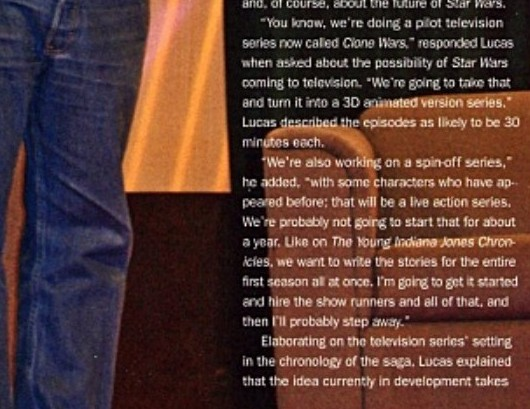

### Stat block notes (game mechanics, not feats)

- Lucas' children in Revenge of the Sith: They appear in Revenge of the Sith, Jett as Zett Jukassa and Katie as Chi Eekway. (Star Wars Insider 82, p. 12) (Source: *Star Wars Insider #82* (2005), scan p.12)

## scan p.13 (scan page 13)

Page contents: Lucas Q&A continued: TV series set between Episodes III and IV; Anakin Starkiller origins and the serial format; Lucas would be R2-D2, has red and blue lightsabers; thanks to fans; "Rick McCallum's Spectacular Spectacular" Episode III footage and ILM reel in the 500 Ballroom (40-foot screen). (hand-read)

- **none** — entry/section: TV series characters: ""There's none of the main characters from I, II, and III (or IV, V and VI for that matter) in the..." he stopped in midsentence. "Well, actually, that's not exactly true now that I think about it. We haven't really started the TV show, so it's hard to answer. There are a lot of issues that are connected, but you won't necessarily see a lot of the people that are connected." —George Lucas, Star Wars Insider 82, p. 13" Source: *Star Wars Insider #82* (2005), scan p.13
  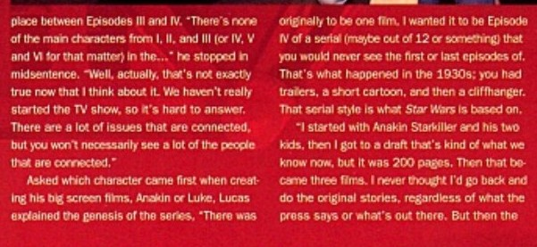
- **Darth Vader (Anakin Skywalker); Luke Skywalker** — entry/section: Anakin Starkiller and the serial: ""There was originally to be one film. I wanted it to be Episode IV of a serial (maybe out of 12 or something) that you would never see the first or last episodes of. That's what happened in the 1930s; you had trailers, a short cartoon, and then a cliffhanger. That serial style is what Star Wars is based on. "I started with Anakin Starkiller and his two kids, then I got to a draft that's kind of what we know now, but it was 200 pages. Then that became three films. I never thought I'd go back and do the original stories, regardless of what the press says or what's out there. But then the necessary film technology came along and I came to grips with being known forever as George 'Star Wars' Lucas." —George Lucas, Star Wars Insider 82, p. 13" Source: *Star Wars Insider #82* (2005), scan p.13
  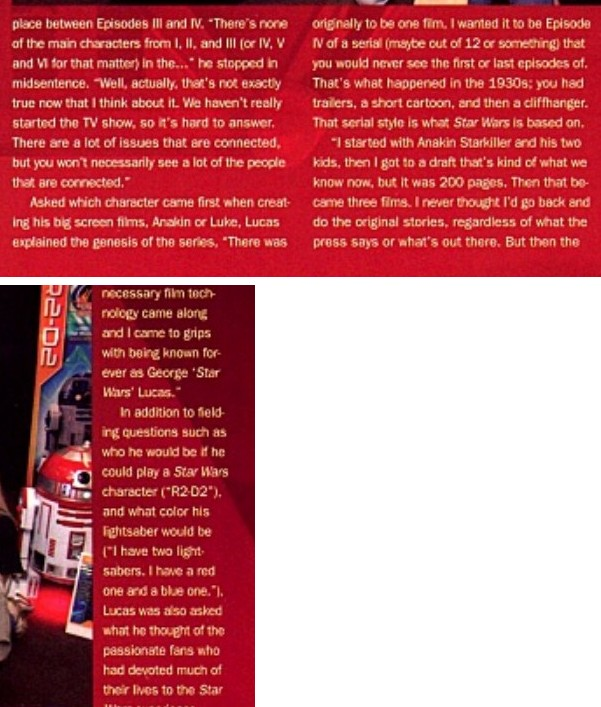
- **Luke Skywalker** — entry/section: Leave your uncle's moisture farm: ""I am very grateful to you all," he said. "I've been very surprised. Star Wars is something to enjoy and take away what you can from it that maybe helps you in your lives...the point of the movies is to get on with your lives, to take that challenge, to leave your uncle's moisture farm, to go out into the world and change it to save the universe." —George Lucas, Star Wars Insider 82, p. 13" Source: *Star Wars Insider #82* (2005), scan p.13
  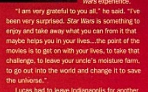

### Stat block notes (game mechanics, not feats)

- Lucas would be R2-D2: In addition to fielding questions such as who he would be if he could play a Star Wars character ("R2-D2"), and what color his lightsaber would be ("I have two lightsabers. I have a red one and a blue one."), (Star Wars Insider 82, p. 13) (Source: *Star Wars Insider #82* (2005), scan p.13)

## scan p.14 (scan page 14)

Page contents: Opening Ceremony hosted by Steve Sansweet (entered disguised as a stormtrooper with the 501st and Darth Vader): Rick McCallum, Lisa Stevens, Howard Roffman (exclusive "Fall of Heroes" music video from Sony's Episode III soundtrack); MCs Tom Berg, Doug Steves, Warwick Davis, Jay Laga'aia; Star Wars in 30 Minutes, Charlie Ross' One-Man Star Wars Trilogy, Star Wars: Musical Edition; "My, My, This Here Anakin Guy"; Master Replicas lightsaber battle; video greetings from Jackson, Lee, Portman, McGregor, McDiarmid, Christensen; Walk of Luminaries; Jim Ward's saga reel; exhibit halls: Fan Fair, Death Star diorama build, Burger King Jedi Training Academy (fan names omitted). (hand-read)

## scan p.15 (scan page 15)

Page contents: Ad: Official Pix—Lucasfilm archive photographs and autographs (C2 Ventures). (hand-read)

## scan p.16 (scan page 16)

Page contents: Celebration III report continued: tattoo art display and Sunday Star Wars Tattoo Show, life-size X-wing, Xbox arena, Stormtrooper Olympics (501st Legion), Droidyard 500 races; Autograph Hall (Official Pix) guests incl. Michonne Bourriague (Aurra Sing), Kenny Baker (R2-D2), Amy Allen (Aayla Secura), Peter Mayhew (Chewbacca), David Prowse (Darth Vader), Jeremy Bulloch (Boba Fett and Captain Colton), Leeanna Walsman (Zam Wesell), Billy Dee Williams (Lando Calrissian) and more than 30 others; R2-D2 Builders' Room (volunteer effort; Don Bies brought Lucas and McCallum to visit); Lucasfilm Archive Exhibit "As the Shroud of the Dark Side Falls... New Hope Dawns" (volunteer and fan names omitted). (hand-read)

## scan p.17 (scan page 17)

Page contents: Ad: Brian's Toys (Star Wars toys 1977–present). (hand-read)

## scan p.18 (scan page 18)

Page contents: Archive Exhibit continued (Obi-Wan and Anakin's lava-burned costumes, RotS Darth Vader costume, Wookiee warriors, Yoda, two Millennium Falcon models, landspeeder and sandcrawler); Exhibit Hall licensees and exclusives (Gentle Giant sandtrooper corporal bust, ESB 3D poster); 2005 Fan Film Awards hosted by Warwick Davis (his Video Nasty, Return of the Ewok, world premiere of Willow: A Short Perspective; Howard Roffman presented Davis the 2005 Pioneer Award for Return of the Ewok; Don Bies with R2-D2; Dan Gregoire); Costume Pageant and Costume Cabaret (fan winners, entrants and fan filmmakers omitted). (hand-read)

## scan p.19 (scan page 19)

Page contents: Ad: Gen Con Indy (August 18–21, 2005, Indiana Convention Center), lightsaber in a packed suitcase (non-Star Wars event ad). (hand-read)

## scan p.20 (scan page 20)

Page contents: Jedi Library (Jason Fry): Lucasfilm Senior Editor Jonathan Rinzler and The Making of Star Wars: Revenge of the Sith (Del Rey, $35) and The Art of Star Wars: Revenge of the Sith; free eBook final chapter; Grievous' development from Warren Fu's droid with organic eyes, sculptor Robert Barnes, ILM, Matthew Wood's voice and Lucas' cough; Rinzler as a Naboo funeral-scene extra. (hand-read)

### Stat block notes (game mechanics, not feats)

- Grievous foreshadows Vader: An evil child, a Medusa-like woman, and floating heads didn't resonate with Lucas; Warren Fu's droid with organic eyes did. "I think that idea clicked with George because you had something that foreshadowed Darth Vader," Rinzler says. (Star Wars Insider 82, p. 20) (Source: *Star Wars Insider #82* (2005), scan p.20)
- Lucas' cough for Grievous: ILM's Matthew Wood may have supplied the voice of Grievous, but Lucas had a unique contribution: Cough into a mike with sound wizards around, and you never know what will happen. (Star Wars Insider 82, p. 20) (Source: *Star Wars Insider #82* (2005), scan p.20)

## scan p.21 (scan page 21)

Page contents: Rinzler continued: Lucas never upset on set; the physical demands of moviemaking; Hayden and Ewan's real duel; Lucas reviewing animatics two to three hours a day for close to a year; DK and other book listings. (hand-read)

- **Darth Vader (Anakin Skywalker); Obi-Wan Kenobi** — entry/section: "They're actually doing it": ""My hat's off to Hayden and Ewan," he says, noting that for all Revenge of the Sith's digital trickery, the lightsaber duel between Christensen and McGregor is far from fake. "They're actually doing it," he says. "They are so fast and so good." —Jonathan Rinzler, Star Wars Insider 82, p. 21" Source: *Star Wars Insider #82* (2005), scan p.21
  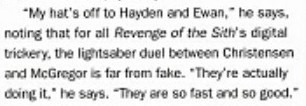

## scan p.22 (scan page 22)

Page contents: Jedi Library continued: "Cutting Up the Sith"—Hans Jenssen and Richard Chasemore's Revenge of the Sith Incredible Cross-Sections (DK, $19.99; text by Curtis Saxton): nearly 24 Episode III vehicles incl. Venator-class Star Destroyer, Jedi interceptor, Republic Juggernaut, Wookiee catamaran, and a gatefold of Invisible Hand; computer vs physical models; Don Bies' ILM tour incl. the original Star Destroyer. (hand-read)

## scan p.23 (scan page 23)

Page contents: Ad: Empire Earth II (Sierra; "Twice the power. Twice the glory."; non-Star Wars RTS game). (hand-read)

## scan p.24 (scan page 24)

Page contents: Cross-Sections continued: Anakin's starfighter process (Erik Tiemens, Ryan Church), ARC-170 resembling an Episode IV fighter, the "Joe Johnston Juggernaut"; Doug Chiang used Chasemore's classic-trilogy art for the Episode II Slave I; Jenssen's trips to Leavesden, Skywalker Ranch, ILM; upcoming Complete Locations. (hand-read)

### Stat block notes (game mechanics, not feats)

- Chasemore's Slave I weapons: Chasemore recalls asking Concept Design Supervisor Doug Chiang where then to put the weapons in the Episode II version of Slave I. Chiang's answer: Chasemore should know because he put them there. "I felt so proud that they had actually used my artwork from the [classic-trilogy book] as reference for the new Slave I," Chasemore says. (Star Wars Insider 82, p. 24) (Source: *Star Wars Insider #82* (2005), scan p.24)

## scan p.25 (scan page 25)

Page contents: Ad: Code 3 Collectibles Star Wars Republic Gunship (limited edition, 2,500 worldwide, die-cast metal, non-removable figures, lower tail ramp exposes speeder bikes). (hand-read)

## scan p.26 (scan page 26)

Page contents: Drawn by the Force (Daniel Wallace): Dark Horse's Star Wars Visionaries (128-page anthology by 11 Episode III concept artists, pitched by Jonathan Rinzler; editor Jeremy Barlow); Derek Thompson's "Sithisis" (Darth Sidious' secret meditation, with a 45-minute phone interview with Ian McDiarmid); Warren Fu's Grievous origin; Aaron McBride's "Old Wounds." (hand-read)

- **Palpatine (Darth Sidious)** — entry/section: "Sithisis": ""I wanted to explore an intimate and unseen aspect of Sith ritual," he says, "and I liked the idea of seeing just what Sidious does before he becomes Palpatine for the last time. I always found his character fascinating and felt that a glimpse behind the veil of his secrecy would be cool to see." —Derek Thompson, Star Wars Insider 82, p. 26" Source: *Star Wars Insider #82* (2005), scan p.26
  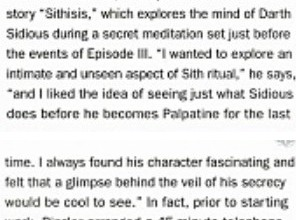
- **General Grievous; Darth Vader (Anakin Skywalker)** — entry/section: The birth of General Grievous: ""My story essentially deals with the birth of General Grievous," he says. "It follows him from his mysterious shuttle accident as a noble Khalee general to his rebirth as a cold-blooded cyborg. I figured that the fans would like to know how Grievous came to be. This is my chance to not only tell them but also to show them." —Warren Fu, Star Wars Insider 82, p. 26" Source: *Star Wars Insider #82* (2005), scan p.26
  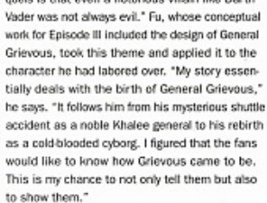

## scan p.27 (scan page 27)

Page contents: Visionaries continued: McBride on Obi-Wan and Owen; Barlow: "He doesn't let just any slouch in there"; sidebar list of all 11 stories (about half fit continuity). (hand-read)

- **Obi-Wan Kenobi; Owen Lars; Darth Maul** — entry/section: Bad blood with Uncle Owen: ""After all [Obi-Wan] lost, he still chose to protect the children of the man who tried to kill him in the hopes of one day restoring peace," McBride points out. "Yet Owen still treats him with contempt, and a whole empire wants to kill him." —Aaron McBride, Star Wars Insider 82, p. 27" Source: *Star Wars Insider #82* (2005), scan p.27
  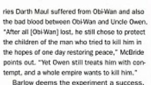

### Stat block notes (game mechanics, not feats)

- "Old Wounds": "Old Wounds" by Aaron McBride: A few years after Revenge of the Sith, Darth Maul confronts Obi-Wan Kenobi at the Lars homestead on Tatooine. (Star Wars Insider 82, p. 27) (Source: *Star Wars Insider #82* (2005), scan p.27)
- Wat Tambor's lost eye: "Wat Tambor and the Quest for the Sacred Eye of the Albino Cyclops" by Michael Murnane: The story is set before Revenge of the Sith and follows Techno Union foreman Wat Tambor's surreal journey to find a replacement for an eye he lost by Anakin Skywalker's hand. (Star Wars Insider 82, p. 27) (Source: *Star Wars Insider #82* (2005), scan p.27)
- "Prototypes": "Prototypes" by Robert E. Barnes: The story behind bounty hunter Durge's intense hatred of the Mandalorians (Star Wars Insider 82, p. 27) (Source: *Star Wars Insider #82* (2005), scan p.27)
- "The Eyes of Revolution": "The Eyes of Revolution" by Warren Fu: The origin of General Grievous (Star Wars Insider 82, p. 27) (Source: *Star Wars Insider #82* (2005), scan p.27)

## scan p.28 (scan page 28)

Page contents: Feature opener: "Galactic Crush!" The starships and battle cruisers of Revenge of the Sith (Daniel Wallace). (hand-read)

## scan p.29 (scan page 29)

Page contents: Starships feature: Episode III's opening Battle of Coruscant as naval battle rivaling Endor; 19th-century high-seas combat analogy (Anakin and Obi-Wan board the enemy flagship); influences from clipper ships to WWII fighters. (hand-read)

## scan p.30 (scan page 30)

Page contents: Starships of Episode III: Invisible Hand (Separatist flagship, Trade Federation Providence-class carrier/destroyer, observation platform where Palpatine was held hostage by Dooku; name from Adam Smith; built by Quarren exiles; Confederacy insignia like a TIE solar panel); Venator-class Star Destroyer (battleship and starfighter carrier; larger than the EU Victory-class, smaller than 1,600-meter Imperial Star Destroyers). (hand-read)

### Stat block notes (game mechanics, not feats)

- Palpatine held aboard the Invisible Hand: The Invisible Hand even had an observation platform, built within a sensor pod high above the dorsal hull, from which its masters could savor the mayhem they had unleashed. It was here, framed by 180-degree windows, that Chancellor Palpatine was held hostage by Count Dooku. (Star Wars Insider 82, p. 30) (Source: *Star Wars Insider #82* (2005), scan p.30)

## scan p.31 (scan page 31)

Page contents: Commerce Guild Recusant-class destroyer and IBC Munificent-class frigate ("visible guts" style, droid crews); Droid Tri-Fighter (Colla Designs and Phlac-Arphocc Automata, Colicoids; alien design "otherness"). (hand-read)

## scan p.32 (scan page 32)

Page contents: Techno Union Mankvim-814 interceptor (built on Utapau, strength in numbers); Republic V-wing (new alphabet ship, Q7 astromech, compare to Dark Empire's original V-wing speeder and Rogue Squadron). (hand-read)

## scan p.33 (scan page 33)

Page contents: Republic ARC-170 (Aggressive ReConnaissance; tail gunner lineage from McQuarrie's Y-wing concept and the Stuka; Incom/Subpro precursor to the X-wing; Z-95 Headhunter sister ship; S-foils as radiators; Odd Ball and Kenobi's Open Circle fleet insignia). (hand-read)

## scan p.34 (scan page 34)

Page contents: Jedi interceptor (Eta-2 Actis; TIE-like octagonal windshield, wingtip radiators, hyperspace docking ring, astromech socket; irony that Jedi craft mimic the "evil" designs). (hand-read)

### Stat block notes (game mechanics, not feats)

- Anakin and R2 fly together again: The Jedi interceptor has no built-in hyperdrive and instead relies on an external hyperspace docking ring for galactic hops. It features a plug-in socket for an astromech droid, allowing Anakin and R2-D2 to fly together for the first time since The Phantom Menace. (Star Wars Insider 82, p. 34) (Source: *Star Wars Insider #82* (2005), scan p.34)

## scan p.35 (scan page 35)

Page contents: Tantive IV (Corellian corvette, Alderaanian property, Senator Bail Organa, Captains Colton and Antilles; "everything old is new again"). (hand-read)

## scan p.36 (scan page 36)

Page contents: Technical Readout/Set Piece: Rebel Blockade Runner Tantive IV (Chris Trevas) — Vader's entrance shot July 14, 1976, Stage 9 Elstree (82nd day); three units (Lucas, Gary Kurtz, Robert Watts); editor Richard Chew on six cameras; McQuarrie suggested Vader's face mask; John Mollo's costume; Prowse's poor visibility; Gavin Bocquet recreated the set for RotS. (hand-read)

- **Darth Vader (Anakin Skywalker)** — entry/section: "The scene was so short": ""The scene was so short, but because the angles were so drastically different, we were able to overlap some of the action and extend the length of the scene," said Editor Richard Chew. —Richard Chew, Star Wars Insider 82, p. 36" Source: *Star Wars Insider #82* (2005), scan p.36
  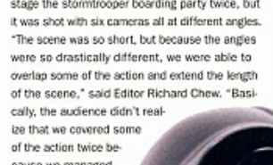
- **Darth Vader (Anakin Skywalker)** — entry/section: "The whole caboodle": ""It was a matter of making it in certain pieces so that you could quickly take off bits on the set so that he wouldn't have to go around all day in the whole caboodle," recalled Mollo. —John Mollo, Star Wars Insider 82, p. 36" Source: *Star Wars Insider #82* (2005), scan p.36
  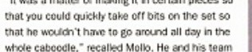

## scan p.37 (scan page 37)

Page contents: Set piece callouts: stormtrooper blasters from Sterling submachine guns; red exit lights; Prowse's role choice; Mollo's Academy Award; Ben Burtt's breathing; Rebel Fleet Trooper helmets from U.S. Navy MK-2 Talker helmets; Rebel blasters. (hand-read)

- **Darth Vader (Anakin Skywalker); Chewbacca** — entry/section: "Everyone remembers the villain": "Dave Prowse was initially offered his choice of two roles, Chewbacca or Darth Vader. He immediately chose the Dark Lord. "In my experience, everyone remembers the villain," he said. —David Prowse, Star Wars Insider 82, p. 37" Source: *Star Wars Insider #82* (2005), scan p.37
  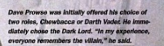

### Stat block notes (game mechanics, not feats)

- Vader's breathing: To create Darth Vader's labored breathing, Sound Designer Ben Burtt put a tiny microphone inside the regulator of a scuba tank and then breathed inside a diving mask. (Star Wars Insider 82, p. 37) (Source: *Star Wars Insider #82* (2005), scan p.37)

## scan p.38 (scan page 38)

Page contents: Ask the Master (Pablo Hidalgo), "A Grab Bag of Lightsabers": Grievous' trophy lightsaber is Obi-Wan's (Ty Teiger prop; Luke's Episode VI saber resembles it); did the Sith continue (Vader and Sidious seeking secret apprentices; Emperor's Hands; Vader's apprentices Tyne Vost, Hethrir, Shira Brie/Lumiya; Sith relics and followers). Questioners omitted. (hand-read)

### Stat block notes (game mechanics, not feats)

- Obi-Wan's saber in Grievous' collection: The center lightsaber actually belongs to Obi-Wan Kenobi. It's a digital model created from the physical one designed by Ty Teiger in the Prop Department. (Star Wars Insider 82, p. 38) (Source: *Star Wars Insider #82* (2005), scan p.38)
- Rule of two and secret apprentices: Darth Sidious and Darth Vader were the last of the secretive Sith Lords, following the "rule of two" covenant that kept the order alive in the shadows for a thousand years. But after Sidious assumed the mantle of Emperor and defeated the Jedi, he realized that Vader was not the prize apprentice he wanted. (Star Wars Insider 82, p. 38) (Source: *Star Wars Insider #82* (2005), scan p.38)
- Lumiya's self-applied title: Of these three, Lumiya is the one with the most Sith knowledge, but her title of "Dark Lady of the Sith" is self-applied. (Star Wars Insider 82, p. 38) (Source: *Star Wars Insider #82* (2005), scan p.38)

## scan p.39 (scan page 39)

Page contents: Ad: Star Wars Episode III: Revenge of the Sith video game (LucasArts; "The ultimate Jedi action experience"; play as Anakin Skywalker and Obi-Wan Kenobi, multiplayer modes, space battles with up to 17 unlockable ships). (hand-read)

## scan p.40 (scan page 40)

Page contents: Ask the Master continued: stormtrooper faces in A New Hope (Empire used other clone hosts and conscripts; Dark Force Rising cloned faces); ARC troopers vs clone commandos (Jango-trained ARCs, squads of four; EU only); Tank (Luke's friend; nickname from brawny build); photo of Imperial Shock Trooper, Commander Bly, AT-RT driver. (hand-read)

### Stat block notes (game mechanics, not feats)

- ARC troopers: ARC troopers are a specially bred type of clone special forces created in small numbers. They don't undergo the docility tampering that makes the other clone types less independent, and they have been handtrained by Jango Fett during his time at the Kamino facilities. (Star Wars Insider 82, p. 40) (Source: *Star Wars Insider #82* (2005), scan p.40)
- Tank: He's not in any way connected to Episode III. As stated in the film, Tank was one of Luke Skywalker's teenage friends who left Tatooine to join the Academy. Tank is just a nickname that was earned due to his rather brawny build. (Star Wars Insider 82, p. 40) (Source: *Star Wars Insider #82* (2005), scan p.40)

## scan p.41 (scan page 41)

Page contents: Ad: Star Wars Trading Card Game, Revenge of the Sith expansion (Wizards of the Coast). (hand-read)

## scan p.42 (scan page 42)

Page contents: Ask the Master continued: toppled Palpatine statue in the ROTJ Special Edition; "There'll be no one to stop us this time" — the Senate as check on the Empire (Commander Daine Jir, radio-drama Ralltiir exchange of Vader and Leia, Tagge); the Death Star changes everything. (hand-read)

### Stat block notes (game mechanics, not feats)

- "No one to stop us": The Death Star was to change everything. When it was confirmed to be operational, Palpatine disbanded the Senate. His regional governors were to take over, and if any of the member worlds even considered rebelling, Palpatine had the ability to rule through fear and threaten any treasonous world with utter obliteration. There would be no one to stop him as Vader said. (Star Wars Insider 82, p. 42) (Source: *Star Wars Insider #82* (2005), scan p.42)

## scan p.43 (scan page 43)

Page contents: Ad: Star Wars Miniatures (Wizards of the Coast, "Stage your own epic battles"). (hand-read)

## scan p.44 (scan page 44)

Page contents: Ask the Master continued: Republic's main early-war starfighter (Torrent V-19, later ARC-170 and V-wing); Mon Mothma's daughter Lieda (Dark Empire Sourcebook; New Essential Guide to Characters; mother Tanith Mothma; brother Corporal Jobin per Visionaries); why Qui-Gon cut the blast door; Naboo after Episode III (Star Wars Galaxies, Queen Kylantha, ROTJ DVD coda); Iridonia's location (Mid Rim, near Ord Mantell); map art. Questioners omitted. (hand-read)

### Stat block notes (game mechanics, not feats)

- Why Qui-Gon used his lightsaber on the door: The door that Obi-Wan Kenobi opened wasn't locked and was fairly lightweight. The door that kept Qui-Gon Jinn out was a heavily armored blast door. Not even Qui-Gon could have opened it in time if he just relied on telekinesis, hence his improvised lightsaber solution. (Star Wars Insider 82, p. 44) (Source: *Star Wars Insider #82* (2005), scan p.44)

## scan p.45 (scan page 45)

Page contents: Ad: Official Star Wars Fan Club / Hyperspace membership (Insider subscription, membership kit with letter from George Lucas). (hand-read)

## scan p.46 (scan page 46)

Page contents: Photo: Hayden Christensen as scarred Anakin, half-merged with Vader's helmet. (hand-read)

## scan p.47 (scan page 47)

Page contents: Feature opener: "The Dark Lord Cometh" — "After a hiatus of more than 20 years, Darth Vader is back, and Hayden Christensen has the cinematic scars to prove it." By Brett Rector. (hand-read)

## scan p.48 (scan page 48)

Page contents: Christensen interview: Vader's 1977 entrance; Christensen cast at 19 for AOTC; arrived in Sydney two months early to train with Nick Gillard; rehearsing the duel with Ewan McGregor until muscle memory; heat and costumes; the duel as storytelling (exchange of power, the Chosen One comes out short). (hand-read)

## scan p.49 (scan page 49)

Page contents: Interview continued: credits Gillard; Gillard plays a Jedi instructor Anakin kills in the Temple (accidental lightsaber gash); Anakin and Obi-Wan as comrades. (hand-read)

- **Darth Vader (Anakin Skywalker)** — entry/section: "I've taken you now": ""Yes. I had a scene where Nick plays a Jedi instructor, and I go in and kill him and these two [Padawans]. It was another one of those cases of the Master and the apprentice, and the apprentice overthrowing the Master. It was my scene to say, "I've taken you now." We just had so much fun with it. I clipped him right in the forehead and gave him a little gash with my lightsaber, which was a total accident. He thinks it was intentional, but I didn't mean to do it. In the next take, he smacked me in the head and got me back." —Hayden Christensen, Star Wars Insider 82, p. 49" Source: *Star Wars Insider #82* (2005), scan p.49
  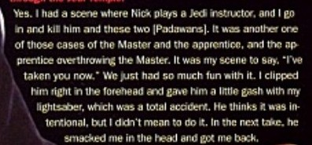

## scan p.50 (scan page 50)

Page contents: Interview continued: Butch Cassidy and the Sundance Kid comparison; bridging Jake Lloyd's Anakin and Sebastian Shaw's unmasked Vader; motivation from circumstance; working with Ian McDiarmid (the opera scene). (hand-read)

## scan p.51 (scan page 51)

Page contents: Interview continued: getting into the Vader suit (new suit built to fit him, muscle suit, five-inch stilts, limited vision, fear of scuffing the helmet; voice replaced by James Earl Jones; breathing apparatus in the costume). (hand-read)

- **Darth Vader (Anakin Skywalker)** — entry/section: "The connective tissue": ""It was a great privilege to get to play Anakin and form who Darth Vader is because it really explains why Vader behaves the way he does in the original trilogy. My role was the connective tissue..." —Hayden Christensen, Star Wars Insider 82, p. 51" Source: *Star Wars Insider #82* (2005), scan p.51
  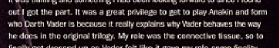

## scan p.52 (scan page 52)

Page contents: Interview continued: burned-Anakin prosthetic (one day; torn off), playing Vader from the outside in, Vader's mystery, prequels and mystique, Anakin's "noble" excuses, childhood (G.I. Joe, He-Man, hockey posters; Lucas book The Creative Impulse); nostalgia in the suit; the final showdown. Relative omitted. (hand-read)

- **Darth Vader (Anakin Skywalker)** — entry/section: Vader's mystique now informed: ""I think it's impossible not to damage his mystique. The reason Vader resonated so much with audiences was because he represented the unknown. He did all these evil things and talked in a very villainous way, but outside of that you knew nothing about him. And it's [because of] the unknown that the mind is able to infer all of your worst fears. I think it is inevitable that some of the mystique no longer will be mystical—it's now informed." —Hayden Christensen, Star Wars Insider 82, p. 52" Source: *Star Wars Insider #82* (2005), scan p.52
  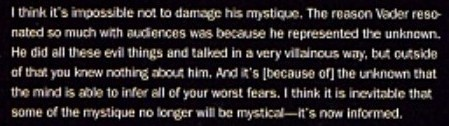
- **Darth Vader (Anakin Skywalker)** — entry/section: "He's not really mine": ""All of a sudden, I felt very connected to this character who is so prominently embedded in popular culture; I didn't really feel that while playing Anakin because Anakin was mine. Even though Darth Vader is a part of me, he's not really mine." —Hayden Christensen, Star Wars Insider 82, p. 52" Source: *Star Wars Insider #82* (2005), scan p.52
  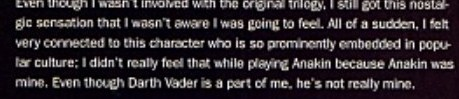

## scan p.53 (scan page 53)

Page contents: Ad: officially licensed Star Wars game controllers ("Choose your destiny...play"). (hand-read)

## scan p.54 (scan page 54)

Page contents: Photo page with pull quote: "[Vader] is a man behind a mask, and up until now we didn't know who that man was." —Hayden Christensen. (hand-read)

## scan p.55 (scan page 55)

Page contents: Ad: Alienware Star Wars PC ("Experience the power of the Force with the first Star Wars PC ever!"). (hand-read)

## scan p.56 (scan page 56)

Page contents: Feature opener: Ian McDiarmid ("nearly steals the show as the galaxy's ultimate villain"), by Brett Rector. (hand-read)

## scan p.57 (scan page 57)

Page contents: Photo: Sidious with red lightsaber. (hand-read)

## scan p.58 (scan page 58)

Page contents: McDiarmid interview: bio (born Carnoustie, Scotland, Aug. 11, 1944; St Andrews psychology; Royal Academy in Glasgow gold medal; Royal Shakespeare Company; The Professionals; Richard's Things; ROTJ; Gorky Park; Dirty Rotten Scoundrels; Almeida Theatre; 2001 Critics' Circle award for Faith Healer); script focus on Anakin–Palpatine; "Palpatine turned into action man"; stunt double Michael Byrne; Yoda duel; Gillard, Sleepy Hollow; Samuel L. Jackson's help. (hand-read)

- **Palpatine (Darth Sidious)** — entry/section: "Palpatine turned into action man": ""I found when I read the script that not only did I have a lot to say, but I also had a lot to do—Palpatine turned into action man. He always had a sharp brain and he had certain electrical lightning power in (his) fingers, but I didn't know he could use a lightsaber and twice as fast—no 500 times as fast—as anyone else." —Ian McDiarmid, Star Wars Insider 82, p. 58" Source: *Star Wars Insider #82* (2005), scan p.58
  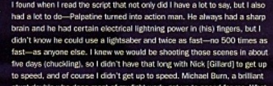

## scan p.59 (scan page 59)

Page contents: Interview continued: opera-box scene shot the same day as the Mace duel; prosthetic by Dave Elsey (and Colin Ware); contact lenses; Palpatine's seduction of Anakin; fatherless Anakin; Palpatine arranged nearly everything; rebuilding Anakin; touching Anakin's forehead; Palpatine vs Sidious. (hand-read)

- **Palpatine (Darth Sidious); Darth Vader (Anakin Skywalker)** — entry/section: "The greatest villain of all time—next to himself": ""He finds Anakin near death, and like all arch political pragmatists, Palpatine converts a seeming tragedy into an opportunity and rebuilds him as this huge, unsympathetic metal creature, (thereby) creating the greatest villain of all time—next to himself, of course. Palpatine wanted the greatest warrior ever, which Anakin clearly is, to protect the Empire." —Ian McDiarmid, Star Wars Insider 82, p. 59" Source: *Star Wars Insider #82* (2005), scan p.59
  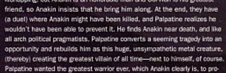
- **Palpatine (Darth Sidious); Darth Vader (Anakin Skywalker)** — entry/section: The only human moment in the Emperor: ""There is one moment that George scripted in a rather casual way where I touch Anakin's forehead. I think that's really the only human moment we see in the Emperor—just a moment of sympathy and compassion for another human being. And sympathy and compassion are not ingredients of the Sith." —Ian McDiarmid, Star Wars Insider 82, p. 59" Source: *Star Wars Insider #82* (2005), scan p.59
  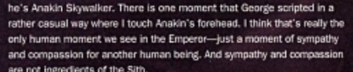
- **Palpatine (Darth Sidious); Darth Vader (Anakin Skywalker); Obi-Wan Kenobi** — entry/section: Palpatine hoped Anakin would leave Obi-Wan: "Palpatine rather hoped that Anakin was going to leave Obi-Wan during the kidnapping, but Anakin is an honorable man and Obi-Wan is his greatest friend, so Anakin insists that he bring him along. At the end, they have (a duel) where Anakin might have been killed, and Palpatine realizes he wouldn't have been able to prevent it." Source: *Star Wars Insider #82* (2005), scan p.59
  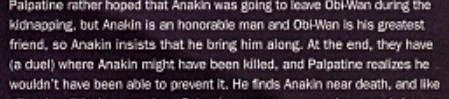

## scan p.60 (scan page 60)

Page contents: McDiarmid interview continued: Lucas' advice "your eyes are contact lenses"; the real Palpatine bursts forth after Anakin's role in killing Mace; Lucas kept the transformed face after seeing Dave Elsey's makeup; Jekyll and Hyde reversed ("Hideous Sidious"); the long opera dialogue scene; the friendship as a means to an end; the seed of evil already in Anakin. (hand-read)

- **Palpatine (Darth Sidious); Mace Windu; Darth Vader (Anakin Skywalker)** — entry/section: "Your eyes are contact lenses": ""He said, "In a sense, your eyes are contact lenses." In other words, the Palpatine character was the most artificial—it was as if they had grafted his face and put in (his) eyes. Because the real Palpatine is the one who bursts forth at a calculated moment in Episode III just after persuading Anakin to kill Mace (Windu). That is when the true person comes out, letting the evil fully manifest itself. The Emperor that you see in the last film looks like he does because he's very old and very evil—it is what he always looked like." —Ian McDiarmid, Star Wars Insider 82, p. 60" Source: *Star Wars Insider #82* (2005), scan p.60
  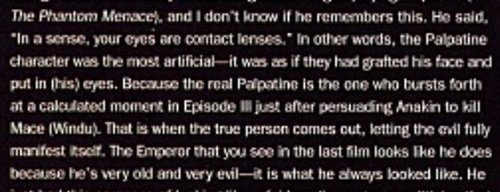
- **Palpatine (Darth Sidious)** — entry/section: "Hideous Sidious": ""You think about Dr. Jekyll and Mr. Hyde—Jekyll was the good doctor who went out at night and transformed into a terrible decadent, Hyde, who was buried down inside. In Episode III, it's more like Hyde in the guise of Jekyll throughout the film. And although the face is hideous, he doesn't care—Hideous Sidious, they go together." —Ian McDiarmid, Star Wars Insider 82, p. 60" Source: *Star Wars Insider #82* (2005), scan p.60
  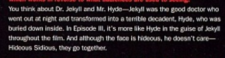

## scan p.61 (scan page 61)

Page contents: Photo page with pull quote: "The Emperor that you see in the last film looks like he does because he's very old and very evil—it is what he always looked like." (hand-read)

## scan p.62 (scan page 62)

Page contents: Feature opener: Natalie Portman (from Queen of Naboo to senator to mother of the twins), by Brett Rector. (hand-read)

## scan p.63 (scan page 63)

Page contents: Photo: Natalie Portman as Padmé. (hand-read)

## scan p.64 (scan page 64)

Page contents: Portman interview: career (Léon/The Professional, Heat, Mars Attacks!, Cold Mountain, Garden State, Closer Oscar nomination); set atmosphere and documentation (Anthony Daniels in C-3PO costume); scenes with Hayden (his "stuntability"); Obi-Wan–Padmé friendship developed offscreen; Ian McDiarmid. (hand-read)

- **Darth Vader (Anakin Skywalker)** — entry/section: Hayden's "stuntability": ""What's most impressive to me, though, is his "stuntability." I watched them film one of the fights between Ewan and him, and he seemed as good as the stunt guys." —Natalie Portman, Star Wars Insider 82, p. 64" Source: *Star Wars Insider #82* (2005), scan p.64
  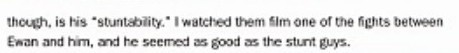

## scan p.65 (scan page 65)

Page contents: Portman interview continued: Padmé's two sides; vulnerability and motherhood; greenscreen; Trisha Biggar costumes (peacock-and-brown dress; David Tattersall); death scene with animatronic babies (Bean as "the Frank Oz of the new millennium"); Padmé and feminism. (hand-read)

- **Padmé Amidala; Darth Vader (Anakin Skywalker)** — entry/section: Padmé lost her man to her commitment to the Republic: ""I didn't really think of them as being separate but rather that the two sides of Padmé's life happened simultaneously because she wouldn't have lost her man if she weren't so committed to the Republic. If she had a different concept of government or morality, she might have been able to stay with Anakin if her loyalties to him were above everything else." —Natalie Portman, Star Wars Insider 82, p. 65" Source: *Star Wars Insider #82* (2005), scan p.65
  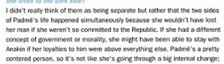

## scan p.66 (scan page 66)

Page contents: Anchorhead Arcade (games): "It's All the Rage!" Star Wars Galaxies: Rage of the Wookiees expansion — Kashyyyk in 10 loading zones; upgraded combat system. Box "Control the Force": Intec programmable controllers for PS2/Xbox, Jedi Hunter, Sith vs. Jedi 2-Pack (glow blue/red) (Brett Rector). (hand-read)

## scan p.67 (scan page 67)

Page contents: Rage of the Wookiees continued: simplified damage (kinetic and energy), Action and Mind stats, cybernetic limbs; General Grievous guest appearance in Kashyyyk's Myyydril Caverns (reward: fly his personal transport); more interaction with Leia and Vader; Total Experience package $29.99, download $24.99. (hand-read)

### Stat block notes (game mechanics, not feats)

- Grievous in Galaxies: Most notably, metallic menace General Grievous makes a guest appearance in the depths of Kashyyyk's Myyydril Caverns. If you manage to beat Grievous, your reward is flying off in Grievous' heavily armed personal transport ship! (Star Wars Insider 82, p. 67) (Source: *Star Wars Insider #82* (2005), scan p.67)

## scan p.68 (scan page 68)

Page contents: Scouting the Galaxy (Steve Sansweet): Episode III midnight-madness toy launch (posse incl. Lucasfilm colleague Pete Vilmur; Toys "R" Us in Marin County; holographic Yoda at the register; Target and Wal-Mart the next day); reader asking for board games — Trivial Pursuit DVD tin, Monopoly Saga Edition, Clone Wars Risk, Saga Stratego, chess; "Grand Moff Mustard... with a vibroblade in the Jedi Temple Library"; Aurebesh Scrabble photo. Private persons, family members and letter-writers omitted. (hand-read)

## scan p.69 (scan page 69)

Page contents: Scouting continued: collector frustration over shortages of Unleashed and basic figures; Sansweet on Hasbro's two buyer types, retailer caution, re-releases; joke answer about a young Obi-Wan in a Cantina playset. Letter-writers omitted. (hand-read)

## scan p.70 (scan page 70)

Page contents: Scouting continued: Hasbro has no online store (Once Upon A Toy at Downtown Disney; StarWarsShop.com); 1983 Pepperidge Farm cookie tumblers (five in the set; "the first real Wookiee cookies!"); vintage = through 1985–1986, modern from 1993 (as printed); a reader's letter about a child's fifth birthday with vintage toys (names omitted); submission address. (hand-read)

## scan p.71 (scan page 71)

Page contents: Ad: The Anthony Grandio Company "Path to the Dark Side" checks and Darth Vader checkbook covers. (hand-read)

## scan p.72 (scan page 72)

Page contents: Jabba's Collection (collectibles): Hasbro Star Wars Evolution gift sets (Anakin to Vader; clone troopers to stormtroopers with head sculpts based on Bodie Taylor and Temuera Morrison; Sith from Maul to Dooku to Palpatine). (hand-read)

## scan p.73 (scan page 73)

Page contents: Collectibles continued: Master Replicas Anakin (RotS) and Vader (ESB) FX lightsabers; other new products. (hand-read)

## scan p.74 (scan page 74)

Page contents: Collectibles continued: LEGO RotS sets (General Grievous Chase, ARC-170, Darth Vader Transformation, Clone Scout Walker, Droid Tri-fighter, Jedi Starfighter and Vulture Droid, Ultimate Lightsaber Duel, Wookiee Attack, Wookiee Catamaran, Clone Turbo Tank; key chains and pens); Gentle Giant Bust-Ups series 4 (Obi-Wan, Anakin, Grievous, Emperor Palpatine and others). (hand-read)

## scan p.75 (scan page 75)

Page contents: Celebration III exclusives: Gentle Giant sandtrooper corporal mini-bust (3,000 pieces); Code 3 Legendary Casts 3D ESB advance one-sheet (1,980 pieces) (Brett Rector). (hand-read)

## scan p.76 (scan page 76)

Page contents: Best of Hyperspace (starwars.com): "Episode III: The Last Set Diary" — final day of additional photography, Monday, January 31 [2005], Stage 8 at Elstree Studios, Borehamwood (first studio day of Episode IV was shot there: the Lars kitchen; X-wing and Falcon cockpits); four scene pieces with only Hayden Christensen and Natalie Portman. (hand-read)

- **Owen Lars; Beru Lars; Luke Skywalker** — entry/section: Elstree Stage 8: the Lars kitchen: ""We started the studio work here the first day for Episode IV," Lucas says, looking around at the dark interior of Stage 8. "I think it was the kitchen. You know, where Aunt Beru is in there cooking and Owen comes in looking for Luke." —George Lucas, Star Wars Insider 82, p. 76" Source: *Star Wars Insider #82* (2005), scan p.76
  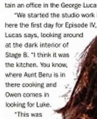

## scan p.77 (scan page 77)

Page contents: Last Set Diary continued: 8:24 a.m. start (2nd AD Sue Wood); Padmé on the Naboo yacht bunk with a single new line to Obi-Wan (extra as Kenobi double; VFX Supervisor Roger Guyett); one HD camera; Portman finished by 10 a.m.; crew watches the full Episode III trailer; Dooku–Anakin rematch pickup (Kyle Rowling as Dooku's double); Mustafar run across crumbling architecture; Gavin Bocquet returns; the last shot; "That's lunch, everyone." (hand-read)

- **none** — entry/section: "Last shot, Rick": ""Last shot, Rick," Lucas points out with little fanfare. "It's all over now. Twenty-eight years." —George Lucas, Star Wars Insider 82, p. 77" Source: *Star Wars Insider #82* (2005), scan p.77
  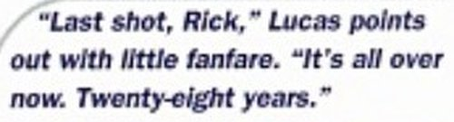

## scan p.78 (scan page 78)

Page contents: "Voice of the Republic": January 31 ADR session in London's West End with Ian McDiarmid (Lucas, McCallum, Supervising Sound Editor Matthew Wood, ADR Mixer Robert Farr, Assistant Mark Appleby); Palpatine lines recorded before Sidious lines per reel; reworked lines ("eyes, ears, and voice of the Republic"; Galaxies Opera House; Sydney 2003 vs. Shepperton 2004 performances); Sidious lines; projection. Pull quote: "[ADR] is a very technical aspect of acting that doesn't get much documentation." (hand-read)

## scan p.79 (scan page 79)

Page contents: ADR continued: the microphone picks up McDiarmid's watch; Lucas: too loud can be toned down, too quiet can't be turned up; top-of-the-lungs scene earned ovations in Sydney and at the session. Photo: Darth Sidious and Chancellor Palpatine costumes. (hand-read)

## scan p.80 (scan page 80)

Page contents: "The Score Begins": February scoring sessions at Abbey Road Studios with John Williams and the London Symphony Orchestra (over 40 cues; working titles like "Boys into Battle" and "Palpatine's TV Set"); "Padmé's Visit" (love theme shadowed by the "Imperial March"); the Dooku rematch; scoring engineer Shawn Murphy and the click track; "Palpatine's Seduction" (Emperor's theme without choir); "Heroes Collide" (new brass theme for the Obi-Wan/Anakin duel; "Imperial March" echo of ESB). Pull quote: "Even in the heavily soundproofed confines of the control room, you can still feel the low vibrations." (hand-read)

- **none** — entry/section: "I love the dark stuff": ""I love the dark stuff," says George Lucas, relishing the tones prevalent throughout this score. (Star Wars Insider 82, p. 80)" Source: *Star Wars Insider #82* (2005), scan p.80
  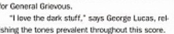
- **Darth Vader (Anakin Skywalker); Luke Skywalker** — entry/section: Imperial March echo in the Mustafar duel: "At one point in this cue, the music sounds almost exactly as it did in The Empire Strikes Back, when Darth Vader begins pummeling Luke with equipment he tossed telekinetically. In both that Episode V moment and this Episode III moment, we hear a grandiose presentation of the "Imperial March" with sharp brass accents." Source: *Star Wars Insider #82* (2005), scan p.80
  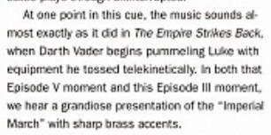

## scan p.81 (scan page 81)

Page contents: Score continued: pained "Force" theme during competing Force pushes; percussion to be recorded later; Lucas asks about "Duel of the Fates" ("That comes later, in the big duel"—Williams); extra cues "Another Happy Landing," "Yoda's Fall," "Revisiting Padmé." Webdocs "The Creatures of Episode III": quotes from Dave Elsey (Creature Shop creative supervisor), Lou Elsey (fabrication supervisor), Silas Carson (Nute Gunray, Ki-Adi-Mundi) and Bruce Spence (Tion Medon). (hand-read)

- **Nute Gunray** — entry/section: Silas Carson on the Neimoidian masks: ""Now, they've changed the motoring, so ["the masks"] have even more facial expressions. The second time around, they actually computerized the movement of the mouth and then I prerecorded [my lines], and the mouth moved depending on what I already recorded. So the lip-synching was already done for us." —Silas Carson, actor/Nute Gunray, Ki-Adi-Mundi, Star Wars Insider 82, p. 81" Source: *Star Wars Insider #82* (2005), scan p.81
  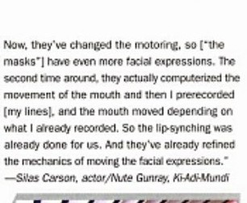

## scan p.82 (scan page 82)

Page contents: Photoreceptor (edited by Bonnie Burton; content by Pablo Hidalgo): ESB/ROTJ photos — Luke relying less on his blaster; stunt double Bob Anderson wore lifts as Vader; Gamorrean Guard and rancor (unfinished blaster effect); Palpatine's goading; Richard Marquand and Sebastian Shaw unmasking makeup; blind man with a polearm vs. a bounty hunter; Leia on Endor. (hand-read)

### Stat block notes (game mechanics, not feats)

- Gamorrean shots at the rancor (unfilmed effect): A Gamorrean Guard cowers as the rancor emerges from its pen. As described in the script, Luke's stolen blaster pistol lands near the Gamorrean, who then fires off some ineffective shots at the rancor. That particular effect was never completed for the film. (Star Wars Insider 82, p. 82) (Source: *Star Wars Insider #82* (2005), scan p.82)

## scan p.83 (scan page 83)

Page contents: Photoreceptor photos continued: (5) Sebastian Shaw unmasking makeup with Richard Marquand and crew; (6) Han Solo with a polearm on Tatooine; (7) Leia with Ewoks on Endor. (hand-read)

## scan p.84 (scan page 84)

Page contents: Bantha Tracks vol. 13 (by the fans, for the fans): "Star Wars Fans Are... Ready for Revenge" — fans prepare for May 19 (charity screenings, travel, house parties, lines); fan-built speeder bike with clone trooper, Yoda riding a pickup truck. Fan names omitted. (hand-read)

## scan p.85 (scan page 85)

Page contents: Bantha Tracks fan art and fan photos (artists and fans omitted). (hand-read)

## scan p.86 (scan page 86)

Page contents: Bantha Tracks fan art: Anakin, Count Dooku, Padmé and others (artists, including children, omitted). (hand-read)

## scan p.87 (scan page 87)

Page contents: Bantha Tracks "Revenge on Ice": Darth Vader snow sculpture at the Sapporo Snow Festival in February guarded by members of the Japanese 501st Legion; sculpted R2-D2; a fan's "Darth Frosty" snowman. Fan and costumer names omitted. (hand-read)

## scan p.88 (scan page 88)

Page contents: Bantha Tracks "Fan-Tastic": the 501st Legion makes George Lucas an honorary member at ShoWest in Las Vegas (Neon City Garrison; laser-cut acrylic award: "The creative 'force' behind the Force without whom we would not exist..."); Lucas thanked them. Costumer names omitted. (hand-read)

## scan p.89 (scan page 89)

Page contents: Bantha Tracks editorial "Celebrating Celebration" by Mary Franklin, editor: written 672 hours before Celebration III; Community, Fun, Creativity, The Saga; Rick McCallum's Revenge of the Sith footage; "Now why are you standing there reading? Go get in line for Revenge of the Sith." Box "The Way We Were": a starwars.com webstrip illustrator recalls his father bringing home the first four Star Wars comics (name omitted). Submission guidelines. (hand-read)

## scan p.90 (scan page 90)

Page contents: Laugh It Up, Fuzzball (humor): illustration by Randy Martinez — General Grievous as a theater concession clerk ("Mace Face" candies, Gummy Ewoks, $92.40). (hand-read)

## scan p.91 (scan page 91)

Page contents: Ad: Fangoria.com / Fangoria.tv and Starlog.com. (hand-read)

## scan p.92 (scan page 92)

Page contents: Ads: IDG Entertainment official Episode III souvenir movie guide and "Vader" ultimate guide (idgentertainment.com). (hand-read)

## scan p.93 (scan page 93)

Page contents: StarWarsShop.com ad: exclusive steel and chrome Darth Vader watch (trilogy DVD slipcase graphic; collectible tin). (hand-read)

## scan p.94 (scan page 94)

Page contents: StarWarsShop.com collector's picks (collector's name omitted): eight-piece magnet set, Darth Vader football jersey (77, VADER), Collector's Edition soundtrack, Larry Noble limited-edition life-size bronze Yoda statue ($15,000). (hand-read)

## scan p.95 (scan page 95)

Page contents: StarWarsShop.com: A New Hope framed film cel, Episode III iPod cover, Kyoto "Art of Star Wars" exhibit poster, six-foot trilogy display cabinet. (hand-read)

## scan p.96 (scan page 96)

Page contents: StarWarsShop.com: "Anakin/Obi-Wan Duel" water globe, Episode III theatrical poster, Drew Struzan poster sport mug, Vader/Yoda/Grievous mug set, logo hat, scaled Obi-Wan lightsaber replica. (hand-read)

## scan p.97 (scan page 97)

Page contents: StarWarsShop.com: Episode III poster T-shirt, life-size General Grievous standee, Star Wars Racing Jeff Gordon T-shirt, Elliott Sadler M&M's hat, LEGO keychain set (Vader, Chewbacca, R2-D2), Episode III blaster assortment. (hand-read)

## scan p.98 (scan page 98)

Page contents: StarWarsShop.com: Darth Vader figural mug, framed pin set, C-3PO collector's mask, Revenge of the Sith video game (PS2/Xbox), Jeff Gordon die-cast, mini plush, Hasbro basic lightsabers, Clone Wars watch, Mr. Potato Head "Darth Tater," Episode V framed double film cel, Star Wars Visionaries. (hand-read)

## scan p.99 (scan page 99)

Page contents: Hasbro ad: Unleashed Anakin Skywalker vs. Obi-Wan Kenobi (each figure sold separately). (hand-read)

## scan p.100 (scan page 100)

Page contents: Back cover: Blockbuster ad "Play on the Dark Side / Pay on the Light Side" — rent Revenge of the Sith game for $6.99, exclusive Yoda wireless controller $29.99. (hand-read)

