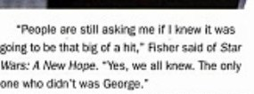
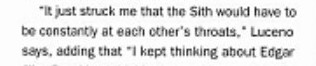
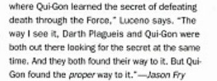
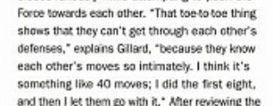
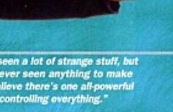
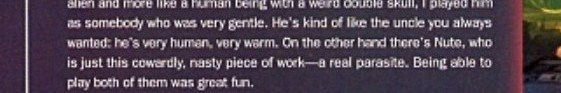
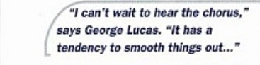
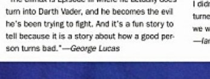
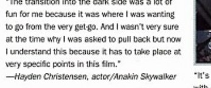

# Owner Material 038 — Star Wars Insider #1–153 plus specials (with The Lucasfilm Fan Club Magazine #1–22): Star Wars Insider #83 (2005)

- **Source:** *Star Wars Insider* magazine (issues 23–153, 1994–2014) and its predecessor *The Lucasfilm Fan Club Magazine* (issues 1–22, 1987–1994), plus seven special editions: articles, interviews, comics and short fiction Secondary source (licensed Legends reference). Scan OCR'd on the box; the scan stays box-only and is **not** published.
- **Method:** every scanned page was OCR'd and machine-screened sentence by sentence for power-relevant statements (fights, kills, defeats, Force feats, rankings, superweapons) that name a character on our roster; each kept sentence is quoted verbatim from the OCR text and has a crop of the printed passage directly under it. Pages with nothing power-relevant are still listed with what is on them.
- **Citation:** "*Star Wars Insider #83* (2005), p.X" by printed page ("scan p.X" where no printed number applies). **Weight:** Licensed magazine: a secondary source. Its short fiction and comics are Legends stories; its articles and interviews sum up or discuss lore and rank below the novels, comics and games they describe.

## scan p.1 (scan page 1)

Page contents: Cover, issue 83 (September/October 2005): General Grievous on his wheel bike, "Ground Assault: General Grievous' wheel bike and the vehicles of Episode III"; Visions of Sith concept art; the 20 greatest EU moments; new fiction MedStar: Intermezzo; Star Wars street art; Bantha Tracks world-wide scrapbook. (hand-read)

## scan p.2 (scan page 2)

Page contents: Advertisement: Destroy All Humans! video game (THQ/Pandemic). (hand-read)

## scan p.3 (scan page 3)

Page contents: Advertisement: Destroy All Humans! continued, "In stores now". (hand-read)

## scan p.4 (scan page 4)

Page contents: Contents, Insider 83: features (Vehicles of Episode III by Daniel Wallace; The Art of Revenge of the Sith Part 1 by Jonathan W. Rinzler; 20 Most Memorable Moments of the Expanded Universe by Abel Peña and Enrique Guerrero; Multiple Personality on Silas Carson by Brett Rector; Spray Paint and Stormtroopers street art by Bonnie Burton; MedStar: Intermezzo by Michael Reeves and Steve Perry) and departments. (hand-read)

## scan p.5 (scan page 5)

Page contents: Advertisement: Code 3 Collectibles 3D sculpted poster art of the Star Wars "Style D" circus poster (Charles White III and Drew Struzan, 1978 re-release). (hand-read)

## scan p.6 (scan page 6)

Page contents: Letter from the Editor, "A Family Affair" (Brett Rector): Revenge of the Sith and the saga as a family experience, seeing Episode III with his father, Ralph McQuarrie seated next to him; masthead. (hand-read)

## scan p.7 (scan page 7)

Page contents: Advertisement: The Anthony Grandio Company "Path to the Dark Side" Darth Vader check series and checkbook covers. (hand-read)

## scan p.8 (scan page 8)

Page contents: Comlink letters: Darth Plagueis as Sidious' mentor (editorial answer: Palpatine hinted Plagueis could manipulate midi-chlorians to create life, the rest open to interpretation); praise for issue 82 and Celebration III coverage by Mary Franklin; an Aurabesh guide being considered; an updated Star Wars encyclopedia definitely planned (Sansweet). Letter-writer names omitted. (hand-read)

### Stat block notes (game mechanics, not feats)

- Plagueis and midi-chlorians (editorial answer): Chancellor Palpatine hinted very convincingly that the Sith Lord Darth Plagueis had found a way to manipulate midi-chlorians to create life. (Star Wars Insider 83, p. 8) (Source: *Star Wars Insider #83* (2005), scan p.8)

## scan p.9 (scan page 9)

Page contents: Comlink continued: the original trilogy to be released in 3D once enough digital theaters exist; Lucasfilm's live-action and CG animated series plans; a clone article by Karen Traviss and Ryan Kaufman coming next issue. Ad: Kevin J. Anderson's Saga of Seven Suns (Aspect). (hand-read)

## scan p.10 (scan page 10)

Page contents: Skywalking news: AFI Lifetime Achievement Award to George Lucas (June 10, Kodak Theatre) with Mark Hamill, Carrie Fisher, Harrison Ford, Steven Spielberg, William Shatner and a stormtrooper chorus line; Revenge of the Sith box office records ($16.9 million midnight showings, $50 million first day, $158.5 million four-day). (hand-read)

- **Leia Organa Solo** — entry/section: Carrie Fisher at the AFI tribute: ""People are still asking me if I knew it was going to be that big of a hit," Fisher said of Star Wars: A New Hope. "Yes, we all knew. The only one who didn't was George." —Carrie Fisher, Star Wars Insider 83, p. 10" Source: *Star Wars Insider #83* (2005), scan p.10
  

## scan p.11 (scan page 11)

Page contents: Advertisement: Cloud City Collectibles vintage toys. (hand-read)

## scan p.12 (scan page 12)

Page contents: Skywalking continued: four-day comparisons with Episodes I and II, $303.2 million worldwide; Star Wars The Show exhibition at La Triennale di Milano (May 13–August 28, 2005); Episode III soundtrack chart records and the Musical Journey DVD hosted by Ian McDiarmid; Star Wars Battlefront II coming to the PSP; crossword solution. (hand-read)

## scan p.13 (scan page 13)

Page contents: Skywalking continued: Battlefront II features; Karen Traviss' Republic Commando: Triple Zero announced (Omega and Delta Squads, Kal Skirata, Null ARC troopers, Etain and Jusik on Coruscant). Ad: Heroes in Action autographs and toys. (hand-read)

## scan p.14 (scan page 14)

Page contents: Jedi Library (Jason Fry), "Birth of the Empire": James Luceno on Dark Lord: The Rise of Darth Vader — Vader's transitional emotional state, the Sith at each other's throats, Vader's malfunctioning suit, Roan Shryne and Olee Starstone, Kashyyyk, Tarkin, Bail Organa; Luceno would love to write how Qui-Gon learned to defeat death. (hand-read)

- **Darth Vader (Anakin Skywalker); Palpatine (Darth Sidious)** — entry/section: Luceno on the Sith in Dark Lord: ""It just struck me that the Sith would have to be constantly at each other's throats," —James Luceno, Star Wars Insider 83, p. 14" Source: *Star Wars Insider #83* (2005), scan p.14
  
- **Qui-Gon Jinn; Darth Plagueis** — entry/section: Luceno on Qui-Gon and Plagueis: ""I would love to write the story of how and where Qui-Gon learned the secret of defeating death through the Force," Luceno says. "The way I see it, Darth Plagueis and Qui-Gon were both out there looking for the secret at the same time. And they both found their way to it. But Qui-Gon found the proper way to it." —James Luceno, Star Wars Insider 83, p. 14" Source: *Star Wars Insider #83* (2005), scan p.14
  

## scan p.15 (scan page 15)

Page contents: Advertisement: Dickies at Wal-Mart. (hand-read)

## scan p.16 (scan page 16)

Page contents: Drawn by the Force (Daniel Wallace), "A Galaxy Full of Rogues": Dark Horse's X-Wing Rogue Squadron: Rogue Leader miniseries by Haden Blackman with art by Tomás Giorello (Wedge's homecoming to Corellia, Tralus, Luke as a founding Rogue); "Pitching Wedge" sidebar of earlier X-Wing collections. (hand-read)

## scan p.17 (scan page 17)

Page contents: Rogue Leader comic art preview: Wedge, a Y-wing and a Hutt sail barge line; "You volunteered to return to Endor for salvage duty, Commander Antilles." (hand-read)

## scan p.18 (scan page 18)

Page contents: Technical Readout set piece (Chris Trevas), "Mustafar: Main Control Room": the Stage 7 control room set, carbon-fiber stunt sabers, Nick Gillard's choreography, squib explosions. (hand-read)

- **Obi-Wan Kenobi; Darth Vader (Anakin Skywalker)** — entry/section: Gillard on the Mustafar control-room duel: ""That toe-to-toe thing shows that they can't get through each other's defenses," explains Gillard, "because they know each other's moves so intimately. I think it's something like 40 moves; I did the first eight, and then I let them go with it." —Nick Gillard, Star Wars Insider 83, p. 18" Source: *Star Wars Insider #83* (2005), scan p.18
  

## scan p.19 (scan page 19)

Page contents: Control room photo annotations: bluescreen hallway, stunt doubles Nash Edgerton (Obi-Wan) and Ben Cooke (Anakin), amber and cyan wall panels, holotable, Nute Gunray's hat hiding mask gears, Anakin's and Obi-Wan's lightsaber prop designs. (hand-read)

### Stat block notes (game mechanics, not feats)

- Gunray killed by Vader: Nute Gunray has finally met his end by Darth Vader's blade. (Star Wars Insider 83, p. 19) (Source: *Star Wars Insider #83* (2005), scan p.19)
- Anakin's lightsaber prop: The design of Anakin's lightsaber was already a familiar one to fans as Luke's first lightsaber in the classic trilogy. (Star Wars Insider 83, p. 19) (Source: *Star Wars Insider #83* (2005), scan p.19)

## scan p.20 (scan page 20)

Page contents: "Ground Assault" (Daniel Wallace), the vehicles of Episode III: Republic HAVw A6 Juggernaut. (hand-read)

## scan p.21 (scan page 21)

Page contents: Ground Assault continued: Juggernaut front/rear cockpits, the clone spotter's crow's nest pod, Juggernauts under Yoda's command on Kashyyyk, the tank's origin in ESB concept work and the EU (Imperial Sourcebook, Darksaber); Separatist droid gunship (HMP, Baktoid Fleet Ordnance), flying-saucer inspiration. (hand-read)

### Stat block notes (game mechanics, not feats)

- Juggernauts under Yoda's command: In Revenge of the Sith, Juggernauts are under the command of Jedi Master Yoda as he works to liberate the Wookiee homeworld Kashyyyk from the droid forces of the Separatists. (Star Wars Insider 83, p. 21) (Source: *Star Wars Insider #83* (2005), scan p.21)

## scan p.22 (scan page 22)

Page contents: Wookiee Oevvaor catamaran: polished wood, two hulls, Podracer-like engines, 230 mph, named for an aquatic reptile near Kachirho, built of wroshyr wood. (hand-read)

## scan p.23 (scan page 23)

Page contents: BARC speeder (Biker Advanced Recon Commando), based on the Mobquet Ripper; Stass Allie on Saleucami betrayed by her clone troopers at Order 66. (hand-read)

### Stat block notes (game mechanics, not feats)

- Stass Allie and Order 66: Stass Allie, one of the Jedi generals in charge of Republic operations on the planet Saleucami, found herself steering a BARC speeder at the moment Darth Sidious unleashed Order 66. (Star Wars Insider 83, p. 23) (Source: *Star Wars Insider #83* (2005), scan p.23)

## scan p.24 (scan page 24)

Page contents: Swamp speeder (Republic ISP, Infantry Support Platform): airboat-inspired, two clones, 62 mph, deployed at Kachirho. (hand-read)

## scan p.25 (scan page 25)

Page contents: Coruscant fireship escorting the Invisible Hand's crash landing; tanks, sprayers, tractor beam; absent at the burning Jedi Temple — "Let the Jedi burn." (hand-read)

## scan p.26 (scan page 26)

Page contents: AT-RT (All Terrain Recon Transport): single driver, policing role, weak chin laser, hunting Yoda on Kashyyyk. (hand-read)

## scan p.27 (scan page 27)

Page contents: Grievous' wheel bike: toothed treads climbing Utapau's sinkholes, clawed limbs, Z-Gomot Ternbuell Guppat Corporation, Grievous' twin laser cannon modification and magnetized chair. (hand-read)

### Stat block notes (game mechanics, not feats)

- Grievous and the wheel bike: Grievous likes to roar into battle on his wheel bike while wielding a lightsaber, like some grim horseman of the apocalypse shaking his scythe. (Star Wars Insider 83, p. 27) (Source: *Star Wars Insider #83* (2005), scan p.27)

## scan p.28 (scan page 28)

Page contents: The Art of Revenge of the Sith Part One (J.W. Rinzler): interviews with the concept artists in 2003; art cut from the 224-page art book; Erik Tiemens' first Utapau sinkhole planet concept. (hand-read)

## scan p.29 (scan page 29)

Page contents: Concept art: Tiemens' ice-planet thumbnails, Ryan Church's floating buildings on Coruscant, Sang Jun Lee's Padmé costume concept 12 ("we didn't know she was going to be pregnant"). (hand-read)

## scan p.30 (scan page 30)

Page contents: Concept art: Church's Naboo cruiser wartime mode, Sang Jun Lee's lemur concept, T. J. Frame's crystal-planet (Mygeeto) junk barge. (hand-read)

## scan p.31 (scan page 31)

Page contents: Concept art: Derek Thompson's Mustafar arrival storyboards (emotional connection storyboarding Padmé's death); Feng Zhu's Mustafar interior. (hand-read)

## scan p.32 (scan page 32)

Page contents: Ask the Master (Pablo Hidalgo), "Dead Sith Tell No Tales": Qui-Gon, the Shaman of the Whills and preserving identity beyond death through compassion and selflessness; Qui-Gon teaching Obi-Wan and Yoda; Anakin's redemption in ROTJ. (hand-read)

### Stat block notes (game mechanics, not feats)

- Qui-Gon and the Shaman of the Whills: Sometime during his travels, Qui-Gon Jinn came across a unique Force ability said to be practiced by a mysterious Force adept known as a Shaman of the Whills. (Star Wars Insider 83, p. 32) (Source: *Star Wars Insider #83* (2005), scan p.32)

## scan p.33 (scan page 33)

Page contents: Ask the Master continued: Yoda and Obi-Wan helping Anakin to the netherworld; Plagueis a real Sith Lord and Sidious' master, killed by him; Obi-Wan learning "Emperor" from the hologram; clone independence and Order 66 as a trained-in order, not a genetic trigger; Anakin's scar from Ventress in Republic #71. (hand-read)

### Stat block notes (game mechanics, not feats)

- Plagueis was Sidious' master: Darth Plagueis was a real Sith Lord who existed at a time when everyone but a handful of people in the galaxy believed the Sith to be extinct. Plagueis was indeed Sidious' master, and true to Sith form, Sidious killed him. (Star Wars Insider 83, p. 33) (Source: *Star Wars Insider #83* (2005), scan p.33)
- Order 66 not a genetic trigger: Order 66 is not some pre-programmed genetic trigger. It's not some Manchurian Candidate brainwash button. (Star Wars Insider 83, p. 33) (Source: *Star Wars Insider #83* (2005), scan p.33)

## scan p.34 (scan page 34)

Page contents: Ask the Master continued: S-foils in attack position; Palpatine's disfigurement caused by reflected lightning (the "Mask of Evil"); why Vader does not turn on Sidious after Padmé's death; how an AT-AT turns. (hand-read)

### Stat block notes (game mechanics, not feats)

- Cause of Palpatine's disfigurement: Perhaps the face that boils up to the surface is shaped by his dark side corruption, but the lightning is definitely the cause. (Star Wars Insider 83, p. 34) (Source: *Star Wars Insider #83* (2005), scan p.34)

## scan p.35 (scan page 35)

Page contents: Advertisement: Official Pix photographs and autographs from the Lucasfilm archives. (hand-read)

## scan p.36 (scan page 36)

Page contents: Ask the Master continued: Jon Berg's walker-turn animation used only as a brace; the Invisible Hand window; young Han's ignorance of Kenobi and Skywalker (Garris Shrike, Corellian isolationism); the cut Tarkin–Vader–Officer Cass dialogue; Han pull-quote. (hand-read)

- **Han Solo** — entry/section: Han's skepticism (pull quote): ""I've seen a lot of strange stuff, but I've never seen anything to make me believe there's one all-powerful force controlling everything." —Han Solo, Star Wars Insider 83, p. 36" Source: *Star Wars Insider #83* (2005), scan p.36
  

### Stat block notes (game mechanics, not feats)

- Cut Vader–Tarkin dialogue: The guy is Grand Moff Tarkin, and Vader's hand motions are the result of his dialogue being cut in the editing room. (Star Wars Insider 83, p. 36) (Source: *Star Wars Insider #83* (2005), scan p.36)

## scan p.37 (scan page 37)

Page contents: Advertisement: Episode III Revenge of the Sith video game (Ubisoft) for Nintendo DS and Game Boy Advance. (hand-read)

## scan p.38 (scan page 38)

Page contents: Full-page Joe Corroney illustration: Vader, Asajj Ventress, Grievous, Aayla Secura and a dark-side figure. (hand-read)

## scan p.39 (scan page 39)

Page contents: "20 Most Memorable Moments of the Expanded Universe" (Abel G. Peña and Enrique Guerrero, illustrations by Joe Corroney): the Death of Chewbacca (Vector Prime); Vader remembers C-3PO (Tales #6 "Thank the Maker"); Grievous' debut (Clone Wars Chapter 20); honorable mentions. (hand-read)

### Stat block notes (game mechanics, not feats)

- Death of Chewbacca: Raging against the crash of Dobido, it would take the annihilation of a planet to defeat the mighty Chewbacca. (Star Wars Insider 83, p. 39) (Source: *Star Wars Insider #83* (2005), scan p.39)
- Vader remembers Threepio: After Threepio has been blasted to pieces by Imperials on Cloud City, the parts are brought to Darth Vader, causing the Sith Lord to recall when he first assembled the protocol droid during his time as an optimistic slave on Tatooine. (Star Wars Insider 83, p. 39) (Source: *Star Wars Insider #83* (2005), scan p.39)
- Grievous' debut in Clone Wars: The lightsaber-toting Grievous then proceeds to take on a half-dozen Jedi with spectacular moves and frightening ease, fighting at times with no less than three laser swords in hand (or foot, as it were). (Star Wars Insider 83, p. 39) (Source: *Star Wars Insider #83* (2005), scan p.39)

## scan p.40 (scan page 40)

Page contents: Heirs of the Sith: Anakin Skywalker meets Asajj Ventress (Clone Wars Chapters 17–19), duel from the jungle to the Yavin 4 ruins; Ventress illustration. (hand-read)

## scan p.41 (scan page 41)

Page contents: 20 Most Memorable Moments continued: Anakin hurls Ventress into the abyss (Clone Wars); the artistic fate of Grand Admiral Thrawn (The Last Command); Boba Fett escapes the Sarlacc (Marvel #81, "A Barve Like That"); Jacen Solo descends into the rings of hell (Traitor). (hand-read)

### Stat block notes (game mechanics, not feats)

- Thrawn's death: As Thrawn's blood flows, slowly staining his pristine white Grand Admiral's uniform, his last words express admiration for his own assassination: "But it was so artistically done." (Star Wars Insider 83, p. 41) (Source: *Star Wars Insider #83* (2005), scan p.41)

## scan p.42 (scan page 42)

Page contents: Memorable Moments continued: Jacen's rebirth; Borsk Fey'lya's noble end (Star by Star); Luke duels Vader for the first time before ESB (Splinter of the Mind's Eye, Alan Dean Foster); Anakin Solo becomes one with the Force (honorable mention). (hand-read)

## scan p.43 (scan page 43)

Page contents: Advertisement: Brian's Toys (Episode III figures, Unleashed, Master Replicas, vintage). (hand-read)

## scan p.44 (scan page 44)

Page contents: Memorable Moments continued: the death of Ton Phanan (X-Wing: Solo Command, Aaron Allston); Darth Vader vs. Darth Maul (Ron Marz and Rick Leonardi); Luke vs. Lumiya (A Long Time Ago Vol. 7, Jo Duffy and Cynthia Martin); Ton Phanan and Face Loran illustration. (hand-read)

### Stat block notes (game mechanics, not feats)

- Vader vs. Maul: Maul, who believes the depth of his hatred rightfully entitles him to the station of Sith apprentice, asks before dying, "What...what could you hate enough to destroy me?" Vader answers simply, "Myself." (Star Wars Insider 83, p. 44) (Source: *Star Wars Insider #83* (2005), scan p.44)

## scan p.45 (scan page 45)

Page contents: Advertisement: Rocketmen: Axis of Evil collectible strategy game (WizKids). (hand-read)

## scan p.46 (scan page 46)

Page contents: Full-page Joe Corroney illustration: Luke Skywalker as Jedi Master with a training remote at the Yavin 4 temple. (hand-read)

## scan p.47 (scan page 47)

Page contents: Memorable Moments continued: Luke creates a Jedi Academy; Aayla Secura appears on the big screen (from Jan Duursema/John Ostrander's Republic, Jon Foster cover #33, played by Amy Allen); Crix Madine's death (Darksaber); Exar Kun gives in to the dark side; the redemption of Ulic Qel-Droma; the pregnancy of Mara Jade Skywalker (Balance Point). (hand-read)

### Stat block notes (game mechanics, not feats)

- Aayla Secura from comics to film: Lucas was struck by Jon Foster's painted cover for Issue #33 of Dark Horse's monthly Star Wars series, featuring the blue-skinned Twi'lek created by writer John Ostrander and illustrator Jan Duursema. (Star Wars Insider 83, p. 47) (Source: *Star Wars Insider #83* (2005), scan p.47)
- Madine's death in Darksaber: Eight years after the Battle of Endor, Madine sacrifices his life on a deadly mission to locate the Darksaber, a planet-destroying space weapon constructed by the Besadii Hutt Clan. (Star Wars Insider 83, p. 47) (Source: *Star Wars Insider #83* (2005), scan p.47)

## scan p.48 (scan page 48)

Page contents: Memorable Moments continued: the Emperor reborn (Dark Empire, Tom Veitch and Cam Kennedy); Ganner Rhysode, a hero at the gates (Traitor, "None shall pass"); the Five Goofiest Moments of the Star Wars Mythos introduced. (hand-read)

### Stat block notes (game mechanics, not feats)

- The Emperor reborn (Dark Empire): "It was not the first time I died...nor will it be the last. Such are the mysteries of the dark side of the Force." (Star Wars Insider 83, p. 48) (Source: *Star Wars Insider #83* (2005), scan p.48)

## scan p.49 (scan page 49)

Page contents: Five goofiest moments: Jaxxon the green rabbit (Marvel #8); Trioculus and Grand Moff Hissa (The Glove of Darth Vader); the Holiday Special's Wookiee home; Ewoks on Ice (Ice Capades 1986); Han and Luke in pink shirts (Planet of Kadril). (hand-read)

## scan p.50 (scan page 50)

Page contents: "Multiple Personality" (Brett Rector): Silas Carson interview — cast by Robin Gurland as a pilot, then Ki-Adi-Mundi and Nute Gunray via prosthetics tests. (hand-read)

## scan p.51 (scan page 51)

Page contents: Silas Carson interview continued: playing Lott Dodd, voicing Ki-Adi and Nute himself, the Nute mask (15–20 minutes) vs. Ki-Adi's foam latex prosthetics (2–3 hours), preferring the Jedi. (hand-read)

## scan p.52 (scan page 52)

Page contents: Silas Carson interview continued: Ki-Adi as gentle uncle vs. Nute as a cowardly parasite; voicing in costume; working with the same crew across three films; never seeing Star Wars before filming; Joseph Campbell; honor and mythology. (hand-read)

- **Nute Gunray; Ki-Adi-Mundi** — entry/section: Silas Carson on his two roles: ""He's kind of like the uncle you always wanted: he's very human, very warm. On the other hand there's Nute, who is just this cowardly, nasty piece of work—a real parasite. Being able to play both of them was great fun." —Silas Carson, Star Wars Insider 83, p. 52" Source: *Star Wars Insider #83* (2005), scan p.52
  

## scan p.53 (scan page 53)

Page contents: Silas Carson interview concluded: not being a fan beforehand; sad to see the saga end; photos of Carson and Ki-Adi-Mundi. (hand-read)

## scan p.54 (scan page 54)

Page contents: Scouting the Galaxy (Steve Sansweet), "Searching Out Cool Sith Stuff": Episode III merchandise (Hasbro ARC-170, LEGO, Master Replicas, Code 3, Acme Archives, Burger King premiums, Virgin Atlantic air sickness bags); Insider "DarthMallows" cartoon. (hand-read)

## scan p.55 (scan page 55)

Page contents: Scouting the Galaxy: Pick of the Litter correction (Star Wars Life: A Jedi's Path, Hasbro 2002); collector letters on unused tickets, the Episode II souvenir magazine published abroad by Courleciel, Burger King toy values. Letter-writer names omitted. (hand-read)

## scan p.56 (scan page 56)

Page contents: Scouting the Galaxy continued: valuing sealed figures on damaged cards, an Ewoks soundtrack (Force Records), Star Wars: The Musical, Christmas in the Stars, sources for new-merchandise news (starwars.com, starwars.hasbro.com, rebelscum.com). Letter-writer names omitted. (hand-read)

## scan p.57 (scan page 57)

Page contents: Advertisement: Alienware Aurora Star Wars Edition PC, starting at $1,499. (hand-read)

## scan p.58 (scan page 58)

Page contents: "Spray Paint and Stormtroopers: Star Wars Street Art" (Bonnie Burton, photos by Tristan Manco) opener; stormtrooper DJ stencil. Artist names omitted. (hand-read)

## scan p.59 (scan page 59)

Page contents: Street art continued: stencil history per Tristan Manco's Stencil Graffiti; a U.K. stencil artist on AT-AT stencils in East London and Star Wars as a pool of inspiration. (hand-read)

## scan p.60 (scan page 60)

Page contents: Street art continued: stencils as political propaganda; Vader and stormtroopers as subversive symbols; R2-D2 stencil (Poland); "I Am Your Father" AT-AT stencil (Norway). (hand-read)

## scan p.61 (scan page 61)

Page contents: Street art continued: Yoda stencil (U.K.); the Urban Medium design duo's 2001 "CheTrooper" sticker merging a stormtrooper with Che Guevara's portrait; Stormtrooper RedS (U.K.). Individual artist names omitted. (hand-read)

## scan p.62 (scan page 62)

Page contents: Street art continued: CheTrooper origins; Tristan Manco gathering 400+ images for Stencil Graffiti; Star Wars as part of popular culture; a Norwegian stencil artist on using Star Wars characters in strange situations; Girl Walking AT-AT and R2-D2 Spray Painting a Flower stencils. (hand-read)

## scan p.63 (scan page 63)

Page contents: Street art concluded: R2-D2 as street artists' favorite muse; Urban Medium's "DJ-D2" with boombox and spray can; "More Stencil Art Resources" box (websites; books Stencil Graffiti and Street Logos by Tristan Manco, Stencil Pirates by Josh MacPhee). (hand-read)

## scan p.64 (scan page 64)

Page contents: Fiction opener: "MedStar: Intermezzo" by Michael Reaves and Steve Perry (byline as printed), illustrations by Randy Martinez — Jos Vondar in surgery with Barriss Offee behind him. (hand-read)

## scan p.65 (scan page 65)

Page contents: MedStar: Intermezzo — Jos Vondar and Tolk le Trene operate at Rimsoo Seven on Drongar after the death of Zan Yant; spore-rot and broken droids; Colonel D'Arc Vaetes. (hand-read)

## scan p.66 (scan page 66)

Page contents: MedStar: Intermezzo — Jos and Tolk's reconciliation; The Silent; reporter Den Dhur in the cantina with Doc Vondar; Barriss Offee arrives. (hand-read)

## scan p.67 (scan page 67)

Page contents: MedStar: Intermezzo — Barriss wonders why Luminara Unduli sent her to Drongar; I-Five; bota as a panacea; Den and Jos talk. (hand-read)

## scan p.68 (scan page 68)

Page contents: MedStar: Intermezzo — Vaetes assigns Jos a Zabrak patient, Sar Omant, a Separatist mercenary commander; Jos realizes he can save or maim him. (hand-read)

## scan p.69 (scan page 69)

Page contents: MedStar: Intermezzo — surgery on the Zabrak's two hearts; Den gathers gossip in the cantina (illustration of Den and a Durosian). (hand-read)

## scan p.70 (scan page 70)

Page contents: MedStar: Intermezzo — Barriss senses a dark rage in Jos; Omant is revealed as the commander of the strike force directly responsible for Zan's death. (hand-read)

## scan p.71 (scan page 71)

Page contents: MedStar: Intermezzo — Barriss tells Jos the patient's prognosis; she reflects on the limits of healing through the Force; Omant taunts "Doctor Smoothskin." (hand-read)

## scan p.72 (scan page 72)

Page contents: MedStar: Intermezzo — Omant mocks Zan Yant's death; Jos leaves the OT and meets the Equani Mind-Healer Klo Merit (illustration of Jos with the Zabrak patient). (hand-read)

## scan p.73 (scan page 73)

Page contents: MedStar: Intermezzo concluded — Merit asks what Zan would do; Barriss keeps the Zabrak stable with the Force; Jos remembers Zan's "intermezzo" and asks for forceps. (hand-read)

### Stat block notes (game mechanics, not feats)

- Barriss holds a patient with the Force: Barriss Offee, wrapped in the Force, was working hard to keep the injured Zabrak's breathing regulated. (Star Wars Insider 83, p. 73) (Source: *Star Wars Insider #83* (2005), scan p.73)

## scan p.74 (scan page 74)

Page contents: Jabba's Collection (Brett Rector): Hasbro Star Wars Ultimate Lightsaber kit (14+ pieces); Insider's editor-in-chief shows off his lightsaber creations. (hand-read)

## scan p.75 (scan page 75)

Page contents: Jabba's Collection continued: Hasbro's 500th 3¾-inch figure, Special Edition Darth Vader in his meditation chamber; Gentle Giant Clone Wars maquettes series 2 (General Grievous, Anakin Skywalker with scar, Barriss Offee and Luminara Unduli). (hand-read)

## scan p.76 (scan page 76)

Page contents: Jabba's Collection concluded: Code 3 Legendary Cast 3D posters (Style A posters for the trilogy, Style D 1978 re-release); Code 3 diecast Republic Gunship and AT-ST. (hand-read)

## scan p.77 (scan page 77)

Page contents: Advertisement: Dark Horse Star Wars graphic novels (Episodes I–III adaptations). (hand-read)

## scan p.78 (scan page 78)

Page contents: Anchorhead Arcade: crossword "Still More Songs from the Mos Eisley Cantina" by Mike Selinker. (hand-read)

## scan p.79 (scan page 79)

Page contents: Advertisement: Official Star Wars Fan Club / Hyperspace / Insider subscription, "Join Us... and the circle will be complete!", $39.95. (hand-read)

## scan p.80 (scan page 80)

Page contents: Best of Hyperspace: "Revenge of the Sith: A Musical Journey, The Conclusion" — John Williams and the London Symphony Orchestra's final recording days; the concert piece "Revenge of the Sith" (cue 6M9) from the Obi-Wan/Anakin duel. (hand-read)

## scan p.81 (scan page 81)

Page contents: Musical Journey continued: recording the "Revenge of the Sith" duel cue with click tracks, choir to be layered later, a new nine-note theme; "Good Bye Old Friend" (Obi-Wan and Commander Cody); a dark cue under a Padmé/Anakin apartment scene; pull quote of George Lucas on the chorus. (hand-read)

- **none** — entry/section: Lucas on the chorus: ""I can't wait to hear the chorus," says George Lucas. "It has a tendency to smooth things out..." —George Lucas, Star Wars Insider 83, p. 81" Source: *Star Wars Insider #83* (2005), scan p.81
  

## scan p.82 (scan page 82)

Page contents: Musical Journey concluded: the end credits with Princess Leia's theme and the "Throne Room" concert version (Shawn Murphy, Andrew Dudman, Ken Wannberg); Star Wars Blogs on Hyperspace (blog excerpts; poster handles omitted). (hand-read)

## scan p.83 (scan page 83)

Page contents: Best of Hyperspace continued: blog excerpts (childhood memories, tribute to R2-D2; handles omitted); Webdocs "Going to the Dark Side: Hayden Christensen" with quotes from George Lucas, Hayden Christensen, Nick Gillard and Ian McDiarmid; Webcam on the May 4–5 press junket. (hand-read)

- **Darth Vader (Anakin Skywalker)** — entry/section: Lucas on Anakin's fall: ""The climax is Episode III where he actually does turn into Darth Vader, and he becomes the evil he's been trying to fight. And it's a fun story to tell because it is a story about how a good person turns bad." —George Lucas, Star Wars Insider 83, p. 83" Source: *Star Wars Insider #83* (2005), scan p.83
  
- **Darth Vader (Anakin Skywalker)** — entry/section: Christensen on the dark side: ""The transition into the dark side was a lot of fun for me because it was where I was wanting to go from the very get-go." —Hayden Christensen, Star Wars Insider 83, p. 83" Source: *Star Wars Insider #83* (2005), scan p.83
  

## scan p.84 (scan page 84)

Page contents: Best of Hyperspace: Photoreceptor (edited by Bonnie Burton, content by Pablo Hidalgo) — Home One model at the Lucasfilm Archives, Vader's commands on the Tantive IV, Leia on the sail barge, Vader/Obi-Wan rematch (David Prowse, Alec Guinness), Hoth trench lines, Death Star floors, Luke vs. Vader plate with Bob Anderson. (hand-read)

## scan p.85 (scan page 85)

Page contents: Photoreceptor photos continued (Hoth troopers, Death Star corridor, Luke vs. Vader unprocessed plate). (hand-read)

## scan p.86 (scan page 86)

Page contents: Bantha Tracks Vol. 14 (By the Fans, For the Fans): "Celebrating Sith" worldwide premiere scrapbook opener. Fan names omitted. (hand-read)

## scan p.87 (scan page 87)

Page contents: Bantha Tracks Sith Scrapbook: Florida, Georgia and Costa Rica premiere photos. Fan names omitted. (hand-read)

## scan p.88 (scan page 88)

Page contents: Bantha Tracks Sith Scrapbook: San Francisco, Germany (Berlin red carpet), New Jersey and Washington photos. Fan names omitted. (hand-read)

## scan p.89 (scan page 89)

Page contents: Bantha Tracks Sith Scrapbook: France fan club premiere concert; Georgia fan club "Lineup for Life" benefiting the American Cancer Society. Fan names omitted. (hand-read)

## scan p.90 (scan page 90)

Page contents: Bantha Tracks Fan.Tastic: the R2-D2 Builders' Group featured on the cover of Make magazine Vol. 2 ("R2-DIY"); three Darth Vaders at a premiere; Star Wars Weekends at Disney-MGM Studios. Fan names omitted. (hand-read)

## scan p.91 (scan page 91)

Page contents: Bantha Tracks editorial "Savor This Moment" by editor Mary Franklin: the last new Star Wars film, "Star Wars is Forever"; The Way We Were photo (starwars.com content provider Pete Vilmur as a child with a costumed Vader); submission guidelines. (hand-read)

## scan p.92 (scan page 92)

Page contents: Advertisement: official Episode III Souvenir Movie Guide and Vader: The Ultimate Guide (IDG Entertainment). (hand-read)

## scan p.93 (scan page 93)

Page contents: StarWarsShop #7 presents Tosche Station: exclusive Comic-Con 2005 Holographic Princess Leia figure, $14.00. (hand-read)

## scan p.94 (scan page 94)

Page contents: StarWarsShop Collector's Picks (staff picks profile; name omitted): Stormtrooper Lineup T-shirt, Dressing a Galaxy limited edition (Trisha Biggar), 3D poster, The Cinema of George Lucas (Marcus Hearn), blue plush lightsaber. (hand-read)

## scan p.95 (scan page 95)

Page contents: StarWarsShop What's New: Celebration III Anakin/Vader lenticular, Yoda bobble head, R2-D2 cookie jar, Anakin .45-scale lightsaber replica, "The Trench" artwork by John Alvin. (hand-read)

## scan p.96 (scan page 96)

Page contents: StarWarsShop Video Games & More: Lightsaber Battle Game, Plug & Play, Galaxies Total Experience, Episode III game, Battlefront II, Saga Edition chess, Risk Clone Wars Edition, LEGO Star Wars. (hand-read)

## scan p.97 (scan page 97)

Page contents: StarWarsShop Back to School: planner, backpack, lunch kits, school set, LEGO pens, NASCAR Jeff Gordon shirt, Vader messenger bag. (hand-read)

## scan p.98 (scan page 98)

Page contents: StarWarsShop More Must Haves: ROTS cap, figure 4-pack, clone trooper bobble head, Vader mug, LEGO Clone Turbo Tank, Vader standee, medallions, Grievous Wheel Bike, The Art of Star Wars: Episode III signed by Jonathan Rinzler, Vader nutcracker; promo code offer. (hand-read)

## scan p.99 (scan page 99)

Page contents: Advertisement: Master Replicas Revenge of the Sith limited edition prop replicas (Sidious, Anakin, Vader, Obi-Wan, Yoda lightsabers; clone trooper and Vader helmets). (hand-read)

## scan p.100 (scan page 100)

Page contents: Advertisement: Star Wars Miniatures Universe (Wizards of the Coast), "Eats Other Minis for Breakfast" — rancor. (hand-read)

