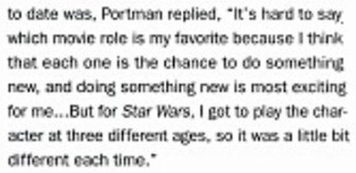
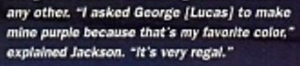
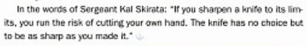
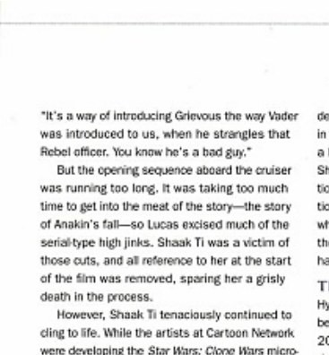
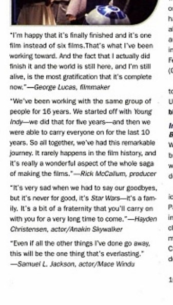

# Owner Material 038 — Star Wars Insider #1–153 plus specials (with The Lucasfilm Fan Club Magazine #1–22): Star Wars Insider #84 (2005)

- **Source:** *Star Wars Insider* magazine (issues 23–153, 1994–2014) and its predecessor *The Lucasfilm Fan Club Magazine* (issues 1–22, 1987–1994), plus seven special editions: articles, interviews, comics and short fiction Secondary source (licensed Legends reference). Scan OCR'd on the box; the scan stays box-only and is **not** published.
- **Method:** every scanned page was OCR'd and machine-screened sentence by sentence for power-relevant statements (fights, kills, defeats, Force feats, rankings, superweapons) that name a character on our roster; each kept sentence is quoted verbatim from the OCR text and has a crop of the printed passage directly under it. Pages with nothing power-relevant are still listed with what is on them.
- **Citation:** "*Star Wars Insider #84* (2005), p.X" by printed page ("scan p.X" where no printed number applies). **Weight:** Licensed magazine: a secondary source. Its short fiction and comics are Legends stories; its articles and interviews sum up or discuss lore and rank below the novels, comics and games they describe.

## scan p.1 (scan page 1)

Page contents: Cover, Issue 84, November/December 2005: clone trooper; "Galactic Soldiers: Inside Palpatine's Grand Army of the Republic"; "Incoming Transmission: HoloNet News is back online!"; "Lurking in the Shadows: The Creatures of Episode III"; top banner "Hidden Treasures: Poster Concepts from A New Hope"; limited-edition 2-of-3 collector's cover badge; Bantha Tracks: Vader fan art, building a Star Wars bedroom; exclusive online content: The Cruel Fate of Shaak Ti, Setting the Stage, Galactic Gallery (hand-read)

## scan p.2 (scan page 2)

Page contents: Ad: Alienware Aurora Star Wars Edition PC, starting at $1,499 (hand-read)

## scan p.3 (scan page 3)

Page contents: Ad: IDG Entertainment, Vader: The Ultimate Guide and the official Episode III movie guide (hand-read)

## scan p.4 (scan page 4)

Page contents: Contents, Insider 84 Nov/Dec 2005: features Guide to the Grand Army of the Republic (Karen Traviss and Ryan Kaufman, p24), The Art of Revenge of the Sith Part Two (J.W. Rinzler, p32), Lurking in the Shadows (Daniel Wallace, p44), HoloNet News (Daniel Wallace with Pablo Hidalgo, p52), Posters of Episode IV (Pete Vilmur, p64); departments Comlink, Skywalking, Jedi Library (Jason Fry), Drawn by the Force (Purge by John Ostrander and Doug Wheatley; last days of Quinlan Vos in Star Wars Republic), Technical Readout (Chris Trevas), Ask the Master (Pablo Hidalgo), Scouting the Galaxy (Steve Sansweet), Jabba's Collection, Best of Hyperspace (Pablo Hidalgo and Bonnie Burton), Bantha Tracks (Mary Franklin), Emperor's Exhibit (Matt Busch); StarWarsShop box: vac-metalized red-finished Darth Vader (hand-read)

## scan p.5 (scan page 5)

Page contents: Ad: Cloud City Collectibles, vintage toys 1960–1989 (hand-read)

## scan p.6 (scan page 6)

Page contents: Letter from the Editor, Brett Rector, "Who Doesn't Love Stormtroopers?": the armor and mystique of the troopers; clones in Attack of the Clones; Karen Traviss' Republic Commando: Hard Contact shows clone brotherhood; Obi-Wan and Commander Cody's camaraderie in Revenge of the Sith; trooper height differences explained by other genetic donors; masthead (IDG Entertainment and Lucasfilm staff) (hand-read)

## scan p.7 (scan page 7)

Page contents: Ad: DK books, Star Wars: Complete Locations and Star Wars: The Ultimate Visual Guide (hand-read)

## scan p.8 (scan page 8)

Page contents: Comlink letters (letter-writer names omitted), "Are the Fetts A Cursed Family, or What?": jetpack malfunctions doom Jango and Boba; request for a prequel top-10 list; pop-culture program track at Celebration III; three versus four ellipses in Return of the Jedi's opening crawl ("sometimes Sith just happens"); correction box "Incoming Transmission" on misspelling author Michael Reaves' name in MedStar: Intermezzo (hand-read)

## scan p.9 (scan page 9)

Page contents: Comlink cont. (letter-writer names omitted): Indiana Jones coverage; a clone trooper guide arrives this issue, Mandalorian features coming; video-game EU moments (Revan's identity, Bastila) missing from the 20 Most Memorable list; Ton Phanan's death correction (X-Wing: Iron Fist) and Luke and Mara's wedding in Star Wars: Union; Episode III DVD on November 1; top-right box with the Comlink mailing and email address (hand-read)

## scan p.10 (scan page 10)

Page contents: Skywalking News, Brett Rector, "Star Wars Is Forever… At Comic-Con '05 and Beyond; Plus, Release Date for Episode III DVD": Sansweet's Saturday panel, Letterman Digital Arts Center at the Presidio, new Lucasfilm Animation 3D Clone Wars series (Gail Currey, Catherine Winder, Chris Kubsch), Matt Wood introduced (hand-read)

## scan p.11 (scan page 11)

Page contents: Skywalking cont.: Matt Wood on earning the Grievous role and the raspy voice; "The Journey" for Hyperspace members; Natalie Portman at Comic-Con promoting V for Vendetta; For the Collector: Hasbro figures (Commander Bly, Commander Gree, Wookiee commando, hologram Aayla Secura and Plo Koon) and 2006 Saga Collection; Master Replicas Obi-Wan Elite saber, Darth Maul Force FX, AT-AT and Millennium Falcon; Sideshow and Hasbro 12-inch figures (hand-read)

- **Padmé Amidala** — entry/section: Portman on playing Padmé at three ages: ""It's hard to say which movie role is my favorite because I think that each one is the chance to do something new, and doing something new is most exciting for me...But for Star Wars, I got to play the character at three different ages, so it was a little bit different each time." —Natalie Portman, Star Wars Insider 84, p. 11" Source: *Star Wars Insider #84* (2005), scan p.11
  

### Stat block notes (game mechanics, not feats)

- Matt Wood, voice of General Grievous: Sansweet invited Episode III's Supervising Sound Editor and voice of General Grievous, Matt Wood, to the stage to tell the tale about how he earned the role of the movie's iconic villain (by sneaking his audition tape in front of George Lucas) and how he created the character's raspy voice. (Star Wars Insider 84, pp. 10–11) (Source: *Star Wars Insider #84* (2005), scan p.11)

## scan p.12 (scan page 12)

Page contents: Skywalking cont.: Gentle Giant (Boba Fett, Darth Maul, Luke on tauntaun, Lando bust), Code 3 (Vader TIE, Revenge of the Jedi mini poster); Game On!: Battlefront II, Empire at War; "Get Your Revenge on DVD": November 1 DVD features, Jim Ward quotes, Battlefront II's 501st story; pull quote "It's really going to be a terrific celebration of the entire saga." (hand-read)

## scan p.13 (scan page 13)

Page contents: Ad: NBC's Surface (hand-read)

## scan p.14 (scan page 14)

Page contents: Skywalking cont.: Joshua Katz named VP of marketing at Lucasfilm (Micheline Chau and Jim Ward quotes); Clone Wars Volume 2 Emmy nomination (Chapters 21–25: Palpatine's capture and Anakin's Nelvaan vision-quest), credit list; Empire of Dreams sound-editing nomination; Grievous and Anakin Clone Wars art (hand-read)

### Stat block notes (game mechanics, not feats)

- Clone Wars Volume 2 Emmy nomination: Chapters 21–25 were the episodes that led directly into the events of Revenge of the Sith, featuring the capture of Chancellor Palpatine and Anakin Skywalker's vision-quest on the planet of Nelvaan. (Star Wars Insider 84, p. 14) (Source: *Star Wars Insider #84* (2005), scan p.14)

## scan p.15 (scan page 15)

Page contents: Ad: elvisTECH computers and games (hand-read)

## scan p.16 (scan page 16)

Page contents: Jedi Library, Jason Fry, "Collecting History: Two Books That Delve into Star Wars Lore": Steve Sansweet's The Star Wars Poster Book (with Peter Vilmur) and Star Wars Chronicles: The Prequels (with Pablo Hidalgo); Lucas' love of painted posters (hand-read)

## scan p.17 (scan page 17)

Page contents: Jedi Library cont.: Darth Maul posters from England, Canada, Australia and the U.S.; Roger Kastel's Hong Kong Empire poster; rare Polish C-3PO poster; the Poster Book pitched in 1994; Style "D" "Circus Poster" by Charles White III and Drew Struzan (hand-read)

## scan p.18 (scan page 18)

Page contents: Jedi Library cont.: the Circus Poster's collage solution and the recovered original art ("It's back in George's hands"); Chronicles and its Japanese origins (Eimei Takeda, Seiji Takahashi); Chronicles: The Prequels' CGI props and deadline crunch; Episode I spread (hand-read)

## scan p.19 (scan page 19)

Page contents: Ad: Official Pix photographs and autographs (hand-read)

## scan p.20 (scan page 20)

Page contents: Jedi Library cont.: separate U.S. and Japanese texts; a possible new Star Wars Encyclopedia; Sansweet's dream book on his own collection; SPHA-T, Qui-Gon Jinn and Obi-Wan Kenobi spreads (hand-read)

## scan p.21 (scan page 21)

Page contents: Ad: Scholastic, Jude Watson's Star Wars: The Last of the Jedi (The Desperate Mission, Dark Warning; #3 Underworld coming December 2005) (hand-read)

## scan p.22 (scan page 22)

Page contents: Drawn by the Force, Daniel Wallace, "Wipe Them Out, All of Them: Vader Gets into His Villainous Groove in Purge": the one-shot by John Ostrander and Doug Wheatley; Vader hunts a secret Jedi gathering hoping Obi-Wan is there; Ostrander on Vader's anger, despair and the people he could not save; box "The Mighty Quin": Quinlan Vos' history since Star Wars #17, his death in Republic #81–83 (Kashyyyk, Vilmahr "Vile" Grahrk), Jan Duursema on saying goodbye to Quin and Aayla (hand-read)

### Stat block notes (game mechanics, not feats)

- Purge: Vader's hatred for Obi-Wan: "At the time of Purge, [Vader's anger] is focused on one person: Obi-Wan," says Ostrander. "Kenobi left him to die painfully in the lava, [and] Vader probably blames Obi-Wan for bringing Padmé to Mustafar." (Star Wars Insider 84, p. 22) (Source: *Star Wars Insider #84* (2005), scan p.22)

## scan p.23 (scan page 23)

Page contents: Drawn by the Force cont.: cover and interior artwork from Star Wars Republic #81 (Quinlan Vos and Wookiees) (hand-read)

## scan p.24 (scan page 24)

Page contents: Technical Readout, Chris Trevas, "Geonosis Arena: Jedi, Droids, and Clones…Oh My!": minimal Fox Studios Australia set, 200 Jedi, Samuel L. Jackson's training with Nick Gillard, Byron Bay swordsmen, the 1/35-scale arena miniature; pull quote on the largest gathering of Jedi ever seen (hand-read)

## scan p.25 (scan page 25)

Page contents: Technical Readout cont.: Mace Windu's "Sam Jackson style", Christensen's month of training, the purple lightsaber, Silas Carson as both Ki-Adi-Mundi and Nute Gunray, Mace's hilt, gunship CG model, ILM motion capture for clones, DC-15 rifle built from Hasbro parts (hand-read)

- **Mace Windu** — entry/section: Jackson on the purple lightsaber: ""I asked George [Lucas] to make mine purple because that's my favorite color...It's very regal." —Samuel L. Jackson, Star Wars Insider 84, p. 25" Source: *Star Wars Insider #84* (2005), scan p.25
  

## scan p.26 (scan page 26)

Page contents: Feature, Karen Traviss and Ryan Kaufman, illustrations by Chris Trevas, "Guide to the Grand Army of the Republic": Clones: Bred for War (Arligan Zey's line on intelligent humans; Jango Fett's genome and Mandalorian traits) (hand-read)

## scan p.27 (scan page 27)

Page contents: Guide cont.: Alpha-class ARCs, Null ARCs trained by Kal Skirata (Jaing and Kom'rk located Grievous on Utapau), numbers at Tipoca City and Kamino's northern stations, clone kill rates and sabotage ("clout per credit"); Making the Man: flash training, Alpha-17, the Cuy'val Dar (Skirata, Walon Vau, Rav Bralor); Republic commandos' casualties and 90 percent success; Imperial shock trooper art (hand-read)

### Stat block notes (game mechanics, not feats)

- Null ARCs find Grievous: Those are thought to be the notorious Null ARCs, trained by Sergeant Kal Skirata. Two of the Null-class ARC troopers, N-10 (Jaing) and N-6 (Kom'rk) were the Clone Intelligence Units who located General Grievous on Utapau. They were "black ops" commandos without equal but completely unpredictable and loyal only to Kal Skirata. (Star Wars Insider 84, p. 27) (Source: *Star Wars Insider #84* (2005), scan p.27)

## scan p.28 (scan page 28)

Page contents: Guide cont.: Traditions and Ethos: the Mandalorian Heart (anthem Vode An; motto Darasuum Kote, Eternal Glory), Organization: ORBATs; Regular Army strength and command structure table (Grand Army to squad); Lancer Battalion art (hand-read)

## scan p.29 (scan page 29)

Page contents: Guide cont.: Special Forces structure table; Leadership (ARC commanders' kama and pauldrons, Cody, Gree); Special Units (Galactic Marines under Bacara and Ki-Adi-Mundi, 41st Elite, Squad Seven); Special Units: Divisions (327th Star Corps with Aayla Secura and Commander Bly; Galactic Marines' visor gear); Clone Commander Cody, Galactic Marine and Commander Bly art (hand-read)

### Stat block notes (game mechanics, not feats)

- Aayla Secura and Commander Bly: Aayla Secura was assigned to the Corps after her mission to Hypori and forged a close relationship with Commander Bly. Due to his ARC training, Bly had misgivings about Aayla's Jedi way of doing things, but over time he came to understand her strategies. (Star Wars Insider 84, p. 29) (Source: *Star Wars Insider #84* (2005), scan p.29)

## scan p.30 (scan page 30)

Page contents: Guide cont.: Bacara and Ki-Adi-Mundi's contentious relationship until Mygeeto; 41st Elite under Luminara Unduli and Gree; Lancer Battalion; Kit (DC-15, thermal dets, ECD grenades, medpacs); Logistics and Transport (Rothana Heavy Engineering, LAAT/c, CR20 and CR25 drop ships); Special Kit (DC-17 hand blaster, Bly's twin pistols, kama, jetpacks, 327th rocket troopers); Commander Gree art (hand-read)

## scan p.31 (scan page 31)

Page contents: Guide cont.: UT-AT; Heroes of the Clone Army: Captain Fordo (ARC-77) and the Muunilinst 10, Commander Bacara "1138" (Concord Dawn training, Commander Neyo); Republic Commandos art (hand-read)

## scan p.32 (scan page 32)

Page contents: Guide cont.: Sergeant Fox (501st, Journeyman Protectors, spared Bail Organa at the Temple), Commander Deviss (Hawkbat at Geonosis, promoted by Bly after Altyr V), Captain "Jag" Jai'galaar (ARC-170 test pilot, Plo Koon's wingman at Cato Neimoidia); Sky Corps art (hand-read)

## scan p.33 (scan page 33)

Page contents: Guide cont.: Jedi Eradication: Order 66 (no genetic coding; discipline and training), Kal Skirata on the knife; Footnotes: ORBAT with names (Talon Squad, Bacta Company, Hawkbat Battalion, 327th under Bly and Aayla, Systems Army Alpha under Mace Windu); ARC trooper art (hand-read)

- **Kal Skirata** — entry/section: Skirata on Order 66: ""If you sharpen a knife to its limits, you run the risk of cutting your own hand. The knife has no choice but to be as sharp as you made it." —Kal Skirata, Star Wars Insider 84, p. 33" Source: *Star Wars Insider #84* (2005), scan p.33
  

## scan p.34 (scan page 34)

Page contents: Feature, J.W. Rinzler, "The Art of Revenge of the Sith, Part Two: Rare and Seldom-Seen Imagery from George Lucas' Final Film Installment": the Friday December 6, 2002 art meeting; pull quote by T.J. Frame (hand-read)

## scan p.35 (scan page 35)

Page contents: Art of ROTS cont.: Mygeeto Surrender (Ryan Church, the Banking Clan running joke), Felucia Concept 02 (Iain McCaig, Sang Jun Lee note; Anakin riding the lizard); Ryan Church pull quote (hand-read)

## scan p.36 (scan page 36)

Page contents: Art of ROTS cont.: concept boards for December 6, 2002 (Ryan Church, Stian Dahlslett, T.J. Frame, Warren Fu, Alex Jaeger, Sang Jun Lee, Iain McCaig, Erik Tiemens, Derek Thompson, Feng Zhu); Wookiee Jedi concept by Derek Thompson ("He didn't go for it"); Feng Zhu pull quote (hand-read)

## scan p.37 (scan page 37)

Page contents: Ad: Gen Con So Cal '05, November 17–20, 2005, Anaheim (hand-read)

## scan p.38 (scan page 38)

Page contents: Art of ROTS cont.: Polis Massa revisions 01 and 08 (Erik Tiemens, archaeological dig idea, Joe Johnston vehicle became the clone tank); Erik Tiemens pull quote; "OK" stamp (hand-read)

## scan p.39 (scan page 39)

Page contents: Ad: Brian's Toys catalog (hand-read)

## scan p.40 (scan page 40)

Page contents: Art of ROTS cont.: "Battle of Hoth" drawing by a young Alex Jaeger; Droid General Face Concept 05 (Alex Jaeger) for Grievous; Alex Jaeger pull quote; "Fabulouso" stamped creature concepts (hand-read)

## scan p.41 (scan page 41)

Page contents: Episode III concept-art feature concl.: Trade Federation clone-fighter concepts, young Warren Fu's Battle of Hoth drawing, "Clone fighter, revised" (Warren Fu), Felucia jellyfish creature (Sang Jun Lee) (hand-read)

## scan p.42 (scan page 42)

Page contents: Ask the Master (Pablo Hidalgo), "A Star Wars Time Warp": Revenge of the Sith spans an estimated nine days, day-by-day breakdown (hand-read)

## scan p.43 (scan page 43)

Page contents: Ask the Master: Bestine (Tatooine capital / Bestine system); Grievous' cough; falling forward aboard the Invisible Hand (hand-read)

### Stat block notes (game mechanics, not feats)

- Why Grievous coughs: The real reason Grievous coughs is that George Lucas wanted to add some detail to the character. He wanted Grievous to have a sickly oiliness to him, to make him very unpleasant. (Star Wars Insider 84, p. 43) (Source: *Star Wars Insider #84* (2005), scan p.43)

## scan p.44 (scan page 44)

Page contents: Ask the Master: local forces after Order 66 (Utapau, Kashyyyk; Tusken sharpshooter Taym Dren-garen card backstory); Palpatine's spare lightsabers; why Bail sent for Obi-Wan; Sly Moore and Mas Amedda (hand-read)

### Stat block notes (game mechanics, not feats)

- Palpatine's duplicate lightsabers: Forget about promo shots; we see Palpatine wield a duplicate of his holdout lightsaber later in the movie when he duels with Yoda. The inference is that Palpatine does indeed have multiples of his lightsaber; however it is not known how many he had. (Star Wars Insider 84, p. 44) (Source: *Star Wars Insider #84* (2005), scan p.44)
- Sly Moore's influence: Sly Moore is more than just an aide. As an Umbaran, she has the ability to influence others. It's not a Force talent but something psychochemical. (Star Wars Insider 84, p. 44) (Source: *Star Wars Insider #84* (2005), scan p.44)

## scan p.45 (scan page 45)

Page contents: Ask the Master: Mas Amedda as Sith-relic antiquarian; "robots" vs "droids"; Moff Jerjerrod commands second Death Star (hand-read)

## scan p.46 (scan page 46)

Page contents: "Lurking in the Shadows of Episode III" by Daniel Wallace: creatures of Revenge of the Sith (opening spread) (hand-read)

## scan p.47 (scan page 47)

Page contents: Nos monster: cut Utapau cave scene, Obi-Wan and the seeker droid (hand-read)

## scan p.48 (scan page 48)

Page contents: Varactyl: Boga, Obi-Wan's steed; cut stables/Jedi mind trick sequence survives in comics adaptation; 13 feet tall at shoulder (hand-read)

### Stat block notes (game mechanics, not feats)

- Boga cut sequence: Cut from the script was a sequence where Obi-Wan visits the stables and "borrows" a ride using the Jedi mind trick. The scene does survive in the comics adaptation. (Star Wars Insider 84, p. 48) (Source: *Star Wars Insider #84* (2005), scan p.48)

## scan p.49 (scan page 49)

Page contents: Varactyl concl.: Utai domesticated them; McGregor on hydraulic gimbal rig; Ben Burtt's Boga cry; Rob Coleman on animation (hand-read)

## scan p.50 (scan page 50)

Page contents: Can-cell: Kashyyyk dragonfly-like insect; cut Yoda escape scene (hand-read)

### Stat block notes (game mechanics, not feats)

- Yoda's cut can-cell escape: In the script, Yoda was to have escaped from clone troopers on Kashyyyk by hitching a lift (Star Wars Insider 84, p. 50) (Source: *Star Wars Insider #84* (2005), scan p.50)

## scan p.51 (scan page 51)

Page contents: Mustafar lava flea: Mustafarians, Techno Union; nicknamed "Jun bug" after Sang Jun Lee (hand-read)

## scan p.52 (scan page 52)

Page contents: Felucia gelagrub: ridden by Aayla Secura's clone troopers; ILM digital artist Paul Giacoppo (hand-read)

## scan p.53 (scan page 53)

Page contents: Dactillion: Utapau flying mount, Utai/Pau'ans; Ki-Adi-Mundi concept model (hand-read)

## scan p.54 (scan page 54)

Page contents: Republic HoloNet News special inaugural edition: full text of Palpatine's speech declaring the Galactic Empire (hand-read)

### Stat block notes (game mechanics, not feats)

- Palpatine's Empire speech: The attempt on my life has left me scarred and deformed, but I assure you my resolve has never been stronger. The war is over. (Star Wars Insider 84, p. 54) (Source: *Star Wars Insider #84* (2005), scan p.54)

## scan p.55 (scan page 55)

Page contents: HoloNet News: "Palpatine's Triumphs: A Celebration" timeline (hand-read)

## scan p.56 (scan page 56)

Page contents: HoloNet News: COMPOR reorganized as COMPNOR; SAGroup, Compforce (hand-read)

## scan p.57 (scan page 57)

Page contents: HoloNet News: 63 senators arrested (Armand Isard); Bail Organa statement; Queen Apailana remembers Padmé (hand-read)

## scan p.58 (scan page 58)

Page contents: HoloNet News: Trade Federation signs nationalization treaty (Sentepeth Findos) (hand-read)

## scan p.59 (scan page 59)

Page contents: HoloNet News: Meet your regional governors (Moffs) — Wilhuff Tarkin, Denn Wessex, Marcellin Wessel (hand-read)

### Stat block notes (game mechanics, not feats)

- Tarkin as regional governor: With the sharp features of a hawk-bat, this rising star from the Outer Rim commercial hub of Eriadu holds entire star systems in his grip. (Star Wars Insider 84, p. 59) (Source: *Star Wars Insider #84* (2005), scan p.59)

## scan p.60 (scan page 60)

Page contents: HoloNet News in Brief: citizens urged to register (identichips); "The New Empire: How Can You Help?" (hand-read)

## scan p.61 (scan page 61)

Page contents: HoloNet News headlines; "Be Alert!" partial list of Jedi still at large (incl. Kai Justiss, Halagad Ventor, Ranik Solusar) — final edition notice (hand-read)

## scan p.62 (scan page 62)

Page contents: Scouting the Galaxy (Steve Sansweet), "Finding a Treasure in a Used Bookstore Bin": convention season (Comic-Con, Wizard World Chicago, Dragon*Con), bootleg DVD warning (hand-read)

## scan p.63 (scan page 63)

Page contents: Scouting the Galaxy: That '70s Show green-saber Vader; 1998 Expanded Universe figures (Kyle Katarn, Dark Trooper); StarWarsShop.com online-only ordering (hand-read)

## scan p.64 (scan page 64)

Page contents: Scouting the Galaxy: Paradise Snare uncorrected page proof; Star Wars Encyclopedia follow-up; new-figure price appreciation; Ultimate Soundtrack (hand-read)

## scan p.65 (scan page 65)

Page contents: Ad: Official Star Wars Fan Club / Hyperspace / Insider subscription "Join us... and the circle will be complete!" (hand-read)

## scan p.66 (scan page 66)

Page contents: "Posters of Episode IV: A New Hope" by Pete Vilmur: addendum to The Star Wars Poster Book; "Twenty-Six for Seventy-Six" poster (hand-read)

## scan p.67 (scan page 67)

Page contents: Posters circa 1976: Charles Lippincott on the Fox sales convention; teaser "Coming to Your Galaxy This Summer"; Howard Chaykin poster #1 at 1976 San Diego Comic-Con (hand-read)

## scan p.68 (scan page 68)

Page contents: McQuarrie poster concepts (Where the Red Fern Grows credit block; Vader looming; Luke as a girl in "The Star Wars") (hand-read)

## scan p.69 (scan page 69)

Page contents: Other early concepts: Jeff Jones, John Solie (Frazetta-inspired) (hand-read)

## scan p.70 (scan page 70)

Page contents: Wojtek Siudmak concept; Philippe Druillet concept; Obi-Wan's yellow blade concept (hand-read)

## scan p.71 (scan page 71)

Page contents: John Berkey concept with Alec Guinness; Jim Campbell concept (hand-read)

## scan p.72 (scan page 72)

Page contents: Tom Jung's Style "A" poster: preliminary sketches, Peter Cushing; droids added by a second artist (hand-read)

## scan p.73 (scan page 73)

Page contents: Papuzza's Italian "Guerre Stellari" posters (hand-read)

## scan p.74 (scan page 74)

Page contents: Star Wars Turns One: McQuarrie birthday-poster sketch; Bob Seidemann's cake photos (hand-read)

## scan p.75 (scan page 75)

Page contents: Star Buccaneers: 1978 re-release Style "D" (Charles White III and Drew Struzan); Dan Goozee concept; Tom Chantrell concept (hand-read)

## scan p.76 (scan page 76)

Page contents: Jabba's Collection (Brett Rector), "Hasbro Battle Packs Hit the Front Lines": seven Battle Packs (incl. Attack on Coruscant with Commander Bacara); Code 3 Revenge of the Jedi 3-D poster (hand-read)

### Stat block notes (game mechanics, not feats)

- Bacara Battle Pack: Attack on Coruscant: Available exclusively at Target, this set includes Commander Bacara and four clone troopers as they head off to war against the Separatist army. (Star Wars Insider 84, p. 76) (Source: *Star Wars Insider #84* (2005), scan p.76)

## scan p.77 (scan page 77)

Page contents: Jabba's Collection: Gentle Giant scout trooper statue, Vader and Yoda busts; Master Replicas second-edition AT-AT (750 pieces, Phil Tippett plaque) (hand-read)

## scan p.78 (scan page 78)

Page contents: Best of Hyperspace (Pablo Hidalgo and Bonnie Burton), "Lights, Camera, Jedi: The Sets of Episode III" stage-by-stage list (Stages 1–2) (hand-read)

## scan p.79 (scan page 79)

Page contents: Sets of Episode III list cont. (Stages 3–7) (hand-read)

## scan p.80 (scan page 80)

Page contents: "The Cruel Fate of Shaak Ti": cut twice; Grievous kills her in cut corridor scene shot August 19, 2003 (Orli Shoshan; Duncan Young read Grievous) (hand-read)

### Stat block notes (game mechanics, not feats)

- Shaak Ti's cut death: There's a sharp intake of air from Shaak Ti as she arches her back while Grievous stabs her through the heart. Her body slumps and Anakin and Obi-Wan turn grim. (Star Wars Insider 84, p. 80) (Source: *Star Wars Insider #84* (2005), scan p.80)
- Obi-Wan on Shaak Ti (cut dialogue): OBI-WAN: She's the most cunning of Jedi. She's even shown me a few tricks. They won't catch her. (Star Wars Insider 84, p. 80) (Source: *Star Wars Insider #84* (2005), scan p.80)

## scan p.81 (scan page 81)

Page contents: Shaak Ti concl.: second cut death in Jedi Temple (Shepperton pickup, September 3, 2004); she appears briefly as Council hologram; "The Journey" farewell quotes; Hyperspace AudioCast, Insider archive; VIP blogs (Daniel Logan on Mexico convention with Jeremy Bulloch, David Prowse, Ray Park) (hand-read)

- **General Grievous** — entry/section: McCaig on Grievous' introduction: ""It's a way of introducing Grievous the way Vader was introduced to us, when he strangles that Rebel officer. You know he's a bad guy." —Ian McCaig, Star Wars Insider 84, pp. 80–81" Source: *Star Wars Insider #84* (2005), scan p.81
  
- **Darth Vader (Anakin Skywalker)** — entry/section: Christensen on saying goodbye: ""It's very sad when we had to say our goodbyes, but it's never for good, it's Star Wars—it's a family." —Hayden Christensen, Star Wars Insider 84, p. 81" Source: *Star Wars Insider #84* (2005), scan p.81
  
- **Mace Windu** — entry/section: Jackson on Star Wars: ""Even if all the other things I've done go away, this will be the one thing that's everlasting." —Samuel L. Jackson, Star Wars Insider 84, p. 81" Source: *Star Wars Insider #84* (2005), scan p.81
  

### Stat block notes (game mechanics, not feats)

- Anakin kills Shaak Ti (cut scene): Hayden Christensen, wearing his dark hood up, steps into the frame. "What is it, Skywalker?" asks Shoshan. There's no answer, other than a stab in the back. (Star Wars Insider 84, p. 81) (Source: *Star Wars Insider #84* (2005), scan p.81)

## scan p.82 (scan page 82)

Page contents: Best of Hyperspace: blog parody script "Nice Little Package" (Obi-Wan takes the alias Ben; Bail and Queen Organa on Alderaan; Owen and Beru on Tatooine); Galactic Gallery concept-art captions (Sicemon grass planet, Norman Reynolds Hoth markers, Terryl Whitlatch Hutt hotties, Sang Jun Lee Padmé portrait, Joe Johnston, Erik Tiemens rotor-ship cruiser) (hand-read)

## scan p.83 (scan page 83)

Page contents: Galactic Gallery concept art plates 1–7 (hand-read)

## scan p.84 (scan page 84)

Page contents: Bantha Tracks vol. 15 "The Art of Darth Vader" (fan art; fan names omitted) (hand-read)

## scan p.85 (scan page 85)

Page contents: Bantha Tracks: fan Vader/Anakin art (names omitted) (hand-read)

## scan p.86 (scan page 86)

Page contents: Bantha Tracks: fan cartoon "Darth's Day at the Beach", pumpkin carving, digital art (names omitted) (hand-read)

## scan p.87 (scan page 87)

Page contents: Bantha Tracks: fan acrylic Vader painting (name omitted) (hand-read)

## scan p.88 (scan page 88)

Page contents: Bantha Tracks "Revenge of the Sheets": a family's Star Wars bedroom (names omitted) (hand-read)

## scan p.89 (scan page 89)

Page contents: Bantha Tracks: tips for a custom Star Wars bedroom (names omitted) (hand-read)

## scan p.90 (scan page 90)

Page contents: Bantha Tracks: Fan.Tastic (Celebration III child's exchange with George Lucas; names omitted); "The Way We Were": Insider editor-in-chief Brett Rector's collecting history (hand-read)

## scan p.91 (scan page 91)

Page contents: Bantha Tracks editorial (Mary Franklin), "Anakin Skywalker Changed My Life" (hand-read)

## scan p.92 (scan page 92)

Page contents: Emperor's Exhibit: "Darth Vader Sketch" by Matt Busch (hand-read)

## scan p.93 (scan page 93)

Page contents: StarWarsShop #8: Holiday Edition Darth Vader figure; back-to-school; Halloween superstore (hand-read)

## scan p.94 (scan page 94)

Page contents: StarWarsShop: Collector's Picks (collector name omitted) (hand-read)

## scan p.95 (scan page 95)

Page contents: StarWarsShop: The M-Pire (M&M'S Star Wars products) (hand-read)

## scan p.96 (scan page 96)

Page contents: StarWarsShop: costumes (Supreme Edition Vader, Palpatine, clone trooper, Jedi robe, TIE helmet, Maul mask, Chewbacca mask) (hand-read)

## scan p.97 (scan page 97)

Page contents: StarWarsShop: costumes cont. (toddler Vader, X-wing and scout trooper helmets, Obi-Wan, Dooku, pet Vader, Anakin, Chewbacca) (hand-read)

## scan p.98 (scan page 98)

Page contents: StarWarsShop: More Must Haves (LEGO Death Star, Dressing a Galaxy, Han Solo blaster, etc.) (hand-read)

## scan p.99 (scan page 99)

Page contents: Ad: Anthony Grandio Company "Path to the Dark Side" checks (hand-read)

## scan p.100 (scan page 100)

Page contents: Ad: Star Wars Miniatures AT-AT "Actual Size" (AT-AT release event Nov. 12, 2005) (hand-read)

