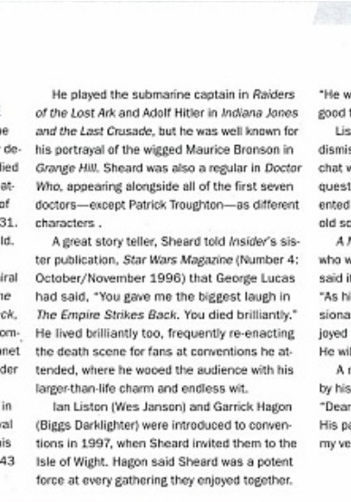
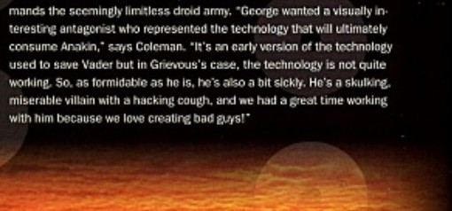
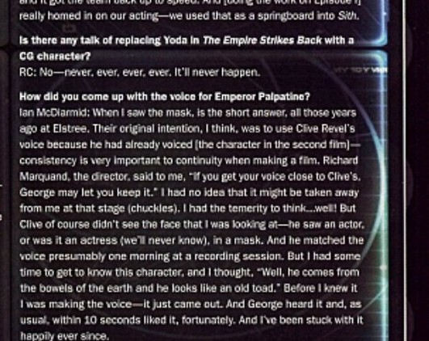
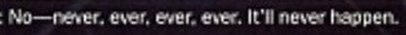
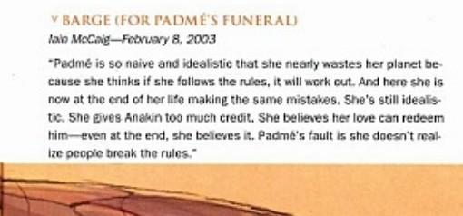
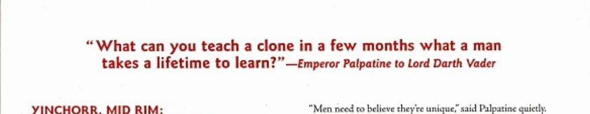
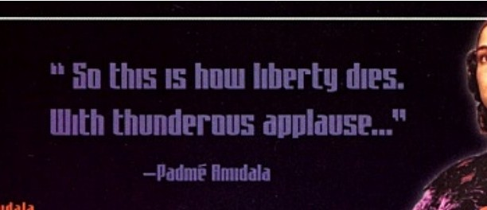
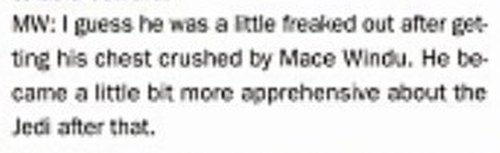

# Owner Material 038 — Star Wars Insider #1–153 plus specials (with The Lucasfilm Fan Club Magazine #1–22): Star Wars Insider #85 (2006)

- **Source:** *Star Wars Insider* magazine (issues 23–153, 1994–2014) and its predecessor *The Lucasfilm Fan Club Magazine* (issues 1–22, 1987–1994), plus seven special editions: articles, interviews, comics and short fiction Secondary source (licensed Legends reference). Scan OCR'd on the box; the scan stays box-only and is **not** published.
- **Method:** every scanned page was OCR'd and machine-screened sentence by sentence for power-relevant statements (fights, kills, defeats, Force feats, rankings, superweapons) that name a character on our roster; each kept sentence is quoted verbatim from the OCR text and has a crop of the printed passage directly under it. Pages with nothing power-relevant are still listed with what is on them.
- **Citation:** "*Star Wars Insider #85* (2006), p.X" by printed page ("scan p.X" where no printed number applies). **Weight:** Licensed magazine: a secondary source. Its short fiction and comics are Legends stories; its articles and interviews sum up or discuss lore and rank below the novels, comics and games they describe.

## scan p.1 (scan page 1)

Page contents: Cover, Issue 85: Revenge of the Sith on DVD "See It Again for the First Time"; "Back to the Frontlines in Star Wars: Battlefront II"; exclusive online content: Bantha Tracks, Star Wars envelope art; IDG Communications publication, The Magazine of Hyperspace: the official Star Wars fan club (hand-read)

## scan p.2 (scan page 2)

Page contents: Ad: Firaxis Games (spread with p3), ESRB rating panel (hand-read)

## scan p.3 (scan page 3)

Page contents: Ad: Firaxis Games, "Dictate policy that will have the entire U.S. seeing red", GameSpy.com blurb (hand-read)

## scan p.4 (scan page 4)

Page contents: Contents, Insider 85: Two-Edged Sword fiction (Vader and Dark Jedi clones), Who's Who in the Delegation of 2000 (Revenge of the Sith DVD deleted scenes), Dressing a Galaxy exhibit (Trisha Biggar costumes), Pete Vilmur posters of The Empire Strikes Back part two; Comlink letters (Quinlan Vos almost followed Aayla Secura's boots), News (Peter Mayhew made U.S. citizen; loss of Michael Sheard), DK Ultimate Visual Guide, Dark Horse Knights of the Old Republic, C-3PO feature, Toys (Hasbro Unleashed Battle Packs, Gentle Giant Empire Strikes Back busts), Best of Hyperspace (Pablo Hidalgo and Bonnie Burton), droid domes fashion (hand-read)

## scan p.5 (scan page 5)

Page contents: Ad: Cloud City Collectibles, Norcross GA (hand-read)

## scan p.6 (scan page 6)

Page contents: Editorial (Brett Rector): restless anticipation a year earlier before Revenge of the Sith; the Obi-Wan/Anakin bond makes the A New Hope duel more impactful; the prequels made Vader a tragic figure rather than pure evil (hand-read)

## scan p.7 (scan page 7)

Page contents: Ad: DK Star Wars: The Ultimate Visual Guide (hand-read)

## scan p.8 (scan page 8)

Page contents: Comlink letters: "Like Apprentice, Like Master?"; staff answer on Quinlan Vos plans for Kashyyyk; The Art of Star Wars street-art letter (writer names omitted) (hand-read)

### Stat block notes (game mechanics, not feats)

- Quinlan Vos planned for Kashyyyk in Revenge of the Sith: As for a scene in Revenge of the Sith involving Quinlan Vos, yes, there were initial plans to include him as one of the Jedi characters on the battlefield of Kashyyyk, the Wookiee homeworld. Costume Archivist and Supervisor Gillian Libbert began putting together a costume folder for Vos with the help of Set Diary Master Pablo Hidalgo, but that's as far as it went—no one was cast, therefore no shots of the character exist...well, nothing else besides his mug plastered in the Star Wars Republic comic books. (Star Wars Insider 85, p. 8) (Source: *Star Wars Insider #85* (2006), scan p.8)

## scan p.9 (scan page 9)

Page contents: Ad: Entertainment Earth exclusive 3 3/4-inch action figures, "Your armies need these new recruits!" (hand-read)

## scan p.10 (scan page 10)

Page contents: Comlink letters continued: Shaak Ti on the Invisible Hand question and staff answer; other letters (writer names omitted) (hand-read)

### Stat block notes (game mechanics, not feats)

- Shaak Ti never on the Invisible Hand: While it may seem like a mystery, there really is a simple answer: For all intents and purposes, Shaak Ti was never on the Invisible Hand. During production on Episode III, Director George Lucas decided to effectively cut the scene with the Jedi as Grievous' captive in favor of moving the story along, with the feeling being that the action should be centered around Anakin and Obi-Wan's rescue attempt. (Star Wars Insider 85, p. 10) (Source: *Star Wars Insider #85* (2006), scan p.10)

## scan p.11 (scan page 11)

Page contents: Ad: Armed Archives Direct (armedarchivesdirect.com) (hand-read)

## scan p.12 (scan page 12)

Page contents: News: George Lucas gives $1 million to the Martin Luther King Jr. memorial; Peter Mayhew becomes a U.S. citizen (hand-read)

## scan p.13 (scan page 13)

Page contents: News: obituary of Michael Sheard (Admiral Ozzel), strangled by Vader for coming out of hyperspace too close to Hoth; Raiders, Last Crusade, Grange Hill, Doctor Who; conventions with Ian Liston and Garrick Hagon (hand-read)

- **Admiral Kendal Ozzel** — entry/section: Lucas to Michael Sheard: ""You gave me the biggest laugh in The Empire Strikes Back. You died brilliantly." —George Lucas, as recalled by Michael Sheard, Star Wars Insider 85, p. 13" Source: *Star Wars Insider #85* (2006), scan p.13
  

## scan p.14 (scan page 14)

Page contents: Jedi Library: Star Wars polymath Ryder Windham tackles the saga's history, DK Ultimate Visual Guide (hand-read)

## scan p.15 (scan page 15)

Page contents: Ad: original artwork prints, Return of the Jedi and Revenge of the Sith ($24.95), Darth Vader artwork (hand-read)

## scan p.16 (scan page 16)

Page contents: Jedi Library continued: Windham on Jar Jar, "The Death of Captain Tarpals", "Thank the Maker" (Star Wars Tales), The Comics Companion with Dan Wallace, McQuarrie/Johnston/Mollo book idea (hand-read)

### Stat block notes (game mechanics, not feats)

- "Thank the Maker" (Star Wars Tales): That Dark Horse series also provided a home for Windham's most-loved story, "Thank the Maker," an off-camera look at The Empire Strikes Back that shows how Darth Vader wound up ordering a dismantled C-3PO sent to Chewbacca's cell (Star Wars Insider 85, p. 16) (Source: *Star Wars Insider #85* (2006), scan p.16)

## scan p.17 (scan page 17)

Page contents: Ad: Master Replicas (hand-read)

## scan p.18 (scan page 18)

Page contents: Drawn by the Force: Dark Horse Knights of the Old Republic comic, set thousands of years before the movies, following the 2003 game (hand-read)

## scan p.19 (scan page 19)

Page contents: Drawn by the Force continued: Knights of the Old Republic art; "Go to starwars.com for more on other books" (hand-read)

## scan p.20 (scan page 20)

Page contents: "In Case of Emergency, Break Glass": the Invisible Hand bridge set, Stage 1 Fox Studios Sydney, filming from August 2003; stuntmen Ben Cooke and Kyle Rowling as Grievous and MagnaGuards in blue suits; Neimoidian masks; caption on MagnaGuard electrostaffs conceived by Lucas (hand-read)

## scan p.21 (scan page 21)

Page contents: Invisible Hand bridge set continued: captions on scaffolding and green gels, R2-D2 computer generated, blue pilot droids; Warren Fu on Grievous' white (hand-read)

### Stat block notes (game mechanics, not feats)

- Warren Fu on Grievous' color: Concept artist Warren Fu explains his color choice when designing Grievous: "Darth Vader is black, so I went with pure white. In the Chinese culture, white means death." (Star Wars Insider 85, p. 21) (Source: *Star Wars Insider #85* (2006), scan p.21)

## scan p.22 (scan page 22)

Page contents: Ad: Brian's Toys (spread): Saga, Episode III, battle packs, Interactive R2-D2, Unleashed, vintage, Kotobukiya (hand-read)

## scan p.23 (scan page 23)

Page contents: Ad: Brian's Toys continued: Gentle Giant, Master Replicas, Sideshow, Attakus, Medicom (hand-read)

## scan p.24 (scan page 24)

Page contents: Feature: "The Saga Is Now Complete" by Brett Rector, Revenge of the Sith on DVD; The Climactic Finale, digital source transfer (hand-read)

## scan p.25 (scan page 25)

Page contents: DVD feature continued: Skywalker Ranch press preview hosted by Jim Ward; Ward on making the DVD as perfect as possible (hand-read)

## scan p.26 (scan page 26)

Page contents: DVD feature continued: opening space battle and Mustafar demo, Inside Episode III: No Jedi Left Behind, Within a Minute documentary, The Chosen One featurette; captions Grievous with four arms, Anakin leading the 501st (hand-read)

## scan p.27 (scan page 27)

Page contents: DVD feature continued: It's All for Real stunt featurette, Nick Gillard's 1-to-10 ranking of Jedi, Christensen and McGregor training, That's a Wrap; pull quote Jim Ward; caption Wookiees defending Kashyyyk (hand-read)

### Stat block notes (game mechanics, not feats)

- Gillard's ranking of Obi-Wan and Anakin: "Obi-Wan is at a level 8, which is where Anakin starts. But Anakin jumps to level 9—and the difference between 8 and 9 is enormous. A Jedi can get to level 9, but that's the difference between light and dark. The duel actually gives you quite an idea about these characters, because Anakin has learned the fighting, he's enormously talented—but he hasn't learned the mental side of it." (Star Wars Insider 85, p. 27) (Source: *Star Wars Insider #85* (2006), scan p.27)

## scan p.28 (scan page 28)

Page contents: Deleted Scenes: Grievous Slaughters a Jedi (animatic), Rumblings in the Senate, Seeds of Rebellion, Confronting the Chancellor, A Plot to Destroy the Jedi?, Exiled to Dagobah; McCallum quote (hand-read)

### Stat block notes (game mechanics, not feats)

- Deleted scene: Grievous slaughters a Jedi: After some casual banter, the General lances Ti through her chest with her own lightsaber, before turning his attention toward the two new visitors. Skywalker and Kenobi escape by cutting a hole in the floor and dropping into a ruptured fuel tank. (Star Wars Insider 85, p. 28) (Source: *Star Wars Insider #85* (2006), scan p.28)

## scan p.29 (scan page 29)

Page contents: Tales from Revenge of the Sith: Production on a Global Scale (principal photography from June 30, 2003, Fox Studios Australia), Visual Effects Masters (2,151 visual effects shots), Christensen subject of the final shot; caption Yoda defiant battling Sidious (hand-read)

## scan p.30 (scan page 30)

Page contents: Tales continued: Knoll and Guyett on Coruscant battle, Mustafar, Kashyyyk, Utapau; Coleman on Yoda and Grievous; caption Vader and the Emperor prepare to rule the galaxy (hand-read)

- **General Grievous; Darth Vader (Anakin Skywalker)** — entry/section: Rob Coleman on Grievous: ""George wanted a visually interesting antagonist who represented the technology that will ultimately consume Anakin," says Coleman. "It's an early version of the technology used to save Vader but in Grievous's case, the technology is not quite working. So, as formidable as he is, he's also a bit sickly. He's a skulking, miserable villain with a hacking cough, and we had a great time working with him because we love creating bad guys!" —Rob Coleman, Star Wars Insider 85, p. 30" Source: *Star Wars Insider #85* (2006), scan p.30
  

## scan p.31 (scan page 31)

Page contents: Galactic Voices: press Q&A with Jim Ward, Rick McCallum, Rob Coleman, Ian McDiarmid, Hayden Christensen and Frank Oz (UMD, VHS, Qui-Gon voice-over, CG Yoda, Palpatine's voice, duel preparation) (hand-read)

- **Palpatine (Darth Sidious)** — entry/section: McDiarmid on finding Palpatine's voice: ""But I had some time to get to know this character, and I thought, "Well, he comes from the bowels of the earth and he looks like an old toad." Before I knew it I was making the voice—it just came out. And George heard it and, as usual, within 10 seconds liked it, fortunately. And I've been stuck with it happily ever since." —Ian McDiarmid, Star Wars Insider 85, p. 31" Source: *Star Wars Insider #85* (2006), scan p.31
  
- **Yoda** — entry/section: Coleman on replacing Yoda in The Empire Strikes Back with CG: ""No—never, ever, ever, ever. It'll never happen." —Rob Coleman, Star Wars Insider 85, p. 31" Source: *Star Wars Insider #85* (2006), scan p.31
  

## scan p.32 (scan page 32)

Page contents: Feature: "Return to the Frontlines in Battlefront II" (LucasArts and Pandemic), Imperial Troops Have Entered the Base!, 501st story mode, A More Expansive Galaxy (hand-read)

## scan p.33 (scan page 33)

Page contents: Battlefront II continued: 24 locales, playable Mace Windu, Ki-Adi-Mundi, Aayla Secura, space battles, Battles on the Go (PSP modes Rebel Raider, Rogue Assassin, Imperial Enforcer) (hand-read)

## scan p.34 (scan page 34)

Page contents: Feature: The Art of Revenge of the Sith Part Three by J.W. Rinzler; 2003 concept art phase (hand-read)

## scan p.35 (scan page 35)

Page contents: Art of ROTS: Vader Construction (Warren Fu), Grievous/Obi-Wan Face-Off (Derek Thompson) (hand-read)

## scan p.36 (scan page 36)

Page contents: Art of ROTS: Sad Threepio (Sang Jun Lee), Utapau Battle, Street Close-Up (Ryan Church), Funeral barge art (hand-read)

## scan p.37 (scan page 37)

Page contents: Art of ROTS: Barge for Padmé's Funeral (Iain McCaig), Wedge Antilles' Father (Sang Jun Lee) (hand-read)

- **Padmé Amidala** — entry/section: Iain McCaig on Padmé: ""Padmé is so naive and idealistic that she nearly wastes her planet because she thinks if she follows the rules, it will work out. And here she is now at the end of her life making the same mistakes. She's still idealistic. She gives Anakin too much credit. She believes her love can redeem him—even at the end, she believes it. Padmé's fault is she doesn't realize people break the rules." —Iain McCaig, Star Wars Insider 85, p. 37" Source: *Star Wars Insider #85* (2006), scan p.37
  

## scan p.38 (scan page 38)

Page contents: Art of ROTS: Boba Fett's Revenge: The Death of Mace Windu (Warren Fu), Separatist Cruiser Throne Room Key (T.J. Frame), Lizard Saddle (Iain McCaig) (hand-read)

### Stat block notes (game mechanics, not feats)

- Boba Fett cut from Episode III: "On January 10, Lucas states definitively that Boba Fett will not be in the film as Boba would only be 16 and therefore too young."—Art department notes (Star Wars Insider 85, p. 38) (Source: *Star Wars Insider #85* (2006), scan p.38)

## scan p.39 (scan page 39)

Page contents: Art of ROTS: Form Study Utapau (Erik Tiemens), Grotto Monster (Michael Murnane) (hand-read)

## scan p.40 (scan page 40)

Page contents: Fiction: "Two-Edged Sword" by Karen Traviss, illustrations by Chris Trevas: Vader duels a stormtrooper-armored clone before Palpatine (hand-read)

## scan p.41 (scan page 41)

Page contents: Two-Edged Sword: Yinchorr, Mid Rim, Imperial training center; Vader spars with a Sa Cuis clone; Lieutenant Erv Lekauf; Palpatine's Hand Sheyvan (hand-read)

- **Palpatine (Darth Sidious); Darth Vader (Anakin Skywalker)** — entry/section: Two-Edged Sword epigraph: ""What can you teach a clone in a few months what a man takes a lifetime to learn?" —Emperor Palpatine to Lord Darth Vader, Star Wars Insider 85, p. 41" Source: *Star Wars Insider #85* (2006), scan p.41
  

## scan p.42 (scan page 42)

Page contents: Two-Edged Sword: Lekauf clones versus Cuis clones with staffs; the Cuis clones win by the Force; Palpatine takes the Cuis clones (hand-read)

## scan p.43 (scan page 43)

Page contents: Two-Edged Sword: day cabin of shuttle ST 321; Lekauf's loyalty; Vader tells him to call his wife (hand-read)

## scan p.44 (scan page 44)

Page contents: Two-Edged Sword: full-page art; the Cuis clones kill the pilots and seize the shuttle (hand-read)

## scan p.45 (scan page 45)

Page contents: Two-Edged Sword: Vader at the hatch; Sheyvan says the Emperor betrayed them (hand-read)

## scan p.46 (scan page 46)

Page contents: Two-Edged Sword: flamethrower plan; art of Vader dueling a Dark Jedi; Palpatine observes behind a shield (hand-read)

## scan p.47 (scan page 47)

Page contents: Two-Edged Sword: the assault on the cockpit; Lekauf shields Vader from flame (hand-read)

### Stat block notes (game mechanics, not feats)

- Vader crushes the Cuis clones through their Force shield: "Get clear," said Vader, and stabbed his Force reach through the shield of the Cuis clones, seizing their throats and crushing them. One yielded and Vader moved in fast, taking three strides forward and slashing his saber down to fell the clone. (Star Wars Insider 85, p. 47) (Source: *Star Wars Insider #85* (2006), scan p.47)

## scan p.48 (scan page 48)

Page contents: Two-Edged Sword: Vader kills Sheyvan; "I survived burns once"; Imperial Palace, Coruscant, two days later, 501st Legion (hand-read)

## scan p.49 (scan page 49)

Page contents: Two-Edged Sword ends: Palpatine says the test was for the clones; Vader prefers ordinary men (hand-read)

## scan p.50 (scan page 50)

Page contents: Ask the Master (Pablo Hidalgo): "Starting With A Clean Slate": the A New Hope first-day slate, Sidious' hologram, dead Jedi in Palpatine's office, R2-D2's memory; C-3PO caption "Hello there! My name is...um...my name...is...blast! Artoo, what's my name again?" (hand-read)

### Stat block notes (game mechanics, not feats)

- Where Palpatine killed the three Jedi: But to specifically address your question, Anakin never saw those dead Jedi when he entered the Chancellor's office. Palpatine killed Agen Kolar, Saesee Tiin, and Kit Fisto in his more secure private office, which is down the hall from the larger space that Anakin rushes into. (Star Wars Insider 85, p. 50) (Source: *Star Wars Insider #85* (2006), scan p.50)
- Sidious in the Jedi Temple hologram: What Obi-Wan sees in a hologram took place in the Jedi Temple—Sidious visited the Temple to witness his apprentice's work firsthand. That's why he is commending young Vader in the recording. (Star Wars Insider 85, p. 50) (Source: *Star Wars Insider #85* (2006), scan p.50)

## scan p.51 (scan page 51)

Page contents: Ask the Master continued: Master Vos to Boz Pity, Valley of the Jedi, Maul in Infinities stories (hand-read)

### Stat block notes (game mechanics, not feats)

- Quinlan Vos and Boz Pity: He is indeed referring to Quinlan Vos, who regained the trust of the Jedi and his footing on the path of the light following events on Saleucami as told in Star Wars: Republic #74–77. As Obi-Wan says to Anakin, Saluecami has fallen and Master Vos moved his troops to Boz Pity. Those events happen in Republic #77. (Star Wars Insider 85, p. 51) (Source: *Star Wars Insider #85* (2006), scan p.51)

## scan p.52 (scan page 52)

Page contents: Ask the Master continued: Open Circle icon, Saesee Tiin's horns, the 212th and shock troopers, Palpatine's voice pitch (hand-read)

## scan p.53 (scan page 53)

Page contents: Ask the Master ends: Death Star origins, mostly human Rebels (hand-read)

## scan p.54 (scan page 54)

Page contents: Feature: "Who's Who in the Delegation of 2000" title spread (hand-read)

## scan p.55 (scan page 55)

Page contents: Delegation of 2000 introduction by Daniel Wallace: the Petition of 2000 (hand-read)

## scan p.56 (scan page 56)

Page contents: Delegation: Padmé Amidala ("So this is how liberty dies. With thunderous applause..."), Bail Organa (hand-read)

- **Padmé Amidala** — entry/section: Delegation epigraph: ""So this is how liberty dies. With thunderous applause..." —Padmé Amidala, Star Wars Insider 85, p. 56" Source: *Star Wars Insider #85* (2006), scan p.56
  

## scan p.57 (scan page 57)

Page contents: Delegation: Mon Mothma, Fang Zar, Giddean Danu; Ghorman massacre under Wilhuff Tarkin (hand-read)

### Stat block notes (game mechanics, not feats)

- Ghorman: According to Expanded Universe lore, the Sern sector world of Ghorman will soon be the site of one of the greatest atrocities of Palpatine's young Empire, when an Imperial warship callously lands atop a crowd of protestors, squashing dozens. The ship's commander, one Wilhuff Tarkin, will receive a promotion for his role in ending the local rebellion. (Star Wars Insider 85, p. 57) (Source: *Star Wars Insider #85* (2006), scan p.57)

## scan p.58 (scan page 58)

Page contents: Delegation: Terr Taneel (Amanda Lucas), Chi Eekway (Katie Lucas), Bana Breemu (Bai Ling), Malé-Dee (hand-read)

## scan p.59 (scan page 59)

Page contents: Delegation: Nee Alavar (Rena Owen), Senator Concorkill, Meena Tills, Tundra Dowmeia (hand-read)

## scan p.60 (scan page 60)

Page contents: Delegation: Ivor Drake, Streamdrinker, Grebleips, Garm Bel Iblis, Shea Sadashassa, Tanner Cadaman; senators gathered (hand-read)

## scan p.61 (scan page 61)

Page contents: Ad: Gentle Giant Star Wars Bust-Ups Series 4: Revenge of the Sith (clone trooper, Grievous, Palpatine, Obi-Wan, Anakin, Yoda) (hand-read)

## scan p.62 (scan page 62)

Page contents: Scouting the Galaxy (Steve Sansweet): "How To Insure Your Collection... And Still Eat! Plus, ticket stubs are hot, Padmé Amidala is not"; Princess Leia in a trash can cartoon; holiday collectibles outlook (hand-read)

## scan p.63 (scan page 63)

Page contents: Scouting the Galaxy continued: framed autographed movie ticket stubs, Decipher Jedi Knights First Day cards, Aurra Sing autographed card (Michonne Bourriague) (letter-writer names omitted) (hand-read)

## scan p.64 (scan page 64)

Page contents: Scouting the Galaxy continued: price guides (Non-Sport Update), Master Replicas shipping cartons, silver Darth Vader figures (Toy Fair 2002, Toys 'R' Us, Official Fan Club); Pick of the Letter on collectibles insurance (names omitted) (hand-read)

## scan p.65 (scan page 65)

Page contents: Scouting the Galaxy ends: Padmé merchandise sold poorly (Yves Saint Laurent "One Love" cosmetics, Gentle Giant snow-suit maquette); submission guidelines (hand-read)

## scan p.66 (scan page 66)

Page contents: "Dressing a Galaxy" photo: costume designer Trisha Biggar with Utapaun costumes (hand-read)

## scan p.67 (scan page 67)

Page contents: Feature: "Long Ago, Far Away: Galaxy Fashion" by Cherié Buchheim, photos by Brett Rector: the FIDM exhibit in Los Angeles of over 100 costumes; Ivo Coveney (hand-read)

## scan p.68 (scan page 68)

Page contents: Galaxy Fashion continued: Designs on a Galaxy (John Mollo and Darth Vader, 1976), Biggar on the prequels, new Vader costume; photos of Lucas at the exhibit, Padmé's funeral gown, Maul stand-in mannequin, Bail Organa and Mas Amedda costumes (hand-read)

### Stat block notes (game mechanics, not feats)

- John Mollo builds Darth Vader: In 1976, Costume Designer John Mollo had only 11 weeks and an extremely limited budget to create the costumes for A New Hope. Mollo constructed such characters as Darth Vader by scouring the various departments of London's famed Berman's and Nathans costume house. Using Ralph McQuarrie's production paintings as a model, he assembled the looks of a leather motorcycle jumpsuit and a monk's cloak with a modified World War II gas mask and a German army helmet. (Star Wars Insider 85, p. 68) (Source: *Star Wars Insider #85* (2006), scan p.68)

## scan p.69 (scan page 69)

Page contents: Galaxy Fashion ends: Fashioning a Universe, Padmé's wardrobe and her arc; photos of costumes worn by Katie, George and Amanda Lucas, the Emperor's new cloak worn by Ian McDiarmid (hand-read)

## scan p.70 (scan page 70)

Page contents: Feature: "Posters of Episode V: The Empire Strikes Back" by Pete Vilmur: Empire 1979 Advance (Vader's helmet image flipped) (hand-read)

## scan p.71 (scan page 71)

Page contents: Posters of Episode V: Advance poster "Coming to your galaxy this Summer" (hand-read)

## scan p.72 (scan page 72)

Page contents: Posters of Episode V: "Gone with the Wind" Style "A" (Roger Kastel; Boba Fett replaced IG-88) (hand-read)

## scan p.73 (scan page 73)

Page contents: Posters of Episode V: Style "A" release poster and variants (hand-read)

## scan p.74 (scan page 74)

Page contents: Posters of Episode V: Tom Jung Strikes Back (Style "B"), Lawrence Noble concept (hand-read)

## scan p.75 (scan page 75)

Page contents: Posters of Episode V: Style "B" poster and sketches (hand-read)

## scan p.76 (scan page 76)

Page contents: Posters of Episode V: Noriyoshi Ohrai concepts and Japanese poster (hand-read)

## scan p.77 (scan page 77)

Page contents: Posters of Episode V: Other Concepts (Tom Chantrell Style "C", McQuarrie, Frank Frazetta, Boris Vallejo) (hand-read)

## scan p.78 (scan page 78)

Page contents: Jabba's Collection (Brett Rector): "Unleash Your Inner Collector": Hasbro Unleashed Battle Packs (Utapau commanders Cody and Obi-Wan, Battle Droids, Clone Trooper Attack Battalion), Wave 2 sneak peek (Bly and Aayla Secura's 327th Star Corps) (hand-read)

## scan p.79 (scan page 79)

Page contents: Jabba's Collection continued: Gentle Giant Empire Strikes Back bust-ups, AMT model kits (Jedi starfighter, droid tri-fighter, droid separatist tank) (hand-read)

## scan p.80 (scan page 80)

Page contents: Best of Hyperspace (Pablo Hidalgo and Bonnie Burton): "The Iron Chef of Filmmaking", the cut Invisible Hand water-tank scene; Grievous script excerpts (hand-read)

## scan p.81 (scan page 81)

Page contents: Best of Hyperspace continued: script excerpt, Grievous kills Shaak Ti; The Space Battle on Paper; ship sketches (hand-read)

### Stat block notes (game mechanics, not feats)

- Scripted death of Shaak Ti on the Invisible Hand: With his new hostages, Grievous has little need for Shaak Ti. In a cold-blooded display, the droid general stabs her through the heart, killing the beautiful Jedi. (Star Wars Insider 85, p. 81) (Source: *Star Wars Insider #85* (2006), scan p.81)

## scan p.82 (scan page 82)

Page contents: Best of Hyperspace continued: space battle evolution; Online Chat: Matthew Wood (supervising sound editor, voice of Grievous) (hand-read)

## scan p.83 (scan page 83)

Page contents: Matthew Wood chat continued (Grievous voice audition, Mace Windu, Geonosians, Boga, Bib Fortuna); Star Wars Webstrips on Hyperspace (Paul Ens and Tom Hodges) (hand-read)

- **General Grievous; Mace Windu** — entry/section: Matt Wood on Grievous as coward: ""I guess he was a little freaked out after getting his chest crushed by Mace Windu. He became a little bit more apprehensive about the Jedi after that." —Matthew Wood, Star Wars Insider 85, p. 83" Source: *Star Wars Insider #85* (2006), scan p.83
  

## scan p.84 (scan page 84)

Page contents: Webstrips: Evasive Action, Gambler's World, A Hunter's Fate: Greedo's Tale, Reversal of Fortune, Darth Vader Strikes, The Bounty Hunter of Ord Mantell, Evasive Action: Recruitment concepts (hand-read)

## scan p.85 (scan page 85)

Page contents: Galactic Gallery: Wookiee Elder (Sang Jun Lee), EG-9 Concept (Doug Chiang, Jay Shuster), Inspection Tour (Ed Natividad), Gunship Down (Doug Chiang), Ravaged Mygeeto (Stephan Martinière), Wan's Duds (hand-read)

## scan p.86 (scan page 86)

Page contents: Bantha Tracks vol. 16: "Droid Domes: Crocheted Caps Warm Heads—and Hearts" (fan names omitted) (hand-read)

## scan p.87 (scan page 87)

Page contents: Bantha Tracks: Fan.Tastic, fan-club events (fan names omitted) (hand-read)

## scan p.88 (scan page 88)

Page contents: Bantha Tracks: The Sith Are in the Mail, envelope art (fan names omitted) (hand-read)

## scan p.89 (scan page 89)

Page contents: Bantha Tracks: envelope art continued (fan names omitted) (hand-read)

## scan p.90 (scan page 90)

Page contents: Bantha Tracks: The Way We Were, Matthew Wood as a child at Disneyland (hand-read)

## scan p.91 (scan page 91)

Page contents: Bantha Tracks editorial (Mary Franklin): "Kenobi Takes Solo in Six"; favorite characters poll (hand-read)

### Stat block notes (game mechanics, not feats)

- Obi-Wan tops the favorite-character poll: We reported the top 15 characters, post-prequels, in Bantha Tracks Online. Here are the top five: 5. Yoda 4. Han Solo 3. Luke Skywalker 2. Darth Vader/Anakin Skywalker 1. Obi-Wan Kenobi (Star Wars Insider 85, p. 91) (Source: *Star Wars Insider #85* (2006), scan p.91)

## scan p.92 (scan page 92)

Page contents: Ad: starwars.com/gift Hyperspace and Insider subscription, $19.95 (hand-read)

## scan p.93 (scan page 93)

Page contents: StarWarsShop.com #9 Tosche Station: "Battle Damaged" clone trooper bust-ups 4-pack $19.99 (hand-read)

## scan p.94 (scan page 94)

Page contents: StarWarsShop: Collector's Picks (collector name omitted): Signed Poster Book, bobble heads, Vader nutcracker, Style D sculpture, M&M poster (hand-read)

## scan p.95 (scan page 95)

Page contents: StarWarsShop: New Releases: Celebration III autographed photos, framed Hayden Christensen autograph, Wicket statue, Vader sport watch, ESB 25th print (hand-read)

## scan p.96 (scan page 96)

Page contents: StarWarsShop: Holiday Gift Ideas: Monopoly Saga Edition, Darth Vader Voice Changer, 12-inch Vader, R2-D2, Clone Wars Volume Two DVD, M&M figures, Boba Fett cookie jar, holiday Vader (hand-read)

## scan p.97 (scan page 97)

Page contents: StarWarsShop: Holiday Gift Ideas: John Alvin lithograph, Chronicles book, Evolutions packs, belt buckle, ornament, LEGO Death Star, calendar, magnets (hand-read)

## scan p.98 (scan page 98)

Page contents: StarWarsShop: More Must Haves: Episode III DVD, "The Duel" plate, Battlefront II, Lord Vader watch, Yoda, Anakin .45 replica (hand-read)

## scan p.99 (scan page 99)

Page contents: Ad: The Anthony Grandio Company "Path to the Dark Side" checks (hand-read)

## scan p.100 (scan page 100)

Page contents: Back cover ad: Wizards of the Coast Star Wars Miniatures AT-AT "Actual Size", release Nov. 12, 2005 (hand-read)

