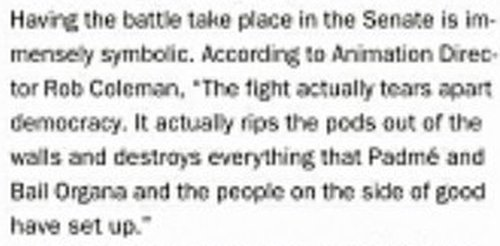
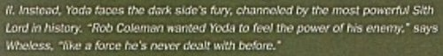

# Owner Material 038 — Star Wars Insider #1–153 plus specials (with The Lucasfilm Fan Club Magazine #1–22): Star Wars Insider #86 (2006)

- **Source:** *Star Wars Insider* magazine (issues 23–153, 1994–2014) and its predecessor *The Lucasfilm Fan Club Magazine* (issues 1–22, 1987–1994), plus seven special editions: articles, interviews, comics and short fiction Secondary source (licensed Legends reference). Scan OCR'd on the box; the scan stays box-only and is **not** published.
- **Method:** every scanned page was OCR'd and machine-screened sentence by sentence for power-relevant statements (fights, kills, defeats, Force feats, rankings, superweapons) that name a character on our roster; each kept sentence is quoted verbatim from the OCR text and has a crop of the printed passage directly under it. Pages with nothing power-relevant are still listed with what is on them.
- **Citation:** "*Star Wars Insider #86* (2006), p.X" by printed page ("scan p.X" where no printed number applies). **Weight:** Licensed magazine: a secondary source. Its short fiction and comics are Legends stories; its articles and interviews sum up or discuss lore and rank below the novels, comics and games they describe.

## scan p.1 (scan page 1)

Page contents: Cover, Issue 86, March/April 2006: "Yoda's Right Arm"; World Exclusive "Untold Origin of General Grievous"; "The Clans of Boba Fett"; "A New Order"; "The Posters of Episode VI"; online content and Bantha Tracks (hand-read)

## scan p.2 (scan page 2)

Page contents: Ad: Star Wars: Empire at War (LucasArts/Petroglyph), spread with p3 (hand-read)

## scan p.3 (scan page 3)

Page contents: Ad: Star Wars: Empire at War, continued (hand-read)

## scan p.4 (scan page 4)

Page contents: Contents: Mandalorians: People and Culture (Karen Traviss), Posters of Episode VI (Pete Vilmur), Unknown Soldier: The Story of General Grievous (Abel G. Peña), A New Order (J.W. Rinzler), Yoda's Right Arm (Daniel Wallace, ILM animator Jamy Wheless); department list (hand-read)

## scan p.5 (scan page 5)

Page contents: Ad: Cloud City Collectibles (hand-read)

## scan p.6 (scan page 6)

Page contents: Editorial "Transitions" (Francis Mao, new Editorial Director): Brett Rector and Kathleen Harsh moving on, Frank Parisi new editor; masthead (hand-read)

## scan p.7 (scan page 7)

Page contents: Ad: Hasbro Unleashed Battle Packs (hand-read)

## scan p.8 (scan page 8)

Page contents: Comlink letters "Why Do the Baddest Guys Get the Coolest Toys?"; staff answers: radio dramas, first double-bladed lightsaber made by Exar Kun, Obi-Wan's "certain point of view"; fan films (writer names omitted) (hand-read)

### Stat block notes (game mechanics, not feats)

- First double-bladed lightsaber: The first double-blade lightsaber was fashioned by a Dark Lord of the Sith named Exar Kun, who initiated The Great Sith War against the Jedi Order nearly 4,000 years before A New Hope. (Star Wars Insider 86, p. 08) (Source: *Star Wars Insider #86* (2006), scan p.8)

## scan p.9 (scan page 9)

Page contents: Ad: Galactic Cruise (Matthew Wood, Dave Barclay, Jeremy Bulloch, Kee Chan) (hand-read)

## scan p.10 (scan page 10)

Page contents: Skywalking news (Frank Parisi): Lucasfilm Animation Singapore opens; work on the animated series (hand-read)

## scan p.11 (scan page 11)

Page contents: Ad: Master Replicas Force FX lightsabers (hand-read)

## scan p.12 (scan page 12)

Page contents: News: ILM turns 30; National Medal of Technology for George Lucas; Spike TV rights; Lucas at MLK memorial fundraiser (hand-read)

## scan p.13 (scan page 13)

Page contents: Ad: Code 3 Darth Vader's TIE Fighter (hand-read)

## scan p.14 (scan page 14)

Page contents: Jedi Library (Jason Fry): Jude Watson's The Last of the Jedi, Ferus Olin and Obi-Wan; Watson on Vader and Ferus; "Elementary Watson" box on Jedi Apprentice and Jedi Quest series (hand-read)

## scan p.15 (scan page 15)

Page contents: Ad: Acme Archives (hand-read)

## scan p.16 (scan page 16)

Page contents: Drawn by the Force (Daniel Wallace) "The Color of Funny": Tag & Bink (Kevin Rubio, Lucas Marangon) (hand-read)

## scan p.17 (scan page 17)

Page contents: Drawn by the Force continued; Knights of the Old Republic / Rebellion flipbook box (Zayne Carrick) (hand-read)

## scan p.18 (scan page 18)

Page contents: Set Piece (Chris Trevas) "Chancellor's Holding Office and Senate Chamber: Clash of the Titans": Yoda vs Darth Sidious; Lucas wanted to get away from sword fighting; Ian McDiarmid's stand-in Michael Byrne; Rob Coleman on the fight tearing apart democracy (hand-read)

- **Yoda; Palpatine (Darth Sidious); Padmé Amidala; Bail Organa** — entry/section: Senate duel tears apart democracy: ""The fight actually tears apart democracy. It actually rips the pods out of the walls and destroys everything that Padmé and Bail Organa and the people on the side of good have set up." —Rob Coleman, Star Wars Insider 86, p. 18" Source: *Star Wars Insider #86* (2006), scan p.18
  

## scan p.19 (scan page 19)

Page contents: Set Piece continued: cutaway with captions on Sidious' lightsaber, Mas Amedda and Sly Moore, Yoda's cloak (hand-read)

## scan p.20 (scan page 20)

Page contents: Mandalorians: People and Culture (Karen Traviss, illustrations Tom Hodges): title spread and epigraph (hand-read)

## scan p.21 (scan page 21)

Page contents: Mandalorians: Origins (no true Mandalorian ethnic type; Jango Fett adopted, Concord Dawn); Warrior Nomads (hand-read)

### Stat block notes (game mechanics, not feats)

- Jango Fett was adopted: Concord Dawn is a good example. Jango Fett, one of the icons of Mandalorian history, was adopted. And yet his genome already shared many markers with his adopted community. (Star Wars Insider 86, p. 21) (Source: *Star Wars Insider #86* (2006), scan p.21)

## scan p.22 (scan page 22)

Page contents: Mandalorians: What Makes a Mandalorian; Society; adoption of war orphans (hand-read)

## scan p.23 (scan page 23)

Page contents: Mandalorians: Family; Religion (hand-read)

## scan p.24 (scan page 24)

Page contents: Mandalorians: Dar'manda; Daily Life (hand-read)

## scan p.25 (scan page 25)

Page contents: Mandalorians: Food; Armor (hand-read)

## scan p.26 (scan page 26)

Page contents: Mandalorians: Mixing with Mando'ade (hand-read)

## scan p.27 (scan page 27)

Page contents: "No Word for Hero: The Mandalorian Language" with phrase boxes (hand-read)

## scan p.28 (scan page 28)

Page contents: Mandalorian language continued, phrase boxes (hand-read)

## scan p.29 (scan page 29)

Page contents: Ad: Brian's Toys (hand-read)

## scan p.30 (scan page 30)

Page contents: "A New Order" (J.W. Rinzler): viewing the saga in story order, 1977/1980 vs 2006 perspectives, Episode IV (hand-read)

## scan p.31 (scan page 31)

Page contents: A New Order continued: Episode IV notes (Vader, Obi-Wan, the Emperor's hidden role) (hand-read)

## scan p.32 (scan page 32)

Page contents: A New Order continued: Episode IV, Vader's return (hand-read)

## scan p.33 (scan page 33)

Page contents: A New Order: Episode V The Empire Strikes Back (Yoda, Dagobah, Emperor hologram, Vader's revelation) (hand-read)

## scan p.34 (scan page 34)

Page contents: A New Order: Episode V cont. ("I am your father"); Episode VI Return of the Jedi (Emperor, Yoda's "there is another", Leia remembers her mother) (hand-read)

## scan p.35 (scan page 35)

Page contents: A New Order concluded: Luke and Leia, Emperor's lightning, Vader and Palpatine, two father-son relationships (hand-read)

## scan p.36 (scan page 36)

Page contents: Yoda's Right Arm (Daniel Wallace): animator Jamy Wheless, from Chattanooga to ILM (hand-read)

## scan p.37 (scan page 37)

Page contents: Yoda's Right Arm: full-page Yoda photo, ILM 30th anniversary series (hand-read)

## scan p.38 (scan page 38)

Page contents: Yoda's Right Arm continued: Marfalump, E.T. and Phantom Menace DVD work; box "Yoda Struggles to Hold Off Darth Sidious" (three key poses) (hand-read)

- **Yoda; Palpatine (Darth Sidious)** — entry/section: Yoda faces the most powerful Sith: "Instead, Yoda faces the dark side's fury, channeled by the most powerful Sith Lord in history. "Rob Coleman wanted Yoda to feel the power of his enemy," says Wheless, "like a force he's never dealt with before." —Jamy Wheless, Star Wars Insider 86, p. 38" Source: *Star Wars Insider #86* (2006), scan p.38
  

## scan p.39 (scan page 39)

Page contents: Yoda's Right Arm continued: Coleman recruits Wheless; Frank Oz and puppet Yoda; box "Anakin Seeks Advice in Yoda's Chambers" (hand-read)

## scan p.40 (scan page 40)

Page contents: Yoda's Right Arm continued: Geonosis gunslinger, facial system; "The Many Faces of Yoda" box; Yoda Force-pushes the Imperial guards (Dave Sidley) (hand-read)

### Stat block notes (game mechanics, not feats)

- Yoda Force-throws the Imperial guards: With the flick of a hand—and a flicker of the Force—he lifts two red-robed Imperial guards off the ground and bashes them senseless against the wall. (Star Wars Insider 86, p. 40) (Source: *Star Wars Insider #86* (2006), scan p.40)

## scan p.41 (scan page 41)

Page contents: Yoda's Right Arm concluded: lighting with John Helms, cloth simulation; box "Yoda Talks to Obi-Wan" (Virginie d'Annoville) (hand-read)

## scan p.42 (scan page 42)

Page contents: Ask the Master (Pablo Hidalgo) "Four Arms Really Are Better Than Two": Grievous in Clone Wars cartoon vs film (hand-read)

## scan p.43 (scan page 43)

Page contents: Ask the Master continued: Dantius Palpatine and Jard Dooku names; Nien Nunb; Lorth Needa; Vader sensing Obi-Wan; Woolwa and Vuvrian; Episode III mural (hand-read)

## scan p.44 (scan page 44)

Page contents: Ask the Master continued: Boba Fett unaltered clone; Death Star attack speed; Maul and Dooku turned to the dark side; Amidala's death cover story (hand-read)

## scan p.45 (scan page 45)

Page contents: Ask the Master concluded: Hutt power; Lando and Leia; Gungans; Commander Odd Ball is not Alpha (hand-read)

### Stat block notes (game mechanics, not feats)

- Odd Ball is not Alpha: Actually, you should know that Odd Ball is not Alpha. They are two completely separate clones. (Star Wars Insider 86, p. 45) (Source: *Star Wars Insider #86* (2006), scan p.45)

## scan p.46 (scan page 46)

Page contents: Unknown Soldier illustration spread (Joe Corroney): Grievous, Sidious, Dooku, San Hill, Kaleesh (hand-read)

## scan p.47 (scan page 47)

Page contents: Unknown Soldier: The Story of General Grievous (Abel G. Peña): Qymaen jai Sheelal of Kalee, the Huk War; The Death of Ronderu (hand-read)

### Stat block notes (game mechanics, not feats)

- Qymaen jai Sheelal: Instead, there lived a brilliant but barbaric man. His name was Qymaen jai Sheelal, born amid unending war on the malnourished world of Kalee, where the reptilian inhabitants were untouched by the galaxy's justice. (Star Wars Insider 86, p. 47) (Source: *Star Wars Insider #86* (2006), scan p.47)

## scan p.48 (scan page 48)

Page contents: Unknown Soldier continued: Ronderu's death; The Birth of General Grievous; San Hill and the IG-100 MagnaGuards; shuttle crash (hand-read)

### Stat block notes (game mechanics, not feats)

- Most savage warlord of Kalee: Grievous became the most savage warlord Kalee had ever known—a match for the galactic despots of old. (Star Wars Insider 86, p. 48) (Source: *Star Wars Insider #86* (2006), scan p.48)

## scan p.49 (scan page 49)

Page contents: Unknown Soldier continued: Grievous becomes a cyborg; Revenge on the Jedi; Sifo-Dyas' lightsaber; Hypori (hand-read)

## scan p.50 (scan page 50)

Page contents: Unknown Soldier continued: Grievous' Jedi kills, Iron Knight, Nelvaan; death on Utapau; The Future of Warfare (hand-read)

### Stat block notes (game mechanics, not feats)

- Geonosis Jedi kills: During the Battle of Geonosis, Grievous slays many Jedi, including Master Ur-Sema Du, who take the secret of the cyborg's existence to their graves. (Star Wars Insider 86, p. 50) (Source: *Star Wars Insider #86* (2006), scan p.50)
- Windu crushes Grievous' shell: In a confrontation with Mace Windu, the Jedi Master used the Force to crush Grievous' duranium shell, lacerating his lungs with steel. (Star Wars Insider 86, p. 50) (Source: *Star Wars Insider #86* (2006), scan p.50)

## scan p.51 (scan page 51)

Page contents: "The Knight Slayer" sidebar: list of Jedi slain by Grievous (hand-read)

### Stat block notes (game mechanics, not feats)

- The Knight Slayer: General Grievous took to collecting the lightsabers of his fallen Jedi opponents. As a swordsman, Grievous greatly appreciated the craftsmanship that went into each weapon. (Star Wars Insider 86, p. 51) (Source: *Star Wars Insider #86* (2006), scan p.51)

## scan p.52 (scan page 52)

Page contents: Scouting the Galaxy (Steve Sansweet) "Thirty Years and Not Halfway There!": Howard Roffman on future of Star Wars; collector Q&A (letter-writer names omitted) (hand-read)

## scan p.53 (scan page 53)

Page contents: Scouting the Galaxy continued: Collector Fleet Super Star Destroyer; 500th figure (hand-read)

## scan p.54 (scan page 54)

Page contents: Scouting the Galaxy continued: Mace Windu/Darth Sidious figure mix-up; gold-plated Anakin Skywalker lightsaber; vinyl soundtracks (hand-read)

## scan p.55 (scan page 55)

Page contents: Scouting the Galaxy concluded; Pick of the Litter (Return of the Jedi LP; contributor names omitted) (hand-read)

## scan p.56 (scan page 56)

Page contents: Anchorhead Arcade (Sid Shuman) "When Worlds Collide": Star Wars Galaxies Trials of Obi-Wan (hand-read)

## scan p.57 (scan page 57)

Page contents: Anchorhead Arcade continued: profession screens, combat captions (hand-read)

## scan p.58 (scan page 58)

Page contents: Posters of Episode VI: Return of the Jedi (Pete Vilmur): Drew Struzan advance posters, Revenge of the Jedi (hand-read)

## scan p.59 (scan page 59)

Page contents: Posters continued: Revenge of the Jedi advance poster (hand-read)

## scan p.60 (scan page 60)

Page contents: Posters continued: Lawrence Noble concept, Tim Reamer Style "A" poster with Lucas' hands (hand-read)

## scan p.61 (scan page 61)

Page contents: Posters continued: Kazuhiko Sano Style "B", Japanese version (hand-read)

## scan p.62 (scan page 62)

Page contents: Posters continued: Bootlegs (hand-read)

## scan p.63 (scan page 63)

Page contents: Posters concluded: bootleg identification (hand-read)

## scan p.64 (scan page 64)

Page contents: Jabba's Collection (Frank Parisi): Sideshow 12-inch Luke Skywalker Jedi Knight and Anakin; Star Wars Transformers (hand-read)

## scan p.65 (scan page 65)

Page contents: Jabba's Collection continued: Hasbro wave two, Gentle Giant busts and statues (Darth Maul) (hand-read)

## scan p.66 (scan page 66)

Page contents: Best of Hyperspace (Pablo Hidalgo and Bonnie Burton) "Spinning the Jedi Wheel of Fate": Invisible Hand elevator sequence (hand-read)

## scan p.67 (scan page 67)

Page contents: Best of Hyperspace continued: scripted dialogue, deleted Grievous and Ki-Adi-Mundi details (hand-read)

## scan p.68 (scan page 68)

Page contents: Best of Hyperspace continued: Halloween AudioCast with Matthew Wood; Galactic Gallery box (hand-read)

## scan p.69 (scan page 69)

Page contents: Best of Hyperspace concluded: concept art gallery (hand-read)

## scan p.70 (scan page 70)

Page contents: Bantha Tracks Vol. 17 "Best of the Year" (fan names omitted) (hand-read)

## scan p.71 (scan page 71)

Page contents: Bantha Tracks: Editor's Choice items (fan names omitted) (hand-read)

## scan p.72 (scan page 72)

Page contents: Bantha Tracks: Celebration III (fan names omitted) (hand-read)

## scan p.73 (scan page 73)

Page contents: Bantha Tracks: Celebration III photos; The Way We Were (Mary Franklin) (hand-read)

## scan p.74 (scan page 74)

Page contents: Bantha Tracks Editorial (Mary Franklin) "The Best of My Star Wars Year" (hand-read)

## scan p.75 (scan page 75)

Page contents: Ad: Battlestar Galactica Collectable Card Game (hand-read)

## scan p.76 (scan page 76)

Page contents: Ad: Star Wars Fan Club subscription "Join Us... and the circle will be complete!" (hand-read)

## scan p.77 (scan page 77)

Page contents: StarWarsShop #10: The Ultimate Lucas Family Collection (hand-read)

## scan p.78 (scan page 78)

Page contents: StarWarsShop: Collector's Picks (hand-read)

## scan p.79 (scan page 79)

Page contents: StarWarsShop: What's New (hand-read)

## scan p.80 (scan page 80)

Page contents: StarWarsShop: The Droids of Star Wars (hand-read)

## scan p.81 (scan page 81)

Page contents: StarWarsShop: Fan Favorites (hand-read)

## scan p.82 (scan page 82)

Page contents: StarWarsShop: More Must Haves (hand-read)

## scan p.83 (scan page 83)

Page contents: Ad: Anthony Grandio Company "Path to the Dark Side" checks (hand-read)

## scan p.84 (scan page 84)

Page contents: Ad: Kuat Drive Yards AT-ST scenario pack (Star Wars Miniatures) (hand-read)

