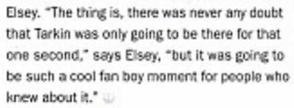
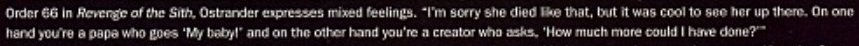
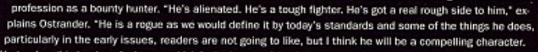
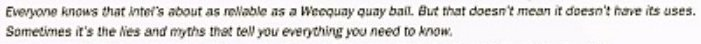

# Owner Material 038 — Star Wars Insider #1–153 plus specials (with The Lucasfilm Fan Club Magazine #1–22): Star Wars Insider #87 (2006)

- **Source:** *Star Wars Insider* magazine (issues 23–153, 1994–2014) and its predecessor *The Lucasfilm Fan Club Magazine* (issues 1–22, 1987–1994), plus seven special editions: articles, interviews, comics and short fiction Secondary source (licensed Legends reference). Scan OCR'd on the box; the scan stays box-only and is **not** published.
- **Method:** every scanned page was OCR'd and machine-screened sentence by sentence for power-relevant statements (fights, kills, defeats, Force feats, rankings, superweapons) that name a character on our roster; each kept sentence is quoted verbatim from the OCR text and has a crop of the printed passage directly under it. Pages with nothing power-relevant are still listed with what is on them.
- **Citation:** "*Star Wars Insider #87* (2006), p.X" by printed page ("scan p.X" where no printed number applies). **Weight:** Licensed magazine: a secondary source. Its short fiction and comics are Legends stories; its articles and interviews sum up or discuss lore and rank below the novels, comics and games they describe.

## scan p.1 (scan page 1)

Page contents: Cover, Issue 87, May/June 2006: Obi-Wan; "New Sith! New Empire! New Skywalker!" (Legacy); "Order 66 Destroy All Jedi!"; Galaxy Makers: ILM digimatte; Odds fiction (sequel to Republic Commando: Triple Zero); LEGO Star Wars II (hand-read)

## scan p.2 (scan page 2)

Page contents: Ad: Brian's Toys, spread with p3 (hand-read)

## scan p.3 (scan page 3)

Page contents: Ad: Brian's Toys, continued (hand-read)

## scan p.4 (scan page 4)

Page contents: Contents: Casualty Report: Order 66 (Daniel Wallace), New Force Rising (Frank Parisi), Setting the Scene (ILM 30th), Odds (Karen Traviss); departments; cover by Roberto Campos (hand-read)

## scan p.5 (scan page 5)

Page contents: Ad: Cloud City Collectibles (hand-read)

## scan p.6 (scan page 6)

Page contents: Editorial "And then…" (Frank Parisi, editor) and masthead (hand-read)

## scan p.7 (scan page 7)

Page contents: Ad: Kenner-style vintage Luke X-wing pilot figure / Ultimate Galactic Hunt (hand-read)

## scan p.8 (scan page 8)

Page contents: Comlink: "Since When Do Cowboys Scream?" (Wilhelm scream, Ben Burtt, Sheb Wooley); "Give that Anakin a hand"; letter-writer names omitted (hand-read)

## scan p.9 (scan page 9)

Page contents: Comlink cont.: Commander Cody named for Commando Cody of King of the Rocketmen; why Sidious is slow to reach Mustafar; Mythology letter; letter-writer names omitted (hand-read)

### Stat block notes (game mechanics, not feats)

- Named for Commando Cody: Both the band and the character from Revenge of the Sith were given the name Commander Cody as an homage to Commando Cody, the hero in a couple of old sci-fi serials titled King of the Rocketmen and Radar Men from the Moon. (Star Wars Insider 87, p. 09) (Source: *Star Wars Insider #87* (2006), scan p.9)

## scan p.10 (scan page 10)

Page contents: Skywalking: Revenge of the Sith People's Choice award; ILM VES awards; Golden Satellite; Phil Brown (Uncle Owen) obituary (hand-read)

## scan p.11 (scan page 11)

Page contents: Skywalking cont.: ILM National Medal of Technology; Dark Crystal sequel (Genndy Tartakovsky); Clone Wars Annie; Natalie Portman at ShoWest; LEGO Toy of the Year; artist Matt Busch; Samuel L. Jackson Walk of Fame (hand-read)

## scan p.12 (scan page 12)

Page contents: Remembering David Tomblin (Brandon Alinger) (hand-read)

## scan p.13 (scan page 13)

Page contents: Remembering David Tomblin, continued (hand-read)

## scan p.14 (scan page 14)

Page contents: Alien Encounters: The Makeup of Revenge of the Sith (Joe Nazzaro): Nikki Gooley on Padmé and Hayden Christensen makeup (hand-read)

## scan p.15 (scan page 15)

Page contents: Alien Encounters cont.: Dave Elsey turns Wayne Pygram into Tarkin; galactic denizens captions (hand-read)

- **Grand Moff Tarkin** — entry/section: Tarkin's one-second cameo: ""The thing is, there was never any doubt that Tarkin was only going to be there for that one second," says Elsey, "but it was going to be such a cool fan boy moment for people who knew about it." —Dave Elsey, Star Wars Insider 87, p. 15" Source: *Star Wars Insider #87* (2006), scan p.15
  

### Stat block notes (game mechanics, not feats)

- Prosthetic makeup on Wayne Pygram: Dave Elsey and his team used prosthetic makeup to turn Wayne Pygram (above, inset) into Tarkin. (Star Wars Insider 87, p. 15) (Source: *Star Wars Insider #87* (2006), scan p.15)

## scan p.16 (scan page 16)

Page contents: Groundbreaking: Letterman Digital Arts Center (Frank Parisi) (hand-read)

## scan p.17 (scan page 17)

Page contents: Groundbreaking cont.: Living Art, Lawrence Halprin interview (hand-read)

## scan p.18 (scan page 18)

Page contents: Groundbreaking cont.: Halprin boxes and campus photos (hand-read)

## scan p.19 (scan page 19)

Page contents: Ad: Galactic Cruise (hand-read)

## scan p.20 (scan page 20)

Page contents: How Can I Get Your Job? Joe Corroney ("The Great Remorse of Vader"); Star Wars International box (Kubricks, Real Action Heroes Darth Vader) (hand-read)

## scan p.21 (scan page 21)

Page contents: Ad: Entertainment Earth astromechs (hand-read)

## scan p.22 (scan page 22)

Page contents: General Grievous' Sweet Ride (Wheelsurf, Bonnie Burton); "Certain Points of View" WonderCon interviews (interviewee names omitted) (hand-read)

## scan p.23 (scan page 23)

Page contents: Ad: Gen Con (hand-read)

## scan p.24 (scan page 24)

Page contents: Jedi Library (Jason Fry): Cinema by the Bay (hand-read)

## scan p.25 (scan page 25)

Page contents: Jedi Library cont.: Upcoming Books box (hand-read)

## scan p.26 (scan page 26)

Page contents: Drawn by the Force (Daniel Wallace) "Whatever Happened to Tank?" (Rebellion, Janek Sunber); Made in Japan box (Tokyopop manga) (hand-read)

## scan p.27 (scan page 27)

Page contents: Ad: MechWarrior (hand-read)

## scan p.28 (scan page 28)

Page contents: Set Piece (Chris Trevas) "Order 66: The Hammer Falls": Plo Koon, Ki-Adi-Mundi captions (hand-read)

## scan p.29 (scan page 29)

Page contents: Set Piece cont.: Aayla Secura, Stass Allie captions (hand-read)

## scan p.30 (scan page 30)

Page contents: Casualty Report: Order 66 (Daniel Wallace): Sate Pestage memo to Palpatine (hand-read)

## scan p.31 (scan page 31)

Page contents: Incident reports 890-A Plo Koon (Captain Jag, Cato Neimoidia) and 890-B Aayla Secura (Commander Bly, Felucia) (hand-read)

### Stat block notes (game mechanics, not feats)

- Stark Hyperspace War victory: Notorious for his fearlessness, Koon earned the admiration of the Republic's ragtag, pre-clone army when he rallied the troops to victory in the final battle of the Stark Hyperspace War in 9BrS. (Star Wars Insider 87, p. 31) (Source: *Star Wars Insider #87* (2006), scan p.31)
- Shot down over Cato Neimoidia: Accompanying Koon on aerial patrol of Cato Neimoidia's bridge cities, Jag (CT-55/11-9009) and CT-57/11-9048 received Order 66 and fired several shots from the wing cannons of the ARC-170 starfighters belonging to the 127th. (Star Wars Insider 87, p. 31) (Source: *Star Wars Insider #87* (2006), scan p.31)
- Apprenticed to Quinlan Vos: Apprenticed to the tainted Jedi Quinlan Vos, Aayla Secura underwent a memory wipe at the hands of her corrupt uncle during an investigation into narcotic glitteryll spice. (Star Wars Insider 87, p. 31) (Source: *Star Wars Insider #87* (2006), scan p.31)
- Order 66 on Felucia: The troopers of the Star Corps received Order 66 while advancing on foot through the fungus forest. Quick action by the troopers took Secura by surprise, and the Jedi fell under their combined blaster fire. (Star Wars Insider 87, p. 31) (Source: *Star Wars Insider #87* (2006), scan p.31)

## scan p.32 (scan page 32)

Page contents: Incident reports 890-C Ki-Adi-Mundi (Commander Bacara, Mygeeto) and 890-D Stass Allie (Commander Neyo, Saleucami) (hand-read)

### Stat block notes (game mechanics, not feats)

- Survived Grievous on Hypori: Ki-Adi-Mundi led the failed assault on the Droid Control Ship during the Battle of Geonosis, and barely survived a fight with General Grievous on Hypori. (Star Wars Insider 87, p. 32) (Source: *Star Wars Insider #87* (2006), scan p.32)
- Order 66 on Mygeeto: In light of Ki-Adi-Mundi's battle prowess, the Galactic Marines elected to wait until the Jedi was most vulnerable. (Star Wars Insider 87, p. 32) (Source: *Star Wars Insider #87* (2006), scan p.32)
- Order 66 on Saleucami: Commander Neyo (CC-8826) and CT-3423, accompanying Allie on speeder bike reconnaissance, received Order 66 and fired on the Jedi with the cannons of the BARC speeders operated by the 91st. (Star Wars Insider 87, p. 32) (Source: *Star Wars Insider #87* (2006), scan p.32)

## scan p.33 (scan page 33)

Page contents: Incident reports 890-E Luminara Unduli (Commander Faie, Kashyyyk) and 890-F Barriss Offee (Lieutenant Galle, Felucia) (hand-read)

### Stat block notes (game mechanics, not feats)

- Trained Barriss Offee: Unduli trained Barriss Offee to Knighthood, and during the Clone Wars, Unduli and Offee prevented the Separatist destruction of the crystal caves of Ilum. (Star Wars Insider 87, p. 33) (Source: *Star Wars Insider #87* (2006), scan p.33)
- No warning of Order 66: Unduli was preoccupied with the state of the wounded from Kashyyyk's Battle of Kachirho, and therefore possessed no precognitive warning of Order 66. (Star Wars Insider 87, p. 33) (Source: *Star Wars Insider #87* (2006), scan p.33)
- Killed by an AT-TE: Heavy equipment belonging to the 327th opened fire on Offee while she engaged Separatist battle droids. Multiple blasts from an AT-TE eliminated the Jedi target. (Star Wars Insider 87, p. 33) (Source: *Star Wars Insider #87* (2006), scan p.33)

## scan p.34 (scan page 34)

Page contents: Incident reports 890-G Traavis (RC-1013 Sarge) and 890-H Jocasta Nu (Commander Appo; killed by Vader) (hand-read)

### Stat block notes (game mechanics, not feats)

- Vader kills Jocasta Nu: When Jocasta Nu refused to give Vader access to the Temple's emergency beacon, he killed her with a lightsaber wound to the chest. (Star Wars Insider 87, p. 34) (Source: *Star Wars Insider #87* (2006), scan p.34)

## scan p.35 (scan page 35)

Page contents: Incident reports 890-I Cin Drallig and 890-J Whie Malreaux (both killed by Vader in the Temple training hall) (hand-read)

### Stat block notes (game mechanics, not feats)

- Temple swordsmaster: Stationed on Coruscant, he taught the basics of lightsaber combat forms one through six to thousands of students, including Obi-Wan Kenobi and Anakin Skywalker. (Star Wars Insider 87, p. 35) (Source: *Star Wars Insider #87* (2006), scan p.35)
- Cut down by Vader: After dispatching the Padawans, Lord Vader cut down Drallig following a short exchange of lightsaber strikes. (Star Wars Insider 87, p. 35) (Source: *Star Wars Insider #87* (2006), scan p.35)

## scan p.36 (scan page 36)

Page contents: Incident reports 890-K Zett Jukassa (Sergeant Fox), 890-L Tsui Choi and 890-M Bultar Swan (Commander Bow, Kessel) (hand-read)

### Stat block notes (game mechanics, not feats)

- Witnessed Zett Jukassa's death: A civilian, Senator Bail Organa of Alderaan, witnessed the incident, and escaped in an airspeeder. (Star Wars Insider 87, p. 36) (Source: *Star Wars Insider #87* (2006), scan p.36)

## scan p.37 (scan page 37)

Page contents: Incident reports 890-N Koffi Arana and addendum 890-O Roan Shryne (Vader, Kashyyyk); closing "May your reign last for a thousand years!" (hand-read)

### Stat block notes (game mechanics, not feats)

- Vader kills Shryne on Kashyyyk: Orbital bombardment from the Star Destroyer Exactor neutralized further resistance from the natives, and Vader fought and killed Shryne. (Star Wars Insider 87, p. 37) (Source: *Star Wars Insider #87* (2006), scan p.37)

## scan p.38 (scan page 38)

Page contents: Ask the Master (Pablo Hidalgo) "The Jedi Master Gets the Shaft?": Yoda's absence from Empire posters; Padmé assassination attempts; Shaak Ti deleted scene; Dooku/Obi-Wan balcony (hand-read)

## scan p.39 (scan page 39)

Page contents: Ask the Master cont.: Yoda and the Wookiees; lightsaber auto-shutoff; Commander Deviss vs Commander Bly; C-3PO rotoscoping; letter-writer names omitted (hand-read)

### Stat block notes (game mechanics, not feats)

- Red-marked commander was to be Bly: There is an image, rendered by ILM for Episode III, of a Star Corps clone commander with red markings. At the time the image was rendered, it was to be Commander Bly. (Star Wars Insider 87, p. 39) (Source: *Star Wars Insider #87* (2006), scan p.39)

## scan p.40 (scan page 40)

Page contents: Cade Skywalker illustration (Jan Duursema) (hand-read)

## scan p.41 (scan page 41)

Page contents: New Force Rising (Frank Parisi): John Ostrander and Jan Duursema on Star Wars Legacy; Aayla Secura's death (hand-read)

- **Aayla Secura** — entry/section: Ostrander on Aayla's death: ""I'm sorry she died like that, but it was cool to see her up there." —John Ostrander, Star Wars Insider 87, p. 41" Source: *Star Wars Insider #87* (2006), scan p.41
  

## scan p.42 (scan page 42)

Page contents: New Force Rising cont.: Beyond Good and Evil; new Sith; Cade Skywalker (hand-read)

- **Cade Skywalker** — entry/section: Ostrander on Cade: ""He's alienated. He's a tough fighter. He's got a real rough side to him," explains Ostrander. "He is a rogue as we would define it by today's standards and some of the things he does, particularly in the early issues, readers are not going to like, but I think he will be a compelling character." —John Ostrander, Star Wars Insider 87, p. 42" Source: *Star Wars Insider #87* (2006), scan p.42
  

## scan p.43 (scan page 43)

Page contents: New Force Rising cont.: Cade, the New Sith Order and the Empire comparison box (hand-read)

## scan p.44 (scan page 44)

Page contents: Scouting the Galaxy (Steve Sansweet): Star Wars sushi; collector letters (names omitted) (hand-read)

## scan p.45 (scan page 45)

Page contents: Scouting the Galaxy cont.; collector letters (names omitted) (hand-read)

## scan p.46 (scan page 46)

Page contents: Scouting the Galaxy cont.: Pick of the Litter (hand-read)

## scan p.47 (scan page 47)

Page contents: Scouting the Galaxy cont.: Celebration III Tsuneo Sanda "Congratulations" lithograph answer; submission info (hand-read)

## scan p.48 (scan page 48)

Page contents: Setting the Scene (Daniel Wallace): Jonathan Harb leads ILM's digimatte artists, Mustafar title spread (hand-read)

## scan p.49 (scan page 49)

Page contents: Setting the Scene cont.: matte painting from Mos Eisley to digimattes; VES nomination (hand-read)

## scan p.50 (scan page 50)

Page contents: Setting the Scene cont.: Jonathan Harb profile; establishing shots (hand-read)

## scan p.51 (scan page 51)

Page contents: Setting the Scene cont.: Brett Northcutt, Architect of Vader's ER; cycloramas (hand-read)

## scan p.52 (scan page 52)

Page contents: Setting the Scene cont.: Yanick Dusseault, Building a Better Mustafar; Galaxies Opera House (Ben Huber) and Senate Hall (Yusei Uesugi) shots (hand-read)

## scan p.53 (scan page 53)

Page contents: Setting the Scene cont.: Theed establishing shot; Harb on Eight Below; Hilmar Koch, The Invisible Hand Behind the Invisible Hand (hand-read)

## scan p.54 (scan page 54)

Page contents: Odds (Karen Traviss): epigraph by Kal Skirata; Olanet droid factory, Atin and Prudii (hand-read)

- **Kal Skirata** — entry/section: Epigraph on intel: ""Everyone knows that intel's about as reliable as a Weequay quay ball. But that doesn't mean it doesn't have its uses. Sometimes it's the lies and myths that tell you everything you need to know." —Sergeant Kal Skirata, Star Wars Insider 87, p. 54" Source: *Star Wars Insider #87* (2006), scan p.54
  

## scan p.55 (scan page 55)

Page contents: Odds: illustration by Rob Hendrickson (hand-read)

## scan p.56 (scan page 56)

Page contents: Odds cont.: Omega Squad, Atin and Prudii in the factory; illustration (hand-read)

## scan p.57 (scan page 57)

Page contents: Odds cont.: droid production numbers, quadrillions (hand-read)

## scan p.58 (scan page 58)

Page contents: Odds cont.: Glossary of Mando'a terms; Tipoca City, Mereel (ARC trooper N-7) on Kamino (hand-read)

## scan p.59 (scan page 59)

Page contents: Odds cont.: illustration of Skirata and the Nulls; Mereel slicing Kamino files (hand-read)

## scan p.60 (scan page 60)

Page contents: Odds cont.: TIV 2768/2, Cato Neimoidia, Atin and Prudii (hand-read)

## scan p.61 (scan page 61)

Page contents: Odds cont.: Lama Su recording to Chancellor Palpatine; Skirata (hand-read)

## scan p.62 (scan page 62)

Page contents: Odds cont.: Drall space, Skirata and the Nulls; illustration (hand-read)

### Stat block notes (game mechanics, not feats)

- Would never lie to his boys: Skirata—a contract killer, an accomplished thief, a man who diverted Republic resources whenever he felt like it—would never lie to his boys. (Star Wars Insider 87, p. 62) (Source: *Star Wars Insider #87* (2006), scan p.62)

## scan p.63 (scan page 63)

Page contents: Odds cont.: General Zey briefing; "The odds weren't in her favor." (hand-read)

## scan p.64 (scan page 64)

Page contents: Jabba's Collection (Frank Parisi): Darth Maul in Effect (Master Replicas FX lightsaber); Transformers Wave 3; Ultimate Galactic Hunt (hand-read)

## scan p.65 (scan page 65)

Page contents: Jabba's Collection cont.: Hasbro exclusives; Mos Eisley Cantina busts; Gentle Giant Yoda statue; Qui-Gon lightsaber replica; Emperor Palpatine mini bust (hand-read)

## scan p.66 (scan page 66)

Page contents: Anchorhead Arcade (Frank Parisi): Jedi Mind Bricks, LEGO Star Wars II (Jeffrey Gullett) (hand-read)

## scan p.67 (scan page 67)

Page contents: Ad: Anthony Grandio Company, Path to the Dark Side checks (hand-read)

## scan p.68 (scan page 68)

Page contents: Best of Star Wars Blogs (Bonnie Burton and Pablo Hidalgo): fan blog excerpts (blogger names omitted) (hand-read)

## scan p.69 (scan page 69)

Page contents: Best of Hyperspace cont.: Webcam Movies on Hyperspace; Third Evasive Action Under Way (Prey, Paul Ens, Thomas Hodges) (hand-read)

## scan p.70 (scan page 70)

Page contents: Galactic Gallery: Neimoidian Cage Bird (Terryl Whitlatch), Pieced Together (Doug Chiang), Inside Artoo, Air Whales (Ralph McQuarrie), Dramatic Cliffs (Erik Tiemens), Not Bad for a Furball (Nilo Rodis Jamero), Not Quite Themselves (hand-read)

## scan p.71 (scan page 71)

Page contents: Galactic Gallery cont.: art 3-7 (hand-read)

## scan p.72 (scan page 72)

Page contents: Bantha Tracks vol. 18: Mail Call! envelope art (sender names omitted) (hand-read)

## scan p.73 (scan page 73)

Page contents: Bantha Tracks cont.: envelope art (sender names omitted) (hand-read)

## scan p.74 (scan page 74)

Page contents: Bantha Tracks cont.: envelope art (sender names omitted); The Way We Were (Randy Martinez) (hand-read)

## scan p.75 (scan page 75)

Page contents: Bantha Tracks editorial "The Joys of the PaperNet" (Mary Franklin); letter-writer names omitted (hand-read)

## scan p.76 (scan page 76)

Page contents: Ad: Hyperspace, The Next Star Wars Fan Club President (hand-read)

## scan p.77 (scan page 77)

Page contents: Star Wars Shop: Padmé Amidala Animation Character Key (hand-read)

## scan p.78 (scan page 78)

Page contents: Star Wars Shop: Collector's Picks (Pete Vilmur) (hand-read)

## scan p.79 (scan page 79)

Page contents: Star Wars Shop: What's New (R2-Q5, Commander Bly model kit) (hand-read)

## scan p.80 (scan page 80)

Page contents: Star Wars Shop: Sports Gear (hand-read)

## scan p.81 (scan page 81)

Page contents: Star Wars Shop: Clearance Items (hand-read)

## scan p.82 (scan page 82)

Page contents: Star Wars Shop: More Must Haves (hand-read)

## scan p.83 (scan page 83)

Page contents: Ad: EverQuest II: Kingdom of Sky (hand-read)

## scan p.84 (scan page 84)

Page contents: Ad: Star Wars Miniatures AT-ST scenario pack ("Kuat Drive Yards") (hand-read)

