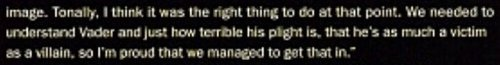
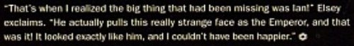
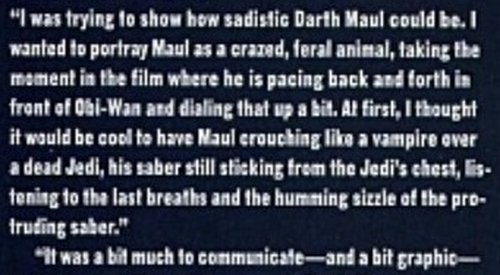
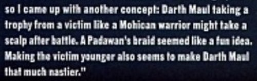
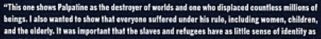
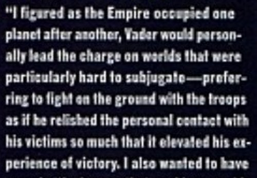
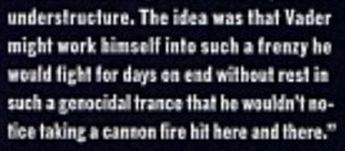
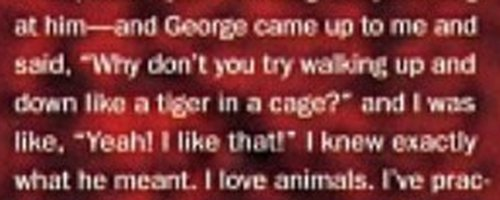
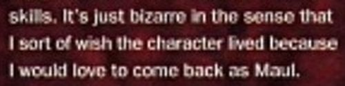

# Owner Material 038 — Star Wars Insider #1–153 plus specials (with The Lucasfilm Fan Club Magazine #1–22): Star Wars Insider #88 (2006)

- **Source:** *Star Wars Insider* magazine (issues 23–153, 1994–2014) and its predecessor *The Lucasfilm Fan Club Magazine* (issues 1–22, 1987–1994), plus seven special editions: articles, interviews, comics and short fiction Secondary source (licensed Legends reference). Scan OCR'd on the box; the scan stays box-only and is **not** published.
- **Method:** every scanned page was OCR'd and machine-screened sentence by sentence for power-relevant statements (fights, kills, defeats, Force feats, rankings, superweapons) that name a character on our roster; each kept sentence is quoted verbatim from the OCR text and has a crop of the printed passage directly under it. Pages with nothing power-relevant are still listed with what is on them.
- **Citation:** "*Star Wars Insider #88* (2006), p.X" by printed page ("scan p.X" where no printed number applies). **Weight:** Licensed magazine: a secondary source. Its short fiction and comics are Legends stories; its articles and interviews sum up or discuss lore and rank below the novels, comics and games they describe.

## scan p.1 (scan page 1)

Page contents: Cover, Issue 88, July/August 2006, Special Sith Issue: "Obey Vader" (Shepard Fairey); Dark Lords of the Sith; Sith Training with Darth Maul (Ray Park); Ghosts of the Sith (Jude Watson); one of four Sith Lord covers (hand-read)

## scan p.2 (scan page 2)

Page contents: Ad: Brian's Toys, spread with p3 (hand-read)

## scan p.3 (scan page 3)

Page contents: Ad: Brian's Toys, continued (hand-read)

## scan p.4 (scan page 4)

Page contents: Contents: Morbid Visions (Frank Parisi); Heritage of the Sith (Drew Karpyshyn); Lessons in Light and Darkness (Parisi); Betrayal (Jason Fry); Legacies of Future Orders (Parisi); Ghosts of the Sith (Jude Watson); Virtual Sith (Hugh Sterbakov); departments; correction re Rob Hendrickson (hand-read)

## scan p.5 (scan page 5)

Page contents: Ad: Cloud City Collectibles (hand-read)

## scan p.6 (scan page 6)

Page contents: Editorial "Paint It Black" (Frank Parisi) and masthead (hand-read)

## scan p.7 (scan page 7)

Page contents: Ad: Transformers Clone Pilot/ARC-170 (hand-read)

## scan p.8 (scan page 8)

Page contents: Comlink letters "A (Sort Of) Mystery Answered": Wilhelm scream; Galaxies NGE (letter-writer names omitted) (hand-read)

## scan p.9 (scan page 9)

Page contents: Ad: Weis/Hickman Dragonlance (hand-read)

## scan p.10 (scan page 10)

Page contents: Skywalking "Han Shoots First!": original trilogy DVDs (Jim Ward, Tom Warner); LEGO Star Wars II; Darth Bane: Path of Destruction (Drew Karpyshyn); The Making of Star Wars (J.W. Rinzler) (hand-read)

## scan p.11 (scan page 11)

Page contents: Ad: Stargate SG-1 (hand-read)

## scan p.12 (scan page 12)

Page contents: "Obey Vader" (Frank Parisi and Eugene Wang): Shepard Fairey interview on his Vader cover (hand-read)

## scan p.13 (scan page 13)

Page contents: "Obey Vader" continued (hand-read)

## scan p.14 (scan page 14)

Page contents: "Faces of Evil" (Joe Nazzaro): Dave Elsey on Anakin's burn makeup on Mustafar; design concepts captions (hand-read)

## scan p.15 (scan page 15)

Page contents: "Faces of Evil" continued: Elsey on the Palpatine makeup and Ian McDiarmid's makeup test (hand-read)

- **Darth Vader (Anakin Skywalker)** — entry/section: Elsey on Anakin's burn makeup: ""We needed to understand Vader and just how terrible his plight is, that he's as much a victim as a villain, so I'm proud that we managed to get that in." —Dave Elsey, Star Wars Insider 88, p. 15" Source: *Star Wars Insider #88* (2006), scan p.15
  
- **Palpatine (Darth Sidious)** — entry/section: McDiarmid completes the makeup: ""That's when I realized the big thing that had been missing was Ian!" Elsey exclaims. "He actually pulls this really strange face as the Emperor, and that was it! It looked exactly like him, and I couldn't have been happier." —Dave Elsey, Star Wars Insider 88, p. 15" Source: *Star Wars Insider #88* (2006), scan p.15
  

### Stat block notes (game mechanics, not feats)

- Early alien Palpatine designs: "I actually did a couple of designs where he was a lot more alien-looking under that hood, but George wanted to pull back from those ideas and do it more as a deformity." (Star Wars Insider 88, p. 15) (Source: *Star Wars Insider #88* (2006), scan p.15)

## scan p.16 (scan page 16)

Page contents: How Can I Get Your Job? Andrew Wen (Master Replicas, Darth Maul FX lightsaber); Indiana Jones news; Star Wars International box (Chunk T-shirts) (hand-read)

## scan p.17 (scan page 17)

Page contents: "Bands Show Their Sith Side" (Bonnie Burton): professional musicians' Sith picks; Star Wars Sightings (Nathan Cabrera); Driving Interest license plates (owner names omitted) (hand-read)

## scan p.18 (scan page 18)

Page contents: Technical Readout / Set Piece (Chris Trevas) "Death Star II Main Hangar: Help me take this mask off" (Sebastian Shaw unmasking, Stuart Freeborn makeup), spread with p19 (hand-read)

## scan p.19 (scan page 19)

Page contents: Set Piece continued: Hayden Christensen DVD replacement; Vader helmet influences (hand-read)

## scan p.20 (scan page 20)

Page contents: Morbid Visions (Frank Parisi): Christian Alzmann profile; Darth Maul cover art (Padawan braid trophy) (hand-read)

- **Darth Maul** — entry/section: Alzmann on Maul's cover: ""I was trying to show how sadistic Darth Maul could be. I wanted to portray Maul as a crazed, feral animal, taking the moment in the film where he is pacing back and forth in front of Obi-Wan and dialing that up a bit." —Christian Alzmann, Star Wars Insider 88, p. 20" Source: *Star Wars Insider #88* (2006), scan p.20
  
- **Darth Maul** — entry/section: Padawan's braid trophy: ""Darth Maul taking a trophy from a victim like a Mohican warrior might take a scalp after battle. A Padawan's braid seemed like a fun idea. Making the victim younger also seems to make Darth Maul that much nastier." —Christian Alzmann, Star Wars Insider 88, p. 20" Source: *Star Wars Insider #88* (2006), scan p.20
  

## scan p.21 (scan page 21)

Page contents: Morbid Visions: Alzmann's Darth Sidious cover art (refugees, Exorcist corridor concept) (hand-read)

- **Palpatine (Darth Sidious)** — entry/section: Destroyer of worlds: ""This one shows Palpatine as the destroyer of worlds and one who displaced countless millions of beings. I also wanted to show that everyone suffered under his rule, including women, children, and the elderly." —Christian Alzmann, Star Wars Insider 88, p. 21" Source: *Star Wars Insider #88* (2006), scan p.21
  

## scan p.22 (scan page 22)

Page contents: Morbid Visions: Aaron McBride profile; Darth Vader cover art (ground battle, toned-down saber) (hand-read)

- **Darth Vader (Anakin Skywalker)** — entry/section: Vader leads the charge: ""I figured as the Empire occupied one planet after another, Vader would personally lead the charge on worlds that were particularly hard to subjugate—preferring to fight on the ground with the troops as if he relished the personal contact with his victims so much that it elevated his experience of victory." —Aaron McBride, Star Wars Insider 88, p. 22" Source: *Star Wars Insider #88* (2006), scan p.22
  
- **Darth Vader (Anakin Skywalker)** — entry/section: Days without rest: ""The idea was that Vader might work himself into such a frenzy he would fight for days on end without rest in such a genocidal trance that he wouldn't notice taking a cannon fire hit here and there." —Aaron McBride, Star Wars Insider 88, p. 22" Source: *Star Wars Insider #88* (2006), scan p.22
  

## scan p.23 (scan page 23)

Page contents: Morbid Visions: McBride's Darth Tyranus and Asajj Ventress cover (Gustav Klimt influence) (hand-read)

## scan p.24 (scan page 24)

Page contents: Heritage of the Sith (Drew Karpyshyn), in-universe Sith tome: Life Is Struggle; Origins of the Sith; Legions of Lettow and General Xendor (24,500 BBY); illustration Iain McCaig (hand-read)

## scan p.25 (scan page 25)

Page contents: Heritage of the Sith: Hundred Year Darkness; Battle of Corbos (6,900 BBY); Korriban and the Sith species; The Great Hyperspace War (Naga Sadow, 5,000 BBY); illustrations Ashley Wood (hand-read)

### Stat block notes (game mechanics, not feats)

- Great Hyperspace War: In the year 5,000 BBY, during the reign of the Dark Lord Naga Sadow, the two expanding empires finally collided (Star Wars Insider 88, p. 25) (Source: *Star Wars Insider #88* (2006), scan p.25)

## scan p.26 (scan page 26)

Page contents: Heritage of the Sith: Sadow and Ludo Kressh; The Old Sith Wars (Exar Kun, Ulic Qel-Droma, 3,997 BBY); Revan and Malak (3,956 BBY); illustration Iain McCaig (hand-read)

### Stat block notes (game mechanics, not feats)

- Ambushed at Korriban: Falling back to Korriban to regroup, Sadow and his followers were ambushed by the fleets of Ludo Kressh, a rival whom Sadow had bested when he seized the title of Dark Lord. (Star Wars Insider 88, p. 26) (Source: *Star Wars Insider #88* (2006), scan p.26)
- Anointed in the Valley of the Dark Lords: There, the spirits of these long-dead lords manifested themselves and anointed Kun the new Dark Lord of the Sith: the prophet who would revive the lost glory of their fallen Empire. (Star Wars Insider 88, p. 26) (Source: *Star Wars Insider #88* (2006), scan p.26)
- Ulic betrays Kun: Kun selected the most powerful of his followers, a former Jedi Knight named Ulic Qel-Droma, as his apprentice and declared war on the Jedi, beginning the Old Sith Wars. (Star Wars Insider 88, p. 26) (Source: *Star Wars Insider #88* (2006), scan p.26)
- Revan and Malak: Revan proclaimed himself the new Dark Lord of the Sith with Malak becoming his apprentice. Taking the names of Darth Revan and Darth Malak, and with a rapidly growing army of followers behind them, they sought to conquer the Republic. (Star Wars Insider 88, p. 26) (Source: *Star Wars Insider #88* (2006), scan p.26)

## scan p.27 (scan page 27)

Page contents: Heritage of the Sith: Revan captured and remade; Darths Traya, Nihilus and Sion; The New Sith (Darth Ruin, Lord Kaan's Brotherhood of Darkness); illustration Doug Alexander Gregory (hand-read)

### Stat block notes (game mechanics, not feats)

- Revan hunts Malak: Revan was then unleashed against Malak, hunting him across the galaxy before ultimately finding and slaying the Dark Lord. (Star Wars Insider 88, p. 27) (Source: *Star Wars Insider #88* (2006), scan p.27)
- Traya, Nihilus and Sion: Led by Darths Traya, Nihilus, and Sion, the Jedi were hunted to near extinction, and the Jedi Council was forced into hiding. (Star Wars Insider 88, p. 27) (Source: *Star Wars Insider #88* (2006), scan p.27)
- Darth Ruin revives the Sith: The Sith virtually disappeared until the year 2,000 BBY, when Darth Ruin—one of the Lost Twenty Jedi who renounced their oaths and abandoned the Jedi order—worked to revive the Sith. (Star Wars Insider 88, p. 27) (Source: *Star Wars Insider #88* (2006), scan p.27)

## scan p.28 (scan page 28)

Page contents: Heritage of the Sith: The Title of "Darth" box (Daritha; darr tah); Ruusan, General Hoth's Army of Light; Darth Bane's thought bomb and Rule of Two (hand-read)

### Stat block notes (game mechanics, not feats)

- Thought bomb at Ruusan: Taking the name Darth Bane, he manipulated Lord Kaan into detonating a thought bomb in a desperate attempt to wipe out General Hoth's Army of Light. Instead, Kaan and all his followers were annihilated by the blast (Star Wars Insider 88, p. 28) (Source: *Star Wars Insider #88* (2006), scan p.28)
- Rule of Two: The essence of the order was based on the Rule of Two: one Master and one apprentice. One to embody the power; another to crave it. (Star Wars Insider 88, p. 28) (Source: *Star Wars Insider #88* (2006), scan p.28)
- First to use "Darth": Darth Revan and Darth Malak are generally believed to be the first Dark Lords to use the title. (Star Wars Insider 88, p. 28) (Source: *Star Wars Insider #88* (2006), scan p.28)

## scan p.29 (scan page 29)

Page contents: Heritage of the Sith: Darth Sidious and His Apprentices (Plagueis, Maul, Dooku/Tyranus, Vader); "The Sith will return." (hand-read)

### Stat block notes (game mechanics, not feats)

- Sidious and Plagueis: Sidious served for many decades as the apprentice of Darth Plagueis, learning diligently at the feet of his Master. Once he possessed all of Plagueis' secrets, he retired him. (Star Wars Insider 88, p. 29) (Source: *Star Wars Insider #88* (2006), scan p.29)
- A living weapon: he trained for years toward a single purpose: to become a living weapon that could be unleashed against the Jedi. (Star Wars Insider 88, p. 29) (Source: *Star Wars Insider #88* (2006), scan p.29)
- Last of the Lost Twenty: For his second apprentice, he chose Count Dooku, the last of the infamous Lost Twenty. (Star Wars Insider 88, p. 29) (Source: *Star Wars Insider #88* (2006), scan p.29)

## scan p.30 (scan page 30)

Page contents: Lessons in Light and Darkness (Frank Parisi): Ray Park interview opener (hand-read)

## scan p.31 (scan page 31)

Page contents: Ray Park interview: Bruce Lee, wushu, training, Mortal Kombat, Nick Gillard call; A Wushu Primer box (hand-read)

## scan p.32 (scan page 32)

Page contents: Ray Park interview: Maul audition, "tiger in a cage", Fanboys, What We Do Is Secret; Ray Park Essential Filmography box (hand-read)

- **Darth Maul** — entry/section: Tiger in a cage: ""George came up to me and said, 'Why don't you try walking up and down like a tiger in a cage?' and I was like, 'Yeah! I like that!' I knew exactly what he meant." —Ray Park, Star Wars Insider 88, p. 32" Source: *Star Wars Insider #88* (2006), scan p.32
  
- **Darth Maul** — entry/section: Wishes Maul lived: ""It's just bizarre in the sense that I sort of wish the character lived because I would love to come back as Maul." —Ray Park, Star Wars Insider 88, p. 32" Source: *Star Wars Insider #88* (2006), scan p.32
  

## scan p.33 (scan page 33)

Page contents: My Sith Apprenticeship: lesson at the National Wushu Training Center (Eric Chen); staff weapon notes; photos Julie Wang (hand-read)

## scan p.34 (scan page 34)

Page contents: My Sith Apprenticeship continued: warm-ups and staff drills (hand-read)

## scan p.35 (scan page 35)

Page contents: "How to Fight Like a Sith": Ray Park in eight steps (hand-read)

## scan p.36 (scan page 36)

Page contents: Ask the Master (Pablo Hidalgo) "A Lesson in Absolutes": "Only a Sith deals in absolutes"; hyperspace travel times (questioner names omitted) (hand-read)

## scan p.37 (scan page 37)

Page contents: Ask the Master: astrogation race; Kamino not secret; Padawan definition; illustration Scott Kinsel (hand-read)

## scan p.38 (scan page 38)

Page contents: Ask the Master: Adi Gallia vs. Stass Allie on Saleucami (caption Gin Clarke, Lily Nyamwasa, Nina Fallon); Vader's and the Emperor's other apprentices (Lumiya, Vost Tyne, Lord Hethrir); Jango "keep him here" (hand-read)

### Stat block notes (game mechanics, not feats)

- Saleucami victim is Stass Allie: That's not Adi Gallia on Saleucami who gets blasted by her clones. That's actually supposed to be Stass Allie, the Adi Gallia look-alike introduced in Episode II. (Star Wars Insider 88, p. 38) (Source: *Star Wars Insider #88* (2006), scan p.38)
- Adi Gallia's death: Adi Gallia is killed in Star Wars: Obsession, a comic book series from Dark Horse. (Star Wars Insider 88, p. 38) (Source: *Star Wars Insider #88* (2006), scan p.38)
- Vader's later apprentices: yes, both Vader and the Emperor sought out other apprentices after the events of Episode III. We know about some of them, from the Emperor's Hands to Vader's apprentices Lumiya (from the Marvel series), Vost Tyne (Star Wars Insider 88, p. 38) (Source: *Star Wars Insider #88* (2006), scan p.38)
- More product than person: If anything, it's indicative of the clinical detachment that the Kaminoans exhibit. To them, Jango is more product than person. (Star Wars Insider 88, p. 38) (Source: *Star Wars Insider #88* (2006), scan p.38)

## scan p.39 (scan page 39)

Page contents: Ad: Titanium die-cast AT-AT (hand-read)

## scan p.40 (scan page 40)

Page contents: Betrayal (Jason Fry): Legacy of the Force book 1 (Aaron Allston), Jacen Solo, Ben Skywalker (hand-read)

## scan p.41 (scan page 41)

Page contents: Betrayal continued; "I've Seen That Face Before" box: Lumiya's Marvel history (Shira Brie) (hand-read)

## scan p.42 (scan page 42)

Page contents: Betrayal: Legacy of the New Jedi Order box (Shelly Shapiro; Allston, Karen Traviss, Troy Denning); Bloodlines and Betrayal covers; Lumiya and Vergere (hand-read)

## scan p.43 (scan page 43)

Page contents: Betrayal conclusion: Allston on Lumiya, Big Rock Ranch story conferences, tragedy (hand-read)

## scan p.44 (scan page 44)

Page contents: Legacies of Future Orders (Frank Parisi), part 2 of 3: Star Wars Legacy (John Ostrander, Jan Duursema); Darth Krayt art (hand-read)

## scan p.45 (scan page 45)

Page contents: Legacy: The Sith Order (Darth Krayt, Darth Nihl, Darth Talon, Darth Maladi, Darth Wyyrlok) (hand-read)

### Stat block notes (game mechanics, not feats)

- Rule of One: Krayt (opposite page) has abolished the disastrous Rule of Two and supplanted it with the Rule of One—the One being the Sith order itself. (Star Wars Insider 88, p. 45) (Source: *Star Wars Insider #88* (2006), scan p.45)
- Darth Nihl: The corpselike Nagai known as Darth Nihl (left) spent his former years as a galactic warlord and scourge of the Unknown Regions before being recruited by Darth Krayt to join his fledgling Sith order. (Star Wars Insider 88, p. 45) (Source: *Star Wars Insider #88* (2006), scan p.45)
- Darth Talon: She is a third-generation Sith and was raised on Korriban to be another one of Krayt's "hands;" thus she has no inkling of life outside the order. (Star Wars Insider 88, p. 45) (Source: *Star Wars Insider #88* (2006), scan p.45)
- Darth Maladi: Head of Sith Intelligence and Assassination, Maladi is also an accomplished torturer and inquisitor; her specialty is the craft of mental manipulation techniques. (Star Wars Insider 88, p. 45) (Source: *Star Wars Insider #88* (2006), scan p.45)
- Darth Wyyrlok: Krayt's most trusted lieutenant, Darth Wyyrlok (below with Krayt) is his second in command. He is also the third person to take on the name of Darth Wyyrlok. (Star Wars Insider 88, p. 45) (Source: *Star Wars Insider #88* (2006), scan p.45)

## scan p.46 (scan page 46)

Page contents: Legacy: The Galactic Underworld (Cade Skywalker, Deliah Blue, Jariah Syn, Rav); Imperials (Roan Fel) (hand-read)

### Stat block notes (game mechanics, not feats)

- Cade Skywalker: The son of Kol, a senior member of the Jedi Council until his death, Cade trained as a Jedi under the tutelage of Master Wolf Sazen and was at the Jedi Temple on Ossus when it was destroyed toward the end of the Sith Imperial War. Cade now makes his living as a bounty hunter. (Star Wars Insider 88, p. 46) (Source: *Star Wars Insider #88* (2006), scan p.46)
- Rav: Rav lost his leg, and has since replaced it with a weapons-laden artificial one. (Star Wars Insider 88, p. 46) (Source: *Star Wars Insider #88* (2006), scan p.46)
- Roan Fel: Fel is also an Imperial Knight and a talented wielder of the Force. (Star Wars Insider 88, p. 46) (Source: *Star Wars Insider #88* (2006), scan p.46)

## scan p.47 (scan page 47)

Page contents: Legacy: Morlish Veed, Antares Draco; Jedi (Wolf Sazen, Astraal and Shado Vao) (hand-read)

### Stat block notes (game mechanics, not feats)

- Wolf Sazen: Wolf was grievously injured during the siege of the Jedi Temple on Ossus, and his apprentice went missing. (Star Wars Insider 88, p. 47) (Source: *Star Wars Insider #88* (2006), scan p.47)

## scan p.48 (scan page 48)

Page contents: Scouting the Galaxy (Steve Sansweet) "Why Is the Dark Side So Darn Attractive?": Celebration I Darth Maul jacket; Vader watch (letter-writer names omitted) (hand-read)

## scan p.49 (scan page 49)

Page contents: Scouting: Fossil Darth Vader watch; acrylic Death Star prop (collector name omitted); reader's Order 66 troopers (hand-read)

## scan p.50 (scan page 50)

Page contents: Scouting: Sharper Image Vader/stormtrooper banners; Jabba foam-filled maquette (hand-read)

## scan p.51 (scan page 51)

Page contents: Scouting: Imperial officer's cap (Thinking Cap Co.); photos Anne Neumann (hand-read)

## scan p.52 (scan page 52)

Page contents: Ghosts of the Sith (Jude Watson, illustration Lin Ho): Last of the Jedi interlude; Ferus Olin heads for Korriban (hand-read)

### Stat block notes (game mechanics, not feats)

- Korriban calls evil: Korriban, the seat of power for the ancient Sith order, lay behind the debris field. A source of evil that still calls evil to meet it, Obi-Wan Kenobi had once said. (Star Wars Insider 88, p. 52) (Source: *Star Wars Insider #88* (2006), scan p.52)

## scan p.53 (scan page 53)

Page contents: Ghosts of the Sith: Siri Tachi's apprentice, Trever Flume, Dreshdae landing (hand-read)

## scan p.54 (scan page 54)

Page contents: Ghosts of the Sith conclusion: Jenna Zan Arbor; the dark side voices; Ferus leaves Korriban (hand-read)

## scan p.55 (scan page 55)

Page contents: Ad: Entertainment Earth Darth Vader Anakin Reveal mini bust (Gentle Giant) (hand-read)

## scan p.56 (scan page 56)

Page contents: Virtual Sith (Hugh Sterbakov): Darth Vader human incarnation (Revenge of the Sith game) (hand-read)

## scan p.57 (scan page 57)

Page contents: Virtual Sith: Darth Vader armored (Battlefront II, Masters of Teräs Käsi, Super Empire Strikes Back) and TIE Advanced (TIE Fighter, Rogue Leader) (hand-read)

## scan p.58 (scan page 58)

Page contents: Virtual Sith: Darth Sidious (Empire at War) and Darth Maul (Phantom Menace, Demolition, Tony Hawk's Pro Skater 3, Jedi Power Battles) (hand-read)

## scan p.59 (scan page 59)

Page contents: Virtual Sith: Darth Tyranus (Galactic Battlegrounds Clone Campaigns) and Asajj Ventress (Battlefront II) (hand-read)

## scan p.60 (scan page 60)

Page contents: Virtual Sith: Villains of the Old Republic (Darth Revan, Darth Malak, Darth Sion) (hand-read)

### Stat block notes (game mechanics, not feats)

- Held together by will: Sion is in constant pain, but his body is held together by his will and fury—he is a true, immortal manifestation of the dark side of the Force. (Star Wars Insider 88, p. 60) (Source: *Star Wars Insider #88* (2006), scan p.60)

## scan p.61 (scan page 61)

Page contents: Virtual Sith: Darth Nihilus; Villains of the New Republic (Desann, Tavion) (hand-read)

### Stat block notes (game mechanics, not feats)

- Nihilus and Sion expel Traya: Darth Nihilus and Darth Sion conquered and expelled their Master, Darth Traya, from the Sith Order before setting out to expunge the Jedi from the galaxy. (Star Wars Insider 88, p. 61) (Source: *Star Wars Insider #88* (2006), scan p.61)
- Ravager and Katarr: With a crew of slaves, Nihilus set out to conquer the galaxy in his starship, the Ravager, and soon destroyed the planet Katarr along with all of the Jedi on it. (Star Wars Insider 88, p. 61) (Source: *Star Wars Insider #88* (2006), scan p.61)

## scan p.62 (scan page 62)

Page contents: Jabba's Collection "At Last They Will Have Their Revenge": Sideshow 12-inch Darth Maul, probe droids, Medicom VSD figures, Gentle Giant animated Boba Fett maquette (hand-read)

## scan p.63 (scan page 63)

Page contents: Jabba's Collection: LEGO Star Destroyer and Jabba's Barge; premium format Luke on Dagobah with Yoda (hand-read)

## scan p.64 (scan page 64)

Page contents: Best of Hyperspace (Bonnie Burton and Pablo Hidalgo) "Best of Star Wars Blogs" (blogger names omitted): Palpatine name, Maul and Jax Pavan, Sith jokes (hand-read)

## scan p.65 (scan page 65)

Page contents: Best of Hyperspace: Evasive Action: Prey webstrip (Paul Ens, Thomas Hodges); jokes column (hand-read)

## scan p.66 (scan page 66)

Page contents: Galactic Gallery: Norman Reynolds Imperial shuttle and Vader's chamber; Creature Department "Under Pressure"; Ralph McQuarrie duel sketch (hand-read)

## scan p.67 (scan page 67)

Page contents: Photoreceptor: Death Star matte; Luke and Vader; Bob Anderson; Dagobah dummy head; Vader torso (hand-read)

## scan p.68 (scan page 68)

Page contents: Padawan Corner (Bonnie Burton): Make Your Own Vader Mural (hand-read)

## scan p.69 (scan page 69)

Page contents: Ad: Hyperspace fan club (hand-read)

## scan p.70 (scan page 70)

Page contents: Bantha Tracks vol. 19 "Celebration of Sith" (fan artist names omitted) (hand-read)

## scan p.71 (scan page 71)

Page contents: Bantha Tracks: fan art (names omitted) (hand-read)

## scan p.72 (scan page 72)

Page contents: Bantha Tracks: fan art (names omitted) (hand-read)

## scan p.73 (scan page 73)

Page contents: Bantha Tracks: fan art; "The Way We Were": Abel Peña (hand-read)

## scan p.74 (scan page 74)

Page contents: Bantha Tracks Editorial "My Best Friend Darth" (501st costumer names omitted) (hand-read)

## scan p.75 (scan page 75)

Page contents: Bantha Tracks editorial continued (Mary Franklin); submission guidelines (hand-read)

## scan p.76 (scan page 76)

Page contents: Laugh It Up, Fuzzball: "Sith Lords Summer Camp" parody ad (hand-read)

## scan p.77 (scan page 77)

Page contents: StarWarsShop #12: Shadow Stormtrooper exclusive (Blackhole) (hand-read)

## scan p.78 (scan page 78)

Page contents: StarWarsShop Collector's Picks: Bonnie Burton (hand-read)

## scan p.79 (scan page 79)

Page contents: StarWarsShop What's New: Hugh Fleming iPod case; Grievous watch; chrome Vader statue (hand-read)

## scan p.80 (scan page 80)

Page contents: StarWarsShop Lords of the Sith: Hayden Christensen-signed presentation; 500th figure; Grievous cel (Paul Rudish, Genndy Tartakovsky); Dooku replica saber (hand-read)

## scan p.81 (scan page 81)

Page contents: StarWarsShop Fan Favorites: Dressing a Galaxy; Obi-Wan standee; Wicket statue (hand-read)

## scan p.82 (scan page 82)

Page contents: StarWarsShop More Must Haves: Tsuneo Sanda Celebration III art; Battlefront II shirt; Vader M&M (hand-read)

## scan p.83 (scan page 83)

Page contents: Ad: Anthony Grandio "Path to the Dark Side" checks (hand-read)

## scan p.84 (scan page 84)

Page contents: Back cover ad: Star Wars Miniatures Champions of the Force ("He made his choice.") (hand-read)

