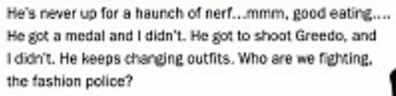
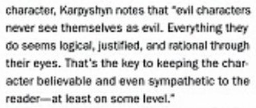
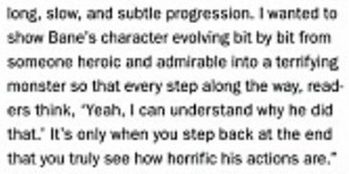
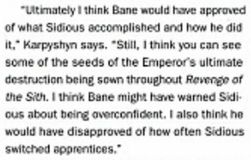
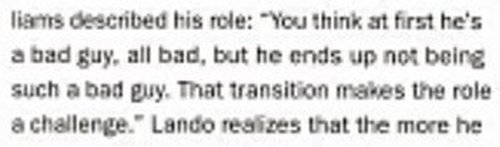
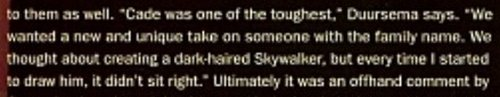

# Owner Material 038 — Star Wars Insider #1–153 plus specials (with The Lucasfilm Fan Club Magazine #1–22): Star Wars Insider #89 (2006)

- **Source:** *Star Wars Insider* magazine (issues 23–153, 1994–2014) and its predecessor *The Lucasfilm Fan Club Magazine* (issues 1–22, 1987–1994), plus seven special editions: articles, interviews, comics and short fiction Secondary source (licensed Legends reference). Scan OCR'd on the box; the scan stays box-only and is **not** published.
- **Method:** every scanned page was OCR'd and machine-screened sentence by sentence for power-relevant statements (fights, kills, defeats, Force feats, rankings, superweapons) that name a character on our roster; each kept sentence is quoted verbatim from the OCR text and has a crop of the printed passage directly under it. Pages with nothing power-relevant are still listed with what is on them.
- **Citation:** "*Star Wars Insider #89* (2006), p.X" by printed page ("scan p.X" where no printed number applies). **Weight:** Licensed magazine: a secondary source. Its short fiction and comics are Legends stories; its articles and interviews sum up or discuss lore and rank below the novels, comics and games they describe.

## scan p.1 (scan page 1)

Page contents: Cover, Issue 89, Sep/Oct 2006: Han Solo "Our Kind of Scum"; Boba Fett fiction excerpt from Bloodlines; The Art of War (Legacy); A Long Time Ago... original trilogy on DVD; Force in Effect games; Pirates 2, MI: III, Poseidon (hand-read)

## scan p.2 (scan page 2)

Page contents: Ad: Topps Star Wars Evolution Update Edition ("Destiny Fulfilled") (hand-read)

## scan p.3 (scan page 3)

Page contents: Contents: ILM's Sizzling Mustafarian Summer (Ron Magid); Where Did You Dig Up That Old Fossil? (Daniel Wallace); Underworld (Ryan Kaufman and Abel G. Peña); The Art of War (Frank Parisi); Bricks, Whips and Spaceships (Ryan Jones); departments; cover illustration Timothy Bradstreet (hand-read)

## scan p.4 (scan page 4)

Page contents: Editorial "Choices" (Frank Parisi): 1997 Special Edition line at the Coronet; masthead (hand-read)

## scan p.5 (scan page 5)

Page contents: Ad: Weis/Hickman Dragonlance, Dragons of the Dwarven Depths (hand-read)

## scan p.6 (scan page 6)

Page contents: Comlink "Same Sith, Different Day....": Sith issue, Sleazebaggano, Images of Evil, issue 87 cover homage to Days of Future Past (Francis Mao, Eugene Wang), Aurebesh (letter-writer names omitted); Obi-Wan illustration Francis Mao (hand-read)

## scan p.7 (scan page 7)

Page contents: Ad: Cloud City Collectibles (hand-read)

## scan p.8 (scan page 8)

Page contents: Ad: TimeShift (Sierra), spread with p9 (hand-read)

## scan p.9 (scan page 9)

Page contents: Ad: TimeShift continued (hand-read)

## scan p.10 (scan page 10)

Page contents: Skywalking: Celebration IV announced for Los Angeles, May 24-28, 2007 (Steve Sansweet); ILM sells physical production unit to Mark Anderson (Kerner Optical, Chrissie England); Lucas to be inducted into Toy Industry Hall of Fame box; illustration Francis Mao (hand-read)

## scan p.11 (scan page 11)

Page contents: Skywalking: Kerner continued; Boba Fett: A Practical Man eBook (Karen Traviss); Ray Harryhausen and Ralph McQuarrie visit ILM; Ian McDiarmid wins Tony (Faith Healer); MTV votes Hayden Christensen Best Villain box; Carrie Fisher's Wishful Drinking (hand-read)

## scan p.12 (scan page 12)

Page contents: "The Dark Side of the Death Star" Star Wars Synchronicity Project (Bonnie Burton; fan name omitted); What a Wookiee! Peter Mayhew Q&A; Certain Points of View box (interviewee names omitted) (hand-read)

- **Chewbacca; Han Solo** — entry/section: What annoys Chewie about Han: "He's never up for a haunch of nerf...mmm, good eating.... He got a medal and I didn't. He got to shoot Greedo, and I didn't. He keeps changing outfits. Who are we fighting, the fashion police? —Peter Mayhew, Star Wars Insider 89, p. 12" Source: *Star Wars Insider #89* (2006), scan p.12
  

## scan p.13 (scan page 13)

Page contents: From the Outer Rim: Gnarls Barkley at MTV Movie Awards; History of Aurebesh (Stephen Crane); Darth Vader vs. Japanese Police; Nathan Sawaya LEGO Han in Carbonite; ClubJade; Ad: Kevin J. Anderson Of Fire and Night (hand-read)

## scan p.14 (scan page 14)

Page contents: Jedi Library "Darth Reign" (Jason Fry): Drew Karpyshyn on Darth Bane: Path of Destruction; Upcoming Books box (hand-read)

- **Darth Bane** — entry/section: Evil characters never see themselves as evil: "Karpyshyn notes that "evil characters never see themselves as evil. Everything they do seems logical, justified, and rational through their eyes. That's the key to keeping the character believable and even sympathetic to the reader—at least on some level." —Drew Karpyshyn, Star Wars Insider 89, p. 14" Source: *Star Wars Insider #89* (2006), scan p.14
  
- **Darth Bane** — entry/section: Heroic to terrifying monster: ""I wanted to show Bane's character evolving bit by bit from someone heroic and admirable into a terrifying monster so that every step along the way, readers think, 'Yeah, I can understand why he did that.' It's only when you step back at the end that you truly see how horrific his actions are." —Drew Karpyshyn, Star Wars Insider 89, p. 14" Source: *Star Wars Insider #89* (2006), scan p.14
  
- **Darth Bane; Palpatine (Darth Sidious)** — entry/section: Bane would warn Sidious: ""Ultimately I think Bane would have approved of what Sidious accomplished and how he did it," Karpyshyn says. "Still, I think you can see some of the seeds of the Emperor's ultimate destruction being sown throughout Revenge of the Sith. I think Bane might have warned Sidious about being overconfident. I also think he would have disapproved of how often Sidious switched apprentices." —Drew Karpyshyn, Star Wars Insider 89, p. 14" Source: *Star Wars Insider #89* (2006), scan p.14
  

## scan p.15 (scan page 15)

Page contents: Legacy of the Force: Bloodlines excerpt (Karen Traviss), prologue: Boba Fett hunts H'buk at Atzerri (hand-read)

### Stat block notes (game mechanics, not feats)

- Never use your kids: He shouldn't have said that. Now I'm angry, and I don't often get angry. "Never use your kids, scumbag. Never." My father put me first. Any father should. (Star Wars Insider 89, p. 15) (Source: *Star Wars Insider #89* (2006), scan p.15)
- Fett believes he is dying: You see, I'm ill. I think I'm dying. If I am, then there are things I've got to do. One of them is to find out what happened to Ailyn. Another is to decide who's going to be Mandalore when I'm gone. And the third, of course, is to cheat death. I've had a lot of practice at that. (Star Wars Insider 89, p. 15) (Source: *Star Wars Insider #89* (2006), scan p.15)

## scan p.16 (scan page 16)

Page contents: Drawn by the Force "The Emperor's Final Fate" (Daniel Wallace): Dark Empire II 2nd Edition with Empire's End (Tom Veitch, Cam Kennedy, Jim Baikie, Tsuneo Sanda cover) (hand-read)

## scan p.17 (scan page 17)

Page contents: So What's All This About a Resurrected Emperor? box; Continue, the Clone Wars Do (Clone Wars Adventures vol. 6, The Fillbach Brothers, Haden Blackman, Rick Lacy, Mike Kennedy, Stewart McKenny); Other Upcoming Comics box (hand-read)

### Stat block notes (game mechanics, not feats)

- Fett survives the Sarlacc: Boba Fett's return. With a deadpan, "The Sarlacc found me somewhat indigestible, Solo," the fan-favorite bounty hunter bounced back from his onscreen death (Star Wars Insider 89, p. 17) (Source: *Star Wars Insider #89* (2006), scan p.17)
- Luke kneels before the Emperor: Dark Empire went where Return of the Jedi wouldn't, showing a humbled Luke kneeling before Emperor Palpatine as his apprentice. Even though the action was a ruse on Luke's part, the temptations of power soon made his struggle all too real. (Star Wars Insider 89, p. 17) (Source: *Star Wars Insider #89* (2006), scan p.17)

## scan p.18 (scan page 18)

Page contents: Ad: Brian's Toys, spread with p19 (hand-read)

## scan p.19 (scan page 19)

Page contents: Ad: Brian's Toys continued (hand-read)

## scan p.20 (scan page 20)

Page contents: ILM's Sizzling Mustafarian Summer (Ron Magid): Mission: Impossible III (Roger Guyett, J.J. Abrams, Brian Flynn) (hand-read)

## scan p.21 (scan page 21)

Page contents: ILM 30th: intro; MI:III Shanghai jump; R2-D2 hidden in MI:III (hand-read)

## scan p.22 (scan page 22)

Page contents: Poseidon (Kim Libreri, Mohen Leo) (hand-read)

## scan p.23 (scan page 23)

Page contents: Poseidon: Stanford fluid simulation (Ron Fedkiw); 180-foot wave (hand-read)

## scan p.24 (scan page 24)

Page contents: Pirates of the Caribbean II: Dead Man's Chest (John Knoll) (hand-read)

## scan p.25 (scan page 25)

Page contents: Pirates: Imocap; Knoll on faithful CG performances (hand-read)

## scan p.26 (scan page 26)

Page contents: Jabba's Collection "Han Shoots Fir- Ah, You Know": Mos Eisley Cantina bookends (Gentle Giant), Rancor statue, Premium Format Boba Fett (Sideshow) (hand-read)

## scan p.27 (scan page 27)

Page contents: Jabba's Collection: Jabba's Throne and Salacious Crumb pack, Leia as Boushh, Bib Fortuna, Jabba 1:6, Deluxe clone trooper mini bust (hand-read)

## scan p.28 (scan page 28)

Page contents: Jabba's Collection: Darth Vader's Sith Starfighter, Unleashed Battle Packs wave 5, Studio Scale Millennium Falcon (Master Replicas) (hand-read)

## scan p.29 (scan page 29)

Page contents: Jabba's Collection: Obi-Wan Episode III Force FX, Force Action lightsabers; Ad: Memorabilia Fest 06 (Billy Dee Williams, Ray Park, Nalini Krishan, Christian Simpson, Daniel Logan) (hand-read)

## scan p.30 (scan page 30)

Page contents: "Where Did You Dig Up That Old Fossil?" (Daniel Wallace) opener: original trilogy cuts on DVD (hand-read)

## scan p.31 (scan page 31)

Page contents: Old Fossil: release Sept. 12-Dec. 31, 2006; Lucas "Films never get finished, they get abandoned." (hand-read)

## scan p.32 (scan page 32)

Page contents: Story Changes: Han and Greedo's face-off; Don't Look Now (Jabba docking bay, Declan Mulholland, Biggs); Punch Lines (hand-read)

## scan p.33 (scan page 33)

Page contents: Visual Changes: A Less Wretched Hive (Ajim, Djerba); Clap for the Wolfman (Rick Baker); Masters of the Model Shop; Rooms with a View (hand-read)

## scan p.34 (scan page 34)

Page contents: The Stalker in the Snow (Howie Weed, Phil Tippett); Lapti Nek (Joseph Williams, Sy Snootles); Long Arm of the Prequels (Sebastian Shaw, Jason Wingreen, Temuera Morrison, Clive Revill); Celebrate the Love (Yub Nub) (hand-read)

### Stat block notes (game mechanics, not feats)

- Original Empire voice: In the original Empire, Boba Fett's voice is dubbed by Jason Wingreen, not by Attack of the Clones' Temura Morrison. (Star Wars Insider 89, p. 34) (Source: *Star Wars Insider #89* (2006), scan p.34)
- Original Empire hologram: Empire's hologram call between Vader and the Emperor is downright jarring in its original incarnation, featuring an Emperor who speaks with the stentorian voice of Clive Revill and a face masked by heavy prosthetics that bears little resemblance to Palpatine actor Ian McDiarmid. (Star Wars Insider 89, p. 34) (Source: *Star Wars Insider #89* (2006), scan p.34)

## scan p.35 (scan page 35)

Page contents: Lorne Peterson sidebar: Death Star surface, sandcrawler dune shot, John Knoll, CG vs. models, Mustafar model (hand-read)

## scan p.36 (scan page 36)

Page contents: Underworld: A Galaxy of Scum and Villainy (Ryan Kaufman and Abel G. Peña; illustrations Joe Corroney with Brian Miller and Dustin Yee): ISB report; Bounty Hunters Guild (Cradossk, Crimson Nova); Hutt kajidics (hand-read)

### Stat block notes (game mechanics, not feats)

- Head of the Guild: The Guild itself is currently headed by Cradossk, a typical Trandoshan sociopath. (Star Wars Insider 89, p. 36) (Source: *Star Wars Insider #89* (2006), scan p.36)
- Crimson Nova destroyed by Windu: During the Clone Wars, Crimson Nova was destroyed by the traitor Mace Windu. (Star Wars Insider 89, p. 36) (Source: *Star Wars Insider #89* (2006), scan p.36)

## scan p.37 (scan page 37)

Page contents: Underworld illustration (Xizor, Jabba, Han, Boba Fett, underworld figures) (hand-read)

## scan p.38 (scan page 38)

Page contents: Black Sun (Ysanne Isard report; Xizor); caption Guri and BoShek; Contraband: sampling of illegal drugs box (hand-read)

### Stat block notes (game mechanics, not feats)

- Xizor's grudge: Prince Xizor's royal house and family were incinerated in an orbital bombardment ordered by Darth Vader a number of years ago. Xizor has harbored a grudge against Vader ever since that may prove beneficially exploitable in the coming years. (Star Wars Insider 89, p. 38) (Source: *Star Wars Insider #89* (2006), scan p.38)
- Jango exterminates the Bando Gora: Galactic trade of this product was originally dominated by the Bando Gora cult, which was exterminated by Jango Fett. (Star Wars Insider 89, p. 38) (Source: *Star Wars Insider #89* (2006), scan p.38)

## scan p.39 (scan page 39)

Page contents: Scoundrels: Han Solo dossier; BoShek interview; Talon Karrde; caption Lando loses the Falcon (hand-read)

### Stat block notes (game mechanics, not feats)

- Corporate Sector dossier: "...Captain Solo, a product of the Imperial Academy, famously breached Corporate Sector security at the maximum security prison on Mytus VII (Stars' End). (Star Wars Insider 89, p. 39) (Source: *Star Wars Insider #89* (2006), scan p.39)
- Prone to shooting first: "Solo wears the Corellian blood stripes (First Class) and travels with a Wookiee named Chewbacca, whom he rescued from Imperial slavery. "Solo should be considered armed and dangerous, and is prone to 'shooting first.' Approach with extreme prejudice. (Star Wars Insider 89, p. 39) (Source: *Star Wars Insider #89* (2006), scan p.39)
- Karrde inherits Car'das' cartel: Karrde recently "inherited" the criminal cartel that belonged to Jorj Car'das, a smuggling kingpin who apparently just up and poofed out of existence like the crowd around an undigested Ortolan. (Star Wars Insider 89, p. 39) (Source: *Star Wars Insider #89* (2006), scan p.39)

## scan p.40 (scan page 40)

Page contents: Wretched Hives: Smuggler's Run; Keyorin, the Hunter's World; Slavers (Zygerrians); caption Crimson Nova vs. Kai Justiss (hand-read)

## scan p.41 (scan page 41)

Page contents: Rogue Elements: Aurodium Sword (Muzzle, Alpha-66); Lando Calrissian complaints; Tyber Zann; Conclusion (hand-read)

### Stat block notes (game mechanics, not feats)

- Lando's record: Since leaving Corellia roughly 10 years ago, he won a battered YT-1300 in a sabacc game and enlisted a privateer named Solo to instruct him in starship navigation. Ironically, Calrissian later lost his ship, the Millenium Falcon, to Solo in another sabacc game. (Star Wars Insider 89, p. 41) (Source: *Star Wars Insider #89* (2006), scan p.41)
- Tyber Zann: Until recently, Zann waged a grudge war with Jabba the Hutt, and the collateral damage suited the Empire. (Star Wars Insider 89, p. 41) (Source: *Star Wars Insider #89* (2006), scan p.41)

## scan p.42 (scan page 42)

Page contents: Technical Readout / Set Piece "Escape From Cloud City" (Chris Trevas): Elstree Stage 2, Billy Dee Williams, unfilmed elevator sequence, flu on set box (hand-read)

- **Lando Calrissian** — entry/section: Billy Dee Williams on Lando: ""You think at first he's a bad guy, all bad, but he ends up not being such a bad guy. That transition makes the role a challenge." —Billy Dee Williams, Star Wars Insider 89, p. 42" Source: *Star Wars Insider #89* (2006), scan p.42
  

## scan p.43 (scan page 43)

Page contents: Set Piece callouts: C-3PO arm rig, Art Deco, Wing Guard, BlasTech E-11 from Sterling, Cloud City blaster pistols (hand-read)

## scan p.44 (scan page 44)

Page contents: The Art of War (Frank Parisi, illustrations Jan Duursema) opener spread (hand-read)

## scan p.45 (scan page 45)

Page contents: The Art of War: intro, Jan Duursema, artist of Star Wars Legacy, final installment of a three-part series (hand-read)

## scan p.46 (scan page 46)

Page contents: Duursema on influences, reverse archaeology, Jedi Temple/Academy on Ossus, Yuuzhan Vong-altered Coruscant (hand-read)

## scan p.47 (scan page 47)

Page contents: Duursema on characters (John Ostrander; Darth Talon; Cade Skywalker); pull quote (hand-read)

## scan p.48 (scan page 48)

Page contents: Cade design; new Sith order (Darth Talon, Darth Krayt, Darth Nihl); layouts, atmosphere, pacing (hand-read)

- **Cade Skywalker** — entry/section: Designing Cade: ""Cade was one of the toughest," Duursema says. "We wanted a new and unique take on someone with the family name. We thought about creating a dark-haired Skywalker, but every time I started to draw him, it didn't sit right." —Jan Duursema, Star Wars Insider 89, p. 48" Source: *Star Wars Insider #89* (2006), scan p.48
  

## scan p.49 (scan page 49)

Page contents: Concept art captions (Coruscant, Ossus Jedi Temple, Poser 3D models); New Ships for a New Empire box (Sean Cooke, Randy Stradley): Pellaeon-class Super Star Destroyer, Predator-class fighter (hand-read)

## scan p.50 (scan page 50)

Page contents: Ask the Master Q&A (Pablo Hidalgo; letter-writer names omitted) "Maybe Luke Was a Bad Pilot, After All": Luke's X-wings in Marvel and Splinter of the Mind's Eye, Death Probe, AA-589 (hand-read)

## scan p.51 (scan page 51)

Page contents: Q&A: Obi-Wan's lightsaber props (Ty Teiger); LYMIRN webcam sign (Ralph Nelson); Wilford Brimley in Battle for Endor (hand-read)

## scan p.52 (scan page 52)

Page contents: Q&A: Noa's line; Rum Sleg; X-wing/TIE Easter eggs in Episode II; Qui-Gon and Force ghost technique; Yoda cartoon box (hand-read)

### Stat block notes (game mechanics, not feats)

- Qui-Gon's incomplete technique: Qui-Gon hadn't fully cracked the sublimation-into-the-Force ability when he died in Episode I. That's why he left behind a body, which caught many Star Wars fans by surprise. He did know enough of these obscure Whill shamanistic rites to preserve his consciousness in the afterlife, but as an astral trailblazer, he still had much to learn. (Star Wars Insider 89, p. 52) (Source: *Star Wars Insider #89* (2006), scan p.52)

## scan p.53 (scan page 53)

Page contents: Q&A: Obi-Wan/Yoda robes; Sate Pestage in Empire drafts, Kenner, Guide to the Star Wars Universe, Dark Empire Sourcebook (hand-read)

### Stat block notes (game mechanics, not feats)

- Obi-Wan and Yoda more adept: Such practice, which Qui-Gon never benefited from, results in Obi-Wan and Yoda being far more adept at this ability then Qui-Gon was. (Star Wars Insider 89, p. 53) (Source: *Star Wars Insider #89* (2006), scan p.53)
- Pestage in Empire drafts: In the second draft script, he is identified as Sate Molock, Grand Vizier to his eminence the Emperor. The revised second draft calls him Sate Pestage. The script that best reflects the finished film was the fifth draft, and no trace of Pestage remains. (Star Wars Insider 89, p. 53) (Source: *Star Wars Insider #89* (2006), scan p.53)

## scan p.54 (scan page 54)

Page contents: Scouting the Galaxy (Steve Sansweet) "The One That Almost Got Away!": Jar Jar in Carbonite presented to George Lucas at Skywalker Ranch, placed at ILM Letterman Digital Arts Center (builders and friends are fans, names omitted) (hand-read)

## scan p.55 (scan page 55)

Page contents: Scouting the Galaxy letters (names omitted): stormtrooper costumes and the 501st; Topps Evolution Update cut autograph cards (Lucas, Alec Guinness, Peter Cushing); figure value (hand-read)

## scan p.56 (scan page 56)

Page contents: Scouting: 1984 Gym-Dandy swing set; Sphere four-book boxed set (hand-read)

## scan p.57 (scan page 57)

Page contents: Scouting: bootleg Revenge of the Jedi script; Brava Soft Furnishings Ewok bean bag chair (Tomart's guide) (hand-read)

## scan p.58 (scan page 58)

Page contents: "Bricks, Whips and Spaceships" (Ryan Jones): LucasArts E3 lineup opener (hand-read)

## scan p.59 (scan page 59)

Page contents: LEGO Star Wars II: The Original Trilogy (Traveler's Tales; Sept. 12, 2006) (hand-read)

## scan p.60 (scan page 60)

Page contents: Empire at War: Forces of Corruption (Tyber Zann vs. Jabba) (hand-read)

## scan p.61 (scan page 61)

Page contents: Forces of Corruption continued: maps, Mirror Mode, Bossk, IG-88 (hand-read)

## scan p.62 (scan page 62)

Page contents: Untitled next-gen Star Wars game (Haden Blackman; euphoria, DMM; Felucia), bridges Episodes III and IV (hand-read)

## scan p.63 (scan page 63)

Page contents: Indiana Jones 2007 game (Marcus Brody; Fate of Atlantis template) (hand-read)

## scan p.64 (scan page 64)

Page contents: Best of Hyperspace (Bonnie Burton and Pablo Hidalgo) "What's the Story?": fan-written backstories Tzizvvt and E-3PO (contributor handles omitted); Best of Star Wars Blogs: Daniel Logan "Happy 29th Anniversary" (hand-read)

## scan p.65 (scan page 65)

Page contents: Dan Wallace blog "Gamoreans Drive Like This, But Gotals Drive Like That" (reader omitted; species templates); Making of the Star Wars Radio Drama on AudioCast (Mark Hamill, Anthony Daniels, John Madden quotes) (hand-read)

## scan p.66 (scan page 66)

Page contents: Best of Hyperspace: Galactic Gallery: Ken Ralston Jabba's palace candidates and Night Crew; early Joe Johnston wampa ice creature (hand-read)

## scan p.67 (scan page 67)

Page contents: Galactic Gallery: Terryl Whitlatch Sebulba lip sync and Nozzle-Nose; Ralph McQuarrie Black Knight Royal Guard; Iain McCaig Naboo horse creature (hand-read)

## scan p.68 (scan page 68)

Page contents: Padawan Corner "How to Draw a Tusken Raider" (Cynthia Cummens), steps 1-3 (hand-read)

## scan p.69 (scan page 69)

Page contents: Padawan Corner steps 4-6, inking and coloring (hand-read)

## scan p.70 (scan page 70)

Page contents: Bantha Tracks vol. 20, Padawan Edition: "Star Wars: The Next Generation" (fan family photos, names omitted) (hand-read)

## scan p.71 (scan page 71)

Page contents: Bantha Tracks: fan family photos (names omitted) (hand-read)

## scan p.72 (scan page 72)

Page contents: Bantha Tracks: fan family photos incl. a Lucasfilm Vader character performer with his son, Fox Studios Sydney, Alpha Base group (names omitted) (hand-read)

## scan p.73 (scan page 73)

Page contents: Ad: The Anthony Grandio Company "Path to the Dark Side" checks (hand-read)

## scan p.74 (scan page 74)

Page contents: Bantha Tracks Editorial "Bringing Up Mom" (Mary Franklin): her mother volunteers at Celebration II Lucasfilm Archive Exhibit; The Way We Were (fan sketch, name omitted) (hand-read)

## scan p.75 (scan page 75)

Page contents: Bantha Tracks: mother-daughter fans at Celebration III (names omitted); Art Galaxy special selection (child artist omitted); submission guidelines (hand-read)

## scan p.76 (scan page 76)

Page contents: Ad: Hyperspace, the Official Star Wars Fan Club, $39.95 (hand-read)

## scan p.77 (scan page 77)

Page contents: StarWarsShop #13 "Tosche Station": Exclusive Silver Darth Vader statue (Kotobukiya) (hand-read)

## scan p.78 (scan page 78)

Page contents: StarWarsShop Collector's Picks (collector name omitted): Imperial Icon ladies watch, Lucasfilm logo T-shirt, Star Wars Is Forever T-shirt, Yoda Fireworks poster, Vintage Action Figures Guide (hand-read)

## scan p.79 (scan page 79)

Page contents: StarWarsShop What's New: coaster set, Indiana Jones cap, General Grievous watch, Super Deformed Boba Fett, Boba Fett T-shirt (hand-read)

## scan p.80 (scan page 80)

Page contents: StarWarsShop Trooper Gear: SpudTrooper, iPod Nano cover (Tsuneo Sanda art), GSX watch, clone helmet, costumes, blaster, flag, T-shirt (hand-read)

## scan p.81 (scan page 81)

Page contents: StarWarsShop Fan Favorites: Vader hockey jersey, Yoda watch, OT DVD set, Darth Maul M&M, Obi-Wan FX saber, Attakus Vader, Lucas family figures, Vader M&M plush (hand-read)

## scan p.82 (scan page 82)

Page contents: StarWarsShop More Must Haves: Locked in Combat card, R2-Q5, magnets, The Cinema of George Lucas, black chrome Anakin mini saber, Vader's TIE, C-3PO Pez, Obi-Wan standee, clone mini bust, AT-RT glass cube, basic saber (hand-read)

## scan p.83 (scan page 83)

Page contents: Ad: Entertainment Earth Chaykin mini poster sculpture (Howard Chaykin 1976 Comic-Con poster) (hand-read)

## scan p.84 (scan page 84)

Page contents: Ad: Star Wars Miniatures Champions of the Force "He Made His Choice" (Solo twins, Darth Nihilus, Bastila Shan) (hand-read)

