# Owner Material 038 — Star Wars Insider #1–153 plus specials (with The Lucasfilm Fan Club Magazine #1–22): Star Wars Insider #90 (2006)

- **Source:** *Star Wars Insider* magazine (issues 23–153, 1994–2014) and its predecessor *The Lucasfilm Fan Club Magazine* (issues 1–22, 1987–1994), plus seven special editions: articles, interviews, comics and short fiction Secondary source (licensed Legends reference). Scan OCR'd on the box; the scan stays box-only and is **not** published.
- **Method:** every scanned page was OCR'd and machine-screened sentence by sentence for power-relevant statements (fights, kills, defeats, Force feats, rankings, superweapons) that name a character on our roster; each kept sentence is quoted verbatim from the OCR text and has a crop of the printed passage directly under it. Pages with nothing power-relevant are still listed with what is on them.
- **Citation:** "*Star Wars Insider #90* (2006), p.X" by printed page ("scan p.X" where no printed number applies). **Weight:** Licensed magazine: a secondary source. Its short fiction and comics are Legends stories; its articles and interviews sum up or discuss lore and rank below the novels, comics and games they describe.

## scan p.1 (scan page 1)

Page contents: Cover, Issue 90, Nov/Dec 2006, Aliens of Episode III (Utapaun cover art by Daniel Scott Gabriel Murray); Wookiee World: Building Kashyyyk; Cool Trooper: The Star Wars Art of Nathan Cabrera; Vader Rises: Dark Times are here; Spaceballs: The 19th Anniversary! (hand-read)

## scan p.2 (scan page 2)

Page contents: Ad: TimeShift (Sierra), spread with p3 (hand-read)

## scan p.3 (scan page 3)

Page contents: Ad: TimeShift "Ultimate Weapon" (hand-read)

## scan p.4 (scan page 4)

Page contents: Contents: features (Models of Revenge of the Sith Part I, Aliens of Episode III, Spaceballs: The Article, Cool Trooper) and departments (hand-read)

## scan p.5 (scan page 5)

Page contents: Ad: Gen Con So Cal (hand-read)

## scan p.6 (scan page 6)

Page contents: Editorial "Future Visionaries" (Frank Parisi); masthead (hand-read)

## scan p.7 (scan page 7)

Page contents: Ad: Hasbro Gragra 3 3/4" figure "Her 15 minutes of fame lasted only one." (hand-read)

## scan p.8 (scan page 8)

Page contents: Comlink letters "Only the Good Die Young" (letter-writers omitted): Jedi vs. Sith coverage, LORDVADR plate, Owen and Beru not recognizing C-3PO, Questions About Star Wars to Keep You Awake at Night, Ultimate Edition rumors denied (hand-read)

## scan p.9 (scan page 9)

Page contents: Ad: Swords of Eveningstar (Ed Greenwood, Wizards) (hand-read)

## scan p.10 (scan page 10)

Page contents: Skywalking: Star Wars Rules Comic-Con: Steve Sansweet's Star Wars Spectacular (Celebration IV in L.A. May 24-27 2007, Celebration Europe July 2007, live-action series later this decade, animated series 2008 set late in the Clone Wars, Rose Parade 501st, 30th Anniversary logo); LucasArts and Free Radical Design partnership (Peter Hirschmann); Del Rey "Darth Who" naming contest for Jacen Solo (Betrayal); story and photos by John Mulder (hand-read)

## scan p.11 (scan page 11)

Page contents: Skywalking: Lethal Alliance for DS and PSP (Ubisoft; Twi'lek Rianna Saren and droid Zeeo); Lucasfilm Animation Singapore handheld and digital artist groups (Christian Kubsch); new Hyperspace fan club president (fan, name omitted) (hand-read)

## scan p.12 (scan page 12)

Page contents: Skywalking: Fan Filmmakers (David Maddox): 2006 Star Wars Fan Film Awards at SDCC hosted by Steve Sansweet; double winner of Audience Choice and George Lucas Selects (fan filmmakers' names omitted) (hand-read)

## scan p.13 (scan page 13)

Page contents: 2006 Artoos Awards Ceremony, Hasbro U.K. Mini Movies (Mark Newbold; host Danny John-Jules; fan entrants omitted); photography Adrian Pearman (hand-read)

## scan p.14 (scan page 14)

Page contents: Refresher Reading: 20 Things You Didn't Know About the Tantive IV (Pablo Hidalgo) (hand-read)

### Stat block notes (game mechanics, not feats)

- Tantive IV renamed: It was renamed the Tantive IV when Bail Organa ascended to the position of Viceroy and attained the elected title of Senatorial representative, taking the Tantive IV as his consular vessel of office. (Star Wars Insider 90, p. 14) (Source: *Star Wars Insider #90* (2006), scan p.14)
- False distress signal: The message began: PRIORITY DISTRESS ALERT: Captain R. Antilles, Tantive IV: House of Alderaan consular vessel. We have suffered catastrophic depressurization and hull damage as a result of superluminal collision with uncharted asteroidal body. (Star Wars Insider 90, p. 14) (Source: *Star Wars Insider #90* (2006), scan p.14)
- Wide-Eyed fabrication: Sixteen standard hours later, the Wide-Eyed reported visual confirmation of the Tantive IV's wreckage and sensor-confirmation of all 85 dead crewmembers, including Senator Leia Organa. (Star Wars Insider 90, p. 14) (Source: *Star Wars Insider #90* (2006), scan p.14)

## scan p.15 (scan page 15)

Page contents: Ad: Brian's Toys buying list (hand-read)

## scan p.16 (scan page 16)

Page contents: Star Wars International: "Star Wars Reigns in Spain" (Gus Lopez): Josman costumes, Kellogg's ROTS premiums, Clone Wars convention badges, Droids board game (Didacta), Colgate ROTJ figure boxes (hand-read)

## scan p.17 (scan page 17)

Page contents: Ad: Road of the Patriarch (R.A. Salvatore, Wizards) (hand-read)

## scan p.18 (scan page 18)

Page contents: House ad: Be a Part of Star Wars History! 2007 = 30 submissions call (hand-read)

## scan p.19 (scan page 19)

Page contents: Ad: Acme Archives Clone Wars production art (hand-read)

## scan p.20 (scan page 20)

Page contents: Ad: Brian's Toys, spread with p21 (hand-read)

## scan p.21 (scan page 21)

Page contents: Ad: Brian's Toys / Action Figure Authority (hand-read)

## scan p.22 (scan page 22)

Page contents: Jedi Library: "Sculpting History" (Daniel Wallace): Lorne Peterson's Sculpting a Galaxy: Inside the Star Wars Model Shop; Death Star II model budget story; Limited Edition of 3,500 with Falcon bas-relief and landspeeder replica; model shop sold, now Kerner Optical (hand-read)

## scan p.23 (scan page 23)

Page contents: Sculpting History cont.: Limited Edition landspeeder and figures handcrafted by Lorne Peterson; seven replicas of Death Star surface components; Peterson on a "modelmakers' cut"; Pablo Hidalgo helped write the book (hand-read)

## scan p.24 (scan page 24)

Page contents: Jedi Library: "Caught in the Tempest" (Jason Fry): Troy Denning on Legacy of the Force: Tempest (Del Rey, November 28), the Solos' marriage after Star by Star, Han and Leia pursued as criminals by their own son Jacen (hand-read)

## scan p.25 (scan page 25)

Page contents: Tempest cont.: Luke and Mara worry about Ben and Jacen; Luke vs. Lumiya rematch; Tenel Ka and Allana in the Hapan Court; Denning on Jacen as tragic hero and fanatic; politics; returning foes; Upcoming Books Oct 2006–Feb 2007 (Allegiance cover by Timothy Zahn) (hand-read)

- **Jacen Solo (Darth Caedus)** — entry/section: Denning on Jacen: ""deeply troubled by the moral imperfections and injustices that permeate his society, and he feels compelled to set matters right. This raises him to the stature of a mythic figure, and that's how I treat him. I write Jacen as a tragic hero, forced by fate to make unbearable choices and unthinkable decisions. And he never balks." —Troy Denning, Star Wars Insider 90, p. 25" Source: *Star Wars Insider #90* (2006), scan p.25
  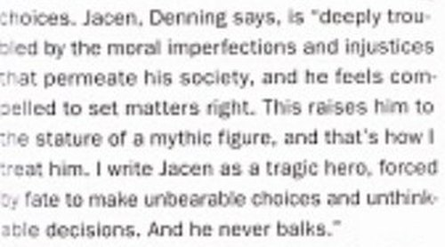

### Stat block notes (game mechanics, not feats)

- Tempest preview: Tenel Ka and Allana: The Jedi-turned-queen, Tenel Ka, must navigate her way through the treacheries of the Hapan Court, which threaten to also engulf Allana, the daughter of Tenel Ka and Jacen Solo. (Star Wars Insider 90, p. 25) (Source: *Star Wars Insider #90* (2006), scan p.25)
- Tempest preview: Luke vs. Lumiya: Luke Skywalker and Mara Jade Skywalker worry about their son Ben's relationship with Jacen, and if you've waited for a rematch between Luke Skywalker and the Sith adept Lumiya, wait no more. (Star Wars Insider 90, p. 25) (Source: *Star Wars Insider #90* (2006), scan p.25)

## scan p.26 (scan page 26)

Page contents: Drawn by the Force: "Begin the Dark Times" (Daniel Wallace): Dark Horse's Star Wars: Dark Times, "The Path to Nowhere" (Doug Wheatley art, Welles Hartley story, Mick Harrison script); Dass Jennir and Bomo Greenbark; Randy Stradley quotes (hand-read)

- **Dass Jennir; Darth Vader (Anakin Skywalker)** — entry/section: Stradley on The Path to Nowhere: ""After fighting a losing war against the Grand Army of the Republic, Jedi Master Dass Jennir and Nosaurian Separatist leader Bomo Greenbark set out to locate refugees from the Nosaurian homeworld," summarizes editor Randy Stradley. "What they discover of the Nosaurians' fate deeply affects not only Greenbark and Jennir, but Darth Vader as well." —Randy Stradley, Star Wars Insider 90, p. 26" Source: *Star Wars Insider #90* (2006), scan p.26
  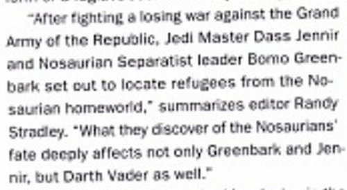

## scan p.27 (scan page 27)

Page contents: Dark Times cont.: Harrison on Dass Jennir, Wheatley; themes; X-Wing Rogue Squadron Omnibus Vol. 2 (Battleground Tatooine, The Warrior Princess, Requiem for a Rogue); Upcoming Star Wars Comics Oct 2006–Jan 2007 (hand-read)

- **Darth Vader (Anakin Skywalker); Dass Jennir** — entry/section: Harrison on Dark Times themes: ""Thematically, it's about how the rise of the Empire has changed the future for all of the characters," says Harrison. "Even Vader is discovering that being a Sith Lord isn't what he imagined it would be. For Jennir, there's no future in being a Jedi. For Bomo, there's no future without his missing family." —Mick Harrison, Star Wars Insider 90, p. 27" Source: *Star Wars Insider #90* (2006), scan p.27
  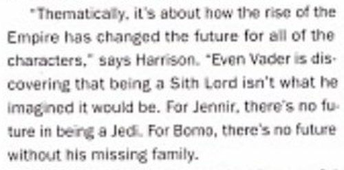

## scan p.28 (scan page 28)

Page contents: Jabba's Collection: "Bad Guys Wear Red": Gentle Giant Royal Guard statue (3,500, $165), Darth Maul and Chewbacca mini-busts, Sideshow 12-inch Endor Rebel soldiers (hand-read)

## scan p.29 (scan page 29)

Page contents: Collectibles cont.: Gentle Giant Obi-Wan Kenobi in Clone Trooper Armor statue ($185); Attakus statues (Bib Fortuna, Luke Skywalker Jedi Knight, Gamorrean Guard, TIE Fighter Pilot) (hand-read)

## scan p.30 (scan page 30)

Page contents: Final Kashyyyk tree drawing by Ryan Church on top of a maquette by Danny Wagner (full-page art) (hand-read)

## scan p.31 (scan page 31)

Page contents: "The Models of Revenge of the Sith" Part 1 (Frank Parisi; photos by Ryan Church): Brian Gernand and ILM's model shop (now Kerner Optical); Kashyyyk tree 1:72 scale, over 12 feet tall, built in 13 weeks by 20 team members (hand-read)

## scan p.32 (scan page 32)

Page contents: Kashyyyk Tree: Gernand on foam sculpture, steel armature, prototype maquette; lead sculptor Gritsada Satjawatcharaphong; Wookiee village concept art by Erik Tiemens (hand-read)

- **none** — entry/section: Gernand on the Kashyyyk tree: ""The tree was great. It was just a really fun thing to do. It was highly styled and conceptually very specific. We worked closely with Erik [Tiemens] and Ryan [Church] and determined how we were going to build it. These trees are humongous. You could live in them. There were many, many rooms and internal environments that we carved into the tree with very high buttress details." —Brian Gernand, Star Wars Insider 90, p. 32" Source: *Star Wars Insider #90* (2006), scan p.32
  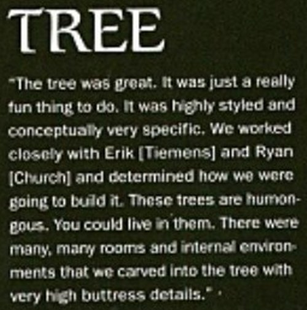

## scan p.33 (scan page 33)

Page contents: Kashyyyk tree cont.: clay detail sculpture, faux paint bark finish, hand-laid teak strips and laser-cut metal banding (hand-read)

## scan p.34 (scan page 34)

Page contents: Kashyyyk tree cont.: interior/exterior architecture, the tree rotated and reshot to populate the forest, CG canopies added (hand-read)

## scan p.35 (scan page 35)

Page contents: Yoda Pagoda: larger-scale miniature for interior moving shots of Yoda, Chewbacca and Tarfful; Order 66 scene; miniature lights and moss (hand-read)

- **Yoda; Chewbacca** — entry/section: Gernand on the Yoda pagoda: ""This is what would have been one of these little buildings, but we built it on a separate scale, because this is the model where the camera is inside. Yoda's in there, Chewbacca is in there. It's [used] when Order 66 goes down and the clone troopers try to kill Yoda, just before he escapes Kashyyyk, so all of that that is going on inside this [model]." —Brian Gernand, Star Wars Insider 90, p. 35" Source: *Star Wars Insider #90* (2006), scan p.35
  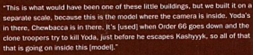

## scan p.36 (scan page 36)

Page contents: Full-page photo of a Utapaun (Tion Medon makeup) (hand-read)

## scan p.37 (scan page 37)

Page contents: "Aliens of Episode III" (Daniel Wallace): Utapauns, Mustafarians and Polis Massans with Iain McCaig, Derek Thompson, Sang Jun Lee, Robert Barnes, Mike Murnane; dropped Clone Wars montage (hand-read)

## scan p.38 (scan page 38)

Page contents: Utapauns: Pau'ans, "the Ancients"; original lemur concept; Mustafar robed humanoids moved to Utapau; Tion Medon facial grooves (Robert Barnes); Bruce Spence as Tion Medon; lemur concept by Sang Jun Lee (hand-read)

### Stat block notes (game mechanics, not feats)

- Utapauns: In Star Wars lore, the Utapauns are known as "the Ancients," a consequence of life spans that can be measured in centuries. The proper name of their species is the Pau'ans, and they are masters at harvesting wind power to energize their lonely, vertical cities. Utapaun resistance fighters joined the struggle to chase General Grievous' forces from their world but were caught flat-footed when the Republic's triumphant clone troopers turned hostile and seized Utapau in the name of the Emperor. (Star Wars Insider 90, p. 38) (Source: *Star Wars Insider #90* (2006), scan p.38)
- Tion Medon's face: In the film, Port Administrator Tion Medon greets Obi-Wan Kenobi upon the Jedi's arrival on Utapau. Medon has a long face lined by deep facial grooves, a characteristic inspired by ritualistic tribal scarring. (Star Wars Insider 90, p. 38) (Source: *Star Wars Insider #90* (2006), scan p.38)

## scan p.39 (scan page 39)

Page contents: Utapauns cont.: female Utapaun sculpture by Robert E. Barnes; Murnane's "very Hellraiser"; Bruce Spence on makeup and playing Tion Medon; Thompson; the Utai laborers and a cut lizard corral scene (hand-read)

- **Tion Medon; Obi-Wan Kenobi** — entry/section: Spence on Tion Medon: ""Obi-Wan Kenobi still hasn't reached that moment in time where he can be one of the great nobles," he says. "And I think Tion Medon really feels a teensy weensy bit superior." —Bruce Spence, Star Wars Insider 90, p. 39" Source: *Star Wars Insider #90* (2006), scan p.39
  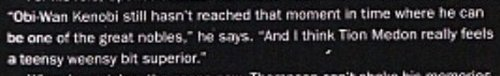

## scan p.40 (scan page 40)

Page contents: Mustafarians: northern and southern subspecies, arthropods with heat-resistant exoskeletons; Sang Jun Lee's insect designs; rejected "droid hell" and Anakin-as-quasi-deity concepts; Thompson quotes (hand-read)

- **Darth Vader (Anakin Skywalker)** — entry/section: Thompson on rejected Mustafar concepts: ""[Concept artist] Iain McCaig had the notion that it was a droid hell. [Later] we tooled around with the idea that if this was an industrial ore planet, that maybe because of Anakin's partial machine arm he would be perceived as a quasi-deity [to] feed his delusions of grandeur." —Derek Thompson, Star Wars Insider 90, p. 40" Source: *Star Wars Insider #90* (2006), scan p.40
  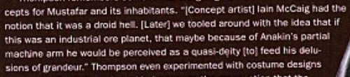

## scan p.41 (scan page 41)

Page contents: Mustafarian art: Mustafar alien concepts by Derek Thompson, CG Mustafarian scooping molten metal (hand-read)

## scan p.42 (scan page 42)

Page contents: Polis Massans: archaeological team seeking the Eellayin, hand-gesture communication; blank face design; Doug Chiang's early concept; Murnane busts; early Polis Massan concepts by Stian Dahlslett (hand-read)

## scan p.43 (scan page 43)

Page contents: Polis Massans cont.: Murnane on "Force Surgery"; CG in the final film; Barnes on the placid face; Polis Massan concepts by Stian Dahlslett and Sang Jun Lee (hand-read)

- **Padmé Amidala** — entry/section: Murnane on the Polis Massans: ""We thought they were going to be like mimes in their movement, very deliberate, slow and somewhat robotic. They were going to operate on the pregnant Padmé, so they must be masters in the galaxy for delivery and surgery." —Mike Murnane, Star Wars Insider 90, p. 43" Source: *Star Wars Insider #90* (2006), scan p.43
  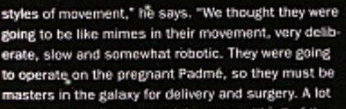

## scan p.44 (scan page 44)

Page contents: Technical Readout, Set Piece: "Luke's Landspeeder" (Chris Trevas): two full-size props in Tunisia (automobile with mirror skirt; counterweighted arm rig), China Lake reshoots, Mos Eisley sale scene filmed April 22, 1976 at Elstree; blank-firing Sterling stormtrooper props sidebar; ILM 38-inch scale model (hand-read)

### Stat block notes (game mechanics, not feats)

- Luke's landspeeder: Young Luke Skywalker cruised the desert flats of Tatooine in his old beat-up reddish-brown landspeeder. When he wasn't driving out to the fringes of his uncle's farm to fix moisture vaporators, he could head into Anchorhead and hang out with his friends, and though it wasn't much to look at, it was a vehicle he could call his own. (Star Wars Insider 90, p. 44) (Source: *Star Wars Insider #90* (2006), scan p.44)

## scan p.45 (scan page 45)

Page contents: Luke's Landspeeder cont.: sandtrooper blaster rifles were deactivated German MG-15 machine guns; sandtrooper pauldrons were motocross chest protectors; landspeeder model figures (12-inch Obi-Wan was a Six Million Dollar Man figure); early enclosed cockpit canopy; Ralph McQuarrie production painting (hand-read)

### Stat block notes (game mechanics, not feats)

- R2-D2 on the landspeeder: As an astromech droid, R2-D2 would be much more comfortable in the droid socket of a starfighter rather than lying on his back. (Star Wars Insider 90, p. 45) (Source: *Star Wars Insider #90* (2006), scan p.45)

## scan p.46 (scan page 46)

Page contents: Full-page Spaceballs illustration by Randy Martinez (hand-read)

## scan p.47 (scan page 47)

Page contents: "Spaceballs: The Article!" (David Maddox & Rich Handley; illustrations by Randy Martinez): 19th anniversary of Mel Brooks' Spaceballs; cast reflections (hand-read)

## scan p.48 (scan page 48)

Page contents: Spaceballs cont.: plot primer; Hardware Wars and fan parodies; script history and $25 million budget; Brooks as Yoghurt and President Skroob; Bill Pullman, Daphne Zuniga, John Candy; Rick Moranis on Dark Helmet's helmet (hand-read)

- **none** — entry/section: Moranis on Dark Helmet: ""Originally, it was designed that the character would be a gigantic helmet," remembers Moranis. "It was only after that was proven to be technically unfeasible that they just went for the larger-than-necessary helmet, which I thought was just as effective." —Rick Moranis, Star Wars Insider 90, p. 48" Source: *Star Wars Insider #90* (2006), scan p.48
  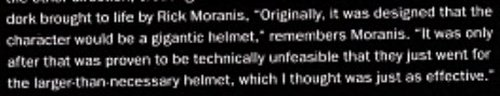

## scan p.49 (scan page 49)

Page contents: Ad: Destroy All Humans! 2 (THQ) (hand-read)

## scan p.50 (scan page 50)

Page contents: Spaceballs cont.: George Wyner as Colonel Sandurz ("second banana"); Moranis on Brooks' set; Lorene Yarnell as Dot Matrix (voice by Joan Rivers) and the hot suit (hand-read)

## scan p.51 (scan page 51)

Page contents: Ad: Pitching Lucas, Official Winner of the 2006 Star Wars Fan Film Awards (fan production; credits not recorded) (hand-read)

## scan p.52 (scan page 52)

Page contents: Spaceballs cont.: Mike Pniewski as the cross-eyed gunner; Tim Russ "combing the desert"; Rudy DeLuca as Vinnie and Richard Karron's burning Pizza the Hutt suit; John Hurt reprising Kane from Alien (hand-read)

## scan p.53 (scan page 53)

Page contents: Spaceballs cont.: Hurt on blue screen; Moranis on parody and Spaceballs 3: The Search for Spaceballs 2; merchandise; reflections on John Candy; "The Pizza" art by Randy Martinez (hand-read)

## scan p.54 (scan page 54)

Page contents: Ask the Master (Pablo Hidalgo): "For the Last Time—No Episodes VII Through IX!": Hoth energy shield explained (diagram); soundtrack track order; Clone Wars Wookiee father and son (Tarkov and Jaccoba) (hand-read)

### Stat block notes (game mechanics, not feats)

- Hoth energy shield: The energy shield that covered Echo Base on Hoth only offered a limited protection of a few kilometers from the source. Think of it as a ceiling above the Rebel base. It definitely stops Rebel ships from taking off and guards against bombardment, but does nothing to stop Imperial ships from arriving in the system, high overhead. That's why, as Vader ordered, General Veers had to land his troops beyond the range of the energy shield, and then march over land under the shield "umbrella" to destroy the power generators. (Star Wars Insider 90, p. 54) (Source: *Star Wars Insider #90* (2006), scan p.54)
- Tarkov and Jaccoba, not Lumpy: In Chapter 22 of the Clone Wars micro-series, we see a Wookiee father and his son discover a Separatist invasion army in the forests of Kashyyyk. That Wookiee is Tarkov, and his son is Jaccoba, who are actually named after series director Genndy Tartakovsky and his son Jacob. Furthermore, it would have been too early in the timeline for Chewbacca to be a father; Lumpy was born well after the Clone Wars. (Star Wars Insider 90, p. 54) (Source: *Star Wars Insider #90* (2006), scan p.54)

## scan p.55 (scan page 55)

Page contents: Ask the Master cont.: why Revenge of the Sith got no North American VHS release; Clone Wars Qui-Gon/Anakin scene explained as Yoda's Force vision (hand-read)

### Stat block notes (game mechanics, not feats)

- Qui-Gon and Anakin in Clone Wars: Qui-Gon instructing Anakin Skywalker to step into a dark cavelike tree on Dagobah is a Force vision seen by Yoda. The event may not have actually occurred, but Yoda having the vision occurred. (Star Wars Insider 90, p. 55) (Source: *Star Wars Insider #90* (2006), scan p.55)

## scan p.56 (scan page 56)

Page contents: Ask the Master cont.: unofficial "interview" site is fabricated, stick to official sources; can humans understand R2 units (cartoon of Luke and Artoo) (hand-read)

### Stat block notes (game mechanics, not feats)

- Understanding astromechs: Humans can understand the basic gist of what an R2 unit is saying if the droid keeps it simple—things like greetings, warnings or argumentative beeps—but no organic being can ever truly understand what an astromech is bleeping about unless he has a computer or protocol droid to translate for him. (Star Wars Insider 90, p. 56) (Source: *Star Wars Insider #90* (2006), scan p.56)

## scan p.57 (scan page 57)

Page contents: Ask the Master cont.: Roman letters for starfighter names; Rogue Two Zev Senesca (Christopher Malcolm) found Han and Luke, Wedge Antilles (Denis Lawson) is Rogue Three; Jek Porkins caption; send-questions box (hand-read)

### Stat block notes (game mechanics, not feats)

- Rogue Three caption: Rogue Three is Wedge Antilles, a very skilled Corellian pilot and survivor of many battles. He and his gunner Janson brought down the first AT-AT in the battle of Hoth using a tow cable. (Star Wars Insider 90, p. 57) (Source: *Star Wars Insider #90* (2006), scan p.57)
- Rogue Two caption: Rogue Two is Zev Senesca. He is the pilot who first found Han and Luke in the Hoth wilderness after Luke's fight with the wampa. Zev was shot down in the battle of Hoth. (Star Wars Insider 90, p. 57) (Source: *Star Wars Insider #90* (2006), scan p.57)
- Red Six caption: Red Six is Jek Porkins, a pilot of great renown and appetite who gave his all in the battle of Yavin over the first Death Star. (Star Wars Insider 90, p. 57) (Source: *Star Wars Insider #90* (2006), scan p.57)

## scan p.58 (scan page 58)

Page contents: Scouting the Galaxy (Steve Sansweet): "Scumming the Galaxy, One Toy at a Time": history of the fan-run collectibles site Rebelscum.com (proprietor and volunteers not named) (hand-read)

## scan p.59 (scan page 59)

Page contents: Scouting the Galaxy cont.: Rebelscum's future; reader question on "true collecting" answered by Sansweet; reader Order 66 toy diorama photo (names omitted) (hand-read)

## scan p.60 (scan page 60)

Page contents: Scouting the Galaxy cont.: complete list of Hallmark Star Wars ornaments 1996–2006 (photos by Anne Neumann) (hand-read)

## scan p.61 (scan page 61)

Page contents: Scouting the Galaxy cont.: Ralph Marlin neckties; Wal-Mart Early Bird kit and backdrop; how to send questions (hand-read)

## scan p.62 (scan page 62)

Page contents: "Cool Trooper: The Star Wars Art of Nathan Cabrera" (Bonnie Burton; photos by Chris Warner): "Who's Afraid of the Big Bad Wolf?" blue femtrooper sculpture (2003), Tank Girl influence (hand-read)

- **none** — entry/section: Cabrera on his femtrooper: ""I love the design of stormtroopers," Cabrera explains. "And I wanted to make a version of Little Red Riding Hood that actually looked like she hunted wolves." —Nathan Cabrera, Star Wars Insider 90, p. 62" Source: *Star Wars Insider #90* (2006), scan p.62
  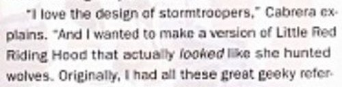

## scan p.63 (scan page 63)

Page contents: Cabrera cont.: Deckard's gun from Blade Runner; Tusken Raider installation "The Cost of Fun Is Going Up" (2006) about oil prices and toy costs (hand-read)

## scan p.64 (scan page 64)

Page contents: Cabrera cont.: reactions to the 6'5" Tusken; Star Wars fans and DIY costuming; childhood action-figure sets and behind-the-scenes footage; "The Cost of Fun Is Going Up" photos (hand-read)

## scan p.65 (scan page 65)

Page contents: Cabrera cont.: Fangoria/Gorezone influences; career in comics (Image, Marvel, DC) and TV (Fox Kids, Discovery Kids, Cartoon Network, Disney, Jim Henson Company creature shop); installation art; Tusken pull quote (hand-read)

## scan p.66 (scan page 66)

Page contents: Best of Hyperspace (Bonnie Burton and Pablo Hidalgo): "Star Wars Goes to School": AudioCast of the 1978 educational filmstrip (Pete Vilmur), worksheets; Random House "Attack on Reading" workbooks with covers by John Berkey and Tom Chantrell (hand-read)

## scan p.67 (scan page 67)

Page contents: Best of Hyperspace cont.: "Visits to Rancho Obi-Wan" video series with Steve Sansweet (about 30 topics; fan-made items his favorites) (hand-read)

## scan p.68 (scan page 68)

Page contents: Best of Hyperspace cont.: Star Wars Blogs (VIP blogs incl. Aaron Allston); member blog excerpts (handles omitted) quoting Chuck Klosterman and on director Ken Annakin as the source of "Anakin"; Galactic Gallery: Terryl Whitlatch Jar Jar color study, Alex Jaeger Jedi starfighter paint scheme, Ralph McQuarrie Hoth painting (hand-read)

- **Luke Skywalker; Han Solo** — entry/section: Klosterman on Luke and Han: ""Studied objectively, Luke Skywalker was not very cool. But for kids who saw Empire, Luke was the Man. He was the guy we wanted to be. Retrospectively, we'd like to claim Han Solo was the single most desirable character—and he was, in theory." —Chuck Klosterman, quoted in Star Wars Insider 90, p. 68" Source: *Star Wars Insider #90* (2006), scan p.68
  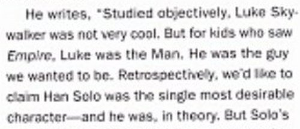

## scan p.69 (scan page 69)

Page contents: Galactic Gallery cont.: McQuarrie painting of Colin Cantwell's conceptual Y-wing with bubble-dome turret; Iain McCaig Mustafar lava monster; early storyboard of prototype Leia and Chewbacca; Ryan Church octuptarra precursor; Joe Johnston wampa explorations (hand-read)

## scan p.70 (scan page 70)

Page contents: Bantha Tracks Vol. 21 (Mary Franklin): "Making Tracks in the Summertime!": fan costuming at Bay to Breakers and a Fourth of July parade (fan names omitted) (hand-read)

## scan p.71 (scan page 71)

Page contents: Bantha Tracks cont.: Star Wars Weekends at Disney-MGM, convention costumes, Science Meets Imagination exhibit in Columbus, fourth annual Fan Club breakfast at Comic-Con (fan names omitted) (hand-read)

## scan p.72 (scan page 72)

Page contents: Bantha Tracks cont.: Comic-Con Fan Club breakfast, Randy Martinez drawing class; "The Way We Were...And Are" reader photos (names omitted) (hand-read)

## scan p.73 (scan page 73)

Page contents: Bantha Tracks: "Star Wars in the Mail": reader-decorated envelopes (names omitted) (hand-read)

## scan p.74 (scan page 74)

Page contents: Bantha Tracks Art Galaxy: member drawing of the varactyl Boga (artist omitted) (hand-read)

### Stat block notes (game mechanics, not feats)

- Boga caption: Studies of Boga, the loyal and intelligent lizard mount ridden by Obi-Wan Kenobi on Utapau (Star Wars Insider 90, p. 74) (Source: *Star Wars Insider #90* (2006), scan p.74)

## scan p.75 (scan page 75)

Page contents: Bantha Tracks Editorial "It's Just a Movie" (Mary Franklin): Comic-Con Spectacular, SIGGRAPH, Rose Parade with 200+ 501st marchers planned, Celebration IV moved to Los Angeles Convention Center, Kyle Newman's Fanboys sneak peek; Tracking Ahead Halloween photo call; submission guidelines (reader names omitted) (hand-read)

## scan p.76 (scan page 76)

Page contents: Ad: Hyperspace, The Official Star Wars Fan Club ($39.95) (hand-read)

## scan p.77 (scan page 77)

Page contents: StarWarsShop #14 "Tosche Station": Boba Fett Deluxe Timepiece by GSX Japan (500 pieces) (hand-read)

## scan p.78 (scan page 78)

Page contents: StarWarsShop Collector's Picks by Darren Lee Phillipson (Lucas Licensing): Gentle Giant rancor statue, LEGO Jabba's Sail Barge, Force Action lightsaber, Kotobukiya R2-D2 and C-3PO, AT-AT T-shirt (hand-read)

## scan p.79 (scan page 79)

Page contents: StarWarsShop What's New: clone trooper Bust-Ups, Gamorrean Guard Attakus statue, Vader spring-action lightsaber, Obi-Wan in clone trooper armor statue, Episode III tin (hand-read)

## scan p.80 (scan page 80)

Page contents: StarWarsShop: A Star Wars Halloween costumes (Maul mask, Yoda pet costume, Palpatine, Chewbacca, X-wing helmet) (hand-read)

## scan p.81 (scan page 81)

Page contents: StarWarsShop: Celebrate the Trilogy (coasters, Boba Fett vinyl, DVD trilogy, LEGO Star Wars II, Hugh Fleming iPod case) (hand-read)

## scan p.82 (scan page 82)

Page contents: StarWarsShop: More Must Haves (Vader hockey jersey, Yoda bobble head, Clone Commander Bly, Padmé lenticular poster) (hand-read)

## scan p.83 (scan page 83)

Page contents: Ad: Entertainment Earth Kir Kanos & Carnor Jax comic 2-pack (Hasbro) (hand-read)

## scan p.84 (scan page 84)

Page contents: Ad: Star Wars Miniatures Bounty Hunters (Wizards of the Coast) (hand-read)

