# Owner Material 038 — Star Wars Insider #1–153 plus specials (with The Lucasfilm Fan Club Magazine #1–22): Star Wars Insider #91 (2007)

- **Source:** *Star Wars Insider* magazine (issues 23–153, 1994–2014) and its predecessor *The Lucasfilm Fan Club Magazine* (issues 1–22, 1987–1994), plus seven special editions: articles, interviews, comics and short fiction Secondary source (licensed Legends reference). Scan OCR'd on the box; the scan stays box-only and is **not** published.
- **Method:** every scanned page was OCR'd and machine-screened sentence by sentence for power-relevant statements (fights, kills, defeats, Force feats, rankings, superweapons) that name a character on our roster; each kept sentence is quoted verbatim from the OCR text and has a crop of the printed passage directly under it. Pages with nothing power-relevant are still listed with what is on them.
- **Citation:** "*Star Wars Insider #91* (2007), p.X" by printed page ("scan p.X" where no printed number applies). **Weight:** Licensed magazine: a secondary source. Its short fiction and comics are Legends stories; its articles and interviews sum up or discuss lore and rank below the novels, comics and games they describe.

## scan p.1 (scan page 1)

Page contents: Cover, Issue 91, Jan/Feb 2007, Star Wars 30th Anniversary 1st of 6 commemorative issues; Collector's Vader Cover #2 of 2; Vader Speaks! exclusive interview with David Prowse; Star Wars TV Series; A New Hope Recovered: never-before-seen storyboards from the Lucasfilm Archives; Hell Raiser: Brian Gernand on building Mustafar; Marvel Star Wars; Timothy Zahn exclusive interview on Allegiance (hand-read)

## scan p.2 (scan page 2)

Page contents: Contents: features (The Man Behind the Mask by Cesar G. Soriano; Guilty by Association: Early Star Wars Bootleg Merchandise by Pete Vilmur; Pirates of the Boards by J. W. Rinzler, first of a six-part Joe Johnston storyboard series; Hell Raising: The Models of Revenge of the Sith Part II by Frank Parisi; Comic Marvels by Jason Fry) and departments; StarWarsShop LEGO Vader and stormtrooper maquettes note (hand-read)

## scan p.3 (scan page 3)

Page contents: Ad: DK The Complete Visual Dictionary (available now) and You Can Draw Star Wars (coming January 2007, by Bonnie Burton, illustrated by Matt Busch and Tom Hodges) (hand-read)

## scan p.4 (scan page 4)

Page contents: Letter from the Editor "30 Years of Star Wars: The Film, The Fans, & The Force", guest-written by the president of the Official Star Wars Fan Club (name omitted): 30th Anniversary plans (Celebration IV in Los Angeles Memorial Day weekend, Celebration Europe, Tournament of Roses Parade January 1 in Pasadena); IDG/Lucasfilm masthead (hand-read)

## scan p.5 (scan page 5)

Page contents: Ad: Coolwaters Productions movie posters signed by Harrison Ford (proceeds to Conservation International) (hand-read)

## scan p.6 (scan page 6)

Page contents: Comlink letters "Star Wars Is Everywhere!" (letter-writers omitted): women of Star Wars issue promised; staff sightings of Star Wars around the office (Chenda Ngak, Michele Nelson, George Hu); Tempest cover by Jason Felix; Questions About Star Wars to Keep You Awake at Night (hand-read)

## scan p.7 (scan page 7)

Page contents: Ad: Brian's Toys (hand-read)

## scan p.8 (scan page 8)

Page contents: Skywalking: Lucas Talks Star Wars TV (MTV interview): animated Clone Wars series set between Episodes II and III, 3-D animation, 2008; live-action series set between Revenge of the Sith and A New Hope, minor characters, not about the Skywalkers; Lucasfilm Foundation $175 million donation to USC School of Cinematic Arts ($75 million to buildings, $100 million endowment); Lucas named Grand Marshal of the 2007 Tournament of Roses (Paul L. Holman quotes; 501st and Ewok participants) (hand-read)

- **none** — entry/section: Lucas on Star Wars' influence: ""Star Wars was really designed to make people think outside the box, to make people use their imagination and think anything is possible. And it does that." —George Lucas, Star Wars Insider 91, p. 8" Source: *Star Wars Insider #91* (2007), scan p.8
  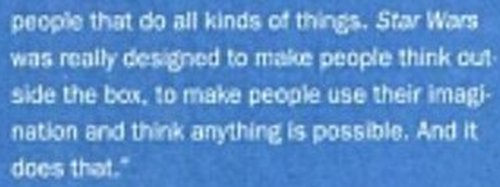

### Stat block notes (game mechanics, not feats)

- Live-action series has no Skywalker story: "None of the Skywalker story, none of that stuff is in there," Lucas explained. "It's completely different. The animated series has got all the characters in it. The one that comes after, the live-action one, is with people who were in Star Wars, but they're not the main characters." (Star Wars Insider 91, p. 8) (Source: *Star Wars Insider #91* (2007), scan p.8)

## scan p.9 (scan page 9)

Page contents: Ad: Brian's Toys (Christmas reductions; Master Replicas FX lightsabers) (hand-read)

## scan p.10 (scan page 10)

Page contents: Skywalking: Refresher Reading "20 Things You Don't Know About the Mos Eisley Cantina" by Pablo Hidalgo (EU and Behind the Scenes legend): Chalmun's Cantina at 3112 Outer Kerner Way; Cedo Partu's blockhouse; the Prophetess; Wuher and Ackmena; Tork the bouncer; "double-c"/"ceecee"; max occupancy 102; Fabritech EPT-212 droid detector; holographic sports screen; Tatooine Manhunt (1988); Tunisia exteriors at Jerba April 2-3, 1976; false door; Dr. David West Reynolds found the real door (now at Rancho Obi-Wan); Stage 6 Elstree April 13-21, 1976; 17 contract performers and 41-44 extras; female performers in alien roles (hand-read)

### Stat block notes (game mechanics, not feats)

- Chalmun's Cantina address: Chalmun's Cantina is located at 3112 Outer Kerner Way, Mos Eisley, just before the street splits into Kerner Plaza and Inner Curved Street. (Star Wars Insider 91, p. 10) (Source: *Star Wars Insider #91* (2007), scan p.10)
- Cantina bartenders: Wuher tends bar during the day, Ackmena during the night. The patrons prefer Ackmena for she has actual personality, but just in case, she's backed by Tork the bouncer. (Star Wars Insider 91, p. 10) (Source: *Star Wars Insider #91* (2007), scan p.10)
- Wuher and the Prophetess: The Prophetess, a shyster fortuneteller working the back alleys, claimed that the bartender, Wuher, was the reincarnated soul of Cedo Partu. (Star Wars Insider 91, p. 10) (Source: *Star Wars Insider #91* (2007), scan p.10)
- Cantina occupancy: Maximum occupancy is 102 humanoids, though there has never been any record of anyone enforcing it. (Star Wars Insider 91, p. 10) (Source: *Star Wars Insider #91* (2007), scan p.10)
- Women played cantina aliens: Many of the aliens that have been identified by the expanded universe as males were in fact played by women, including Lak Sivrak, Nabrun Leids, Thuku, and sometimes Greedo. (Star Wars Insider 91, p. 10) (Source: *Star Wars Insider #91* (2007), scan p.10)

## scan p.11 (scan page 11)

Page contents: Ad: Brian's Toys vintage Star Wars (AFA graded carded figures) (hand-read)

## scan p.12 (scan page 12)

Page contents: Skywalking: Expanded Universe, Meet the Paparazzi by Chenda Ngak (Worth1000.com Celebrity Star Wars Photoshop contest; winner Mr. Toda/Yoda); Found on Flickr: Epic Battle on Washington Road, Mt. Lebanon Halloween Parade (photographer credit omitted); IDG reader survey with $250 Best Buy gift certificate "GGGRRRRLLOOWWGGG*" (hand-read)

## scan p.13 (scan page 13)

Page contents: Ad: Brian's Toys / Master Replicas / AFA (hand-read)

## scan p.14 (scan page 14)

Page contents: Image: Darth Vader with lightsaber (opening art, The Man Behind the Mask) (hand-read)

## scan p.15 (scan page 15)

Page contents: Feature: The Man Behind the Mask by Cesar G. Soriano, David Prowse reflects on 30 years living in Darth Vader's dark side: offered Vader or Chewbacca; AFI ranked Vader Hollywood's third most evil villain behind Hannibal Lecter and Norman Bates; USA TODAY online poll top villain (hand-read)

## scan p.16 (scan page 16)

Page contents: Feature: The Man Behind the Mask cont.: Vader the cult figure of the first trilogy; Prowse's A Clockwork Orange role led to meeting Lucas; photos (Vader and Leia) (hand-read)

- **Darth Vader (Anakin Skywalker)** — entry/section: Prowse on Vader's villainy: ""Darth Vader was this terrible villain who wreaked death and destruction everywhere he went. He became the cult figure of the entire first trilogy. Here we are 30 years later and I'm still riding on the back of Star Wars." —David Prowse, Star Wars Insider 91, p. 16" Source: *Star Wars Insider #91* (2007), scan p.16
  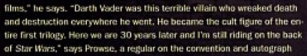

## scan p.17 (scan page 17)

Page contents: Feature: The Man Behind the Mask cont.: meeting Lucas ("good enough for Stanley Kubrick"); John Mollo costume fitting; mask fogging; carbon-freezing set at 130 degrees, Ugnaughts led him by hand; photos (hand-read)

- **Darth Vader (Anakin Skywalker)** — entry/section: Mask fogged: ""So they padded the mask with rubber so it would fit flush with my face. But once it was fitted, the heat from my costume rose up into the mask and fogged up the eyepiece so I couldn't see where I was going. I could only wear it for about two minutes." —David Prowse, Star Wars Insider 91, p. 17" Source: *Star Wars Insider #91* (2007), scan p.17
  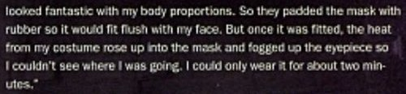
- **Darth Vader (Anakin Skywalker)** — entry/section: Carbon-freezing set: ""Because the carbon freezing set was about 130 degrees with heat and steam. I remember getting as far as walking down the stairs before my eyepiece misted up. I had no idea where I was so the Ugnaughts had to lead me by hand!" —David Prowse, Star Wars Insider 91, p. 17" Source: *Star Wars Insider #91* (2007), scan p.17
  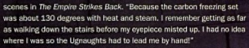

## scan p.18 (scan page 18)

Page contents: Feature: The Man Behind the Mask cont.: rehearsing the fight with Sir Alec Guinness; dialogue overdubbed by James Earl Jones; first saw the film in July 1977; Green Cross Code Man; other Vader performers (stuntman Bob Anderson, Sebastian Shaw, Hayden Christensen); autobiography "Straight from the Force's Mouth"; Celebration Europe July 13-15 (hand-read)

- **Darth Vader (Anakin Skywalker); Obi-Wan Kenobi** — entry/section: Rehearsing with Guinness: ""When I wasn't working, I would sit around with Sir Alec Guinness, who was always pleasant. We would go find a quiet studio and practice our fight scene, just running through the movements until we perfected it." —David Prowse, Star Wars Insider 91, p. 18" Source: *Star Wars Insider #91* (2007), scan p.18
  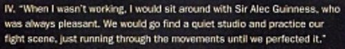
- **Darth Vader (Anakin Skywalker)** — entry/section: Losing the voice: ""I lost out to James Earl Jones who, mind you, was absolutely wonderful." —David Prowse, Star Wars Insider 91, p. 18" Source: *Star Wars Insider #91* (2007), scan p.18
  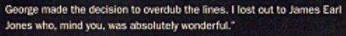
- **none** — entry/section: Prowse on Star Wars: ""Star Wars was such a special movie. It was the forerunner of all other space movies since, the ultimate story of good triumphing over evil. It's a fairy tale set in this fantastic space setting." —David Prowse, Star Wars Insider 91, p. 18" Source: *Star Wars Insider #91* (2007), scan p.18
  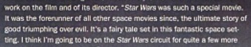

## scan p.19 (scan page 19)

Page contents: Image: Darth Vader with stormtroopers; pull quote "Darth Vader was this terrible villain who wreaked death and destruction everywhere he went" —David Prowse (hand-read)

## scan p.20 (scan page 20)

Page contents: Jedi Library: Questions of Allegiance by Jason Fry: Timothy Zahn's Allegiance (Del Rey, February, $25.95) set between A New Hope and The Empire Strikes Back; Han, Luke, Chewie, Leia; Captain Ozzel; deserting stormtroopers (Hand of Judgment); Mara Jade as the Emperor's Hand (hand-read)

## scan p.21 (scan page 21)

Page contents: Jedi Library cont.: Zahn on plotting; Mara's Force strength from Palpatine; loyalty later transferred to Talon Karrde, the New Republic and Luke; 30th Anniversary Fact card (novelization ghostwritten by Alan Dean Foster, Chewbacca's medal); Upcoming Star Wars Books list; You Can Draw Star Wars ad (hand-read)

- **Mara Jade Skywalker; Palpatine (Darth Sidious)** — entry/section: Mara's power from Palpatine: ""Much of her Force strength at this age is a result of her link with Palpatine; she's essentially drawing on his own strength, though without any of the Sith philosophy and mindset. That's why, after his death, her powers rapidly decline and go almost dormant for the five-year period between Return of the Jedi and Heir to the Empire." —Timothy Zahn, Star Wars Insider 91, p. 21" Source: *Star Wars Insider #91* (2007), scan p.21
  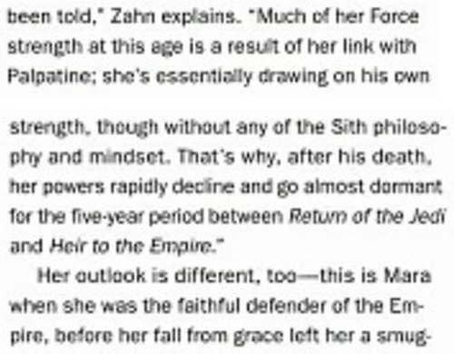
- **Mara Jade Skywalker; Talon Karrde; Luke Skywalker** — entry/section: Mara's loyalty: ""Her strong sense of loyalty will later be transferred to Talon Karrde, then to the New Republic, and finally to Luke." —Timothy Zahn, Star Wars Insider 91, p. 21" Source: *Star Wars Insider #91* (2007), scan p.21
  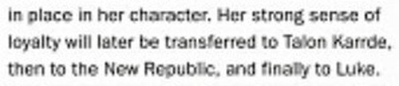

### Stat block notes (game mechanics, not feats)

- Novelization medal: The first Star Wars book ever was the novelization of the first film back when it was known simply as Star Wars and not A New Hope. Ghostwritten by Alan Dean Foster off of George Lucas' script, the novelization is notable for containing scenes excised from the final film and even one-ups the film in the fact that Chewbacca is rewarded with a medal after the Battle of Yavin. (Star Wars Insider 91, p. 21) (Source: *Star Wars Insider #91* (2007), scan p.21)

## scan p.22 (scan page 22)

Page contents: Drawn by the Force: Don't Tell Yoda by Daniel Wallace, Knights of the Old Republic #13 "Days of Fear"/"Nights of Anger"/"Days of Suffering" arc (John Jackson Miller; Brian Ching, Dustin Weaver, Michael Atiyeh): Zayne Carrick, Padawans slaughtered by his Master and Jedi prognosticators; cover art by Brian Ching and Michael Atiyeh (hand-read)

## scan p.23 (scan page 23)

Page contents: Ad: Hyperspace, The Official Star Wars Fan Club ($39.95; VIP treatment at Celebration IV) (hand-read)

## scan p.24 (scan page 24)

Page contents: Jabba's Collection: Heavy Metal: Attakus metal collection figures (Darth Vader, Obi-Wan Kenobi, C-3PO, R2-D2, stormtrooper variants; 2,500 pieces; $90-$115) and dioramas (Millennium Falcon $2,589, Death Star Hall $825, both $3,200; 400 pieces); Attakus resin statues (Oola 14.9 inches $375, sandtrooper 15.7 inches $389, Imperial probe droid 15.6 inches $459; 1,500 pieces) (hand-read)

## scan p.25 (scan page 25)

Page contents: Jabba's Collection: LEGO vehicle sets (AT-ST $19.99, Y-wing $39.99, General Grievous starfighter $19.99); LEGO battle packs (Droids, Clone Troopers, $9.99); Gentle Giant statues (Han Solo on tauntaun, 3,000 pieces, $189, March; Princess Leia as Jabba's slave, April, $180) (hand-read)

## scan p.26 (scan page 26)

Page contents: Jabba's Collection: Gentle Giant animated maquettes (C-3PO, Luke Skywalker, stormtrooper; 8 inches, $80); Medicom Yoda VCD via Sideshow ($59.99); 30th Anniversary Fact: The Early Bird Certificate Package; web links (hand-read)

### Stat block notes (game mechanics, not feats)

- Early Bird Certificate Package: Christmas, 1977. Failing to anticipate Star Wars' massive popularity, Kenner fumbled the ball by not producing Star Wars action figures in time for the holidays. Instead they sold pieces of cardboard. (Star Wars Insider 91, p. 26) (Source: *Star Wars Insider #91* (2007), scan p.26)

## scan p.27 (scan page 27)

Page contents: Jabba's Collection: Sideshow life-sized Yoda bust ($549.99); Medicom 12-inch Real Action Hero clone trooper (1,000 pieces, $149.99); Gentle Giant mini-busts (Obi-Wan Kenobi, Luke Skywalker Jedi Knight, Jango Fett, Zuckuss; $50) (hand-read)

### Stat block notes (game mechanics, not feats)

- Mini-bust copy: He's been called everything from the Negotiator to a crazy old hermit. The lynchpin character of the Star Wars saga, Obi-Wan Kenobi, strikes a pensive pose in this mini-bust from Gentle Giant. (Star Wars Insider 91, p. 27) (Source: *Star Wars Insider #91* (2007), scan p.27)

## scan p.28 (scan page 28)

Page contents: Feature: Guilty by Association, Early Star Wars Bootleg Merchandise by Pete Vilmur (opening spread: Force Beam ad, Star Wars poster, Star Fleet Spring 1978) (hand-read)

## scan p.29 (scan page 29)

Page contents: Feature: Guilty by Association cont.: "Bootleg" defined vs. "unlicensed"; fanzine Forbidden Worlds of Fantasy no. 2 "Star Warriors" portfolio (artist omitted); cartoon artwork (hand-read)

## scan p.30 (scan page 30)

Page contents: Feature: Guilty by Association cont.: Filling the Void (unlicensed merchandise after May 25, 1977; Star Trek convention dealers; FBI raiding conventions as early as August 1977, "'Star Wars' heroes find FBI agents profitable allies" clipping); Buttons, Bobbles, & Bumper Stickers ("Wookies Need Love Too!", "I Brake for R-2's", prismatic stickers) (hand-read)

## scan p.31 (scan page 31)

Page contents: Feature: Guilty by Association cont.: "The Light Sabre" bootleg ad ($75.00); The Image Factory and Factors Etc. licensing; Kenner's inflatable "Force Beam" lightsaber; Belt Buckles (line-art droid and Lord Vader buckles; block-letter buckles attributed to Baron Buckles) (hand-read)

## scan p.32 (scan page 32)

Page contents: Feature: Guilty by Association cont.: catalog sellers (Star Trek Galore and others); Unusual Suspects; Posters, Prints, & Portfolios (an amateur artist, name omitted; signed portfolios by William Jungkuntz and Gene Day) (hand-read)

## scan p.33 (scan page 33)

Page contents: Feature: Guilty by Association cont.: Fanzines (Skywalker, Mos Eisley Tribune; 1977-1979; Official Star Wars Fan Club's Bantha Tracks); unlicensed button sheet (hand-read)

## scan p.34 (scan page 34)

Page contents: Set Piece: X-wing Starfighter, Running the Trench by Chris Trevas: three full-size X-wings; cockpit set on Stage 8 of Elstree in June and July 1976; explosive squibs; amber-tinted visors; Drewe Henley as Red Leader in sandals; S-foil continuity error; Death Star model about 3 feet in diameter painted by Ralph McQuarrie and David Jones; Graflite flashgun; "Blue Squadron" renamed because of bluescreen (hand-read)

- **Jek Tono Porkins** — entry/section: Hootkins on the squibs: ""I really wasn't worried about it until the funnels of two big fire extinguishers appeared right next to the camera. I thought, what do these guys know that I don't?" —William Hootkins (recalled from Star Wars Insider #32), Star Wars Insider 91, p. 34" Source: *Star Wars Insider #91* (2007), scan p.34
  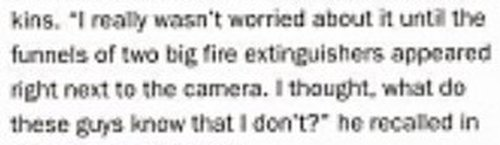

### Stat block notes (game mechanics, not feats)

- Red Leader in sandals: Drewe Henley filmed his scenes as Red Leader wearing sandals. (Star Wars Insider 91, p. 34) (Source: *Star Wars Insider #91* (2007), scan p.34)
- Blue Squadron became Red: In the original screenplay Luke flew with "Blue Squadron," but the flight group's color changed because it was not possible to have blue markings on models filmed in front of a bluescreen. (Star Wars Insider 91, p. 34) (Source: *Star Wars Insider #91* (2007), scan p.34)

## scan p.35 (scan page 35)

Page contents: Set Piece cont.: astromech heads swapped per pilot (Red Leader's red R5 unit); "Chewie" Antilles early-draft fact; Rebel pilot helmets from US Navy APH-6B flight helmet; mistuned short-wave radio for transmissions; 1950s Vickers Viscount 700 airliner lamp used as holoprojectors; red wing stripes denote call sign (Red Five) (hand-read)

### Stat block notes (game mechanics, not feats)

- Early-draft Wedge: In early drafts of Star Wars, Wedge Antilles was a young human pilot named "Chewie" Antilles. In that version of the story Chewie died during the space battle. (Star Wars Insider 91, p. 35) (Source: *Star Wars Insider #91* (2007), scan p.35)
- Call-sign stripes: Each X-wing starfighter bears a number of red stripes on the wings that denote the pilot's call sign number. With five stripes Luke Skywalker was known as Red Five. Red Leader had one stripe per wing. (Star Wars Insider 91, p. 35) (Source: *Star Wars Insider #91* (2007), scan p.35)

## scan p.36 (scan page 36)

Page contents: Ask the Master Q&A by Pablo Hidalgo "What Ever Happened to HoloNet News?" (questioners omitted): HNN written by Pablo Hidalgo with Paul Ens, ran February-May 2002 in real time to the May 16 release, pulled "for security reasons"; archives online; Gungans on kaadu are messengers (no comlinks); "Meesa so outta here!" art (hand-read)

## scan p.37 (scan page 37)

Page contents: Ask the Master cont.: why Anakin's spirit wears Sebastian Shaw's tunic; how the Death Star travels from Alderaan to Yavin (hyperdrive; Admiral Motti; issue #88 astrogation) (hand-read)

### Stat block notes (game mechanics, not feats)

- Christensen head on Shaw's body: When George Lucas replaced Shaw's likeness at the end of Jedi, he had ILM compositors place Hayden Christensen's head atop Shaw's body. So, what you're seeing is actually a digital amalgam of two actors. (Star Wars Insider 91, p. 37) (Source: *Star Wars Insider #91* (2007), scan p.37)

## scan p.38 (scan page 38)

Page contents: Feature: Pirates of the Boards by J. W. Rinzler, Exclusive Series Part 1 of 6: about 40 of 366 early Joe Johnston storyboards (with Alex Tavoularis boards), working copies with Richard Edlund's penciled notes; Han's original pirate ship by Colin Cantwell; Alderaan still in the third and fourth drafts; Mos Eisley Escape; Jump to Hyperspace (hand-read)

### Stat block notes (game mechanics, not feats)

- Pirate ship before the Falcon: The storyboards are also remarkable in that they show Han Solo's original pirate ship, designed by concept sculptor Colin Cantwell, which was about to be replaced by a redesigned ship, aka the "hamburger" ship, aka the Millennium Falcon. (Star Wars Insider 91, p. 38) (Source: *Star Wars Insider #91* (2007), scan p.38)

## scan p.39 (scan page 39)

Page contents: Pirates of the Boards cont.: Alderaan Sequence boards 19-25 (ship drifting toward gaseous Alderaan; Imperial fighters) (hand-read)

## scan p.40 (scan page 40)

Page contents: Pirates of the Boards cont.: boarding vessel attaches; hangar bay; gantry officer; boards 26-33 (hand-read)

## scan p.41 (scan page 41)

Page contents: Pirates of the Boards cont.: Escape from Alderaan boards 28, 29, 34 (ship backing out); "Stay tuned" note (hand-read)

## scan p.42 (scan page 42)

Page contents: Scouting the Galaxy by Steve Sansweet "Where's the Star Wars Stuff? Everywhere!" (questioners omitted): merchandise resurgence; QVC Star Wars Collectibles shows (co-host of some 27 between 1995 and 1999), HSN; unlicensed latex Salacious Crumb (original by an Australian professional propmaker for Force 1 in Melbourne) (hand-read)

## scan p.43 (scan page 43)

Page contents: Scouting the Galaxy cont.: Frito-Lay inflatable Podracer display ($35-$50); Topps cards (at least 40 U.S. sets); Salacious Crumb photo; card images (hand-read)

## scan p.44 (scan page 44)

Page contents: Scouting the Galaxy cont.: wish list (space slug, Sarlacc, dejarik table, in-scale Yoda puppet); AFA grading question; cartoon art (hand-read)

## scan p.45 (scan page 45)

Page contents: Scouting the Galaxy cont.: The Star Wars Storybook (Random House, 1978) photo showing C-3PO's human hand (Anthony Daniels missing his hand covering); AFA grading costs ($17-$65) at toygrader.com (hand-read)

## scan p.46 (scan page 46)

Page contents: Star Wars International: Tokyo Treasures by Gus Lopez: Sankyo Star Wars pachinko; Takara claw-machine plush (R2-D2, Chewie, Luke, Vader, C-3PO) in the mid 1990s (hand-read)

## scan p.47 (scan page 47)

Page contents: Star Wars International cont.: Tokyo shop Star Cases (collector-guide and owner names omitted); Sakura C-3PO and R2-D2 bento box; Coca Cola bottle caps (50 images); Pepsi/Suntory figural caps and life-size R2-D2 Pepsi vending machine (hand-read)

## scan p.48 (scan page 48)

Page contents: Feature: Hell Raising, The Models of Revenge of the Sith Part II by Frank Parisi, photos by Ryan Church: Brian Gernand on Mustafar; 1:134 scale set 36 feet long, 25 feet wide, about 25 feet tall; John Bunyan pull quote (hand-read)

## scan p.49 (scan page 49)

Page contents: Hell Raising cont.: Lucas's verbal brief; John Knoll challenge; video tests with Danny Wagner; set photo (hand-read)

- **none** — entry/section: Lucas's brief for Mustafar: ""This is a really hard, harsh, nasty environment, a really gnarly space that was uninhabitable, all black rock with aggressive lava—not meandering, like a trickle—this lava wants to eat you." —George Lucas (as recalled by Brian Gernand), Star Wars Insider 91, p. 49" Source: *Star Wars Insider #91* (2007), scan p.49
  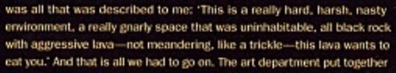

## scan p.50 (scan page 50)

Page contents: Hell Raising cont.: lava footage study; Ron Fricke shot Mount Etna; methylcel lava (over 10,000 gallons) (hand-read)

- **none** — entry/section: Methylcel lava: ""It's what we call methylcel, a powder that is added to water. It is an additive used in a lot of different food products as a thickener; it's the stuff that makes your ketchup thick and that thickens milkshakes at bad fast food restaurants. We ended up using over 10,000 gallons of the material to do the lava river." —Brian Gernand, Star Wars Insider 91, p. 50" Source: *Star Wars Insider #91* (2007), scan p.50
  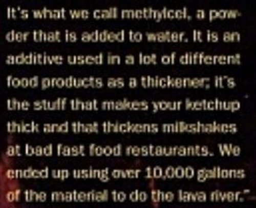

## scan p.51 (scan page 51)

Page contents: Hell Raising cont.: lava river on a one-inch Lexan bottom, 1,000-gallon delivery, bright yellow tint, crowning/dipping; vacuum-formed bumps for eddies (hand-read)

## scan p.52 (scan page 52)

Page contents: Hell Raising cont.: ground cork crust with binder; 20K lights with orange gels; recirculation and microorganisms eating the methylcel (hand-read)

## scan p.53 (scan page 53)

Page contents: Hell Raising cont.: longest miniature shoot in ILM history (six days a week, 12 to 14 hours per day); Gernand portrait ("Brian Gernand, head of ILM's model shop for Revenge of the Sith") (hand-read)

- **none** — entry/section: Longest miniature shoot: ""It was a very difficult shoot. It ended up being the longest miniature shoot in ILM history." —Brian Gernand, Star Wars Insider 91, p. 53" Source: *Star Wars Insider #91* (2007), scan p.53
  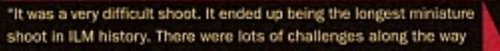

## scan p.54 (scan page 54)

Page contents: Feature: Comic Marvels by Jason Fry, opening art "Dark Lord's Gambit!" (Marvel's legacy includes some of the EU's greatest moments and some of its goofiest) (hand-read)

## scan p.55 (scan page 55)

Page contents: Comic Marvels cont.: 150-plus stories over 107 issues; Our Heroes: Luke (Jedi Apprentice), Leia (Rebel Princess), Han (Reluctant Rebel), Chewbacca (Wookiee Warrior; Crimson Jack, the Wheel) (hand-read)

### Stat block notes (game mechanics, not feats)

- Escape from the Wheel: But the Wookiee has his moments, double-crossing the space pirate Crimson Jack and helping Han escape the Wheel—a space station—in what Han dubs "the most expensive escape known to sentient life." (Star Wars Insider 91, p. 55) (Source: *Star Wars Insider #91* (2007), scan p.55)

## scan p.56 (scan page 56)

Page contents: Comic Marvels cont.: Lando (Repaying a Debt; Drebble), C-3PO and R2-D2, Darth Vader and his quest; Allies: Shira Brie (issue 56), Fenn Shysa (issue 68), Plif (issue 55), Dani (issue 71), Bey (issue 99) (hand-read)

### Stat block notes (game mechanics, not feats)

- Fenn Shysa: On Mandalore, Leia and C-3PO encountered a familiar figure wearing battered armor and a jetpack. But this wasn't Boba Fett—it was Fenn Shysa, another of the famed Mandalorian commandos, and no friend to the fearsome bounty hunter. (Star Wars Insider 91, p. 56) (Source: *Star Wars Insider #91* (2007), scan p.56)

## scan p.57 (scan page 57)

Page contents: Comic Marvels cont.: Enemies: Baron Tagge (issue 25), Admiral Giel (issue 60), Crimson Jack (issue 7), Valance (issue 16); Oddities: Don-Wan Kihotay (issue 8), Jaxxon (issue 8), the Hiromi (issue 94), Reist (Marvel UK Weekly 149) (hand-read)

### Stat block notes (game mechanics, not feats)

- Baron Tagge: But his greatest ambition was to kill Darth Vader, who had blinded the baron with a lightsaber, obliging him to rely on cybernetic vision. Tagge vowed that he'd defeat Vader with his own weapon; despite not being Force-sensitive, he trained himself to wield a lightsaber with remarkable skill. (Star Wars Insider 91, p. 57) (Source: *Star Wars Insider #91* (2007), scan p.57)
- Valance's secret: Renowned for his visceral hatred of droids, the bounty hunter Valance's obsession was the product of a terrible secret: Half his body was mechanical parts. (Star Wars Insider 91, p. 57) (Source: *Star Wars Insider #91* (2007), scan p.57)
- Jaxxon: A six-foot green Lepus carnivorous who spouted Bugs Bunnyesque one-liners, Jaxxon is Marvel's most-infamous addition to the Expanded Universe. (Star Wars Insider 91, p. 57) (Source: *Star Wars Insider #91* (2007), scan p.57)

## scan p.58 (scan page 58)

Page contents: Comic Marvels cont.: Great Tales 1-5: Dark Encounter (issue 29), Thunder in the Stars! (issue 34), Screams in the Void (issue 61, David Michelinie and Walter Simonson), The Third Law (issue 48, Larry Hama), The Last Jedi! (issue 49, Mike W. Barr) (hand-read)

## scan p.59 (scan page 59)

Page contents: Comic Marvels cont.: Great Tales 6-10: The Stenax Shuffle (issue 70, Jo Duffy), Supply and Demand (issue 95, Archie Goodwin's final tale with Han and Nien Nunb), Ellie (issue 80), To the Last Gladiator! (issue 22), Shadeshine! (Annual #2, David Michelinie) (hand-read)

## scan p.60 (scan page 60)

Page contents: Comic Marvels cont.: Strange Tales 1-5: The Last Gift from Alderaan! (issue 53), Serphidian Eyes (issue 64), Chanteuse of the Stars... (issue 77, Hoojibs, Kabray, Zeltrons), I'll See You in the Throne Room! (issue 89, Solay, Blackhole), Small Wars (issue 94, Lahsbees vs. Ewoks) (hand-read)

## scan p.61 (scan page 61)

Page contents: Comic Marvels cont.: Anticipation: The Tarkin (issue 51), Always Look for the Body (issue 81, "Jawas of Doom", Boba Fett escapes the Sarlacc), Threats from Beyond (issue 96, the Nagai and the Tofs), A Redhead with a Past (issue 56, Shira Brie; Domina Tagge), Brainstorming a Title! (issue 18, "The Empire Strikes!") (hand-read)

### Stat block notes (game mechanics, not feats)

- The Tarkin superweapon: Before a new Death Star took shape in Return of the Jedi, Marvel unveiled the Tarkin, which mounted the Death Star's superlaser on the hull of a giant warship. (Star Wars Insider 91, p. 61) (Source: *Star Wars Insider #91* (2007), scan p.61)
- The Nagai: But the Ssi-Ruuk weren't the first extragalactic invaders—that honor goes to the Nagai, a sadistic species given an angular, anime-inspired look by artist Cynthia Martin and who were named after legendary manga artist, Go Nagai. (Star Wars Insider 91, p. 61) (Source: *Star Wars Insider #91* (2007), scan p.61)

## scan p.62 (scan page 62)

Page contents: Comic Marvels cont.: Continuity 101: Jabba! You've Lost Weight! (issue 2, Howard Chaykin; walrus-faced Jabba; issue 28), Count the Jedi (Annual 1, Chris Claremont; Majestrix of Skye; S'kytri), Won't Someone Please Think of the Children? (issue 68, Fenn Shysa and 211 Mandalorian supercommandos under chief officer Boba Fett) (hand-read)

### Stat block notes (game mechanics, not feats)

- Marvel's walrus Jabba: Marvel adapted the cut scene restored years later in the Special Edition, but Jabba was a walrus-faced biped reminiscent of an extra glimpsed briefly in Mos Eisley. (Star Wars Insider 91, p. 62) (Source: *Star Wars Insider #91* (2007), scan p.62)
- Fett as Mandalorian chief officer: Fenn Shysa tells Leia that he and 211 other Mandalorian supercommandos served the Emperor during the Clone Wars, their chief officer was Boba Fett, and briefing sessions on the Empire's enemies introduced Fenn to Leia's "comely features." (Star Wars Insider 91, p. 62) (Source: *Star Wars Insider #91* (2007), scan p.62)

## scan p.63 (scan page 63)

Page contents: Comic Marvels cont.: Corellians Are Always Guilty of Something (issue 37, new death mark on Han over Crimson Jack's cruiser), They All Look Alike in Flight Suits (issue 78, "Hoth Stuff!": Wedge's first non-movie appearance, Wes Janson killed); sidebar Classic Marvel Talent: Jo Duffy by Kurt Anthony Krug (wrote from issue 70; no Vader between ESB and ROTJ; created Dani, Lumiya, the Nagai; 107,000 copies monthly; cancelled for New Universe; 15 pages to wrap up) (hand-read)

- **none** — entry/section: Duffy on Vader: ""He either appeared as a hologram or as an artwork splash when someone mentioned him." —Jo Duffy, Star Wars Insider 91, p. 63" Source: *Star Wars Insider #91* (2007), scan p.63
  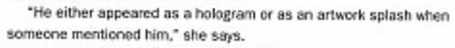
- **Han Solo; Luke Skywalker** — entry/section: Duffy on the near-rescue of Han: ""I got a warning—I was flattered." —Jo Duffy, Star Wars Insider 91, p. 63" Source: *Star Wars Insider #91* (2007), scan p.63
  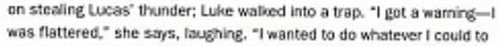
- **none** — entry/section: Duffy on canon: ""My work is gospel—that's all there is to it. Lucasfilm made me walk a very careful path within continuity." —Jo Duffy, Star Wars Insider 91, p. 63" Source: *Star Wars Insider #91* (2007), scan p.63
  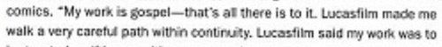

### Stat block notes (game mechanics, not feats)

- Vader off-limits to Marvel: According to Duffy, she couldn't use Darth Vader between The Empire Strikes Back and Return of the Jedi. (Star Wars Insider 91, p. 63) (Source: *Star Wars Insider #91* (2007), scan p.63)
- Duffy's creations: Duffy also created new characters, like Dani, Lumiya, and the Nagai. (Star Wars Insider 91, p. 63) (Source: *Star Wars Insider #91* (2007), scan p.63)
- End of the Marvel run: While Star Wars sold 107,000 copies monthly, Marvel cancelled the series to free up creators for its New Universe imprint. Duffy didn't know it was cancelled until halfway into number 107. (Star Wars Insider 91, p. 63) (Source: *Star Wars Insider #91* (2007), scan p.63)

## scan p.64 (scan page 64)

Page contents: Best of Hyperspace at StarWars.com by Bonnie Burton and Pablo Hidalgo: 1977 Star Wars Documentary Filmmakers; The Early Saga Chroniclers by Pete Vilmur: Peter Shillingford (Tunisia, no soundman; Tosche Station sequence) and Mike Dodds (first week at Elstree and Shepperton); footage aired September 1977; captions (Carrie Fisher still; Kenny Baker) (hand-read)

- **none** — entry/section: No budget for sound: ""Gary [Kurtz] said there was no budget. The original intent was to just do a voice-over." —Peter Shillingford, Star Wars Insider 91, p. 64" Source: *Star Wars Insider #91* (2007), scan p.64
  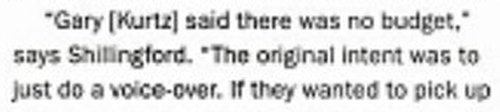

### Stat block notes (game mechanics, not feats)

- Documentary footage: On-set documentary filmmakers Peter Shillingford and Mike Dodds were on hand in 1976 to capture the shooting of Star Wars both in Tunisia and London, preserving for future generations the only real-time record of how the iconic Star Wars saga began. The footage they shot was aired in September, 1977. (Star Wars Insider 91, p. 64) (Source: *Star Wars Insider #91* (2007), scan p.64)

## scan p.65 (scan page 65)

Page contents: Best of Hyperspace cont.: Dodds interviews four major cast members incl. rare filmed responses from Sir Alec Guinness; given only 10 days, mid-June to late July 1976 undocumented; Shillingford PSA with Anthony Daniels and Kenny Baker; Best of Star Wars Blogs (VIP blogs: Michael Quinn, Daniel Logan, Don Bies, Aaron Allston); So You Want to Start Your Own Star Wars Book Club? (fan columnist handle omitted; Darth Bane: Path of Destruction cover) (hand-read)

### Stat block notes (game mechanics, not feats)

- Guinness on film: Dodds also managed to grab interviews with the four major cast members, including some extremely rare filmed responses from Sir Alec Guinness. (Star Wars Insider 91, p. 65) (Source: *Star Wars Insider #91* (2007), scan p.65)

## scan p.66 (scan page 66)

Page contents: Best of Hyperspace cont.: Secrets of Star Wars Next-Gen: first look at the next-gen game concept art (That's Gotta Hurt, Lost and Found, Wear and Tear, The Bigger They Are..., Greatly Exaggerated) (hand-read)

## scan p.67 (scan page 67)

Page contents: Galactic Gallery: Boles Roor first known as "Shaggy" (Terryl Whitlatch); Doug Chiang layout of Nute Gunray on mechno-chair; Dermot Power's portrait of Padmé Amidala; Sang Jun Lee "Lemur people" concept #8 for Episode III; Joe Johnston reptilian space slug and Ewok feeding a pet bordok; Ryan Church Wookiee flying catamaran; TJ Frame crystal-carrying droids for Mygeeto (hand-read)

### Stat block notes (game mechanics, not feats)

- Boles Roor was "Shaggy": The Podracer pilot Boles Roor was first known as Shaggy, for reasons made obvious in this illustration by Terryl Whitlatch. (Star Wars Insider 91, p. 67) (Source: *Star Wars Insider #91* (2007), scan p.67)

## scan p.68 (scan page 68)

Page contents: Padawan Corner: DIY R2-D2 Pinhole Camera by Bonnie Burton (materials list; steps 1-4: oatmeal container, aluminum/brass shim, pinhole) (hand-read)

## scan p.69 (scan page 69)

Page contents: Padawan Corner cont.: steps 5-8 (paint as R2-D2, mount plate, tape shutter, dark room with red safety light, 5x7 photo paper, about 20-second exposure) (hand-read)

## scan p.70 (scan page 70)

Page contents: Bantha Tracks Vol. 22: Best of the Year (no movie or Celebration in 2006); Best Action, Best Vader with Kids (fan names omitted) (hand-read)

## scan p.71 (scan page 71)

Page contents: Bantha Tracks cont.: Best Birthday Project (wampa tissue boxes), Best Star Wars Tattoo, Best Sith Surprise (Comic-Con 2006 501st photo shoot) (fan and private names omitted) (hand-read)

## scan p.72 (scan page 72)

Page contents: Bantha Tracks cont.: Best Mask Behind the Mask, Best "Stuff on My Dog", Best Note from a Parent (child's Anakin drawing), Best Proposal at the Comic-Con 501st photo shoot (names omitted) (hand-read)

## scan p.73 (scan page 73)

Page contents: Bantha Tracks cont.: Best Breakfast (Official Star Wars Fan Club breakfast at Comic-Con; Hasbro exclusive 501st figure; Daniel Logan greeted fans), Best Envelope (Boba Fett envelope art), Happiest Baby in Costume (names omitted); new address c/o Mary Franklin (hand-read)

## scan p.74 (scan page 74)

Page contents: Bantha Tracks cont.: Best Shaak Ti (child art), Best Sneak Attack (Southern California Rebel Legion foam disc shooters); The Way We Were: LucasArts studio publicist Chris Baker on six Kenner figures, Christmas Eve 1980, and selling his Falcon for $8.00 (hand-read)

## scan p.75 (scan page 75)

Page contents: Bantha Tracks Editorial "Is the Dark Side Stronger?" by Mary Franklin, Editor: WonderCon fan film "Dark Side vs. Light Side" evening won by the dark side; post-ROTS mail from kids drawn by Anakin's fall; fan Darth Maul art (artist omitted); submission guidelines (hand-read)

## scan p.76 (scan page 76)

Page contents: Ad: Star Wars 30th Anniversary, Celebration IV May 24-28 in Los Angeles; first day reserved and free for Fan Club members; subscribe/renew (hand-read)

## scan p.77 (scan page 77)

Page contents: Star Wars Shop catalog #15 "presents Tosche Station": LEGO Star Wars Darth Vader Maquette $64.99 (Gentle Giant, 6", interchangeable heads, editions of 1,000) (hand-read)

## scan p.78 (scan page 78)

Page contents: Star Wars Shop: Collector's Picks (staff picker name omitted): OT DVD set, Mace Windu production drawing, LEGO Star Wars II, animated Leia and R2-D2 maquette, Obi-Wan Force FX lightsaber (hand-read)

## scan p.79 (scan page 79)

Page contents: Star Wars Shop: What's New (LEGO maquettes $69.99, Raiders one sheet, Indiana Jones fedora, Medicom 12" stormtrooper, ANH lenticular poster) (hand-read)

## scan p.80 (scan page 80)

Page contents: Star Wars Shop: Holiday Gift Ideas (porcelain Jabba ornament, Attakus Vader, Kotobukiya Vader and slave Leia, Cinema by the Bay proofs signed by George Lucas, Francis Ford Coppola and Saul Zaentz, Steinbach Vader nutcracker limited to 7,500) (hand-read)

## scan p.81 (scan page 81)

Page contents: Star Wars Shop: Holiday Gift Ideas cont. (Episode III Xbox game, Fossil Yoda watch, Vader emblem pins, remote control R2-Q5, Padmé lenticular, stormtrooper iPod Nano case, Vader M&M figure, "May the Fourth Be With You" Yoda poster, 750 printed) (hand-read)

## scan p.82 (scan page 82)

Page contents: Star Wars Shop: More Must Haves (Darth Vader 500th figure, Vader hockey jersey, animated C-3PO with Jawa, Gentle Giant Boba Fett statue, Playskool Spudtrooper, Lucas Family action figure set) (hand-read)

## scan p.83 (scan page 83)

Page contents: Ad: Entertainment Earth "First in a New Series of Comic Packs": Kir Kanos & Carnor Jax 2-Pack with Crimson Empire comic ($19.99) (hand-read)

### Stat block notes (game mechanics, not feats)

- Comic pack figures: This internet exclusive includes 3 3/4-inch action figures of Kir Kanos and Carnor Jax, and a Crimson Empire comic book. (Star Wars Insider 91, p. 83) (Source: *Star Wars Insider #91* (2007), scan p.83)

## scan p.84 (scan page 84)

Page contents: Back cover ad: Star Wars Miniatures Starship Battles (60 starships; Starter Set exclusives Super Star Destroyer Executor and Mon Calamari Star Defender Viscount) (hand-read)

