# Owner Material 038 — Star Wars Insider #1–153 plus specials (with The Lucasfilm Fan Club Magazine #1–22): Star Wars Insider #92 (2007)

- **Source:** *Star Wars Insider* magazine (issues 23–153, 1994–2014) and its predecessor *The Lucasfilm Fan Club Magazine* (issues 1–22, 1987–1994), plus seven special editions: articles, interviews, comics and short fiction Secondary source (licensed Legends reference). Scan OCR'd on the box; the scan stays box-only and is **not** published.
- **Method:** every scanned page was OCR'd and machine-screened sentence by sentence for power-relevant statements (fights, kills, defeats, Force feats, rankings, superweapons) that name a character on our roster; each kept sentence is quoted verbatim from the OCR text and has a crop of the printed passage directly under it. Pages with nothing power-relevant are still listed with what is on them.
- **Citation:** "*Star Wars Insider #92* (2007), p.X" by printed page ("scan p.X" where no printed number applies). **Weight:** Licensed magazine: a secondary source. Its short fiction and comics are Legends stories; its articles and interviews sum up or discuss lore and rank below the novels, comics and games they describe.

## scan p.1 (scan page 1)

Page contents: Cover, Issue 92, Mar/Apr 2007, Collector's Cover #2 of 2 (Indiana Jones): Official First News! Indy 4; Star Wars on Earth: The Art of Cédric Delsaux; Found at Last! Never-before-seen storyboards from A New Hope; Uncovered! Never-produced Star Wars toys; Star Wars 30 logo (hand-read)

## scan p.2 (scan page 2)

Page contents: Collector's Cover #1 of 2 (Darth Vader): The Origins of Star Wars, the beginnings of the prequel trilogy revealed!; Indiana Jones 4 official first news; Star Wars on Earth; Found at Last storyboards (hand-read)

## scan p.3 (scan page 3)

Page contents: Contents: features (The In-Between Theory by Patrice Girod; The Toys That Never Were by Chris Fawcett; Unknown Origins by J.W. Rinzler) and departments (Comlink, Skywalking, Jedi Library, Drawn by the Force, Jabba's Collection, Technical Readout: Rebel Snowspeeder, Ask the Master: Darth Bane, Scouting the Galaxy, Star Wars International: toys from Brazil, Best of Hyperspace: unproduced Empire Micro Collection, Padawan Corner: how to draw Admiral Ackbar, Bantha Tracks: Tournament of Roses, Pirates of the Boards part II, Puzzle Planet: The Models of Revenge of the Sith Part III by Frank Parisi); StarWarsShop note (hand-read)

## scan p.4 (scan page 4)

Page contents: Ad: Hasbro "Works of the Great Masters (now available in 3 3/4" scale)": Ralph McQuarrie Series, part of the 2007 Basic Figure collection, each figure based on initial sketches developed by Ralph McQuarrie for the original trilogy; mock gallery with McQuarrie painting beside the Mona Lisa (hand-read)

### Stat block notes (game mechanics, not feats)

- McQuarrie Series figures: Each never-before-seen figure is based on the initial sketches developed by Ralph McQuarrie for the original trilogy. (Star Wars Insider 92, p. 4) (Source: *Star Wars Insider #92* (2007), scan p.4)

## scan p.5 (scan page 5)

Page contents: Letter from the Editor "Ch-ch-ch-changes..." by Frank Parisi: last issue published by IDG Entertainment after a three-year run; Insider to be relaunched by Titan Magazines for the 30th anniversary; thanks to IDG and Lucasfilm staff; IDG Entertainment/Lucasfilm masthead (hand-read)

### Stat block notes (game mechanics, not feats)

- Insider moves to Titan: "this is the last issue of Star Wars Insider that will be published by IDG Entertainment. Under IDG, Insider has had a great three-year run, and as the 30th anniversary of Star Wars approaches, Insider will be relaunched by its new publisher, Titan Magazines." (Star Wars Insider 92, p. 5) (Source: *Star Wars Insider #92* (2007), scan p.5)

## scan p.6 (scan page 6)

Page contents: Comlink letters "The Choice Is Yours" (letter-writers omitted): choosing light or dark side of the fan club; why Vader didn't recognize C-3PO / Luke's light side; Obi-Wan's limbs on Mustafar; unaltered ROTJ viewing; secret soundtracks in the Episode I Racer PC version; editors' replies (hand-read)

## scan p.7 (scan page 7)

Page contents: Skywalking news "It's Official: Indy Is Back!" opener (Harrison Ford as Indiana Jones photo) (hand-read)

## scan p.8 (scan page 8)

Page contents: Indiana Jones IV announced January 2nd: Lucas and Spielberg confirm the fourth installment, production begins in June for a 2008 release with Harrison Ford; script by David Koepp; Frank Marshall producing with George Lucas and Kathleen Kennedy as executive producers; first three films earned 14 Academy Award nominations, won 7 Oscars, grossed over $1,182,000,000 (hand-read)

- **none** — entry/section: Ford on Indy IV: ""I'm delighted to be back in business with my old friends," said Ford. "I don't know if the pants still fit but I know the hat will." —Harrison Ford, Star Wars Insider 92, p. 8" Source: *Star Wars Insider #92* (2007), scan p.8
  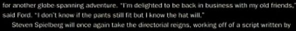
- **none** — entry/section: Spielberg on Indy IV: ""George, Harrison, and I are all very excited. We feel that the script was well worth the wait. We hope it delivers everything you'd expect from our history with Indiana Jones." —Steven Spielberg, Star Wars Insider 92, p. 8" Source: *Star Wars Insider #92* (2007), scan p.8
  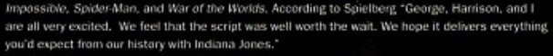
- **none** — entry/section: Lucas on Indy IV: ""Working with Steven, Frank, Kathy and the Indy crew is like working with family," said Lucas. "These films are such great fun to make. I'm looking forward to reuniting with the team and starting this new journey." —George Lucas, Star Wars Insider 92, p. 8" Source: *Star Wars Insider #92* (2007), scan p.8
  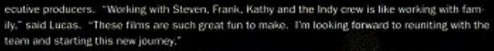

### Stat block notes (game mechanics, not feats)

- Indy box office: the first three Indiana Jones films earned 14 Academy Award nominations, won 7 Oscars, and grossed over $1,182,000,000 at the box office. (Star Wars Insider 92, p. 8) (Source: *Star Wars Insider #92* (2007), scan p.8)

## scan p.9 (scan page 9)

Page contents: Refresher Reading "20 Things You Didn't Know About the Massassi Temples" by Pablo Hidalgo (Expanded Universe facts 1-10; behind-the-scenes facts 11-20): Dr'uun Unnh, Wedge's firebee nest, Fernandin Scouting Expedition, Naga Sadow, Mas Amedda's piranha beetles, Yuuzhan Vong, recon towers, Corporal Osleo Prennert; Tikal Temple III, Tozzer Causeway, Naboo plate, Lorne Peterson/Dick Alexander/Richard Edlund crew, trash-can sentry post, light-meter prop, VistaVision camera, coral snake omen (hand-read)

### Stat block notes (game mechanics, not feats)

- Dr'uun Unnh's scouting: Rebel Alliance master scout Dr'uun Unnh recommended the Great Temple as a base after locales on Tynna, Akuria II, and Boz Pity were rejected. (Star Wars Insider 92, p. 9) (Source: *Star Wars Insider #92* (2007), scan p.9)
- Firebee nest: The Rebels in the temple constantly dealt with animal infestation. Wedge Antilles once fell afoul of a firebee nest in the pilots' barracks. (Star Wars Insider 92, p. 9) (Source: *Star Wars Insider #92* (2007), scan p.9)
- Builders of the temples: the ancient Sith followers of Naga Sadow built the Massassi temples 5,000 years earlier. (Star Wars Insider 92, p. 9) (Source: *Star Wars Insider #92* (2007), scan p.9)
- Amedda's scouting mission: After Anakin Skywalker's defeat of Asajj Ventress on Yavin 4, Chancellor Palpatine dispatched Mas Amedda and elite clone troopers to secretly scout the ruins for any worthy Sith relics. Amedda instead returned with piranha beetle samples that greatly delighted Palpatine for possible future use. (Star Wars Insider 92, p. 9) (Source: *Star Wars Insider #92* (2007), scan p.9)
- Temple destroyed: The Great Temple was destroyed by the Yuuzhan Vong, who reduced the ancient structure to rubble. (Star Wars Insider 92, p. 9) (Source: *Star Wars Insider #92* (2007), scan p.9)
- Corporal Osleo Prennert: Corporal Osleo Prennert is the sentry guard that watched the Millennium Falcon's approach from recon tower four. (Star Wars Insider 92, p. 9) (Source: *Star Wars Insider #92* (2007), scan p.9)
- Adventureland suggestion: George Lucas was inspired by photos in National Geographic to pursue filming in Guatemala. 20th Century-Fox, concerned with the film's ballooning budget, instead suggested shooting in Adventureland in Disneyland. (Star Wars Insider 92, p. 9) (Source: *Star Wars Insider #92* (2007), scan p.9)
- Temple III: Shot in Tikal, Guatemala, the temple that the Falcon flies toward is Temple III, which stands 180 feet tall and faces east. (Star Wars Insider 92, p. 9) (Source: *Star Wars Insider #92* (2007), scan p.9)
- Tikal doubles as Naboo: An Episode IV background plate of Guatemala doubled as Naboo in Episode I when the Trade Federation landing ships hover over the swamplands. (Star Wars Insider 92, p. 9) (Source: *Star Wars Insider #92* (2007), scan p.9)
- Peterson the sentry: Peterson plays the Rebel sentry. He says he got the risky job of standing on the high perch since of the three ILMers he had no children. (Star Wars Insider 92, p. 9) (Source: *Star Wars Insider #92* (2007), scan p.9)
- Trash-can post: The sentry post was actually a 50-gallon trash can with cosmetic alterations. (Star Wars Insider 92, p. 9) (Source: *Star Wars Insider #92* (2007), scan p.9)
- Light-meter prop: Peterson improvised the hand-scanner prop seen in the film. It's a light meter gaffer-taped to other objects found among their camera gear. (Star Wars Insider 92, p. 9) (Source: *Star Wars Insider #92* (2007), scan p.9)
- Coral snake omen: the crew encountered a coral snake half-digesting a bat on the ground of their filming location. Despite what could have been considered a bad omen, the shoot went off without a hitch. (Star Wars Insider 92, p. 9) (Source: *Star Wars Insider #92* (2007), scan p.9)

## scan p.10 (scan page 10)

Page contents: Ad: Star Wars Celebration IV, "A New Show," May 24-28, 2007, Los Angeles Convention Center ("Register online, and party like you've blown up a Death Star.") (hand-read)

## scan p.11 (scan page 11)

Page contents: Jedi Library "A Fairy Tale Wrapped Around a Fairy Tale" by Jason Fry: J.W. Rinzler's The Making of Star Wars: The Definitive Story Behind the Original Film (Del Rey, April); built on Charles Lippincott-era interviews; photo of Lucas, Alec Guinness and stunt coordinator Peter Diamond on the hangar set (hand-read)

- **none** — entry/section: Rinzler: archives vs. Episode III: ""It was the exact opposite of Episode III," he says. "For Episode III, I saw everything. For this one I saw nothing. It was live vs. archives." —J.W. Rinzler, Star Wars Insider 92, p. 11" Source: *Star Wars Insider #92* (2007), scan p.11
  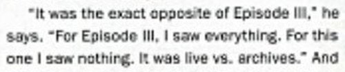

## scan p.12 (scan page 12)

Page contents: Jedi Library cont.: interview transcripts found in Lucasfilm archives; Rinzler's discoveries (front projection idea, Journal of the Whills, McQuarrie's 1975 envelope of Lucas sketches, unpublished Tunisia photos, 48 extra pages incl. Tavoularis/Beddoes/Johnston storyboards); photos of Mos Eisley Cantina and Death Star model explosions (hand-read)

### Stat block notes (game mechanics, not feats)

- The Journal of the Whills: Lucas showed Rinzler the legendary Journal of the Whills, the first paragraph and a summary of which appear in the book. (Sorry, hardcore fans: Rinzler says the entire Journal runs about a page and a half.) (Star Wars Insider 92, p. 12) (Source: *Star Wars Insider #92* (2007), scan p.12)
- Luke's first Death Star attempt: Joe Johnston storyboards that include Luke's first, unsuccessful attempt to destroy the Death Star—a sequence preserved in the novelization ghostwritten by Alan Dean Foster. (Star Wars Insider 92, p. 12) (Source: *Star Wars Insider #92* (2007), scan p.12)

## scan p.13 (scan page 13)

Page contents: Jedi Library cont.: Rinzler on Lucas's will; photo of Lucas directing Peter Cushing and Carrie Fisher; sidebar Upcoming Star Wars Books (Feb-June 2007: Legacy of the Force: Exile, The Last of the Jedi #7: Secret Weapon, The Making of Star Wars, The Ultimate Visual Guide: Special Edition, The Complete Incredible Cross-Sections, Legacy of the Force: Sacrifice) (hand-read)

- **none** — entry/section: Rinzler on sheer force of will: ""It really was by sheer force of will that he was able to make Star Wars," Rinzler says. "Because literally every step of the way people said it wouldn't work, wouldn't pay for it, or actively tried to get the film stopped." —J.W. Rinzler, Star Wars Insider 92, p. 13" Source: *Star Wars Insider #92* (2007), scan p.13
  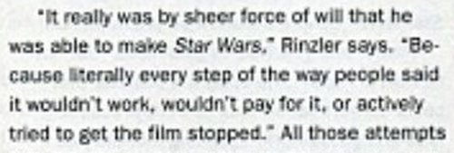
- **none** — entry/section: A fairy tale wrapped around a fairy tale: ""No one had any faith in it at all—at least until they started seeing finished footage.... It's kind of a fairy tale wrapped around a fairy tale." —J.W. Rinzler, Star Wars Insider 92, p. 13" Source: *Star Wars Insider #92* (2007), scan p.13
  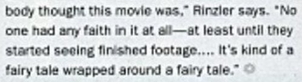

## scan p.14 (scan page 14)

Page contents: Drawn by the Force "Bookshelf Bragging" by Daniel Wallace: Dark Horse 30th Anniversary Collection hardcover reprints (print-to-order), Volume One The Freedon Nadd Uprising; Dave Marshall quote; sidebar Other Upcoming Star Wars Comics (Feb-May) (hand-read)

## scan p.15 (scan page 15)

Page contents: Comics cont.: full reprint schedule March 2007-February 2008; Marshall and Randy Stradley quotes; Rebellion Volume 1: My Brother, My Enemy (Janek "Tank" Sunber) and Boba Fett: Man with a Mission trade paperbacks (hand-read)

### Stat block notes (game mechanics, not feats)

- Rebellion Vol. 1: Rebellion Volume 1 collects issues #1-5 of Star Wars Rebellion, spotlighting Luke Skywalker's reunion with boyhood friend (turned Imperial officer!) Janek "Tank" Sunber. (Star Wars Insider 92, p. 15) (Source: *Star Wars Insider #92* (2007), scan p.15)

## scan p.16 (scan page 16)

Page contents: Jabba's Collection "No Reward Is Worth This": Sideshow Darth Maul Premium Format Figure ($274.99; Exclusive $299.99 with Sith Probe accessory); Gentle Giant Princess Leia mini bust ($50); Gentle Giant Clone Wars Roron Corobb maquette ($80) (hand-read)

### Stat block notes (game mechanics, not feats)

- Corobb's fall: Renowned for his sonic-based Force abilities, Roron Corobb fell while valiantly protecting Chancellor Palpatine from General Grievous. (Star Wars Insider 92, p. 16) (Source: *Star Wars Insider #92* (2007), scan p.16)

## scan p.17 (scan page 17)

Page contents: Jabba's Collection cont.: Sideshow Bubo creature pack (womp rat, rock wart, Bubo; $39.99); Hasbro Comic Packs wave two (Luke in stormtrooper armor and R2-D2, Obi-Wan & Alpha ARC Trooper, Quinlan Vos & Vilmarh Grahrk); Sideshow dejarik holochess set ($39.99) (hand-read)

## scan p.18 (scan page 18)

Page contents: Feature "The In-Between Theory: Reality Becomes Fantasy in the Star Wars Photography of Cédric Delsaux" by Patrice Girod, opener (dewback rider in parking structure) (hand-read)

## scan p.19 (scan page 19)

Page contents: Delsaux photograph: dewback and sandtrooper in spiral parking structure (no text) (hand-read)

## scan p.20 (scan page 20)

Page contents: Delsaux intro: Kodak La Bourse du Talent winner 2004 and 2005; 16 images using resin Attakus statues in Paris suburbs; Q&A on Showcase of Things series and the "in-between" (hand-read)

- **none** — entry/section: Delsaux's "in-between": ""So I tried to find a way to give the suburbs this sense of fantasy. That's how I got the idea to put Star Wars characters, in action, inside our suburbs in order to create fiction. That's what I call the "in-between": a state between reality and dream." —Cédric Delsaux, Star Wars Insider 92, p. 20" Source: *Star Wars Insider #92* (2007), scan p.20
  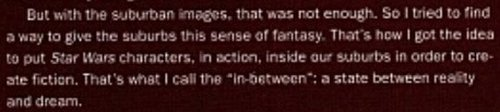

## scan p.21 (scan page 21)

Page contents: Delsaux photograph: Royal Guards on a rooftop (no text) (hand-read)

## scan p.22 (scan page 22)

Page contents: Delsaux photograph: Jango Fett in a parking lot at dusk (no text) (hand-read)

## scan p.23 (scan page 23)

Page contents: Delsaux Q&A: political messages (dropped Eiffel Tower image), Lucas's influence, staging Jabba in an abandoned house, first fully digital work, compositing the statues (hand-read)

- **Darth Vader (Anakin Skywalker)** — entry/section: The dropped Eiffel Tower image: ""I had a photo of Darth Vader with an army of stormtroopers in front of the Eiffel Tower, but I dropped it because it recalled World War II too much, and that was not my idea." —Cédric Delsaux, Star Wars Insider 92, p. 23" Source: *Star Wars Insider #92* (2007), scan p.23
  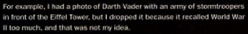

## scan p.24 (scan page 24)

Page contents: Delsaux photographs: Royal Guards in a monumental building; clone troopers on a walkway at night (no text) (hand-read)

## scan p.25 (scan page 25)

Page contents: Delsaux Q&A cont.: two days per image in post; lightsaber on the grass; Emperor image shot at Abraxas, Noisy-le-Grand (Ricardo Bofill, used in Brazil); portrait of Delsaux (hand-read)

- **Palpatine (Darth Sidious)** — entry/section: The Emperor's throne room: ""It was kind of like the Death Star, but is in fact a 'theatre' called Abraxas in the city of Noisy-le-Grand. This building was created by renowned architect Ricardo Bofill, and has already been used for Terry Gilliam's movie Brazil." —Cédric Delsaux, Star Wars Insider 92, p. 25" Source: *Star Wars Insider #92* (2007), scan p.25
  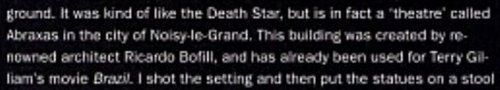

## scan p.26 (scan page 26)

Page contents: Feature "The Toys That Never Were" by Chris Fawcett: Kenner figures that never made it; 1. Rocket Fett (missile-firing mail-in, L-slot and J-slot), nine variants pictured (hand-read)

### Stat block notes (game mechanics, not feats)

- Rocket-firing Fett pulled: just a few months before the figure's release, a child died choking on a similar missile shot from a Battlestar Galactica toy. Kenner tried to enhance the safety of the figure by adding a tab to the firing slot so that the missile could not be shot off accidentally. (Star Wars Insider 92, p. 26) (Source: *Star Wars Insider #92* (2007), scan p.26)
- L-slots and J-slots: Today there are over fifty L-slots and around a dozen J-slots known to still exist. (Star Wars Insider 92, p. 26) (Source: *Star Wars Insider #92* (2007), scan p.26)

## scan p.27 (scan page 27)

Page contents: Toys That Never Were cont.: 2. R1-G4 (sandcrawler droid, kitbashed, one prototype); 3. Wookiee Family (Malla, Itchy, Lumpy from the 1978 Holiday Special, hacked-up Chewbacca figures) (hand-read)

### Stat block notes (game mechanics, not feats)

- R1-G4: R1-G4 is probably the least known of the unproduced figures. Also called the sandcrawler droid because it represents a droid the Jawas were selling on Tatooine (Star Wars Insider 92, p. 27) (Source: *Star Wars Insider #92* (2007), scan p.27)
- Wookiee family prototypes: a set of normal Chewbacca figures were hacked-up Frankenstein-style to create prototypes of what these figures would look like. Ultimately the idea was nixed and only this single set of prototypes is known to exist. (Star Wars Insider 92, p. 27) (Source: *Star Wars Insider #92* (2007), scan p.27)

## scan p.28 (scan page 28)

Page contents: Toys That Never Were cont.: 4. Vac-Metallized Figures (Royal Guard and TIE fighter pilot); 5. Accessory Figures (second mail-in "Survival Pack" accessories, Droid Factory piece on Leia's right side) (hand-read)

## scan p.29 (scan page 29)

Page contents: Toys That Never Were cont.: 6. Gargan (POTF, nixed by Lucasfilm); 7. Luke Skywalker in Robes (alternate Jedi Luke, French catalog; alternate hoodless Emperor head); 8. Unproduced Power of the Force (twenty-one mock-ups, FX-7 card) (hand-read)

### Stat block notes (game mechanics, not feats)

- Gargan nixed: The figure apparently was nixed by Lucasfilm as the character was thought to be a little too unseemly for a children's toy. (Star Wars Insider 92, p. 29) (Source: *Star Wars Insider #92* (2007), scan p.29)
- Luke in Robes: A recent photo discovered in a rare French toy company catalog has proven that Luke in Robes is indeed an alternate Jedi Luke. (Star Wars Insider 92, p. 29) (Source: *Star Wars Insider #92* (2007), scan p.29)

## scan p.30 (scan page 30)

Page contents: Toys That Never Were cont.: 9. 2nd Series Ewoks (Chief Chirpa, Paploo, Morag, Weechee, Chituhr, Bondo); 10. Unproduced Droids (Kleb Zellok, Mon Julpa, Jessica Meade, Vlix, Governor Koong, Gaff, Mungo Baobab, Admiral Screed); Vlix released only in Brazil by Glasslite (hand-read)

### Stat block notes (game mechanics, not feats)

- Vlix in Brazil: Vlix, a brand new mold that was never used in the U.S., somehow made its way south. The Brazilian Vlix is still a very rare figure, but by far the easiest of the 2nd series Droids to acquire. (Star Wars Insider 92, p. 30) (Source: *Star Wars Insider #92* (2007), scan p.30)

## scan p.31 (scan page 31)

Page contents: Toys That Never Were cont.: sidebar Collecting Unproduced Figures (four tips: do your homework, network, save up your cash, be patient); picture credits (private collectors, names omitted) (hand-read)

## scan p.32 (scan page 32)

Page contents: Technical Readout: Set Piece "Rebel Snowspeeder: In the Path of Destruction" by Chris Trevas: full-size crashed snowspeeder in Finse, Norway; Ogle Designs Ltd. built full-size speeders (fourteen-foot wingspan); March 1979 shoot; 32-inch sheet-lead miniature crushed by a two-foot AT-AT foot; rotoscoping Hamill; captions on Dack (John Morton) and Joe Johnston's early concepts (hand-read)

### Stat block notes (game mechanics, not feats)

- Hamill on the glacier: After the first unit wrapped with the other actors, Mark Hamill stayed on location a little longer with the second unit crew to film higher up on the glacier as the weather improved. Temperatures eventually reached thirty-six degrees below zero, which was a marked improvement from previous temperatures (Star Wars Insider 92, p. 32) (Source: *Star Wars Insider #92* (2007), scan p.32)
- Crushed snowspeeder miniature: the scene of Luke's crash was re-created with a special snowspeeder model approximately 32-inches long. The miniature was made from sheet lead, a soft metal which, when crushed, provided the look of a much larger armored vehicle being destroyed. (Star Wars Insider 92, p. 32) (Source: *Star Wars Insider #92* (2007), scan p.32)
- Ogle Designs speeders: Ogle-Designs Ltd., makers of the Reliant sports cars, manufactured the full-size snowspeeders at their facilities in Letchworth Heath near London. Each finished ship had a wingspan of fourteen-feet. (Star Wars Insider 92, p. 32) (Source: *Star Wars Insider #92* (2007), scan p.32)
- Dack lost: Luke lost his gunner Dack in mid-flight when their snowspeeder took a direct hit to the aft section. (Star Wars Insider 92, p. 32) (Source: *Star Wars Insider #92* (2007), scan p.32)

## scan p.33 (scan page 33)

Page contents: Snowspeeder photo captions: record snowfalls causing avalanches; snowspeeder idea in the second draft; Ben Burtt's freeway-through-vacuum-pipe hum; ILM models from a few inches to 21-inch (hand-read)

### Stat block notes (game mechanics, not feats)

- Snowspeeders in the second draft: The idea of the Rebels using snowspeeders first appeared in the second draft of the movie's script. In it they are described as "more powerful than the ones Luke used on the farm on Tatooine. They can go up to sixty or seventy feet in the air and can make banking turns sharper than a skyhopper." (Star Wars Insider 92, p. 33) (Source: *Star Wars Insider #92* (2007), scan p.33)
- Snowspeeder hum: Sound designer Ben Burtt created the steady hum of the snowspeeder in flight from the sound of the Los Angeles freeway recorded from a distance through a vacuum cleaner pipe. (Star Wars Insider 92, p. 33) (Source: *Star Wars Insider #92* (2007), scan p.33)

## scan p.34 (scan page 34)

Page contents: Feature "Unknown Origins" by J. W. Rinzler: elements of Lucas's original 1973-1977 drafts that resurfaced in the prequel trilogy; why ideas were discarded (too much story, budget, visual-effects limits until Jurassic Park in 1993) (hand-read)

## scan p.35 (scan page 35)

Page contents: Unknown Origins: Journal of the Whills (Early 1973): Mace Windy as prototype for Mace Windu and Qui-Gon Jinn; Padawan; secret mission by the "Chairman" (hand-read)

### Stat block notes (game mechanics, not feats)

- Mace Windy: The great Jedi in Lucas' very first two-page story is named Mace Windy. Lucas would reassign his name decades later to prequel trilogy Jedi Master Mace Windu (Star Wars Insider 92, p. 35) (Source: *Star Wars Insider #92* (2007), scan p.35)
- Master and Padawan on a secret mission: Indeed The Phantom Menace begins with the two of them sent on a clandestine mission by the Chancellor—which is exactly how the Journal ends: with Master and Padawan sent on a secret mission by the "Chairman." (Star Wars Insider 92, p. 35) (Source: *Star Wars Insider #92* (2007), scan p.35)

## scan p.36 (scan page 36)

Page contents: Unknown Origins: The Star Wars, Rough Draft (May 1974): Annikin (personality closer to Han Solo's); desert planet Utapau; silver spacecraft; brother killed by a Sith; Emperor's invasion speech (excerpt) (hand-read)

### Stat block notes (game mechanics, not feats)

- Annikin: The main character of the rough draft is Annikin—uh, yes, he would obviously resurface, at least as a name with a different spelling. His personality—cocksure, flirtatious, and ready to fight—is actually closer to Han Solo's. (Star Wars Insider 92, p. 36) (Source: *Star Wars Insider #92* (2007), scan p.36)
- Utapau's first use: Annikin is hiding out with his brother and father on the desert planet Utapau—a name that Lucas would transfer to the sinkhole planet of Episode III, after Utapau became Tatooine in a later draft. (Star Wars Insider 92, p. 36) (Source: *Star Wars Insider #92* (2007), scan p.36)

## scan p.37 (scan page 37)

Page contents: Unknown Origins cont.: early Emperor prefigures Palpatine; Cliegg Whitsun; Aquilae's "Palace of Life"; Count Sandage as precursor of Dooku; Valorum, Jommillia; Wookiees and the Ewoks (Lucas quote); The Star Wars, First Draft (July 1974): Espaa and Bink Valor (hand-read)

- **Chewbacca** — entry/section: Wookiees too savvy for Endor: ""I had established the Wookiees, by then, as technologically savvy," Lucas says, "so I had to invent another species to bring down the Empire." —George Lucas, Star Wars Insider 92, p. 37" Source: *Star Wars Insider #92* (2007), scan p.37
  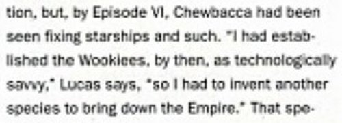

### Stat block notes (game mechanics, not feats)

- Cliegg Whitsun: Among the crowd listening to the early Emperor is Cliegg Whitsun. Lucas would split up his name between Cliegg Lars and Beru Whitesun in Episode II. (Star Wars Insider 92, p. 37) (Source: *Star Wars Insider #92* (2007), scan p.37)
- Count Sandage: His negotiations are complicated by the corrupt Count Sandage. This character, whom Lucas abandoned in the second draft, would become at least in part the prequel trilogy's shifty Count Dooku. (Star Wars Insider 92, p. 37) (Source: *Star Wars Insider #92* (2007), scan p.37)
- Bink Valor: Bink Valor, a young good guy, would have his first name co-opted by a certain...Jar Jar Binks. (Star Wars Insider 92, p. 37) (Source: *Star Wars Insider #92* (2007), scan p.37)

## scan p.38 (scan page 38)

Page contents: Unknown Origins: Adventures of the Starkiller, Episode I: The Star Wars, Second Draft (January 1975): "son of the suns" prophecy; Senate controlled by guilds; Darklighter and the Bogan; Sith as pirates; floating city of Alderaan became Cloud City (hand-read)

### Stat block notes (game mechanics, not feats)

- Darklighter and the Bogan: The second draft also tells the story of a Padawan named Darklighter who runs away from his Master after coming under the spell of the Bogan, the dark side of the Force. He then teaches its ways to "Sith pirates." (Star Wars Insider 92, p. 38) (Source: *Star Wars Insider #92* (2007), scan p.38)
- Boga's name: (The name Bogan would finally see the light of day with Boga, Obi-Wan's lizard-mount, in Episode III.) (Star Wars Insider 92, p. 38) (Source: *Star Wars Insider #92* (2007), scan p.38)

## scan p.39 (scan page 39)

Page contents: Unknown Origins: The Star Wars: From the Adventures of Luke Starkiller, Third Draft (August 1975): Luke as son of Annikin Starkiller; Luke floating prisoner of the Tusken Raiders (reused for Obi-Wan on Geonosis); Luke's dreams of Leia; Chewbacca carries Leia (hand-read)

### Stat block notes (game mechanics, not feats)

- Son of Annikin Starkiller: In the third draft Luke Starkiller knows the identity of his father: he is the son of Annikin Starkiller. (Star Wars Insider 92, p. 39) (Source: *Star Wars Insider #92* (2007), scan p.39)
- Floating prisoner reused: when Count Dooku imprisons Obi-Wan Kenobi on Geonosis, the Jedi is floating and revolving, held in check by an electrical field. (Ironically, in the third draft it is Obi-Wan who rescues Luke.) (Star Wars Insider 92, p. 39) (Source: *Star Wars Insider #92* (2007), scan p.39)

## scan p.40 (scan page 40)

Page contents: Feature "Pirates of the Boards" Exclusive Series Part 2: Joe Johnston's early storyboards of the TIE attack on the first pirate ship flown by Han Solo and Chewbacca; draft chronology; Richard Edlund's pencilled notes; "enemy pilot" panel; boards 36 onward (hand-read)

### Stat block notes (game mechanics, not feats)

- Pirate ship renamed: in December 1975, Lucas had ILM redesign the pirate ship, at which time it was rechristened the Millennium Falcon (Star Wars Insider 92, p. 40) (Source: *Star Wars Insider #92* (2007), scan p.40)

## scan p.41 (scan page 41)

Page contents: Pirates of the Boards: third-draft script excerpt (Han, Luke, Chewbacca, Leia) with boards 37-39 (hand-read)

## scan p.42 (scan page 42)

Page contents: Pirates of the Boards: boards 40-45 (TIE fighters open fire, Han's gun) (hand-read)

## scan p.43 (scan page 43)

Page contents: Pirates of the Boards: boards 46-51; "Stay tuned to Insider for the next installment" (hand-read)

## scan p.44 (scan page 44)

Page contents: Ask the Master "The Bane of Continuity" by Pablo Hidalgo (letter-writers omitted): Darth Maul from Iridonia (a Zabrak); how Yoda knew the Rule of Two (Kibh Jeen, from Abel G. Peña's "Evil Never Dies"); Darth Maul illustration (hand-read)

### Stat block notes (game mechanics, not feats)

- Maul's homeworld: Darth Maul is from the planet Iridonia. (Star Wars Insider 92, p. 44) (Source: *Star Wars Insider #92* (2007), scan p.44)
- Kibh Jeen and the Rule of Two: a seemingly mad cultist by the name of Kibh Jeen surfaced during the Dark Jedi Conflict (about 150 years before the events of Episode I) and blathered some gibberish about there always being no more or less than two Sith at a time. (Star Wars Insider 92, p. 44) (Source: *Star Wars Insider #92* (2007), scan p.44)

## scan p.45 (scan page 45)

Page contents: Ask the Master cont.: Path of Destruction timeline vs. Jedi vs. Sith; Lumiya vs. Tremayne; Kas'im and Vaapad/Juyo; tall Jawas (a crew member behind R2-D2) (hand-read)

### Stat block notes (game mechanics, not feats)

- Bane's rise: it obviously starts first—about three years before the events of the comic—with Bane as a cortosis miner on Apatros. He later ascends to the position of Sith Lord over three years (Star Wars Insider 92, p. 45) (Source: *Star Wars Insider #92* (2007), scan p.45)
- Lumiya over Tremayne: Tremayne would have made an interesting candidate for the character that starts Jacen down his slippery dark side slope, but I would argue that Tremayne is just as—if not more—obscure a character than Lumiya. (Star Wars Insider 92, p. 45) (Source: *Star Wars Insider #92* (2007), scan p.45)
- Vaapad named for Juyo: Master Kas'im was indeed adept at a seventh form of lightsaber combat, a powerful discipline known as Juyo. (Star Wars Insider 92, p. 45) (Source: *Star Wars Insider #92* (2007), scan p.45)

## scan p.46 (scan page 46)

Page contents: Feature "Puzzle Planet: The Models of Revenge of the Sith, Part III" by Frank Parisi (photos by Ryan Church and David Owen): Brian Gernand on Utapau; history of the name; 18-by-6-foot 1:2,000 sinkhole model and 16-by-24-foot 1:90 reconfigurable miniature (hand-read)

- **none** — entry/section: George-approved: ""These guys [and their team] would draw non-stop and present huge walls of art to George Lucas, who would walk through and say, 'Okay, okay, okay,' and they would put whatever he liked into their binder and say, 'This is George-approved.'" —Brian Gernand, Star Wars Insider 92, p. 46" Source: *Star Wars Insider #92* (2007), scan p.46
  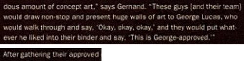

### Stat block notes (game mechanics, not feats)

- Utapau's models: An 18-foot by 6-foot 1:2,000 scale sinkhole model (that is, 2,000 times smaller than it would be in real life) was built for the scene in which Obi-Wan flies down into the sinkhole (Star Wars Insider 92, p. 46) (Source: *Star Wars Insider #92* (2007), scan p.46)

## scan p.47 (scan page 47)

Page contents: Puzzle Planet: foam sinkhole model with clay/wax shale texture; master-mold-cast building gang runs; inch-long painted buildings (hand-read)

## scan p.48 (scan page 48)

Page contents: Puzzle Planet: Michael Lynch's "10 gallons of buildings"; the sinkhole shot on its side; the 1:90 "hero" four-section modular model (hand-read)

- **none** — entry/section: Ten gallons of buildings: ""'Well, I went to the mold room and said, Just give me 10 gallons of buildings.' So we basically took two five-gallon buckets and filled them to the top with these buildings. Ultimately we don't know how many thousands there were." —Brian Gernand, Star Wars Insider 92, p. 48" Source: *Star Wars Insider #92* (2007), scan p.48
  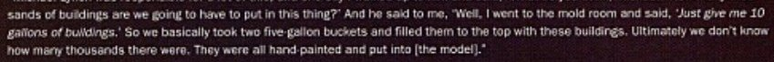
- **none** — entry/section: Laying the sinkhole on its side: ""So we ended up laying the model over on its side and running the camera in horizontally; then were able to put the light really far away to simulate a high sun angle. We kind of cheated that." —Brian Gernand, Star Wars Insider 92, p. 48" Source: *Star Wars Insider #92* (2007), scan p.48
  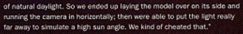

## scan p.49 (scan page 49)

Page contents: Puzzle Planet: pre- and post-battle dressing; railings and doorways for scale; reconfigurable architectural elements (hand-read)

## scan p.50 (scan page 50)

Page contents: Puzzle Planet: vacuum-forming technique; miniature lighting with 1/16- or 1/32-inch bulbs ("grains of sand") (hand-read)

## scan p.51 (scan page 51)

Page contents: Puzzle Planet: 500 or 600 lights in one shot; pinpoints of light; all handmade (hand-read)

- **none** — entry/section: Nothing off the shelf: ""There was nothing that we could pull off the shelf and use. It was such an alien environment and the architectural design was so signature to this place that everything had to be created from scratch. There is nothing about Utapau that anybody had ever seen before." —Brian Gernand, Star Wars Insider 92, p. 51" Source: *Star Wars Insider #92* (2007), scan p.51
  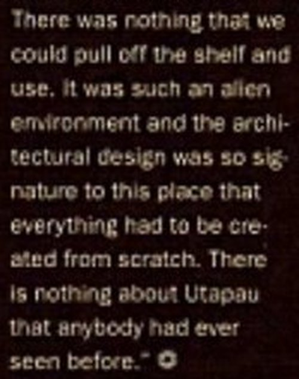

## scan p.52 (scan page 52)

Page contents: Scouting the Galaxy "Beware of Holy Grails and Fixations!" by Steve Sansweet: the ROTJ bicycle offered at $2,000; the Darth Vader electronic dart board found via the French fan magazine run by Patrice Girod (reader names omitted) (hand-read)

## scan p.53 (scan page 53)

Page contents: Scouting the Galaxy cont. (letter-writers omitted): stormtrooper Christmas tree; Sansweet at the Tournament of Roses Parade with more than 200 501st Legion troopers from 24 countries and 35 states; Darth Mickey feet variation; selling a Micro Machine collection (hand-read)

## scan p.54 (scan page 54)

Page contents: Scouting the Galaxy cont.: reader photos of a child's clone trooper battles (names omitted) (hand-read)

## scan p.55 (scan page 55)

Page contents: Scouting the Galaxy cont.: Marvel Treasury #1 value; Applause vinyl figures value (Xizor vinyl at 99 cents); Han in Carbonite replica by Illusive Concepts; how to submit questions (hand-read)

## scan p.56 (scan page 56)

Page contents: Star Wars International "The Toys From Brazil" by Gus Lopez: Estrela's Fuga da Estrela da Morte game ("Guerra nas Estrelas"); Glasslite Power of the Force and Droids figures (hand-read)

## scan p.57 (scan page 57)

Page contents: Toys From Brazil cont.: Glasslite Vlix; Nestlé Attack of the Clones cereal 3-D cards (thirty boxes for a full set); Marisol apparel with McQuarrie art (hand-read)

### Stat block notes (game mechanics, not feats)

- Glasslite Vlix: Years later Glasslite introduced Vlix as a regular production figure for the Droids line in Brazil. (Star Wars Insider 92, p. 57) (Source: *Star Wars Insider #92* (2007), scan p.57)

## scan p.58 (scan page 58)

Page contents: Best of Hyperspace "Holy Grails: The Unproduced Empire Micro Collection Line" by Gus Lopez: planned Hoth Bacta Chamber, Bespin Torture Chamber and Dagobah play sets; Hoth Bacta Chamber prototype photo (hand-read)

### Stat block notes (game mechanics, not feats)

- Bacta Chamber play set: The Hoth Bacta Chamber would have allowed kids to re-create the scenes from The Empire Strikes Back where 2-1B and FX-7 operate on a wampa-damaged Luke Skywalker. (Star Wars Insider 92, p. 58) (Source: *Star Wars Insider #92* (2007), scan p.58)

## scan p.59 (scan page 59)

Page contents: Micro Collection cont.: Bacta Chamber two designs, box prototype, blueprint schematics (hand-read)

## scan p.60 (scan page 60)

Page contents: Micro Collection cont.: Bacta Chamber pieces $50-100; around half a dozen boxes and proof sheets; Torture Chamber (Han's shock chair, conveyor belt for dismembered C-3PO; Ugnaught, two Bespin guards, Chewbacca with backpack), only two complete prototypes; Dagobah set, 4-up sculpts, pantograph; Kenner sculptor Bill Lemon's acetate milling; R2-D2 hard copy photo (hand-read)

### Stat block notes (game mechanics, not feats)

- Bespin Torture Chamber: The Torture Chamber has an array of medieval punishment devices such as a chair that moves Han into position for shocking by electrodes, a locking detention cell, and a movable conveyer belt to place a dismembered C-3PO on route to an incinerator. (Star Wars Insider 92, p. 60) (Source: *Star Wars Insider #92* (2007), scan p.60)
- Two Torture Chamber prototypes: There are only two complete prototypes of Bespin Torture Chamber play sets known to exist. (Star Wars Insider 92, p. 60) (Source: *Star Wars Insider #92* (2007), scan p.60)

## scan p.61 (scan page 61)

Page contents: Micro Collection cont.: Luke in X-wing uniform sculpture by Bill Lemon; green Dynacast 4-up hard copies of Luke, R2-D2 and Yoda; later blue 1990s copies not considered true prototypes; photos of Luke hard copy and Bacta Chamber with box (hand-read)

## scan p.62 (scan page 62)

Page contents: Best of Hyperspace "Galactic Gallery" concept art: Terryl Whitlatch's unused Podracer pilot (basis of Toy Dampner); Joe Johnston's humanoid rancor (L.F.L. 1981); Ed Natividad's acklay; unsigned Empire Strikes Back creature sketch (hand-read)

### Stat block notes (game mechanics, not feats)

- Toy Dampner: This unused Podracer pilot design by Terryl Whitlatch became the basis of Toy Dampner, a racing champ seen in Expanded Universe video games. (Star Wars Insider 92, p. 62) (Source: *Star Wars Insider #92* (2007), scan p.62)
- Humanoid rancor: A Joe Johnston illustration depicting a rancor with very humanoid proportions—consistent with an early abandoned approach to depict the creature with a man in a suit. (Star Wars Insider 92, p. 62) (Source: *Star Wars Insider #92* (2007), scan p.62)
- Dread Lobster: Ed Natividad's concept illustration of the acklay arena monster, which at one point was described as a cross between a dinosaur and a lobster. (Star Wars Insider 92, p. 62) (Source: *Star Wars Insider #92* (2007), scan p.62)

## scan p.63 (scan page 63)

Page contents: Galactic Gallery cont.: Iain McCaig's female Sith warrior for Attack of the Clones; Doug Chiang's unused "baron droid"; Dermot Power's "Miss Fisto?"; Terryl Whitlatch's "Royal Procession in Utapau" (hand-read)

### Stat block notes (game mechanics, not feats)

- Miss Fisto?: Dermot Power's explorations of alien life forms in Episode II would eventually develop into the Jedi Master Kit Fisto, among others. (Star Wars Insider 92, p. 63) (Source: *Star Wars Insider #92* (2007), scan p.63)
- Baron droid: An unused Doug Chiang design for a "baron droid," an elite form of battle droid belonging to the Trade Federation. (Star Wars Insider 92, p. 63) (Source: *Star Wars Insider #92* (2007), scan p.63)

## scan p.64 (scan page 64)

Page contents: Best of Hyperspace "Secrets of Star Wars Next-Gen Game": first look at next-gen game concept art (Camp Jawa; Organic Pad on Felucia) (hand-read)

## scan p.65 (scan page 65)

Page contents: Next-gen game art cont.: Night on the Town; Jaws of the Sepulcher; Grim Trophies (stormtrooper helmets) (hand-read)

## scan p.66 (scan page 66)

Page contents: Padawan Corner "How to Draw Admiral Ackbar" by Amy Pronovost: steps 1-4 (hand-read)

## scan p.67 (scan page 67)

Page contents: How to Draw Admiral Ackbar steps 5-7; artist bio (starwars.com, Star Wars Kids, Topps sketch cards) (hand-read)

## scan p.68 (scan page 68)

Page contents: Bantha Tracks Vol. 23 "Tournament of Roses Special Edition": the Star Wars Spectacular in the January 1, 2007 Rose Parade (two floats, Grambling State University Tiger Marching Band, more than 240 marching fans); Lucas inspired by the 501st Legion; 200 troopers chosen from 22 countries and 36 states; 5.5-mile route; record four-and-a-half minutes of airtime (fan and drill-staff names omitted) (hand-read)

### Stat block notes (game mechanics, not feats)

- Rose Parade airtime: On New Year's Day, the Star Wars Spectacular made headlines worldwide, and nabbed a record-breaking four-and-a-half minutes of airtime during the broadcast. (Star Wars Insider 92, p. 68) (Source: *Star Wars Insider #92* (2007), scan p.68)
- Troopers chosen: Many hundreds of troopers sent audition tapes to Lucasfilm, and 200 were chosen to march, from 22 countries and 36 states. (Star Wars Insider 92, p. 68) (Source: *Star Wars Insider #92* (2007), scan p.68)

## scan p.69 (scan page 69)

Page contents: Rose Parade photo spread: drill rehearsals, flag rehearsals, Twi'lek makeup, troopers (costumer and photographer names omitted) (hand-read)

## scan p.70 (scan page 70)

Page contents: Rose Parade photos: "Hero Squadron" with Dr. Larry Pannell, director of the Grambling State band; troopers with George Lucas; thirteen buses, seven minutes to form up (fan names omitted) (hand-read)

## scan p.71 (scan page 71)

Page contents: Rose Parade photos: Grambling State band in Imperial officer uniforms ("Best Band in the Galaxy"); the 501st Legion's 10th anniversary; rainbow Twi'lek flag carriers (fan names omitted) (hand-read)

## scan p.72 (scan page 72)

Page contents: Rose Parade photos: Steve Sansweet, Lucasfilm's head of fan relations, marching with the 501st; Endor float with Ewoks, Chewbacca, C-3PO and R2-D2; Darth Vader and Imperial Guards; Naboo float finale with Queen Amidala (costumer names omitted) (hand-read)

### Stat block notes (game mechanics, not feats)

- Sansweet and the 501st: Steve Sansweet, Lucasfilm's head of fan relations, marched with the 501st troopers in the Tournament of Roses Parade. (Star Wars Insider 92, p. 72) (Source: *Star Wars Insider #92* (2007), scan p.72)

## scan p.73 (scan page 73)

Page contents: Bantha Tracks Editorial "The United Colours of Star Wars" by Mary Franklin, Editor, Bantha Tracks: the hotel-bar week of friendships, gifts from the garrisons; helper thanks (names omitted); submission guidelines (hand-read)

## scan p.74 (scan page 74)

Page contents: Advertisement: Star Wars 30th anniversary, Celebration IV May 24-May 28 in Los Angeles; first day reserved and free for Fan Club members; subscribe to Insider (hand-read)

## scan p.75 (scan page 75)

Page contents: StarWarsShop.com presents Tosche Station #16: Chunk brand T-shirts ("Your Empire Needs You," "Disco Yoda," "Surfer Trooper"), $29.99 (hand-read)

## scan p.76 (scan page 76)

Page contents: StarWarsShop Collector's Picks (collector name omitted): Mimoco Darth Vader 2GB USB drive $119.95; Sculpting a Galaxy limited edition $395.00; Anakin black chrome mini lightsaber $29.99; Animated Darth Vader maquette $79.99; Episode III iPod cover $29.99 (hand-read)

## scan p.77 (scan page 77)

Page contents: StarWarsShop What's New: Imperial Briefing Room 7-pack $34.99; GSX C-3PO watch $549.99 limited to 1,977 pieces; ESB Boba Fett vinyl doll $49.99; Real Action Hero Shadow Stormtrooper $129.99; LEGO Stormtrooper maquette $64.99 (hand-read)

### Stat block notes (game mechanics, not feats)

- C-3PO watch: GSX C-3PO Watch $549.99 Limited to only 1,977 pieces, this high end watch is imported directly from Japan (Star Wars Insider 92, p. 77) (Source: *Star Wars Insider #92* (2007), scan p.77)

## scan p.78 (scan page 78)

Page contents: StarWarsShop Exclusives: Vader hockey jersey, "Star Wars Rocks" iPod case (Hugh Fleming art), Kotobukiya pewter Vader, M&M Vader, Padmé lenticular poster, clone trooper bust-ups, flag, .45-scale Anakin saber (hand-read)

## scan p.79 (scan page 79)

Page contents: StarWarsShop Video Games: Empire at War: Forces of Corruption, LEGO Star Wars II, The Best of PC, Galaxies Complete Online Adventures, Escape from Monkey Island, Thrillville, Jedi Knight: Dark Forces II, Lethal Alliance (hand-read)

## scan p.80 (scan page 80)

Page contents: StarWarsShop More Must Haves: Vintage Action Figures book, C-3PO helmet, Trilogy DVD, ROTJ Boba Fett vinyl, Sidious standee, Attakus Obi-Wan and Vader, Lucas family figures, Kotobukiya Slave Leia (hand-read)

## scan p.81 (scan page 81)

Page contents: Back cover advertisement: Entertainment Earth Republic Commando Delta Squad internet-exclusive 7-figure set HS87269 $33.99 (Scorch RC-1262, Fixer RC-1140, Boss RC-1138, Sev RC-1207, Sun Fac, Geonosian warriors) (hand-read)

