# Owner Material 038 — Star Wars Insider #1–153 plus specials (with The Lucasfilm Fan Club Magazine #1–22): Star Wars Insider #93 (2007)

- **Source:** *Star Wars Insider* magazine (issues 23–153, 1994–2014) and its predecessor *The Lucasfilm Fan Club Magazine* (issues 1–22, 1987–1994), plus seven special editions: articles, interviews, comics and short fiction Secondary source (licensed Legends reference). Scan OCR'd on the box; the scan stays box-only and is **not** published.
- **Method:** every scanned page was OCR'd and machine-screened sentence by sentence for power-relevant statements (fights, kills, defeats, Force feats, rankings, superweapons) that name a character on our roster; each kept sentence is quoted verbatim from the OCR text and has a crop of the printed passage directly under it. Pages with nothing power-relevant are still listed with what is on them.
- **Citation:** "*Star Wars Insider #93* (2007), p.X" by printed page ("scan p.X" where no printed number applies). **Weight:** Licensed magazine: a secondary source. Its short fiction and comics are Legends stories; its articles and interviews sum up or discuss lore and rank below the novels, comics and games they describe.

## scan p.1 (scan page 1)

Page contents: Contents (part 1): Darth Vader, Leia and Luke 30th-anniversary art; Star Wars Insider 30 logo (hand-read)

## scan p.2 (scan page 2)

Page contents: Contents (part 2): cover feature "May the Facts Be With You! Part One: #1-50"; Com-Scan; Celebration IV; Best of StarWars.com; The Force Unleashed; Pirates of the Boards Part Three; Part of the Language (Karen Traviss); Jawa's Corner departments; Indy Vault; Comlink Letters (hand-read)

## scan p.3 (scan page 3)

Page contents: Editor's Welcome "Here's Where the Fun Begins!" by Brian J. Robb, Editor: first edition of the all-new Insider from Titan Magazines (UK edition publisher for over a decade), new look, 100 facts; contact addresses and masthead (hand-read)

## scan p.4 (scan page 4)

Page contents: Com-Scan "ILM Pirates Scoop Oscar Glory!": John Knoll and Hal Hickel win the 2007 Visual Effects Oscar for Pirates of the Caribbean: Dead Man's Chest; Knoll's acceptance speech; Knoll co-developed Photoshop with brother Thomas, cameos as Lt. Rya Kirsch (Bravo 4) in The Phantom Menace and a Fire Ship Pilot in Revenge of the Sith; ILM's 37th and 38th nominations; Lucas presents Scorsese's Best Director Oscar (hand-read)

## scan p.5 (scan page 5)

Page contents: Com-Scan "Jedi Master's New Look Revealed!": first image of Yoda for the CGI Clone Wars TV series (between Episodes II and III); Gail Currey; Frank Oz involved; Rob Coleman says 15 episodes in production, directing five of the first 26; Lucas at the Paley Festival: new female Padawan "Osoka", possible young Boba Fett, 100 episodes, story of the Skywalkers completed; premiere expected 2008 (hand-read)

- **none** — entry/section: Star Wars is not dead: ""Star Wars is not dead," —George Lucas, Star Wars Insider 93, p. 5" Source: *Star Wars Insider #93* (2007), scan p.5
  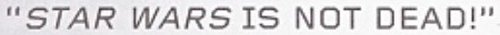

### Stat block notes (game mechanics, not feats)

- Osoka announced: George Lucas, speaking at the 24th Annual William S. Paley Television Festival, commented on the show stating that the animated series will feature Osoka, a new young female Padawan character and he speculated that an appearance from a young Boba Fett is possible. (Star Wars Insider 93, p. 5) (Source: *Star Wars Insider #93* (2007), scan p.5)
- Skywalker story complete: When asked about a continuation of the saga on the big screen with Episodes VII, VIII, and IX, Lucas confirmed that the story of the Skywalkers has been completed. (Star Wars Insider 93, p. 5) (Source: *Star Wars Insider #93* (2007), scan p.5)

## scan p.6 (scan page 6)

Page contents: Com-Scan "Feel the Fabric!": Bonhams sells an Alec Guinness Obi-Wan Kenobi cloak for £54,000 (estimate £40,000); the cloak was rented out as fancy dress; lots: Rebel blockade runner crew shirt £2,600, Rebel commander's jacket £6,600, Snaggletooth's trousers £900, Imperial commander's uniform £7,500; consultant Adrian Cowdry and John Mollo's authentication; "Did You Bid?" (hand-read)

### Stat block notes (game mechanics, not feats)

- Kenobi cloak auction: London auctioneers Bonhams have sold one of the cloaks said to have been worn by Sir Alec Guinness in his iconic role as Obi-Wan Kenobi in Star Wars: Episode IV for £54,000 after initial estimates placed its value at £40,000. (Star Wars Insider 93, p. 6) (Source: *Star Wars Insider #93* (2007), scan p.6)

## scan p.7 (scan page 7)

Page contents: Com-Scan "Leia Leads Lust List!": Carrie Fisher's Princess Leia tops a Maxim.com Hit-List for Hottest Comic Book/Sci-Fi Character, ahead of Gillian Anderson and Carrie-Anne Moss; full top-10 list (hand-read)

## scan p.8 (scan page 8)

Page contents: "Indiana Set to Ride Again": Indiana Jones IV starts production June 2007, Harrison Ford returns, directed by Steven Spielberg, release May 22, 2008, screenplay by David Koepp, produced by Frank Marshall; Ford quote on the hat; trilogy's 14 nominations and seven Oscars (hand-read)

- **none** — entry/section: The hat will fit: ""I'm delighted to be back in business with my old friends. I don't know if the pants still fit but I know the hat will." —Harrison Ford, Star Wars Insider 93, p. 8" Source: *Star Wars Insider #93* (2007), scan p.8
  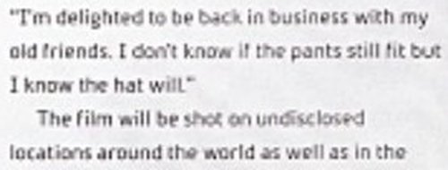

## scan p.9 (scan page 9)

Page contents: Com-Scan "Sith in Lights?" (design droid K-BARR spots "DITA" sign behind Vader); Blaster news: Matthew Stover's Luke Skywalker and the Shadows of Mindor (Feb 2008, Lord Shadowspawn); DK Readers by Simon Beecroft; JAKKS Pacific Original Trilogy TV Games (hand-read)

### Stat block notes (game mechanics, not feats)

- Battle of Mindor: Due out in February 2008, Luke Skywalker and the Shadows of Mindor tells the tale of the Alliance's efforts to stop Lord Shadowspawn and his black-clad legions of shadow stormtroopers shortly after the destruction of the second Death Star. (Star Wars Insider 93, p. 9) (Source: *Star Wars Insider #93* (2007), scan p.9)

## scan p.10 (scan page 10)

Page contents: Com-Scan Extra Celebration IV: Los Angeles Convention Center May 24-28, 2007, pivoting on May 25; saga screenings; 30th Anniversary Opening Ceremonies; Skywalker Ranch archive exhibit; Celebration IV stages (hand-read)

## scan p.11 (scan page 11)

Page contents: Celebration IV cont. "Join the Biggest Star Wars Party of 2007!": Charlie Ross's One Man Star Wars Trilogy; two costume contests; Star Wars Fan Movie Challenge with George Lucas Selects trophy; R2-D2 Builders, Xtreme Droid Challenge, Endor diorama, fan tables (fan names omitted) (hand-read)

## scan p.12 (scan page 12)

Page contents: "Shining Stars" autograph guests (Official Pix brought 34 to Celebration II and 41 to Celebration III): Carrie Fisher, Anthony Daniels, Kenny Baker, Jeremy Bulloch, Peter Mayhew, Ray Park, David Prowse, Daniel Logan and more; "All Systems Go on Celebration Europe" at London's ExCeL, July 13-15, 2007 (hand-read)

## scan p.13 (scan page 13)

Page contents: Best of StarWars.com (words: Pete Vilmur & Bonnie Burton) "Koto's Three Dimensional Duel": Kotobukiya 3D vinyl models of Ralph McQuarrie's 1975 Vader vs. Luke ("Deak Starkiller") painting; breath masks; Tomomi Iwasaki on translating 2D to 3D; 16.5-inch base (hand-read)

### Stat block notes (game mechanics, not feats)

- McQuarrie's breath masks: Early versions of the script implied that the Rebel starship's hull was breached by the Imperials to board it, releasing the pressurized atmosphere into space. As a result, both Deak and Vader were required to wear breath masks for a duel sequence. While Luke no longer required the mask after script rewrites, Vader kept his since the look so perfectly captured his sinister mystique. (Star Wars Insider 93, p. 13) (Source: *Star Wars Insider #93* (2007), scan p.13)

## scan p.14 (scan page 14)

Page contents: "Samurai Sith Lord": Vader's design inspiration in Samurai armor; Yoshitoku Company's "Samurai Vader" quarter-scale costume for Tango no Sekku (Boys' Day, May 5); yoroi and kabuto; Yoshitoku history since 1711 (hand-read)

## scan p.15 (scan page 15)

Page contents: Samurai Vader cont.: Noboru Kawahara's prototype, Mr. Takeya's helmet; ensemble prices (kabuto about 180,000 yen); Sean Lennon's Favorite Star Wars Memories begins (levitating the station wagon, 1:20 Millennium Falcon model) (hand-read)

- **Han Solo; Leia Organa Solo** — entry/section: Lennon's Falcon model: ""My favorite toy was the 1:20 scale model of the Millennium Falcon that I built myself over the course of a month," —Sean Lennon, Star Wars Insider 93, p. 15" Source: *Star Wars Insider #93* (2007), scan p.15
  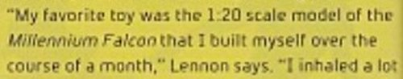

## scan p.16 (scan page 16)

Page contents: Sean Lennon's Favorite Star Wars Memories cont.: Empire Strikes Back his favorite, Joseph Campbell, John Williams' music, his film Friendly Fire, seeing Revenge of the Sith on opening night, Yoda and Luke on Dagobah (hand-read)

- **Han Solo; Leia Organa Solo; Luke Skywalker** — entry/section: Lennon on the heroes: ""Han Solo in a way is an anti-hero type, but a hero as well. His journey is overcoming his selfishness and becoming a more caring person. Leia, in a way, is the only one with nothing to learn." —Sean Lennon, Star Wars Insider 93, p. 16" Source: *Star Wars Insider #93* (2007), scan p.16
  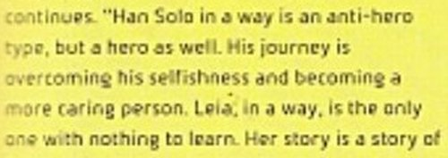

## scan p.17 (scan page 17)

Page contents: Feature "Unleash Your Inner Sith!" (words: Frank Parisi): opening spread title; Darth Vader's secret apprentice in Star Wars: The Force Unleashed (hand-read)

## scan p.18 (scan page 18)

Page contents: Unleash Your Inner Sith! opening art: Vader looms over the apprentice hurling stormtroopers with the Force (hand-read)

## scan p.19 (scan page 19)

Page contents: The Force Unleashed: imagine being six in 1977; the official next chapter, story input from George Lucas, early 2008 release for next-gen consoles; concept art of the fungus planet Felucia and a droid (hand-read)

## scan p.20 (scan page 20)

Page contents: The Force Unleashed "Bridging the Saga": set in the 'dark times'; play a secret Sith apprentice of Vader's unknown to the Emperor; Haden Blackman (Project Lead) on Lucas's input; "Synergistic Visions" with ILM (Letterman Digital Arts Center); Shaak Ti and rancor art; Jedi being hunted (hand-read)

### Stat block notes (game mechanics, not feats)

- Vader's secret apprentice: You will play as a brand new character in the Star Wars mythos – a secret Sith apprentice of Vader's, clandestinely trained by the Dark Lord and unknown even to the Emperor. (Star Wars Insider 93, p. 20) (Source: *Star Wars Insider #93* (2007), scan p.20)

## scan p.21 (scan page 21)

Page contents: The Force Unleashed cont.: "Star Scribe" box on Haden Blackman (Galaxies, Starfighter, Clone Wars comics Republic); newcomers Juno Eclipse, a droid, General Kota and Maris Brood; Shaak Ti on Felucia; Maris Brood art (hand-read)

### Stat block notes (game mechanics, not feats)

- Juno Eclipse: Joining your secret apprentice character will be Juno Eclipse, a female Imperial pilot and – as suggested by Lucas – a potential love interest. (Star Wars Insider 93, p. 21) (Source: *Star Wars Insider #93* (2007), scan p.21)
- Kota and Brood: First is General Kota, a grizzled, militaristic Jedi General who survived the Jedi Purge – but not without scars. There's also Maris Brood, a powerful and deadly female Jedi. (Star Wars Insider 93, p. 21) (Source: *Star Wars Insider #93* (2007), scan p.21)
- Shaak Ti on Felucia: Fans will be happy to know that Togrutan Jedi Master Shaak Ti will triumphantly return to make a stand against your character on Felucia. (Star Wars Insider 93, p. 21) (Source: *Star Wars Insider #93* (2007), scan p.21)

## scan p.22 (scan page 22)

Page contents: "Fulfilling the Force": Julio Torres (producer); four core powers push, grip, repulse and lightning; euphoria (NaturalMotion) and Digital Molecular Matter technologies; Havok physics; the Rogue Shadow (hand-read)

### Stat block notes (game mechanics, not feats)

- Four core Force powers: Your character will start his adventure with four core Force powers – push, grip, repulse, and lightning – all of which will be amped up to staggering degrees. (Star Wars Insider 93, p. 22) (Source: *Star Wars Insider #93* (2007), scan p.22)
- Rogue Shadow: Every Star Wars hero has his own iconic ship. In The Force Unleashed, the Secret Apprentice's is called the Rogue Shadow (Star Wars Insider 93, p. 22) (Source: *Star Wars Insider #93* (2007), scan p.22)

## scan p.23 (scan page 23)

Page contents: "Adding Depth to Vader": stormtrooper and sandtrooper character models, AT-ST; Juno Eclipse art; multiple endings, one canonical; Blackman and Torres quotes (hand-read)

## scan p.24 (scan page 24)

Page contents: "The Worlds of The Force Unleashed": Raxus Prime, Felucia, TIE Fighter Construction Facility, Kashyyyk; concept art; "You are Darth Vader's Secret Apprentice" (hand-read)

### Stat block notes (game mechanics, not feats)

- Felucia: Seen in Revenge of the Sith, the fungus planet is rife with the Living Force. This is where you, as Vader's secret apprentice, will encounter Shaak Ti, as well as a pack of vicious rancors. (Star Wars Insider 93, p. 24) (Source: *Star Wars Insider #93* (2007), scan p.24)
- Kashyyyk: A shadow has descended on the Wookiee home world as Imperial forces embark on a campaign to enslave the entire planet. (Star Wars Insider 93, p. 24) (Source: *Star Wars Insider #93* (2007), scan p.24)

## scan p.25 (scan page 25)

Page contents: Feature "Pirates of the Boards" Exclusive Series Part 3 of 6 (words: J.W. Rinzler): early Joe Johnston storyboards of the dogfight between the pirate ship and TIE fighters (third draft); Richard Edlund's penciled notes; boards 52-53; #1 Imperial fighters buzz about (hand-read)

### Stat block notes (game mechanics, not feats)

- The "enemy pilot" panel: it might seem like Darth Vader was to be included in this battle – but the reality is that this particular panel was photocopied to save time and used to signify "enemy pilot," whether the script called for Vader or a TIE pilot fighter, throughout the early storyboards. (Star Wars Insider 93, p. 25) (Source: *Star Wars Insider #93* (2007), scan p.25)
- Pirate ship redesign: They show the first pirate ship (in December 1975, Lucas had ILM redesign the ship, at which time it became the Millennium Falcon). (Star Wars Insider 93, p. 25) (Source: *Star Wars Insider #93* (2007), scan p.25)

## scan p.26 (scan page 26)

Page contents: Pirates of the Boards cont.: boards 54-63; #2 an Imperial fighter explodes, Han gives Luke a victory wave; board 57 "Reverse - Han - ship explodes"; #3 the princess gives instructions over the comlink; "To be continued..." (hand-read)

## scan p.27 (scan page 27)

Page contents: Pirates of the Boards cont.: boards 64-73; #4 Chewbacca keeps the cockpit under control; Leia and Han dialogue; the ship races away (hand-read)

### Stat block notes (game mechanics, not feats)

- Not a cargo trawler: LEIA There are only three or four left. HAN (over intercom) Chewbacca, it's time we showed them this isn't the regulation F8-88 Cargo Trawler. (Star Wars Insider 93, p. 27) (Source: *Star Wars Insider #93* (2007), scan p.27)

## scan p.28 (scan page 28)

Page contents: Pirates of the Boards cont.: boards 74-80; #5 Luke and Han fire at the fighters ("end of Alderaan" sequence); #6 Ext. space around fourth moon of Yavin, life-pods descending (hand-read)

### Stat block notes (game mechanics, not feats)

- Life-pods to Yavin: The battered pirate starship drifts into orbit around the emerald green fourth moon of Yavin [note the life-pods descending toward the planet, as this was originally how Luke and company arrived – a concept that was cut very late in preproduction; (Star Wars Insider 93, p. 28) (Source: *Star Wars Insider #93* (2007), scan p.28)

## scan p.29 (scan page 29)

Page contents: Full-page image: the blockade runner captured in the Star Destroyer's hangar (opening image for May the Facts Be With You) (hand-read)

## scan p.30 (scan page 30)

Page contents: Cover feature "May the Facts Be With You" Part One #1-#50: 100 things you didn't know about Star Wars: Episode IV A New Hope (words: Dan Wallace); facts 1-8 (33rd Century; Journal of the Whills; four films; Legions of Lettow; Nelwyns; dustbin of history; Space: 1999 and the Tantive IV; model sizes); novelization cover (hand-read)

### Stat block notes (game mechanics, not feats)

- 33rd Century: George Lucas' first treatment for the film set the story in the 33rd Century. (Star Wars Insider 93, p. 30) (Source: *Star Wars Insider #93* (2007), scan p.30)
- Shaman of the Whills: That name came back into vogue more than a quarter of a century later, when Qui-Gon Jinn revealed that he learned the secret of immortality from a Shaman of the Whills. (Qui-Gon's dialogue, while scripted for Revenge of the Sith, is missing from the final cut.) (Star Wars Insider 93, p. 30) (Source: *Star Wars Insider #93* (2007), scan p.30)
- Legions of Lettow: The Knights of the Sith in the first draft were called "the Legions of Lettow." (Star Wars Insider 93, p. 30) (Source: *Star Wars Insider #93* (2007), scan p.30)
- Tantive IV origin: In early concepts, Han Solo's ship looked too much like a vessel in the 1970s TV show Space: 1999, which started airing in late 1975 after the original Falcon model had been built. The design then gained a "hammerhead" cockpit and became the now infamous Rebel blockade runner Tantive IV. (Star Wars Insider 93, p. 30) (Source: *Star Wars Insider #93* (2007), scan p.30)
- Model sizes: The blockade runner model seen in A New Hope's famous opening shot measured 194 centimeters (more than six feet), while the model for the looming Star Destroyer came in at a comparatively puny 91 centimeters (three feet). (Star Wars Insider 93, p. 30) (Source: *Star Wars Insider #93* (2007), scan p.30)

## scan p.31 (scan page 31)

Page contents: May the Facts Be With You facts 9-14: U-3PO the traitor droid; the Tantive IV invasion shot with six cameras; C-3PO's "I'm melting!" moved; a single white hallway; R2-D2 veering; the escape pod shot among ILM's first two effects shots (hand-read)

### Stat block notes (game mechanics, not feats)

- U-3PO the traitor: The silver protocol droid who looks similar to C-3PO in the opening scene is U-3PO. According to the Star Wars radio dramatization and a Decipher CCG card, the droid is a traitor, having transmitted the signal that allowed Vader's Star Destroyer to track the Tantive IV to Tatooine. (Star Wars Insider 93, p. 31) (Source: *Star Wars Insider #93* (2007), scan p.31)
- I'm melting: C-3PO's panic while buried beneath a pile of wires ("Help! I think I'm melting!") was to have taken place aboard the Tantive IV. The shot eventually found a place later in the film, during the Millennium Falcon's shootout with the TIE fighters. (Star Wars Insider 93, p. 31) (Source: *Star Wars Insider #93* (2007), scan p.31)
- R2-D2 veers: R2-D2 rarely followed a straight line during filming. Regarding one astromech scene aboard the Tantive IV, production supervisor Robert Watts noted that "the cut was taken to the absolute limit. [R2-D2] kept veering off and crashing into the wall. If you look carefully at that shot you can see it just starting to veer." (Star Wars Insider 93, p. 31) (Source: *Star Wars Insider #93* (2007), scan p.31)
- First ILM shot: The shot of the escape pod blasting away from the Tantive IV is notable as one of the first two effects shot completed by Industrial Light & Magic. (Star Wars Insider 93, p. 31) (Source: *Star Wars Insider #93* (2007), scan p.31)

## scan p.32 (scan page 32)

Page contents: Facts 15-24: Vader's "red eyes"; Commander Daine Jir talks back; C-3PO's silver leg; Tantive IV vaporized in the novelization; floppy-hat Luke and Tosche Station cut scenes with Biggs; the Devastator; Jundland means "no-man's land"; Tunisia's first winter rainstorm in 50 years; the Krayt dragon skeleton (hand-read)

### Stat block notes (game mechanics, not feats)

- Red eyes: Vader's first encounter with Leia in the novelization describes "red eyes" glaring behind the Dark Lord's breath mask. (Star Wars Insider 93, p. 32) (Source: *Star Wars Insider #93* (2007), scan p.32)
- Daine Jir talks back: Nobody has the guts to talk back to Darth Vader except Commander Daine Jir. (Star Wars Insider 93, p. 32) (Source: *Star Wars Insider #93* (2007), scan p.32)
- Silver leg: C-3PO's mismatched silver leg is a nod to his colorful past, although fans in 1977 had no inkling of the surprising direction that the droid's past would eventually take. As Lucas said (in an interview conducted before the prequels), "I made that leg silver so that Threepio could have a history, so that it seemed like he had been around for 20 or 30 years." (Star Wars Insider 93, p. 32) (Source: *Star Wars Insider #93* (2007), scan p.32)
- Captain Antilles' last ride: The fate of the Tantive IV is never revealed in the movie. Alas, the novelization reveals that Imperials vaporized the prequel-era craft. (Star Wars Insider 93, p. 32) (Source: *Star Wars Insider #93* (2007), scan p.32)
- Meteor crater: After Luke overreacts, Biggs snaps, "You've got a mouth like a meteor crater!" Replies Luke in a stage whisper, "I'm quiet, I'm quiet... listen to how quiet I am... You can barely hear me..." (Star Wars Insider 93, p. 32) (Source: *Star Wars Insider #93* (2007), scan p.32)
- Jundland: According to the script and novelization, Tatooine's Jundland Wastes can be translated as "no-man's land." (Star Wars Insider 93, p. 32) (Source: *Star Wars Insider #93* (2007), scan p.32)
- Tunisia rain: To compound the crew's woes, on March 26, 1976, Tunisia received its first winter rainstorm in 50 years. (Star Wars Insider 93, p. 32) (Source: *Star Wars Insider #93* (2007), scan p.32)

## scan p.33 (scan page 33)

Page contents: Facts 25-35: C-3PO tells the Jawas where R2-D2 is (radio drama); Dathcha and "Ootini!"; Luke's signal flare; 13-hour droid auction shoot; R5-D4's motivator; R5-D4 auction blooper; C-3PO's ignorance of the Princess; KPR droids; front-projected landspeeder test; Mardji the bantha; "Banthas, all right" (hand-read)

### Stat block notes (game mechanics, not feats)

- Dathcha: The Jawa who shoots R2-D2 is named Dathcha, and it is he who delivers the immortal Jawa catchphrase "Ootini!" (Star Wars Insider 93, p. 33) (Source: *Star Wars Insider #93* (2007), scan p.33)
- Through a straw: The cast and crew worked 13 hours straight to shoot the droid auction. To avoid delays caused by disassembling and reassembling the C-3PO costume, Anthony Daniels took all his nourishment through a straw. (Star Wars Insider 93, p. 33) (Source: *Star Wars Insider #93* (2007), scan p.33)
- Skippy the Jedi Droid: And in the Star Wars Tales comic "Skippy the Jedi Droid," a Force-sensitive R5-D4 takes himself out of the running lest he upset the scales of cosmic destiny. (Star Wars Insider 93, p. 33) (Source: *Star Wars Insider #93* (2007), scan p.33)
- Auction blooper: In a droid auction blooper, R5-D4 topples forward and hits the ground face-first, causing his head to pop off of its seams. (Star Wars Insider 93, p. 33) (Source: *Star Wars Insider #93* (2007), scan p.33)
- Programmed ignorance: in a character sketch created for radio drama writer Brian Daley, George Lucas emphasized that the golden droid had been programmed to feign ignorance about the Princess for the security of the mission. In Episode III, of course, instructions are given to wipe his memory. (Star Wars Insider 93, p. 33) (Source: *Star Wars Insider #93* (2007), scan p.33)
- Mardji: Only one bantha appears in A New Hope, portrayed by a trained elephant from Marine World named Mardji. Two banthas are visible when Luke peeks through his macrobinoculars at the Sand People, but it's a composite shot that shows Mardji twice. (Star Wars Insider 93, p. 33) (Source: *Star Wars Insider #93* (2007), scan p.33)

## scan p.34 (scan page 34)

Page contents: Facts 36-38: poisoned gaffi sticks; "even a duck has to be taught to swim"; Sand People's gold bracelets (third draft); photos of R2-D2 and C-3PO in the Lars garage, bantha, Tusken Raider (hand-read)

### Stat block notes (game mechanics, not feats)

- Poisoned gaffi stick: In retrospect, it's extremely lucky that Luke dodged the gaffi stick wielded by the howling Tusken Raider. According to the Star Wars Visual Dictionary, the tips of gaffi sticks are poisoned. (Star Wars Insider 93, p. 34) (Source: *Star Wars Insider #93* (2007), scan p.34)
- What's a duck?: "Still, even a duck has to be taught to swim." "What's a duck?" Luke asked curiously. "Never mind." (Star Wars Insider 93, p. 34) (Source: *Star Wars Insider #93* (2007), scan p.34)
- Suspended Luke: In the third draft, the Sand People attach gold bracelets to Luke's wrists and ankles and leave him suspended ten feet in the air. (Star Wars Insider 93, p. 34) (Source: *Star Wars Insider #93* (2007), scan p.34)

## scan p.35 (scan page 35)

Page contents: Facts 39-49: restraining bolt not reattached; Owen and Beru's deaths (floating fortress); Luke's dog; "Right now I don't feel too good"; Yuma shoot at 132 degrees F; Sentinel-class shuttle added 1997; Romodi; Vader levitates a cup (comic); Bavo-6 truth serum; Tusken marksmanship; Jawa funeral pyre (hand-read)

### Stat block notes (game mechanics, not feats)

- Show of trust: After repairing C-3PO's arm in Ben Kenobi's hut, a sympathetic Luke doesn't reattach the droid's restraining bolt. (Star Wars Insider 93, p. 35) (Source: *Star Wars Insider #93* (2007), scan p.35)
- Floating fortress: The deaths of Uncle Owen and Aunt Beru are depicted in the short story anthology Tales from the Mos Eisley Cantina, in which the Lars homestead is ignited by a "floating fortress," a type of Imperial heavy tank. (Star Wars Insider 93, p. 35) (Source: *Star Wars Insider #93* (2007), scan p.35)
- Luke's dog: According to the novelization of A New Hope, Luke Skywalker thinks back to a dog he had once owned when the Millennium Falcon blasts into hyperspace away from Tatooine. (Star Wars Insider 93, p. 35) (Source: *Star Wars Insider #93* (2007), scan p.35)
- Yuma heat: In 1995, crew members shot additional Tatooine footage for the Special Edition in Yuma, Arizona – just in time for temperatures that hit 132 degrees Fahrenheit. (Star Wars Insider 93, p. 35) (Source: *Star Wars Insider #93* (2007), scan p.35)
- Romodi: In the novelization, a mysterious officer named Romodi is present at the Death Star conference. Romodi, who has never appeared in the Expanded Universe, bore "facial scars so deeply engraved that even the best cosmetic surgery could not fully repair them." (Star Wars Insider 93, p. 35) (Source: *Star Wars Insider #93* (2007), scan p.35)
- Levitated cup: In the comic-book adaptation, Vader uses the Force to levitate a steaming cup into his hand. (Star Wars Insider 93, p. 35) (Source: *Star Wars Insider #93* (2007), scan p.35)
- Bavo-6: Why did the interrogation droid in Leia's cell carry a giant syringe? According to Expanded Universe lore, the hypodermic carried a truth serum named Bavo-6. (Star Wars Insider 93, p. 35) (Source: *Star Wars Insider #93* (2007), scan p.35)
- Blast points: Obi-Wan doesn't win any points for his sandcrawler deduction, which manages to simultaneously belittle the precision of Tusken sharpshooters (who can hit Podracers traveling in excess of 900 kilometers per hour) and exaggerate the woeful marksmanship of the Emperor's finest ("only Imperial stormtroopers are so precise"). (Star Wars Insider 93, p. 35) (Source: *Star Wars Insider #93* (2007), scan p.35)
- Funeral pyre: Obi-Wan Kenobi ensures that the bodies of the dead Jawas are burned, a very Jedi-like thing to do. Obi-Wan's mentor Qui-Gon received a similar sendoff on Naboo, and Luke later builds a flaming pyre on Endor for either Darth Vader (original script) or Darth Vader's armor (revised final version). (Star Wars Insider 93, p. 35) (Source: *Star Wars Insider #93* (2007), scan p.35)

## scan p.36 (scan page 36)

Page contents: Fact 50 and photos (dewback in Mos Eisley, Obi-Wan with R2-D2, Vader and Leia, sandtroopers); "Coming Soon" box: next issue is a 100-page 30th-anniversary special; facts #51-#100 in the issue-after-next (hand-read)

### Stat block notes (game mechanics, not feats)

- Rontos and scurriers: The elephantine rontos and hopping scurriers created for the Special Edition are reskinned versions of Jurassic Park's brachiosaurus and velociraptor models. (Star Wars Insider 93, p. 36) (Source: *Star Wars Insider #93* (2007), scan p.36)

## scan p.37 (scan page 37)

Page contents: Feature opener "Part of the Language": three decades after the original Star Wars has really left its mark on the way we talk and think (words: Karen Traviss); C-3PO photo (hand-read)

## scan p.38 (scan page 38)

Page contents: Part of the Language: "He's gone over to the dark side"; Dr. Andrew Hardie (Lancaster University); OED 2002 adds 'Jedi', 'Force', 'dark side'; Memorable Movie Phrases (California State University study; "May the Force be with you" number eight); 2001 UK census Jedi; Brighton 2.6 percent; 2005 Cincinnati minister; Reagan's 'Star Wars' SDI; USAF SITH; JEDI software; Enron 'JEDI' and 'Chewco'; photos of Vader, Anakin, Yoda (hand-read)

- **none** — entry/section: Passing into the lexicon: ""George Lucas' Star Wars films are passing into the contemporary lexicon." —Dr. Andrew Hardie, Star Wars Insider 93, p. 38" Source: *Star Wars Insider #93* (2007), scan p.38
  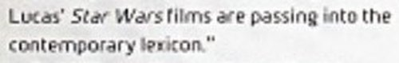

### Stat block notes (game mechanics, not feats)

- Dark side in the dictionary: In 2002, the Shorter Oxford English Dictionary – the definitive record of the English language – officially added the words 'Jedi', the 'Force' and 'dark side.' (Star Wars Insider 93, p. 38) (Source: *Star Wars Insider #93* (2007), scan p.38)
- Number eight: "May the Force be with you" was number eight in the Top 20 phrases quoted by all age and gender groups. (Star Wars Insider 93, p. 38) (Source: *Star Wars Insider #93* (2007), scan p.38)
- Jedi census: In Britain, the 2001 national census recorded that 390,000 people out of 52 million respondents gave their religion as 'Jedi.' (Star Wars Insider 93, p. 38) (Source: *Star Wars Insider #93* (2007), scan p.38)
- USAF SITH: But you might not be aware of the USAF's very own SITH – the Senior In-Theater Historian. (Star Wars Insider 93, p. 38) (Source: *Star Wars Insider #93* (2007), scan p.38)

## scan p.39 (scan page 39)

Page contents: Part of the Language concl.: "Jedi Jokers?" Project Jedi (Fort Bragg 1979; Jon Ronson, The Men Who Stare at Goats); author bio (Karen Traviss, Legacy of the Force 5: Sacrifice out in June); "The Hunt Is On..." box asking readers for examples (US/UK addresses); photos of Kit Fisto, Aayla Secura, Obi-Wan (hand-read)

### Stat block notes (game mechanics, not feats)

- Project Jedi: It's alleged to have been a secret US Army project to train super-warriors who could walk through walls, make themselves invisible, levitate, confound the enemy by advancing into battle hugging lambs, and – brace yourselves – kill goats by staring at them. (Star Wars Insider 93, p. 39) (Source: *Star Wars Insider #93* (2007), scan p.39)

## scan p.40 (scan page 40)

Page contents: Jawa's Corner section opener ("Packed with all the latest stuff from the Star Wars universe"): Books 50, Comics 52, Toys 54, Star Wars Q&A 56, Scouting the Galaxy 58, International Collecting 62, Set Piece 64, Bantha Tracks 67, Indy Vault 72, Comlink 74; poster-style art of Luke, Leia, droids (hand-read)

## scan p.41 (scan page 41)

Page contents: Jawa's Corner Books "Sacrificial Writes" (words: Jason Fry): Karen Traviss discusses Sith Lords, grim choices and men in armor (Spoiler Alert); Legacy of the Force 5: Sacrifice (Del Rey, $25.95/Century, £17.99); Jacen's passage into Sith mastery; psychology of motivation; Ben Skywalker, Boba Fett returns to Mandalore; Sacrifice cover and author photo (hand-read)

- **Darth Vader (Anakin Skywalker)** — entry/section: Driving force: ""we all knew exactly what happened to Vader long before we saw Revenge of the Sith, but finding out how it all happened was the driving force of the film." —Karen Traviss, Star Wars Insider 93, p. 41" Source: *Star Wars Insider #93* (2007), scan p.41
  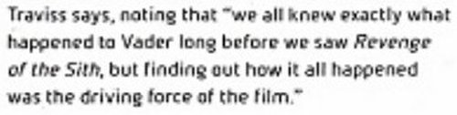
- **none** — entry/section: Every character gets to have their say: ""All my novels are like that," she says, adding, "every character gets to have their say. I don't mediate, I don't interpret, and I don't steer the reader." —Karen Traviss, Star Wars Insider 93, p. 41" Source: *Star Wars Insider #93* (2007), scan p.41
  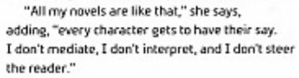

### Stat block notes (game mechanics, not feats)

- Jacen's sacrifice: The sacrifice in question will be Jacen Solo's – the prophesied death of a loved one by his hand. That event will mark Jacen's passage into Sith mastery, and end with him taking a Sith name, as his grandfather once did. (Star Wars Insider 93, p. 41) (Source: *Star Wars Insider #93* (2007), scan p.41)

## scan p.42 (scan page 42)

Page contents: Books cont.: Upcoming Book Releases Timeline, Legacy of the Force forthcoming books (Book 5 Sacrifice by Karen Traviss, hardcover; Book 6 Inferno by Troy Denning, paperback; Book 7 Fury by Aaron Allston, paperback; Book 8 Revelation by Karen Traviss, paperback; Book 9 TBA by Troy Denning, hardcover); Lumiya and Alema Rar; Pushed to the Limit; True Colors due this summer; Mird the strill; dream projects; Das Boot; Lumiya art (hand-read)

- **Jacen Solo (Darth Caedus)** — entry/section: Not crazy-evil: "Traviss calls Jacen "not only utterly plausible but far from crazy-evil... a know-all who had some good ideas, then placed too much faith in his own judgment, went to extremes, and behaved exactly like many, many politicians I've known and worked with and for over the years. —Karen Traviss, Star Wars Insider 93, p. 42" Source: *Star Wars Insider #93* (2007), scan p.42
  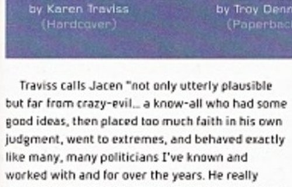
- **Lumiya** — entry/section: Exemplary Lumiya: "Lumiya, Traviss says is "a woman who was indoctrinated and used, and who paid a terrible price for her service to the Empire, but because she's smart and strong she doesn't go crazy about all the things she'll never have and all she's lost... She's exemplary in many ways: tough, smart, with no trace of self-pity." —Karen Traviss, Star Wars Insider 93, p. 42" Source: *Star Wars Insider #93* (2007), scan p.42
  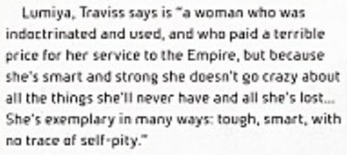
- **Boba Fett; Darth Vader (Anakin Skywalker)** — entry/section: Anything in armor: "Dream projects? "Anything in armor," Traviss says, "by which I mean clones, stormies, Mandalorians, the Fetts and Vader." —Karen Traviss, Star Wars Insider 93, p. 42" Source: *Star Wars Insider #93* (2007), scan p.42
  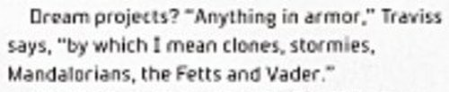
- **none** — entry/section: The Grand Army: ""I'd like to examine how the Grand Army became the Imperials, and explore the Empire from their point of view," —Karen Traviss, Star Wars Insider 93, p. 42" Source: *Star Wars Insider #93* (2007), scan p.42
  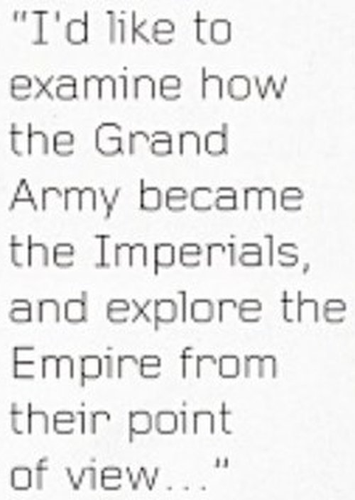

## scan p.43 (scan page 43)

Page contents: Jawa's Corner Comics "Suicide Mission: one team attempts the impossible in Star Wars Rebellion" (words: Daniel Wallace): five-issue arc from Issue #6 "The Ahakista Gambit", written by Rob Williams with art by Michel Lacombe; Rebel spy Wyl Tarson and gangster Raze; Alliance Gloom (set between A New Hope and Empire); Twi'lek art (hand-read)

- **none** — entry/section: Raze's revenge: ""Raze knows Wyl's a traitor," explains Williams. "But why kill Wyl when he can put him to work? And that means sending him on a suicide mission." —Rob Williams, Star Wars Insider 93, p. 43" Source: *Star Wars Insider #93* (2007), scan p.43
  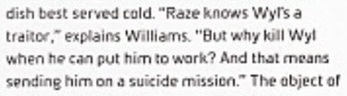
- **Han Solo** — entry/section: Little moments: ""My favorite things about the Star Wars universe are the little moments, like Han banging the Falcon when it won't start on Hoth," he says. "Moments that really made you care about these characters. —Rob Williams, Star Wars Insider 93, p. 43" Source: *Star Wars Insider #93* (2007), scan p.43
  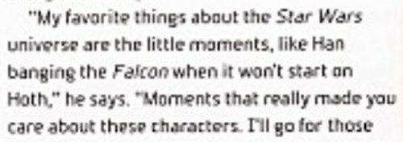
- **none** — entry/section: Buffet of strange life: ""Crowd scenes in cosmopolitan areas are always a buffet of strange life." —Michel Lacombe, Star Wars Insider 93, p. 43" Source: *Star Wars Insider #93* (2007), scan p.43
  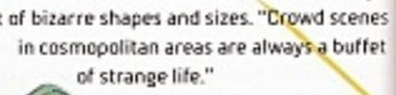

### Stat block notes (game mechanics, not feats)

- Wyl Tarson's suicide mission: As the story opens, Rebel spy Wyl Tarson (familiar from earlier issues of Rebellion) has been posing as a henchman for the interstellar gangster Raze. (Star Wars Insider 93, p. 43) (Source: *Star Wars Insider #93* (2007), scan p.43)

## scan p.44 (scan page 44)

Page contents: Comics cont.: Lacombe's canine character, life models; Williams on Order 66 and the Jedi Temple, return of a familiar face, classic-era Vader; Rebellion cover ("My Brother, My Enemy") and interior art; box "Star Wars: Panel to Panel Volume 2" (text by Randy Stradley; May 30, 192-page trade paperback, $19.95) (hand-read)

- **Darth Vader (Anakin Skywalker)** — entry/section: Small army: ""How about watching Vader cut his way through a small army all on his own?" he teases. —Rob Williams, Star Wars Insider 93, p. 44" Source: *Star Wars Insider #93* (2007), scan p.44
  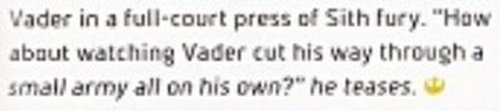
- **none** — entry/section: Order 66 ties: ""We'll be dealing with a conflict, and hatred, that goes back to Order 66 and the massacre in the Jedi Temple," he says. "There will also be the return of a familiar face – a character the Star Wars readers probably never thought they'd see again." —Rob Williams, Star Wars Insider 93, p. 44" Source: *Star Wars Insider #93* (2007), scan p.44
  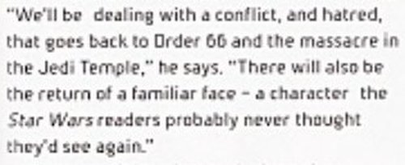

### Stat block notes (game mechanics, not feats)

- Panel to Panel 2: Some of these, including the blue-skinned Twi'lek Aayla Secura, went on to star in the Star Wars movies. Others lived a second life in the Clone Wars animated series, such as the Sith hopeful Asajj Ventress and the bounty hunter Durge. (Star Wars Insider 93, p. 44) (Source: *Star Wars Insider #93* (2007), scan p.44)

## scan p.45 (scan page 45)

Page contents: Jawa's Corner Toys "Toy Invasion! Hasbro leads the 30th anniversary Star Wars celebrations" (words: Frank Parisi): 2007 3 3/4" Figures Wave Four (Elis Helrot, M'iiyoom Onith, Jedi Luke, CZ-4, Umpass-stay with gong, animated Boba Fett, McQuarrie concept Vader); Dengar Mini Bust (Gentle Giant, 8.75-inch, July, ~$50); V-Wing Starfighter and Sith Infiltrator (hand-read)

### Stat block notes (game mechanics, not feats)

- Wave Four highlights: The highlights of this wave, however, are sure to be a new version of Boba Fett as he appeared in his animated debut in the Star Wars Holiday Special, as well as a Ralph McQuarrie concept version of Darth Vader. (Star Wars Insider 93, p. 45) (Source: *Star Wars Insider #93* (2007), scan p.45)
- Dengar: Donning patchwork armor consisting of repainted pieces from snowtrooper, sandtrooper, and stormtrooper armor, the seemingly human Dengar is one of the most notorious of the credit-hungry outlaws (Star Wars Insider 93, p. 45) (Source: *Star Wars Insider #93* (2007), scan p.45)
- V-wing and Infiltrator: Flown by clone pilots towards the end of the Clone Wars, the nimble V-wing starfighter is particularly adept at dog-fighting and close-range battle, while Darth Maul's Sith Infiltrator inspires dread wherever it appears. (Star Wars Insider 93, p. 45) (Source: *Star Wars Insider #93* (2007), scan p.45)

## scan p.46 (scan page 46)

Page contents: Toys cont.: LEGO Darth Vader's TIE Advanced Fighter (Collector Series); Vintage Collection (Endor Leia, Imperial snow trooper, Bespin Luke, IG-88, Hoth Han, Bossk; Ultimate Galactic Hunt promotion, Vintage Coin Collection); LEGO Imperial Landing Craft; Clone Wars Yoda on Kybuck Maquette (Gentle Giant, 9.5-inch, $90, July) (hand-read)

### Stat block notes (game mechanics, not feats)

- TIE Advanced: Customized and piloted by the cybernetic hands of Vader himself, the prototype TIE Advanced boasts large, angular wings, an extended engine block, and a reinforced hull, making it much more formidable than the standard TIE fighter. (Star Wars Insider 93, p. 46) (Source: *Star Wars Insider #93* (2007), scan p.46)
- Yoda on kybuck: the sight of Yoda charging into battle flanked by troops and surrounded by blaster fire atop a kybuck was one of the more indelible images from the series. (Star Wars Insider 93, p. 46) (Source: *Star Wars Insider #93* (2007), scan p.46)

## scan p.47 (scan page 47)

Page contents: Jawa's Corner Q&A "Luke's a Back Seat Driver: plus, how many escape pods does Yoda have and where's Anakin's scar in Return of the Jedi...?" (words: Pablo Hidalgo); top box with how to contact Insider (US/UK addresses, email); reader questions (names omitted): C-3PO driving the landspeeder; TV series; Episode I digital Yoda; Anakin's scar (hand-read)

### Stat block notes (game mechanics, not feats)

- Threepio drives: C-3PO has over 30 secondary functions, and piloting landspeeders is one of them. When Luke goes out to search for Artoo, he decides to let Threepio drive, letting Skywalker concentrate on the scanner. (Star Wars Insider 93, p. 47) (Source: *Star Wars Insider #93* (2007), scan p.47)
- TV series timing: neither will be on screen in 2007, in time for the 30th anniversary of Star Wars. Both will make their debut sometime in the next five years, with the animated series currently scheduled for late 2008. (Star Wars Insider 93, p. 47) (Source: *Star Wars Insider #93* (2007), scan p.47)
- Digital Yoda in Episode I: as a way of keeping the team busy and testing out the new Yoda model created for Episode III, ILM went back to Episode I and practiced by replacing the puppet with the digital incarnation for all those shots. (Star Wars Insider 93, p. 47) (Source: *Star Wars Insider #93* (2007), scan p.47)
- Anakin's scar: The scar that Anakin got from Asajj did not cut so deeply as the burns that seared his flesh. We're left to assume those layers of skin burned off completely, (Star Wars Insider 93, p. 47) (Source: *Star Wars Insider #93* (2007), scan p.47)

## scan p.48 (scan page 48)

Page contents: Q&A cont.: Yoda's two escape pods; Maul and Force lightning (Maul is a Zabrak); Vader and Force lightning; blocking blaster bolts; Rebel commando in scout trooper armor at the Endor bunker; the Dowager Queen wreck in Mos Eisley (not Podracer engines); Yoda and bunker photos (hand-read)

### Stat block notes (game mechanics, not feats)

- Two escape pods: Yoda boards an egg-shaped escape pod to leave Kashyyyk. Once in space, he begins transmitting a coded distress signal that is picked up by Senator Organa. (Star Wars Insider 93, p. 48) (Source: *Star Wars Insider #93* (2007), scan p.48)
- Second pod: After deciding to go into exile, Yoda takes a second, different escape pod and lands on Dagobah. (Star Wars Insider 93, p. 48) (Source: *Star Wars Insider #93* (2007), scan p.48)
- Maul and lightning: There's no reason to believe Maul couldn't use Force lightning. He has the rage and the focus, but it's just not his strength or preferred tactic. A flourishing swordsman, Maul prefers to overwhelm his targets with rapid, agile attacks. Dooku, on the other hand, is more a traditional swordsman, who prefers to keep his enemies at bay and uses measured, economic moves. (Star Wars Insider 93, p. 48) (Source: *Star Wars Insider #93* (2007), scan p.48)
- Zabrak: Incidentally, Maul's alien heritage didn't limit his powers in any noticeable way. He is a Zabrak, by the way... (Star Wars Insider 93, p. 48) (Source: *Star Wars Insider #93* (2007), scan p.48)
- No Force lightning: As for Vader and Force lightning, it's been reported in this column before that he cannot master this ability due to his mechanical limbs. As George Lucas once described it, the peculiar nature of Force lightning requires a living hand to direct it, and Vader lacked the control required to harness it. (Star Wars Insider 93, p. 48) (Source: *Star Wars Insider #93* (2007), scan p.48)
- Blocking bolts: Vader did it, and in this case, he was helped by his unfeeling hands, which were encased in armored gauntlets that helped contain the explosive power of the incoming blaster bolts. (Star Wars Insider 93, p. 48) (Source: *Star Wars Insider #93* (2007), scan p.48)
- Commando in the armor: The one left behind gets tricked by Han into getting captured by the Rebel commandos. (Star Wars Insider 93, p. 48) (Source: *Star Wars Insider #93* (2007), scan p.48)
- Dowager Queen: A particular piece of junk seen in the spaceport city was described as the remains of the Dowager Queen, the original colony ship that settled Mos Eisley. (Star Wars Insider 93, p. 48) (Source: *Star Wars Insider #93* (2007), scan p.48)

## scan p.49 (scan page 49)

Page contents: Jawa's Corner Scouting the Galaxy (words: Steve Sansweet), subheads on finding a Star Wars story on tape, rare vs. valuable items, and repros (reader names omitted): Sansweet and colleague Mary Franklin at the British Toy Fair; Celebration Europe (July 13 to 15, ExCeL London), host Barry Eldridge (managing Celebration Europe for licensee Cards Inc.); British Toy Fair ~250 exhibitors vs 1,500 in New York and 2,750 at Nürnberg; Nikko R2-D2 DVD player and projector; Celebration Europe and Star Wars 3D logos (hand-read)

### Stat block notes (game mechanics, not feats)

- Nikko R2-D2 projector: The 21-inch droid, complete with many of Artoo's actual movie sounds, is operated via a remote control imbedded inside a small Millennium Falcon, and can project an image from just about any kind of video up to 80 inches diagonal on a wall or ceiling. (Star Wars Insider 93, p. 49) (Source: *Star Wars Insider #93* (2007), scan p.49)
- Toy fair sizes: The British Toy Fair is much smaller than that in the US, about 250 exhibitors compared to 1,500 in New York, itself dwarfed by the 2,750 exhibitors at the Nürnberg International Toy Fair in Germany. (Star Wars Insider 93, p. 49) (Source: *Star Wars Insider #93* (2007), scan p.49)

## scan p.50 (scan page 50)

Page contents: Scouting the Galaxy cont.: Audio Stars! reader letter on Buena Vista read-along books and cassettes (1984 oversized pack; starwars.com Audiocast); Demo Time! reader letter on LucasArts promotional demo discs (Dark Forces, Rebel Assault, Full Throttle, Super Mac Sampler); Sansweet's answer on scarcity vs desirability (Star Wars Poster Book with Pete Vilmur); photos of read-along records, tapes, demo discs (hand-read)

### Stat block notes (game mechanics, not feats)

- Worth very little: So while they're hard to come by, they're worth very little, if anything. (Star Wars Insider 93, p. 50) (Source: *Star Wars Insider #93* (2007), scan p.50)

## scan p.51 (scan page 51)

Page contents: Scouting the Galaxy cont. (reader names omitted): No Medal, But a Statue! (ILM Chewbacca statue, 2005); Accesorize! (repro weapons and international figure stickers); Geek 101 letter; photos of Chewbacca statue and Japanese Tomy Attack of the Clones Yoda card (hand-read)

### Stat block notes (game mechanics, not feats)

- ILM Chewbacca statue: As the base suggests, the Chewbacca statue was sculpted at Industrial Light & Magic in 2005. It was commissioned by Lucasfilm's Marketing division as a very limited thank you gift sent to executives around the world – many of them at Twentieth Century Fox – who helped make Star Wars: Episode III Revenge of the Sith such a resounding success. There were only several hundred made. (Star Wars Insider 93, p. 51) (Source: *Star Wars Insider #93* (2007), scan p.51)
- International carded figures: Vintage carded international figures from outside the United States are finally beginning to catch up with, and in many cases surpass, the price of the US figures. (Star Wars Insider 93, p. 51) (Source: *Star Wars Insider #93* (2007), scan p.51)

## scan p.52 (scan page 52)

Page contents: Scouting the Galaxy cont.: Sansweet's Geek 101 answer (collect what turns you on; ~55,000 eBay items); Death Star Exit letter on Kenner's "Escape from Death Star" game (1977) and answer; contact box ([email omitted]; [postal address omitted]; Titan US/UK addresses); photos of the game box and eBay screen (hand-read)

### Stat block notes (game mechanics, not feats)

- Escape from Death Star game: That said, the game was produced in huge quantities and, especially with the indelible blue price marked on the back, it probably wouldn't sell for much more than your dad paid for it all of those years ago. (Star Wars Insider 93, p. 52) (Source: *Star Wars Insider #93* (2007), scan p.52)

## scan p.53 (scan page 53)

Page contents: Jawa's Corner International Collecting (Turkey) "The Ottoman Empire Strikes Back: exploring the weird world of unlicensed collectibles: meet Blue Stars and Head Man!" (words: Gus Lopez): UZAY line of unlicensed figures by SB Products (Head Man, Chewbacca, Imperial Gunner cards); Turkish Star Wars comic images (collector credits omitted) (hand-read)

### Stat block notes (game mechanics, not feats)

- UZAY line: The 'UZAY' line of action figures from Return of the Jedi are the most highly coveted unlicensed toys ever produced. Made by SB Products in Turkey, these action figures were a blatant rip-off of Kenner's Return of the Jedi and Power of the Force lines. There are 14 figures in the entire set (Star Wars Insider 93, p. 53) (Source: *Star Wars Insider #93* (2007), scan p.53)
- Calculator gunner: For instance, the Imperial Gunner card photo shows the character typing on a pocket calculator pad, and fortunately for the Rebels, the Empire never pressed the Death Star's dreaded square root button. (Star Wars Insider 93, p. 53) (Source: *Star Wars Insider #93* (2007), scan p.53)
- Head Man: The real prizes of the UZAY line were 'Blue Stars' and 'Head Man', two 'characters' exclusive to the UZAY series. Head Man is literally a robeless Emperor's Royal Guard with black body and bright metallic head piece, who wields a Roman gladiator's shield (Star Wars Insider 93, p. 53) (Source: *Star Wars Insider #93* (2007), scan p.53)

## scan p.54 (scan page 54)

Page contents: International cont.: Blue Stars card; Turkish posters (Imparator, Yildiz Savaslari, Jedi'nin Dönüsü); Kellogg's cereal boxes (Frosties, Chocos, Smacks); Yildiz Savaslari board game; Pizza Hut/Pepsi Phantom Menace promotion (hand-read)

### Stat block notes (game mechanics, not feats)

- Thousands of dollars: While fans of the saga may regret that these characters never made the final cut of Return of the Jedi, the collector demand for carded samples of these two figures is intense, with some selling for thousands of dollars in recent sales. (Star Wars Insider 93, p. 54) (Source: *Star Wars Insider #93* (2007), scan p.54)
- Yildiz Savaslari board game: A board game titled 'Yildiz Savaslari' ('Star Wars' in Turkish) was released at the time of Return of the Jedi. (Star Wars Insider 93, p. 54) (Source: *Star Wars Insider #93* (2007), scan p.54)
- Head Man cola: Collectors can only dream that one day Head Man will be featured on his own cola can. (Star Wars Insider 93, p. 54) (Source: *Star Wars Insider #93* (2007), scan p.54)

## scan p.55 (scan page 55)

Page contents: Jawa's Corner Set Piece "Imperial TIE Fighter: Death Star Defender" (words: Chris Trevas): the partial full-size set on Stage 3 at Elstree; Vader's ship decision; 1/16 miniatures and foam explosion versions; caption: TIE pilot cockpit destruction scenes filmed but cut; cockpit photos (hand-read)

### Stat block notes (game mechanics, not feats)

- Only full-size TIE: They were deployed in swarms on screen and several miniature models were made, but the only full-size TIE fighter ever built was a partial set for filming Star Wars: A New Hope. (Star Wars Insider 93, p. 55) (Source: *Star Wars Insider #93* (2007), scan p.55)
- Vader's own ship: Until the completion of studio filming it had been planned that Darth Vader would fly a standard TIE fighter, no different than the rest of the Imperials. However a late decision was made that he should have his own unique ship. (Star Wars Insider 93, p. 55) (Source: *Star Wars Insider #93* (2007), scan p.55)
- Continuity error: The change was made so late, though, that a distinct cockpit set was never made so there is one continuity error between the cockpit interior and the model ship. (Star Wars Insider 93, p. 55) (Source: *Star Wars Insider #93* (2007), scan p.55)
- Foam TIEs: Special versions were cast in foam to be used for pyrotechnic explosions. They were pre-scored with a knife from the inside so that effects technicians could plan how the models would break apart. (Star Wars Insider 93, p. 55) (Source: *Star Wars Insider #93* (2007), scan p.55)
- Only cockpit filming: A New Hope was the only time TIE fighter cockpit interiors were ever filmed. (Star Wars Insider 93, p. 55) (Source: *Star Wars Insider #93* (2007), scan p.55)

## scan p.56 (scan page 56)

Page contents: Set Piece cont.: annotated panels Art (Colin Cantwell concept model), Pilot's Helmet, Sound Design (Ben Burtt), Interior, View, Imperial Logo, Vader's TIE Fighter; TIE drawings and cockpit stills (hand-read)

### Stat block notes (game mechanics, not feats)

- Cantwell concept: A simple concept model by Colin Cantwell established the basic design and proportions of the TIE fighter's ball cockpit and hexagonal wings. (Star Wars Insider 93, p. 56) (Source: *Star Wars Insider #93* (2007), scan p.56)
- Pilot's helmet: The TIE fighter pilot helmet was born by merging the faceplate of a stormtrooper helmet with a Rebel pilot helmet. (Star Wars Insider 93, p. 56) (Source: *Star Wars Insider #93* (2007), scan p.56)
- TIE scream: Sound designer Ben Burtt created the distinct scream of the ship's twin ion engines by combining the sound of cars on a rain-slicked highway with the trumpeting cry of an elephant. (Star Wars Insider 93, p. 56) (Source: *Star Wars Insider #93* (2007), scan p.56)
- Hyperdrive: Luckily, Darth Vader's advanced TIE fighter was capable of traversing the depths of space unlike the standard short-range model. (Star Wars Insider 93, p. 56) (Source: *Star Wars Insider #93* (2007), scan p.56)

## scan p.57 (scan page 57)

Page contents: Advertisement: "Galactic Adventures!" Titan's Star Wars Comic, "Dark Times Ahead as Vader's hold tightens!", "The electrifying conclusion to Infinities: A New Hope!", Out Now; order line and titanmagazines.co.uk (hand-read)

## scan p.58 (scan page 58)

Page contents: Bantha Tracks Vol. 24 "By the fans, for the fans" opener: intro on two fans (a fashion designer in Florida and a puppeteer in Canada); "Star Wars: Between the Sheets": fan fashion designs made from vintage Star Wars bed sheets (fan, model and photographer names omitted); Bantha Tracks submission guidelines box (hand-read)

## scan p.59 (scan page 59)

Page contents: Bantha Tracks cont.: Star Wars sheet design sketches and photos (fan, model names omitted); box "Sheets Rock": Jenny Conlee of the Decemberists in her Star Wars-sheet dress at Skywalker Ranch, interviewed by StarWars.com's Bonnie Burton for "Star Wars Rocks" (hand-read)

### Stat block notes (game mechanics, not feats)

- Sheets Rock: Jenny Conlee from the Decemberists wore her self-designed and sewn dress made out of Star Wars sheets when she and her Chewbacca visited Skywalker Ranch. (Star Wars Insider 93, p. 59) (Source: *Star Wars Insider #93* (2007), scan p.59)

## scan p.60 (scan page 60)

Page contents: Bantha Tracks "Sith Lords and Furballs - Make Them Yourself!" (special for Bantha Tracks by Bonnie Burton): a fan puppeteer's foam Darth Maul and Chewbacca puppets, with web links to build instructions (fan name omitted); notes next goal is a Yoda puppet (hand-read)

### Stat block notes (game mechanics, not feats)

- Oz pull quote (fan puppeteer, unnamed): "The performance that Frank Oz gave was not about moving a puppet with exceptional skill, but rather about bringing life to a character." (Star Wars Insider 93, p. 60) (Source: *Star Wars Insider #93* (2007), scan p.60)

## scan p.61 (scan page 61)

Page contents: Bantha Tracks Editorial "The Dark Side Really Is Stronger" (Mary Franklin, Editor, Bantha Tracks): reader answers on why the dark side is stronger (reader names, tattoo photo subject omitted); Darth Maul and Palpatine images (hand-read)

- **none** — entry/section: Kicks butt: ""Star Wars fans agree - it kicks butt to be evil - at least in our minds if not in practice." —Mary Franklin, Star Wars Insider 93, p. 61" Source: *Star Wars Insider #93* (2007), scan p.61
  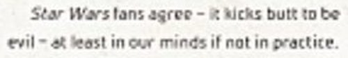
- **none** — entry/section: Looks cooler: ""So why is the dark side stronger? First of all, there's the plain and simple truth that the dark side looks so much cooler." —Mary Franklin, Star Wars Insider 93, p. 61" Source: *Star Wars Insider #93* (2007), scan p.61
  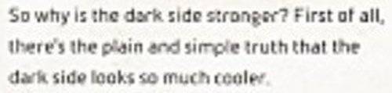

### Stat block notes (game mechanics, not feats)

- Dark side question: I pondered why Star Wars fans, who in my experience are extremely thoughtful, community-minded people, generally prefer dark lords to Jedi and clone troopers to Ewoks. (Star Wars Insider 93, p. 61) (Source: *Star Wars Insider #93* (2007), scan p.61)

## scan p.62 (scan page 62)

Page contents: Indy Vault opener: Raiders-era costume sketch of Indiana Jones with handwritten notes beside a photo of Harrison Ford in costume (hand-read)

### Stat block notes (game mechanics, not feats)

- Costume notes: 15 hats ... 10-12 pant 25 shirt 10 leather jacket 5 pr boots (Star Wars Insider 93, p. 62) (Source: *Star Wars Insider #93* (2007), scan p.62)

## scan p.63 (scan page 63)

Page contents: Indy Vault #1 "Designs on Indy: a sneak peek at the earliest concepts for Raiders of the Lost Ark opens Insider's first foray inside the Indy vault..." (words: J.W. Rinzler): early costume sketch with notes (Deborah Nadoolman), and Indy's .455 S&W revolver reference photo with property master Frank Bruton's accessory note; next issue: "Indiana Jones Lays an Egg" (hand-read)

### Stat block notes (game mechanics, not feats)

- Wilson's House of Suede: The notations were made before George Lucas and Steven Spielberg had cast their swashbuckling archaeologist, circa early 1980, hence the words written on the sheet: "Wilson's House of Suede, for style until character cast." (Star Wars Insider 93, p. 63) (Source: *Star Wars Insider #93* (2007), scan p.63)
- Nadoolman: The costume designer on Raiders of the Lost Ark was Deborah Nadoolman, who presumably is the author behind the remarks written on the sketch, and she emphasizes, in red, that this is the "basic outfit worn off and on thru-out movie." (Star Wars Insider 93, p. 63) (Source: *Star Wars Insider #93* (2007), scan p.63)
- Indy's pistol: The property master on Raiders was Frank Bruton, who, again presumably, was responsible for the research into possible firearms for Lucas and Spielberg's approval. (Star Wars Insider 93, p. 63) (Source: *Star Wars Insider #93* (2007), scan p.63)
- Gun accessories: "Required for use with this gun: 1 flap-over holster (well used); 6 dummy bullets; 25 blanks - 1/2 charge; 25 blanks - 1/4 charge)." (Star Wars Insider 93, p. 63) (Source: *Star Wars Insider #93* (2007), scan p.63)

## scan p.64 (scan page 64)

Page contents: Comlink letters opener "Your Star Wars Memories: UK": 30th anniversary look back at seeing Star Wars in Britain; write-in addresses box (Titan US/UK, [email omitted]); reader memories (letter-writer names omitted): first viewings, early figures, Blockade Runner opening (hand-read)

## scan p.65 (scan page 65)

Page contents: Comlink UK memories cont.: reader letters headed "Silence is Golden", "Space Warfare", "Toy Story" (letter-writer names and relatives omitted); stills of Han Solo, Luke and Leia, C-3PO (hand-read)

## scan p.66 (scan page 66)

Page contents: Comlink UK memories cont.: letters "Video Stars", "Overture to Adventure", "Beta Testing..." (names omitted); 20th Century Fox logo and Tusken Raider still; call-out inviting further Star Wars memories (hand-read)

## scan p.67 (scan page 67)

Page contents: Advertisement: "Subscribe Now!" Star Wars Insider UK subscription for £27.50 with membership of the Official UK Star Wars Fan Club (membership card, Star Wars Celebration in London benefits, Emperor's Emporium prices, 10% Forbidden Planet discount, two A2 posters, two art cards); order form and Direct Debit form (hand-read)

## scan p.68 (scan page 68)

Page contents: Next Issue: "Celebrate 30 Years with Star Wars Insider": exclusive star interviews, behind-the-scenes access, "The Star Wars Effect"; 100-page special anniversary collectors' edition; US newsstands 5 June, UK newsagents 7 June (hand-read)

### Stat block notes (game mechanics, not feats)

- Next issue: DON'T MISS THIS 100-PAGE SPECIAL ANNIVERSARY COLLECTORS' EDITION OF STAR WARS INSIDER! (Star Wars Insider 93, p. 68) (Source: *Star Wars Insider #93* (2007), scan p.68)

## scan p.69 (scan page 69)

Page contents: Advertisement: Forbidden Planet "The Emperor's Emporium" mail order (left page): R2-D2 Projector, Anakin's FX Lightsaber, Order 66 Anakin and 501st Airborne Trooper two-pack and other Order 66 packs, Stormtrooper Data Stick; Fan Club Special 10% discount box; contact, postage and payments boxes (hand-read)

## scan p.70 (scan page 70)

Page contents: Emperor's Emporium cont.: Ambush on Ilum battle pack, Knights of the Old Republic Vol. 1: Commencement, Legacy of the Force: Exile, Star Wars: Empire Vol. 7: The Wrong Side of the War; order form (hand-read)

## scan p.71 (scan page 71)

Page contents: Advertisement: "Back Issues!" Star Wars Magazine (UK) back issue covers and order form via Titan (hand-read)

## scan p.72 (scan page 72)

Page contents: Advertisement: The Collector Zone "Star Wars: The Force Will Be With You, Always": Force FX lightsaber, Saga Collectors Gift Pack, Darth Vader limited edition lightsaber, die-cast Republic Gunship, Chatz quotable mug set, C-3PO and Yoda cookie jars (hand-read)

## scan p.73 (scan page 73)

Page contents: Cover (UK edition, printed issue number reads "Issue #69 May/June 2007", £4.50; low resolution): "A Long Time Ago....: Star Wars: The Past, the Present, the Future!" with Leia, Vader and Luke; top boxes "Celebration IV Update: the latest news", "The Indy Vault: explore the archives", "CGI Star Wars: sneak peek inside!"; plus lines: lost Star Wars storyboards, how Star Wars became part of the language, weird collectibles, your Star Wars memories, "The adventure continues with Star Wars: The Force Unleashed!" (hand-read)

