# Owner Material 038 — Star Wars Insider #1–153 plus specials (with The Lucasfilm Fan Club Magazine #1–22): Star Wars Insider #94 (2007)

- **Source:** *Star Wars Insider* magazine (issues 23–153, 1994–2014) and its predecessor *The Lucasfilm Fan Club Magazine* (issues 1–22, 1987–1994), plus seven special editions: articles, interviews, comics and short fiction Secondary source (licensed Legends reference). Scan OCR'd on the box; the scan stays box-only and is **not** published.
- **Method:** every scanned page was OCR'd and machine-screened sentence by sentence for power-relevant statements (fights, kills, defeats, Force feats, rankings, superweapons) that name a character on our roster; each kept sentence is quoted verbatim from the OCR text and has a crop of the printed passage directly under it. Pages with nothing power-relevant are still listed with what is on them.
- **Citation:** "*Star Wars Insider #94* (2007), p.X" by printed page ("scan p.X" where no printed number applies). **Weight:** Licensed magazine: a secondary source. Its short fiction and comics are Legends stories; its articles and interviews sum up or discuss lore and rank below the novels, comics and games they describe.

## scan p.1 (scan page 1)

Page contents: Cover: Star Wars Insider #94 July/August 2007, "Exclusive Collector's Edition 100-Page Anniversary Special!" Darth Vader, "Legacy: Star interviews: making Star Wars in their own words!"; plus: the Star Wars Effect, stuntman Peter Diamond "the fall guy", thirty years of Star Wars memories, latest gear; "Celebrating 30 years of the greatest space saga of them all!" (hand-read)

## scan p.2 (scan page 2)

Page contents: Contents (part 1): Editor's Welcome "First Steps into a Larger World"; Com-Scan (Star Wars stamp, Indiana Jones, Lucas on Star Wars TV, Robot Chicken); In Focus: Gentle Giant; Best of StarWars.com; cover feature "Star Wars: 30 Years": The Star Wars Effect Part 1; interviews Mark Hamill, Koo Stark & Garrick Hagon; Anthony Daniels, Kenny Baker, Phil Brown & Shelagh Fraser; Harrison Ford, Peter Mayhew & Declan Mulholland; Carrie Fisher; Peter Diamond; Star Wars Effect Part 2; tribute Peter Cushing; interviews David Prowse & James Earl Jones; tribute Alec Guinness; "The Empire Strikes Fact!" (hand-read)

## scan p.3 (scan page 3)

Page contents: Contents (part 2) Departments: Jawa's Corner: Books: Back Pages (first Star Wars book boom of 1977); Comics: Star Wars Legacy "The Ghosts of Ossus" (Cade Skywalker faces his past); Toys "This Is No Cave...." (space slug 'enviorama', new Hasbro figures); Star Wars Q&A; Scouting the Galaxy (Steve Sansweet); International Collecting: Australia; Set Piece: Naboo Royal Starship ("Which part of this Royal vehicle is made out of old lawnmower pieces?"); Padawan's Corner (sketching C-3PO); Bantha Tracks; The Indy Vault #2; Comlink Letters (hand-read)

## scan p.4 (scan page 4)

Page contents: Advertisement: Wizkids Star Wars Pocketmodel TCG "Build Your Empire" June 2007 (punch 'em out, build 'em, play!; game pack contents) (hand-read)

## scan p.5 (scan page 5)

Page contents: Editor's Welcome "First Steps into a Larger World" (Brian J. Robb, Editor): first encounters with Star Wars, 30th anniversary, Bonnie Burton's rock star interviews on starwars.com, Darren Hayes of Savage Garden featured; contact box and masthead; Vader vs. Obi-Wan still (hand-read)

### Stat block notes (game mechanics, not feats)

- First step: In the words of Obi-Wan Kenobi, we all took that "first step into a larger world." Little did we know how large the world of Star Wars would grow to be. (Star Wars Insider 94, p. 05) (Source: *Star Wars Insider #94* (2007), scan p.5)

## scan p.6 (scan page 6)

Page contents: Com-Scan "Mail the Force Be with You.... Star Wars becomes stamp wars": 15 new 41-cent US postage stamps unveiled at Grauman's Chinese Theatre; first-day-of-issue at Celebration IV on May 25; R2-D2 mailboxes from March 16; stamp sheet images; Indiana Jones Newsreel header (hand-read)

### Stat block notes (game mechanics, not feats)

- Stamps: Iconic characters from the Star Wars saga are featured on 15 new 41-cent postage stamps unveiled at Grauman's Chinese Theatre in Los Angeles, where the first Star Wars movie opened almost 30 years ago. (Star Wars Insider 94, p. 06) (Source: *Star Wars Insider #94* (2007), scan p.6)
- First-day ceremony: The stamps went on sale and had a first-day-of-issue ceremony on Friday, May 25, at Star Wars Celebration IV, at the Los Angeles Convention Center. (Star Wars Insider 94, p. 06) (Source: *Star Wars Insider #94* (2007), scan p.6)
- R2-D2 mailboxes: Failor announced the Star Wars and U.S. Postal Service collaboration, which began March 16, when mailboxes around the country were designed to look like R2-D2. (Star Wars Insider 94, p. 06) (Source: *Star Wars Insider #94* (2007), scan p.6)

## scan p.7 (scan page 7)

Page contents: Com-Scan cont.: "Fans Deliver Their Verdict!" (public vote for favorite stamp at www.uspsjedimaster.com, March 28 to May 23); "Designs on Success" (stamp sheet design, Drew Struzan); stamp images; "Ford and LaBeouf Race into Action as George Lucas Talks Indiana Jones" (waterfall location, Connery not yet signed, Shia LaBeouf cast, shooting June, release May 22, 2008) (hand-read)

### Stat block notes (game mechanics, not feats)

- Stamp vote: The stamp that recieves the most votes wins the honor of being issued as a single stamp, which will go on sale later this summer. (Star Wars Insider 94, p. 07) (Source: *Star Wars Insider #94* (2007), scan p.7)
- Vader stamp: The background also includes the lightsaber-wielding form of Darth Vader, whose helmet comprises the largest of the 15 stamps. (Star Wars Insider 94, p. 07) (Source: *Star Wars Insider #94* (2007), scan p.7)
- Connery: Although, at the time of going to press, Sean Connery has yet to sign up to reprise his role as Dr. Henry Jones, Lucas admits: "We're still trying." (Star Wars Insider 94, p. 07) (Source: *Star Wars Insider #94* (2007), scan p.7)

## scan p.8 (scan page 8)

Page contents: Com-Scan "Lucas Hints at 'Adult' TV Star Wars: Stormtroopers called into action on the small screen!" (USA Today at Toyota Pro/Celebrity Race; SFGate); "Clone Wars 3D to 'Push Boundaries'" (Directors Guild of America); Kit Fisto image; sidebar Blaster "I Want That Ship!" Master Replicas at CIV booth #1101: Millennium Falcon studio scale replica competition, Wedge Antilles X-wing pilot helmet scaled replica (1,500 pieces, $55), Medal of Yavin replica (2,500, $15), Force FX Combat Trials, The Vader Project (over 50 artists painted Vader helmets) (hand-read)

- **none** — entry/section: Not the Skywalkers: ""Ours will be very different. It's very Star Wars, but it doesn't involve the Skywalkers." —George Lucas, Star Wars Insider 94, p. 08" Source: *Star Wars Insider #94* (2007), scan p.8
  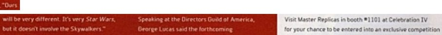
- **none** — entry/section: More adult: ""A little bit more adult, it will be something most people have never seen on television before." —George Lucas, Star Wars Insider 94, p. 08" Source: *Star Wars Insider #94* (2007), scan p.8
  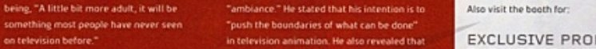

### Stat block notes (game mechanics, not feats)

- Kit Fisto episode: Lucas promised, "episodes with nothing but stormtroopers," (he clarified these would be the earlier "clone trooper" versions), and an "episode just about Kit Fisto," referring to the popular Jedi Knight from Attack of the Clones and Revenge of the Sith. (Star Wars Insider 94, p. 08) (Source: *Star Wars Insider #94* (2007), scan p.8)
- Vader Project: Over 50 artists were given unpainted Darth Vader Helmets - with amazing results! (Star Wars Insider 94, p. 08) (Source: *Star Wars Insider #94* (2007), scan p.8)

## scan p.9 (scan page 9)

Page contents: Advertisement: Dark Horse "Discover Heroes / Discover Star Wars / Discover Dark Horse": Luke in Jedi robes; Rebellion Vol. 1 My Brother, My Enemy; Star Wars Omnibus: X-Wing Rogue Squadron; Star Wars Panel to Panel; "Celebrating 30 years of adventure!"; discover.darkhorse.com (hand-read)

## scan p.10 (scan page 10)

Page contents: Com-Scan "Star Wars Events: Special Reports": "Star Wars Show Lands in London" (Star Wars: The Exhibition, County Hall, Westminster, until September 1, 2007, with the life-size Naboo N-1 Starfighter); "Star Wars Hits Lone Star State" (Where Science Meets Imagination at Fort Worth Museum of Science and History, June 9 to September 3; then Franklin Institute and Science Museum of Minnesota); "Sith and Fetts Descend on Celebration Europe" (ExCeL London July 13-15) (hand-read)

### Stat block notes (game mechanics, not feats)

- London exhibition: The new exhibition presents original film props, models, art, vehicles and costumes from all six Star Wars episodes and showcases the artistry and storytelling that have made the films some of the most popular in history. (Star Wars Insider 94, p. 10) (Source: *Star Wars Insider #94* (2007), scan p.10)
- Naboo starfighter: The exhibition will feature an array of items brought over especially from the Lucasfilm Archives, and will also include the spectacular life-size Naboo N-1 Starfighter. (Star Wars Insider 94, p. 10) (Source: *Star Wars Insider #94* (2007), scan p.10)
- Science and Imagination: Star Wars: Where Science Meets Imagination, a travelling exhibition that combines costumes and props from all six Star Wars films with real-world technology, will be arriving at The Fort Worth Museum of Science and Technology in Texas from June 9 until September 3. (Star Wars Insider 94, p. 10) (Source: *Star Wars Insider #94* (2007), scan p.10)
- CE guests: Actors David Prowse, Ray Park, Temuera Morrison, Daniel Logan and Jeremy Bulloch are scheduled to appear at the event at ExCeL London, July 13-15 to celebrate the 30th Anniversary of Star Wars. (Star Wars Insider 94, p. 10) (Source: *Star Wars Insider #94* (2007), scan p.10)
- LEGO UCS Falcon: LEGO will be unveiling its new ultimate collector's Millennium Falcon - the largest LEGO model ever made! (Star Wars Insider 94, p. 10) (Source: *Star Wars Insider #94* (2007), scan p.10)

## scan p.11 (scan page 11)

Page contents: Com-Scan "Celebration Exclusives": "This Time, He Is the Bounty!" (Gentle Giant Droids-style Boba Fett maquette, 1,000 pieces, ~700 at CIV); "These Are the Droids You're Looking For!" (McQuarrie concept R2-D2 & C-3PO figure two-pack with CIV and CE coins; badge-punch purchase limits); "Another Ralph Rarity" (McQuarrie Signature Series Luke Skywalker); "Coining It In" (24 coins commemorating the first 12 Kenner figures) (hand-read)

### Stat block notes (game mechanics, not feats)

- Droids Fett maquette: The StarWarsShop Celebration convention exclusive will be a Gentle Giant classic animation Boba Fett maquette limited to just 1,000 pieces. Based on Fett's color scheme as he appeared in the Droids animated series from the 1980s (in fact, the colors were modeled after Kenner's action figure cardback artwork) (Star Wars Insider 94, p. 11) (Source: *Star Wars Insider #94* (2007), scan p.11)
- McQuarrie droids: Modeled after artist Ralph McQuarrie's original concept illustrations for iconic droids R2-D2 and C-3PO, this action figure Celebration exclusive celebrates the 30-year legacy of the Star Wars saga as well as the creative, guiding vision of McQuarrie, whose drawings helped George Lucas convince studio directors to back the very first Star Wars movie. (Star Wars Insider 94, p. 11) (Source: *Star Wars Insider #94* (2007), scan p.11)
- McQuarrie Starkiller: McQuarrie's early illustration of Darth Vader battling a Rebel hero - a figure who would ultimately evolve into the character of Luke Skywalker - remains a powerful image that many fans count among McQuarrie's best. (Star Wars Insider 94, p. 11) (Source: *Star Wars Insider #94* (2007), scan p.11)
- Kenner coins: Also available at the Celebration events will be a set of 24 coins (12 different designs at each event) commemorating the first 12 Kenner action figures. (Star Wars Insider 94, p. 11) (Source: *Star Wars Insider #94* (2007), scan p.11)

## scan p.12 (scan page 12)

Page contents: Left column ad: Star Wars Insider 100-page special variant covers: Newsstand edition (Legacy, Vader), Celebration IV edition (StarWars.com store and Insider booth), Diamond Exclusive Part One "1977" (available now) and "2007" (available 7/24/07, completed by Insider #95). Com-Scan "Robot Chicken Goes to the Dark Side! Satirical puppet show spoofs Star Wars" (words: Bonnie Burton): Seth Green and Matthew Senreich, premiere June 17, 2007 on Adult Swim; "Funny Force" (Emperor's Phone Call; Plastic Earth George Lucas likeness; Lucas recorded his voice) (hand-read)

- **none** — entry/section: Funny and ironic: ""It's a funny and ironic take on Star Wars. We poke fun at the things we take seriously." —Seth Green, Star Wars Insider 94, p. 12" Source: *Star Wars Insider #94* (2007), scan p.12
  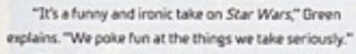
- **none** — entry/section: Dream come true: ""It's a cliché to say but this is a dream come true. How many people can say that George Lucas let them play with his Star Wars universe?" —Matthew Senreich, Star Wars Insider 94, p. 12" Source: *Star Wars Insider #94* (2007), scan p.12
  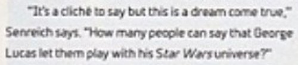
- **C-3PO; R2-D2** — entry/section: Four-year-old: ""I remember vividly being a four-year-old kid and seeing all the desert scenes for Tatooine, and then I saw C-3PO and R2-D2 and thought they were the most amazing things I'd ever seen." —Seth Green, Star Wars Insider 94, p. 12" Source: *Star Wars Insider #94* (2007), scan p.12
  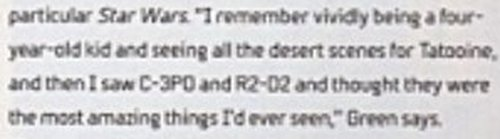

### Stat block notes (game mechanics, not feats)

- Covers: To celebrate Star Wars' 30th anniversary, this Star Wars Insider 100-page special is available in a variety of different, highly collectible covers. (Star Wars Insider 94, p. 12) (Source: *Star Wars Insider #94* (2007), scan p.12)
- Robot Chicken: Star Wars: Premiering on June 17, 2007 (on Cartoon Network's Adult Swim line-up), Robot Chicken: Star Wars combines their satirical sensibilities with the unforgettable moments and favorite characters of the Star Wars universe - plus, its creator himself, George Lucas. (Star Wars Insider 94, p. 12) (Source: *Star Wars Insider #94* (2007), scan p.12)

## scan p.13 (scan page 13)

Page contents: Advertisement: Gentle Giant Ltd World Tour 2007 Star Wars: Star Wars Animated Yoda & R2-D2 maquette; Commander Gree mini bust (Celebration IV, May); Bust-Ups Luke Skywalker & Han Solo; Commanders Neyo (Blister Event Tokyo, June), Bly (Forbidden Planet UK, July), Cody light-up (San Diego Comic-Con, July), Bacara (Baltimore Comic-Con, September); also at CIV: Spirit of Yoda light-up mini bust and Darth Malak mini bust (hand-read)

## scan p.14 (scan page 14)

Page contents: In Focus "Gentle Giant's All Star Cast": Princess Leia mini bust (6,000, $50), Obi-Wan Kenobi mini bust (6,000, $50), Dengar mini bust (4,000, $50), Clone Wars Yoda on Kybuck maquette (3,500, $90), Jabba the Hutt statue with Oola and a Jawa (2,500, $295); arrival dates June/July '07 (hand-read)

### Stat block notes (game mechanics, not feats)

- Dengar bust: First seen in The Empire Strikes Back, Dengar - one of the most lethal bounty hunters - is now available as a mini bust. (Star Wars Insider 94, p. 14) (Source: *Star Wars Insider #94* (2007), scan p.14)
- Yoda on Kybuck: One of the most unforgettable images of the Clone Wars series was that of Yoda on a Kybuck charging into battle. (Star Wars Insider 94, p. 14) (Source: *Star Wars Insider #94* (2007), scan p.14)
- Jabba statue: This stunningly detailed Jabba the Hutt statue features the ill-fated Oola as well as his very own Jawa, employed to help keep the exhalted, but impatient one cool! (Star Wars Insider 94, p. 14) (Source: *Star Wars Insider #94* (2007), scan p.14)

## scan p.15 (scan page 15)

Page contents: In Focus cont.: Jabba's Palace Band statue (Max Rebo, Droopy McCool, Sy Snootles, Salacious Crumb; 2,500, $195); Jawa mini bust two-pack (light-up eyes, 7,000, $60); Celebration IV/World Tour box (Animated Yoda & R2-D2 maquette $90, Bust-Up Luke & Han in stormtrooper disguise $10, CIV-only Darth Malak, Spirit of Yoda, Commander Gree mini busts); Summer Exclusives list (Neyo at Blister Tokyo June 16, Bly at Forbidden Planet UK July 12, Cody at San Diego Comic-Con July 26-29, Bacara at Baltimore Comic-Con Sept 8-9); clone commander busts (hand-read)

### Stat block notes (game mechanics, not feats)

- Band statue: This statue, depicting Jabba's Palace Band, features Max Rebo, Droopy McCool and the exotic lead singer, Sy Snootles. Also getting in on the act is everybody's favorite Kowakian monkey-lizard, Salacious Crumb! (Star Wars Insider 94, p. 15) (Source: *Star Wars Insider #94* (2007), scan p.15)

## scan p.16 (scan page 16)

Page contents: Best of StarWars.com "Who to Draw First? Greedo or Han? In You Can Draw Star Wars, the decision is all yours...." (words: Pete Vilmur & Bonnie Burton): DK book written by Bonnie Burton and illustrated by Matt Busch and Tom Hodges; origin in the starwars.com Learn to Draw section; sample spreads (Color Basics, Clone Wars) (hand-read)

- **none** — entry/section: Never got tired: ""There is so much variety in the techniques presented in the book, as well as subject matter, that I never got tired of working on it." —Matt Busch, Star Wars Insider 94, p. 16" Source: *Star Wars Insider #94* (2007), scan p.16
  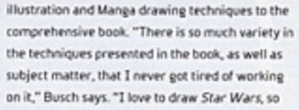
- **none** — entry/section: Adverts: ""I was drawing Star Wars characters and ships from the day I saw the movie on opening weekend. And at the time, there was little more to go on than my memories from the film and adverts in magazines and newspapers." —Tom Hodges, Star Wars Insider 94, p. 16" Source: *Star Wars Insider #94* (2007), scan p.16
  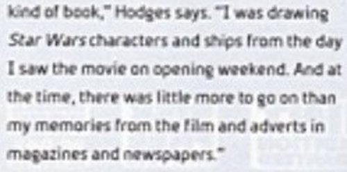
- **none** — entry/section: Whole reason: ""Star Wars is the whole reason I got into drawing in the first place." —Matt Busch, Star Wars Insider 94, p. 16" Source: *Star Wars Insider #94* (2007), scan p.16
  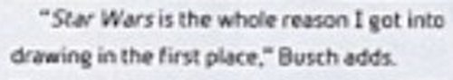

### Stat block notes (game mechanics, not feats)

- You Can Draw: Written by Bonnie Burton and illustrated by Star Wars artists Matt Busch and Tom Hodges, You Can Draw: Star Wars has something for veteran fans and artists alike. (Star Wars Insider 94, p. 16) (Source: *Star Wars Insider #94* (2007), scan p.16)

## scan p.17 (scan page 17)

Page contents: Best of StarWars.com cont.: You Can Draw Star Wars sample spreads (Muscle, Service Droids, Weapons, Male and Female, Creating a Comic); pull quote from Tom Hodges; Durge battle scene, Gonk droid, mouse droids; book from DK Publishing and StarWarsShop.com (hand-read)

- **Obi-Wan Kenobi; Durge** — entry/section: Durge rampaging: ""The battle scene section with Obi-Wan Kenobi and the clones, with Durge rampaging, was my favorite piece to illustrate for the book." —Tom Hodges, Star Wars Insider 94, p. 17" Source: *Star Wars Insider #94* (2007), scan p.17
  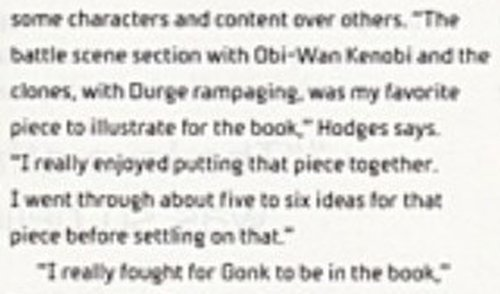
- **none** — entry/section: Gonk: ""I really fought for Gonk to be in the book. He's one of those droids that people tend to overlook. I'm a big fan of drawing minor and obscure characters from the saga like the Sarlacc and mouse droids." —Bonnie Burton, Star Wars Insider 94, p. 17" Source: *Star Wars Insider #94* (2007), scan p.17
  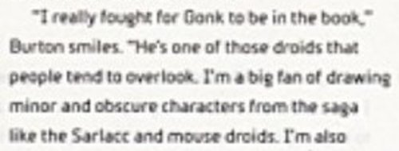
- **none** — entry/section: Reality: ""Look to reality as well for inspiration. Draw everything you can think of whether it be foldsin clothing, cars driving down the street, or whatever you see on your block. Looking to reality will help you create fantasy." —Tom Hodges, Star Wars Insider 94, p. 17" Source: *Star Wars Insider #94* (2007), scan p.17
  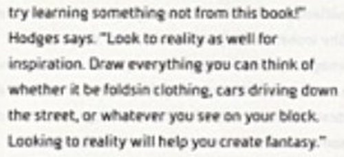
- **R2-D2** — entry/section: Baked potato: ""Be willing to make mistakes and not get too frustrated, even if your first attempt at drawing R2-D2 looks like a baked potato on wheels." —Bonnie Burton, Star Wars Insider 94, p. 17" Source: *Star Wars Insider #94* (2007), scan p.17
  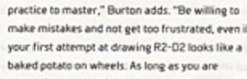

## scan p.18 (scan page 18)

Page contents: StarWars.com "Darren Hayes Singing Star Wars' Praises": the Savage Garden singer on auditioning for Episode II (Rick McCallum, casting director Robin Gurland), song lyrics, first Vader encounter at the Brisbane 'Ekka' fair in 1977, a Christmas carry-case gift, his collection; pull quote on Leia and Han; photo of Darren Hayes (hand-read)

- **none** — entry/section: Dead Wookiee: ""I remember sitting in front of casting director Robin Gurland who patiently waited while I did my best American accent. She looked at me puzzled and said, 'What do you imagine yourself doing?' I thought for a second and said, 'Look, I'll do anything. I'll play a rock, a tree, a dead Wookiee - ANYTHING!'" —Darren Hayes, Star Wars Insider 94, p. 18" Source: *Star Wars Insider #94* (2007), scan p.18
  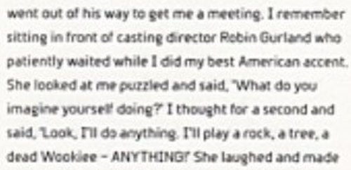
- **none** — entry/section: Lightsaber handle: ""The microphone is not unlike the lightsaber handle. The weapons may differ but the job description is pretty similar: Save the universe. Win the girl (or guy). Roll credits." —Darren Hayes, Star Wars Insider 94, p. 18" Source: *Star Wars Insider #94* (2007), scan p.18
  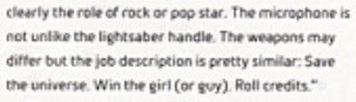
- **Darth Vader (Anakin Skywalker)** — entry/section: Love at first sight: ""It featured a mask of this imposing black 'robot' who I later found out was the infamous Darth Vader. You could say it was love at first sight - almost literally." —Darren Hayes, Star Wars Insider 94, p. 18" Source: *Star Wars Insider #94* (2007), scan p.18
  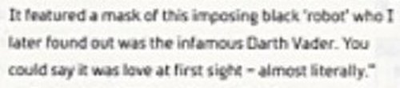
- **Leia Organa Solo; Han Solo** — entry/section: Love affair: ""The love affair between Leia and Han was so believable and full of sparks." —Darren Hayes, Star Wars Insider 94, p. 18" Source: *Star Wars Insider #94* (2007), scan p.18
  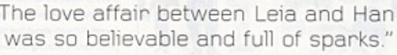
- **R2-D2** — entry/section: McQuarrie designs: ""I'm the most passionate about Ralph McQuarrie designs including R2-D2, the AT-AT and the Scout Trooper. Darth Vader goes without saying." —Darren Hayes, Star Wars Insider 94, p. 18" Source: *Star Wars Insider #94* (2007), scan p.18
  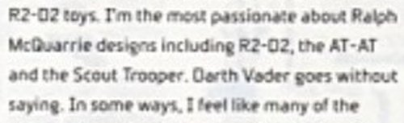

## scan p.19 (scan page 19)

Page contents: Darren Hayes cont. (photo of Hayes with a Chewbacca; favorite films, Empire, twin sunset scene); "Communications Disruption: Photo Caption Contest: Leia-ing Around": StarWars.com fans caption a rare photo of Carrie Fisher lying on the set floor (top 10 captions; fan handles omitted); link to Star Wars Rocks (hand-read)

## scan p.20 (scan page 20)

Page contents: Full-page montage art of the original trilogy cast (Luke, Leia, Han, Obi-Wan, Vader, Tarkin, Chewbacca, droids, stormtrooper, Greedo, X-wings) (hand-read)

## scan p.21 (scan page 21)

Page contents: Cover feature opener "A Star Wars Celebration: In Their Own Words": "You Said It, Chewie!": raiding the archives for the stars' views of Star Wars, with seldom-seen photos and interviews from the early days of Star Wars Magazine; plus the Star Wars Effect on film culture and movie technology (hand-read)

### Stat block notes (game mechanics, not feats)

- Opener: To celebrate the 30th anniversary of the greatest space saga of them all, we've raided the archives to present the stars' views of Star Wars, illustrated with seldom seen photographs and interviews from the early days of Star Wars Magazine that tell the story in the stars' own words! (Star Wars Insider 94, p. 21) (Source: *Star Wars Insider #94* (2007), scan p.21)

## scan p.22 (scan page 22)

Page contents: "The Star Wars Effect: Part 1: The Sincerest Form" (words: Paul Simpson): imitators of the late 1970s; blockbuster history (The Towering Inferno, Jaws, 2001, Planet of the Apes licensing); stills: George Lucas and stormtrooper, Alien (1979), Death Star assault shoot at ILM, Mark Hamill visiting the Death Star surface model; caption on the opening crawl (hand-read)

- **none** — entry/section: Didn't change the movie business: ""People have funny visions about Star Wars and what happened. They always say it changed the movie business. Star Wars didn't change the movie business." —George Lucas, Star Wars Insider 94, p. 22" Source: *Star Wars Insider #94* (2007), scan p.22
  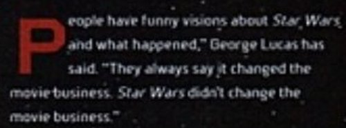

### Stat block notes (game mechanics, not feats)

- Memorial Day: It wasn't set for release on either of the two big days in the U.S. film-going calendar - Christmas Day or the July 4th weekend - but instead for Memorial Day weekend, when the film's natural audience of school children were still in the midst of lessons. (Star Wars Insider 94, p. 22) (Source: *Star Wars Insider #94* (2007), scan p.22)
- Licensing boom: But while there were licensed products from The Planet of the Apes movies and James Bond films, it was the immense, worldwide success of Star Wars merchandise that kicked off the boom in licensed products. (Star Wars Insider 94, p. 22) (Source: *Star Wars Insider #94* (2007), scan p.22)
- Opening crawl caption: The opening crawl text went through various permutations before it was finalized for the film (Star Wars Insider 94, p. 22) (Source: *Star Wars Insider #94* (2007), scan p.22)

## scan p.23 (scan page 23)

Page contents: Star Wars Effect Part 1 cont. "...Of Flattery": "Bringing Balance to the Force": Close Encounters, Superman: The Movie and Star Trek: The Motion Picture; stills of Lucas behind the camera, Death Star model, Superman, Close Encounters; posters Battlestar Galactica, Blade Runner, Star Trek: The Motion Picture; display head "Star Wars had proved that there was an audience for sci-fi and fantasy" (hand-read)

### Stat block notes (game mechanics, not feats)

- Rushed into production?: There's a common belief that films like Close Encounters of the Third Kind, Superman: The Movie and Star Trek: The Motion Picture were rushed into production as a result of the success of Star Wars. Certainly the amount of attention given to each film by its respective studio was increased once Star Wars had proved that there was an audience for sci-fi and fantasy, but such films don't happen overnight. (Star Wars Insider 94, p. 23) (Source: *Star Wars Insider #94* (2007), scan p.23)

## scan p.24 (scan page 24)

Page contents: Star Wars Effect Part 1 cont.: Star Trek: Phase II becomes a film; Moonraker; Battlestar Galactica, Buck Rogers in the 25th Century (Twiki), Doctor Who's K-9; Space: Above and Beyond; display head "Moonraker tried to ride the Star Wars wave, but the combination of genres was not successful"; photos Dennis Muren at work on a Y-wing, ILM modelmaker on a Star Destroyer, Buck Rogers poster, C-3PO, Luke on Tatooine (hand-read)

### Stat block notes (game mechanics, not feats)

- Galactica cost: Tapping a similar mix of old film serials, heroic archetypes and evil empires, Galactica was the most expensive TV show of its time. It cost over one million dollars an episode in 1978, but that expense ended up being its downfall. (Star Wars Insider 94, p. 24) (Source: *Star Wars Insider #94* (2007), scan p.24)
- Flash Gordon: George Lucas had met with King Features Syndicate, which owned the rights to Alex Raymond's hero Flash Gordon, prior to developing Star Wars, but discovered that they weren't willing to part with the rights. (Star Wars Insider 94, p. 24) (Source: *Star Wars Insider #94* (2007), scan p.24)
- Twiki: Buck Rogers in the 25th Century was a tongue-in-cheek action series, whose most obvious debt to Star Wars was the creation of Twiki, a small robot (about R2-D2's height and C-3PO's shape) with a line of smart-aleck remarks. (Star Wars Insider 94, p. 24) (Source: *Star Wars Insider #94* (2007), scan p.24)
- Dogfight footage: Lucas had used footage of dogfights to visualize the final battle over the Death Star, later replacing it with finished effects footage. (Star Wars Insider 94, p. 24) (Source: *Star Wars Insider #94* (2007), scan p.24)

## scan p.25 (scan page 25)

Page contents: Star Wars Effect Part 1 concl.: "What a Pile of Junk!": lived-in universe (Guinness rolling in the Tunisian desert to age his robe), Alien and Blade Runner; imitators (Laserblast, Starcrash/Stella Star); Lucas helping Kurosawa's Kagemusha, Mishima, Latino, Powaqqatsi, Tucker; "turning to the dark side" and Reagan's SDI; photos C-3PO and Chewbacca at the hologram game, Luke and Ben, landspeeder, R2-D2, Buck Rogers' Twiki, Doctor Who's K-9; teaser to Part 2 on p.48 (hand-read)

### Stat block notes (game mechanics, not feats)

- Lived-in robe: Alec Guinness rolled around in the Tunisian desert to turn his pristine robe provided for Obi-Wan Kenobi into something that a hermit would have worn for decades and there are bump and scratch marks on the speeders. (Star Wars Insider 94, p. 25) (Source: *Star Wars Insider #94* (2007), scan p.25)
- Into the language: It had brought new expressions into the English language - people still talked of someone "turning to the dark side", and President Ronald Reagan's Strategic Defense Initiative was colloquially known as "Star Wars" (Star Wars Insider 94, p. 25) (Source: *Star Wars Insider #94* (2007), scan p.25)

## scan p.26 (scan page 26)

Page contents: Full-page Luke Skywalker (Mark Hamill) with lightsaber; box "On Making Star Wars" (Hamill, archival interview): Carrie Fisher's Buck Rogers helium pistol for Lucas, Luke as Dorothy, imitating Lucas's inflection; stills Luke and Ben, Death Star corridor (hand-read)

## scan p.27 (scan page 27)

Page contents: "Mark Hamill: Luke Skywalker" (In Their Own Words): boxes "On the 1997 Star Wars Special Edition" and "On His Reluctance to Talk About Star Wars" (The Black Pearl comic); location photos with R2-D2, C-3PO and crew, Leia and Luke, Mos Eisley cantina, Obi-Wan and Luke (hand-read)

- **Luke Skywalker** — entry/section: Special Edition: ""When I saw Star Wars again at the [Special Edition] premiere in Los Angeles, that was the first time I'd seen it in 20 years. I think I held my breath for the whole two hours." —Mark Hamill, Star Wars Insider 94, p. 27" Source: *Star Wars Insider #94* (2007), scan p.27
  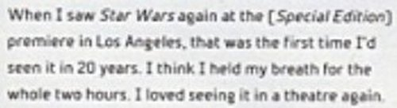
- **Luke Skywalker** — entry/section: Keep the magic: ""I kind of wanted to keep the magic, the secrets of Star Wars a secret; talking about it would have drained the magic from it. I didn't want to be the magician's assistant who gave away all the secrets." —Mark Hamill, Star Wars Insider 94, p. 27" Source: *Star Wars Insider #94* (2007), scan p.27
  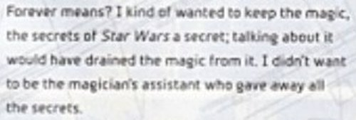
- **none** — entry/section: Bar Mitzvahs: ""At the time, I was thinking, "What's next? Bar Mitzvahs?" I wanted to do other things, and I did them." —Mark Hamill, Star Wars Insider 94, p. 27" Source: *Star Wars Insider #94* (2007), scan p.27
  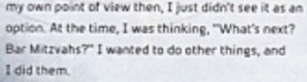

## scan p.28 (scan page 28)

Page contents: "Koo Stark: Camie": cut Tosche Station role; boxes "On Her Star Wars Experience", "On Being Considered for the Role of Princess Leia", "On George Lucas", "On the Passion of a Droid" (R2-D2 wandering onto the Jesus of Nazareth set), "George Lucas on Koo Stark's Cut Scene..."; also Hamill box "On Evaluating His Work in Star Wars"; stills Camie on Tatooine, Biggs and Luke, Anchorhead (hand-read)

- **Leia Organa Solo** — entry/section: Considered for Leia: ""As Star Wars was to be a low budget film, Carrie Fisher's agent was holding out for more money. But, when Fisher's agent changed his mind and signed the contract, George very kindly rang me at home and said how sorry he was that I hadn't got the part." —Koo Stark, Star Wars Insider 94, p. 28" Source: *Star Wars Insider #94* (2007), scan p.28
  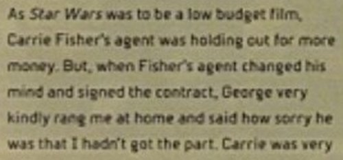
- **R2-D2** — entry/section: Wandering droid: ""They were filming Jesus of Nazareth on the same location. Operated by remote control, R2-D2 had to trundle off camera and disappear behind a sand dune. But the remote control failed to stop the robot and he wandered onto the set of Jesus of Nazareth!" —Koo Stark, Star Wars Insider 94, p. 28" Source: *Star Wars Insider #94* (2007), scan p.28
  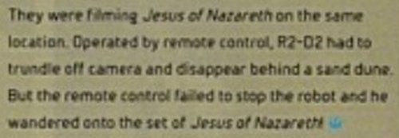
- **none** — entry/section: Visual mind: ""He had a very visual mind. Some people communicate very well through words and some through imagery." —Koo Stark, Star Wars Insider 94, p. 28" Source: *Star Wars Insider #94* (2007), scan p.28
  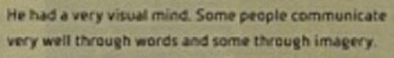

## scan p.29 (scan page 29)

Page contents: "Garrick Hagon: Biggs Darklighter" (In Their Own Words): Biggs backstory interest and the Special Edition reappearance; boxes "On Tosche Station" and "On Learning Lines with Mark Hamill"; carry-over sidebar "On Whether Star Wars Would Work Today" (speaker not labeled on page; Hamill section layout); stills Luke/Han/Leia/Biggs, Luke and Leia, Luke and Biggs in flight suits, Biggs in cockpit, Anchorhead reunion (hand-read)

- **Biggs Darklighter** — entry/section: One take: ""It was shot around this mosque on the edge of a bay. It was a brilliant location, and George positioned the camera a long way away. We did the scene in one take." —Garrick Hagon, Star Wars Insider 94, p. 29" Source: *Star Wars Insider #94* (2007), scan p.29
  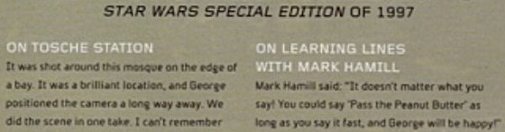
- **Biggs Darklighter** — entry/section: Cut Tosche scenes: ""It was a nice idea, a kind of kids together teenage scene that was very different from the rest of the film - but George decided it had to go." —Garrick Hagon, Star Wars Insider 94, p. 29" Source: *Star Wars Insider #94* (2007), scan p.29
  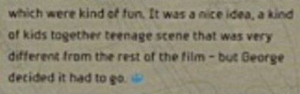

### Stat block notes (game mechanics, not feats)

- Would it work today (sidebar): Whenever you have a good story with good characters that people can relate to, you're already on third base. You need the public to step up to bat and drive you home. I'd like to say yes, Star Wars would be a hit today. But who knows? (Star Wars Insider 94, p. 29) (Source: *Star Wars Insider #94* (2007), scan p.29)

## scan p.30 (scan page 30)

Page contents: Full-page art C-3PO and R2-D2 with inset of C-3PO and Luke in the landspeeder; no body text (hand-read)

## scan p.31 (scan page 31)

Page contents: "Anthony Daniels & Kenny Baker: C-3PO & R2-D2" (In Their Own Words): boxes "Anthony Daniels on C-3PO's Costume" (sculptor Liz Moore, Vaseline and cling-film casting, 16 pieces) and "Kenny Baker on Life Inside R2-D2"; photos R2-D2 on set, Daniels and Baker out of costume, Tunisia location (hand-read)

- **R2-D2** — entry/section: Opaque window: ""There's just an opaque window, about four inches at the most in diameter and I couldn't see much at all." —Kenny Baker, Star Wars Insider 94, p. 31" Source: *Star Wars Insider #94* (2007), scan p.31
  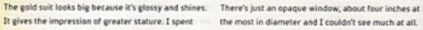
- **R2-D2** — entry/section: Acting inside: ""I'm acting away inside this thing. You just have to act through the costume." —Kenny Baker, Star Wars Insider 94, p. 31" Source: *Star Wars Insider #94* (2007), scan p.31
  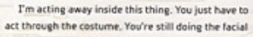

## scan p.32 (scan page 32)

Page contents: Daniels & Baker cont.: boxes "Anthony Daniels on His Distinctive C-3PO Voice", "Kenny Baker on His Star Wars Expectations", "Anthony Daniels on Working with Alec Guinness", "Kenny Baker on Mark Hamill" (Jack Purvis, cabaret circuit), "Anthony Daniels on Acting in the Suit", "Anthony Daniels on R2-D2" (Ben Burtt's voice); photos Tatooine location, C-3PO with crew, Daniels with Lucas (hand-read)

- **C-3PO** — entry/section: Radio mike: ""I spoke the lines as we filmed each scene. I had a tiny radio mike tucked into my left eyebrow." —Anthony Daniels, Star Wars Insider 94, p. 32" Source: *Star Wars Insider #94* (2007), scan p.32
  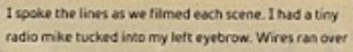
- **C-3PO** — entry/section: Another voice: ""I never realized that George Lucas would return to the States and search for another voice. I had sort of invented the personality the way I interpreted the script, but it wasn't quite what George had in mind." —Anthony Daniels, Star Wars Insider 94, p. 32" Source: *Star Wars Insider #94* (2007), scan p.32
  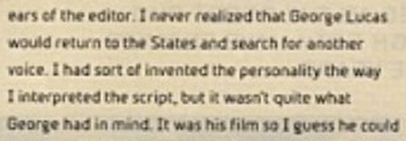
- **R2-D2** — entry/section: Beep: ""I asked George to say "beep" when I'd finished a speech and it was Artoo's turn to speak, but he was hopeless so I did it on my own. At the first screening of Star Wars I was amazed to hear what Ben Burtt had added as Artoo's voice." —Anthony Daniels, Star Wars Insider 94, p. 32" Source: *Star Wars Insider #94* (2007), scan p.32
  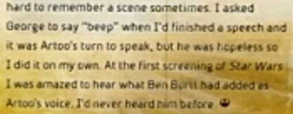

## scan p.33 (scan page 33)

Page contents: "Phil Brown: Uncle Owen" (blacklist victim relocated to the UK; died 2006) and "Shelagh Fraser: Aunt Beru" (acted until her death in 2000): boxes on the flight to Tunisia with Alec Guinness, the screenplay, meeting Lucas, Mark Hamill, Uncle Owen; the impact of Beru, George Lucas, Alec Guinness, Tunisia, preparing for her role, the success of Star Wars (hand-read)

- **Owen Lars** — entry/section: Curmudgeon: ""He was a straight-forward curmudgeon - which I am anyway, so it was easy for me to play. I've been a curmudgeon a long time." —Phil Brown, Star Wars Insider 94, p. 33" Source: *Star Wars Insider #94* (2007), scan p.33
  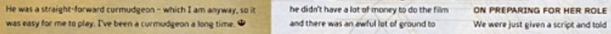
- **Luke Skywalker** — entry/section: Preparing: ""We were just given a script and told about our relationship with Luke. That's all we knew." —Shelagh Fraser, Star Wars Insider 94, p. 33" Source: *Star Wars Insider #94* (2007), scan p.33
  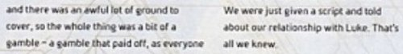

### Stat block notes (game mechanics, not feats)

- Brown intro: A victim of the McCarthyite Hollywood blacklist, Phil Brown's relocation from the US to the UK benefited Star Wars when he won the role of Uncle Owen. Brown died in 2006. (Star Wars Insider 94, p. 33) (Source: *Star Wars Insider #94* (2007), scan p.33)

## scan p.34 (scan page 34)

Page contents: Full-page art Han Solo with blaster and Chewbacca, Millennium Falcon; insets of the Falcon cockpit and Han; no body text (hand-read)

## scan p.35 (scan page 35)

Page contents: "Harrison Ford & Peter Mayhew: Han Solo & Chewbacca" (In Their Own Words): boxes "Peter Mayhew on Getting the Part of Chewbacca" (Sinbad and the Eye of the Tiger, Stuart Freeborn), "Harrison Ford on Acting in Star Wars", "Peter Mayhew on His First Day on the Star Wars Set" (Docking Bay 94 with Jabba), "Peter Mayhew on Chewie's Original Role", "Harrison Ford on Star Wars as a Fantasy"; stills Chewbacca and Leia, Mos Eisley, Falcon hold, Yavin medal ceremony group (hand-read)

- **Chewbacca** — entry/section: Big hairy creature: ""She said, "Well, it's a big hairy creature, and we want someone as big as we possibly can get." I said that was fine, what did I have to do?" —Peter Mayhew, Star Wars Insider 94, p. 35" Source: *Star Wars Insider #94* (2007), scan p.35
  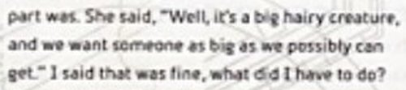
- **Chewbacca** — entry/section: Stood up: ""Then George came into the office and at the time I'd been sitting down on a chair, so I stood up and his eyes almost popped out of his head." —Peter Mayhew, Star Wars Insider 94, p. 35" Source: *Star Wars Insider #94* (2007), scan p.35
  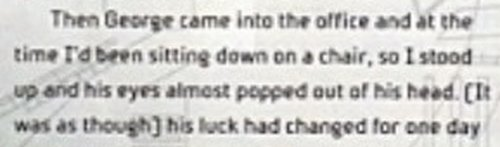
- **Han Solo** — entry/section: Powder puff: ""I'm not an athlete - I'm a notorious powder puff. I'm one of those founding members of that chaotic underground of anti-joggers." —Harrison Ford, Star Wars Insider 94, p. 35" Source: *Star Wars Insider #94* (2007), scan p.35
  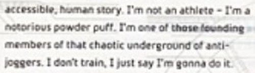
- **Jabba the Hutt; Han Solo; Chewbacca** — entry/section: First day: ""It was the scene on Docking Bay 94 with Jabba and Han Solo, where they consult each other. That was my first day's shooting, and it will stay in my mind forever and ever, because I was a new boy, a new costume and everything was still strange." —Peter Mayhew, Star Wars Insider 94, p. 35" Source: *Star Wars Insider #94* (2007), scan p.35
  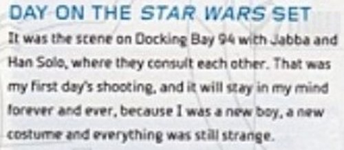

## scan p.36 (scan page 36)

Page contents: Ford & Mayhew cont.: boxes on improvisation, technical dialogue, acting behind a mask, being an action figure, Han vs. Indiana Jones, pre-release jitters, Han's similarity to John Wayne, Mayhew on Ford, Ford on George Lucas; photos Han and Chewbacca posed, Falcon hold chess scene, group on Yavin (hand-read)

- **Chewbacca; Obi-Wan Kenobi; Han Solo** — entry/section: Cantina: ""Chewie worked from the moment you first see him in the background, talking to Obi-Wan in the Cantina. Kenobi's looking for a ship, Harrison is sitting over in the corner.... bang, bang, bang.... the whole scene just worked." —Peter Mayhew, Star Wars Insider 94, p. 36" Source: *Star Wars Insider #94* (2007), scan p.36
  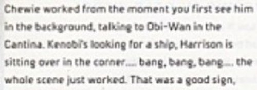
- **Han Solo** — entry/section: Not Indy: ""Indy and Han wear totally different clothes; they couldn't possibly be the same person." —Harrison Ford, Star Wars Insider 94, p. 36" Source: *Star Wars Insider #94* (2007), scan p.36
  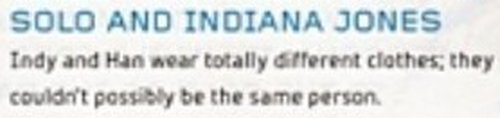
- **Han Solo; Chewbacca** — entry/section: Closest buddies: ""You don't do three movies playing closest buddies without some of it rubbing off a little bit." —Peter Mayhew, Star Wars Insider 94, p. 36" Source: *Star Wars Insider #94* (2007), scan p.36
  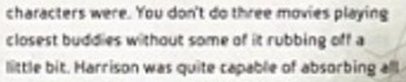
- **none** — entry/section: Building furniture: ""I guess I'd still be building furniture if it wasn't for George Lucas." —Harrison Ford, Star Wars Insider 94, p. 36" Source: *Star Wars Insider #94* (2007), scan p.36
  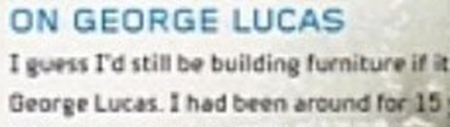

## scan p.37 (scan page 37)

Page contents: Ford & Mayhew concl. (Ford on the success of Star Wars, Mayhew on the public reaction, Ford on the legacy, George Lucas on Harrison Ford; photo Chewbacca makeup with Stuart Freeborn) and "Declan Mulholland: Jabba the Hutt" (human stand-in, died 1999; boxes on his Star Wars experience, his co-star, his director); stills of the cut Docking Bay 94 scene (hand-read)

- **none** — entry/section: George's movie: ""I was in the neighborhood of a success, but it was not a personal triumph. It was so clearly George's movie." —Harrison Ford, Star Wars Insider 94, p. 37" Source: *Star Wars Insider #94* (2007), scan p.37
  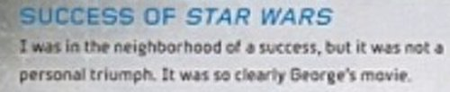
- **none** — entry/section: Went bananas: ""Before the movie was released in England, we'd already heard stuff from the States and seen the queues on television but we all thought, "Oh, that's the Americans for you," but when it arrived in Europe everyone went bananas." —Peter Mayhew, Star Wars Insider 94, p. 37" Source: *Star Wars Insider #94* (2007), scan p.37
  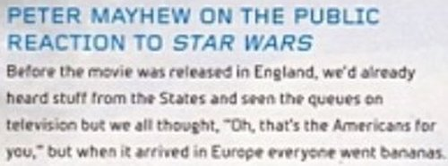
- **none** — entry/section: Mythic terms: ""What Star Wars has accomplished is not possible. But it has done it anyway. Nobody rational would have believed that there was a place for fairy tales." —Harrison Ford, Star Wars Insider 94, p. 37" Source: *Star Wars Insider #94* (2007), scan p.37
  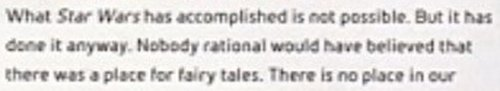
- **Han Solo** — entry/section: Mellowed him: ""The experience of the Star Wars films - especially the first - and of working with a lot of British actors like Alec Guinness mellowed him out a lot as an actor." —George Lucas, Star Wars Insider 94, p. 37" Source: *Star Wars Insider #94* (2007), scan p.37
  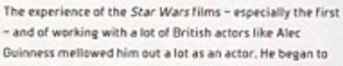

### Stat block notes (game mechanics, not feats)

- Mulholland intro: Cast as the human stand-in for Jabba the Hutt, Delcan Mulholland (who died in 1999) was to be replaced by a special effects version of Jabba. However, this was beyond the technology of the mid-1970s and the shot was abandoned. Ironically, Mulholland then enjoyed subsequent fame as 'The man who wasn't Jabba!' (Star Wars Insider 94, p. 37) (Source: *Star Wars Insider #94* (2007), scan p.37)

## scan p.38 (scan page 38)

Page contents: Full-page Princess Leia (Carrie Fisher) with boxes "On Carrie Fisher", "On What Brought Her to the Attention of George Lucas", "On Her Audition with Lucas" (Brian DePalma); stills Leia with blaster, Tantive IV corridor (hand-read)

- **Leia Organa Solo** — entry/section: Distressing damsel: ""He said he'd hired all of us because we had larger than life personalities. He was right. I think mine was the strangest." —Carrie Fisher, Star Wars Insider 94, p. 38" Source: *Star Wars Insider #94* (2007), scan p.38
  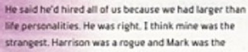
- **Leia Organa Solo** — entry/section: Not a damsel: ""I was not a damsel in distress, I was a distressing damsel!" —Carrie Fisher, Star Wars Insider 94, p. 38" Source: *Star Wars Insider #94* (2007), scan p.38
  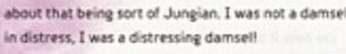

## scan p.39 (scan page 39)

Page contents: "Carrie Fisher: Princess Leia Organa" (also novelist and script doctor): boxes "On Princess Leia's Unique Look", "On Princess Leia's Dialogue", "On the Screenplay", "On Using Her Imagination", "On Lucas' Attention to Detail"; stills Leia on Tantive IV, Leia posed, Leia with blaster (hand-read)

- **Leia Organa Solo** — entry/section: Proud and frightening: ""He wanted me to be proud and frightening, so that's what I did." —Carrie Fisher, Star Wars Insider 94, p. 39" Source: *Star Wars Insider #94* (2007), scan p.39
  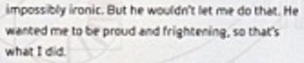

## scan p.40 (scan page 40)

Page contents: Full-page Tusken Raider with gaffi stick; inset photo of stuntman Peter Diamond; no body text (hand-read)

## scan p.41 (scan page 41)

Page contents: "Peter Diamond: Stuntman" (born 1929, died 2004; Raiders, Superman, Highlander): boxes "On How He Got Involved in Star Wars" (via Robert Duvall; Gary Kurtz, Ralph McQuarrie), "On Working with the Lightsabers", "On Appearing 15 Times in the First Movie...", "On Attacking Luke as a Sand Person" (Jack Purvis; Garouf Lafoe CCG name); photos stormtrooper, Tusken attack on Luke, Jawa sandcrawler crowd (hand-read)

- **none** — entry/section: Laser swords: ""He said "I've got these laser swords - I don't want it broadswords and I don't want it fencing; I want it somewhere in between." I had to create a style that was unique." —Peter Diamond, Star Wars Insider 94, p. 41" Source: *Star Wars Insider #94* (2007), scan p.41
  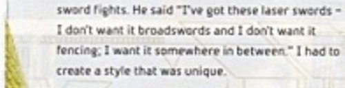
- **Darth Vader (Anakin Skywalker); Obi-Wan Kenobi** — entry/section: Wooden blades: ""Because the [blades of the] lightsabers were made of wood, and Dave Prowse [Darth Vader] was such a heavy-handed man, every time they touched blades they kept breaking." —Peter Diamond, Star Wars Insider 94, p. 41" Source: *Star Wars Insider #94* (2007), scan p.41
  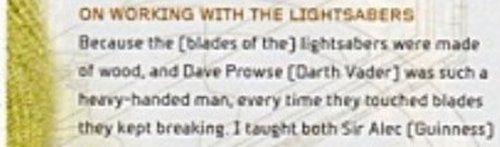
- **none** — entry/section: First fall: ""I died so many times in Star Wars. Because I like to lead from the front with stuntmen, when Mark and Carrie Fisher swung over the Death Star chasm and were escaping, I was the stormtrooper they shot off the top. I did the first fall." —Peter Diamond, Star Wars Insider 94, p. 41" Source: *Star Wars Insider #94* (2007), scan p.41
  

### Stat block notes (game mechanics, not feats)

- Diamond intro: Born in 1929, Peter Diamond began his career in stunts in the 1950s, working with visiting Hollywood stars such as Errol Flynn. Originally trained as an actor, Diamond become one of the film industry's best known stuntmen and fight arrangers. (Star Wars Insider 94, p. 41) (Source: *Star Wars Insider #94* (2007), scan p.41)
- Garouf Lafoe: [The character was named as Garouf Lafoe in the A New Hope expansion set for the Star Wars Customisable Card Game.] (Star Wars Insider 94, p. 41) (Source: *Star Wars Insider #94* (2007), scan p.41)

## scan p.42 (scan page 42)

Page contents: Peter Diamond cont.: boxes "On the Dangers of Stunts" (Reg Harding, Colin Skeaping; squibs set armor alight) and "On the Death Star Chasm Swing"; photos Lucas with Guinness on set, stormtroopers falling in the Death Star shaft (hand-read)

## scan p.43 (scan page 43)

Page contents: Peter Diamond concl.: boxes "On Star Wars Being Special", "On CGI Changing the Stuntman's Trade", "On His Cinematic Legacy", "On George Lucas", "On Mark Hamill" (accident-prone; Dorchester Hotel arm injury), "On Harrison Ford" (on-screen punch for Raiders); photos Lucas and crew on the Death Star set, trash-compactor-area fall rig with stuntmen (hand-read)

- **none** — entry/section: Run-of-the-mill job: ""To me it was a run-of-the-mill job, I just did it, enjoyed it, and never for one moment did I believe that my picture as a Tusken Raider would go around the world!" —Peter Diamond, Star Wars Insider 94, p. 43" Source: *Star Wars Insider #94* (2007), scan p.43
  
- **none** — entry/section: Make-believe business: ""I'm a magician, really. I'm creating something that an audience sees that I know never happened. That has been the whole story of my career: making someone look good on the screen. We're in the make-believe business." —Peter Diamond, Star Wars Insider 94, p. 43" Source: *Star Wars Insider #94* (2007), scan p.43
  
- **Luke Skywalker** — entry/section: Accident-prone: ""When I first met him he was a young 22 year old, full of enthusiasm, but very accident-prone." —Peter Diamond, Star Wars Insider 94, p. 43" Source: *Star Wars Insider #94* (2007), scan p.43
  
- **Han Solo** — entry/section: Carpenter: ""He was always saying during Star Wars: "If this doesn't work I can always go back to being a carpenter." I taught him how to do an on-screen punch, which stood him in good stead for Raiders of the Lost Ark." —Peter Diamond, Star Wars Insider 94, p. 43" Source: *Star Wars Insider #94* (2007), scan p.43
  

## scan p.44 (scan page 44)

Page contents: "The Star Wars Effect: Part 2: The Unseen Force" (words: Paul Simpson): technology invented for Star Wars; John Dykstra and the Dykstraflex motion-control camera (seven axes, VistaVision), blue-screen compositing, use on Star Trek: The Motion Picture and The Black Hole; captions on classic techniques with cutting-edge technology for the Death Star assault, new technology bringing spaceship models to life, Disney's The Black Hole (1979); Toy Story image (hand-read)

### Stat block notes (game mechanics, not feats)

- Had to invent it: When Lucas set out to bring his vision of Star Wars to the screen, he discovered that the technology he needed didn't exist. He had to invent it. (Star Wars Insider 94, p. 44) (Source: *Star Wars Insider #94* (2007), scan p.44)
- Dykstraflex: Using computer controls, Dykstra combined old VistaVision cameras in such a way that they could move through seven axes of motion (roll, pan, tilt, swing, boom, traverse and track) adding a lens focus, motor drive, and shutter control. (Star Wars Insider 94, p. 44) (Source: *Star Wars Insider #94* (2007), scan p.44)

## scan p.45 (scan page 45)

Page contents: Star Wars Effect Part 2 cont.: "Birth of an Empire": ILM in a Van Nuys warehouse, Richard Edlund, Dennis Muren, Joe Johnston; Computer Division (EditDroid, SoundDroid, 1984; sold to Avid 1993), Pixar sold to Steve Jobs 1986, Young Sherlock Holmes stained-glass knight, Willow's Morf, T-1000, Jurassic Park; captions: "hamburger" Millennium Falcon evolved from the blockade runner "pirate ship", Toy Story, Jurassic Park; pull quote Lucas (hand-read)

- **none** — entry/section: Vulgarities of editing: ""I really wanted to build a system that allowed me to get around all the vulgarities of editing," —George Lucas, Star Wars Insider 94, p. 45" Source: *Star Wars Insider #94* (2007), scan p.45
  

### Stat block notes (game mechanics, not feats)

- Hamburger Falcon caption: The 'hamburger' Millennium Falcon evolved from the earlier Rebel blockade runner "pirate ship" (Star Wars Insider 94, p. 45) (Source: *Star Wars Insider #94* (2007), scan p.45)
- Death Star CGI: ILM would go on to become the leading force in the visual effects industry, pioneering 3-D computer generated imagery as early as the first Star Wars film (it's used for the section demonstrating the proposed attack on the Death Star). (Star Wars Insider 94, p. 45) (Source: *Star Wars Insider #94* (2007), scan p.45)

## scan p.46 (scan page 46)

Page contents: Star Wars Effect Part 2 concl.: "The Sound of Space": Sprocket Systems/Skywalker Sound, Ben Burtt hired 1975 (projector hum for the lightsaber), THX (1983), Dolby; Sony HDC-F900 24-P cameras on Episode II, Michael Mann; Jar Jar, Sebulba, Watto and The Lord of the Rings; photo of the Letterman Digital Arts Center in the Presidio (hand-read)

- **none** — entry/section: Sound is 50 percent: ""Sound is 50 per cent of the motion-picture experience," —George Lucas, Star Wars Insider 94, p. 46" Source: *Star Wars Insider #94* (2007), scan p.46
  
- **Jar Jar Binks; Sebulba; Watto** — entry/section: Believable characters: ""We made Jar Jar, Sebulba, and Watto believable characters who could act," "That opened the door for everyone else." —George Lucas, Star Wars Insider 94, p. 46" Source: *Star Wars Insider #94* (2007), scan p.46
  

### Stat block notes (game mechanics, not feats)

- Letterman caption: Lucasfilm's new Letterman Digital Arts Center in San Francisco's Presidio, housing Industrial Light & Magic, Lucas Licensing, and LucasArts, among others (Star Wars Insider 94, p. 46) (Source: *Star Wars Insider #94* (2007), scan p.46)
- Lightsaber hum: He ended up using such unlikely sounds as a projector hum as the basis for the lightsaber's distinctive buzz and crackle. (Star Wars Insider 94, p. 46) (Source: *Star Wars Insider #94* (2007), scan p.46)

## scan p.47 (scan page 47)

Page contents: Star Wars Effect Part 2 sidebar "The George Lucas Educational Foundation" (GLEF, founded 1991; Edutopia); captions: THX sound, a Lucasfilm innovation; the Death Star cable-car service never caught on; Lucas believes learning should be exciting; Jar Jar "How wude!"; pull quote Lucas on Jar Jar, Sebulba and Watto; reader prompt to write in about other Star Wars effects (hand-read)

### Stat block notes (game mechanics, not feats)

- Cable-car caption: The Death Star cable-car service never caught on... (Star Wars Insider 94, p. 47) (Source: *Star Wars Insider #94* (2007), scan p.47)

## scan p.48 (scan page 48)

Page contents: "Peter Cushing: Grand Moff Tarkin" (Hammer horror actor; cast and crew tribute): boxes "On His Casting", "On His Star Wars Dialogue", "On George Lucas"; tributes "David Prowse on Peter Cushing", "Don Henderson on Peter Cushing", "Don Henderson on What a Grand Moff Wears on His Feet" (women's slippers); stills Tarkin on the Death Star, Tarkin and Leia (hand-read)

- **Grand Moff Tarkin; Obi-Wan Kenobi** — entry/section: Would rather be Kenobi: ""Originally the idea was for me to play Ben Kenobi, but when I met George Lucas, he said, "You would be so right for Moff Tarkin. Would you mind playing that part instead?" I said, "No, not at all." Frankly, it would have been nicer to have played Kenobi." —Peter Cushing, Star Wars Insider 94, p. 48" Source: *Star Wars Insider #94* (2007), scan p.48
  
- **Grand Moff Tarkin; Leia Organa Solo** — entry/section: Body odor: ""I turned to George Lucas and asked innocently: "Do you want me to look as if I have body odor?"" —Peter Cushing, Star Wars Insider 94, p. 48" Source: *Star Wars Insider #94* (2007), scan p.48
  
- **none** — entry/section: Knocked for six: ""I was absolutely "knocked for six" when I first saw the film at the premiere. I was riveted." —Peter Cushing, Star Wars Insider 94, p. 48" Source: *Star Wars Insider #94* (2007), scan p.48
  

## scan p.49 (scan page 49)

Page contents: Peter Cushing tribute concl.: Tarkin stills (Death Star conference room, behind-the-scenes, Tarkin and Leia); tributes "Alec Guinness on Peter Cushing", "Carrie Fisher on Peter Cushing", "Rick McCallum on Peter Cushing" (hand-read)

## scan p.50 (scan page 50)

Page contents: Full-page Darth Vader with lit lightsaber; inset portraits of David Prowse and James Earl Jones (hand-read)

## scan p.51 (scan page 51)

Page contents: "David Prowse & James Earl Jones: Darth Vader" intro (the shape of evil and the voice of terror); boxes "David Prowse on Getting the Part", "David Prowse on Darth Vader's Costume", "James Earl Jones on Creating That Distinctive Voice"; Vader stills (Tantive IV corridor, with Tarkin, Death Star) (hand-read)

- **Darth Vader (Anakin Skywalker); Chewbacca** — entry/section: Offered Chewbacca: ""When Lucas offered me the role in Star Wars, it was for the part of Chewbacca." —David Prowse, Star Wars Insider 94, p. 51" Source: *Star Wars Insider #94* (2007), scan p.51
  
- **Darth Vader (Anakin Skywalker)** — entry/section: Masked part: ""I didn't know what Vader looked like, until I went to costume and they showed me the designs of the suit. It was only then I discovered that it would be a masked part." —David Prowse, Star Wars Insider 94, p. 51" Source: *Star Wars Insider #94* (2007), scan p.51
  
- **Darth Vader (Anakin Skywalker)** — entry/section: Sweltering: ""They built up the inside of the mask with foam rubber and, of course, it was absolutely sweltering." —David Prowse, Star Wars Insider 94, p. 51" Source: *Star Wars Insider #94* (2007), scan p.51
  
- **Darth Vader (Anakin Skywalker)** — entry/section: Orson Welles busy: ""I used to tell people that the film's producers first called up Orson Welles, and he was busy, so they called up Victor Jory and he was busy, so they called me." —James Earl Jones, Star Wars Insider 94, p. 51" Source: *Star Wars Insider #94* (2007), scan p.51
  
- **Darth Vader (Anakin Skywalker)** — entry/section: Voice of authority: ""With Darth Vader, my voice came to be used more and more frequently as a voice of authority." —James Earl Jones, Star Wars Insider 94, p. 51" Source: *Star Wars Insider #94* (2007), scan p.51
  

### Stat block notes (game mechanics, not feats)

- Intro deck: For 30 years he's been the shape of evil.... but it took several people to bring him to life. Inside the iconic suit was actor David Prowse, while the voice of terror was James Earl Jones. Together, they complete the vision of evil that was Darth Vader (Star Wars Insider 94, p. 51) (Source: *Star Wars Insider #94* (2007), scan p.51)

## scan p.52 (scan page 52)

Page contents: Darth Vader full-figure photo; boxes "David Prowse on Wielding a Lightsaber" (dowels on revolving motors with reflective tape; knocking Alec Guinness over) and "James Earl Jones on Working on Star Wars" (hand-read)

- **Darth Vader (Anakin Skywalker)** — entry/section: He is Vader: ""He worked very hard to create the character. He is Vader." —James Earl Jones, Star Wars Insider 94, p. 52" Source: *Star Wars Insider #94* (2007), scan p.52
  

## scan p.53 (scan page 53)

Page contents: Vader cont.: Vader vs. Obi-Wan duel stills (plus rehearsal photos); boxes "James Earl Jones on Looping the Dark Lord's Voice", "David Prowse on Working on the Film", "David Prowse on Seeing Star Wars", "James Earl Jones on Looking Back" (hand-read)

- **Darth Vader (Anakin Skywalker)** — entry/section: Narrow band: ""Vader is a man who never learned the beauties or subtleties of human expression. So we figured out the key to my work was to keep it on a very narrow band. A narrow band of expression, that was the secret." —James Earl Jones, Star Wars Insider 94, p. 53" Source: *Star Wars Insider #94* (2007), scan p.53
  
- **Darth Vader (Anakin Skywalker)** — entry/section: Two and a half hours: ""It only took about two and a half hours to complete the looping for the first film." —James Earl Jones, Star Wars Insider 94, p. 53" Source: *Star Wars Insider #94* (2007), scan p.53
  
- **none** — entry/section: Strange science fiction movie: ""We thought we were just doing yet another strange science fiction movie. The only thing you could see, working on the film, was that they were spending a lot of money on it." —David Prowse, Star Wars Insider 94, p. 53" Source: *Star Wars Insider #94* (2007), scan p.53
  
- **Darth Vader (Anakin Skywalker)** — entry/section: Greatest entrance: ""And then Darth Vader comes onto the scene, and it's the greatest entrance that anybody can wish for." —David Prowse, Star Wars Insider 94, p. 53" Source: *Star Wars Insider #94* (2007), scan p.53
  
- **none** — entry/section: Didn't give a hoot: ""They might not give a hoot about the next thing I do on Broadway, but they did care about Star Wars." —James Earl Jones, Star Wars Insider 94, p. 53" Source: *Star Wars Insider #94* (2007), scan p.53
  

## scan p.54 (scan page 54)

Page contents: "Alec Guinness: Obi-Wan Kenobi" (Sir Alec gained a new audience as the venerable Jedi Knight); boxes "Alec Guinness on George Lucas", "Alec Guinness on Acting", "Alec Guinness on Fighting George Lucas' Corner"; tributes from Anthony Daniels, Ewan McGregor, George Lucas, Harrison Ford and Mark Hamill; stills Obi-Wan with lightsaber, Obi-Wan with R2-D2 and C-3PO (hand-read)

- **none** — entry/section: Pay the rent: ""I'm just grateful for any work that comes along. You know, I have to pay the rent like everyone else." —Alec Guinness, Star Wars Insider 94, p. 54" Source: *Star Wars Insider #94* (2007), scan p.54
  

### Stat block notes (game mechanics, not feats)

- Intro deck: Already a respected actor by the time he donned the distinctive brown cloak, Sir Alec Guinness gained a whole new audience with his role as the venerable Jedi Knight, Obi-Wan Kenobi. (Star Wars Insider 94, p. 54) (Source: *Star Wars Insider #94* (2007), scan p.54)

## scan p.55 (scan page 55)

Page contents: Alec Guinness photo page: Obi-Wan with lightsaber; behind-the-scenes stills in Tunisia with Lucas, Obi-Wan in his hut, Obi-Wan on the Death Star (hand-read)

## scan p.56 (scan page 56)

Page contents: "The Empire Strikes Fact: A Cornucopia of Essential Star Wars Trivia" by Jonathan Wilkins; opener art of Han, Leia, Luke, Chewbacca, C-3PO, R2-D2 and Obi-Wan (hand-read)

### Stat block notes (game mechanics, not feats)

- Trivia deck: Some of the information contained on these pages is fascinating, some of it is bizarre, but all of it is completely useless! Discover Boba Fett's musical past, the link between two Sith apprentices, and find out who was the only American to play Anakin.... (Star Wars Insider 94, p. 56) (Source: *Star Wars Insider #94* (2007), scan p.56)

## scan p.57 (scan page 57)

Page contents: Empire Strikes Fact items 1–9: A Tale of Two Worlds (Tatooine/Utapau naming), An Admirable Role (Kenneth Colley), An American Anakin (Jake Lloyd), Artoo Dee-Tune (Kenny Baker's harmonica), A Rose by Any Other Name (Peter Cushing), Boba's Bopping Past (Jeremy Bulloch), Veering to the Dark Side (Julian Glover), Near a Jedi Junction (Grabowiec street), Blowing His Own Trumpet? (Jar Jar and Gunga Din); photo caption "That way lies the path to the Dark Side..." (hand-read)

### Stat block notes (game mechanics, not feats)

- Tatooine naming: Tatooine is not actually named in A New Hope. According to George Lucas he intended to name it Utapau but finally named it retrospectively after the movie's desert locations, Tataouine (French spelling) in Tunisia (although ultimately they did not shoot there). Utapau however was later given to a different planet, in Star Wars: Episode III Revenge of the Sith. (Star Wars Insider 94, p. 57) (Source: *Star Wars Insider #94* (2007), scan p.57)
- Life of Brian: Actor Kenneth Colley (Admiral Piett) played the part of Jesus in Monty Python's Life of Brian! (Star Wars Insider 94, p. 57) (Source: *Star Wars Insider #94* (2007), scan p.57)
- American Anakin: Jake Lloyd is the only American actor to have played Anakin Skywalker. His predecessor, the late Sebastian Shaw, was British, and his successor, Hayden Christensen, is Canadian. (Star Wars Insider 94, p. 57) (Source: *Star Wars Insider #94* (2007), scan p.57)
- Summer Holiday: Jeremy Bulloch played one of Cliff Richard's (Britain's Elvis) all singing, all dancing sidekicks in Summer Holiday! (Star Wars Insider 94, p. 57) (Source: *Star Wars Insider #94* (2007), scan p.57)
- Julian Glover: Julian Glover (General Veers) is the only actor to appear in Star Wars, as well as the Indiana Jones and James Bond films! (Star Wars Insider 94, p. 57) (Source: *Star Wars Insider #94* (2007), scan p.57)
- Obi-Wan's street: In the Polish village of Grabowiec near Torun, one of the streets is named 'ulica Obi-Wana Kenobiego', which means 'Obi-Wan Kenobi's street.' (Star Wars Insider 94, p. 57) (Source: *Star Wars Insider #94* (2007), scan p.57)
- Gunga Din: Jar Jar Binks has a notable literary antecedent. The character Gunga Din, in the 1939 movie of the same name, based on the poem by Rudyard Kipling, was an Indian "water boy" for the British army who comically tried to imitate the British soldiers, but in the end saved the day by blowing a horn to summon assistance in the middle of an attack. (Star Wars Insider 94, p. 57) (Source: *Star Wars Insider #94* (2007), scan p.57)

## scan p.58 (scan page 58)

Page contents: Empire Strikes Fact items 10–21: Leia Outguns 'Em All, Something to Howl About (Peter Mayhew in Dragon Ball GT), Slippery When Oiled (Jon Bon Jovi on Christmas in the Stars), Wizards!, The Two Maces, Mothma Russia (Caroline Blakiston), Not So Far, Far Away (Tatooine planet HD 188753), Planet Popular, Lucas Digs the Droid, Outgunned (Terri Nunn), Samuel's Place in History, More Than They Bargained For; photos Christmas in the Stars album, Mace Windu (hand-read)

- **R2-D2** — entry/section: Favorite actor: ""In fact, I believe he is George [Lucas'] favorite actor." —Ewan McGregor, Star Wars Insider 94, p. 58" Source: *Star Wars Insider #94* (2007), scan p.58
  

### Stat block notes (game mechanics, not feats)

- Most accurate shot: In the original Star Wars trilogy, Princess Leia is the most accurate shot with a blaster, hitting a higher percentage of her intended targets than any other character. (Star Wars Insider 94, p. 58) (Source: *Star Wars Insider #94* (2007), scan p.58)
- Bon Jovi: Jon Bon Jovi made his first recording ever on the Christmas in the Stars album (he's credited as John Bongiovi), singing lead vocals on "R2-D2 We Wish You A Merry Christmas." (Star Wars Insider 94, p. 58) (Source: *Star Wars Insider #94* (2007), scan p.58)
- Two Maces: In the prequel films, Mace Windu is never referred to by his full name, except in the closing credits. He's not the first Mace to appear on screen either; Mace Towani was a character in the two Ewok films. (Star Wars Insider 94, p. 58) (Source: *Star Wars Insider #94* (2007), scan p.58)
- Mothma Russia: Caroline Blakiston (Mon Mothma in Return of the Jedi) was the first non-Russian woman to act in a Russian play, speaking Russian. (Star Wars Insider 94, p. 58) (Source: *Star Wars Insider #94* (2007), scan p.58)
- Tatooine planet: It is the first planet to be discovered orbiting a multi-star system, and Konacki named it a 'Tatooine planet' after Luke Skywalker's home world. (Star Wars Insider 94, p. 58) (Source: *Star Wars Insider #94* (2007), scan p.58)
- Planet Popular: Tatooine is the only planet either to be seen or mentioned in each of the six movies. (Star Wars Insider 94, p. 58) (Source: *Star Wars Insider #94* (2007), scan p.58)
- Terri Nunn: Terri Nunn, lead singer of Berlin who enjoyed a number one hit single with "Take My Breath Away" from the film Top Gun, auditioned for the role of Princess Leia and had readings with Harrison Ford and Mark Hamill. (Star Wars Insider 94, p. 58) (Source: *Star Wars Insider #94* (2007), scan p.58)
- Samuel L. Jackson gross: The success of The Incredibles in 2004 saw Samuel L. Jackson surpass Harrison Ford as the actor whose movies have grossed the most money in the world – in excess of $3 billion. (Star Wars Insider 94, p. 58) (Source: *Star Wars Insider #94* (2007), scan p.58)

## scan p.59 (scan page 59)

Page contents: Empire Strikes Fact items 22–28: Lack of Vision (film stock), Ben Loves Boing! (Ben Burtt), Wookiee Words, Kenobi Has a Cow (Guinness and The Simpsons), Arctic Artist (Ralph McQuarrie cameo), Two Siths and a Moff (Christopher Lee, David Prowse and Peter Cushing), Star Lords (Lord of the Rings crossovers); photos Chewbacca, Count Dooku, C-3PO and R2-D2, Simpsons lightsaber parody (hand-read)

### Stat block notes (game mechanics, not feats)

- Lack of Vision: Over 60 percent of Star Wars: Episode IV A New Hope was shot with a film stock that was so prone to fading that it was discontinued in the early 1980s. (Star Wars Insider 94, p. 59) (Source: *Star Wars Insider #94* (2007), scan p.59)
- Wookiee Words: During the scene on the Death Star right after Ben leaves to shut down the tractor beam, Chewbacca barks something to Luke to which Han says, "Boy, you said it Chewie." Backstage footage reveals that what Chewie says is: "The old man's gone mad." (Star Wars Insider 94, p. 59) (Source: *Star Wars Insider #94* (2007), scan p.59)
- Arctic Artist: In The Empire Strikes Back, Ralph McQuarrie (above center) walks in front of one of his own matte paintings. (Star Wars Insider 94, p. 59) (Source: *Star Wars Insider #94* (2007), scan p.59)
- Frankenstein's Monster: Christopher Lee and fellow Star Wars Sith Lord David Prowse have both played Frankenstein's Monster opposite Moff Tarkin, Peter Cushing. (Star Wars Insider 94, p. 59) (Source: *Star Wars Insider #94* (2007), scan p.59)
- Star Lords: Although Anthony Daniels is the first Star Wars actor to appear in a Lord of the Rings adaptation, by having played C-3PO and providing the voice of Legolas in Ralph Bakshi's The Lord of the Rings he is not alone. (Star Wars Insider 94, p. 59) (Source: *Star Wars Insider #94* (2007), scan p.59)

## scan p.60 (scan page 60)

Page contents: Ad: Star Wars Insider subscription offer, save 35%, 6 issues for $24.95, titanmagazines.com/starwars (cover of the "A Long Time Ago...." issue) (hand-read)

## scan p.61 (scan page 61)

Page contents: "Jawa's Corner" section opener (packed with all the latest stuff from the Star Wars universe): contents Books 66, Comics 68, Toys 70, Star Wars Q&A 72, Scouting the Galaxy 74, International Collecting 78, Set Piece 80, Padawan's Corner 82, Bantha Tracks 85, Indy Vault 90, Comlink 92; photo of George Lucas and Mark Hamill; Luke and Leia figures (hand-read)

## scan p.62 (scan page 62)

Page contents: Books by Jason Fry: "A New Hope's Back Pages" (Star Wars 30 years ago in a bookstore): J.W. Rinzler's The Making of Star Wars; The Story (Alan Dean Foster ghost-written novelization, Dec 1976; Star Wars Storybook 1978; Pop-Up Book 1978); For Kids (1979 activity books, Punch-Out and Make-It Book, Question and Answer Book About Space) (hand-read)

### Stat block notes (game mechanics, not feats)

- Making of Star Wars: Lucasfilm's J. W. Rinzler has painstakingly assembled a missing piece of Star Wars history out of thousands of pages of interviews and archival photographs. (Star Wars Insider 94, p. 62) (Source: *Star Wars Insider #94* (2007), scan p.62)
- Blue Five: Because the novelization was put together before final script changes, it offers glimpses of what might have been: For instance, Blue Five (that would be Luke) makes an unsuccessful trench run before trusting the Force to send a second torpedo home. (Star Wars Insider 94, p. 62) (Source: *Star Wars Insider #94* (2007), scan p.62)
- Storybook stills: Another vintage retelling of the story is the Star Wars Storybook (below, center), a nicely illustrated 1978 kids' version whose stills of Luke and Biggs Darklighter at Tosche Station helped convince countless children of the 1970s that they saw that scene in some early theatrical cut. (They didn't.) (Star Wars Insider 94, p. 62) (Source: *Star Wars Insider #94* (2007), scan p.62)
- Droids on Mars: 1979 also brought the Star Wars Question and Answer Book About Space, in which C-3PO and R2-D2 taught slightly older kids about real-life space exploration, complete with scenes of the droids out for a stroll on Mars. (Star Wars Insider 94, p. 62) (Source: *Star Wars Insider #94* (2007), scan p.62)

## scan p.63 (scan page 63)

Page contents: Books cont.: Behind the Scenes (Joe Johnston's Star Wars Sketchbook, Blueprints, Ralph McQuarrie Portfolio, The Art of Star Wars 1979, The Star Wars Album); The (Early) Expanded Universe (Splinter of the Mind's Eye 1978, Brian Daley's Han Solo books, The Maverick Moon, The Mystery of the Rebellious Robot, The Wookiee Storybook 1979); covers of the 1979 activity books (Chewbacca's, Artoo Detoo's, Luke Skywalker's, Darth Vader's); pull quote about the Wookiee Storybook (hand-read)

### Stat block notes (game mechanics, not feats)

- TIE Boarding Craft: The "TIE Boarding Craft" would appear as the sequel's TIE bomber. (Star Wars Insider 94, p. 63) (Source: *Star Wars Insider #94* (2007), scan p.63)
- Deak Starkiller: The Star Wars Portfolio, on the other hand, remains spectacular – 21 Ralph McQuarrie production paintings, among them classic a depiction of the Metropolis-style C-3PO with R2-D2, and Darth Vader battling lightsaber-wielding foe Deak Starkiller on the blockade runner. (Star Wars Insider 94, p. 63) (Source: *Star Wars Insider #94* (2007), scan p.63)
- Brian Daley: Han Solo got perhaps his greatest chronicler in Brian Daley, who gave Corellia's favorite son lots of funny lines and adventures to spare in 1979's Han Solo at Stars' End and Han Solo's Revenge. (Star Wars Insider 94, p. 63) (Source: *Star Wars Insider #94* (2007), scan p.63)
- Wookiee Storybook: In it, Han and Chewie return to Kashyyyk for Chewie's 200th birthday, but have to rescue Chewie's son Lumpy from an ill-advised trip into the Kashyyyk depths. References to that story showed up 17 years later in the Black Fleet Crisis. (Star Wars Insider 94, p. 63) (Source: *Star Wars Insider #94* (2007), scan p.63)

## scan p.64 (scan page 64)

Page contents: Comics by Daniel Wallace: "The Prodigal Son Returns: Cade Skywalker Faces His Past in Star Wars: Legacy" (issues #11–12 "The Ghosts of Ossus"; Jan Duursema, John Ostrander; Yuuzhan Vong return); section "Unchartered Waters"; covers Legacy #11 "Return to Ossus – No Rest, No Peace, Just Ghosts" and #12 "Keeper of the Jedi Secret!"; pull quote Duursema (hand-read)

- **Cade Skywalker** — entry/section: Wake-up call: ""Cade could use a wake-up call," —Jan Duursema, Star Wars Insider 94, p. 64" Source: *Star Wars Insider #94* (2007), scan p.64
  
- **Cade Skywalker** — entry/section: Overdosed on death sticks: ""When we first see him, he's overdosed on death sticks," "Coming back from the brink, Cade decides – for his own reasons – to get more Jedi training." —John Ostrander, Star Wars Insider 94, p. 64" Source: *Star Wars Insider #94* (2007), scan p.64
  
- **none** — entry/section: Amphistaffs into plowshares: ""Have they given up their vision of galactic conquest and turned their amphistaffs into plowshares? Or do some still remember the old days?" —Jan Duursema, Star Wars Insider 94, p. 64" Source: *Star Wars Insider #94* (2007), scan p.64
  
- **none** — entry/section: Japan after World War II: ""The end of the war shattered a lot of their conceptions about themselves and their society. I think an apt analogy would be Japan after World War II." —John Ostrander, Star Wars Insider 94, p. 64" Source: *Star Wars Insider #94* (2007), scan p.64
  
- **none** — entry/section: Feel like Star Wars: ""It has to 'feel' like Star Wars, and we want echoes of past events while creating a new storyline and new characters." —John Ostrander, Star Wars Insider 94, p. 64" Source: *Star Wars Insider #94* (2007), scan p.64
  

### Stat block notes (game mechanics, not feats)

- Cade intro: More than one hundred years into the future of Star Wars, the Jedi lineage is being upheld by Luke Skywalker's descendant, Cade. But fans expecting to meet another model Jedi encountered instead a moody ex-pirate who hunts fugitives for money and nurses an addiction to death sticks. (Star Wars Insider 94, p. 64) (Source: *Star Wars Insider #94* (2007), scan p.64)
- Ghosts of Ossus: In the story "The Ghosts of Ossus," Cade returns to the Jedi Academy on the planet Ossus – the place where he trained as a youth and saw his father murdered by the Sith – and finally comes to terms with his past. (Star Wars Insider 94, p. 64) (Source: *Star Wars Insider #94* (2007), scan p.64)

## scan p.65 (scan page 65)

Page contents: Comics cont.: Duursema on fan rapport, Ostrander on plotting ahead; sidebar "Clone Wars Adventures: Volume 8" ("Old Scores", "Versus", "One of A Kind", "Pathways"); art of Cade Skywalker (hand-read)

- **none** — entry/section: Geek out of the artist: ""I'm a fan myself, and it's tough to take the geek out of the artist," —Jan Duursema, Star Wars Insider 94, p. 65" Source: *Star Wars Insider #94* (2007), scan p.65
  

### Stat block notes (game mechanics, not feats)

- Old Scores: "Old Scores": Bounty hunter Aurra Sing is back in this tale by Chris Avellone and the Fillbach Brothers. The smuggler's moon of Nar Shaddaa provides the backdrop for a twisty tale of revenge and double-crosses. (Star Wars Insider 94, p. 65) (Source: *Star Wars Insider #94* (2007), scan p.65)
- Versus: "Versus": Who will be the last one standing in the Arena of Death? In this adventure by the Fillbach Brothers, Jedi Knight Luminara Unduli faces a horde of angry challengers with nothing but her bare hands to protect her. (Star Wars Insider 94, p. 65) (Source: *Star Wars Insider #94* (2007), scan p.65)
- One of A Kind: "One of A Kind": Responding to an emergency call from the Republic cloning facility on Kamino, Obi-Wan Kenobi clashes with gun-for-hire Vianna D'Pow in a desperate bid to thwart a sabotage attempt. (Star Wars Insider 94, p. 65) (Source: *Star Wars Insider #94* (2007), scan p.65)
- Pathways: "Pathways": What is a single battle droid worth? Jeremy Barlow and the Fillbach Brothers attempt to answer the question by presenting what happens after a battle droid short-circuits in a mountain stream and loses its connection to the hive mind of the Separatist army. (Star Wars Insider 94, p. 65) (Source: *Star Wars Insider #94* (2007), scan p.65)

## scan p.66 (scan page 66)

Page contents: Toys by Frank Parisi: "This Is No Cave....": Sideshow 30th Anniversary Exclusive Space Slug Enviorama (2,000 pieces, $69.99 Celebration IV/$79.99); Luke Skywalker, Rebel Hero 12-inch figure (Yavin 4 ceremony); Princess Leia 12-inch figure ($54.99, with wrist binders in the Sideshow Exclusive) (hand-read)

### Stat block notes (game mechanics, not feats)

- Rebel Hero figure: Sideshow's 30th Anniversary Exclusive 12-inch figure is Luke Skywalker as he appeared during the victory ceremony on Yavin 4 at the end of A New Hope. (Star Wars Insider 94, p. 66) (Source: *Star Wars Insider #94* (2007), scan p.66)
- Leia figure: The Sideshow Exclusive edition will also come with a set of wrist binders used during Leia's imprisonment on the Death Star. (Star Wars Insider 94, p. 66) (Source: *Star Wars Insider #94* (2007), scan p.66)

## scan p.67 (scan page 67)

Page contents: Toys cont.: Hasbro 3¾" Action Figures, Wave 4&5 (Odle, C-3PO with Salacious Crumb, Clone Wars Roron Corobb, Yoda on Kybuck, Anakin with Nelvaan markings, Darth Revan, Darth Malak, General Grievous as a Kaleesh warrior, Starkiller Hero (Leia) McQuarrie concept); Unleashed Battlepacks, Wave 3 (Pilots, Rebels and Imperials, Death Star Troopers) (hand-read)

### Stat block notes (game mechanics, not feats)

- Seen better days: while with a dislocated eye and a pesky Salacious Crumb on his back, C-3PO has seen better days. (Star Wars Insider 94, p. 67) (Source: *Star Wars Insider #94* (2007), scan p.67)
- Clone Wars wave: Ithorian Jedi Master Roron Corobb is ready to defend Chancellor Palpatine from General Grievous while Yoda rides into battle atop a Kybuck. (Star Wars Insider 94, p. 67) (Source: *Star Wars Insider #94* (2007), scan p.67)
- Nelvaan markings: Last but not least, Anakin Skywalker, bearing the ritualistic marks of Nelvaan bruise-leech crawlers, prepares for his final Jedi trial, and an ominous premonition. (Star Wars Insider 94, p. 67) (Source: *Star Wars Insider #94* (2007), scan p.67)
- KOTOR figures: From the award-winning video game, Knights of the Old Republic, Sith Lords Darth Revan (winner of Hasbro's Fans Choice Award) and his treacherous apprentice, Darth Malak wage war against the Republic backed by their massive Sith army. (Star Wars Insider 94, p. 67) (Source: *Star Wars Insider #94* (2007), scan p.67)
- Battlepacks: The Rebels and Imperials set will include Luke Skywalker and Han Solo in stormtrooper armor along with two Imperial officers, while the Death Star Troopers set will feature two Imperial Navy Troopers, an officer, and an Imperial gunner. (Star Wars Insider 94, p. 67) (Source: *Star Wars Insider #94* (2007), scan p.67)

## scan p.68 (scan page 68)

Page contents: Star Wars Q&A by Pablo Hidalgo: "Luke's Duel Against the Dark Side on Dagobah...." (plus Jango's jetpack jinx, Count Dooku's bust, Nute Gunray's grudge and Durge's sunburn): Dagobah cave vision, the Lost Twenty, Durge's fate, Anakin's datapad in his Episode III vision; reader questions (names omitted); contact box for questions (hand-read)

### Stat block notes (game mechanics, not feats)

- Cave vision: The scene isn't supposed to be taken literally. It's a vision that Luke Skywalker has while deep within the root systems of a tree twisted by the dark side of the Force. (Star Wars Insider 94, p. 68) (Source: *Star Wars Insider #94* (2007), scan p.68)
- Greatest foe himself: Luke's vision was meant as a warning: that his greatest foe was in fact himself, and that to rely on combat and aggressive confrontation was a path to the dark side. (Star Wars Insider 94, p. 68) (Source: *Star Wars Insider #94* (2007), scan p.68)
- Lost Twenty: The Lost Twenty aren't necessarily fallen Jedi. They are the only Jedi who have voluntarily renounced their title. (Star Wars Insider 94, p. 68) (Source: *Star Wars Insider #94* (2007), scan p.68)
- Never regarded as fallen: In the case of Dooku, he became disillusioned with the Republic and the Jedi order, and removed himself from the order. Though considered a maverick by some, he was never regarded as "fallen." (Star Wars Insider 94, p. 68) (Source: *Star Wars Insider #94* (2007), scan p.68)
- Durge into a sun: It's just that as an extremely bizarre Gen'Dai alien, Durge can walk away from being turned into mincemeat. What he can't shake off so readily is being hurled into a sun. Anakin Skywalker does that to him in Star Wars: Obsession, the Episode III lead-in comic book series from Dark Horse Comics. (Star Wars Insider 94, p. 68) (Source: *Star Wars Insider #94* (2007), scan p.68)
- Datapad paperwork: Anakin is using a datapad given to him from the Jedi Council to catch up on "paperwork". A Jedi Knight's job is not without its bureaucracy. (Star Wars Insider 94, p. 68) (Source: *Star Wars Insider #94* (2007), scan p.68)

## scan p.69 (scan page 69)

Page contents: Q&A cont.: Wiorkettle the Snivvian on Cloud City (Snaggletooth/"The Colonel" masks; King Ozz retcon, Planet Dreams, Inc.), sabacc vs. Pazaak, Jedi Temple holobooks, Jango's two jetpacks; photos Snivvian, Jango and Boba jetpacks; reader questions (names omitted) (hand-read)

### Stat block notes (game mechanics, not feats)

- Wiorkettle backstory: Technically, no. At least, we've not been able to spot him. I can tell you some more about Wiorkettle, since I created the character's backstory over a decade ago. (Star Wars Insider 94, p. 69) (Source: *Star Wars Insider #94* (2007), scan p.69)
- Planet Dreams retcon: We crafted a retcon (retroactive continuity) to patch over this contradiction. King Ozz was, in fact, a former member of Planet Dreams, Inc. a firm that specialized in terraforming. (Star Wars Insider 94, p. 69) (Source: *Star Wars Insider #94* (2007), scan p.69)
- Backstories have backstories: Ah, the Star Wars expanded universe: where even the backstories have backstories! (Star Wars Insider 94, p. 69) (Source: *Star Wars Insider #94* (2007), scan p.69)
- Sabacc not Pazaak: No, the game was sabacc, as originally established in the Empire screenplay, though the name was not spoken in the film. (Star Wars Insider 94, p. 69) (Source: *Star Wars Insider #94* (2007), scan p.69)
- Pazaak: Pazaak was instead invented for the first Star Wars: Knights of the Old Republic roleplaying video game in 2003. (Star Wars Insider 94, p. 69) (Source: *Star Wars Insider #94* (2007), scan p.69)
- Holobooks: According to Star Wars: The Complete Visual Dictionary, the items are holobooks, which are "ancient self-contained technology requiring only small amounts of energy." (Star Wars Insider 94, p. 69) (Source: *Star Wars Insider #94* (2007), scan p.69)
- Two jetpacks: Look closely, and you'll see that Jango Fett has two different jetpacks in Episode II. When he's on the Kamino landing platform, he's wearing a more heavily armored silver and blue model with a larger missile. (Star Wars Insider 94, p. 69) (Source: *Star Wars Insider #94* (2007), scan p.69)
- Boba's jetpack: Later, when Jango is on Geonosis, he's wearing a more colorful model, with blue and yellow panels. It has a thinner missile, and the two rocket thrusters extend from the sides and point down. This is the model that Boba Fett later uses. (Star Wars Insider 94, p. 69) (Source: *Star Wars Insider #94* (2007), scan p.69)

## scan p.70 (scan page 70)

Page contents: Collecting: Scouting the Galaxy by Steve Sansweet, "Pay It Forward" — collector generosity: fan-made Empire jackets and hand-carved wood Falcon/sail barge/AT-AT (paint-stirrer prototype) gifted to Sansweet; super-collector group's Celebration III trading cards and 12 pewter-colored medallions of Kenner's first 12 figures for Celebration IV/Europe, plus 12 variants (collector names omitted); photos of carvings, jackets, Celebration Europe medallion (hand-read)

### Stat block notes (game mechanics, not feats)

- Collectors stereotype: For some folks outside the hobby, Star Wars collectors are seen as a strange breed: a bunch of loners who get up at the crack of dawn to hit every big-box retailer, sweep the shelves clear of any exclusive or otherwise hot items, and then sell most of them on eBay to feed their hobby or even support themselves. (Star Wars Insider 94, p. 70) (Source: *Star Wars Insider #94* (2007), scan p.70)
- Sansweet's 30 years: Those of us who are, or who know, collectors realize that's all a bunch of nonsense. In my 30 years of collecting Star Wars, I have met some of the nicest, most genuine, and totally generous people it has been my privilege to know. (Star Wars Insider 94, p. 70) (Source: *Star Wars Insider #94* (2007), scan p.70)
- Kenner medallions: To celebrate the 30th anniversary, they have outdone themselves, coming up with an amazing set of 12 different two-inch pewter-colored medallions commemorating Kenner's first 12 action figures. (Star Wars Insider 94, p. 70) (Source: *Star Wars Insider #94* (2007), scan p.70)

## scan p.71 (scan page 71)

Page contents: Scouting the Galaxy letters (reader names omitted): The Light Side (Idea Nuova Darth Vader EVA lamp), It Figures! (vehicle wish lists; Hasbro's V-wing and Sith Infiltrator), A Brush with the Dark Side (Burger King/Colgate items); photos of Vader lamp, V-wing, Sith Infiltrator (photos by Martin Mazi), Colgate Star Wars toothbrush (photo by Anne Neumann) (hand-read)

### Stat block notes (game mechanics, not feats)

- Vader EVA lamp: Very odd indeed - but it was licensed by a company named Idea Nuova Inc., a Canadian firm based in Quebec. This was called the Darth Vader EVA lamp. (Star Wars Insider 94, p. 71) (Source: *Star Wars Insider #94* (2007), scan p.71)
- Vader lamp night light: It's really more of a giant night light since it has a small seven watt bulb that gives the head an eerie glow in the dark. (Star Wars Insider 94, p. 71) (Source: *Star Wars Insider #94* (2007), scan p.71)
- Hasbro barriers: So there are lots of barriers, especially for the biggest pieces. That said, remember that Hasbro has the Star Wars license through 2018 and a lot of toys can be made in the next decade. (Star Wars Insider 94, p. 71) (Source: *Star Wars Insider #94* (2007), scan p.71)
- Fast-food toys value: But all of the items you list were produced in the millions, are fairly recent, and sold for very little or were given away. (Star Wars Insider 94, p. 71) (Source: *Star Wars Insider #94* (2007), scan p.71)

## scan p.72 (scan page 72)

Page contents: Scouting letters cont. (names omitted): A Price on His Head? (vintage Boba Fett figure, $1,199.99; advice on deposits), Comic Capers (Marvel vs. Whitman treasury editions), The Phantom Piece (jigsaw puzzle missing pieces); contact box [email omitted], [postal address omitted]; photos carded Kenner Boba Fett, Marvel Special Edition comics (photos by Anne Neumann) (hand-read)

### Stat block notes (game mechanics, not feats)

- Collectible prices: There is no set rule, nor can there be. Everything is a negotiation between a buyer and a seller. (Star Wars Insider 94, p. 72) (Source: *Star Wars Insider #94* (2007), scan p.72)
- Marvel vs Whitman: In my experience as a Star Wars collector, there is no difference in value between the Marvel and Whitman cover variations for the oversized reprints. (Star Wars Insider 94, p. 72) (Source: *Star Wars Insider #94* (2007), scan p.72)
- Whitman logo: And the only difference in the two versions is the small Whitman logo on the cover of the 10-inch by 14-inch comics. Whitman distributed the titles for special sales situations. (Star Wars Insider 94, p. 72) (Source: *Star Wars Insider #94* (2007), scan p.72)

## scan p.73 (scan page 73)

Page contents: International by Gus Lopez: "In a Land Down Under" — Australian collectibles: Toltoys sub-licensee, Toltoys landspeeder with red decals, five POTF figures virtually exclusive to Australia (Nikto, Gamorrean Guard, AT-AT Driver, Anakin Skywalker, Yak Face); photos Toltoys landspeeder, Harper's Dog Chow Return of the Jedi stickers (hand-read)

### Stat block notes (game mechanics, not feats)

- Toltoys: As was the practice with other toy license arrangements at the time, Kenner sold its line of Star Wars action figures toys through a sub-licensee, and for Down Under, this was the Australian toy company, Toltoys. (Star Wars Insider 94, p. 73) (Source: *Star Wars Insider #94* (2007), scan p.73)
- Toltoys landspeeder: For reasons unknown, the Toltoys version of the landspeeder had red decals for detail lines instead of the painted lines seen on the vehicle everywhere else in the world. (Star Wars Insider 94, p. 73) (Source: *Star Wars Insider #94* (2007), scan p.73)
- Australian POTF five: This gang of five included Nikto, Gamorrean Guard, AT-AT Driver, Anakin Skywalker, and Yak Face on Power of the Force cards. (Star Wars Insider 94, p. 73) (Source: *Star Wars Insider #94* (2007), scan p.73)

## scan p.74 (scan page 74)

Page contents: International cont.: May the Lolly Be With You! (Streets "Ice Treat" boxes, Peters and Pauls ROTJ "Ice Lollys", McDonald's Australia ESB cups — one of only two McDonald's Star Wars promotions), Harper's Dog Chow stickers, Cast and Crew Gear (Fox Studios Sydney, ILM snowgum jacket, ROTS preshoot invitation, AOTC R2-D2 cap); photos Streets boxes, Peters wrappers, McDonald's cups, crew jacket and cap (hand-read)

### Stat block notes (game mechanics, not feats)

- Ice cream promotions: Australia was one of the first countries in the world to offer Star Wars ice cream promotions, and the only country to do so for the first three films. (Star Wars Insider 94, p. 74) (Source: *Star Wars Insider #94* (2007), scan p.74)
- McDonald's twice: Many collectors are surprised that in the 30 years of Star Wars fast food tie-ins, McDonald's has only done Star Wars promotions twice, once in Japan for A New Hope and once in Australia for The Empire Strikes Back. (Star Wars Insider 94, p. 74) (Source: *Star Wars Insider #94* (2007), scan p.74)
- Dog food: Australia would leave its mark on Star Wars food collectibles in a way that is now legendary among collectors - Star Wars dog food! (Star Wars Insider 94, p. 74) (Source: *Star Wars Insider #94* (2007), scan p.74)
- Dingos: Completing your collection of Harpers stickers is incredibly difficult since in order to acquire all the stickers one needed to buy enough large-sized dog food bags to feed a pack of dingos for a decade. (Star Wars Insider 94, p. 74) (Source: *Star Wars Insider #94* (2007), scan p.74)
- Honorary marsupial: The R2-D2 cap from Attack of the Clones has an embroidered R2-D2 drawn in line strokes similar to logos found on T-shirts sold throughout Australia for native fauna such as koalas, kangaroos, and wombats, officially making R2 an honorary marsupial. (Star Wars Insider 94, p. 74) (Source: *Star Wars Insider #94* (2007), scan p.74)

## scan p.75 (scan page 75)

Page contents: Set Piece by Chris Trevas: "Naboo Royal Starship — Soaring Through Space with Style and Elegance": Doug Chiang concept team, 10-foot fiberglass/Mylar model shot outdoors, Gavin Bocquet's Leavesden interiors, cockpit set and chairs, backlit display graphics; boxes The Pilot (Ralph Brown as Ric Olié), Solar Sailer (early concept reused for Dooku's ship) (hand-read)

- **none** — entry/section: Bocquet on interior: ""We were completely responsible for the interior design of that ship, but we always stayed in line with the spirit of the way it looked on the outside." —Gavin Bocquet, Star Wars Insider 94, p. 75" Source: *Star Wars Insider #94* (2007), scan p.75
  

### Stat block notes (game mechanics, not feats)

- Chiang's design cues: Concept artists at Skywalker Ranch led by Doug Chiang were responsible for the exterior look of the chrome ship, taking design cues from 1950s automobile hood ornaments and the rocketships of George Lucas' childhood. (Star Wars Insider 94, p. 75) (Source: *Star Wars Insider #94* (2007), scan p.75)
- 10-foot model: The resulting 10-foot long model was further refined by hand and cast in fiberglass. The chrome finish was achieved with a covering of Mylar sheeting. (Star Wars Insider 94, p. 75) (Source: *Star Wars Insider #94* (2007), scan p.75)
- The Pilot: Actor Ralph Brown portrayed the Queen's pilot Ric Olié. Brown had previous experience in another long running sci-fi movie series. In Alien 3 he played Aaron, the warden on the prison planet who discovers the alien fetus inside Ripley. (Star Wars Insider 94, p. 75) (Source: *Star Wars Insider #94* (2007), scan p.75)
- Solar Sailer: Early designs depicted the Queen's ship as a sailing vessel powered by solar rays. This concept would ultimately be revisited for Count Dooku's personal ship in the next film. (Star Wars Insider 94, p. 75) (Source: *Star Wars Insider #94* (2007), scan p.75)
- Display screens: In the movie these display screens illustrated key points such as R2-D2 repairing of the shield generator, discovering Tatooine as a planet to set down for repairs, reviewing Anakin's abnormally high midichlorian count, and observing the status of the Trade Federation blockade when our heroes returned to Naboo. (Star Wars Insider 94, p. 75) (Source: *Star Wars Insider #94* (2007), scan p.75)

## scan p.76 (scan page 76)

Page contents: Set Piece cont.: Art box (J-type 327 Nubian, Theed Palace Space Vessel Engineering Corps), Profile (Naboo; 76 meters long; Theed Palace Space Vessel; weapons none), Design (turrets cut), Sound Design (Ben Burtt), Interior (lawnmower motor casing; droid complement); photos Qui-Gon, Obi-Wan, Panaka in hold (hand-read)

### Stat block notes (game mechanics, not feats)

- J-type 327 Nubian: The Queen's Royal starship is classified a J-type 327 Nubian. The Theed Palace Space Vessel Engineering Corps handcrafted the spaceframe around Nubian sublight and hyperdrive propulsion systems. (Star Wars Insider 94, p. 76) (Source: *Star Wars Insider #94* (2007), scan p.76)
- Gun turrets cut: Early story drafts had Qui-Gon and Obi-Wan manning two transparent gun turrets on the underside of the ship to fight off droid starfighters. It was ultimately determined by Lucas that the Queen's ship should be one of peace. (Star Wars Insider 94, p. 76) (Source: *Star Wars Insider #94* (2007), scan p.76)
- Burtt engine sound: It was created by slowing down and altering World War II era propeller aircraft noises. (Star Wars Insider 94, p. 76) (Source: *Star Wars Insider #94* (2007), scan p.76)
- Lawnmower: This box above the doorway of the forward hold is the motor casing from a small electric hover lawnmower. (Star Wars Insider 94, p. 76) (Source: *Star Wars Insider #94* (2007), scan p.76)
- Droid complement: The ship holds a complement of droids including: R2-B1, R2-D1, R2-R9, R5-A7, and R2-C4, but it is the plucky R2-D2 who survives the flight from Naboo, repairs the ship, and earns himself an audience with the Queen. (Star Wars Insider 94, p. 76) (Source: *Star Wars Insider #94* (2007), scan p.76)

## scan p.77 (scan page 77)

Page contents: Padawan's Corner: "How to Draw: C-3PO — Your guide to sketching the galaxy's greatest protocol droid!" words and artwork by Cynthia Cummens; intro on materials, Steps 1–3 (egg-shaped head silhouette, guidelines, inverted "V" nose, brow lines) with three sketch stages (hand-read)

### Stat block notes (game mechanics, not feats)

- Draw C-3PO intro: In this tutorial, I'll be demonstrating how to draw everyone's favorite protocol droid, C-3PO. (Star Wars Insider 94, p. 77) (Source: *Star Wars Insider #94* (2007), scan p.77)

## scan p.78 (scan page 78)

Page contents: Padawan's Corner cont.: Steps 4–6 (highlight planning, Micron inking, marker coloring) and tips box; finished color C-3PO on Tatooine; starwars.com/kids, cynthiacummensart.com (hand-read)

### Stat block notes (game mechanics, not feats)

- Coloring C-3PO: Think about the environment that C-3PO is in and how his reflective surface catches the colors around him. (Star Wars Insider 94, p. 78) (Source: *Star Wars Insider #94* (2007), scan p.78)
- Practice tip: All artists, including those who love to draw Star Wars, have spent lots of time practicing their drawing, and you should too! (Star Wars Insider 94, p. 78) (Source: *Star Wars Insider #94* (2007), scan p.78)

## scan p.79 (scan page 79)

Page contents: Bantha Tracks Vol. 25 "By the Fans, for the Fans": "Tales of the Mail — Bantha Tracks readers spot R2-D2 mailboxes across the country": USPS R2-D2 mailboxes (some 400, incl. Grauman's Chinese Theatre) teasing the commemorative Star Wars stamps; USPS CMO Anita Bizzotto quote; fan photo in Times Square (fan names omitted); submission guidelines box (hand-read)

### Stat block notes (game mechanics, not feats)

- R2-D2 mailboxes: In cooperation with Lucasfilm Ltd., the U.S. Postal Service placed mailboxes across the country that were the postal equivalent of everyone's favorite astromech droid, R2-D2. (Star Wars Insider 94, p. 79) (Source: *Star Wars Insider #94* (2007), scan p.79)
- R2 still delivers: It seems that 30 years on, R2-D2 still delivers! (Star Wars Insider 94, p. 79) (Source: *Star Wars Insider #94* (2007), scan p.79)

## scan p.80 (scan page 80)

Page contents: Bantha Tracks cont.: seven numbered fan photos with R2-D2 mailboxes (Rebel Legion Leia, Jawa, R2-D2 go-go dress, Chewbacca costumer, C-3PO costumer, etc.; all fan names omitted) (hand-read)

## scan p.81 (scan page 81)

Page contents: Bantha Tracks cont.: fan photos 7–9 with R2-D2 mailboxes (fan names omitted; USPS staffer quote omitted as named fan letter); "The Way We Were": sculptor Lawrence Noble's 1982 Star Wars wedding cake photos, his bronze Yoda at Lucasfilm's Presidio offices, Celebration IV/Europe live sculpting; caption on Yoda fountain (photo by Julian Mussi) (hand-read)

- **none** — entry/section: Noble on old photos: ""I sent copies of these pictures to Bantha Tracks back then, but they did not run them in the newsletter." —Lawrence Noble, Star Wars Insider 94, p. 81" Source: *Star Wars Insider #94* (2007), scan p.81
  

### Stat block notes (game mechanics, not feats)

- Noble's bronze Yoda: Famed artist and sculptor, Lawrence Noble, was a Star Wars fan long before he sculpted the full-sized bronze of Jedi Master Yoda that now resides at Lucasfilm's offices in the Presidio of San Francisco (below). (Star Wars Insider 94, p. 81) (Source: *Star Wars Insider #94* (2007), scan p.81)
- Presidio statues: Noble sculpted other works for Lucas that reside at the Presidio, including the larger-than-life statues of cinematic innovators Eadweard Muybridge and Willis O'Brien. (Star Wars Insider 94, p. 81) (Source: *Star Wars Insider #94* (2007), scan p.81)

## scan p.82 (scan page 82)

Page contents: Bantha Tracks Editorial "Life Without Star Wars" by Mary Franklin, Editor, Bantha Tracks (sections More Money, Very Different Memories, Fewer Friends Worldwide); fan art of Han Solo and Greedo in the cantina (artist name omitted) (hand-read)

- **none** — entry/section: Franklin on community: ""Their generosity, humor, hard work, and sheer joy of living keep it front of mind; this is a community, not simply a fan club. This is life with Star Wars - certainly worth another 30 years or more!" —Mary Franklin, Star Wars Insider 94, p. 82" Source: *Star Wars Insider #94* (2007), scan p.82
  

## scan p.83 (scan page 83)

Page contents: Indiana Jones — Indy Vault #2 by J.W. Rinzler: "Dr Jones Lays an Egg" — unused Temple of Doom Shanghai-escape gags from Kasdan's Raiders drafts revived by Willard and Gloria Huyck; Joe Johnston's Rube Goldberg egg-gag drawing with handwritten steps A–H (hand-read)

### Stat block notes (game mechanics, not feats)

- Kasdan's cliffhangers: Lawrence Kasdan's first script had so many cliffhangers that some had to be discarded - but they were resuscitated in Willard and Gloria Huyck's script for the second Indy film. (Star Wars Insider 94, p. 83) (Source: *Star Wars Insider #94* (2007), scan p.83)
- Egg gag: An early gag had Indy sleeping in the back of the plane and procuring an egg in a manner that seems to have been inspired by the game Mousetrap or by an invention of Wile E. Coyote, seen in this Joe Johnston drawing (right). (Star Wars Insider 94, p. 83) (Source: *Star Wars Insider #94* (2007), scan p.83)

## scan p.84 (scan page 84)

Page contents: Indy Vault cont.: Johnston egg drawing continued (steps E–H, egg landing in Indy's hand); Edward Verreaux storyboard of Short Round on a tripod machine-gun with Willie Scott; dogfight cut (hand-read)

### Stat block notes (game mechanics, not feats)

- Verreaux dogfight storyboard: Meanwhile, an early storyboard (right) by Edward Verreaux shows Short Round manning a machine-gun mounted on a tripod while Willie Scott feeds him ammunition rounds. (Star Wars Insider 94, p. 84) (Source: *Star Wars Insider #94* (2007), scan p.84)
- Dogfight cut: Like the egg gag, the aerial dogfight was cut from the film. (Star Wars Insider 94, p. 84) (Source: *Star Wars Insider #94* (2007), scan p.84)

## scan p.85 (scan page 85)

Page contents: Comlink: "From Seeing Vader to Being Vader" — readers' 30-year memories (names omitted): a 1977 Boston department-store Vader appearance (Don Post helmet costume) inspiring a reader to appear as Vader at fairs 30 years later; Write to Us box (Titan Magazines US/UK addresses, [email omitted], [email omitted]); Vader photo (hand-read)

## scan p.86 (scan page 86)

Page contents: Comlink cont. (names omitted): Star Warriors (30th anniversary drawings of Vader, C-3PO and R2-D2), editorial ask for what Star Wars fans should be called, Storm Force (vinyl case/Vader figure childhood story), Promo Princess (Leia costume in Fullerton 1977), Star Walls (bedroom Death Star battle mural), Queen Amidala dolls letter; Leia photo (hand-read)

## scan p.87 (scan page 87)

Page contents: Comlink cont. (names omitted): Secret Stormtrooper (1977 memories, Holiday Special), The Real Darth Vader (1977 mall promotional tour with Vader and Chewbacca); call for memories; new "Bounty Hunters" feature — reader photos with Star Wars celebrities: a 1977 meeting with Mark Hamill at a sci-fi store (The Galactic Players), and a 2004 New York meeting with Ewan McGregor at the end of his Long Way Round motorcycle trip; Boba Fett art (hand-read)

### Stat block notes (game mechanics, not feats)

- Bounty Hunters intro: Have you met Motti? Is Chewie your chum? Are you a pal of Palpatine? Have you been on a date with a Darth? Did you talk to Tarkin? (Star Wars Insider 94, p. 87) (Source: *Star Wars Insider #94* (2007), scan p.87)

## scan p.88 (scan page 88)

Page contents: Next Issue: Pirates of the Boards returns (unseen early storyboards), Another 50 Things You Didn't Know About A New Hope, The Light Side (archive interview with cinematographer Gilbert Taylor); US newsstands July 24, UK newsagents July 26; Bill Murray SNL and Carrie Fisher Pez quotes; Chewbacca photo (hand-read)

- **none** — entry/section: Bill Murray SNL: ""Oh Star Wars if they should bar wars please let these Star Wars stay." —Bill Murray, Saturday Night Live, Star Wars Insider 94, p. 88" Source: *Star Wars Insider #94* (2007), scan p.88
  
- **Leia Organa Solo** — entry/section: Fisher on Pez: ""You're not really famous until you're a Pez dispenser." —Carrie Fisher, Star Wars Insider 94, p. 88" Source: *Star Wars Insider #94* (2007), scan p.88
  

## scan p.89 (scan page 89)

Page contents: Ad: OfficialPix.com "George, Thanks for 30 incredible years!" (Ben Stevens & Philip Wise), Star Wars 30 logo, Vader image (hand-read)

## scan p.90 (scan page 90)

Page contents: Ad: Wizards of the Coast Star Wars Miniatures Alliance and Empire — "This edition is limited. The game is not." (limited first run with Star Wars logo bases; wizards.com/starwars) (hand-read)

