# Owner Material 038 — Star Wars Insider #1–153 plus specials (with The Lucasfilm Fan Club Magazine #1–22): Star Wars Insider #95 (2007)

- **Source:** *Star Wars Insider* magazine (issues 23–153, 1994–2014) and its predecessor *The Lucasfilm Fan Club Magazine* (issues 1–22, 1987–1994), plus seven special editions: articles, interviews, comics and short fiction Secondary source (licensed Legends reference). Scan OCR'd on the box; the scan stays box-only and is **not** published.
- **Method:** every scanned page was OCR'd and machine-screened sentence by sentence for power-relevant statements (fights, kills, defeats, Force feats, rankings, superweapons) that name a character on our roster; each kept sentence is quoted verbatim from the OCR text and has a crop of the printed passage directly under it. Pages with nothing power-relevant are still listed with what is on them.
- **Citation:** "*Star Wars Insider #95* (2007), p.X" by printed page ("scan p.X" where no printed number applies). **Weight:** Licensed magazine: a secondary source. Its short fiction and comics are Legends stories; its articles and interviews sum up or discuss lore and rank below the novels, comics and games they describe.

## scan p.1 (scan page 1)

Page contents: Cover: Star Wars Insider #95 September 2007 ($5.99): "The Clone Wars! Meet the makers of the new Star Wars!" (CG Anakin, Obi-Wan, Yoda, clone troopers); top banners "Celebration IV Diary: inside the event!", "Lost Storyboards: see Star Wars history!", "The Clone Wars secrets revealed!"; plus: A New Hope: another 50 facts, Star Wars veteran Gil Taylor, Troy Denning on Inferno, "Exclusive photo-heavy diary reports from Celebration IV!"; Star Wars 30 logo (hand-read)

## scan p.2 (scan page 2)

Page contents: Advertisement: Brian's Toys (Star Wars and G.I. Joe toys 1977 to present): figure club at $7.99 each, Comic 2-packs, Vintage Style, 30th Anniversary figure waves, vehicles, Saga II exclusives, battle packs, Celebration IV exclusives (McQuarrie C-3PO & R2-D2 or McQuarrie Luke), Episode III exclusives, Gentle Giant statues and mini-busts, Master Replicas FX lightsabers and scale replicas, Sideshow 12-inch figures (hand-read)

## scan p.3 (scan page 3)

Page contents: Advertisement: Brian's Toys cont.: Vintage Star Wars AFA-graded carded figures (12-back Vader, Boba Fett, Princess Leia Organa), Imperial Shuttle AFA 80 $1,099.99, Millennium Falcon AFA 75 $2,999.99, Top 10 Deals (30th Anniversary figures, Celebration II Jorg Sacul $25.99, Droids 5-pack), Master Replicas clearance lightsabers and blasters, "We Are Buying Toys!!!", Fountain City, WI address, catalog offer (hand-read)

## scan p.4 (scan page 4)

Page contents: Contents opener: CG still from The Clone Wars (Mace Windu, Obi-Wan Kenobi, Anakin Skywalker, Yoda, clone troopers, green-lightsaber figure); "Contents" header, Star Wars 30 logo (hand-read)

## scan p.5 (scan page 5)

Page contents: Contents: News 08 Com-Scan (Celebration IV news, CGI Clone Wars TV series, Yoda stamp); Cover Feature 10 Star Wars: The Clone Wars, meet the show's creators (Dave Filoni and Catherine Winder); 14 Best of StarWars.com (1977 Star Wars diary, DK sneak peek, the Kaiser Chiefs); Features 18 Celebration IV event diary, 26 May the Facts Be With You part two #51-100, 34 Pirates of the Boards part four (lost storyboards), 40 Taylor Made (cinematographer Gilbert Taylor, at 93); Departments 07 Editor's Welcome, 49 Jawa's Corner, 50 Books: Inferno (Troy Denning), 52 Comics: Dark Times, 54 Toys "Where did you dig up that old fossil?" (Obi-Wan), 56 Q&A, 58 Scouting the Galaxy (Steve Sansweet), 62 International Collecting: Canada, 64 Set Piece: Supreme Chancellor Palpatine's Office, 66 Padawan's Corner, 69 Bantha Tracks (Celebration IV), 74 The Indy Vault, 76 Comlink Letters (hand-read)

## scan p.6 (scan page 6)

Page contents: Advertisement: Entertainment Earth exclusive Hasbro "Jango Fett's Friends Are Visiting: They're here to train your army" — Elite Forces of the Republic full set (14 figures, two boxed sets of 7, $66.99), Llats Ward figure (hand-read)

### Stat block notes (game mechanics, not feats)

- Llats Ward: After Jango Fett was cloned to make the Republic's clone trooper army, he went out in the galaxy to recruit a legion of combat instructors! Men and women like Llats Ward brought their specially colored armor, weapons proficiency, and fanatical loyalty to ensure the clone trooper army was prepared for every threat that Count Dooku and the Separatists threw at them. (Star Wars Insider 95, p. 06) (Source: *Star Wars Insider #95* (2007), scan p.6)

## scan p.7 (scan page 7)

Page contents: Editor's Welcome "Didn't We Just Leave This Party?" (Brian J. Robb, Editor): Celebration IV at the Los Angeles Convention Center with Deputy Editor Jonathan Wilkins, likened to Mos Eisley; family appeal of Star Wars; the CGI TV series The Clone Wars trailer by supervising director Dave Filoni; Filoni and Catherine Winder interview p. 10, Celebration IV diary p. 18; contact box, letters addresses (US/UK), masthead; Modal Nodes (Bith band) photo (hand-read)

- **none** — entry/section: Party that never ends: ""Write us with your Celebration stories and Bounty Hunter photos (see page 76) - and remember, Star Wars is the party that never ends!" —Brian J. Robb, Star Wars Insider 95, p. 07" Source: *Star Wars Insider #95* (2007), scan p.7
  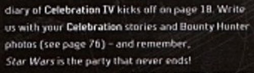
- **none** — entry/section: We've seen it: ""We've seen it! It's fab! The trailer specially prepared by supervising director Dave Filoni (there's a Star Wars fan who's landed on his feet!) genuinely wowed the audiences at Celebration IV who were lucky enough to see it on a giant screen, sound blasting at full volume." —Brian J. Robb, Star Wars Insider 95, p. 07" Source: *Star Wars Insider #95* (2007), scan p.7
  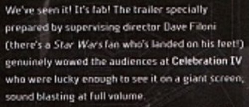

## scan p.8 (scan page 8)

Page contents: Com-Scan "The Clone Wars Revealed! Celebration IV audiences get first glimpse of the new Star Wars!": supervising director Dave Filoni dressed as Plo Koon, gave away part of his toy collection; trailer on starwars.com and three panels; Filoni thought Winder's call a prank; 22-minute standalone episodes plus multi-part arcs; writer Henry Gilroy, episodic director Rob Coleman; no TV partner yet, likely fall 2008; Obi-Wan caption and Jedi starfighter art (hand-read)

### Stat block notes (game mechanics, not feats)

- Filoni as Plo Koon: Celebration IV attendees were treated to the sight of Filoni dressed as his favorite character, Plo Koon, and giving away part of his personal Star Wars toy collection at an Episode III premiere. (Star Wars Insider 95, p. 08) (Source: *Star Wars Insider #95* (2007), scan p.8)
- Prank call: Filoni admitted that he thought the initial call from Winder to talk about the project was a prank. (Star Wars Insider 95, p. 08) (Source: *Star Wars Insider #95* (2007), scan p.8)
- Episode format: The pair revealed that the initial plan is to produce a batch of episodes that are 22 minutes long, all of them standalone episodes that can be enjoyed on their own, but some of which will also create multi-part story arcs. (Star Wars Insider 95, p. 08) (Source: *Star Wars Insider #95* (2007), scan p.8)
- Writers and directors: One of the writers is Henry Gilroy, a veteran of Dark Horse's various Star Wars comic books and one of the episodic directors is the Star Wars prequel animation director Rob Coleman. There's no television partner announced, but the show is likely to debut in the fall of 2008. (Star Wars Insider 95, p. 08) (Source: *Star Wars Insider #95* (2007), scan p.8)

## scan p.9 (scan page 9)

Page contents: Com-Scan "Yoda Stamps Out Sith Lord: Director Irvin Kershner calls Yoda 'a childlike mascot'": Yoda (Drew Struzan art) beat Darth Vader in the popular vote for the stand-alone stamp, ~500,000 votes cast, won by ~10,000; Kershner on making the Yoda puppet; stamp sheet at Post Offices, usps.com, 1-800-STAMP-24, Yoda single-stamp sheet this fall; "Star Wars Has Its Day" box (Celebration IV opening ceremony, LA Mayor Antonio Villaraigosa in a Yoda tie proclaims May 25 Star Wars Day; photo by Kristen DelValle); Indiana Jones Newsreel "Indy Whips Up an All Star Cast" (Harrison Ford, Shia LaBeouf, Ray Winstone, John Hurt, Cate Blanchett; Sean Connery statement declining) (hand-read)

- **Yoda** — entry/section: Nightmare: ""Yoda was a nightmare for me! It was hard for me to believe that we could make this puppet of plastic and rubber, with a lot of wires sticking out of it, and with poles for his ears to go up and down, work. I was concerned in case we couldn't make it into a living thing." —Irvin Kershner, Star Wars Insider 95, p. 09" Source: *Star Wars Insider #95* (2007), scan p.9
  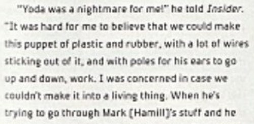
- **Yoda** — entry/section: Little mascot: ""It's difficult to think of a creature who is a great master and is childlike, and yet is appealing to a lot of people, but there they have it. You've got a little mascot! I guess it worked!" —Irvin Kershner, Star Wars Insider 95, p. 09" Source: *Star Wars Insider #95* (2007), scan p.9
  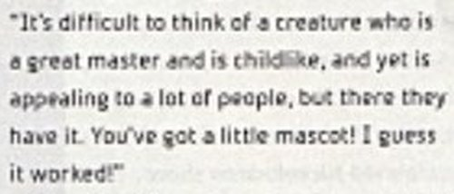
- **none** — entry/section: Connery on Indy IV: ""I thought long and hard about it and if anything could have pulled me out of retirement it would have been an Indiana Jones film. I love working with Steven and George, and it goes without saying that it is an honor to have Harrison as my son. In the end, retirement is just too damned much fun." —Sean Connery, Star Wars Insider 95, p. 09" Source: *Star Wars Insider #95* (2007), scan p.9
  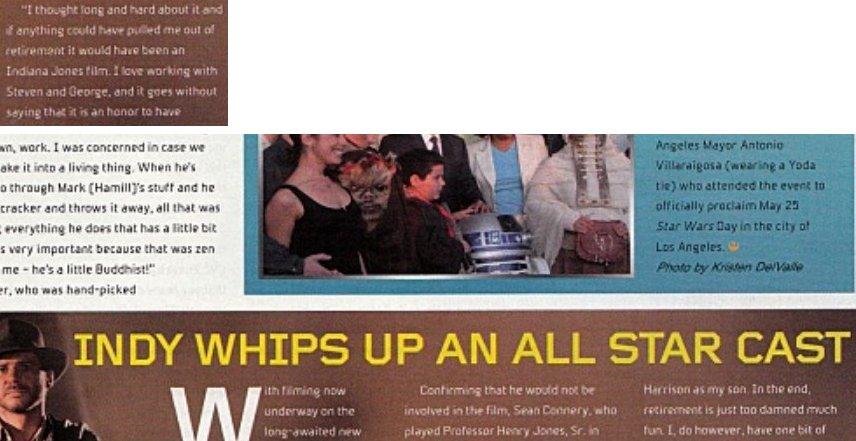
- **none** — entry/section: Advice for Junior: ""I do, however, have one bit of advice for Junior: Demand that the critters be digital, the cliffs be low, and for goodness sake keep that whip by your side at all times in case you need to escape from the stunt coordinator! This is a remarkable cast, and I can only say, 'Break a leg, everyone.' I'll see you on May 22, 2008 at the theater!" —Sean Connery, Star Wars Insider 95, p. 09" Source: *Star Wars Insider #95* (2007), scan p.9
  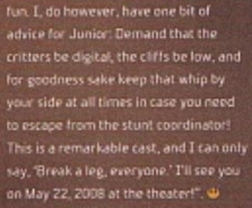

### Stat block notes (game mechanics, not feats)

- Vote: In a popular vote to select which stamp would be issued as a stand-alone from 15 Star Wars stamps featuring characters or ships from the six-movie saga, the diminutive Jedi Master defeated the ever-popular Sith Lord. With around 500,000 votes cast, the Yoda stamp, drawn by popular artist Drew Struzan, won by approximately 10,000 votes, postal officials have confirmed. (Star Wars Insider 95, p. 09) (Source: *Star Wars Insider #95* (2007), scan p.9)
- Star Wars Day: Celebration IV's opening ceremony featured a surprise appearance by Los Angeles Mayor Antonio Villaraigosa (wearing a Yoda tie) who attended the event to officially proclaim May 25 Star Wars Day in the city of Los Angeles. (Star Wars Insider 95, p. 09) (Source: *Star Wars Insider #95* (2007), scan p.9)

## scan p.10 (scan page 10)

Page contents: Cover feature "Fighting the Clone Wars" (words: Brian J. Robb & Jonathan Wilkins): The Clone Wars producer Catherine Winder (ex-Senior VP of Production, Fox Feature Animation; Ice Age; Disney, HBO, MTV, Hanna-Barbera) and supervising director Dave Filoni (Avatar: The Last Airbender; Film Roman, Disney) interview: Star Wars feel via writing and CG, pre-visualization, Filoni as "George's Padawan", "It's not fun", two-/three-part arcs and one four-parter, 22-24 minute pacing; CG Anakin, Mace Windu, clone captain art (hand-read)

- **none** — entry/section: Dynamic visuals: ""I think a lot of it has to do with the fact that we are working in CG. If we were doing a 2-D cartoon, you could still get it to feel like Star Wars, but you couldn't get the dynamic visuals that Star Wars demands." —Dave Filoni, Star Wars Insider 95, p. 10" Source: *Star Wars Insider #95* (2007), scan p.10
  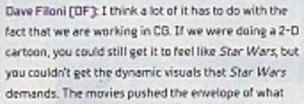
- **none** — entry/section: George's Padawan: ""Dave is George's Padawan. George took him under his wing and he's been training Dave in storytelling and cinematography. It's incredible how they give you that visceral, exciting experience." —Catherine Winder, Star Wars Insider 95, p. 10" Source: *Star Wars Insider #95* (2007), scan p.10
  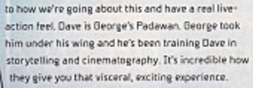
- **none** — entry/section: It's not fun: ""The first thing I edited on this show was just in 2-D drawings as animatics. George liked it, but he said "It's not fun." And I thought, "Well, gee, George I don't know what that means." So he's been teaching me. The fact that George is involved, more than any other reason, is why it comes out feeling like Star Wars." —Dave Filoni, Star Wars Insider 95, p. 10" Source: *Star Wars Insider #95* (2007), scan p.10
  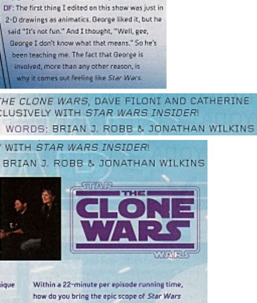
- **none** — entry/section: Arcs: ""We are not just doing stand-alone episodes; we are producing these so we can have that big, epic feel to the storyline in two- and three-parts. Actually, there is one four-parter." —Catherine Winder, Star Wars Insider 95, p. 10" Source: *Star Wars Insider #95* (2007), scan p.10
  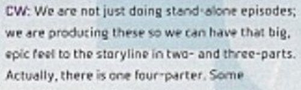
- **none** — entry/section: Fast-moving: ""It's a challenge. For an epic-scale, 22-to-24 minutes isn't long - that's an intro to most movies! We definitely try to pace it so that you feel like you've watched a whole movie. The fact that we're quickly paced reflects what Star Wars always was: When people saw the original Star Wars in 1977, it was one of the fastest-moving things they had ever seen." —Dave Filoni, Star Wars Insider 95, p. 10" Source: *Star Wars Insider #95* (2007), scan p.10
  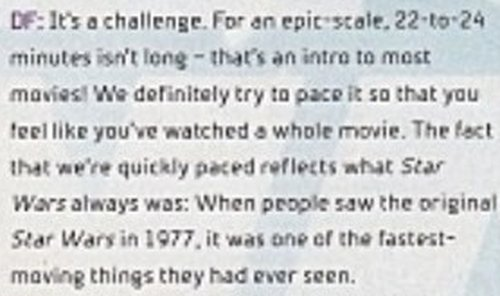

## scan p.11 (scan page 11)

Page contents: Clone Wars interview cont. (Star Wars Insider Exclusive): Filoni on design changes by necessity (cloth sim, rigs), anime influence, Anakin realistic vs. cartoony Yoda, Hayao Miyazaki dynamic, Ralph McQuarrie and Joe Johnston look, McQuarrie paintings as 3-D moving pictures with stylized characters from the Cartoon Network Clone Wars, Lucas handing over Johnston and Erik Tiemens designs; Winder on Technical Development team led by Andrew Harris, Marin County studios and Lucasfilm Animation Singapore (process nailed late 2006), Lucas' growing involvement, new characters, challenges; Filoni on CG skepticism and the Millennium Falcon flying; thanks to Filoni, Winder, Kayleen Walters and John Singh; CG Yoda (hand-read)

- **Plo Koon** — entry/section: Plugging it in: ""It's really just plugging it in: we don't try to reinvent anything. I think that's key. I know what a Republic Cruiser looks like, I know what Plo Koon looks like. Design changes I do based on necessity, because I can't do major cloth sim[ulation] or we can't rig something that elaborate." —Dave Filoni, Star Wars Insider 95, p. 11" Source: *Star Wars Insider #95* (2007), scan p.11
  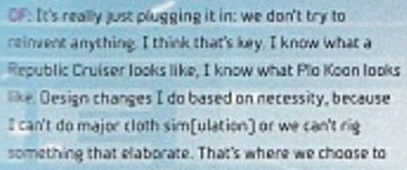
- **Darth Vader (Anakin Skywalker); Yoda** — entry/section: Cartoony Yoda: ""The vehicles look relatively the same; we didn't mess with their proportions. Anakin looks pretty realistic, in this universe. Yoda was a puppet in the movies, so he's more cartoony in ours." —Dave Filoni, Star Wars Insider 95, p. 11" Source: *Star Wars Insider #95* (2007), scan p.11
  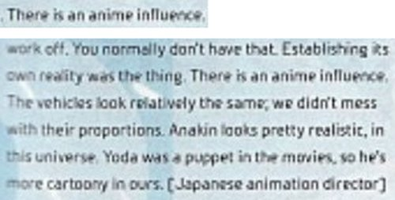
- **none** — entry/section: Here, use this: ""Actually, George gives me designs of things. When he has ideas he'll say "Here, use this," and hands me something Joe Johnston designed for the first trilogy. Then we bring it to life on our series. There's something Erik Tiemens designed for the prequels that we use in the series." —Dave Filoni, Star Wars Insider 95, p. 11" Source: *Star Wars Insider #95* (2007), scan p.11
  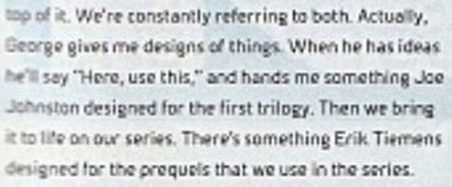
- **none** — entry/section: Process nailed: ""This time last year we were not only trying to find out what the stories were that we were producing, but how we were technically producing them. It was all really loose until late in 2006, when we felt we had really nailed our process." —Catherine Winder, Star Wars Insider 95, p. 11" Source: *Star Wars Insider #95* (2007), scan p.11
  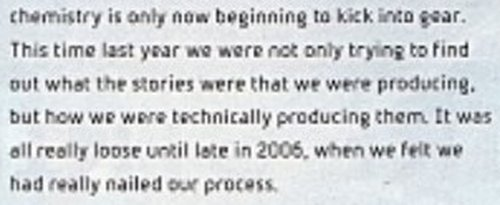
- **none** — entry/section: Out of the box: ""I've never worked for somebody who's made me think so out of the box. That's the only way to accomplish the amazing things that need to be done on this show." —Catherine Winder, Star Wars Insider 95, p. 11" Source: *Star Wars Insider #95* (2007), scan p.11
  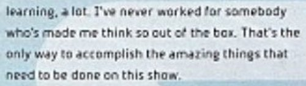
- **Darth Vader (Anakin Skywalker)** — entry/section: New characters: ""You can't do a whole series without meeting new people - that would be boring! In every Star Wars movie, you're usually meeting a host of new characters. It's always a toss up, as you want to use the characters the fans know and love, like Anakin Skywalker, [but] you also want to use ones they've never heard of before as that makes it interesting." —Dave Filoni, Star Wars Insider 95, p. 11" Source: *Star Wars Insider #95* (2007), scan p.11
  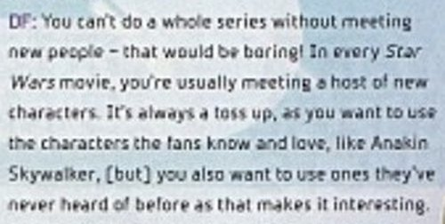
- **none** — entry/section: Falcon fly: ""With CG you never really know [what you've got] until you render it out. I bet George was surprised the first time he saw the Millennium Falcon fly! You can imagine it and dream it, but you still need people to make that a reality and we're lucky that we have the right people." —Dave Filoni, Star Wars Insider 95, p. 11" Source: *Star Wars Insider #95* (2007), scan p.11
  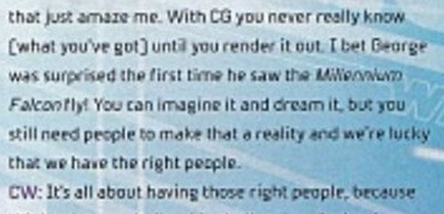

## scan p.12 (scan page 12)

Page contents: Com-Scan "The Empire Strikes Brit: Star Wars Exhibition Wows London!": Star Wars: The Exhibition at County Hall (12 rooms, Tatooine through Mustafar, Death Star room with MSE-6, Imperial officers, Royal Guard; Anakin's Podracer, life-size Naboo N-1, Vader costume, Han in carbonite, Bib Fortuna pre-production maquette, McQuarrie illustrations, Jedi School, green-screen studio; 240+ objects; open until September 1); "Star Wars' Influential Effects" (VES vote, Eric Roth quote; Blaster strip); "Original Trilogy Is Most Watched" (Sky Movies survey: top for men, second to Dirty Dancing for women; 50% watched 20+ times; top-5 lists); stormtrooper, R2-D2, Podracer photos (hand-read)

### Stat block notes (game mechanics, not feats)

- Exhibition rooms: Situated in London's ornate County Hall, right by the River Thames, the exhibition is themed so that each room represents a distinctive Star Wars environment. The journey starts with Tatooine and takes in Naboo, Endor, Hoth, Coruscant, Kamino, Geonosis, Kashyyyk, Utapau and Mustafar. (Star Wars Insider 95, p. 12) (Source: *Star Wars Insider #95* (2007), scan p.12)
- Bib Fortuna maquette: The chance to see Han Solo encased in carbonite is certain to thrill any fan, and an original pre-production maquette showing what Bib Fortuna might have looked like is an intriguing piece of Star Wars history. (Star Wars Insider 95, p. 12) (Source: *Star Wars Insider #95* (2007), scan p.12)
- VES vote: Star Wars has been voted the most influential visual effects film of all time. The 1977 original, directed by George Lucas, came out on top of the list chosen by members of the Visual Effects Society (VES), beating Blade Runner, 2001: A Space Odyssey, The Matrix and Jurassic Park. (Star Wars Insider 95, p. 12) (Source: *Star Wars Insider #95* (2007), scan p.12)
- Most watched: A survey carried out by Sky Movies has shown that the Star Wars trilogy are the most watched movies for male movie fans, and came second only to Dirty Dancing for female viewers. Some 50 percent of those taking part in the survey admitted that they had watched the Star Wars films more than 20 times! (Star Wars Insider 95, p. 12) (Source: *Star Wars Insider #95* (2007), scan p.12)

## scan p.13 (scan page 13)

Page contents: Advertisement: Wizards of the Coast, Margaret Weis & Tracy Hickman, Dragonlance "Dragons of the Highlord Skies: The Lost Chronicles, Volume II" (July 2007), Publishers Weekly blurb (not Star Wars) (hand-read)

## scan p.14 (scan page 14)

Page contents: Best of StarWars.com (words: Pete Vilmur & Bonnie Burton) "Star Wars Diary: 30 Years": new regular series of 1977 pre-release events; January 1977 (Sight and Sound spread, John Williams views rough cut, Fox executives, new cantina footage with articulated-lip Greedo on La Brea Avenue, Mojave Desert Tatooine pickups, Marc Pevers/Craig Stokely Kenner dialogue, ILM shots); February 1977 (Lucas screens rough cut for De Palma and Spielberg, McQuarrie poster concepts, Charles Lippincott at Toy Fair, paperback novel sells out, ILM shots); poster, Marvel #1 cover, Hildebrandt art, Burger power bar images (hand-read)

### Stat block notes (game mechanics, not feats)

- Greedo's lips: New cantina footage, including some creature insert shots and close-ups of Greedo (now with articulated lips, a functionality not available during an earlier cantina shoot in England) is filmed over two days in a small studio on La Brea Avenue in Los Angeles. (Star Wars Insider 95, p. 14) (Source: *Star Wars Insider #95* (2007), scan p.14)
- Mojave pickups: Additional Tatooine footage, including shots of a radio-controlled model sandcrawler, a full-size landspeeder on wheels, an elephant posing as a bantha, and Tusken Raiders is shot in the Mojave Desert. (Star Wars Insider 95, p. 14) (Source: *Star Wars Insider #95* (2007), scan p.14)
- De Palma and Spielberg: Lucas screens a rough cut of Star Wars for several of his close friends, including directors Brian De Palma and Steven Spielberg. While Spielberg is very excited about Star Wars, De Palma is less optimistic, and offers to help rewrite the opening crawl. (Star Wars Insider 95, p. 14) (Source: *Star Wars Insider #95* (2007), scan p.14)
- Toy Fair: While attending the 1977 Toy Fair in New York, Star Wars Corporation publicist Charles Lippincott is literally pushed out of an office by an executive of a large toy company after attempting to make a licensing pitch. (Star Wars Insider 95, p. 14) (Source: *Star Wars Insider #95* (2007), scan p.14)
- ILM February: ILM shooting includes: star streak for hyperspace, live action stormtroopers outside Death Star docking bay, severed arm (and head!) insert shots for cantina, X-wing and landspeeder dashboard graphics, Death Star laser to Alderaan, title crawl tests, Death Star trench sequences, and other shots. (Star Wars Insider 95, p. 14) (Source: *Star Wars Insider #95* (2007), scan p.14)

## scan p.15 (scan page 15)

Page contents: Star Wars Diary cont.: March 1977 (Williams records score March 5-16 in London, first comic, Children of the Night #3 "G-rated fantasy film", James Earl Jones records Vader in a single day at Goldwyn, Films Incorporated, Tippett and Berg holo-chess, Bernie Loomis 3.75", Fox previews, ILM crew to Guatemala for Yavin exteriors, landspeeder rear-projection); April 1977 (comic #2, Factors Etc. $100,000, Kenner deal, Hildebrandt poster after Tom Jung, Charles White III and Drew Struzan "Circus Poster", American Film "But will it fly?", Roddenberry on Paramount lot, theft from Star Wars Corporation HQ, ILM wraps with Star Destroyer shot 110P on April 22); "Inside the Star Wars Visual Guides" sidebar (starwars.com 2007 chapter-by-chapter guides); stormtrooper and ANH stills (hand-read)

### Stat block notes (game mechanics, not feats)

- Jones in a day: James Earl Jones spends a single day at Goldwyn Studios recording his voice-over dialogue for Darth Vader. (Star Wars Insider 95, p. 15) (Source: *Star Wars Insider #95* (2007), scan p.15)
- 3.75 inches: Kenner President Bernie Loomis establishes the size of the Star Wars action figure line by holding his thumb and forefinger 3.75" apart and having the distance between his fingers measured for the size of Luke Skywalker. (Star Wars Insider 95, p. 15) (Source: *Star Wars Insider #95* (2007), scan p.15)
- Yavin in Guatemala: A crew from ILM, including Richard Edlund and Lorne Peterson, travel to Guatemala to shoot the exteriors for the Yavin moon location. Fox had originally asked the team if they might just use the Adventureland setting at Disneyland to shoot the exteriors. (Star Wars Insider 95, p. 15) (Source: *Star Wars Insider #95* (2007), scan p.15)
- Circus Poster: Charles White III and Drew Struzan finish the poster artwork that would come to be known as the Star Wars "Circus Poster"; although completed before the film's release, it would be held back until summer 1978. (Star Wars Insider 95, p. 15) (Source: *Star Wars Insider #95* (2007), scan p.15)
- Theft: A thief or thieves allegedly steal thousands of production transparencies, photo reproductions of Ralph McQuarrie paintings, and at least two ILM models after breaking into the Star Wars Corporation headquarters at Universal Studios. The FBI gets involved, but little, if any, of the material was ever recovered. (Star Wars Insider 95, p. 15) (Source: *Star Wars Insider #95* (2007), scan p.15)
- Final ILM shot: ILM wraps up shooting after completing the end battle sequence and small insert shots like the tractor beam meter (written in English, incidentally). The final shot was logged as that of a Star Destroyer (shot 110P) on April 22. (Star Wars Insider 95, p. 15) (Source: *Star Wars Insider #95* (2007), scan p.15)

## scan p.16 (scan page 16)

Page contents: Best of StarWars.com: "Kaiser Chiefs: I Predict an Intergalactic Riot": the band recasts itself as Star Wars characters on tour (Ricky Wilson Luke, Simon Rix and Nick Baines R2-D2 and C-3PO, Nick Hodgson Leia, Andrew "Whitey" White Han Solo, stage manager Chief Chirpa, crew Chewbacca, Lobot, tour manager Vader, band manager Yoda); White's favorite order of films, underrated stormtroopers, ANH/ESB double bill in Leeds at seven, toys sacrificed down the grates, collecting; band history (formed 2003, Reading/Leeds 2004, Live 8 Philadelphia 2005, Yours Truly, Angry Mob); pull quote; band photos (hand-read)

- **Darth Vader (Anakin Skywalker); Palpatine (Darth Sidious)** — entry/section: Underrated Jedi: ""I probably watch Return of the Jedi the most. My favorites, in order, are Return of the Jedi, Empire second, Phantom Menace third, Star Wars, Sith and then Clones. I love Jedi the most because that's when I had all the toys. Those are the Christmases I remember the most. I think it's quite an underrated film. Everything happens in that one. That whole 20 minutes with Luke and the Emperor is scary! And Vader takes his mask off and he looks horrible! And you realize that he's just a man. I was surprised he was English." —Andrew White, Star Wars Insider 95, p. 16" Source: *Star Wars Insider #95* (2007), scan p.16
  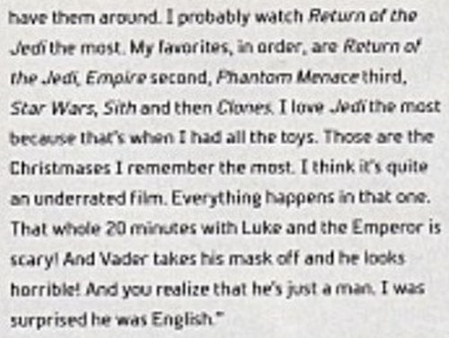
- **none** — entry/section: Stormtroopers underrated: ""Ultimately it's those poor stormtroopers who are equipped with really bad armor who are the most underrated characters in the movies. Just like the goons in the orange jumpsuits in all the James Bond films, they never get enough credit." —Andrew White, Star Wars Insider 95, p. 16" Source: *Star Wars Insider #95* (2007), scan p.16
  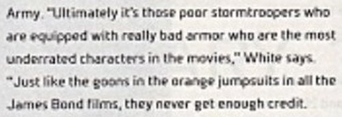
- **none** — entry/section: X-wing: ""Seeing the X-wing in a battle scene made me want to be in space. It got me thinking about what's out there, and science fiction in general. Good movies give you room to think and imagine possibilities. Star Wars did that for me." —Andrew White, Star Wars Insider 95, p. 16" Source: *Star Wars Insider #95* (2007), scan p.16
  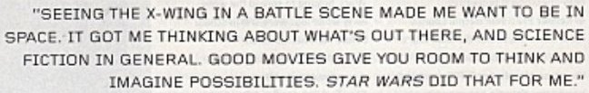

## scan p.17 (scan page 17)

Page contents: Kaiser Chiefs cont.: collecting from The Phantom Menace on, Star Wars room at home, praise of Steve Sansweet, why the films endure, Lucas and toys; "Star Wars Rocks" at starwars.com; Communications Disruption photo caption contest "Little Short for a Sith Lord" (fan captions; handles omitted); "Mix It Up with the Photo Masher!" (starwars.com image editor, Lando and Yoda graffiti fan mashups; creators omitted); band photo (hand-read)

- **none** — entry/section: Sansweet a legend: ""There are others who have much more impressive collections, like Steve Sansweet from Lucasfilm. He isn't merely a collector, he's a legend. And he's completely dedicated to the films, not just the action figures." —Andrew White, Star Wars Insider 95, p. 17" Source: *Star Wars Insider #95* (2007), scan p.17
  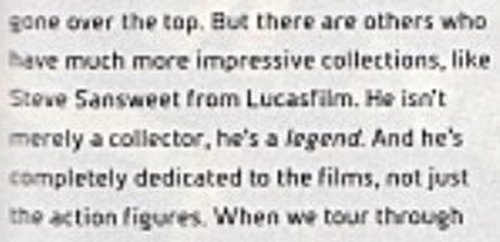
- **none** — entry/section: Lucas savvy: ""George Lucas was savvy enough to transform a film into a thriving business. Usually movies are released and then they are gone. But Lucas understood the idea behind creating toys for the films." —Andrew White, Star Wars Insider 95, p. 17" Source: *Star Wars Insider #95* (2007), scan p.17
  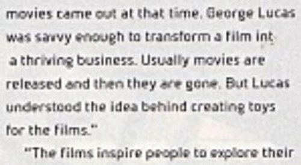

## scan p.18 (scan page 18)

Page contents: Feature "Inside Celebration IV" (words: Jonathan Wilkins): Los Angeles Convention Center May 24-28, Jedi, troopers, characters from films, EU and fans; Lucasfilm and Gen Con, more than 35,000 fans; Star Wars Celebration IV logo; Leia/Luke art, Lando, Greedo, LEGO, R2-D2 photos (hand-read)

### Stat block notes (game mechanics, not feats)

- 35,000 fans: However, the combined forces of Lucasfilm and Gen Con provided far more for the more than 35,000 fans to enjoy. (Star Wars Insider 95, p. 18) (Source: *Star Wars Insider #95* (2007), scan p.18)

## scan p.19 (scan page 19)

Page contents: Advertisement: Science Fiction Book Club "Is the Republic Doomed? Unravel the fate of the Force & take 5 books for $1": Karen Traviss' Legacy of the Force: Sacrifice (ships 8/7/07) plus Allegiance, Outbound Flight, Labyrinth of Evil, Exile, Betrayal, Republic Commando, other SF/fantasy titles; reply form (hand-read)

### Stat block notes (game mechanics, not feats)

- Sacrifice blurb: The Legacy of the Force saga continues... the coming Civil War rends the Skywalker and Solo families. Master Jacen, with Luke's young son Ben at his side, embarks on the path his grandfather Darth Vader took—while an enemy from the past emerges. (Star Wars Insider 95, p. 19) (Source: *Star Wars Insider #95* (2007), scan p.19)

## scan p.20 (scan page 20)

Page contents: Advertisement: Science Fiction Book Club cont.: more Star Wars novels (Dark Lord, Shatterpoint, Darth Bane etc.) and SF/fantasy covers, "Take 5 books for $1, save $232", membership terms, business reply mail card (Camp Hill, PA) (hand-read)

## scan p.21 (scan page 21)

Page contents: Celebration IV diary "Los Angeles, California - May 24 - May 28, 2007", Fri May 25: 9:30am journey to the venue; 12pm Jay Laga'aia hosts creature creators Dave and Lou Elsey with Bruce Spence (U.S. convention debut, Tion Medon); 1:30pm Carrie Fisher to a capacity crowd, recites the hologram speech; 2:30pm Scott Chernoff hosts the Imperial bad guys (Ken Colley, Richard LeParmentier, Julian Glover, George Roubicek, Barrie Holland, David Prowse); 7pm Opening Ceremony (marching band, stormtrooper battalion, birthday cake, Boba Fett blasting off, Steve Sansweet as an Ewok, two Lucas video appearances, Mayor Villaraigosa, In Memoriam montage); 10:30pm pizza behind Darth Maul and a Lucas look-alike; "Star Wars moment of the day" box (Fisher sings Life Day song); photos (Fisher with Laga'aia, Fett jetpack, Slave Leia costume) (hand-read)

### Stat block notes (game mechanics, not feats)

- Spence debut: The ever-exuberant Jay Laga'aia hosts a fascinating discussion with creature creators Dave and Lou Elsey on the Concourse stage where they are joined by Bruce Spence, making his U.S. convention debut. Spence speaks with great passion about his brief but crucial role in Revenge of the Sith. (Star Wars Insider 95, p. 21) (Source: *Star Wars Insider #95* (2007), scan p.21)
- Hologram speech: Fisher delights fans with a superb interview and answers fans' questions with her usual biting and self-deprecating wit. She draws cheers from the crowd as she recites the hologram speech from A New Hope perfectly over 30 years on. (Star Wars Insider 95, p. 21) (Source: *Star Wars Insider #95* (2007), scan p.21)
- Imperial bad guys: A quick dash down the hall to the Petree stage to see funnyman Scott Chernoff hosting a fantastic interview with the Imperial bad guys: Ken Colley, Richard LeParmentier, Julian Glover, George Roubicek, Barrie Holland, and David Prowse. Julian Glover's assertion that he did not have a clue as to what he was doing in The Empire Strikes Back is met with much laughter from the fans in the audience. (Star Wars Insider 95, p. 21) (Source: *Star Wars Insider #95* (2007), scan p.21)
- Opening Ceremony: A full marching band launches the epic Opening Ceremony which features a battalion of stormtroopers, cake for the entire audience, Boba Fett blasting off and, in the most surreal moment in Star Wars history, Steve Sansweet dressed as an Ewok. George Lucas makes two video appearances - one more real than the other. (Star Wars Insider 95, p. 21) (Source: *Star Wars Insider #95* (2007), scan p.21)
- No anchovies: Going for a pizza after the opening ceremony, we join the line behind Darth Maul and a George Lucas look-alike. Maul fixes the pizza guy with an intimidating stare that would strike fear into the heart of any Jedi as he says "No anchovies." (Star Wars Insider 95, p. 21) (Source: *Star Wars Insider #95* (2007), scan p.21)
- Life Day song: Star Wars moment of the day: Carrie Fisher delights the crowds by singing a few lines of the Life Day song from the Star Wars Holiday Special. (Star Wars Insider 95, p. 21) (Source: *Star Wars Insider #95* (2007), scan p.21)

## scan p.22 (scan page 22)

Page contents: Celebration IV diary, Sat May 26: 10am A New Hope cast panel (Paul Blake, Anthony Forrest, Garrick Hagon, Colin Higgins; why Higgins was replaced as Wedge by Denis Lawson); 11:30am Robot Chicken (Seth Green, Matt Senreich; animated Lucas on a psychiatrist's couch over the Holiday Special); 1pm Seth MacFarlane's Family Guy Star Wars episode preview (Peter Griffin, couch, Millennium Falcon gag); 2pm Charlie Ross' One Man Star Wars Trilogy; 3pm Irvin Kershner press conference; "Star Wars moment(s) of the day" box (Richard LeParmentier and Barrie Holland at the washbasins; little girl calls Vader "Da-Da Vader!"); photos (young Lando costume, Jawa/Jedi/X-wing pilot/Cylon, Obi-Wan costume reading Insider) (hand-read)

### Stat block notes (game mechanics, not feats)

- Higgins fired: Paul Blake, Anthony Forrest, Garrick Hagon, and Colin Higgins are all in sparkling form, with the latter offering a frank response when asked to solve the mystery as to why he was replaced as Wedge by Denis Lawson: George Lucas fired him!. (Star Wars Insider 95, p. 22) (Source: *Star Wars Insider #95* (2007), scan p.22)
- Robot Chicken Lucas: The first clip shown features an animated version of George Lucas (who provided his own voice) on a psychiatrist's couch working through his issues about the much-maligned Star Wars Holiday Special. (Star Wars Insider 95, p. 22) (Source: *Star Wars Insider #95* (2007), scan p.22)
- Family Guy: Another dash over to the Petree stage as Scott Chernoff hosts a presentation on the forthcoming Star Wars-themed episode of Family Guy with creator Seth McFarlane. The footage shown from the episode is hilarious and has those in attendance rolling in the aisles. A gag involving Peter Griffin, a couch, and the Millennium Falcon is an unexpected highlight. (Star Wars Insider 95, p. 22) (Source: *Star Wars Insider #95* (2007), scan p.22)
- One Man Star Wars: So popular is Charlie Ross' One Man Star Wars Trilogy that Star Wars Insider has to fight to get in. A hilarious rollercoaster ride through Episodes IV, V, and VI, it seems inconceivable that one man can perform all the roles so well and mock the saga in such a light-hearted and respectful way. (Star Wars Insider 95, p. 22) (Source: *Star Wars Insider #95* (2007), scan p.22)
- Da-Da Vader: A close tie between going to the bathroom and finding myself washing my hands with Richard (Motti) LeParmentier and Barrie ("You rebel scum!") Holland on either side OR a little girl, no older than two, seeing Darth Vader and announcing him to be "Da-Da Vader!" (Star Wars Insider 95, p. 22) (Source: *Star Wars Insider #95* (2007), scan p.22)

## scan p.23 (scan page 23)

Page contents: Celebration IV photo spread: Slave Leia gathering with Jabba ("Would you believe that Star Wars Insider missed this amazing event?"); Colin Higgins with his poster; Vader Project helmets; Lorne Peterson; "Lobot" Chicken and Seth Green; Wedge "Mark One" Colin Higgins reading Legacy (hand-read)

### Stat block notes (game mechanics, not feats)

- Vader Project: Heroes and villains (clockwise from top). Some examples of the impressive Vader Project; Lorne Peterson catches up on the latest news from the universe he helped create; 'Lobot' Chicken and Seth Green (photo by Bonnie Burton); Wedge "Mark One" Colin Higgins prepares to spill some secrets. (Star Wars Insider 95, p. 23) (Source: *Star Wars Insider #95* (2007), scan p.23)

## scan p.24 (scan page 24)

Page contents: Celebration IV spread cont.: "Art Wars" box on JAKe's Celebration IV entry-pass illustrations; "Star Wars: Star Fans Spotted at CIV" box (Ronald D. Moore, Hal Sparks, Jane Wiedlin, J.J. Abrams; thanks to Kayleen Walters and John Singh); costume photos (Spidey trooper, Ewok, baby Leia buns, Mandalorian); Vader helmets (hand-read)

### Stat block notes (game mechanics, not feats)

- Art Wars: Influenced by New York hip hop and graffiti art, the distinctive Star Wars illustrations by UK-based artist JAKe could be seen dangling around the necks of all the best people in L.A. during Celebration IV, in the form of a variety of different, but all equally cool, entry passes. (Star Wars Insider 95, p. 24) (Source: *Star Wars Insider #95* (2007), scan p.24)
- JAKe on Slave Leia: While his favorite character to draw is the stormtrooper, he notes that Slave Leia can present problems as she can look a little weird when interpreted into his distinctive super-deformed style. (Star Wars Insider 95, p. 24) (Source: *Star Wars Insider #95* (2007), scan p.24)
- Star fans: Battlestar Galactica supremo Ronald D. Moore buying Star Wars toys for his kids; Hal Sparks checking out Star Wars T-shirts; former Go-Go Jane Weidlin (at left) grasping a Yoda; and Lost producer J. J. Abrams. (Star Wars Insider 95, p. 24) (Source: *Star Wars Insider #95* (2007), scan p.24)

## scan p.25 (scan page 25)

Page contents: Celebration IV diary, Sun May 27: R2 Builders room; 11am Darth Vader helmet gallery; 1:30pm Star Wars: The Clone Wars panel with Dave Filoni and Catherine Winder (Boba Fett look-alike "I've had my faith restored!"; Anthony Daniels pops in); 3:30pm costume pageant (Aunt Beru, Gamorrean Guard, Spidey-stormtrooper; winner a towering Chewbacca); "Star Wars moment of the day" box (kid in a Vader costume called Anakin); Mon May 28: 10am dealers room, Jay Laga'aia luggage; 1:30pm bellydancing lesson, "How long to Celebration Europe?"; photos (Lawrence Noble sculpts Obi-Wan, young Leia, Artoo and Threepio "The Early Years", lightsabers, Boba Fett) (hand-read)

### Stat block notes (game mechanics, not feats)

- R2 Builders: An exploration of the R2 builders room reveals just how dedicated and precise the droid makers are. A diverse array of R2 units combined with various other Star Wars droids (plus a Jawa or two) make the room mechanical heaven. (Star Wars Insider 95, p. 25) (Source: *Star Wars Insider #95* (2007), scan p.25)
- Vader helmets: The gallery of Darth Vader helmets proves to be one of the must-see attractions at the event as the Dark Lord's mask is reinterpreted in a variety of creative and original ways. (Star Wars Insider 95, p. 25) (Source: *Star Wars Insider #95* (2007), scan p.25)
- Clone Wars panel: Booming sound from inside the Celebration Theater is followed by cheers and rapturous applause, which is followed by the same pattern of sound and applause. As fans pile out of the room, a Boba Fett look-alike stops and proclaims: "I've had my faith restored!" The atmosphere becomes electric. Filoni's enthusiasm for Star Wars (and Plo Koon in particular) is contagious. (Star Wars Insider 95, p. 25) (Source: *Star Wars Insider #95* (2007), scan p.25)
- Costume pageant: There are many highlights, but special mention must go to a wonderful Aunt Beru, a stunning Gamorrean Guard, and an excellent Spidey-stormtrooper. The eventual winner is a towering Chewbacca but he had to beat off stiff competition. (Star Wars Insider 95, p. 25) (Source: *Star Wars Insider #95* (2007), scan p.25)
- Called Anakin: Star Wars moment of the day: Seeing a kid in a stroller wearing a full Darth Vader costume and hearing his parents call him Anakin. (Star Wars Insider 95, p. 25) (Source: *Star Wars Insider #95* (2007), scan p.25)
- Noble sculpt: Lawrence Noble sculpts a stunning likeness of Obi-Wan Kenobi (Star Wars Insider 95, p. 25) (Source: *Star Wars Insider #95* (2007), scan p.25)

## scan p.26 (scan page 26)

Page contents: "Dark Lord of the Store! Star Wars Fan Movie Challenge Winners Explore Vader's Softer Side": Lucasfilm and AtomFilms sixth annual Star Wars Fan Movie Challenge at Celebration IV; George Lucas Selects award to Chad Vader: Day Shift Manager; other winners (Incident at Toshi Station, IG-88: The Dancing Robot, The Eyes of Darth Tater, Forced Alliance, Essence of the Force); "Fan Movie Challenge Winners" box; fan filmmaker names omitted per policy; photos (Darth Tater, Chad Vader, AT-AT) (hand-read)

### Stat block notes (game mechanics, not feats)

- Chad Vader: "We made Chad Darth's little brother. He has the same look and powers but not the same confidence," ... "We gave him a heart. Chad doesn't really want to kill people, he just wants them to like him, but he's got a lot of inner conflicts." (Star Wars Insider 95, p. 26) (Source: *Star Wars Insider #95* (2007), scan p.26)
- Darth Tater: "The idea originated in a dream, the singular shot of Darth Sidious beside a foil-wrapped baked potato," ... "It was then just a matter of putting a beginning and end to that thought." (Star Wars Insider 95, p. 26) (Source: *Star Wars Insider #95* (2007), scan p.26)
- IG-88 dancing: For some reason I became fixated on the IG-88 character. Along with the snowtrooper, he was the action figure to have back in 1980. (Star Wars Insider 95, p. 26) (Source: *Star Wars Insider #95* (2007), scan p.26)

## scan p.27 (scan page 27)

Page contents: Ad: Swords of Dragonfire, The Knights of Myth Drannor Book II by Ed Greenwood (Forgotten Realms, wizards.com/books) (hand-read)

## scan p.28 (scan page 28)

Page contents: "May the Facts Be With You: 100 Things You Didn't Know About Star Wars: Episode IV A New Hope", Part Two #51-#100, words by Dan Wallace; opener photo (stormtroopers with a yellow droid in Mos Eisley; George Lucas Star Wars novelization) (hand-read)

## scan p.29 (scan page 29)

Page contents: "May the Facts Be With You" Part Two cont.: #51 Color Coded (sandtrooper pauldrons); #52 Nap Time (Jawa Siesta card); #53 Hand in Glove (Duros hands); #54 Fraternal Twins? (Tonnika sisters, see Q&A p58); #55 Lend Me a Hand (Ponda Baba's arm); #56 You'll Be Dead! (Doctor Evazan as Roofoo in the radio drama); photos (Mos Eisley checkpoint, cantina, severed arm, Evazan) (hand-read)

### Stat block notes (game mechanics, not feats)

- Color Coded: Regular sandtroopers wear black shoulder pauldrons, while patrol leaders wear orange ones. A similar ranking scheme appears in The Phantom Menace, where colored trim is used to distinguish types of battle droids. (Star Wars Insider 95, p. 29) (Source: *Star Wars Insider #95* (2007), scan p.29)
- Nap Time: As Luke and Obi-Wan head inside the cantina, they pass three sleepy Jawas leaning against the foot of a doorway. The Star Wars Customizable Card Game released a card of the trio entitled "Jawa Siesta." (Star Wars Insider 95, p. 29) (Source: *Star Wars Insider #95* (2007), scan p.29)
- Hand in Glove: Take a closer look at the gesticulating hands of the two bickering Duros in the cantina. One has long, alien fingers, one doesn't. (Star Wars Insider 95, p. 29) (Source: *Star Wars Insider #95* (2007), scan p.29)
- Fraternal Twins?: The dark-haired Tonnika sisters have been called identical twins in some spin-off literature, but the two actresses that play them look quite different. (Star Wars Insider 95, p. 29) (Source: *Star Wars Insider #95* (2007), scan p.29)
- Lend Me a Hand: During principal photography of the cantina scene, the arm of Ponda Baba (Walrus Man) ended in a cup-shaped flipper. Later, while shooting additional footage, the crew substituted a furry claw for the shot of Ponda Baba's severed arm. (Star Wars Insider 95, p. 29) (Source: *Star Wars Insider #95* (2007), scan p.29)
- You'll Be Dead!: In the radio drama, Doctor Evazan ("I have the death sentence in 12 systems") is referred to as Roofoo, and is said to have been cut entirely in half. (Star Wars Insider 95, p. 29) (Source: *Star Wars Insider #95* (2007), scan p.29)

## scan p.30 (scan page 30)

Page contents: "May the Facts Be With You" cont.: #57 Strange Species (crew nicknames Louie, Goggle-Eyes, Spider-Man); #58 False Advertising (Marvel Star Wars #2 cover); #59 Corellian Casting Call; #60 Shut Him Up or Shut Him Down (droid caller); #61 You Watch Your Language (R2-D2 voice by Ben Burtt); #62 What, No Comb? (Chewbacca's bandolier pouch); #63 Chewie's Cuter Precursor (Boma named Deeta); #64 Bunji Jumped; #65 There Are Alternatives to Fighting (radio drama mind trick); #66 Freeze-Frame Fun (Docking Bay 94); #67 Jets Prohibited; #68 Tuning Forks (Falcon prongs, Lucas quote); photos (Devaronian, Talz, Han Solo, Falcon) (hand-read)

- **none** — entry/section: Flying hamburger: ""We won't make it like a flying saucer, we'll make it sort of like a flying hamburger. And then we'll put two big forks on the end of it so that it can pick up things, like it's a freighter. The idea was to make it look as unusual as possible." —George Lucas, Star Wars Insider 95, p. 30" Source: *Star Wars Insider #95* (2007), scan p.30
  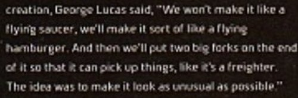

### Stat block notes (game mechanics, not feats)

- Strange Species: During filming, the crew referred to the horned Devaronian as "Louie," the two space-suited Duros as "Goggle-Eyes," and the white-furred Talz as "Spider-Man." (Star Wars Insider 95, p. 30) (Source: *Star Wars Insider #95* (2007), scan p.30)
- False Advertising: The cantina fight must have seemed a hundred times more frenzied to readers of Marvel's Star Wars comic. The cover of issue #2 featured a horde of attacking aliens as a muscular Luke shouted, "Swing that LIGHT-SABRE [sic] Ben - or we're FINISHED!" (Star Wars Insider 95, p. 30) (Source: *Star Wars Insider #95* (2007), scan p.30)
- Corellian Casting Call: Kurt Russell, Christopher Walken, and Perry King were all considered for the role of Han Solo. Perry King later became the voice of Han Solo for the classic trilogy radio adaptations. (Star Wars Insider 95, p. 30) (Source: *Star Wars Insider #95* (2007), scan p.30)
- Droid caller: One of the gadgets on Han Solo's belt is a droid caller, a remote-control device used to shut the droids down. It could have come in handy against the chatty C-3PO. (Star Wars Insider 95, p. 30) (Source: *Star Wars Insider #95* (2007), scan p.30)
- Vocalizations: R2-D2's distinctive vocalizations are a mixture of electronic noises and human baby-like cooing, mixed by sound designer Ben Burtt. (Star Wars Insider 95, p. 30) (Source: *Star Wars Insider #95* (2007), scan p.30)
- What, No Comb?: Ever wonder what Chewbacca carries in his bandolier pouch? According to guidebooks, it's packed with repair tools and kthysh vines (which can be used as bowcaster strings). (Star Wars Insider 95, p. 30) (Source: *Star Wars Insider #95* (2007), scan p.30)
- Chewie's Cuter Precursor: In the script's second draft, Han shares an apartment with a "Boma" named Deeta, who is described as a "cross between a brown bear and a guinea pig." (Star Wars Insider 95, p. 30) (Source: *Star Wars Insider #95* (2007), scan p.30)
- Bunji Jumped: Big Bunji, a gangster rival of Jabba the Hutt, is mentioned in the Star Wars radio drama. After this debut Bunji remained absent from the Star Wars universe until the 2000 novel Hero's Trial, in which he is described as a hulking humanoid with an enormous head and saucepan eyes. (Star Wars Insider 95, p. 30) (Source: *Star Wars Insider #95* (2007), scan p.30)
- Mind trick payout: In the radio drama, Obi-Wan uses the Jedi mind trick on the landspeeder buyer to win a 2,000 credit payout. We now know that he picked that up from Qui-Gon, who shamelessly used the Force to nudge Watto's dice. (Star Wars Insider 95, p. 30) (Source: *Star Wars Insider #95* (2007), scan p.30)
- Freeze-Frame Fun: Close examination of Docking Bay 94 will allow you to make out the number "94" printed on the walls. (Star Wars Insider 95, p. 30) (Source: *Star Wars Insider #95* (2007), scan p.30)
- Jets Prohibited: Look closely at the left-hand side of the screen as Luke and company arrive at Docking Bay 94, and you'll see R2-D2 carefully picking his way down the stairs. Perhaps in tribute to this moment, the online feature HoloNet News revealed that the warranty on R2-D2's prequel-era rocket jets expired after 20 years. (Star Wars Insider 95, p. 30) (Source: *Star Wars Insider #95* (2007), scan p.30)

## scan p.31 (scan page 31)

Page contents: "May the Facts Be With You" cont.: #69 Imperial Pursuit (Star Destroyer Conquest); #70 Silent Scream (Alderaan explosion sound); #71 Checkmate (Kalhar monster/Mantellian Savrip); #72 Good Against a Remote Is One Thing; #73 I Can't See a Thing in This Helmet; #74 Simple Tricks; #75 "I Have a Bad Feeling About This."; #76 Unsolved Mysteries (scanning crew); #77 Bad Transmitter (TK-421/THX-1138, 501st); #78 This Bickering Is Pointless (Vader/Tarkin scripted lines); photos (Star Destroyers, Falcon cockpit, holo-chess, training remote, Tarkin and Vader) (hand-read)

### Stat block notes (game mechanics, not feats)

- Imperial Pursuit: One of the Star Destroyers chasing the Millennium Falcon as it flees Tatooine is the Conquest. The other hasn't been named in spin-off material. (Star Wars Insider 95, p. 31) (Source: *Star Wars Insider #95* (2007), scan p.31)
- Silent Scream: Sound designer Ben Burtt considered leaving Alderaan's explosion completely silent, and also toyed with the idea of delaying the sound effect until several moments after the planet's on-screen destruction. Burtt salvaged the latter idea for Jango Fett's seismic charges in Attack of the Clones. (Star Wars Insider 95, p. 31) (Source: *Star Wars Insider #95* (2007), scan p.31)
- Checkmate: Chewbacca's piece in the holo-chess match is a long-necked beast identified as a "Kalhar monster" in the video game Super Star Wars. Later it bore the name of Mantellian Savrip, and the species even won a supporting role in the comic series Qui-Gon and Obi-Wan: Last Stand on Ord Mantell. (Star Wars Insider 95, p. 31) (Source: *Star Wars Insider #95* (2007), scan p.31)
- Training remote: The floating ball used for Luke's lightsaber exercises has been called a "Jedi training remote," but apparently it's Han's property. The Han Solo novels (by author Brian Daley) reveal that the smuggler used the remote to practice his quick-draw skills. (Star Wars Insider 95, p. 31) (Source: *Star Wars Insider #95* (2007), scan p.31)
- Blast shield: As Luke dons the training helmet, he says, "With the blast shield down, I can't even see. How am I supposed to fight?" It's a good question, isn't it? One wonders how the helmet could be useful with a metal-welded faceplate. (Star Wars Insider 95, p. 31) (Source: *Star Wars Insider #95* (2007), scan p.31)
- Simple Tricks: In the script's fourth draft, when Han scoffs at Luke's Jedi training, Obi-Wan causes Han's sidearm to fire in its holster and blast a hole near his feet. (Star Wars Insider 95, p. 31) (Source: *Star Wars Insider #95* (2007), scan p.31)
- Bad feeling: This evergreen in-joke got its start with a double-dose in A New Hope. The first instance occurs when Luke worries about the looming Death Star, and the second when Han expresses his skepticism regarding the safety of the trash compactor. (Star Wars Insider 95, p. 31) (Source: *Star Wars Insider #95* (2007), scan p.31)
- Unsolved Mysteries: One of the movie's lingering questions concerns the fate of the Death Star scanning crew that inspected the Millennium Falcon. Were they terminated, or just stunned? One answer is given by a Decipher card. They were stunned, taken to the infirmary, and died there when the Death Star exploded. (Star Wars Insider 95, p. 31) (Source: *Star Wars Insider #95* (2007), scan p.31)
- Bad Transmitter: The luckless stormtrooper TK-421 almost went by a different call sign entirely; the novelization labeled him THX-1138 after George Lucas' first film. The name TK-421 later turned up as an in-joke in the movie Boogie Nights (referring to a type of stereo system), and also inspired the naming conventions of the fan costumers of the 501st Legion. (Star Wars Insider 95, p. 31) (Source: *Star Wars Insider #95* (2007), scan p.31)
- This Bickering Is Pointless: After Tarkin snaps, "Terminate her, immediately!" the movie omits Vader's scripted response ("And lose your only link to the Rebel base? She can still be of value to us.") as well as Tarkin's comeback ("You'll get nothing more out of her. I'll find that hidden fortress if I have to destroy every star system in this sector!"). Bonus points if you recognize that "hidden fortress" is a nod to the Akira Kurosawa film of the same name. (Star Wars Insider 95, p. 31) (Source: *Star Wars Insider #95* (2007), scan p.31)

## scan p.32 (scan page 32)

Page contents: "May the Facts Be With You" cont.: #79 That's a Name I've Not Heard in a Long Time; #80 There's Something Alive in Here (dianoga/Dai Noga, Kenner playset); #81 Under Pressure (Hamill's blood vessel); #82 Wet Wookiee; #83 Close Up Formation; #84 Idle Chatter (BT-16); #85 The Wilhelm; photos (Leia, trash compactor, stormtroopers, tractor beam, chasm fall) (hand-read)

### Stat block notes (game mechanics, not feats)

- Ben Kenobi: Leia's message contains the line, "Help me, Obi-Wan Kenobi," yet curiously the Princess doesn't seem at all puzzled by Luke's mention of "Ben Kenobi." One possible interpretation is that Bail Organa let his daughter in on the secret of Obi-Wan's alias. (Star Wars Insider 95, p. 32) (Source: *Star Wars Insider #95* (2007), scan p.32)
- Dianoga: The tentacled trash monster, properly called a dianoga, saw its name emerge in early outlines attached to the Jedi-like "Dai Noga" warriors. In the late 1970s, Kenner reproduced the creature in green plastic as part of the company's Death Star playset. (Star Wars Insider 95, p. 32) (Source: *Star Wars Insider #95* (2007), scan p.32)
- Under Pressure: While filming the trash compactor scene, Mark Hamill held his breath for too long and ruptured a blood vessel in his eye. For the remaining shots, the crew filmed him only in profile. (Star Wars Insider 95, p. 32) (Source: *Star Wars Insider #95* (2007), scan p.32)
- Wet Wookiee: Because the crew didn't want to damage the expensive yak-fur costume, Chewbacca spent the entire trash compactor scene perched on a platform in the corner. (Star Wars Insider 95, p. 32) (Source: *Star Wars Insider #95* (2007), scan p.32)
- Close Up Formation: After the stormtrooper squad bursts into the Death Star control room, two troopers take up flanking positions on either side of the droids' closet leaving their comrade utterly unprotected had the closet's contents proved hostile. (Star Wars Insider 95, p. 32) (Source: *Star Wars Insider #95* (2007), scan p.32)
- Idle Chatter: As Obi-Wan sneaks toward the tractor beam tower, two stormtroopers can be heard discussing "that new BT-16." According to Cynabar's Fantastic Technology: Droids, the BT-16 is a spider-like perimeter security droid. (Star Wars Insider 95, p. 32) (Source: *Star Wars Insider #95* (2007), scan p.32)
- The Wilhelm: The distinctive squeal of an injured cowboy in 1953's Charge at Feather River has become a movie industry in-joke, thanks largely to its appearance in A New Hope and subsequent Lucasfilm productions featuring the work of sound designer Ben Burtt. Listen for the Wilhelm as a stricken stormtrooper plunges into the Death Star chasm. (Star Wars Insider 95, p. 32) (Source: *Star Wars Insider #95* (2007), scan p.32)

## scan p.33 (scan page 33)

Page contents: "May the Facts Be With You" cont.: #86 For Luck (chasm swing); #87 Forgotten Friend (Tocneppil); #88 Four Barrels of Hot Laser; #89 Not This Ship, Sister (tracking device); photos (Luke and Leia swing, stormtroopers, Falcon gunwell) (hand-read)

### Stat block notes (game mechanics, not feats)

- For Luck: Mark Hamill and Carrie Fisher completed the rope swing across the Death Star chasm on their first try, without stunt doubles. (Star Wars Insider 95, p. 33) (Source: *Star Wars Insider #95* (2007), scan p.33)
- Forgotten Friend: Han has a funny line from the novelization concerning a mysterious "Tocneppil" who has so far escaped notice in the Expanded Universe. While racing back to the Falcon alongside Chewie, Han grumbles, "Of course I can find the ship from here; Corellians can't get lost. Tocneppil doesn't count; he wasn't Corellian. Besides, I was drunk." (Star Wars Insider 95, p. 33) (Source: *Star Wars Insider #95* (2007), scan p.33)
- Four Barrels of Hot Laser: The recoiling fire pattern of the Falcon's quad cannons is so cool that it was called out in the Clone Wars cartoon. In the animated series' second season, a clone trooper engages General Grievous with a miniaturized quad cannon carried on his chest. (Star Wars Insider 95, p. 33) (Source: *Star Wars Insider #95* (2007), scan p.33)
- Not This Ship, Sister: The tracking device planted aboard the Millennium Falcon is never seen on screen, but contradictory depictions of it have appeared in Marvel's Droids comic and the "Darklighter" story arc of Dark Horse's Star Wars Empire. Both designs, merged into a single gadget, recently appeared in The New Essential Guide to Droids. (Star Wars Insider 95, p. 33) (Source: *Star Wars Insider #95* (2007), scan p.33)

## scan p.34 (scan page 34)

Page contents: "May the Facts Be With You" cont.: #90 Risky Business (Lorne Peterson as Rebel sentry Osleo Prennert); #91 Curtain Call (Commander Willard); #92 More Wealth Than You Can Imagine; #93 Fake Wedge (Colin Higgins); photos (Tikal temples, Willard and Leia, Han in hangar, briefing room) (hand-read)

### Stat block notes (game mechanics, not feats)

- Risky Business: The Rebel sentry observing the Falcon's approach to Yavin Base is ILM model builder Lorne Peterson, who "won" the right to perch on a garbage can near the crumbling corner of a Mayan temple because his two companions (Richard Edlund and Dick Alexander) had children, and therefore considered themselves less expendable. Star Wars Insider recently revealed this character's name to be Osleo Prennert. (Star Wars Insider 95, p. 34) (Source: *Star Wars Insider #95* (2007), scan p.34)
- Curtain Call: Commander Willard, one of the most important Rebel commanders, appears at the film's climax, and even gets a few lines. Yet besides a few paragraphs in role-playing guidebooks, the Expanded Universe gave Willard the boot, establishing that the commander retired after the Battle of Yavin. (Star Wars Insider 95, p. 34) (Source: *Star Wars Insider #95* (2007), scan p.34)
- More Wealth: According to the radio drama, the Rebels paid out Han's reward with precious metals used to repair electrical equipment. (Star Wars Insider 95, p. 34) (Source: *Star Wars Insider #95* (2007), scan p.34)
- Fake Wedge: The Rebel pilot who speaks the line, "That's impossible, even for a computer" is identified as Wedge Antilles, yet the actor is not long-time Wedge portrayer Denis Lawson. For years the character earned the fan nickname "Fake Wedge," until starwars.com's Pablo Hidalgo identified the stand-in as Blake's 7 actor Colin Higgins (he was recently seen at Celebration IV). (Star Wars Insider 95, p. 34) (Source: *Star Wars Insider #95* (2007), scan p.34)

## scan p.35 (scan page 35)

Page contents: "May the Facts Be With You" cont.: #94 Be Careful Out There (Dodonna first "May the Force be with you"); #95 Lock S-Foils (X-wing cockpit continuity error); #96 Sir Not-Appearing-in-This-Film (Red 4 "John D"/Jack Klaff, see p34); #97 Still Standing (30 Rebel starfighters); #98 Chewie's Medal; #99 Shark Slayer; #100 Honored Company (AFI #15); photos (Dodonna, Y-wings, X-wing, Death Star, Red 4, medal ceremony) (hand-read)

### Stat block notes (game mechanics, not feats)

- Be Careful Out There: General Dodonna sends off his starfighter pilots with a warm "May the Force be with you," marking him out as the first character to speak the line in a Star Wars movie. (Star Wars Insider 95, p. 35) (Source: *Star Wars Insider #95* (2007), scan p.35)
- Lock S-Foils: For live-action filming, the crew built a single full-size X-wing cockpit. They mounted the rear engines as they would appear when the ship was in its fully spread "X" configuration, thus creating a minor continuity error during the cockpit shots that occur immediately after take-off. (Star Wars Insider 95, p. 35) (Source: *Star Wars Insider #95* (2007), scan p.35)
- Red 4: Red 4, nicknamed "John D" (Jack Klaff) was largely cut from the movie. His missing lines were, "Red 4 standing by," and "I've got one, I've got one." Only his cry of "I'm hit! Aaargh!" remains. (Star Wars Insider 95, p. 35) (Source: *Star Wars Insider #95* (2007), scan p.35)
- Still Standing: According to an Imperial officer's dialogue, a total of 30 Rebel starfighters attack the Death Star. Only three of the 30 fly away: Luke's X-wing, Wedge's X-wing, and a single Y-wing (commonly attributed to video game character Keyan Farlander). (Star Wars Insider 95, p. 35) (Source: *Star Wars Insider #95* (2007), scan p.35)
- Chewie's Medal: Although Chewbacca is snubbed during the awards ceremony, he received a medal in various spin-off sources. The novelization honors him during the ceremony itself, while the Marvel U.K. comics give him his decoration later that night (where Princess Leia stands on a table to reach his neck). In The Revenge of Tag and Bink, the two protagonists find Chewie's medal on the floor of the abandoned base, apparently forgotten. And during the 1997 MTV Movie Awards, Carrie Fisher gave Chewie (Peter Mayhew) a real-world medal. But could all of this activity have been off-base? According to interviews conducted shortly after the release of A New Hope, George Lucas maintained that the Rebels had participated in a celebration on Chewbacca's homeworld in lieu of an actual medal. (Star Wars Insider 95, p. 35) (Source: *Star Wars Insider #95* (2007), scan p.35)
- Shark Slayer: Star Wars quickly passed 1975's Jaws to become the highest-grossing movie of all time, a position it held for two decades until the success of James Cameron's Titanic in 1997. (Star Wars Insider 95, p. 35) (Source: *Star Wars Insider #95* (2007), scan p.35)
- Honored Company: Star Wars: Episode IV A New Hope is among the 100 inductees on the American Film Institute's list of the greatest American movies of all time, ranking #15. (Star Wars Insider 95, p. 35) (Source: *Star Wars Insider #95* (2007), scan p.35)

## scan p.36 (scan page 36)

Page contents: "Pirates of the Boards: At Last, the Complete Story of Mysterious Rebel Pilot "John D" Is Revealed!" (Star Wars 30 logo; Exclusive Series Part 4 of 6), words by J.W. Rinzler: Joe Johnston storyboards notated by Richard Edlund; third-draft pilot "Chewie" split into Wedge and John D (named after John Dykstra, played by Jack Klaff); shot on Elstree Stage 8 June 28-29, 1976; Blue Squadron became Red; storyboard panels #1-#2 with fourth-draft script excerpts (Yavin lookout, Blue Leader/Luke sunshade exchange) (hand-read)

### Stat block notes (game mechanics, not feats)

- Chewie split: Edlund's notes reveal that the exploits of a pilot named "Chewie" in the third draft have been divided into two characters: the well-known Wedge, who would survive the attack on the Death Star, and John D, the almost unknown Rebel pilot who would NOT survive the attack. While Chewie was transformed because Chewbacca was also called Chewie, John D was presumably named after Industrial Light & Magic special effects supervisor John Dykstra, and played by British actor Jack Klaff (as the CD-ROM Behind the Magic states), who was represented back in the day by the Richard Stone Agency (revealed on an old cast list). (Star Wars Insider 95, p. 36) (Source: *Star Wars Insider #95* (2007), scan p.36)
- Blue became Red: Klaff's scenes were shot on Stage 8 of Elstree Studios in the "Interior cockpit with blue backing" set on Monday and Tuesday, June 28 and 29, 1976. Originally his scenes were to be filmed with front projection but when Lucas had to switch to "blue backing," or bluescreen, the entire Blue Squadron became Red for technical reasons. Though his original script designation "Blue Six" was changed in post-production to "Red Four," John D's fate remained the same. (Star Wars Insider 95, p. 36) (Source: *Star Wars Insider #95* (2007), scan p.36)
- Reference film: Many of the final boards and shots were based on Lucas' 16 mm reference film he'd edited out of pieces from World War II movies and documentaries. (Star Wars Insider 95, p. 36) (Source: *Star Wars Insider #95* (2007), scan p.36)

## scan p.37 (scan page 37)

Page contents: "Pirates of the Boards" cont.: storyboard panels #3-#5 (X- and Y-wings dive on the Death Star, Luke hits a power terminal, long shot of X-wings dodging explosions) with fourth-draft script excerpts (Blue Leader/Luke "lead time" exchange) (hand-read)

### Stat block notes (game mechanics, not feats)

- Power terminal: Luke directs his fire at one of the prime power terminals. It explodes, generating weird electronic arcs that leap off the station's surface. (Star Wars Insider 95, p. 37) (Source: *Star Wars Insider #95* (2007), scan p.37)

## scan p.38 (scan page 38)

Page contents: "Pirates of the Boards" cont.: storyboard panels #6-#11 (power terminal explodes; Wedge among gun towers, pilot still called "Chewie" on the storyboard; Luke's twisting dive; POV from Luke's guns; Biggs through radar domes; four TIE ships dive on the Rebel fighters) (hand-read)

### Stat block notes (game mechanics, not feats)

- Still Chewie: An X-wing fighter (Wedge) maneuvers among gun towers and projecting superstructures. [Note that pilot is still called "Chewie" on the storyboard, a remnant from the third draft.] (Star Wars Insider 95, p. 38) (Source: *Star Wars Insider #95* (2007), scan p.38)
- TIE dive: Long shot. Silhouetted against the rim lights of the Death Star horizon, four ferocious Imperial TIE ships dive on the Rebel fighters. Two of the TIE fighters peel off and drop out of frame. Pan with the remaining two TIE ships. Biggs sees the TIE ship behind him and swings around, trying to avoid him. (Star Wars Insider 95, p. 38) (Source: *Star Wars Insider #95* (2007), scan p.38)

## scan p.39 (scan page 39)

Page contents: "Pirates of the Boards" cont.: storyboard panels #12-#13 (Luke flying upside down, "Hang on, Biggs, I'm coming in."; Edlund's "Like film, 12/17" note on the 16 mm short; storyboard 134 omitted; Wedge rolls past a TIE, still called "Chewie") (hand-read)

### Stat block notes (game mechanics, not feats)

- Like film: [Note the underlined words scribbled by Edlund, "Like film, 12/17," which refers to the 16 mm short Lucas had assembled as a guide for the shots he wanted. Also note that storyboard 134 has been omitted - "replace with 133A, TIE exploding" are the instructions.] (Star Wars Insider 95, p. 39) (Source: *Star Wars Insider #95* (2007), scan p.39)
- Wedge dives: Full shot. Wedge rolls his ship and dives toward the Death Star surface, passing a TIE ship going in the other direction. [Note that Wedge is still called "Chewie" here.] (Star Wars Insider 95, p. 39) (Source: *Star Wars Insider #95* (2007), scan p.39)

## scan p.40 (scan page 40)

Page contents: "Pirates of the Boards" cont.: storyboard panels #14-#16 (John D with a scar across one eye, "I'm on one! I've got one!"; "Chewie" crossed out and replaced with "John D"; John D downs a TIE, Blue Leader "Good shooting, Blue Six"; John D's cockpit explodes, "I'm hit! I'm hit!"); "To be continued...." (hand-read)

### Stat block notes (game mechanics, not feats)

- John D scar: CU. John D, a young pilot with a scar across one eye, adjusts his targeting device. (Star Wars Insider 95, p. 40) (Source: *Star Wars Insider #95* (2007), scan p.40)
- Crossed out: (Note that here and in subsequent boards, "Chewie" has been crossed out and replaced with the name "John D") (Star Wars Insider 95, p. 40) (Source: *Star Wars Insider #95* (2007), scan p.40)
- John D hit: Full shot. John D's X-wing races past camera, closely chased by an Imperial TIE ship firing both guns. CU John D. The inside of the cockpit explodes as John D is hit. (Star Wars Insider 95, p. 40) (Source: *Star Wars Insider #95* (2007), scan p.40)

## scan p.41 (scan page 41)

Page contents: Ad: Star Wars PocketModel TCG trading card game by WizKids, "Build Your Empire", June 2007 (game pack contents 4-6 PocketModels, 6 game cards; Darth Vader art) (hand-read)

## scan p.42 (scan page 42)

Page contents: "Taylor Made: Special Edition" opener spread (left page): Darth Vader backdrop with an inset photo of Gilbert Taylor (hand-read)

## scan p.43 (scan page 43)

Page contents: "Taylor Made: Special Edition" opener (right page), words by Chris Gardner: intro on cinematographer Gilbert Taylor (93, first movie 1930; The Omen, Star Wars, Flash Gordon); revised interview first run in the U.K.'s Star Wars Magazine 10 years ago; Obi-Wan Kenobi backdrop (hand-read)

### Stat block notes (game mechanics, not feats)

- Gilbert Taylor intro: Cinematographer Gilbert Taylor has enjoyed a productive career, and at 93 is now enjoying a happy retirement. From his first movie in 1930, through his work lighting The Omen, Star Wars and Flash Gordon, Taylor has contributed to various horror, SF and fantasy movie franchises. (Star Wars Insider 95, p. 43) (Source: *Star Wars Insider #95* (2007), scan p.43)

## scan p.44 (scan page 44)

Page contents: "Taylor Made: Special Edition" by Chris Gardner: Gil Taylor suspected Star Wars would be a hit; fresh off The Omen and A Hard Day's Night; hired by The Star Wars Corporation after Geoffrey Unsworth withdrew; pull quote "I thought that Star Wars was a great idea..."; photos (R2-D2 and C-3PO, Tunisia sandcrawler set, Tatooine location) (hand-read)

- **none** — entry/section: Biggest shock: ""They had the biggest shock in the world when the premiere went like it did," ... "I knew it would be a hit because it was so different." —Gilbert Taylor, Star Wars Insider 95, p. 44" Source: *Star Wars Insider #95* (2007), scan p.44
  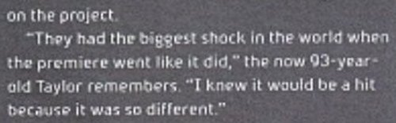
- **none** — entry/section: Witchcraft to spacecraft: ""I thought that Star Wars was a great idea, and that a sudden change from witchcraft to spacecraft would be great," ... "There was nothing that was distasteful, there was very little horror and it was not gory. That's what appealed." —Gilbert Taylor, Star Wars Insider 95, p. 44" Source: *Star Wars Insider #95* (2007), scan p.44
  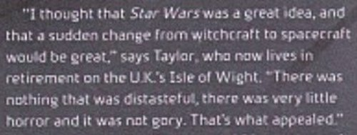

### Stat block notes (game mechanics, not feats)

- Unsworth withdrew: Taylor was hired by what was then The Star Wars Corporation, after first choice Geoffrey Unsworth withdrew to make A Matter of Time with director Vincente Minnelli. (Star Wars Insider 95, p. 44) (Source: *Star Wars Insider #95* (2007), scan p.44)

## scan p.45 (scan page 45)

Page contents: "Taylor Made" cont.: lightsaber blades with 3M reflective material; R2-D2 problems and Kenny Baker; "Perfect Storm" section (Tunisia from March 22, 1976; sandcrawler facade flattened by storm; heat; Artoo and Threepio); Death Star set redesign with 9,000 photo bulbs; pull quote "I always had a tremendous feeling about Artoo and Threepio..."; photos (droids in Tunisian heat, Kenny Baker) (hand-read)

- **R2-D2** — entry/section: Small person inside: ""I suggested, almost as an aside, that we might be wise to make a much lighter model and put a small person inside," ... "This was taken up and, after several fittings and one or two falls, Kenny Baker became the star everyone loves." —Gilbert Taylor, Star Wars Insider 95, p. 45" Source: *Star Wars Insider #95* (2007), scan p.45
  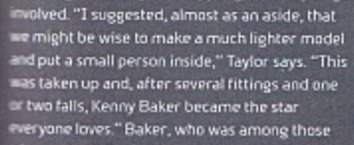
- **R2-D2; C-3PO** — entry/section: Great act: ""To their credit Kenny and Anthony never complained about the heat rashes they suffered when the sun eventually came out. I always had a tremendous feeling about Artoo and Threepio - those two together, I thought, were a great act. They made mechanical objects into humans." —Gilbert Taylor, Star Wars Insider 95, p. 45" Source: *Star Wars Insider #95* (2007), scan p.45
  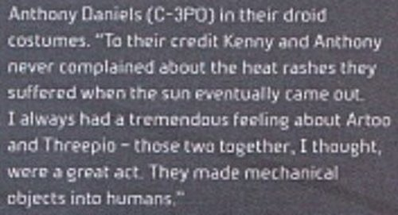
- **Darth Vader (Anakin Skywalker)** — entry/section: Lighting balance: ""It gave me control to raise and lower the lighting balance to suit the action, depending on whether Darth Vader's black costume or the stormtroopers' white uniforms were being used," —Gilbert Taylor, Star Wars Insider 95, p. 45" Source: *Star Wars Insider #95* (2007), scan p.45
  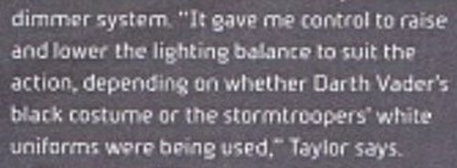
- **none** — entry/section: 360 degrees: ""I wanted George to be able to shoot 360 degrees up and down his corridors, and he could only do that by having an even light." —Gilbert Taylor, Star Wars Insider 95, p. 45" Source: *Star Wars Insider #95* (2007), scan p.45
  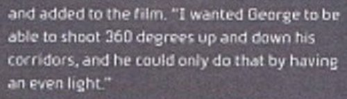

### Stat block notes (game mechanics, not feats)

- Sandcrawler storm: There was bedlam on set when the partial facade of 90-foot-long Jawa sandcrawler, which had been constructed on location, was flattened in a freak wind and rain storm - the first in the area for half a century. (Star Wars Insider 95, p. 45) (Source: *Star Wars Insider #95* (2007), scan p.45)
- Death Star bulbs: While art director John Barry's sets were impressively large, Taylor found them difficult to light. Taylor's redesign saw rounded oblong holes cut in the walls through which 9,000 photo bulbs were illuminated. (Star Wars Insider 95, p. 45) (Source: *Star Wars Insider #95* (2007), scan p.45)

## scan p.46 (scan page 46)

Page contents: "Taylor Made" cont.: blaster bolt explosions with the late John Stears; Sir Alec Guinness; good portraiture; "Death Star Redux" section (Star Wars: The Interactive Video Board Game for Hasbro, David Prowse as Vader, James Earl Jones voice, sets by Dick George Productions, 82 setups); insurance/retirement; pull quote "Working with The Beatles and Roman Polanski, those were all special movies, but Star Wars is unique"; photos (Taylor with David Prowse in 1997; Taylor in retirement, photo Chris Gardner; Death Star sets) (hand-read)

- **none** — entry/section: Explosions: ""It was so complicated. At lunch time we used to test the explosives as everything was controlled. It was a grind, hard work all the way. Every shot had to be worked out when you had all those explosions taking place." —Gilbert Taylor, Star Wars Insider 95, p. 46" Source: *Star Wars Insider #95* (2007), scan p.46
  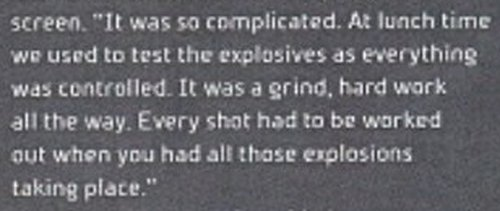
- **Obi-Wan Kenobi** — entry/section: Alec Guinness: ""Alec was wonderful. He would say 'Just keep your eye on me,' and if there was something not quite right I would tell him. He was a lovely guy." —Gilbert Taylor, Star Wars Insider 95, p. 46" Source: *Star Wars Insider #95* (2007), scan p.46
  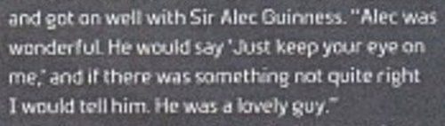

### Stat block notes (game mechanics, not feats)

- Board game shoot: The sets were designed by Dick George Productions, which also handled some set construction on the 1977 film. Taylor and his team worked for two days on the project and filmed a total of 82 setups, including seven tracking shots. (Star Wars Insider 95, p. 46) (Source: *Star Wars Insider #95* (2007), scan p.46)

## scan p.47 (scan page 47)

Page contents: Sidebar "An Impressive Career Recognized": Gil Taylor born Bushey Heath, England, April 12, 1914; BSC Lifetime Achievement Award 2002 and ASC International Achievement Award (April 2006); Russ Alsobrook quote; early career (Gainsborough Studios), WWII aerial photography for Churchill, filming camp liberation; Repulsion, Cul-de-sac; captions (Taylor on location with the Star Wars crew in 1976; Albert Clarke, Gil Taylor, the late Michael Sheard and Garrick Hagon in 1997; Obi-Wan in the Death Star) (hand-read)

- **none** — entry/section: From my peers: ""This recognition is more important to me than an Oscar, or any other award I can think of because it comes from my peers," —Gilbert Taylor, Star Wars Insider 95, p. 47" Source: *Star Wars Insider #95* (2007), scan p.47
  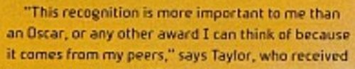

### Stat block notes (game mechanics, not feats)

- ASC award: The American equivalent, for cinematographers whose body of work was done outside of the U.S., followed last year when Taylor was 92. (Star Wars Insider 95, p. 47) (Source: *Star Wars Insider #95* (2007), scan p.47)
- Aerial photographer: He put his camera skills to work in 1942 when, as a special envoy for British Prime Minister Winston Churchill, he became the first aerial photographer to record a night raid, carried out by 1,000 bombers over Germany. (Star Wars Insider 95, p. 47) (Source: *Star Wars Insider #95* (2007), scan p.47)

## scan p.48 (scan page 48)

Page contents: "Taylor Made" end: Alfred Hitchcock (Frenzy, Number Seventeen); film industry gone downhill; Taylor painting Star Wars scenes; 1997 Isle of Wight convention with Garrick Hagon (Biggs Darklighter) and the late Michael Sheard (Admiral Ozzel); sidebar "Taylor On Lucas" (few conversations, documentary style, Kubrick comparison, Fox interference, clarity); captions (lightsabers posed a difficult problem; Taylor's own Star Wars-inspired paintings; Lucas quiet, Alec Guinness "a lovely guy") (hand-read)

- **none** — entry/section: Hitchcock: ""Working on a film should be an experience and it was with Hitchcock, who never got out of his chair, never looked through the camera once, but always knew what we were doing. And he never stopped talking." —Gilbert Taylor, Star Wars Insider 95, p. 48" Source: *Star Wars Insider #95* (2007), scan p.48
  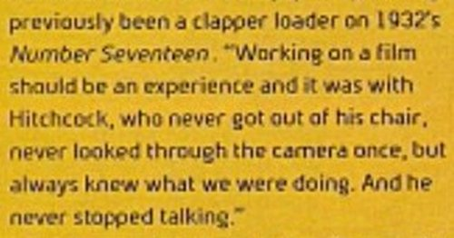
- **none** — entry/section: Ancient art: ""Good cinematography is becoming an ancient art, and that is the tragedy of it all," —Gilbert Taylor, Star Wars Insider 95, p. 48" Source: *Star Wars Insider #95* (2007), scan p.48
  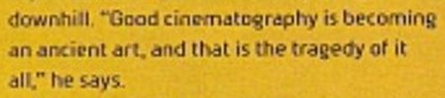
- **none** — entry/section: Smoke screen: ""On a lot of science fiction films you're looking through a smoke screen. I wanted Star Wars to have clarity," —Gilbert Taylor, Star Wars Insider 95, p. 48" Source: *Star Wars Insider #95* (2007), scan p.48
  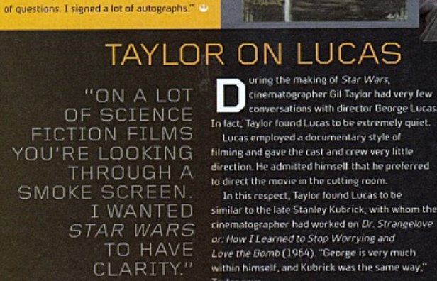
- **none** — entry/section: Time over again: ""I only wish I could have my time over again to have a different relationship with George. It was very unfortunate that we did not have much to do with each other," —Gilbert Taylor, Star Wars Insider 95, p. 48" Source: *Star Wars Insider #95* (2007), scan p.48
  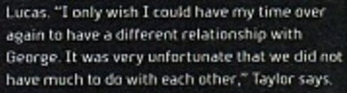

### Stat block notes (game mechanics, not feats)

- 1997 convention: He made a rare appearance at an Isle of Wight Star Wars convention in 1997 where he was reacquainted with Garrick Hagon (Biggs Darklighter) and the late Michael Sheard (Admiral Ozzel), who had appeared in Green Ice (1981), which Taylor had filmed. (Star Wars Insider 95, p. 48) (Source: *Star Wars Insider #95* (2007), scan p.48)
- Lucas quiet: During the making of Star Wars, cinematographer Gil Taylor had very few conversations with director George Lucas. In fact, Taylor found Lucas to be extremely quiet. (Star Wars Insider 95, p. 48) (Source: *Star Wars Insider #95* (2007), scan p.48)

## scan p.49 (scan page 49)

Page contents: Hasbro ad "The fans have spoken!": Darth Revan voted Fans' Choice figure (30th Anniversary Collection, each figure with a collector coin; Darth Malak, Darth Revan, pre-cyborg General Grievous); starwars.hasbro.com (hand-read)

### Stat block notes (game mechanics, not feats)

- Darth Revan figure: We appealed to the people, and you said "Darth Revan"! This sinister Sith master, voted the Fans' Choice, now makes his devious debut as part of our Basic Figure Collection. (Star Wars Insider 95, p. 49) (Source: *Star Wars Insider #95* (2007), scan p.49)

## scan p.50 (scan page 50)

Page contents: Titan Magazines subscription ad: Star Trek Magazine (40 Years of Star Trek; "The Doomsday Machine Strikes!") and The Official Magazine Stargate SG-1 & Atlantis (100 Page Special); titanmagazines.com (hand-read)

## scan p.51 (scan page 51)

Page contents: "Jawa's Corner" section opener: "Packed with all the latest stuff from the Star Wars universe"; Mace Windu photo; index (Books 50, Comics 52, Toys 54, Star Wars Q&A 56, Scouting the Galaxy 58, International Collecting 62, Set Piece 64, Padawan's Corner 66, Bantha Tracks 69, Indy Vault 74, Comlink 76) (hand-read)

## scan p.52 (scan page 52)

Page contents: Books: "A Tour of the Inferno — Troy Denning unleashes hell on the galaxy", words by Jason Fry: Legacy of the Force: Inferno (Del Rey $25.95/Century £17.99); Jacen Solo as Darth Caedus, Tenel Ka and the Hapan fleet, Kashyyyk; "Dark Times" section on Ben Skywalker; favorite characters (Han and Leia, Saba Sebatyne); pull quote "I took myself back to my own teenage years..."; Inferno cover, Luke photo (hand-read)

- **none** — entry/section: Writing teenagers: ""Very carefully," ... "Writing teenagers is as complex as being one. They're on the verge of adulthood, but not quite there. They're eager and nervous at the same time, and often a little confused. Basically, I took myself back to my own teenage years, then asked myself how it would have been different if I'd had superpowers and a license to kill!" —Troy Denning, Star Wars Insider 95, p. 52" Source: *Star Wars Insider #95* (2007), scan p.52
  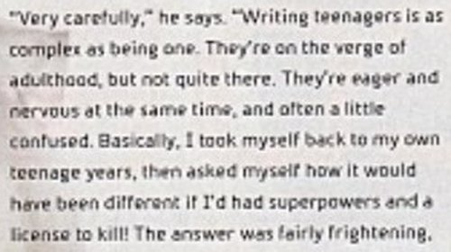

### Stat block notes (game mechanics, not feats)

- Inferno season in hell: In Inferno, all of the characters we first came to know 30 years ago endure what might be called a season in hell. ... Even C-3PO has a brush with mortality, one nicely handled by Denning. (Star Wars Insider 95, p. 52) (Source: *Star Wars Insider #95* (2007), scan p.52)

## scan p.53 (scan page 53)

Page contents: Books cont.: Saba Sebatyne; Han and Leia's final break with Jacen; "Last Word" section on Luke; SD-XX droid; humor ("Horror Writing 101"); nine-book structure (Aaron Allston Betrayal, Karen Traviss Sacrifice, Denning Invincible); photos (Han, Chewbacca, Leia; Troy Denning; Luke on Tatooine); pull quote "I profess a soft spot for Han and Leia..." (hand-read)

- **Luke Skywalker** — entry/section: Whiny innocence: ""Most of us never escape our past, and Luke is no exception," ... "The whiny innocence has been burned out of him by all of the tragedy and evil that he's suffered during his rise to Jedi Grand Master, but at his core, he's still the optimistic farmboy we met in A New Hope. He still believes that the galaxy is basically good - with a few notable exceptions." —Troy Denning, Star Wars Insider 95, p. 53" Source: *Star Wars Insider #95* (2007), scan p.53
  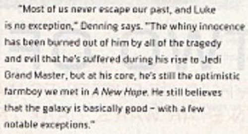
- **none** — entry/section: Humor: ""So I just let the humor happen in my stories. I never force it, I never deny it." —Troy Denning, Star Wars Insider 95, p. 53" Source: *Star Wars Insider #95* (2007), scan p.53
  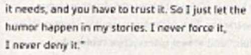
- **none** — entry/section: Last word: ""I'm going to enjoy having the last word. Who wouldn't?" —Troy Denning, Star Wars Insider 95, p. 53" Source: *Star Wars Insider #95* (2007), scan p.53
  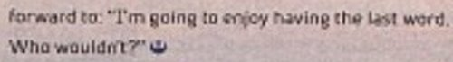

## scan p.54 (scan page 54)

Page contents: Comics: "Two of a Kind — A pair of fugitives walk the same road in Star Wars: Dark Times", words by Daniel Wallace: "Parallels" five-issue arc from issue #6 (art Dave Ross, story Mick Harrison), two months after Revenge of the Sith; Jedi Master K'Kruhk (Whiphid) and Jeisel, younglings and Order 66; Bomo Greenbark (Nosaurian) and the Uhumele; "Planet Hopping" section; comic panel art (hand-read)

- **none** — entry/section: Two similar stories: ""It's really two similar stories taking place at the same time that have two completely different outcomes," ... "The two are connected on a number of levels, but the participants in the stories are not aware of the connections." —Mick Harrison, Star Wars Insider 95, p. 54" Source: *Star Wars Insider #95* (2007), scan p.54
  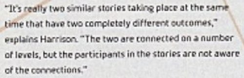
- **Obi-Wan Kenobi; Yoda; Darth Vader (Anakin Skywalker)** — entry/section: Avoid the obvious: ""Everyone wants to tell an Obi-Wan story, or a Vader story, and the restrictions right now are that we can only proceed so far into the time period after Revenge of the Sith. Luke and Leia are only about two months old. Obi-Wan is tied to Tatooine, just as Yoda is stuck on Dagobah." —Mick Harrison, Star Wars Insider 95, p. 54" Source: *Star Wars Insider #95* (2007), scan p.54
  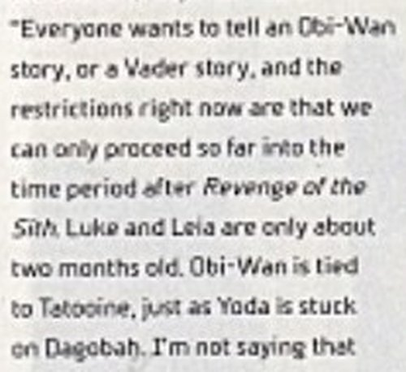
- **Palpatine (Darth Sidious)** — entry/section: Emperor consolidating: ""The Emperor is still consolidating his power," ... "Palpatine obviously moves slowly and cautiously during this time - after all, we know he doesn't disband the Senate for another 19 years." —Mick Harrison, Star Wars Insider 95, p. 54" Source: *Star Wars Insider #95* (2007), scan p.54
  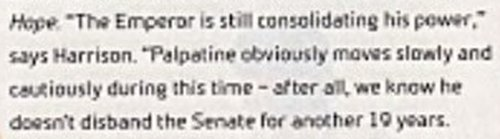

### Stat block notes (game mechanics, not feats)

- K'Kruhk: First is the Jedi Master K'Kruhk, known to fans of Cartoon Network's animated Clone Wars and the comic series Star Wars Republic. K'Kruhk is a stocky, fur-covered Whiphid with a tusk-face only a mother could love. (Star Wars Insider 95, p. 54) (Source: *Star Wars Insider #95* (2007), scan p.54)

## scan p.55 (scan page 55)

Page contents: Comics cont.: K'Kruhk long-lived (Legacy, 160+ years after Jedi Council: Acts of War); Uhumele crew (Ratty, Heren, Ko Vakier, Janks; co-designed by Doug Wheatley); "A New Family" section; comic art and captions ("A face only a mother could love? Whiphid Jedi K'Kruhk springs into action in Star Wars: Dark Times 'Parallels.'") (hand-read)

- **Han Solo; Chewbacca** — entry/section: Theme of family: ""The theme of family is a natural for Star Wars," ... "In A New Hope, both Luke and Leia's families are taken from them and they end up creating a new family with Han, Chewie, and the droids." —Mick Harrison, Star Wars Insider 95, p. 55" Source: *Star Wars Insider #95* (2007), scan p.55
  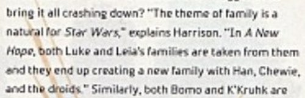
- **none** — entry/section: Galaxy is huge: ""The galaxy is huge, and it would seem silly if the only stories that mattered concerned the same handful of characters every time." —Mick Harrison, Star Wars Insider 95, p. 55" Source: *Star Wars Insider #95* (2007), scan p.55
  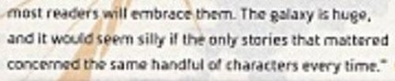

## scan p.56 (scan page 56)

Page contents: Toys: "Where Did You Dig Up That Old Fossil? — Sideshow presents a certain crazy old hermit in 12-inch form, plus more clones, Imperials, and characters in disguise", words by Frank Parisi: Holographic Darth Sidious with Mechno-Chair (Sideshow, $39.99); R2-KT charity figure (in memory of a 501st Legion founder's daughter; San Diego Comic-Con; $100,000 Hasbro/Lucasfilm donation to Make-A-Wish; family names omitted per policy); Star Wars Transformers; Premium Format Speederbike and Scout Trooper (1:4, $799.99) (hand-read)

### Stat block notes (game mechanics, not feats)

- Mechno-Chair: Crafted in scale with the 12-inch line of action figures, Sideshow's walking holo-projector from The Phantom Menace is fully articulated and includes a blue LED to illuminate the hologram of Darth Sidious. (Star Wars Insider 95, p. 56) (Source: *Star Wars Insider #95* (2007), scan p.56)
- Transformers: The Republic Juggernaut heavy assault vehicle transforms into a clone pilot in order to trounce Separatist forces while the Rebel snowspeeder transforms into Luke Skywalker in pilot fatigues, and the indomitable missile-firing AT-AT morphs into an AT-AT driver. (Star Wars Insider 95, p. 56) (Source: *Star Wars Insider #95* (2007), scan p.56)

## scan p.57 (scan page 57)

Page contents: Toys cont.: 12-inch Obi-Wan Kenobi (Sideshow, $59.99, training remote, exclusive Leia hologram); Ralph McQuarrie Series Obi-Wan Kenobi and Yoda Two-Pack (Comic-Con exclusive); Shadow Scout with Speederbike; Gentle Giant Classic and Mini-Busts (Boba Fett, Kit Fisto, TIE Fighter Pilot, Vader ESB statue, Emperor's Royal Guard and Senate Guard) (hand-read)

### Stat block notes (game mechanics, not feats)

- McQuarrie two-pack: This early version of Obi-Wan is reminiscent of a samurai warrior, while this Yoda prototype looks leaner and meaner than the final design. (Star Wars Insider 95, p. 57) (Source: *Star Wars Insider #95* (2007), scan p.57)
- 12-inch Obi-Wan: Old "Ben" will include his lightsaber, a training remote with base, and the exclusive version will feature a small Princess Leia hologram. (Star Wars Insider 95, p. 57) (Source: *Star Wars Insider #95* (2007), scan p.57)

## scan p.58 (scan page 58)

Page contents: Star Wars Q&A: "Why Girls Rule — Plus, the mystery of the Tonnika sisters unraveled as the Keeper of the Holocron answers your Star Wars questions", words by Leland Y. Chee (askers omitted): Naboo's young female leaders (King Veruna); A-wings/B-wings without astromechs (Complete Cross Sections); Captain Kagi; Tank (Janek Sunber); submission addresses box; Naboo throne room photo (hand-read)

### Stat block notes (game mechanics, not feats)

- Naboo leaders: While it is true that the sovereigns of Naboo depicted in the films have all been young females (Amidala, Jamillia from Episode II, and Apailana from Episode III), Amidala's immediate predecessor was male, King Veruna. (Star Wars Insider 95, p. 58) (Source: *Star Wars Insider #95* (2007), scan p.58)
- Youngest senator: While she was still a teenager, Princess Leia was the youngest person ever elected to the Senate, a distinction previously held by Mon Mothma. (Star Wars Insider 95, p. 58) (Source: *Star Wars Insider #95* (2007), scan p.58)
- A-wing astromech: A-wings are designed purely for speed and thus the astromech socket was removed for space and weight considerations. (Star Wars Insider 95, p. 58) (Source: *Star Wars Insider #95* (2007), scan p.58)

## scan p.59 (scan page 59)

Page contents: Q&A cont.: Tonnika sisters (Brea and Senni; Shada D'ukal and Karoly D'ulin per Timothy Zahn's Tales from the Mos Eisley Cantina story; actresses Christine Hewett and Angela Staines); Red Squadron check-in order; Vader's suit origins; Null ARC troopers (Karen Traviss, Republic Commando: True Colors); alternate-take photo of Ben with lightsaber; C-3PO helmet wires; photos (Tonnika sisters, Luke and Ben) (hand-read)

### Stat block notes (game mechanics, not feats)

- Tonnika sisters: Since Star Wars Celebration III, Christine Hewett, the Tonnika sister wearing the blue bodysuit in the film, has been signing official autographs as Brea Tonnika (aka Shada D'ukal). The other actress, Angela Staines, who wears a green bodysuit in the film, is Senni (aka Karoly D'ulin). (Star Wars Insider 95, p. 59) (Source: *Star Wars Insider #95* (2007), scan p.59)
- Red check-in order: They report in in the following order: Ten, Seven, Three (Biggs), Six (Porkins), Nine, Two (Wedge), Eleven, Five (Luke). (Star Wars Insider 95, p. 59) (Source: *Star Wars Insider #95* (2007), scan p.59)
- Vader helmet look: Where the look for Vader's helmet originates is still a mystery: some think it's reminiscent of the dark sider Null Warb's Sith armor seen in the Tales of the Jedi comics. (Star Wars Insider 95, p. 59) (Source: *Star Wars Insider #95* (2007), scan p.59)
- Helmet wires: One of the wires ran to a microphone used to pick up Anthony Daniel's dialogue on set. A different set of wires connected the light bulbs used to illuminate C-3PO's eyes to a battery pack attached to the back of the costume. (Star Wars Insider 95, p. 59) (Source: *Star Wars Insider #95* (2007), scan p.59)

## scan p.60 (scan page 60)

Page contents: Scouting the Galaxy: "You Say Zuckuss, But I Say 4-LOM — Dusting off an old mistake... and other items; more Padawans and a Boba Fett stumper", words by Steve Sansweet (letter writers omitted): intro three weeks before Celebration IV and two months before Celebration Europe; "Zuckuss versus 4-LOM - and who's Tuckuss?"; photos of Zuckuss and 4-LOM (hand-read)

### Stat block notes (game mechanics, not feats)

- Kenner name swap: If you want to blame anyone, try the folks at Kenner Products. They produced the original Zuckuss and 4-LOM action figures - and somehow reversed the names! Since the characters weren't named in the movie itself, it stayed that way until 1989. (Star Wars Insider 95, p. 60) (Source: *Star Wars Insider #95* (2007), scan p.60)

## scan p.61 (scan page 61)

Page contents: Scouting the Galaxy cont.: names corrected in Galaxy Guide 3; Pablo Hidalgo Databank note ("Tuckuss", Archie Goodwin's Dengar as "Zuckass"); 4-LOM acronym; "Figuring Out the Correct Jedi Order" (Del Rey EU timeline, food-item collectibles, Boo Berry box, Australian Kellogg's ESB boxes); "Spreading the Word" Padawan box with a young fan's clone collection photo (names omitted); "Box O' Clones" (LEGO clone box from a Wal-Mart Episode II promotion) (hand-read)

- **none** — entry/section: Kellogg's boxes: ""One of my favorite collectibles is a set of rare Kellogg's boxes from Australia for The Empire Strikes Back with unique painted masks on the back." —Steve Sansweet, Star Wars Insider 95, p. 61" Source: *Star Wars Insider #95* (2007), scan p.61
  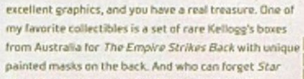

### Stat block notes (game mechanics, not feats)

- Tuckuss: "In the revised fifth draft script of The Empire Strikes Back, dated March 19, 1979, Zuckuss' name is misspelled 'Tuckuss.' Furthermore, the script and original novelization described Zuckuss as a 'human-type' bounty hunter. This description prompted comic book author Archie Goodwin to use the human bounty hunter Dengar in his stories as 'Zuckass.'" (Star Wars Insider 95, p. 61) (Source: *Star Wars Insider #95* (2007), scan p.61)
- 4-LOM acronym: As far as 4-LOM goes, he was named by some wag at ILM. It's an acronym for "For the Love of Money." (Star Wars Insider 95, p. 61) (Source: *Star Wars Insider #95* (2007), scan p.61)

## scan p.62 (scan page 62)

Page contents: Scouting the Galaxy cont.: "Revenge or Bust, and Finding an Unknown Fett" (1982 Variety Revenge of the Jedi supplement, alternate-color 12-inch Boba Fett, ILM Chewbacca bust); "Dust, Buster!" (collection dust care); submission addresses box; photos (two 12-inch Boba Fetts, Chewbacca bust, Revenge of the Jedi supplement) (hand-read)

- **Chewbacca** — entry/section: Variety supplement: ""The Revenge of the Jedi Variety advertising supplement is very cool - but not very rare. Tens of thousands of them were printed up both for use in the trade-industry newspaper and for marketing and publicity use by Lucasfilm and Twentieth Century Fox. They are a $10 to $20 item. The Chewbacca bust was indeed a Lucasfilm gift - but it was given to every employee as a holiday gift in 2005." —Steve Sansweet, Star Wars Insider 95, p. 62" Source: *Star Wars Insider #95* (2007), scan p.62
  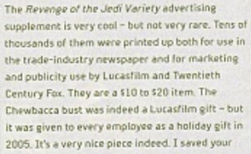
- **Boba Fett** — entry/section: Alternate Fett: ""Presuming it has not been altered by a previous owner, it appears to me to be bits and pieces of a first-shot or mold test that has been assembled either by the factory or by someone at Kenner headquarters, which was then in Cincinnati." —Steve Sansweet, Star Wars Insider 95, p. 62" Source: *Star Wars Insider #95* (2007), scan p.62
  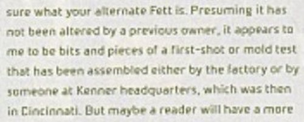

## scan p.63 (scan page 63)

Page contents: The Anthony Grandio Company ad "Celebrate 30 Years of Star Wars Everyday": checks, address labels, checkbook covers (Star Wars Characters, Armada, Alliance; Boba Fett cover autographed by Jeremy Bulloch; 30th Anniversary LE cover; Darth Vader cover); order form (YSI094) (hand-read)

## scan p.64 (scan page 64)

Page contents: International Collecting: "In the Great White North — Exploring the weird world of international collectibles: check out the curious Canadian action figure variations!", words by Gus Lopez: Regal three-foot plush Chewbacca store display, plush Jawa, Chewbacca hand puppet; General Mills late-1970s sticker promotion (Franken Berry box shown); La Guerre des Etoiles items; photos (collector photo credits omitted) (hand-read)

### Stat block notes (game mechanics, not feats)

- Plush Chewbacca display: One of the most sought-after items is a three foot tall plush Chewbacca store display produced by Regal to promote the smaller plush Chewbacca toy sold in Canada, based on the similar 20" plush Chewie made by Kenner. (Star Wars Insider 95, p. 64) (Source: *Star Wars Insider #95* (2007), scan p.64)
- Cereal stickers: As in the U.S., a set of 16 different Star Wars stickers was offered throughout boxes of Count Chocula, Franken Berry, Trix, Lucky Charms, Cocoa Puffs, and Cheerios. (Star Wars Insider 95, p. 64) (Source: *Star Wars Insider #95* (2007), scan p.64)

## scan p.65 (scan page 65)

Page contents: International Collecting cont.: rare second-series stickers (General Mills and Adpac employees), single known bilingual cereal box; ROTJ booklets promotion; "Star Words" section (bilingual 12-back cards, nine-figure multi-pack, Sears ESB generic cards: General Veers, R2-D2 Periscope, Han Solo in Cloud City Outfit; Takara wind-up R2-D2 on Canada-exclusive card); photos of Canadian carded figures (hand-read)

### Stat block notes (game mechanics, not feats)

- Nine-figure multi-pack: One unique item during this era was the nine-figure multi-pack for the second series of figures (Cantina Aliens, Droids, Luke X-Wing, and Boba Fett). ... There are two or three examples of this style of packaging in existence today. (Star Wars Insider 95, p. 65) (Source: *Star Wars Insider #95* (2007), scan p.65)
- Canadian renames: Instead of AT-AT Commander, the character became General Veers (as he is known in the movie). Instead of R2-D2 Sensorscope, the figure became R2-D2 Periscope in Canada. Bespin Han became Han Solo in Cloud City Outfit. (Star Wars Insider 95, p. 65) (Source: *Star Wars Insider #95* (2007), scan p.65)

## scan p.66 (scan page 66)

Page contents: Set Piece: "Supreme Chancellor Palpatine's Office — Dispensing with freedom and the Jedi", words by Chris Trevas: Palpatine vs. four Jedi; set on Stage Seven at Fox Studios Australia from Episode II blueprints, new hallway/antechamber in grays; filmed mid-July 2003; Ian McDiarmid trained by Nick Gillard, stunt double Michael Byrne; Anakin's entrance re-shot late August 2004 at Shepperton B Stage; makeup stages; Samuel L. Jackson wire-yanked out the window; boxes "Effects" (wind machine) and "Furniture" (Peter Walpole quote) (hand-read)

- **Palpatine (Darth Sidious)** — entry/section: Foreshadowing chair: ""There was a bit of foreshadowing there and some continuity with the later film" —Peter Walpole, Star Wars Insider 95, p. 66" Source: *Star Wars Insider #95* (2007), scan p.66
  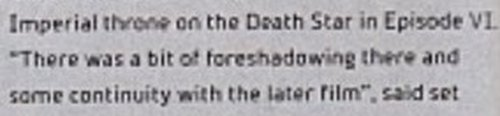

### Stat block notes (game mechanics, not feats)

- Windu proves troublesome: A group of four Jedi has come to interfere with his ambitions, but Palpatine is prepared. The first three fall quickly, struck down by his red glowing blade. However, Master Windu proves to be more troublesome. (Star Wars Insider 95, p. 66) (Source: *Star Wars Insider #95* (2007), scan p.66)
- Color arc: This use of color subtly reinforces the developing arc of the character. As Palpatine's power grows, and he is consumed by the dark side, his environment becomes colder. Eventually, he resides in a world of gray on the second Death Star and the only accents of red are his royal guards. (Star Wars Insider 95, p. 66) (Source: *Star Wars Insider #95* (2007), scan p.66)
- Saber stunt double: Ian McDiarmid learned several moves on set from swordmaster and stunt co-ordinator Nick Gillard that were utilized for close-ups. For the more complex swordplay, stunt double Michael Byrne stepped in as a substitute Sith Lord. (Star Wars Insider 95, p. 66) (Source: *Star Wars Insider #95* (2007), scan p.66)
- Fight rethought: The scene was rethought after principal photography and it was decided that Anakin should come in later when it appears that Windu has won. ... These changes were filmed in late August of 2004, over a year after the sequence was initially shot. (Star Wars Insider 95, p. 66) (Source: *Star Wars Insider #95* (2007), scan p.66)
- Lightning skeleton: Palpatine easily dispatches Windu with lightning so powerful it lights up the Jedi's skeleton, a special effects homage to Darth Vader's final encounter with the Emperor. (Star Wars Insider 95, p. 66) (Source: *Star Wars Insider #95* (2007), scan p.66)
- Jackson yanked: Connected by a harness under his robes to a wire rig, Jackson was yanked backwards out the window by stuntmen jumping off a ladder. (Star Wars Insider 95, p. 66) (Source: *Star Wars Insider #95* (2007), scan p.66)

## scan p.67 (scan page 67)

Page contents: Set Piece cont. boxes: "Set Design" (Lucas approved antechamber January 24, 2003); "Palpatine's Lightsaber" (hero prop, prismatic finish); lightsaber diagrams; "Mace Windu's Lightsaber" (aluminum, brass, steel; chrome-plated castings for dueling); Lucas quote on Sam Jackson; "Decor" (statue of demagogue Sistros, Mas Amedda's staff); "Coruscant" (matte painting by ILM artist Yanick Dusseault) (hand-read)

### Stat block notes (game mechanics, not feats)

- Palpatine's lightsaber: Concealed in his sleeve, Palpatine's lightsaber is ready at a moment's notice. A special close-up "hero" version of the lightsaber prop with a unique prismatic finish and multi-colored metallic details was used in this reveal scene. (Star Wars Insider 95, p. 67) (Source: *Star Wars Insider #95* (2007), scan p.67)
- Windu's lightsaber: Mace Windu's lightsaber was originally built from aluminum, brass, and steel. For dueling purposes, lightweight chrome plated castings with painted detailing, and durable carbon fiber blades were utilized. (Star Wars Insider 95, p. 67) (Source: *Star Wars Insider #95* (2007), scan p.67)
- Sistros statue: Around the office are many statues dating back to when the Sith ruled the galaxy. This one is of the ancient demagogue Sistros who also adorns the top of Vice Chair Mas Amedda's staff. (Star Wars Insider 95, p. 67) (Source: *Star Wars Insider #95* (2007), scan p.67)

## scan p.68 (scan page 68)

Page contents: Padawan's Corner: "How to Draw: Queen Amidala — Your guide to capturing the elegance of Naboo's young queen!", words & artwork by Cynthia Cummens: intro (pencils, Bristol Vellum); Steps 1-4 with sketches (hand-read)

### Stat block notes (game mechanics, not feats)

- Trust your instincts: Drawing is meant to be fun. So if you find yourself a bit intimidated or nervous, take a deep breath and know that you cannot make mistakes! Like Luke Skywalker, learn to trust your instincts and let them guide you as you draw. (Star Wars Insider 95, p. 68) (Source: *Star Wars Insider #95* (2007), scan p.68)

## scan p.69 (scan page 69)

Page contents: Padawan's Corner cont.: Steps 5-7 (fur trim, tracing paper, Micron fine liners, Copic markers) with sketches and finished color Queen Amidala; box with contact/tutorial links (starwars.com/kids; artist's site cynthiacummensart.com) (hand-read)

### Stat block notes (game mechanics, not feats)

- Tracing: Lots of artists learn to draw by tracing or copying other artists when they're starting out. Remember, the important thing is that you're drawing! (Star Wars Insider 95, p. 69) (Source: *Star Wars Insider #95* (2007), scan p.69)

## scan p.70 (scan page 70)

Page contents: Star Wars Insider subscription offer ad (save 35%, 6 issues for $24.95; Insider 96 Clone Wars cover) (hand-read)

## scan p.71 (scan page 71)

Page contents: Bantha Tracks Vol. 26 "By the fans. For the fans.": "The Best of Celebration IV" intro (Los Angeles Convention Center May 23-28; broke Celebration III attendance records); fan photo (fan name omitted); Bantha Tracks submission guidelines box (c/o Mary Franklin) (hand-read)

### Stat block notes (game mechanics, not feats)

- Celebration IV: From the fan perspective, and maybe from most every perspective, Star Wars Celebration IV was a party of epic proportions, with a variety of programs, exhibits, guests, and fun that entertained fans from all around the world in the Los Angeles Convention Center May 23-28. (Star Wars Insider 95, p. 71) (Source: *Star Wars Insider #95* (2007), scan p.71)

## scan p.72 (scan page 72)

Page contents: Bantha Tracks "The Best of Celebration IV" photo awards 1-3, 5, 10-11: Best New Jedi, Loudest Fett (a rocket-flying Boba Fett at the Opening Ceremonies), Most Helpful Clone, etc. (fan names and fan photo credits omitted) (hand-read)

### Stat block notes (game mechanics, not feats)

- Loudest Fett: "Rocket Man" ... sailed into the Opening Ceremonies Friday night as a real flying Boba Fett. (Star Wars Insider 95, p. 72) (Source: *Star Wars Insider #95* (2007), scan p.72)

## scan p.73 (scan page 73)

Page contents: Bantha Tracks Celebration IV awards cont.: 4. Best Surprise Interview (George Lucas via "live satellite feed"); 6. Fastest Speeder Bike (Stormtrooper Olympics); 7. Best Reunion (Kenny Baker with R2-D2 in the Droid Builders' Room); 8. Best Scavengers (Jawas); 9. Best Leias; 10. Best Cool Down; 11. Best Transformation (Steve Sansweet as Master of Ceremonies) (fan names and photo credits omitted) (hand-read)

### Stat block notes (game mechanics, not feats)

- Surprise interview: Best Surprise Interview. George Lucas – from a certain point of view – appeared via "live satellite feed" during the Opening Ceremonies Friday night to answer a few questions about his new television show, and to greet the fans at Celebration IV. (Star Wars Insider 95, p. 73) (Source: *Star Wars Insider #95* (2007), scan p.73)
- Best Reunion: Actor Kenny Baker reunited with R2-D2 in the Droid Builders' Room at Celebration IV. (Star Wars Insider 95, p. 73) (Source: *Star Wars Insider #95* (2007), scan p.73)
- Best Transformation: Lucasfilm's Steve Sansweet somehow transformed from a rampaging Ewok to a dapper, tux-clad Master of Ceremonies in the blink of an eye during the Opening Ceremonies on Friday night. (Star Wars Insider 95, p. 73) (Source: *Star Wars Insider #95* (2007), scan p.73)

## scan p.74 (scan page 74)

Page contents: Bantha Tracks "Editorial: Celebration of Star Wars Life" by Mary Franklin, Editor, Bantha Tracks: thanks to Lucasfilm, Gen Con, staff; long sidebar listing Celebration IV Elite Squad staff and volunteers (volunteer names omitted); fan costume photos (names omitted) (hand-read)

- **none** — entry/section: Best Celebration yet: ""As one of the team who worked to produce Star Wars Celebration IV, the huge six-day party for Star Wars fans in Los Angeles this past Memorial Day weekend, I risk sounding self-congratulatory when I say I believe this was the best Celebration yet." —Mary Franklin, Star Wars Insider 95, p. 74" Source: *Star Wars Insider #95* (2007), scan p.74
  

## scan p.75 (scan page 75)

Page contents: Titan magazines ad: Lost, 24, Prison Break official magazines (hand-read)

## scan p.76 (scan page 76)

Page contents: Indiana Jones "Indy Vault #3: Ark Attack — Esoteric concept designs for the Ark of the Covenant – and Nepalese hats.", words by J.W. Rinzler: Exodus 25:10-22 building instructions; Blake-style end-panel concept of Moses (artist unknown, possibly David Negron) (hand-read)

### Stat block notes (game mechanics, not feats)

- Ark end panel: One drawing (by an unknown artist, possibly David Negron) in the style of William Blake (1757-1827) features a concept for the Ark's end panel – "carved wood in bas relief, antique guilded [sic] + aged" – of the seated figure of Moses. (Star Wars Insider 95, p. 76) (Source: *Star Wars Insider #95* (2007), scan p.76)

## scan p.77 (scan page 77)

Page contents: Indy Vault cont.: Kelly Kimball costume sketch sheet (Nepal knit caps, turban "of thick single spun yarn") (hand-read)

### Stat block notes (game mechanics, not feats)

- Nepalese hats: A sheet of less lofty sketches by Kelly Kimball includes several designs for Nepalese hats and other costume accoutrements. These knit caps and turbans would be worn by extras in the scenes taking place in the Raven bar, high in the snowy Himalayas – where Indiana Jones begins his dangerous hunt for the fabled Ark. (Star Wars Insider 95, p. 77) (Source: *Star Wars Insider #95* (2007), scan p.77)

## scan p.78 (scan page 78)

Page contents: Comlink: "Snaggletooth Strikes Back" mailbag intro; write-to-us box (Titan addresses); reader letters on buying a Snaggletooth costume at auction and restoring creature masks, with Stuart Freeborn photo (letter-writer names omitted); editor reply (hand-read)

## scan p.79 (scan page 79)

Page contents: Comlink cont.: reader letters "Making a Comic Connection" (Marvel Star Wars #1 and #3 covers; ESB premiere memories) and "Sign of the Times" (school Star Wars parody) (letter-writer names omitted); Han Solo photo (hand-read)

## scan p.80 (scan page 80)

Page contents: Comlink cont.: reader letters "Out of Order?" and "Bath Wars" (letter-writer names omitted) with editor replies; Lando Calrissian photo; "Bounty Hunters" photo box (reader photo with George Lucas at the Where Science Meets Imagination gala, Museum of Science, October 2005; reader name omitted) (hand-read)

## scan p.81 (scan page 81)

Page contents: Next Issue: "Imperial Special!" — The Empire's Finest (Michael Sheard, Richard LeParmentier, Julian Glover, David Prowse); Inside the Mighty Imperial Military (Karen Traviss); Imperial Aliens; Meet the 501st; on sale US Sept 04, UK Sept 06 (hand-read)

- **Admiral Kendal Ozzel** — entry/section: Ozzel teaser: ""Lord Vader, the fleet has moved out of lightspeed, and we're preparing to.... aaagh." —Admiral Ozzel, Star Wars Insider 95, p. 81" Source: *Star Wars Insider #95* (2007), scan p.81
  
- **none** — entry/section: Lucky dialogue: ""I think I was lucky... all my dialogue did make sense!" —Richard LeParmentier, Star Wars Insider 95, p. 81" Source: *Star Wars Insider #95* (2007), scan p.81
  

## scan p.82 (scan page 82)

Page contents: StarWarsShop #19 Tosche Station: Gentle Giant Clone Wars Mace Windu maquette, $80.00, limited to 1,000 pieces (hand-read)

### Stat block notes (game mechanics, not feats)

- Dantooine seismic tank: If you recall his jaw-dropping adventure on Dantooine – where he single-handedly destroyed a massive Separatist seismic tank – then you'll understand why a Jedi Master of such skill and power needs to be immortalized in a classy maquette. (Star Wars Insider 95, p. 82) (Source: *Star Wars Insider #95* (2007), scan p.82)

## scan p.83 (scan page 83)

Page contents: StarWarsShop: Shadow Scout Trooper with Speeder Bike, $25.00, Hasbro Comic-Con exclusive (Aratech 74-Z speeder bike) (hand-read)

### Stat block notes (game mechanics, not feats)

- Shadow scouts: The shadow forces deployed by the Empire's spymasters include stormtroopers dressed in special sensor-proof armor, able to strike swiftly and silently. (Star Wars Insider 95, p. 83) (Source: *Star Wars Insider #95* (2007), scan p.83)

## scan p.84 (scan page 84)

Page contents: StarWarsShop: R2-KT Action Figure, $10.00, Make-A-Wish Foundation support (memorial details; child and family names omitted); R2 Builders Club and 501st Legion origin (hand-read)

### Stat block notes (game mechanics, not feats)

- R2-KT donation: The 501st Legion approached Hasbro with the idea of producing a figure to commemorate R2-KT. This inspired Hasbro and Lucasfilm to help make more wishes come true for children like [her]. Hasbro and Lucasfilm together are donating $100,000 in [her] memory to the Make-A-Wish Foundations of South Carolina and San Diego. (Star Wars Insider 95, p. 84) (Source: *Star Wars Insider #95* (2007), scan p.84)

## scan p.85 (scan page 85)

Page contents: Hasbro Battle Packs Unleashed ad ("Who shoots first, Han or Greedo? Now you decide!"; Trouble on Tatooine Cantina Encounter, Tusken Raiders, Sandtrooper Search) (hand-read)

## scan p.86 (scan page 86)

Page contents: Back cover: Wizards of the Coast Star Wars Miniatures Alliance and Empire ad ("This edition is limited. The game is not.") (hand-read)

