# Owner Material 038 — Star Wars Insider #1–153 plus specials (with The Lucasfilm Fan Club Magazine #1–22): Star Wars Insider #96 (2007)

- **Source:** *Star Wars Insider* magazine (issues 23–153, 1994–2014) and its predecessor *The Lucasfilm Fan Club Magazine* (issues 1–22, 1987–1994), plus seven special editions: articles, interviews, comics and short fiction Secondary source (licensed Legends reference). Scan OCR'd on the box; the scan stays box-only and is **not** published.
- **Method:** every scanned page was OCR'd and machine-screened sentence by sentence for power-relevant statements (fights, kills, defeats, Force feats, rankings, superweapons) that name a character on our roster; each kept sentence is quoted verbatim from the OCR text and has a crop of the printed passage directly under it. Pages with nothing power-relevant are still listed with what is on them.
- **Citation:** "*Star Wars Insider #96* (2007), p.X" by printed page ("scan p.X" where no printed number applies). **Weight:** Licensed magazine: a secondary source. Its short fiction and comics are Legends stories; its articles and interviews sum up or discuss lore and rank below the novels, comics and games they describe.

## scan p.1 (scan page 1)

Page contents: Cover: Star Wars Imperials Collector's Special Issue, "Rise of the Empire — All you wanted to know about the Empire, but were afraid to ask!"; cover lines: Empire's Finest: actors interviewed!, Who's who in the Empire military?, Imperial Commander's Handbook, Death Star: the inside story!; Issue #96 October/November 2007, $5.99 US/$7.99 CAN; stormtrooper cover art with Tarkin, Palpatine, Thrawn inset (hand-read)

## scan p.2 (scan page 2)

Page contents: Contents (News/Starwars.com/Features): Com-Scan 08 (Celebration Europe, Rick McCallum's live-action TV series update, 3-D project, Lucasfilm's Red Tails); Best of Starwars.com 14; Imperial Special 18; The Men Who Built the Empire 20 (Kenneth Colley, David Prowse, George Roubicek, Barrie Holland, Richard Le Parmentier, Julian Glover); Imperial Officers' Field Guide 27; Strangers Among Us 32; The Empire's Finest: Who's Who in the Imperial Military 38; Inside the 501st 43; Imperial shuttle art (hand-read)

## scan p.3 (scan page 3)

Page contents: Contents (Departments/Jawa's Corner): Editor's Welcome 07; Books: Death Star 50 (Michael Reaves and Steve Perry); Comics: The Empire 52; Toys: Hasbro Focus 54 (Ralph McQuarrie concept Rebel trooper); Star Wars Q&A 56 (Conan Antonio Motti, Ewok annihilation); Scouting the Galaxy 58; International Collecting 62; Set Piece: The Death Star Conference Room 64; Padawan's Corner: How to Draw Emperor Palpatine 66; Bantha Tracks 69; The Indy Vault 74; Comlink Letters 76; "The Empire" stormtrooper ranks art (hand-read)

## scan p.4 (scan page 4)

Page contents: Wizkids Star Wars PocketModel TCG "Ground Assault" ad, September 2007 ("Expand your Empire!") (hand-read)

## scan p.5 (scan page 5)

Page contents: Editor's Welcome "You may fire when ready" by Brian J. Robb, Editor: Star Destroyer opening, why villains are seductive, contents of the Imperial Special; Royal Guard photo; masthead/staff credits (Titan and Lucasfilm staff) (hand-read)

- **none** — entry/section: Star Destroyer: ""When the first audiences watched the original Star Wars, it wasn't the plucky little blockade runner, the Tantive IV, that stuck in people's memories, but the vast, screen-dominating Star Destroyer (complete with sub-sonic rumble, courtesy of Ben Burtt)." —Brian J. Robb, Star Wars Insider 96, p. 5" Source: *Star Wars Insider #96* (2007), scan p.5
  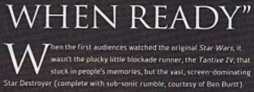
- **Darth Vader (Anakin Skywalker); Darth Maul; Boba Fett** — entry/section: Villain costumes: ""For every Jedi costume at a Star Wars event, there are often two or three Darth Vaders, Darth Mauls, or Boba Fetts." —Brian J. Robb, Star Wars Insider 96, p. 5" Source: *Star Wars Insider #96* (2007), scan p.5
  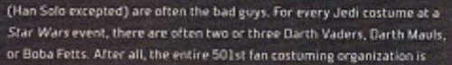

## scan p.6 (scan page 6)

Page contents: Com-Scan: "The Future of the Force!" Star Wars Insider exclusive, words by Brian J. Robb, Jonathan Wilkins, Brigid Cherry: Rick McCallum at Celebration Europe on the live-action TV series, 3-D A New Hope, Red Tails; Darth Vader art (hand-read)

## scan p.7 (scan page 7)

Page contents: Com-Scan cont.: McCallum on distribution (broadband downloading), 3-D conversion (Peter Jackson, Jim Cameron, Robert Rodriguez, Bob Zemeckis), Red Tails (Tuskegee Airmen; scouting Italy, Croatia, Tunisia, Hungary; outside director), prequel audiences; Anakin photo (hand-read)

- **none** — entry/section: Interrupted storytelling: ""Traditional network TV doesn't really work for us because we don't want to have interrupted storytelling." —Rick McCallum, Star Wars Insider 96, p. 7" Source: *Star Wars Insider #96* (2007), scan p.7
  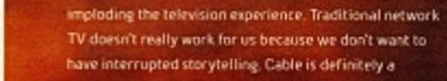
- **none** — entry/section: Red Tails: ""It's a story about a group of African-American kids and a remarkable story about U.S. history. Black people were not allowed to fly in the military, and Eleanor Roosevelt helped set up the Tuskegee Airmen." —Rick McCallum, Star Wars Insider 96, p. 7" Source: *Star Wars Insider #96* (2007), scan p.7
  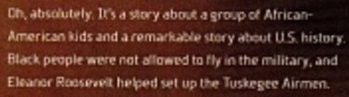
- **Darth Vader (Anakin Skywalker)** — entry/section: Going to get killed: ""I remember in 1992 when George started telling me about the prequels. He said, "We're going to get killed. I just wanted you to know that. This is going to be about an eight-year-old boy."" —Rick McCallum, Star Wars Insider 96, p. 7" Source: *Star Wars Insider #96* (2007), scan p.7
  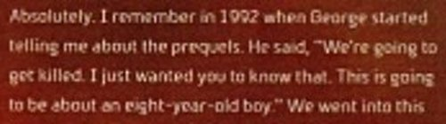
- **none** — entry/section: Two galaxies of fans: ""It's hard to explain that to a 40-year-old fan! I think with Episode III, we perhaps brought peace to the two galaxies of fans." —Rick McCallum, Star Wars Insider 96, p. 7" Source: *Star Wars Insider #96* (2007), scan p.7
  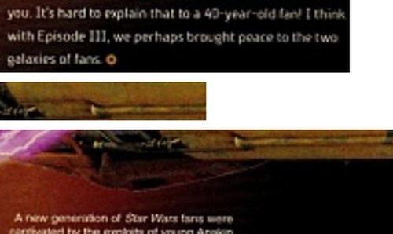

## scan p.8 (scan page 8)

Page contents: Com-Scan: "Star Wars Party Goes Worldwide!" — Celebration Europe at London's ExCeL (Friday 13th to Sunday 15th July), words by Jonathan Wilkins: Mark Hamill, Billy Dee Williams, Warwick Davis hosting Imperials panel, John Mollo; opening ceremony with Steve Sansweet, Jerome Blake, MediCinema check (Christine Hill, Darren Epstein of Cards Inc.) honoring Ian McDiarmid; outdoor Episode IV screening; Jeremy Bulloch and Daniel Logan; droid builders and stormtrooper photos (staff photo credits) (hand-read)

- **Luke Skywalker** — entry/section: I'm a goner: "When Hamill mentioned hearing that he dies in the Expanded Universe, fans helped him out by shouting out that he's dead 140 years in the future. Hamill's deadpan reply, "I guess no matter how well I take care of myself, I'm a goner!" brought the house down. —Mark Hamill, Star Wars Insider 96, p. 8" Source: *Star Wars Insider #96* (2007), scan p.8
  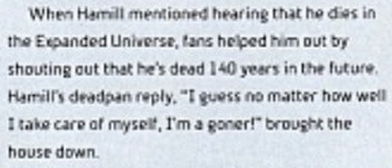

### Stat block notes (game mechanics, not feats)

- MediCinema check: Jerome Blake (otherwise known as Mas Amedda and Rune Haako, amongst many others) helped the organization head, Christine Hill, receive a $10,000 check to MediCinema, a charity that works to recreate the cinema experience in hospitals (Star Wars Insider 96, p. 8) (Source: *Star Wars Insider #96* (2007), scan p.8)

## scan p.9 (scan page 9)

Page contents: Com-Scan cont.: Celebration Europe Saturday/Sunday (Anthony Daniels, Rick McCallum, Indiana Jones "old boys" panel, Billy Dee Williams, charity auction; 29,000+ paid admissions); "A Galaxy Not So Far Away!" — Star Wars: Where Science Meets Imagination at the California Science Center, words by David Maddox (Hoth diorama, mini-hydrofoil, Wookiee exhibit, Coruscant, Jawa sandcrawler Robot Theatre, full-size Millennium Falcon cockpit with Anthony Daniels presentation; 501st support; Boston Museum of Science); photos (Greedo/photo credits staff; fan photo credits omitted) (hand-read)

### Stat block notes (game mechanics, not feats)

- Indy old boys: Sunday offered a pleasant bonus to the wealth of Star Wars on offer with a fascinating panel from the Indiana Jones "old boys". Lorne Peterson, Norman Reynolds, and Robert Watts supplied a dazzling collection of anecdotes (Star Wars Insider 96, p. 9) (Source: *Star Wars Insider #96* (2007), scan p.9)
- Very Lando: In fine voice (he responded to one question with a song) and happy to hug and shake hands with fans, Williams was cool, sophisticated, and very Lando. (Star Wars Insider 96, p. 9) (Source: *Star Wars Insider #96* (2007), scan p.9)
- Attendance: There were more than 29,000 paid admissions, and another 3,500 youngsters under 8 years old who were admitted without charge. (Star Wars Insider 96, p. 9) (Source: *Star Wars Insider #96* (2007), scan p.9)
- Falcon cockpit: The major showcase of the exhibit was a full-size cockpit replica of the Millennium Falcon. Seven visitors at a time could watch a five-minute multimedia presentation, hosted by the voice of Anthony Daniels with assistance from R2-D2. (Star Wars Insider 96, p. 9) (Source: *Star Wars Insider #96* (2007), scan p.9)

## scan p.10 (scan page 10)

Page contents: Com-Scan: "Snow Patrol" — Karen Traviss meets the 501st's southernmost stormtrooper, a doctor at Antarctica's Davis Station (fan member and family names omitted; quote from fan omitted); Indiana Jones Newsreel "The Man with the Hat is Back!" (Harrison Ford on set; Shia LaBeouf, Cate Blanchett, John Hurt, Ray Winstone, Jim Broadbent; release May 22, 2008; photo by Steven Spielberg) (hand-read)

### Stat block notes (game mechanics, not feats)

- Hoth-like cold: The temperature at Davis Station plummets to a Hoth-like minus 31 degrees Fahrenheit, which is no picnic in plastoid armor designed for warmer climates. (Star Wars Insider 96, p. 10) (Source: *Star Wars Insider #96* (2007), scan p.10)
- Indy is back: For the first time since 1989, Harrison Ford was snapped wearing a familiar costume as the upcoming Indiana Jones adventure began production under the direction of Steven Spielberg. (Star Wars Insider 96, p. 10) (Source: *Star Wars Insider #96* (2007), scan p.10)

## scan p.11 (scan page 11)

Page contents: Hasbro ad "The fans have spoken!" — Darth Revan voted Fans' Choice figure, with Darth Malak and pre-cyborg General Grievous; 3 3/4" figures with collector coins, 60 figures in all (hand-read)

### Stat block notes (game mechanics, not feats)

- Fans' Choice: We appealed to the people, and you said "Darth Revan"! This sinister Sith master, voted the Fans' Choice, now makes his devious debut as part of our Basic Figure Collection. (Star Wars Insider 96, p. 11) (Source: *Star Wars Insider #96* (2007), scan p.11)

## scan p.12 (scan page 12)

Page contents: Best of Starwars.com (words: Pete Vilmur & Bonnie Burton): "Creating R2-S2 (Steampunk R2-D2)", words by Bonnie Burton — interview with artist and animator I-Wei Huang (animator skills, Steampunk, Hayao Miyazaki influence, Steam Walker gold medal at RoboGames 2006); R2-S2 photos; pull quote (hand-read)

- **none** — entry/section: Steam Walker: ""My first steam contraption that I was really proud of was the Steam Walker, which was a four-legged walking machine. It ended up winning the Gold Medal for the Kinetic Artbots category at RoboGames 2006." —I-Wei Huang, Star Wars Insider 96, p. 12" Source: *Star Wars Insider #96* (2007), scan p.12
  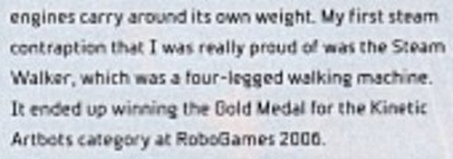

## scan p.13 (scan page 13)

Page contents: R2-S2 interview cont.: Steam Crab, Steam LocoCentipede, Steam Trilobite Tank; building R2-S2 from a broken Hasbro Interactive Droid bought on eBay (two weeks of spare time); Maker Faire/RoboGames reactions; tutorial and Crabfu SteamWorks links (hand-read)

- **C-3PO; Luke Skywalker** — entry/section: Luke SteamWalker: ""I've had many people tell me the Steam Walker reminds them of the AT-AT. Perhaps I should have named it Luke SteamWalker? I'm not a big fan of C-3PO, sorry! AT-ST would be a better fit for a steam biped." —I-Wei Huang, Star Wars Insider 96, p. 13" Source: *Star Wars Insider #96* (2007), scan p.13
  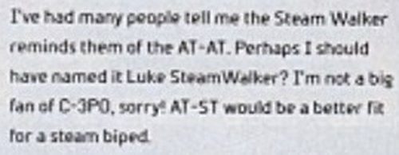

### Stat block notes (game mechanics, not feats)

- That's Artoo: The engines could be chain-linked to two drive wheels for skid steering, with a center supporting swivel wheel—hey, wait a minute... that's Artoo! (Star Wars Insider 96, p. 13) (Source: *Star Wars Insider #96* (2007), scan p.13)

## scan p.14 (scan page 14)

Page contents: Starwars.com: "Found: One Landspeeder, But Is It the Real Thing?", words by Pete Vilmur — Coca-Cola Bottling Company custom X-34 landspeeder on a 1971 Volkswagen chassis (early 1980s); 1981 Coca-Cola 500 Atlanta International Raceway brochure image (hand-read)

### Stat block notes (game mechanics, not feats)

- Coke landspeeder: The landspeeder, which sported a bright red and white paint scheme and a 1971 Volkswagen chassis, was actually a custom vehicle built by the Coca-Cola Bottling Company back in the early 1980s for use in parades and special events. (Star Wars Insider 96, p. 14) (Source: *Star Wars Insider #96* (2007), scan p.14)
- Coke licensee: Coca-Cola, of course, was a Star Wars licensee in the U.S. between 1977-1985. (Star Wars Insider 96, p. 14) (Source: *Star Wars Insider #96* (2007), scan p.14)

## scan p.15 (scan page 15)

Page contents: Landspeeder cont.: in Cedar Grove (Florida) police impound lot, to be resold by the police chief to fund equipment; "Coke One"; RT-T2 Photo Caption Contest winners (R2-D2 in gold chains; entrant handles omitted); Luke landspeeder photo (hand-read)

### Stat block notes (game mechanics, not feats)

- Coke One: With the exception of the wrap-around grill, upholstery, Coke branding, and a couple other cosmetic changes, "Coke One" (as it is was originally called) appears relatively well-preserved (Star Wars Insider 96, p. 15) (Source: *Star Wars Insider #96* (2007), scan p.15)

## scan p.16 (scan page 16)

Page contents: Imperial Special opener "The Imperials" spread (left): intro — distinguished actors behind Imperial officers, Imperial handbook extracts, aliens in the Empire's creation, who's who, the 501st; Death Star, Emperor, Imperial shuttle, AT-AT art (hand-read)

### Stat block notes (game mechanics, not feats)

- Bad guys more fun: Star Wars Insider presents a special look at the Imperials of Star Wars, starting with the distinguished actors who brought key Imperial officers to cinematic life. ... After all, the bad guys have more fun. (Star Wars Insider 96, p. 16) (Source: *Star Wars Insider #96* (2007), scan p.16)

## scan p.17 (scan page 17)

Page contents: "The Imperials" spread (right): stormtrooper with Imperial officers' faces montage (no text beyond folio) (hand-read)

## scan p.18 (scan page 18)

Page contents: "The Men Who Built the Empire" opener (left): Darth Vader helmet art, title (hand-read)

## scan p.19 (scan page 19)

Page contents: "The Men Who Built the Empire" opener (right): at Celebration IV Scott Chernoff hosted a conversation with Kenneth Colley, David Prowse, George Roubicek, Barrie Holland, Richard Le Parmentier and Julian Glover (hand-read)

### Stat block notes (game mechanics, not feats)

- Faces of the Empire: At Celebration IV Scott Chernoff hosted a conversation with six men who were immortalized as the faces of the Empire. Kenneth Colley, David Prowse, George Roubicek, Barrie Holland, Richard Le Parmentier, and Julian Glover reminisced about their days serving the Emperor. (Star Wars Insider 96, p. 19) (Source: *Star Wars Insider #96* (2007), scan p.19)

## scan p.20 (scan page 20)

Page contents: "The Men Who Built the Empire" (Scott Chernoff, Celebration IV panel): Kenneth Colley on Piett; David Prowse on playing Vader (walking fast, gestures, Empire gantry scene with Mark Hamill); George Roubicek on Commander Praji; Barrie Holland on Lieutenant Renz and the "You Rebel scum!" slap; pull quote from Roubicek; stills incl. Tarkin (hand-read)

## scan p.21 (scan page 21)

Page contents: Panel cont.: Julian Glover on five days as General Veers, AT-AT gantry and the rare helmet, and how he got cast in Indiana Jones and the Last Crusade (Robert Watts, Steven Spielberg); box "Darth the Barbarian?" — Prowse on being offered Conan (Hammer, Amicus/Milton Subotsky, Arnold Schwarzenegger); Glover pull quote (hand-read)

## scan p.22 (scan page 22)

Page contents: Panel cont.: Richard Le Parmentier on Admiral Motti, the full script (155 pages) and faking the choke; Prowse on helmet/mask problems, the Alec Guinness duel (knocking him over) and the Ugnaughts guiding him in the carbon-freeze scene, lens changes; pull quotes Le Parmentier and Prowse (hand-read)

## scan p.23 (scan page 23)

Page contents: Box "My Part in Movie History!" — professional supporting artist Harry Fielder as Corporal Grenwick (Daft Ada nickname for Vader; £11 a day; Doctor Who); panel close: Holland ("I'll be back!"), Glover, Colley's 11 takes of "Hoth-ing" with Irvin Kershner, Le Parmentier, Roubicek; thanks to Scott Chernoff and the panel (hand-read)

## scan p.24 (scan page 24)

Page contents: "Imperial Officers Field Guide", words by Jonathan Wilkins — in-universe guide opener (datapad frame, Imperial crest): essentials to serve the Empire, crush the Rebellion and rule the galaxy (hand-read)

### Stat block notes (game mechanics, not feats)

- Field Guide intro: It's a tough job being in charge of the galaxy. With Rebel scum, pirates, and the occasional Jedi causing upheavals and destruction, it's up to the Empire's finest to keep the peace and maintain control. (Star Wars Insider 96, p. 24) (Source: *Star Wars Insider #96* (2007), scan p.24)

## scan p.25 (scan page 25)

Page contents: Field Guide: "Know Your Leader" (in-universe propaganda bio of Emperor Palpatine; Mace Windu's "treacherous" attack; Vader's loyalty); Tech Report box: Mouse Droid (MSE-series, Rebaxan Columni); top-right tab "Top Secret: Death Star Plans" (hand-read)

### Stat block notes (game mechanics, not feats)

- Treacherous Jedi: His ambition and resolve, if not certain before, were strengthened after the treacherous Jedi, led by Mace Windu, launched an unprovoked and brutal attack that left him physically scarred and deformed. (Star Wars Insider 96, p. 25) (Source: *Star Wars Insider #96* (2007), scan p.25)
- Unlimited power: We must work together to achieve that vision. Remember, only unlimited power can bring peace. (Star Wars Insider 96, p. 25) (Source: *Star Wars Insider #96* (2007), scan p.25)
- Mouse droid: After the mass-produced MSE-series Mouse droid failed to sell, the manufacturers, Rebaxan Columni, sold the entire production line to the Imperial Navy at a significantly reduced price. Rumors that the original problem with the line was timidity in the presence of Wookiees are, so far, unfounded. (Star Wars Insider 96, p. 25) (Source: *Star Wars Insider #96* (2007), scan p.25)

## scan p.26 (scan page 26)

Page contents: Field Guide: "Bounty Alerts" — Wanted: Traitors of the Empire (Crix Madine, Kyle Katarn, Biggs Darklighter, Han Solo); Tech Reports: 74-Z speeder bikes, grappling hook and reel; Alerts: Attention Imperial Chefs (dianoga pie, dewback ribs); COMPNOR Members: "Read All About It!" (Iron Will feed) (hand-read)

### Stat block notes (game mechanics, not feats)

- Wanted: Crix Madine, Kyle Katarn, Biggs Darklighter, and Han Solo are all notable traitors to the Imperial way of life! Information leading to their capture will be met with a significant reward! (Star Wars Insider 96, p. 26) (Source: *Star Wars Insider #96* (2007), scan p.26)
- Grappling hook: Any troopers found using this equipment to swing across the Death Star chasms will be disciplined by Lord Vader himself. (Star Wars Insider 96, p. 26) (Source: *Star Wars Insider #96* (2007), scan p.26)
- Dewback ribs: Dewbacks are a source of food! Dewback ribs in particular are a delicacy in some regions of Tatooine. Ideal for feeding the troops! (Star Wars Insider 96, p. 26) (Source: *Star Wars Insider #96* (2007), scan p.26)

## scan p.27 (scan page 27)

Page contents: Field Guide: "Top Secret: Death Star Plans" — Tech Report AT-ST (over 90 km/h; not Ewok-proof); Armor Readout: Spacetrooper; Tech Reports: AT-AT, Deployment, BlasTech E-11, Y-85 Titan dropship; schematics; right-edge "Tech Report" tab (hand-read)

### Stat block notes (game mechanics, not feats)

- AT-ST: While on even terrain an AT-ST can achieve speeds of over 90 kilometers per hour. On uneven or shifting terrain a walker can quickly become unbalanced enough to fall over. And they are not Ewok-proof. (Star Wars Insider 96, p. 27) (Source: *Star Wars Insider #96* (2007), scan p.27)
- Spacetrooper: A spacetrooper wears standard stormtrooper armor that fits into a larger set of power armor standing over two meters tall. ... Spacetroopers are sometimes known as walking tanks. (Star Wars Insider 96, p. 27) (Source: *Star Wars Insider #96* (2007), scan p.27)
- BlasTech E-11: The rifle has a rapid-fire option, which offers an expanded firing area at the cost of poor accuracy. Troopers are requested to avoid using this option whenever possible. (Star Wars Insider 96, p. 27) (Source: *Star Wars Insider #96* (2007), scan p.27)

## scan p.28 (scan page 28)

Page contents: Field Guide: Tech Reports — Interrogation Droid, Probe Droids, Star Destroyer, Death Star (24 zones, civilian amenities); Legends of the Empire: Grand Moff Tarkin (Tarkin Doctrine); Allegiance: "To Serve the Empire" (Grodin Tierce on the Royal Guard) (hand-read)

### Stat block notes (game mechanics, not feats)

- Interrogation seminar: For the interrogators, the use of a droid can also be preferable to performing the torture oneself. Officers are encouraged to attend Lord Vader's interrogation seminar for further hints on information extraction. (Star Wars Insider 96, p. 28) (Source: *Star Wars Insider #96* (2007), scan p.28)
- Star Destroyer: An Imperial-class Star Destroyer is armed with 60 turbolaser batteries, 60 ion cannon batteries, as well as 10 tractor beam projectors. It carries a full stormtrooper division, 20 AT-ATs, 30 AT-STs, eight Lambda-class shuttles, 12 landing barges, and six TIE squadrons. (Star Wars Insider 96, p. 28) (Source: *Star Wars Insider #96* (2007), scan p.28)
- Drive it carefully: Powering a 1.6 kilometer-long Star Destroyer is the equivalent of a miniature sun in the form of a solar ionization reactor that uses its raging fires to fuel the giant warship. Please drive it carefully! (Star Wars Insider 96, p. 28) (Source: *Star Wars Insider #96* (2007), scan p.28)
- Tarkin Doctrine: Perhaps his greatest contribution to the Imperial way of life was the Tarkin Doctrine, which dictated that a single show of force could be used to bring systems into line. (Star Wars Insider 96, p. 28) (Source: *Star Wars Insider #96* (2007), scan p.28)
- Royal Guardsman: "A Royal Guardsman never seeks special privileges. Ever. His entire goal in life is to serve the Emperor and the New Order he created. His goal in life, and his desire in death." - Grodin Tierce on what it is to serve as a Royal Guard. (Star Wars Insider 96, p. 28) (Source: *Star Wars Insider #96* (2007), scan p.28)

## scan p.29 (scan page 29)

Page contents: "Strangers Among Us" opener (left), words by Abel G. Peña, Rich Handley and Jonathan Wilkins — Jar Jar Binks, Mas Amedda, Sly Moore and other alien allies art (hand-read)

## scan p.30 (scan page 30)

Page contents: "Strangers Among Us: The Aliens Who Built the Galactic Empire" intro — Palpatine's "Humans First" policy, Human High Culture, use of aliens (Sly Moore, Mas Amedda, Onaconda Farr, Yarua; Jar Jar tricked into emergency powers) (hand-read)

### Stat block notes (game mechanics, not feats)

- Humans First: Emperor Palpatine enacted a strict "Humans First" policy for his Galactic Empire, but he was not above using aliens to further his devious ambitions. (Star Wars Insider 96, p. 30) (Source: *Star Wars Insider #96* (2007), scan p.30)
- Tricked Jar Jar: Despite a new understanding being established between the two peoples during the Trade Federation's invasion of Naboo, he ruthlessly tricked Jar Jar Binks into convincing the Senate to grant him special wartime powers. (Star Wars Insider 96, p. 30) (Source: *Star Wars Insider #96* (2007), scan p.30)

## scan p.31 (scan page 31)

Page contents: The Advisors: Mas Amedda — Chagrian Speaker of the House under Valorum; foiled an assassination plot; Outbound Flight; learns Palpatine is a Sith Lord; plans Valorum's assassination; uncertain future under human-centric policies (hand-read)

### Stat block notes (game mechanics, not feats)

- Forked tongue: To show his command of the vast chamber he would often show a flicker of his long, forked tongue. (Star Wars Insider 96, p. 31) (Source: *Star Wars Insider #96* (2007), scan p.31)
- Valorum assassination: Among Amedda's first duties was planning the assassination of his friend, former Chancellor Valorum. Thus, despite the noble ideals he'd once held so dear, Amedda stood by Palpatine's side as he declared himself ruler of a Galactic Empire that would endure 10,000 years. (Star Wars Insider 96, p. 31) (Source: *Star Wars Insider #96* (2007), scan p.31)

## scan p.32 (scan page 32)

Page contents: Strangers Among Us cont.: Sly Moore (Umbaran aide; Sei Taria; Sate Pestage, Kinman Doriana; may have impersonated Darth Sidious); The Army Builders: the Kaminoans (Sifo-Dyas, Order 66, Kaminoan rebel clones quashed by the 501st led by Boba Fett) (hand-read)

### Stat block notes (game mechanics, not feats)

- Two places at once: Exploiting the mind-clouding abilities of her species, Palpatine may have had Moore impersonate his Sith persona of Darth Sidious, enabling him to appear in two places at once. (Star Wars Insider 96, p. 32) (Source: *Star Wars Insider #96* (2007), scan p.32)
- Kaminoan revolt: As the Galactic Empire arose from the ashes of the Clone Wars and Kamino was placed under Imperial control, a group of Kaminoans resolved to breed a number of clones that would fight against their unwanted masters. This threat was quashed by the 501st Legion, led by Boba Fett (Star Wars Insider 96, p. 32) (Source: *Star Wars Insider #96* (2007), scan p.32)

## scan p.33 (scan page 33)

Page contents: The Armorers: the Geonosians (Death Star design via Dooku; Poggle the Lesser; resurrection of Qymaen jai Sheelal as General Grievous; techniques reused for Vader); The Strategist: Grand Admiral Thrawn (Mitth'raw'nuruodo; Outbound Flight; Grand Admiral Zaarin; Mara Jade sole witness) (hand-read)

### Stat block notes (game mechanics, not feats)

- Kaleesh warrior: A technologically advanced race (Dooku's solar sailer was a gift from the Geonosian Archduke, Poggle the Lesser), the Geonosians were vital to the plot to resurrect the fallen Kaleesh warrior, Qymaen jai Sheelal, as the fearsome cyborg General Grievous. (Star Wars Insider 96, p. 33) (Source: *Star Wars Insider #96* (2007), scan p.33)
- Shattered form: The techniques used to rebuild Grievous would later be employed to rebuild the shattered form of Darth Vader, forever encasing him in life-saving armor. (Star Wars Insider 96, p. 33) (Source: *Star Wars Insider #96* (2007), scan p.33)
- Sole witness: After helping dispose of the traitorous Grand Admiral Zaarin, Thrawn ascended to that rank himself. The only ones knowledgeable about the surprising development were Thrawn's direct subordinates and a select number of Palpatine's most trusted agents, most notably Mara Jade, who was the sole witness to the ceremony. (Star Wars Insider 96, p. 33) (Source: *Star Wars Insider #96* (2007), scan p.33)

## scan p.34 (scan page 34)

Page contents: Star Wars Insider Top Ten: "The Empire's Finest — Who's Who in the Imperial Military", words by Dan Wallace and Abel G. Peña — intro (officers, not politicians; Tarkin and Moff Jerjerrod excluded); Emperor art (hand-read)

### Stat block notes (game mechanics, not feats)

- Sorry Tarkin fans: These are the military officers who make the Empire function, not the politicians. So, sorry Tarkin fans, but Grand Moff is a political office, not a military one. (Star Wars Insider 96, p. 34) (Source: *Star Wars Insider #96* (2007), scan p.34)

## scan p.35 (scan page 35)

Page contents: Top Ten: Admiral Motti (Death Star triumvirate; radio drama; New Essential Guide to Characters — Tarkin's wife of the Motti lineage; first name supplied by Lucas on Late Night With Conan O'Brien); Chief Bast (Moradmin Bast; Decipher CCG name; Holiday Special; Leland Chee ruling) (hand-read)

### Stat block notes (game mechanics, not feats)

- Coup plot: Motti might have been one of the Empire's first rogue warlords if his and Tarkin's secret plot to take over the Death Star and overthrow the Emperor had been given time to take root. (Star Wars Insider 96, p. 35) (Source: *Star Wars Insider #96* (2007), scan p.35)
- Conan Antonio Motti: Motti's first name, never revealed on-screen or in the Expanded Universe, was supplied by George Lucas during an appearance on Late Night With Conan O'Brien this May. When Associate Producer Jordan Schlansky, Late Night's resident Star Wars expert, tried to stump their guest with that bit of trivia, Lucas jokingly responded with Motti's full name: "Conan Antonio Motti." (Star Wars Insider 96, p. 35) (Source: *Star Wars Insider #96* (2007), scan p.35)
- Bast casualty: Recent analysis of A New Hope has determined that Bast was present on the Death Star's overbridge throughout, leading Lucasfilm's continuity expert Leland Chee to declare him one of the casualties of the Battle of Yavin. (Star Wars Insider 96, p. 35) (Source: *Star Wars Insider #96* (2007), scan p.35)

## scan p.36 (scan page 36)

Page contents: Top Ten cont.: Commander Praji (Nahdonnis Praji; delegated to stormtrooper captain Kosh; Decipher vs. Heroes in Hiding naming); Commander Jir (Daine Jir; 501st; name a pun on "danger"); General Tagge (Cassio Tagge; House of Tagge, TaggeCo; Marvel's "Ulric Tagge") (hand-read)

### Stat block notes (game mechanics, not feats)

- Praji delegated: As with other assignments, Praji delegated the recapture of the plans to a subordinate, in this case stormtrooper captain Kosh, expecting to then take the credit for an easy job. (Star Wars Insider 96, p. 36) (Source: *Star Wars Insider #96* (2007), scan p.36)
- Dead man walking: When Lieutenant Daine Jir first spoke out against one of Darth Vader's suggestions, murmurs of "dead man walking" immediately followed. But instead of choking the life out of the Imperial officer, Vader promoted him to the rank of commander. (Star Wars Insider 96, p. 36) (Source: *Star Wars Insider #96* (2007), scan p.36)
- Jir pun: His name appears to be a pun on the word "danger." (Star Wars Insider 96, p. 36) (Source: *Star Wars Insider #96* (2007), scan p.36)
- House of Tagge: General Tagge's brothers Ulric, Silas, and Orman, as well as his sister Domina, ensnare Luke Skywalker in the Omega Frost trap, force Luke into a lightsaber showdown on Monastery, and nearly kill Lando Calrissian inside the Red Nebula. (Star Wars Insider 96, p. 36) (Source: *Star Wars Insider #96* (2007), scan p.36)

## scan p.37 (scan page 37)

Page contents: Top Ten cont.: Captain Lennox (Xamuel Lennox, Star Destroyer Tyrant, "Good. Our first catch of the day." misattributed to Piett); Admiral Ozzel (Kendal Ozzel; Michael Sheard as Hitler in Last Crusade); Admiral Piett (Firmus Piett, Axxila; Kenneth Colley; name from Latin) (hand-read)

### Stat block notes (game mechanics, not feats)

- First catch: Admiral Piett is often credited with Lennox's one line from the Empire Strikes Back. When Rebel transports are fleeing the Hoth system, Lennox gloats, "Good. Our first catch of the day." (Star Wars Insider 96, p. 37) (Source: *Star Wars Insider #96* (2007), scan p.37)
- Two mistakes: Two mistakes doomed Ozzel: his inability to recognize that a probe droid had located the Rebel base on Hoth, and his hyperspace miscalculation that allowed the Rebels to raise their energy shield, forcing the Empire to commit to a ground invasion. (Star Wars Insider 96, p. 37) (Source: *Star Wars Insider #96* (2007), scan p.37)
- Sheard as Hitler: The actor who portrayed Ozzel, Michael Sheard, made his mark as a villain in another Lucas-connected film. In Indiana Jones and the Last Crusade, he appears briefly in a scene as Adolf Hitler. (Star Wars Insider 96, p. 37) (Source: *Star Wars Insider #96* (2007), scan p.37)
- Houdini-like: Piett, played by Kenneth Colley, is a favorite among fans for his quiet competence and his Houdini-like ability to escape Vader's wrath. His first name is derived from the Latin for strong, reliable, and solid. (Star Wars Insider 96, p. 37) (Source: *Star Wars Insider #96* (2007), scan p.37)

## scan p.38 (scan page 38)

Page contents: Top Ten cont.: Captain Needa (Lorth Needa; Clone Wars, nearly captured Grievous; X-Wing: Wedge's Gamble — cousin Virar); General Veers (Maximilian Veers; Corellia garrison; novelization; Dark Empire II; Julian Glover as Walter Donovan) (hand-read)

### Stat block notes (game mechanics, not feats)

- Fatally stupid: Needa didn't blame his crew and accepted full responsibility for the loss, a decision that was both honorable and fatally stupid. (Star Wars Insider 96, p. 38) (Source: *Star Wars Insider #96* (2007), scan p.38)
- Nearly captured Grievous: Before serving the Galactic Empire, Lorth Needa fought for the Old Republic in the Clone Wars. In fact, at one point during the Battle of Coruscant, he nearly captured the notorious Separatist General Grievous. (Star Wars Insider 96, p. 38) (Source: *Star Wars Insider #96* (2007), scan p.38)
- You may start your landing: He was so confident in his abilities that he calmly told the Dark Lord, "You may start your landing" before he'd even taken out the Hoth Rebels' shield generator. (Star Wars Insider 96, p. 38) (Source: *Star Wars Insider #96* (2007), scan p.38)
- Less than fatal: Since both Veers and the snowspeeder pilot (Hobbie Klivian) appear in later Expanded Universe sources, the crash was obviously less than fatal. Veers dies "offscreen" during the comics series Dark Empire II after leading a division of war droids into battle. (Star Wars Insider 96, p. 38) (Source: *Star Wars Insider #96* (2007), scan p.38)

## scan p.39 (scan page 39)

Page contents: "Inside the 501st" opener — words by a 501st member (name omitted per policy); three stormtroopers; "Everything you ever wanted to know about joining the Empire with the 501st Legion, but were too afraid to ask!" (hand-read)

## scan p.40 (scan page 40)

Page contents: 501st article p1: why members join (member names and quotes omitted per policy); film stills of original stormtroopers; trooper photos (captions name members — omitted) (hand-read)

## scan p.41 (scan page 41)

Page contents: "Ever Saga Has a Beginning": founded 1997 in Columbia, South Carolina (founders omitted); "Detention Block 2551" site; Peter Mayhew escort; Steve Sansweet quote; Episode III Jedi Temple; 2007 Rose Parade; charity pull quote (hand-read)

- **none** — entry/section: Pretty noisy: ""These stormtroopers are pretty noisy, aren't they? I'm going to crush them if they don't be quiet!" —Peter Mayhew, Star Wars Insider 96, p. 41" Source: *Star Wars Insider #96* (2007), scan p.41
  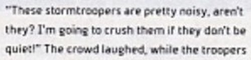
- **Darth Vader (Anakin Skywalker)** — entry/section: Adopted into the mythos: ""The Legion's impact is clear in how much we turned to 501st garrisons worldwide to help us and our partners launch Episode III. And the Legion's name has been adopted as part of the Star Wars mythos." —Steve Sansweet, Star Wars Insider 96, p. 41" Source: *Star Wars Insider #96* (2007), scan p.41
  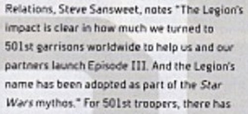

### Stat block notes (game mechanics, not feats)

- Founded 1997: The 501st Legion was started in 1997 by Star Wars fans [names omitted] in Columbia, South Carolina. (Star Wars Insider 96, p. 41) (Source: *Star Wars Insider #96* (2007), scan p.41)
- Jedi Temple: For 501st troopers, there has been no prouder moment than witnessing the 501st Legion on screen entering the Jedi Temple accompanying Darth Vader in Episode III (Star Wars Insider 96, p. 41) (Source: *Star Wars Insider #96* (2007), scan p.41)

## scan p.42 (scan page 42)

Page contents: "A Personal Odyssey" (author's own costuming path; Republic Commando per Karen Traviss's Triple Zero); membership rules; costs; armor-sculpting pull quote (hand-read)

### Stat block notes (game mechanics, not feats)

- Membership rules: To become a member of the Legion, a fan must be at least 18 years old and own a professional-quality Imperial Star Wars costume. There are no dues or fees, and all members have to do is participate in at least one troop a year. (Star Wars Insider 96, p. 42) (Source: *Star Wars Insider #96* (2007), scan p.42)
- Costume costs: An accurate Vader or Fett costume can cost nearly $4,000 to complete and a stormtrooper can cost upwards of $1,000 (Star Wars Insider 96, p. 42) (Source: *Star Wars Insider #96* (2007), scan p.42)

## scan p.43 (scan page 43)

Page contents: "Charity Costuming": Republic Commando armor build (.90-inch ABS over clay bucks); Sterling-based blasters; Make-A-Wish / hospital troops; Vader-friend anecdote (member names omitted); author bio omitted (hand-read)

## scan p.44 (scan page 44)

Page contents: "Jawa's Corner" section opener with contents (Books 50, Comics 52, Toys 54, Star Wars Q&A 56, Scouting the Galaxy 58, International Collecting 62, Set Piece 64, Padawan's Corner 66, Bantha Tracks 69, Indy Vault 74, Comlink 76); TIE pilot photo (hand-read)

## scan p.45 (scan page 45)

Page contents: Books: "The Ultimate Power in the Universe", words by Jason Fry — Michael Reaves & Steve Perry's Death Star (Del Rey $25.95/Century £18.99); ensemble cast (Vil Dance, Teela Kaarz, Tenn Graneet, Uli Divini, Celot Ratua Dil, Atour Ritan, Memah Roothes, Rodo, Nova Stihl) (hand-read)

- **none** — entry/section: Innocent casualties: ""We needed folks from all walks of life: moffs, admirals, TIE pilots, swabbies, pubtenders, thieves, architects, librarians, the good, the bad, and the ugly. Even in fiction, war has innocent casualties. We needed to show who some of them were." —Steve Perry, Star Wars Insider 96, p. 45" Source: *Star Wars Insider #96* (2007), scan p.45
  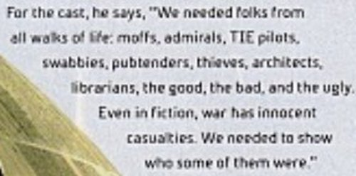

### Stat block notes (game mechanics, not feats)

- Clerks toilet main: In Kevin Smith's Clerks, Dante and Randal argue about whether innocent contractors were killed when Lando Calrissian blew up the second Death Star over Endor. (Star Wars Insider 96, p. 45) (Source: *Star Wars Insider #96* (2007), scan p.45)
- Despayre: we get to meet some of the people aboard the first Death Star, the battle station born above a planet named Despayre and fated to be destroyed above the gas giant Yavin. (Star Wars Insider 96, p. 45) (Source: *Star Wars Insider #96* (2007), scan p.45)

## scan p.46 (scan page 46)

Page contents: Books cont.: "Technological Terror", "Thermal Vent"; idea pitched to Del Rey's Shelly Shapiro; alternating-chapters process; Perry pull quote (hand-read)

- **none** — entry/section: That thermal vent: ""What thermal vent? Oh, that thermal vent. The who-where-what-when-why-and-how of those things, those were what I was curious about. Now I know." —Steve Perry, Star Wars Insider 96, p. 46" Source: *Star Wars Insider #96* (2007), scan p.46
  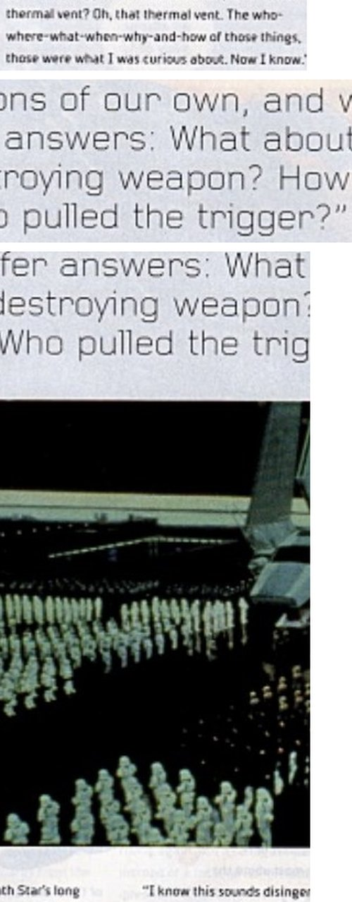
- **Luke Skywalker** — entry/section: Sleepless nights: ""Personally, I like to think that Luke had some sleepless nights after lobbing those proton torpedoes. It makes him more human to me." —Michael Reaves, Star Wars Insider 96, p. 46" Source: *Star Wars Insider #96* (2007), scan p.46
  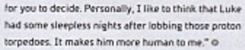

### Stat block notes (game mechanics, not feats)

- Inside the heads: Reaves and Perry walk the reader through a good chunk of A New Hope, putting us inside the heads of Tarkin, Vader, and Motti for new looks at scenes we know by heart (Star Wars Insider 96, p. 46) (Source: *Star Wars Insider #96* (2007), scan p.46)

## scan p.47 (scan page 47)

Page contents: Comics: "Imperial Frames", words by Daniel Wallace — Scott Allie, Jan Duursema, Jeremy Barlow; Empire #1-4 "Betrayal"; Empire #13 "What Sin Loyalty" (hand-read)

- **none** — entry/section: TIE over X-wing: ""I'd take a TIE fighter over an X-wing any day." —Scott Allie, Star Wars Insider 96, p. 47" Source: *Star Wars Insider #96* (2007), scan p.47
  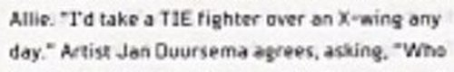
- **none** — entry/section: Looks so damn cool: ""Some folks are drawn to the Empire's strictly regimented order, sure, but I think deep down it's because everything just looks so damn cool." —Jeremy Barlow, Star Wars Insider 96, p. 47" Source: *Star Wars Insider #96* (2007), scan p.47
  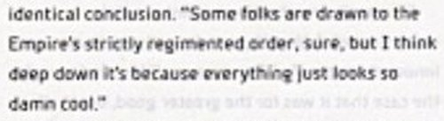
- **Darth Vader (Anakin Skywalker)** — entry/section: Most moral of the evil men: ""I did see him as the most moral of the evil men in the story. He was the hero, in that he was the one we watched wrestle with questions of loyalty." —Scott Allie, Star Wars Insider 96, p. 47" Source: *Star Wars Insider #96* (2007), scan p.47
  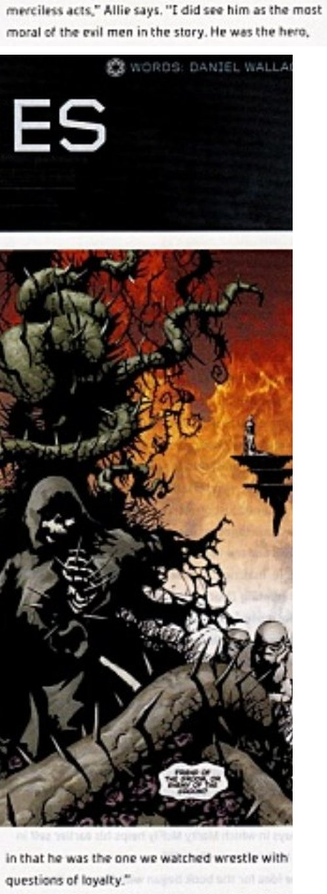
- **none** — entry/section: Don't see themselves as villains: ""But for me, the more interesting villains are the ones who don't see themselves as villains at all." —Jeremy Barlow, Star Wars Insider 96, p. 47" Source: *Star Wars Insider #96* (2007), scan p.47
  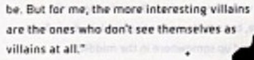

## scan p.48 (scan page 48)

Page contents: Comics cont.: "A Force for Good" — Barlow on the Empire's appeal; post-Jedi Empire in X-Wing Rogue Squadron (Ysanne Isard, Prince-Admiral Krennel), Dark Empire, Crimson Empire, Union; Legacy (John Ostrander, Jan Duursema; Roan Fel); Barlow pull quote (hand-read)

- **none** — entry/section: Better than the alternative: ""Sure, it's an unwieldy bureaucracy, but it's better than the alternative, which might be, depending on your sector, rule by the Hutts or other criminal organizations. Or worse, complete anarchy." —Jeremy Barlow, Star Wars Insider 96, p. 48" Source: *Star Wars Insider #96* (2007), scan p.48
  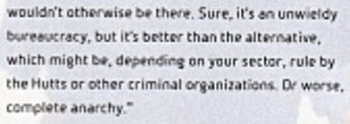
- **none** — entry/section: Good Empire: ""I guess the question remains, is having a 'good' Empire kind of like using the dark side for good?" —Jan Duursema, Star Wars Insider 96, p. 48" Source: *Star Wars Insider #96* (2007), scan p.48
  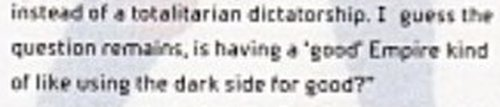
- **none** — entry/section: I'll take democracy: ""There is a power fantasy there, I would think. You do as I say because I tell you. Me - I'll take democracy. With all its messiness." —John Ostrander, Star Wars Insider 96, p. 48" Source: *Star Wars Insider #96* (2007), scan p.48
  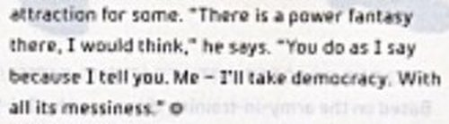

### Stat block notes (game mechanics, not feats)

- Remnant reduced: The X-Wing Rogue Squadron series chronicled Jedi's aftermath, with the manipulative Ysanne Isard assuming the Imperial throne while warlords such as Prince-Admiral Krennel scuffled over the scraps. (Star Wars Insider 96, p. 48) (Source: *Star Wars Insider #96* (2007), scan p.48)
- Legacy Empire: By the time of Star Wars Legacy (set 137 years after the destruction of the first Death Star), it's an Imperial galaxy once more. A civil war fault line has divided a new legion of Sith Lords from the military forces of deposed Emperor Roan Fel. (Star Wars Insider 96, p. 48) (Source: *Star Wars Insider #96* (2007), scan p.48)

## scan p.49 (scan page 49)

Page contents: Toys: "Six of the Best", words by Jeremy Beckett — Hasbro 30th Anniversary eighth wave ($6.99, mid-December): Jango Fett, Padmé Amidala, Clone Trooper with Training Fatigues (hand-read)

### Stat block notes (game mechanics, not feats)

- Bad boy scout: The ultimate bad boy scout is ready for action in any weather with this action figure, which comes with a soft poncho, weapons, and exclusive collectors coin. (Star Wars Insider 96, p. 49) (Source: *Star Wars Insider #96* (2007), scan p.49)

## scan p.50 (scan page 50)

Page contents: Toys cont.: Destroyer Droid (first-ever protective shield), Voolvif Monn (Shistavanen Jedi from Clone Wars), McQuarrie Signature Series Concept Rebel Trooper (hand-read)

### Stat block notes (game mechanics, not feats)

- Droideka shield: The new 30th Anniversary Collection figure comes with detachable blaster bolts, an exclusive collectors coin, and—for the first time ever—a protective shield! (Star Wars Insider 96, p. 50) (Source: *Star Wars Insider #96* (2007), scan p.50)

## scan p.51 (scan page 51)

Page contents: Q&A "Motti the Barbarian?", words by Leland Chee (askers omitted) — Conan Antonio Motti; "Zi" Motti; Emperor's Inner Circle; sandcrawler cover-up (hand-read)

### Stat block notes (game mechanics, not feats)

- Zi Motti: Michael Reaves and Steve Perry actually had intended to give Motti the first name "Zi" in the upcoming Death Star novel. Zi Motti was approved and ready to go when George surprised the world with a name of his own devising (Star Wars Insider 96, p. 51) (Source: *Star Wars Insider #96* (2007), scan p.51)
- First name from Lucas: To my knowledge, this is the first time George Lucas has provided a character's first name unrelated to the prequel trilogy long after production of the film was completed. (Star Wars Insider 96, p. 51) (Source: *Star Wars Insider #96* (2007), scan p.51)
- Inner Circle: Of the handful of advisors we see in the film, only three have been officially named: Janus Greejatus, Sim Aloo, and Kren Blista-Vanee. Notable advisors from the EU include Sate Pestage and Sim Aloo. (Star Wars Insider 96, p. 51) (Source: *Star Wars Insider #96* (2007), scan p.51)

## scan p.52 (scan page 52)

Page contents: Q&A cont. (askers omitted): sandcrawler cover-up (Tales of the Mos Eisley Cantina "Drawing the Maps of Peace"); clone percentage; Ewok extinction theory; RA-7 droids (3B6-RA-7, Moff Dunhausen, ISB); contact box; reader jetpack correction (writer names omitted) and staff reply (hand-read)

### Stat block notes (game mechanics, not feats)

- Clone share: About a third of the stormtroopers at the time of Episode IV are Jango-based clones, though not all of those clones had reached battle-readiness before the end of the Clone Wars. (Star Wars Insider 96, p. 52) (Source: *Star Wars Insider #96* (2007), scan p.52)
- Ewok extinction: No, Lucasfilm does not consider the mass extinction of the Ewoks from a cataclysm on Endor as part of official continuity. From time to time, EU writers will write in tiny bits to dispute the theory, sometimes referring to the events as Imperial propaganda. (Star Wars Insider 96, p. 52) (Source: *Star Wars Insider #96* (2007), scan p.52)
- 3B6-RA-7: The RA-7 we see aboard the Death Star in Episode IV is designated 5D6-RA-7. The one seen in the sandcrawler is 3B6-RA-7 (Star Wars Insider 96, p. 52) (Source: *Star Wars Insider #96* (2007), scan p.52)
- Jetpack correction: It is the two-tone blue and silver design (a design that only appears in Attack of the Clones) that Jango wears on Geonosis. Boba Fett only wears the blue/yellow/silver jetpack in Return of the Jedi. (Star Wars Insider 96, p. 52) (Source: *Star Wars Insider #96* (2007), scan p.52)
- Pet dianoga: You are correct. We apologize for the fault in the answering of the aforementioned question. Those responsible have been fed to the Insider's pet dianoga! (Star Wars Insider 96, p. 52) (Source: *Star Wars Insider #96* (2007), scan p.52)

## scan p.53 (scan page 53)

Page contents: Scouting the Galaxy: "Everybody Wants to Be an Imp... or Collect 'Em", words by Steve Sansweet — why bad guys fascinate; Tom Jung Style A poster theory (Pete Vilmur); "Stormtrooper Conundrum" vintage Kenner mold variation (reader name omitted) (hand-read)

### Stat block notes (game mechanics, not feats)

- 501st before Rebel Legion: There was a 501st Legion long before there was a Rebel Legion. Let's admit it. Flowing black capes and shiny white armor trump simple capes and hoods that look like they're made from the insides of potato sacks. (Star Wars Insider 96, p. 53) (Source: *Star Wars Insider #96* (2007), scan p.53)

## scan p.54 (scan page 54)

Page contents: Scouting cont. (reader names omitted): "Poster Poser" bootleg 1997 poster; "The Phantom Book" (cancelled collectibles book); "Treasure Trove" Disney Tatooine Traders; "Leia Unlicensed" garage-kit statue (hand-read)

### Stat block notes (game mechanics, not feats)

- Tarkin ignored: Nice version of Grand Moff Tarkin, who, as much of an impact as he made in Episode IV, tends to get ignored a bit these days. (Star Wars Insider 96, p. 54) (Source: *Star Wars Insider #96* (2007), scan p.54)

## scan p.55 (scan page 55)

Page contents: Scouting cont. (reader names omitted): "Rare 501st?" Hasbro 501st stormtrooper exclusive; "Game On!" West End Games' Star Warriors (1987); contact box (hand-read)

### Stat block notes (game mechanics, not feats)

- 501st figure: The limited-edition 501st stormtrooper action figure, which came packed with a small 501st banner and a trading card like the ones that 501st members themselves sponsor, was a Hasbro exclusive at San Diego Comic-Con International in 2006. (Star Wars Insider 96, p. 55) (Source: *Star Wars Insider #96* (2007), scan p.55)
- Star Warriors: It was West End Games' first boxed game, Star Warriors, and it came out in 1987. (Star Wars Insider 96, p. 55) (Source: *Star Wars Insider #96* (2007), scan p.55)

## scan p.56 (scan page 56)

Page contents: International Collecting: "Collecting an Empire", words by Gus Lopez — Thinking Cap Imperial Officer's cap (1980); Master Replicas Episode IV stormtrooper helmet (edition of 2,500); ILM "Propaganda" shirts; Kenner Imperial playsets (hand-read)

### Stat block notes (game mechanics, not feats)

- Teddy bears: Although they are terrible shots and lost an intergalactic war to a bunch of teddy bears, the Empire reigns supreme in just about every category available in Star Wars collecting and fandom. (Star Wars Insider 96, p. 56) (Source: *Star Wars Insider #96* (2007), scan p.56)
- ILM Propaganda shirts: Another shirt uses a Big Brother theme with a massive Vader head that reads: "The Empire is Listening." Finally, another design is a nod to World War II battleship production with the Millennium Falcon pictured alongside the slogan "Loose Lips Sink Starships." (Star Wars Insider 96, p. 56) (Source: *Star Wars Insider #96* (2007), scan p.56)

## scan p.57 (scan page 57)

Page contents: International Collecting cont.: Imperial three-pack; Kenner Imperial Shuttle; Nabisco Shreddies 1979 U.K. promotion; unproduced Riddell/SOEDA Darth Vader lamp; 2007 Rose Parade Star Wars Spectacular pin (hand-read)

### Stat block notes (game mechanics, not feats)

- Stormtrooper accuracy: The idea is to place the hero stickers onto the cardboard scene as targets of the stormtroopers' blasters, although in keeping with stormtrooper firing accuracy, it's more appropriate to place the heroes outside the line of fire. (Star Wars Insider 96, p. 57) (Source: *Star Wars Insider #96* (2007), scan p.57)
- Vader lamp: One of SOEDA's product ideas was the Darth Vader lamp with Imperial logo and Vader's lightsaber all along the lampshade. The product never made it to market as the initial small helmet product was cancelled, so only a handmade prototype of this lamp exists today. (Star Wars Insider 96, p. 57) (Source: *Star Wars Insider #96* (2007), scan p.57)

## scan p.58 (scan page 58)

Page contents: Set Piece: "Death Star Conference Room", words by Chris Trevas — John Barry design; plans drafted March 12, 1976; Stage 1 at Elstree; filmed May 3, 1976; Ben Burtt neck-crush effect; Cushing/Prowse Frankenstein link; boxes: Grand Moff Tarkin, Art (rank plaques) (hand-read)

- **none** — entry/section: Intellectually all wrong: ""Intellectually, it's all wrong, because of the fact that they're the enemy; the interiors should really be very angular. But it works," —George Lucas, Star Wars Insider 96, p. 58" Source: *Star Wars Insider #96* (2007), scan p.58
  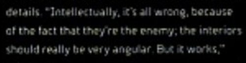
- **Grand Moff Tarkin** — entry/section: Chairs: ""I designed the chairs so they were all basically the same, with a slit in the back. Those chairs weren't quite like anything we could have bought, particularly in the number we needed, so we made them." —John Barry, Star Wars Insider 96, p. 58" Source: *Star Wars Insider #96* (2007), scan p.58
  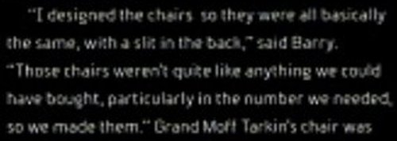
- **Admiral Motti; Darth Vader (Anakin Skywalker)** — entry/section: Walnut shells: ""The actual crushing of the officer's neck was produced by putting some walnut shells in a grapefruit rind and then crushing the whole thing, so you got a smooshing and crackling all at the same time. It seemed to sound like his neck was being broken." —Ben Burtt, Star Wars Insider 96, p. 58" Source: *Star Wars Insider #96* (2007), scan p.58
  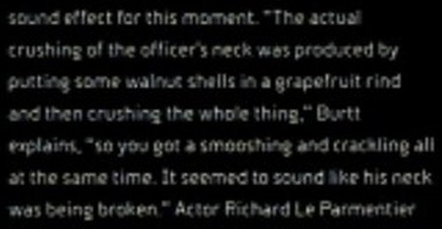
- **Darth Vader (Anakin Skywalker)** — entry/section: Black leather: ""He looked far more imposing in black leather years later in Star Wars." —Peter Cushing, Star Wars Insider 96, p. 58" Source: *Star Wars Insider #96* (2007), scan p.58
  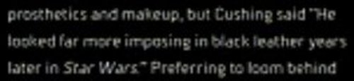

### Stat block notes (game mechanics, not feats)

- Flexed neck: Actor Richard Le Parmentier flexed his neck muscles during his performance to further add to the realism of the scene. (Star Wars Insider 96, p. 58) (Source: *Star Wars Insider #96* (2007), scan p.58)
- Strong human villain: When Darth Vader evolved into a permanently masked character Lucas felt he needed a strong human villain as well. Famed horror movie actor Peter Cushing was his first choice. (Star Wars Insider 96, p. 58) (Source: *Star Wars Insider #96* (2007), scan p.58)
- Rank plaque: Grand Moff Tarkin's plaque consists of six blue rectangles over three red and three amber. (Star Wars Insider 96, p. 58) (Source: *Star Wars Insider #96* (2007), scan p.58)

## scan p.59 (scan page 59)

Page contents: Set Piece cont. boxes: Set (navy-blue walls changed to lighter gray), Art (code cylinders = radiation dosimeters), Design (holoprojector), Costumes (Cushing's size 12 feet, carpet slippers), Cast (Richard Le Parmentier), The Script (fourth draft cup-crush) (hand-read)

### Stat block notes (game mechanics, not feats)

- Code cylinders: Imperial officers carry code cylinders in their pockets to access secure areas around the Death Star. In reality, these small props were pen-style radiation dosimeters. (Star Wars Insider 96, p. 59) (Source: *Star Wars Insider #96* (2007), scan p.59)
- Carpet slippers: The costume department was unable to get Peter Cushing big enough boots for his size 12 feet before filming. When necessary he endured painfully small boots, but most of the time he was only wearing carpet slippers. (Star Wars Insider 96, p. 59) (Source: *Star Wars Insider #96* (2007), scan p.59)
- Superman II: Richard Le Parmentier, Admiral Motti, went on to play a reporter in Superman II alongside his ex-wife Sarah Douglas, the evil super-powered Kryptonian Ursa. (Star Wars Insider 96, p. 59) (Source: *Star Wars Insider #96* (2007), scan p.59)
- Fourth draft: In the fourth draft of the script, after Vader is told to release his chokehold on Motti, he crushes one of these metal cups with the Force in frustration. (Star Wars Insider 96, p. 59) (Source: *Star Wars Insider #96* (2007), scan p.59)

## scan p.60 (scan page 60)

Page contents: Padawan's Corner: "How to Draw: Emperor Palpatine", words & artwork by Cynthia Cummens — materials (HB pencil, Copic markers on Bristol Smooth); Steps 1–3 (hand-read)

### Stat block notes (game mechanics, not feats)

- Everyone loves to hate: Everyone loves to hate the Emperor, and after this lesson you'll love drawing him too! (Star Wars Insider 96, p. 60) (Source: *Star Wars Insider #96* (2007), scan p.60)
- Eyes in the middle: A common mistake made by young or new artists is to draw the eyes in the upper third of the skull. The eyes are actually in the horizontal center of the skull. (Star Wars Insider 96, p. 60) (Source: *Star Wars Insider #96* (2007), scan p.60)

## scan p.61 (scan page 61)

Page contents: Padawan's Corner cont.: Steps 4–6 (inking, coloring—cool greys in cloak, warm greys in flesh; French Gray 10 percent pencil); closing tips; starwars.com/kids (hand-read)

### Stat block notes (game mechanics, not feats)

- Cool and warm greys: When coloring the Emperor, I used cool greys in his cloak, and warm greys in his flesh. (Star Wars Insider 96, p. 61) (Source: *Star Wars Insider #96* (2007), scan p.61)

## scan p.62 (scan page 62)

Page contents: Bantha Tracks Vol. 27 "Summer Time Tracks" (fan photos; all fan names omitted) — Disney Star Wars Weekends at MGM Studios; submission guidelines (hand-read)

### Stat block notes (game mechanics, not feats)

- 30th anniversary summer: This summer was even busier, if that's possible. It's the 30th anniversary year of Star Wars after all, and in addition to all the other fun, there was Celebration IV in the United States, Celebration Europe in London, and a big anniversary presence for Star Wars at San Diego Comic-Con. (Star Wars Insider 96, p. 62) (Source: *Star Wars Insider #96* (2007), scan p.62)

## scan p.63 (scan page 63)

Page contents: Bantha Tracks cont.: Star Wars Weddings (Argentina wedding; R2-D2 wedding cake) and "Bossk Party!" fan art — all fan names omitted (hand-read)

## scan p.64 (scan page 64)

Page contents: Bantha Tracks cont.: "More 'Stuff on My Cat'!", Celebration IV Fan Club Breakfast with guest Jay Laga'aia, "Sweet Sith Music" (Santa Rosa Symphony), Celebration IV generations photos — fan names omitted (hand-read)

### Stat block notes (game mechanics, not feats)

- Vader conducts: Maestro Michael Krajewski steps aside and allows Darth Vader to conduct the Santa Rosa Symphony Orchestra during a summer performance. (Star Wars Insider 96, p. 64) (Source: *Star Wars Insider #96* (2007), scan p.64)

## scan p.65 (scan page 65)

Page contents: Bantha Tracks Editorial "Celebration Generations" by Mary Franklin, Editor, Bantha Tracks (photo credit omitted) (hand-read)

- **none** — entry/section: Keep it up: ""Keep it up, Star Wars parents. You are doing an awesome job. And for your tribe there are many, many more good Star Wars memories to come." —Mary Franklin, Star Wars Insider 96, p. 65" Source: *Star Wars Insider #96* (2007), scan p.65
  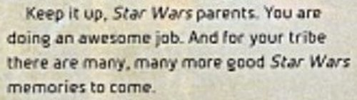

### Stat block notes (game mechanics, not feats)

- Part of the tribe: But when I see entire families enjoying the Celebrations together I can't help but think the line of C-3PO's from Return of the Jedi: "We are now part of the tribe." (Star Wars Insider 96, p. 65) (Source: *Star Wars Insider #96* (2007), scan p.65)

## scan p.66 (scan page 66)

Page contents: Indiana Jones: "Indy Vault #4: Horsing About", words by J.W. Rinzler — Last Crusade young Indy storyboards (possibly by David Jonas) dated April 21, 1988; Elliot Scott watercolor of "Young Indy's room" (hand-read)

### Stat block notes (game mechanics, not feats)

- Botched leap: Never-before-seen storyboards (possibly by David Jonas), dated April 21, 1988, reveal young Indiana Jones' botched leap into the saddle. When filming Indiana Jones and the Last Crusade later that September, River Phoenix added a horse-summoning whistle and Steven Spielberg added Indy's POV of the horse's saddle (it was a long way down). (Star Wars Insider 96, p. 66) (Source: *Star Wars Insider #96* (2007), scan p.66)
- Young Indy's room: However, production designer Elliot Scott had sketched a watercolor, also unpublished, of the interior of "Young Indy's room" (as he had for all the film's interior sets), as at least one scene was originally going to take place there. (Star Wars Insider 96, p. 66) (Source: *Star Wars Insider #96* (2007), scan p.66)

## scan p.67 (scan page 67)

Page contents: Indy Vault cont.: storyboard panels TSR-2-009 (A–D, "...and Indy lands on his butt") and "Young Indy's Room" watercolor (hand-read)

## scan p.68 (scan page 68)

Page contents: Comlink: "Cause for Celebration" — reader letters & photos (all letter-writer names omitted); David Prowse photographed at Celebration IV with a Vader trooper (hand-read)

## scan p.69 (scan page 69)

Page contents: Comlink cont.: reader letters ("Tempted by a Golden Sith Lord!", "Star Mom!", "Zachary Strikes Back!"); Write to Us box (Titan Magazines addresses) — names omitted (hand-read)

## scan p.70 (scan page 70)

Page contents: Comlink cont.: "Star Sounds", "What's in a Name?" (fan nicknames "Swifts", "Star Warsters"); Bounty Hunters (sponsored by Kotobukiya ARTFX statues) — Temuera Morrison and Ray Park meet-ups; names omitted (hand-read)

### Stat block notes (game mechanics, not feats)

- Morrison's jacket: The best part was meeting Temuera Morrison who complimented me on my red Star Wars jacket. I told him that I had bought it from the Celebration store. He asked me to take him to the store, as he wanted to buy one for himself and his son! (Star Wars Insider 96, p. 70) (Source: *Star Wars Insider #96* (2007), scan p.70)
- Kinder face: Amongst the many celebrities I met, here's a shot with the kinder face of Darth Maul, Ray Park! (Star Wars Insider 96, p. 70) (Source: *Star Wars Insider #96* (2007), scan p.70)

## scan p.71 (scan page 71)

Page contents: Next Issue: "The Celebration Continues.... Luke & Leia!" — Mark Hamill interview, Carrie Fisher, Future Force (Haden Blackman, Sam Witwer), Monster Makeup (Dave and Lou Elsey), Where's Vader?; US newsstands October 23, UK newsagents October 25 (hand-read)

### Stat block notes (game mechanics, not feats)

- Rather be Han: In an all-new interview exclusively with Insider, Mark Hamill reveals he'd rather have been Han Solo than Luke Skywalker! (Star Wars Insider 96, p. 71) (Source: *Star Wars Insider #96* (2007), scan p.71)

## scan p.72 (scan page 72)

Page contents: StarWarsShop "Tosche Station" #20: Exclusive Concept Grievous Action Figure ($19.99) — Hasbro 30th Anniversary, based on Warren Fu concept art (hand-read)

### Stat block notes (game mechanics, not feats)

- Fu's concept: In Fu's original artwork, the droid commander exhibits a more humanoid form than what we see in Revenge of the Sith – his cold, calculating efficiency, however, is still readily apparent in the smooth metal casing and skull-like head. (Star Wars Insider 96, p. 72) (Source: *Star Wars Insider #96* (2007), scan p.72)

## scan p.73 (scan page 73)

Page contents: StarWarsShop cont.: Exclusive "Sith Circus" poster by Matt Busch ($19.99; $34.99 with 1978 "Circus" set), approx. 27x40 inches (hand-read)

## scan p.74 (scan page 74)

Page contents: StarWarsShop cont.: Exclusive The Empire Strikes Back Boba Fett VCD (Medicom Super-Deformed, $44.99), approx. 8.5 inches, removable blaster rifle and pistol (hand-read)

### Stat block notes (game mechanics, not feats)

- Empire Fett deco: This new figure features green gauntlets, yellow knee and shoulder armor, gray boots, and an original Empire version blaster rifle. (Star Wars Insider 96, p. 74) (Source: *Star Wars Insider #96* (2007), scan p.74)

## scan p.75 (scan page 75)

Page contents: Ad: Star Wars Fan Days, Dallas, Texas, October 20 & 21 (Official Pix and Sci-Fi Expo; Steve Sansweet; 501st; Fan Club Breakfast) (hand-read)

## scan p.76 (scan page 76)

Page contents: Ad (back cover): Star Wars Miniatures "Alliance and Empire" limited edition — "This edition is limited. The game is not." (wizards.com/starwars) (hand-read)

