# Owner Material 038 — Star Wars Insider #1–153 plus specials (with The Lucasfilm Fan Club Magazine #1–22): Star Wars Insider #97 (2007)

- **Source:** *Star Wars Insider* magazine (issues 23–153, 1994–2014) and its predecessor *The Lucasfilm Fan Club Magazine* (issues 1–22, 1987–1994), plus seven special editions: articles, interviews, comics and short fiction Secondary source (licensed Legends reference). Scan OCR'd on the box; the scan stays box-only and is **not** published.
- **Method:** every scanned page was OCR'd and machine-screened sentence by sentence for power-relevant statements (fights, kills, defeats, Force feats, rankings, superweapons) that name a character on our roster; each kept sentence is quoted verbatim from the OCR text and has a crop of the printed passage directly under it. Pages with nothing power-relevant are still listed with what is on them.
- **Citation:** "*Star Wars Insider #97* (2007), p.X" by printed page ("scan p.X" where no printed number applies). **Weight:** Licensed magazine: a secondary source. Its short fiction and comics are Legends stories; its articles and interviews sum up or discuss lore and rank below the novels, comics and games they describe.

## scan p.1 (scan page 1)

Page contents: Cover: Star Wars Insider #97, December 2007 — "Luke & Leia: Mark Hamill & Carrie Fisher reminisce about a long time ago in a galaxy far, far away...."; banners: Vader's Art Attack, The Trench Run first version revealed, Indiana Jones and the Kingdom of the Crystal Skull latest news; The Force Unleashed: meet Sam Witwer, Vader's secret apprentice; Mexican rarities (hand-read)

## scan p.2 (scan page 2)

Page contents: Contents: Com-Scan, News Extra: The Art of Howard Chaykin, Best of StarWars.com (Tantive IV corridor at Celebration Europe), Luke & Leia, The Force Unleashed, Pirates of the Boards V, Art Vader!, Jawa's Corner, Set Piece: Kamino Platform, Padawan's Corner (Max Rebo), Bantha Tracks, Indy Vault, Comlink (hand-read)

## scan p.3 (scan page 3)

Page contents: Full-page image: The Force Unleashed's Secret Apprentice (Starkiller) with lightsaber (hand-read)

## scan p.4 (scan page 4)

Page contents: Ad: Entertainment Earth exclusive Elite Forces of the Republic (14 figures incl. Omega Squad, Isabet Reau; $66.99); Holiday Special Boba Fett bobble head (hand-read)

## scan p.5 (scan page 5)

Page contents: Editor's Welcome: "Don't Underestimate the Force." by Brian J. Robb, Editor; contact/letters addresses; staff credits box (hand-read)

- **Darth Vader (Anakin Skywalker)** — entry/section: Habit of taking over: ""Yet, that pesky Vader is out to grab everyone's attention once more. He has a habit of taking over." —Brian J. Robb, Star Wars Insider 97, p. 5" Source: *Star Wars Insider #97* (2007), scan p.5
  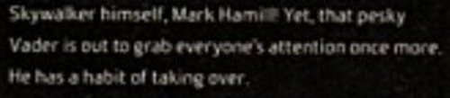

### Stat block notes (game mechanics, not feats)

- Four of last six: We strongly resisted putting Vader on the cover of this issue (after all, he's appeared on four out of the last six issues!), giving pride of place instead over to the much more pleasing sights of Mark Hamill and Carrie Fisher. (Star Wars Insider 97, p. 5) (Source: *Star Wars Insider #97* (2007), scan p.5)

## scan p.6 (scan page 6)

Page contents: Com-Scan: "Lift-Off for Luke's Lightsaber!" (Return of the Jedi prop on Space Shuttle Discovery, STS-120; photo by Stacey Leong, Lucasfilm); "Red Tails Gains Writer" (John Ridley; Rick McCallum) (hand-read)

### Stat block notes (game mechanics, not feats)

- Lightsaber in space: An original prop Luke Skywalker lightsaber from Return of the Jedi is set to make a real trip into space this October. Astronauts aboard the space shuttle Discovery will take the Jedi lightsaber with them on their next flight as part of the celebration for the film's 30th anniversary. (Star Wars Insider 97, p. 6) (Source: *Star Wars Insider #97* (2007), scan p.6)
- Lunar vault: The lightsaber prop was flown to the Houston Space Center on August 28. An actor dressed as Chewbacca handed it over to representatives from NASA's Houston Space Center during a ceremony at Oakland International Airport. In Houston, the lightsaber prop was then escorted by stormtroopers, plus R2-D2 and other Star Wars characters, to the Space Center for safekeeping (inside the lunar vault, once used to store samples from the moon) until the launch of the shuttle. (Star Wars Insider 97, p. 6) (Source: *Star Wars Insider #97* (2007), scan p.6)
- Furthest traveled: Lucasfilm often lends items to exhibitions, but this will be the furthest a Star Wars movie prop has ever traveled. (Star Wars Insider 97, p. 6) (Source: *Star Wars Insider #97* (2007), scan p.6)

## scan p.7 (scan page 7)

Page contents: Com-Scan cont.: "Marion Ravenwood Returns" (Karen Allen joins Indiana Jones and the Kingdom of the Crystal Skull, released May 22, 2008); "Further Indy Adventures" (LEGO Indiana Jones game, Young Indy DVDs, Indiana Jones Handbook); "Star Wars Exhibition Continues" (London, County Hall, closes January 12, 2008) (hand-read)

### Stat block notes (game mechanics, not feats)

- Largest UK exhibition: With 12 exhibition spaces and more than 240 original props, costumes, vehicles, artwork, and models, Star Wars: The Exhibition is the largest and most comprehensive exhibition of Star Wars material to come to the U.K. (Star Wars Insider 97, p. 7) (Source: *Star Wars Insider #97* (2007), scan p.7)

## scan p.8 (scan page 8)

Page contents: Ad: Hasbro 30th Anniversary Basic Figure Collection with coins — "He sure seemed friendly enough" (Luke Skywalker, Boba Fett, CZ-4; Holiday Special reference) (hand-read)

### Stat block notes (game mechanics, not feats)

- Friendly enough: But as Artoo noted, something just didn't smell right about the oh-so-helpful stranger. Still, we're glad we met Boba Fett when he made his debut. (Star Wars Insider 97, p. 8) (Source: *Star Wars Insider #97* (2007), scan p.8)

## scan p.9 (scan page 9)

Page contents: Com-Scan Extra: "The Art of Howard Chaykin" by Pete Vilmur (writing exclusively for Insider) — Chaykin illustration and reference photos (hand-read)

### Stat block notes (game mechanics, not feats)

- Photo reference: Han figure pose (right): This photo reference seems to have been used as the source for the illustrated version of Han Solo in the Chaykin art (above). (Star Wars Insider 97, p. 9) (Source: *Star Wars Insider #97* (2007), scan p.9)

## scan p.10 (scan page 10)

Page contents: Chaykin article cont.: rediscovered sketches of Luke, Leia, Han, Vader; auction purchase (~$112); Lucasfilm Image Archives "Chaykin" folder (hand-read)

### Stat block notes (game mechanics, not feats)

- Buns loosened: Princess Leia portrait and figure pose (left and above): Leia appears here with buns—and modesty—loosened up a bit. That's likely the low-cut wispy gown seen during the award ceremony at the end of Star Wars. (Star Wars Insider 97, p. 10) (Source: *Star Wars Insider #97* (2007), scan p.10)
- Nailed from the get-go: Han Solo portrait and figure pose (below): Chaykin has said that Solo's likeness was the only one he was able to successfully nail from the get-go. (Star Wars Insider 97, p. 10) (Source: *Star Wars Insider #97* (2007), scan p.10)
- Marvel #1 cover: Darth Vader helmet (above): The only sketch that doesn't have an accompanying full-figure pose, this Vader depiction vaguely resembles the appearance of the Dark Lord as printed on the cover of Marvel's Star Wars #1 comic book. (Star Wars Insider 97, p. 10) (Source: *Star Wars Insider #97* (2007), scan p.10)
- Thought lost: Interestingly, while these images have resided in the Lucasfilm Image Archives for over 30 years, the originals had been thought lost—until now. (Star Wars Insider 97, p. 10) (Source: *Star Wars Insider #97* (2007), scan p.10)

## scan p.11 (scan page 11)

Page contents: Best of StarWars.com: "The Weird and Wonderful Tantive IV Experience", words by Pete Vilmur & Bonnie Burton — Weird & Wonderful Ltd (Jonathan Sands) recreated the Tantive IV corridor and a Dagobah swamp for Celebration Europe; costumer participants unnamed (hand-read)

- **Darth Vader (Anakin Skywalker)** — entry/section: Most iconic moment: ""One of the most iconic moments in Star Wars is onboard the Tantive IV Blockade Runner where Darth Vader makes his first appearance," says Sands. "What other scene could we have recreated?" —Jonathan Sands, Star Wars Insider 97, p. 11" Source: *Star Wars Insider #97* (2007), scan p.11
  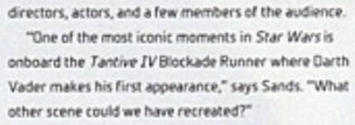

### Stat block notes (game mechanics, not feats)

- Working set: In the case of the Tantive IV, this was not simply a mockup thrown together for Kodak moments—this was an actual working set that could be shot from multiple angles, matching the original Star Wars set so closely that it could virtually double for it in the movie. (Star Wars Insider 97, p. 11) (Source: *Star Wars Insider #97* (2007), scan p.11)
- N1 storage: "We've continued to build on an agreement that was originally created by Lucasfilm in 1998 to store many of the props from Episode I following production, which included set pieces such as the full size N1 Naboo starfighter amongst others," explains Sands. (Star Wars Insider 97, p. 11) (Source: *Star Wars Insider #97* (2007), scan p.11)

## scan p.12 (scan page 12)

Page contents: Tantive IV article cont. (set built from scratch in ~3 months; Jedi School show at Star Wars: The Exhibition); sidebar "Jawa Power!" (StarWars.com Visual Guide facts) (hand-read)

- **none** — entry/section: No error: ""It was a grand plan and one that didn't allow for any error," says Sands. "If executed incorrectly with hardcore fans, it could have gone wrong quickly. So focus and creative persistence was necessary." —Jonathan Sands, Star Wars Insider 97, p. 12" Source: *Star Wars Insider #97* (2007), scan p.12
  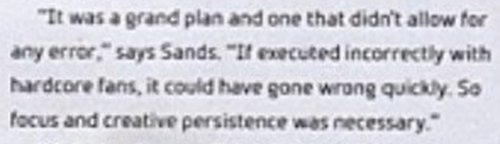
- **none** — entry/section: Old warehouse on tracks: ""The sandcrawler was just said to be an enormous iron-tracked vehicle, and I put a big trapdoor on the front because it's collecting junk and I made it huge and put a driver's compartment at the top and designed this peak that comes off the front. I added engines, exhaust pipes, and plenty of tracks. In fact, there are four different tank-like tracks on the crawler. I wanted it to look like an old warehouse on tracks." —Ralph McQuarrie, Star Wars Insider 97, p. 12" Source: *Star Wars Insider #97* (2007), scan p.12
  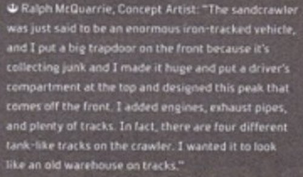

### Stat block notes (game mechanics, not feats)

- Radio drama betrayal: In the radio drama, after he is kidnapped by the Jawas, C-3PO asks if the little creatures have seen his companion, R2-D2. He then goes on to describe the stubby droid and even indicates the direction Artoo traveled when the pair separated. Thus, Threepio is the reason the Jawas easily track Artoo and capture the astromech. (Star Wars Insider 97, p. 12) (Source: *Star Wars Insider #97* (2007), scan p.12)
- Tunisia rainstorm: On March 26, 1976, during the height of filming, Tunisia was hit with its first winter rainstorm in 50 years. (Star Wars Insider 97, p. 12) (Source: *Star Wars Insider #97* (2007), scan p.12)
- Second-draft escape: In the second draft, the droids actually escape the Jawas when the sandcrawler becomes trapped in a narrow canyon pass. As the Jawas attempt to free the vehicle, Threepio and Artoo manage to slip away. They flee to Anchorhead to complete their mission for Deak Starkiller, who has ordered the droids to find Owen Lars. (Star Wars Insider 97, p. 12) (Source: *Star Wars Insider #97* (2007), scan p.12)
- Yuma 132 degrees: In order to expand the sandtroopers-combing-the-desert scene for the Special Edition, new footage was shot in Yuma, Arizona in 1995. It was the hottest day on record, with temperatures soaring to 132 degrees Fahrenheit. The stormtrooper extras consisted mostly of U.S. Marines who could tough out the heat. (Star Wars Insider 97, p. 12) (Source: *Star Wars Insider #97* (2007), scan p.12)
- Dewback puppet: The dewback featured in the original release of Star Wars was actually a huge puppet. Its head could be turned from right to left, but it was largely immobile. (Star Wars Insider 97, p. 12) (Source: *Star Wars Insider #97* (2007), scan p.12)

## scan p.13 (scan page 13)

Page contents: Feature opener image: Luke Skywalker and Princess Leia (Mark Hamill and Carrie Fisher) (hand-read)

## scan p.14 (scan page 14)

Page contents: Feature opener: "Luke & Leia" — words by Brian J. Robb, Jonathan Wilkins, & Brigid Cherry; Hamill interview plus Carrie Fisher Celebration IV highlights (hand-read)

## scan p.15 (scan page 15)

Page contents: Luke & Leia feature: Mark Hamill interview begins; "The Wit & Wisdom of Carrie Fisher" opener (Celebration IV highlights) (hand-read)

## scan p.16 (scan page 16)

Page contents: Hamill interview cont. (pull quote: "The fact that the robots are the most human characters in the movie is hilarious!"); Carrie Fisher box "Getting the Star Wars Job" (hand-read)

## scan p.17 (scan page 17)

Page contents: Hamill interview cont. (fame, Corvette Summer); Carrie Fisher box cont. (script read with Miguel Ferrer; "The 'Danish Pastry' Hair") (hand-read)

### Stat block notes (game mechanics, not feats)

- Hung upside down: "There was a scene in it where the Princess was hung upside down—the torture scene was a little more extensive in the original script—and then the Wookiee had to carry me for a while. That went away." (Carrie Fisher, Star Wars Insider 97, p. 17) (Source: *Star Wars Insider #97* (2007), scan p.17)

## scan p.18 (scan page 18)

Page contents: Hamill pull quote ("Finally, after Star Wars had made a huge mark..."); Carrie Fisher box cont. (diet farm; "Her Favorite and Least Favorite Scenes to Shoot") (hand-read)

- **Leia Organa Solo** — entry/section: Distract from weight: ""By the time I got to the set, I hadn't lost 10 pounds, so when he [George Lucas] put me in that hairstyle, I thought 'I'm gonna say I like anything' to distract from my weight." —Carrie Fisher, Star Wars Insider 97, p. 18" Source: *Star Wars Insider #97* (2007), scan p.18
  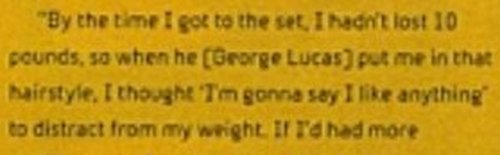

## scan p.19 (scan page 19)

Page contents: Photo page: Luke and Leia (Yavin ceremony costumes), Luke at gunnery controls, Leia in metal bikini (Jabba's palace) (hand-read)

## scan p.20 (scan page 20)

Page contents: Hamill interview cont. (the Joker, Batman: The Animated Series voice work; Broadway); Fisher box cont. ("That Metal Bikini!", "A Second Chance?", "DVD Diva?") (hand-read)

- **none** — entry/section: Ultimate character role: ""To me, the Joker was the ultimate character role, and in my own fantasy world I became a radio actor." —Mark Hamill, Star Wars Insider 97, p. 20" Source: *Star Wars Insider #97* (2007), scan p.20
  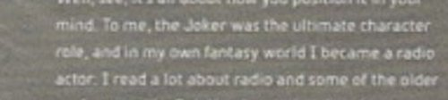
- **Leia Organa Solo** — entry/section: Floating English accent: ""I had a floating English accent in the first movie. If I could redo anything, I might make that go away." —Carrie Fisher, Star Wars Insider 97, p. 20" Source: *Star Wars Insider #97* (2007), scan p.20
  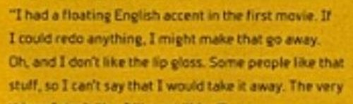

## scan p.21 (scan page 21)

Page contents: Hamill interview concl. (revisiting Luke; Woody Allen joke); Fisher box "A Teenager from Outer Space" (SNL, November 18, 1978) with song lyrics (hand-read)

### Stat block notes (game mechanics, not feats)

- Saturday Night Live: Fisher hosted an episode of Saturday Night Live on November 18, 1978, in which she appeared in a bikini and sang a 1950s-style song. (Star Wars Insider 97, p. 21) (Source: *Star Wars Insider #97* (2007), scan p.21)

## scan p.22 (scan page 22)

Page contents: The Force Unleashed feature opener: full-page portrait (Sam Witwer); top-left box "The next official installment in the Star Wars saga!" with Vader silhouette (hand-read)

## scan p.23 (scan page 23)

Page contents: Feature opener "You're Hired" to be Darth Vader's Secret Apprentice! — Haden Blackman and Sam Witwer on The Force Unleashed; words by Brian J. Robb & Jonathan Wilkins (hand-read)

## scan p.24 (scan page 24)

Page contents: TFU intro and pre-production artwork (TIE fighter/bridge battle; "Devastation road" swamp scene) (hand-read)

### Stat block notes (game mechanics, not feats)

- Narrative gap: In Star Wars: The Force Unleashed you get to play as Darth Vader's "Secret Apprentice" in a storyline that promises new revelations about the Star Wars galaxy. The story—developed under direction from Star Wars creator George Lucas—takes place between Revenge of the Sith and A New Hope, filling a largely unexplored narrative gap. (Star Wars Insider 97, p. 24) (Source: *Star Wars Insider #97* (2007), scan p.24)
- Witwer cast: Bringing the game to a console near you is LucasArts Project Lead Haden Blackman and Battlestar Galactica actor Sam Witwer, cast as the in-game representation of Vader's Secret Apprentice. (Star Wars Insider 97, p. 24) (Source: *Star Wars Insider #97* (2007), scan p.24)

## scan p.25 (scan page 25)

Page contents: TFU interview: Blackman on ILM likeness capture and casting; Witwer on motion capture and the script; caption "The Force itself is central to the gameplay..." (hand-read)

- **none** — entry/section: Get George involved: ""We really wanted to legitimize The Force Unleashed and make it the next chapter in the Star Wars saga. You can't do that unless you get George involved." —Haden Blackman, Star Wars Insider 97, p. 25" Source: *Star Wars Insider #97* (2007), scan p.25
  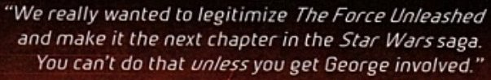
- **Galen Marek** — entry/section: Proper screenplay: ""The story that Haden and George [Lucas] came up with was a proper screenplay. Everything that took place in those scenes was dramatic and had character value, rather than just expositional value." —Sam Witwer, Star Wars Insider 97, p. 25" Source: *Star Wars Insider #97* (2007), scan p.25
  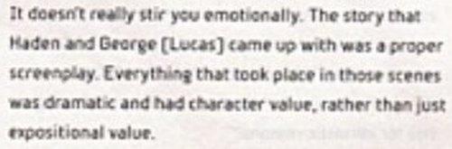
- **Galen Marek; Darth Vader (Anakin Skywalker)** — entry/section: Raised by Vader: ""Haden wrote a character that has a lot of internal conflict. He's a dark-side character who was raised by Darth Vader, essentially. He never really had a chance to have any kind of childhood, or to come up with any moral values based on his own experiences. Everything was fed to him by Darth Vader." —Sam Witwer, Star Wars Insider 97, p. 25" Source: *Star Wars Insider #97* (2007), scan p.25
  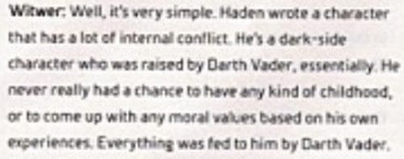

### Stat block notes (game mechanics, not feats)

- ILM collaboration: "This was a very different process for us than on previous games. That's because of the kind of story that we're trying to tell, but also because we collaborated very closely with Industrial Light & Magic on likeness capture and facial mo-cap [motion capture] techniques that they've used in films like Pirates of the Caribbean." (Haden Blackman, Star Wars Insider 97, p. 25) (Source: *Star Wars Insider #97* (2007), scan p.25)
- Casting by face: "In this case we knew that we had to cast people—for all the main characters—that not only looked the part, but also sounded the part and could act, often with their face alone." (Haden Blackman, Star Wars Insider 97, p. 25) (Source: *Star Wars Insider #97* (2007), scan p.25)
- 3-D doubles: "We went to ILM, which created 3-D doubles of all the main characters. Our performances drove the animation models: It's literally our performances in the game." (Sam Witwer, Star Wars Insider 97, p. 25) (Source: *Star Wars Insider #97* (2007), scan p.25)
- Force gameplay: The Force itself is central to the gameplay of Star Wars: The Force Unleashed, giving the player unprecedented power to affect the in-game environment (caption, Star Wars Insider 97, p. 25) (Source: *Star Wars Insider #97* (2007), scan p.25)

## scan p.26 (scan page 26)

Page contents: TFU interview cont.: conflicted character, keeping mystery; full-length Secret Apprentice character render (hand-read)

- **none** — entry/section: Keep some mystery: ""Not explaining the mystery comes from George [Lucas]. During a lot of our conversations that was one of the things he hammered home: "Don't explain everything, let's keep some mystery to the universe."" —Haden Blackman, Star Wars Insider 97, p. 26" Source: *Star Wars Insider #97* (2007), scan p.26
  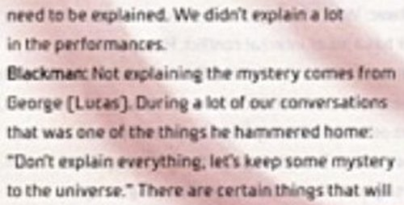

### Stat block notes (game mechanics, not feats)

- Faster, more intense: "The joke is that the oft-heard directions on the Star Wars set were "Faster, more intense!"" (Sam Witwer, Star Wars Insider 97, p. 26) (Source: *Star Wars Insider #97* (2007), scan p.26)

## scan p.27 (scan page 27)

Page contents: TFU interview cont.: 1940s serial pace, comedy between Juno and the Apprentice, Lucas's involvement; pull quotes and in-game screenshots (hand-read)

- **Galen Marek** — entry/section: 12-year-old kid: ""The Secret Apprentice is this incredible warrior, but get him around a girl and he's just turns into a 12-year-old kid." —Sam Witwer, Star Wars Insider 97, p. 27" Source: *Star Wars Insider #97* (2007), scan p.27
  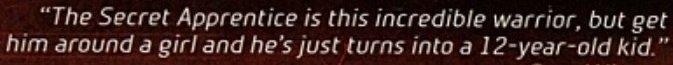

### Stat block notes (game mechanics, not feats)

- 1940's serial pace: "Even in the dialogue scenes, we tried to keep that 1940's serial-type pace to it. The dialogue is very snappy and old school in that way." (Sam Witwer, Star Wars Insider 97, p. 27) (Source: *Star Wars Insider #97* (2007), scan p.27)
- Goes to pieces: The Apprentice may be a warrior, but he goes to pieces whenever he's around Juno Eclipse (caption, Star Wars Insider 97, p. 27) (Source: *Star Wars Insider #97* (2007), scan p.27)

## scan p.28 (scan page 28)

Page contents: TFU interview concl.: Lucas brainstorming, Vader as Master, the Emperor; screenshots and pull quote (hand-read)

### Stat block notes (game mechanics, not feats)

- Motivating through fear: "George talked a lot about Vader motivating through fear, and people constantly being on edge around him." (Haden Blackman, Star Wars Insider 97, p. 28) (Source: *Star Wars Insider #97* (2007), scan p.28)
- Use the Emperor: "He also encouraged us to include the Emperor. In the original draft the Emperor wasn't very well developed or in the game very much, and he told us, "Use the Emperor!"" (Haden Blackman, Star Wars Insider 97, p. 28) (Source: *Star Wars Insider #97* (2007), scan p.28)

## scan p.29 (scan page 29)

Page contents: Pirates of the Boards (Exclusive Series Part 5 of 6), Death Star trench runs; words by J.W. Rinzler; Joe Johnston storyboards #1–#2; 30th-anniversary logo top-left (hand-read)

### Stat block notes (game mechanics, not feats)

- Red Leader drafts: Joe Johnston's early Star Wars storyboards (circa October-December 1975) reveal the on-again-off-again fate of Red Leader. In the third draft, George Lucas has Red Leader be the first to attempt to reach the exhaust port—while Blue Leader and his squad, including Luke Starkiller, try and cover him. ... In the fourth draft, Red Leader gets killed by Darth Vader just as he fires off a shot at the vulnerable exhaust port. (J.W. Rinzler, Star Wars Insider 97, p. 29) (Source: *Star Wars Insider #97* (2007), scan p.29)
- Gold, Red, Luke: Editing would also have Red Leader take the place of Blue Leader, now getting off a shot and then being destroyed, as blue had to be eliminated as a color for technical reasons. To sum up, in the drafts, trench run order was Red, Blue, Luke; but in the film, it's Gold, Red, and Luke. (J.W. Rinzler, Star Wars Insider 97, p. 29) (Source: *Star Wars Insider #97* (2007), scan p.29)
- Three trench runs: In the drafts, when Luke succeeds on his second trench run in destroying the Death Star, because of the earlier failures, the importance of the Force was made even clearer. Ultimately, however, the film contains only three trench runs, as Luke's first was eliminated in editing. (J.W. Rinzler, Star Wars Insider 97, p. 29) (Source: *Star Wars Insider #97* (2007), scan p.29)
- Notations and fourth draft: (Storyboard notations are by special effects director of photography Richard Edlund. Script excerpts are from Lucas' fourth draft, dated January 1, 1976.) (Star Wars Insider 97, p. 29) (Source: *Star Wars Insider #97* (2007), scan p.29)

## scan p.30 (scan page 30)

Page contents: Pirates of the Boards cont.: boards #3–#4 with fourth-draft script excerpts (hand-read)

### Stat block notes (game mechanics, not feats)

- Chewie to Wedge: [Note the board uses the third draft name "Chewie," which was changed to "Wedge" in the fourth draft.] (Star Wars Insider 97, p. 30) (Source: *Star Wars Insider #97* (2007), scan p.30)
- Porkins replaces Blue Leader: [Note that "Blue Leader" has been crossed out, and "Porkins" written in a fourth draft change.] CU. Porkins. His cockpit explodes over the low altitude horizon of the Death Star. (Star Wars Insider 97, p. 30) (Source: *Star Wars Insider #97* (2007), scan p.30)

## scan p.31 (scan page 31)

Page contents: Pirates of the Boards cont.: boards #5–#6 (Y-wing attack run; "Y-guy bites it") (hand-read)

### Stat block notes (game mechanics, not feats)

- Fourth-draft attack run: RED LEADER: Blue Leader, this is Red Leader. We are starting our attack run. The exhaust port is marked and locked in. No flak, no enemy fighters up here… look's like we'll get a smooth run at it. (Lucas fourth-draft excerpt, Star Wars Insider 97, p. 31) (Source: *Star Wars Insider #97* (2007), scan p.31)
- 3-8-104: VADER: 3-8-104, I'll take them myself. Cover me. POV. Gunsight. Vader lines up Red Two in his targeting computer. (Lucas fourth-draft excerpt, Star Wars Insider 97, p. 31) (Source: *Star Wars Insider #97* (2007), scan p.31)

## scan p.32 (scan page 32)

Page contents: Pirates of the Boards concl.: boards #7–#8; "Don't miss the next issue of Star Wars Insider for more exciting Pirates of the Boards!" (hand-read)

### Stat block notes (game mechanics, not feats)

- Red Leader explodes: Vader calmly adjusts his targeting computer and pushes the fire button. Red Leader explodes in a ball of flames throwing debris in all directions. [Note that several boards have been omitted here; originally Red Leader got a shot off before being shot down by Vader—but in the revised sequence, he's killed before he can fire a shot at the exhaust port.] (Star Wars Insider 97, p. 32) (Source: *Star Wars Insider #97* (2007), scan p.32)
- Red Five's death: One of the engines explodes on Red Five's Y-winged fighter [...]. Red Five, a veteran of countless campaigns, spins toward his death. RED FIVE: Lost Tiree… lost Dutch… they came from behind, can't maneuver in the trench… sorry, it's your baby now… so long, Dave… (static) (Lucas fourth-draft excerpt, Star Wars Insider 97, p. 32) (Source: *Star Wars Insider #97* (2007), scan p.32)

## scan p.33 (scan page 33)

Page contents: "Art Vader" feature opener (The Vader Project helmet exhibition at Celebration IV and Celebration Europe); words by Bonnie Burton (hand-read)

## scan p.34 (scan page 34)

Page contents: Art Vader cont.: curator Dov Kelemer (DKE Toys); artists Alex Pardee ("K.I.A."), Eelus ("Full Metal Vader"), Aye Jay; Amanda Visell detail caption; photo of Kelemer with helmet display (hand-read)

- **Darth Vader (Anakin Skywalker)** — entry/section: Iconic image: ""Darth Vader is such an iconic image in our culture that practically anything you do to him makes some kind of statement." —Dov Kelemer, Star Wars Insider 97, p. 34" Source: *Star Wars Insider #97* (2007), scan p.34
  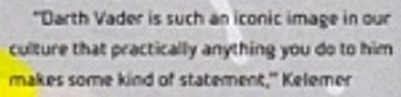
- **Darth Vader (Anakin Skywalker)** — entry/section: Vader is evil: ""Vader deserved much more than that. Vader is evil, so if I dumbed him down too much with my art, I would hate myself." —Alex Pardee, Star Wars Insider 97, p. 34" Source: *Star Wars Insider #97* (2007), scan p.34
  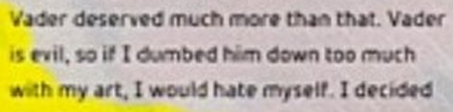

### Stat block notes (game mechanics, not feats)

- The Vader Project: Curator Dov Kelemer (pictured below) of DKE Toys, a large designer vinyl and art-toy distributor, gathered more than 60 of the hottest underground artists and gave each one a 1:1 scale prop replica of the Darth Vader helmet, contributed by Master Replicas, to serve as the ultimate canvas to paint, redesign, mash-up and customize in their own unique style. (Bonnie Burton, Star Wars Insider 97, p. 34) (Source: *Star Wars Insider #97* (2007), scan p.34)
- 20 U.K. helmets: The show debuted at Star Wars Celebration IV in Los Angeles and continued on to Celebration Europe in London this year, where another 20 helmets from U.K. artists were added. (Star Wars Insider 97, p. 34) (Source: *Star Wars Insider #97* (2007), scan p.34)
- 20,000 people: "In the end, we had 20,000 people at CIV see the show." (Dov Kelemer, Star Wars Insider 97, p. 34) (Source: *Star Wars Insider #97* (2007), scan p.34)
- Visell detail: Detail from "Darth Vader Choking the Guy's Neck, but Not Really Because He's Too Far Away and Jabba the Hut, etc" by Amanda Visell, Cel Vinyl Acrylic Paint, USA 2007 (caption, Star Wars Insider 97, p. 34) (Source: *Star Wars Insider #97* (2007), scan p.34)

## scan p.35 (scan page 35)

Page contents: Art Vader cont.: helmets "K.I.A." (Alex Pardee), Untitled (MAD), Untitled (Cam de Leon); "Pattern Force" — Urban Medium (Derek Fridman) (hand-read)

### Stat block notes (game mechanics, not feats)

- Light vs. dark helmet: "We decided to go with the theme of good vs. evil—capturing the light vs. dark side struggle Anakin faces throughout his life. One half of the helmet represents the light side of the Force, pasted with white floral patterns of Rebel Alliance logos and remixed characters DJ-D2 and Chewbacca. The other half represents the dark side, pasted with black floral Imperial logos and remixed characters Boba Fett and B-Boy stormtroopers." (Derek Fridman, Star Wars Insider 97, pp. 35–36) (Source: *Star Wars Insider #97* (2007), scan p.35)

## scan p.36 (scan page 36)

Page contents: Art Vader cont.: helmets by Wade Lageose, Plasticgod ("Praise the Lord"); Visell, Shag ("Darth Tipua"), Marc Ecko ("Darth from Above"), Michelle Valigura, Suckadelic ("Son of the Suns") (hand-read)

- **Darth Vader (Anakin Skywalker)** — entry/section: Its actual size: ""Even if you run across someone who's been living in a cave and hasn't ever seen any of the movies, they know who Darth Vader is, they know what the helmet looks like—and its actual size!" —Amanda Visell, Star Wars Insider 97, p. 36" Source: *Star Wars Insider #97* (2007), scan p.36
  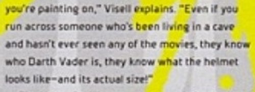
- **Darth Vader (Anakin Skywalker)** — entry/section: Less scary: ""It's interesting for me to see something so iconic used as a canvas, and it made him a little less scary." —Michelle Valigura, Star Wars Insider 97, p. 36" Source: *Star Wars Insider #97* (2007), scan p.36
  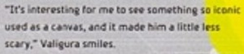

### Stat block notes (game mechanics, not feats)

- Pink plush brain: Switcheroo.com co-founder and artist Michelle Valigura covered her helmet in black flocked material and nestled inside a bright pink plush brain fit for a Sith Lord. (Star Wars Insider 97, p. 36) (Source: *Star Wars Insider #97* (2007), scan p.36)

## scan p.37 (scan page 37)

Page contents: Art Vader cont.: helmets "Darth Fader" (Mister Cartoon) and Untitled (Wade Lageose); Suckadelic, David S. Krys ("Darth Fink"), Alex Pardee (hand-read)

- **none** — entry/section: Rad imagination: ""The Star Wars films helped develop my imagination," Pardee adds. "My work is based solely on my ability to imagine. I am not and will never be the best illustrator or the best painter, but I have a rad imagination, and I have Star Wars to thank for that." —Alex Pardee, Star Wars Insider 97, p. 37" Source: *Star Wars Insider #97* (2007), scan p.37
  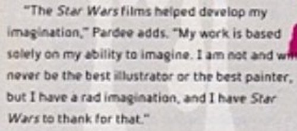

### Stat block notes (game mechanics, not feats)

- Journal of the Whills quote: "If you look closely at my piece, you'll find some hidden Kenner artifacts in there as well. To emphasize the geek factor I also included the Journal of The Whills quote, lest anyone question my fandom and my level of study." (Suckadelic, Star Wars Insider 97, p. 37) (Source: *Star Wars Insider #97* (2007), scan p.37)
- Darth Fink: Artist David S. Krys paid tribute to lowbrow muse Rat Fink with his creation "Darth Fink" complete with bulging eyes and a hotrod paintjob. (Star Wars Insider 97, p. 37) (Source: *Star Wars Insider #97* (2007), scan p.37)

## scan p.38 (scan page 38)

Page contents: Art Vader cont.: "Magic Memories" (Eelus, Suckadelic, Steven Daily); debut May 2007 in Los Angeles; helmets "Darth Tipua" (Shag), "Darth Fink" (David S. Krys), "Kurai No Kurai" (Huck Gee) (hand-read)

- **none** — entry/section: Baking pan trash compactor: ""I made a little trash compactor out of my mom's baking pan and other household stuff," Suckadelic laughs. "This was before the toys came out." —Suckadelic, Star Wars Insider 97, p. 38" Source: *Star Wars Insider #97* (2007), scan p.38
  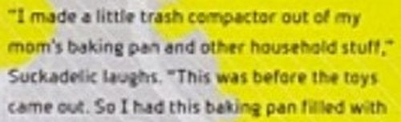
- **none** — entry/section: Pioneer Chicken: ""I can remember seeing The Empire Strikes Back at Vanburen Drive-in with a bucket of Pioneer Chicken!" —Steven Daily, Star Wars Insider 97, p. 38" Source: *Star Wars Insider #97* (2007), scan p.38
  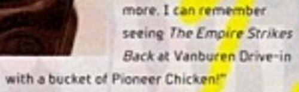
- **Darth Vader (Anakin Skywalker)** — entry/section: Pink Mohawk: ""If you've seen your sister with the same haircut for your entire life, then she shows up with a pink Mohawk, you're gonna want to stare at it." —Alex Pardee, Star Wars Insider 97, p. 38" Source: *Star Wars Insider #97* (2007), scan p.38
  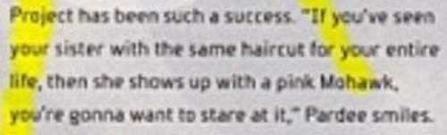

### Stat block notes (game mechanics, not feats)

- 66 takes: "A lot of Star Wars fans may not know these artists but can appreciate seeing 66 different takes on their favorite movies, especially with this choice of canvas." (Amanda Visell, Star Wars Insider 97, p. 38) (Source: *Star Wars Insider #97* (2007), scan p.38)

## scan p.39 (scan page 39)

Page contents: Art Vader concl. (Pardee on Lobot's headset; Aye Jay; www.thevaderproject.com); "Sith Lord of the Air" — Darth Vader hot-air balloon Q&A, words by Patrice Girod (hand-read)

### Stat block notes (game mechanics, not feats)

- Vader balloon specs: The Vader Balloon project began life in the Belgian 501st ... They settled upon Vader's distinctive helmet and created a balloon 26 meters (28.5 yards) high, with an air capacity of 3,000 m3 (790 gallons) and a weight of 320 kilos (850 pounds). The balloon takes a pilot and two passengers. (Star Wars Insider 97, p. 39) (Source: *Star Wars Insider #97* (2007), scan p.39)
- Make R2-D2 short circuit: Even the Empire didn't think of this one! A giant Vader balloon might have been just the thing to frighten the Rebels; it'd be enough to make R2-D2 short circuit! The impressive balloon's most recent outing was at Celebration Europe. (Star Wars Insider 97, p. 39) (Source: *Star Wars Insider #97* (2007), scan p.39)
- Totally black first visual: The balloon company was sent a 3-D shape for the helmet and a replica helmet; the first visual of the balloon "was totally black. So we reworked it using more shades of gray in order to respect the original helmet yet also give shape to the balloon." Eight weeks of needlework followed. (Star Wars Insider 97, p. 39) (Source: *Star Wars Insider #97* (2007), scan p.39)

## scan p.40 (scan page 40)

Page contents: "Jawa's Corner" section opener (Anakin Skywalker photo): Books 50, Comics 52, Toys 54, Star Wars Q&A 56, Scouting the Galaxy 58, International Collecting 61, Set Piece 64, Padawan's Corner 66, Bantha Tracks 69, Indy Vault 74, Comlink 76 (magazine page numbers) (hand-read)

## scan p.41 (scan page 41)

Page contents: Books: "The Man Behind the Mask" — Ryder Windham's The Rise and Fall of Darth Vader (Scholastic, $12.99), words by Jason Fry (hand-read)

- **Darth Vader (Anakin Skywalker)** — entry/section: Continuity as important: ""Maybe it's because I used to edit Star Wars comics, but maintaining continuity is as important to me as crafting what I hope will be an entertaining story." —Ryder Windham, Star Wars Insider 97, p. 41" Source: *Star Wars Insider #97* (2007), scan p.41
  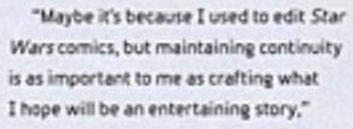

### Stat block notes (game mechanics, not feats)

- Prequels recolor the trilogy: Suddenly longtime fans wondered what Vader must have felt realizing Leia's ship had fled to his homeworld, or when he saw a familiar protocol droid strapped to Chewbacca's back on Cloud City. (Star Wars Insider 97, p. 41) (Source: *Star Wars Insider #97* (2007), scan p.41)
- New scenes in Rise and Fall: We see Anakin Skywalker's first meeting with Watto, his grouchy Toydarian master, and witness Vader's order to execute Luke's aunt and uncle, and learn why he's so angry with them. We even get a glimpse of what happens to Vader after his physical body perishes aboard the second Death Star. (Star Wars Insider 97, p. 41) (Source: *Star Wars Insider #97* (2007), scan p.41)
- Prophetic dreams: The book begins just before the events of Return of the Jedi, with Vader troubled by the first dream he's had in years, then quickly cuts to just before The Phantom Menace, with Anakin and Shmi in the cargo hold of Gardulla the Hutt's freighter. Anakin wakes after dreaming of a desert world and Podracing, a sport he's never seen. (Star Wars Insider 97, p. 41) (Source: *Star Wars Insider #97* (2007), scan p.41)

## scan p.42 (scan page 42)

Page contents: Books cont.: "Windham's Way"; pull quote "We all assumed that most readers were already very familiar with the movies…" (hand-read)

- **Darth Vader (Anakin Skywalker)** — entry/section: Anakin's path: ""We all assumed that most readers were already very familiar with the movies, so the pressure was off to recount, say, yet another blow-by-blow description of the Death Star battle. The goal was to follow Anakin's path in a way that hadn't been done before." —Ryder Windham, Star Wars Insider 97, p. 42" Source: *Star Wars Insider #97* (2007), scan p.42
  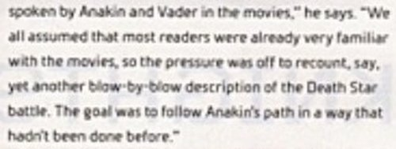
- **Han Solo; Chewbacca** — entry/section: Survive and make ends meet: ""I've also love any chance to write pre-Episode IV adventures of Han and Chewbacca, or anything involving the bounty hunters and droids, characters who aren't necessarily Force-powered. For some reason, I've always been intrigued by the characters who are just trying to survive and make ends meet in the Star Wars galaxy." —Ryder Windham, Star Wars Insider 97, p. 42" Source: *Star Wars Insider #97* (2007), scan p.42
  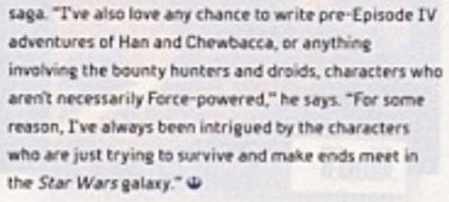

### Stat block notes (game mechanics, not feats)

- En route to Endor opening: Beginning with Vader en route to Endor, Windham notes, "struck me as a good alternative to a purely chronological account of Vader's life, and also seemed consistent with the order that the two trilogies were released, as Darth Vader was introduced before Anakin Skywalker." (Star Wars Insider 97, p. 42) (Source: *Star Wars Insider #97* (2007), scan p.42)

## scan p.43 (scan page 43)

Page contents: Comics: "Knights of Suffering" — Knights of the Old Republic #22–24 (John Jackson Miller), words by Daniel Wallace; box "Know Your Era with the Knights of the Old Republic Handbook" (hand-read)

- **none** — entry/section: One Dunkirk after another: ""The Mandalorians have struck the Republic hard, catching most citizens by surprise. This year's a lot like 1940, only it's been one Dunkirk after another for the Republic. People aren't thinking about how they'll beat the Mandalorians, they're thinking, 'Should I learn Mando'a and start modeling crash helmets in the mirror?'" —John Jackson Miller, Star Wars Insider 97, p. 43" Source: *Star Wars Insider #97* (2007), scan p.43
  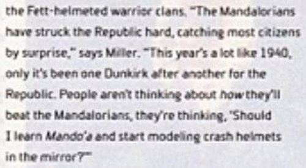
- **Cassus Fett** — entry/section: Uniform armor: ""Suddenly we've got a power structure, and propaganda, and—shudder—uniform armor! Regular grunts are wondering what it's all about. How does an army conquer so much, so fast, without tripping over itself? What happens if all of Mand'alor's forces are not on the same page with him?" —John Jackson Miller, Star Wars Insider 97, p. 43" Source: *Star Wars Insider #97* (2007), scan p.43
  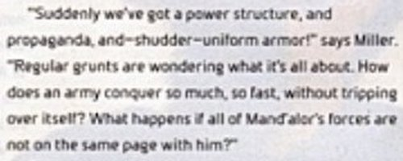
- **Carth Onasi** — entry/section: Before the opening crawl: ""There's still a way to go—not to mention a couple of wars—before hitting the game's opening crawl!" —John Jackson Miller, Star Wars Insider 97, p. 43" Source: *Star Wars Insider #97* (2007), scan p.43
  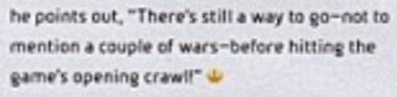

### Stat block notes (game mechanics, not feats)

- Taris under siege: When he fled Taris—site of the Padawan massacre—early in the series, he had the Jedi and law enforcement on his trail. Now in "Knights of Suffering," the Mandalorians have laid siege to Taris and control the Upper City—formerly the only safe place in the planet-covering metropolis. (Star Wars Insider 97, p. 43) (Source: *Star Wars Insider #97* (2007), scan p.43)
- Cassus Fett introduced: "Knights of Suffering" also introduces Cassus Fett, a character who originated in video games but was referenced only in passing until now. In addition to this appearance by Jango and Boba's ancestor, a great deal will be revealed about the nature of the Mandalorians under Cassus Fett's command. (Star Wars Insider 97, p. 43) (Source: *Star Wars Insider #97* (2007), scan p.43)
- KOTOR Handbook: In November, Dark Horse releases the Knights of the Old Republic Handbook ... John Jackson Miller provides the text, and promises to reveal plenty of new information from "Zayne's homeworld to the ship class of the Courageous to how Gryph became Gryph." Dustin Weaver contributes a new cover as well as cross sections of the starships Last Resort and Moomo Williwaw. (Star Wars Insider 97, p. 43) (Source: *Star Wars Insider #97* (2007), scan p.43)

## scan p.44 (scan page 44)

Page contents: Comics cont.: KOTOR art spread; box "One Last Pow! Clone Wars Adventures Completes Its Publishing Run" (Volume 10, December) (hand-read)

### Stat block notes (game mechanics, not feats)

- CWA Vol. 10 stories: "Chain of Command" (written by Jason Hall, illustrated by Ethen Beavers), "Graduation Day" (written by Chris Avellone, illustrated by Stewart McKenney), "Thunder Road" and "Waiting" (written and illustrated by The Fillbach Brothers). (Star Wars Insider 97, p. 44) (Source: *Star Wars Insider #97* (2007), scan p.44)

## scan p.45 (scan page 45)

Page contents: Toys: "Bricks, Biths, and Busts," words by Jeremy Beckett — LEGO Motorized AT-AT; Galactic Heroes Cinema Scenes (hand-read)

### Stat block notes (game mechanics, not feats)

- LEGO Motorized AT-AT: With 1137 pieces it stands 32cm (12.5") tall and over 38cm (15") long, can walk forward and backward, and comes with four mini-figures: AT-AT pilot, General Maximilian Veers, Snowtrooper and Luke Skywalker with grappling line and lightsaber. Price: $129.99 (Star Wars Insider 97, p. 45) (Source: *Star Wars Insider #97* (2007), scan p.45)
- Cantina cinema scenes: Baniss Keeg and Hammerhead are quietly enjoying the ambiance but the peace is about to be shattered by Ponda Baba, who is spoiling for a fight! C-3PO and R2-D2 have more pressing needs because "their kind" aren't allowed in and they need a place to hide. But the valiant Han Solo and faithful Chewbacca have their own problems to deal with when Greedo turns up, and Wuher can't decide whether to serve Snaggletooth or distract the Imperial sandtroopers who have raided his joint. (Star Wars Insider 97, p. 45) (Source: *Star Wars Insider #97* (2007), scan p.45)

## scan p.46 (scan page 46)

Page contents: Toys cont.: Gentle Giant Senate & Imperial Guard Mini-Busts ($50 each); Kotobukiya Kiriko Glasses (hand-read)

### Stat block notes (game mechanics, not feats)

- Senate Guard replaced: Under the rule of Chancellor Palpatine, the role of the Senate Guard was steadily marginalized until this paramilitary organisation was replaced by a more elite unit based on Palpatine's personal bodyguards. (Star Wars Insider 97, p. 46) (Source: *Star Wars Insider #97* (2007), scan p.46)
- Royal Guard mystique: The crimson-clad Royal Guard were hand-picked from the most promising of the Imperial rank and file. Trained in a myriad of armed and unarmed fighting techniques, they were equiped with state-of-the-art force pikes ... Such was their mystique that Darth Vader knew better than to taunt his Master's protectors. (Star Wars Insider 97, p. 46) (Source: *Star Wars Insider #97* (2007), scan p.46)
- Kiriko glasses: Hand etched to produce breathtaking renditions of popular droid's bodies (R2-D2, C-3PO, and Obi-Wan Kenobi's R4-P17) ... only a small quantity (less than 350 pieces) of each Kiriko glass was available during the summer of 2007 at Celebration IV and San Diego Comic-Con. (Star Wars Insider 97, p. 46) (Source: *Star Wars Insider #97* (2007), scan p.46)

## scan p.47 (scan page 47)

Page contents: Star Wars Q&A: "Who Spent Han's Reward?" — answers by Leland Y. Chee; top-right box: how to ask questions (Titan Magazines addresses, [email omitted]) (hand-read)

### Stat block notes (game mechanics, not feats)

- Reward was spice: On Yavin 4, Han and Chewie are loading strongboxes, but they don't actually contain credits. An early version of the script had the reward being eight million credits but it was later changed to boxes of spice. (Leland Y. Chee, Star Wars Insider 97, p. 47) (Source: *Star Wars Insider #97* (2007), scan p.47)
- Radio Drama precious metals: The Star Wars Radio Drama includes a scene where Han discusses the payment. Since the Rebellion had very little Imperial currency on hand, Han offers to accept precious metals as compensation. It's also worth noting that one of the Rebels even suggests that they refuse to pay Han's reward or worse yet, kill him so that he doesn't betray them to the Empire. (Leland Y. Chee, Star Wars Insider 97, p. 47) (Source: *Star Wars Insider #97* (2007), scan p.47)
- Sidetracked by friends: Han's decision to come to Luke's aid during the final Death Star trench run probably surprised even himself. From that point on, he got "sidetracked" by his commitment to his new friends. It was only because of the encounter with the bounty hunter at Ord Mantell that he is reminded of his debt to Jabba the Hutt. (Leland Y. Chee, Star Wars Insider 97, p. 47) (Source: *Star Wars Insider #97* (2007), scan p.47)
- Crimson Jack takes the cargo: In the Marvel Star Wars comics we learn that Han actually leaves to pay off the debt soon after the Battle of Yavin. While in mid-flight, the Millennium Falcon is captured by a red-bearded pirate named Crimson Jack. The crew offloads the Falcon's valuable cargo and sends Han on his way empty-handed. (Leland Y. Chee, Star Wars Insider 97, p. 47) (Source: *Star Wars Insider #97* (2007), scan p.47)
- Padmé's death: In the end, the despondency over the terrible person Anakin has become breaks Padmé's heart ... There might even be a small part of her that blames herself for inadvertently bringing Obi-Wan to Mustafar, though Anakin's gruesome fate at the hands of Obi-Wan remains hidden from her in her final moments. There is nothing to suggest that Padmé's death is the will of the Force, other than it being the fate that Anakin had envisioned earlier. (Leland Y. Chee, Star Wars Insider 97, p. 47) (Source: *Star Wars Insider #97* (2007), scan p.47)

## scan p.48 (scan page 48)

Page contents: Q&A cont.: first Jedi/Sith; surviving pilots; clone ages; R2-G1; the Whills (hand-read)

### Stat block notes (game mechanics, not feats)

- First Jedi on Tython: Based on Obi-Wan's line from Episode IV, we know that the Jedi have been around for over a thousand generations which the Expanded Universe has equated to 25,000 years ... the story of the first Jedi, an order believed to have begun on a planet called Tython. (Leland Y. Chee, Star Wars Insider 97, p. 48) (Source: *Star Wars Insider #97* (2007), scan p.48)
- Third Y-wing survivor?: Luke, Wedge, and a Y-wing pilot survive the Death Star battle ... Sure, the dark haired one is probably Wedge, and a second guy could conceivably be Keyan Farlander, the surviving Y-wing pilot, but who's the third guy? (Leland Y. Chee, Star Wars Insider 97, p. 48) (Source: *Star Wars Insider #97* (2007), scan p.48)
- Bravo Flight named: The Phantom Menace actor Christian Simpson ... would be officially designated as Bravo Six, Gavyn Sykes ... The named pilots of Bravo Flight are: Bravo Leader: Ric Olié; Bravo Two: Porro Dolphe; Bravo Three: Lt. Arven Wendik; Bravo Four: Lt. Rya Kirsch; Bravo Five: Officer Ellberger; Bravo Six: Lt. Gavyn Sykes (Leland Y. Chee, Star Wars Insider 97, p. 48) (Source: *Star Wars Insider #97* (2007), scan p.48)
- Naming background characters: In general, Lucasfilm and Lucas Licensing only name characters on an as needed basis ... If the character isn't named in the script, doesn't have any dialogue, and we don't have decent visuals, chances get to be pretty slim for that character to get an official name. (Leland Y. Chee, Star Wars Insider 97, p. 48) (Source: *Star Wars Insider #97* (2007), scan p.48)
- Years, not the mileage: To paraphrase Han Solo's alter-ego, "It's the years, not the mileage." Your age estimate is correct in that the first clones would still only be 26 by the time of Revenge of the Sith ... the clone faces are scarred to indicate three long years of battle. Believe it or not, some of the clone faces are actually a digital combination of both Bodie (credited as a clone trooper in Episode III) and Temuera. (Leland Y. Chee, Star Wars Insider 97, p. 48) (Source: *Star Wars Insider #97* (2007), scan p.48)
- R2-G1 on a line: The large egg-shaped thing is one of the droids on sale, R2-G1, a predecessor to the more compact R2 units. The long line from the top is used to lower or raise the droid from the sales floor ... for the DVD release, the first longshot had this line removed. (Leland Y. Chee, Star Wars Insider 97, p. 48) (Source: *Star Wars Insider #97* (2007), scan p.48)
- Whills a mystery: The Whills are first mentioned in the Star Wars novelization. Further information on the Whills appears in the printed script for Revenge of the Sith. Beyond the tidbits of info gleaned from these mentions, it's is likely that the full story of the Whills shall forever remain a mystery. (Leland Y. Chee, Star Wars Insider 97, p. 48) (Source: *Star Wars Insider #97* (2007), scan p.48)

## scan p.49 (scan page 49)

Page contents: Scouting the Galaxy: "The Summer of Our Supreme Content," words by Steve Sansweet (Kermit as "Kermie Skywalker" photo; R2-D2 Kiriko glass) (hand-read)

### Stat block notes (game mechanics, not feats)

- Kiriko glass at CIV: One of the most unexpected pieces at CIV was Kotobukiya's R2-D2 Kiriko 10-ounce glass, frosted and deeply engraved using a traditional Japanese method nearly two centuries old. It was joined at Comic-Con by C-3PO and R4-P17 (garnet colored) glasses. While the glasses cost an eye-popping $50 each, they are quite beautiful and tactile (Steve Sansweet, Star Wars Insider 97, p. 49) (Source: *Star Wars Insider #97* (2007), scan p.49)
- Kermie Skywalker: I found one dealer who had dressed up Master Replica's Kermit the Frog "photo model" as Kermie Skywalker, complete with a perfectly-scaled Luke lightsaber. (Steve Sansweet, Star Wars Insider 97, p. 49) (Source: *Star Wars Insider #97* (2007), scan p.49)

## scan p.50 (scan page 50)

Page contents: Scouting the Galaxy cont.: Shadows comic; Value Tracks; images: ROTJ Ewok fur display, Shadows of the Empire, Marvel Star Wars #1, Collector Medallions, ESB soundtrack; photos by Anne Neumann (hand-read)

### Stat block notes (game mechanics, not feats)

- Ewok fur display: At the CIV opening ceremony, I was possessed to come on stage in an Ewok costume ... in London when I came across a beautifully framed display of 22 different colors of Ewok "fur" that creature designer Stuart Freeborn used for costumes for Return of the Jedi. (Steve Sansweet, Star Wars Insider 97, p. 50) (Source: *Star Wars Insider #97* (2007), scan p.50)
- Rejected Hasbro plush: The friendly plush Wampa, and the plush puppet dewback and bantha (you stick your arm in and operate the mouth) were prototypes that Hasbro considered but rejected in the mid-1990s. I absolutely love them, and everyone who visits Rancho Obi-Wan does too. (Steve Sansweet, Star Wars Insider 97, p. 50) (Source: *Star Wars Insider #97* (2007), scan p.50)
- Shadows of the Empire: It was a multimedia project from Lucasfilm and many of its licensees; the story takes place between The Empire Strikes Back and Return of the Jedi. It revolves around Lord Xizor, a criminal kingpin on Coruscant who has no love lost for Darth Vader. Luke Skywalker, Chewbacca, and Leia Organa are back, and there's a new Han Solo-type named Dash Rendar. (Steve Sansweet, Star Wars Insider 97, p. 50) (Source: *Star Wars Insider #97* (2007), scan p.50)
- Rarest comic: The prize clearly goes to Marvel Star Wars #1—the 35 cent cover price variation. It was done as a limited test (the regular version cost 30 cents) and supposedly only around 1,500 copies were printed ... the original test issues—depending on condition—can easily fetch $1,000 or more! (Steve Sansweet, Star Wars Insider 97, p. 50) (Source: *Star Wars Insider #97* (2007), scan p.50)

## scan p.51 (scan page 51)

Page contents: Scouting the Galaxy cont.: C-3PO Post Office, Guilty Fun, Power Drain (reader letters; Sansweet answers); green box: how to send questions ([email omitted]; Scouting the Galaxy, [postal address omitted]; Titan addresses) (hand-read)

### Stat block notes (game mechanics, not feats)

- Open your figures: With absolute assurance I can tell you that for every carded figure that quadruples in value—or even increases 100-fold—there are hundreds of thousands more (the vast majority) that will never again be worth what people paid for them. Open up your figures and play with them! ... And stop feeling guilty. This is the fun stuff! (Steve Sansweet, Star Wars Insider 97, p. 51) (Source: *Star Wars Insider #97* (2007), scan p.51)

## scan p.52 (scan page 52)

Page contents: International Collecting: "Down Mexico Way," words by Gus Lopez — Lili Ledy figures; "La Guerra de las Galaxias" catalog and R2-D2 packaging (hand-read)

### Stat block notes (game mechanics, not feats)

- Lili Ledy large-size line: In 1978, the Lili Ledy toy company issued its own line of large-sized Star Wars action figures. Though the company chose a familiar set of characters—Luke, Han, Leia, Darth Vader, Jawa, and R2-D2—the style was completely unique, as Lili opted to use doll bodies and accessories from earlier toy lines. This series also included a large-size Tusken Raider figure, issued nowhere else in the world. (Gus Lopez, Star Wars Insider 97, p. 52) (Source: *Star Wars Insider #97* (2007), scan p.52)
- Pointy W logo mystery: The large-size R2-D2 figure ... appears to be a scaled up version of the Kenner small-size R2 action figure ... the packaging design ... features the "pointy W" Star Wars logo that was used in early promotional items (such as the Star Wars mylar advance poster) prior to the first film's release. Why Lili Ledy was still using this early logo a few years after the initial release is still a mystery. (Gus Lopez, Star Wars Insider 97, p. 52) (Source: *Star Wars Insider #97* (2007), scan p.52)

## scan p.53 (scan page 53)

Page contents: International Collecting cont.: "Jawa in the Hood"; images: Mexican Tree of the Force candelabra, Nesquik Episode III promo, Lili Ledy carded figures (hand-read)

### Stat block notes (game mechanics, not feats)

- Lili Ledy variations: There are also a host of action figure variations such as a Boba Fett with a removable (but not firing!) rocket. The Jawa is one of the more interesting pieces; in addition to the altered photography on the card packaging, the Jawa figure itself came with a removable hood found nowhere else in the world. (Gus Lopez, Star Wars Insider 97, p. 53) (Source: *Star Wars Insider #97* (2007), scan p.53)
- Tree of the Force candelabras: For the Star Wars Encuentros convention in 2004, a special series of gold, silver, and bronze Star Wars medals were awarded to winners in various fan contests. As a "Thank You" gift at the first couple of conventions, the Toluca Star Wars Fan Club made elaborate ceramic "Tree of the Force" candelabras to give to presenters based on the "Tree of Life" statues found in Mexico. (Gus Lopez, Star Wars Insider 97, p. 53) (Source: *Star Wars Insider #97* (2007), scan p.53)

## scan p.54 (scan page 54)

Page contents: International Collecting cont.: "Custom Force"; images: convention badges, Vader marionette, Jedi carded Jawa, Nestlé wrappers, shirt and caps (hand-read)

### Stat block notes (game mechanics, not feats)

- Smiling Maul piñata: One of the prize finds of the day however was a set of large-size Darth Maul and R2-D2 piñatas that we piled into the back of a pick-up truck to bring across the border. The Maul design was especially notable, as the artist had pictured him with a charming smile. (Gus Lopez, Star Wars Insider 97, p. 54) (Source: *Star Wars Insider #97* (2007), scan p.54)
- Vader marionette: Years later during the release of Revenge of the Sith, we found small unlicensed Darth Vader piñatas and Vader marionettes when we skipped a day of Comic-Con to head south of the border. There's no better entertainment at parties than pulling out the dancing Vader marionette. (Gus Lopez, Star Wars Insider 97, p. 54) (Source: *Star Wars Insider #97* (2007), scan p.54)
- Episode III soaps: Style International released a set of Star Wars soaps that were distributed only in Mexico ... I wonder if Style International heard that the final duel in Revenge of the Sith was to occur on a "lava" planet and thought something to wash with made sense! (Gus Lopez, Star Wars Insider 97, p. 54) (Source: *Star Wars Insider #97* (2007), scan p.54)

## scan p.55 (scan page 55)

Page contents: Set Piece: "Kamino Landing Platform — Duel in a Downpour," words by Chris Trevas; boxes: Set Design (x2), Art (hand-read)

- **Jango Fett** — entry/section: Helmet fog: ""I'd breathe and it would fog up and I couldn't see anything. I also couldn't hear anything inside it, so I'd be standing there, wondering if they'd said 'action' or not." —Temuera Morrison, Star Wars Insider 97, p. 55" Source: *Star Wars Insider #97* (2007), scan p.55
  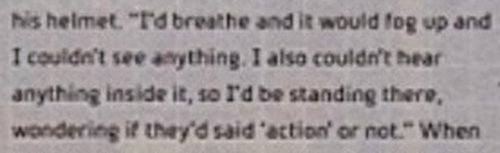

### Stat block notes (game mechanics, not feats)

- Rain system: A rain system was installed in the ceiling that covered the entire platform ... Water was pumped into the rain system at a speed of seven and a half tons of water per minute, covering an area of approximately one-third of an acre. To prevent flooding of the entire stage an 18-inch dam was constructed around the set. (Chris Trevas, Star Wars Insider 97, p. 55) (Source: *Star Wars Insider #97* (2007), scan p.55)
- Kamino duel: It is on this rain-soaked platform that Obi-Wan Kenobi catches up to Jango Fett and attempts to detain him. He draws his lightsaber quickly and the bounty hunter opens fire in return. After several exchanges the two manage to disarm each other and the fight turns from a duel of weapons to an old-fashioned exchange of blows. Punches, kicks, and even a head butt make this an unusually physical encounter. (Chris Trevas, Star Wars Insider 97, p. 55) (Source: *Star Wars Insider #97* (2007), scan p.55)
- Nick Gillard fight design: Stunt coordinator and swordmaster Nick Gillard choreographed the fight after studying storyboards and animatics ... Rather than resort to complex wire harnesses or other stunt rigging, the more elaborate acrobatics and the physically impossible, such as Jango's flying, were left for ILM to execute with digital stunt doubles. (Chris Trevas, Star Wars Insider 97, p. 55) (Source: *Star Wars Insider #97* (2007), scan p.55)
- Homemade wind machines: Wind machines were scarce in Sydney, Australia so the crew ended up building their own from scratch in only four days. (Star Wars Insider 97, p. 55) (Source: *Star Wars Insider #97* (2007), scan p.55)
- Shinier lightsaber: Obi-Wan's lightsaber is a shinier version of the one he lost during his duel with Darth Maul. The props thrown around in this fight were lightweight chromed castings of the original metal prop used in The Phantom Menace. (Star Wars Insider 97, p. 55) (Source: *Star Wars Insider #97* (2007), scan p.55)

## scan p.56 (scan page 56)

Page contents: Set Piece cont.: boxes Jango Fett, Art, Slave I, Set Design, Stunts (hand-read)

### Stat block notes (game mechanics, not feats)

- Armor nearly white: Initially, Jango Fett's armor was going to be white as a visual reminder that he is the forefather of the Imperial stormtroopers. When Lucas saw the armor in development, cast in fiberglass and combined with aluminum powder, he decided to leave it the bare metal color. (Star Wars Insider 97, p. 56) (Source: *Star Wars Insider #97* (2007), scan p.56)
- Inherited jetpack: Jango's jetpack is the exact same design and color scheme as the one worn by his son Boba in Return of the Jedi. Since the pack flies off and explodes during this fight Boba must inherit his father's spare. (Star Wars Insider 97, p. 56) (Source: *Star Wars Insider #97* (2007), scan p.56)
- Slave I green ramp: Slave I was represented by a simple green ramp on stage. It was there for Boba and Jango to walk up. It was ultimately replaced by a completely computer generated model ship. The only portion physically built at full-size was the cockpit interior located on a separate soundstage. (Star Wars Insider 97, p. 56) (Source: *Star Wars Insider #97* (2007), scan p.56)
- Former fairground stage: Stage 1 was chosen for the Kamino set because the soundstage was sloped for easy drainage. It had originally been built to accommodate livestock (the site was once a fairground) and would typically be hosed down after each animal judging. (Star Wars Insider 97, p. 56) (Source: *Star Wars Insider #97* (2007), scan p.56)
- Digital double: Lucas pushed the limits of digital stunt doubles in Attack of the Clones. He wanted to be able to show them from as close as the knees up ... This shot of Obi-Wan is a digital double of Ewan McGregor. (Star Wars Insider 97, p. 56) (Source: *Star Wars Insider #97* (2007), scan p.56)

## scan p.57 (scan page 57)

Page contents: Padawan's Corner: "How to Draw: Max Rebo," words & artwork by Cynthia Cummens; Steps 1–3 (hand-read)

### Stat block notes (game mechanics, not feats)

- Max Rebo intro: Nowhere in the Star Wars galaxy do we see a more outrageous group of intergalactic dancers, singers, and musicians than we do at the infamous palace of Jabba the Hutt. The most memorable of this talented gang of musical misfits may be the blue-skinned keyboard player Max Rebo. (Cynthia Cummens, Star Wars Insider 97, p. 57) (Source: *Star Wars Insider #97* (2007), scan p.57)

## scan p.58 (scan page 58)

Page contents: Padawan's Corner cont.: Steps 4–6 (finished color drawing); box with contact and www.starwars.com/kids, cynthiacummensart.com (hand-read)

## scan p.59 (scan page 59)

Page contents: Bantha Tracks Vol. 28 "By the Fans, for the Fans": "Bantha Tracks Celebrates 30 Years of Star Wars Inspiration" (fan art of Boba Fett and C-3PO; submission guidelines box) — fan names omitted (hand-read)

## scan p.60 (scan page 60)

Page contents: Bantha Tracks cont.: fan artwork (Leia/Luke/Han montage, Vader & Sidious, Anakin, Chewbacca, X-wing replica, stormtrooper heart, Boba Fett) and a fan costuming-group pull quote — fan names omitted (hand-read)

## scan p.61 (scan page 61)

Page contents: Bantha Tracks cont.: fan photos and a teacher's first-viewing reminiscence (costumes, library event, 501st troopers) — fan names omitted (hand-read)

## scan p.62 (scan page 62)

Page contents: Bantha Tracks Editorial: "30 Years Under the Influence," Mary Franklin, Editor, Bantha Tracks; "The Way We Were" childhood-photo box (subject name omitted) (hand-read)

## scan p.63 (scan page 63)

Page contents: Indiana Jones: Indy Vault #5 "Finding the Lost Ark — Figuring Out Solar Alignment!", words J.W. Rinzler; Dave Negron storyboards (Raiders of the Lost Ark map room) (hand-read)

### Stat block notes (game mechanics, not feats)

- Solar alignment problem: During the original story conference in late January 1978, George Lucas, Steven Spielberg, and screenwriter Lawrence Kasdan spent a good deal of time trying to figure out how this would and could make sense. ... The other problems were jettisoned in favor of adventure-movie logic, which doesn't always require a high level of astro-physical accuracy. (J.W. Rinzler, Star Wars Insider 97, p. 63) (Source: *Star Wars Insider #97* (2007), scan p.63)
- Nazi flag rope: The idea of a Nazi flag being part of Indy's escape rope was dreamed up by Spielberg during the story conference. In earlier drafts it was Sallah's son, not Sallah, who helped Mr. Jones during this sequence. (J.W. Rinzler, Star Wars Insider 97, p. 63) (Source: *Star Wars Insider #97* (2007), scan p.63)

## scan p.64 (scan page 64)

Page contents: Indy Vault cont.: full spread of Dave Negron map-room storyboard panels (hand-read)

## scan p.65 (scan page 65)

Page contents: Comlink, The Star Wars Insider Mailbag: "Around the World in 80 Parsecs" (Vader boat, lightsabers theory, Empire Strikes Back set-visit memory); contact box (US/UK addresses) — letter-writer names omitted (hand-read)

## scan p.66 (scan page 66)

Page contents: Comlink cont. (Meeting the Troops, Star Wars Fans Go to the Top of the Class, Spotted at the Smithsonian) and "Bounty Hunters" celebrity-photo section sponsored by Kotobukiya (Mark Hamill at Celebration Europe; Matthew Wood at DragonCon 2006) — letter-writer names omitted (hand-read)

### Stat block notes (game mechanics, not feats)

- Matthew Wood at DragonCon: I was posing on Jabba the Hutt at DragonCon 2006 in Atlanta, when Matthew Wood, aka the voice of the fragile-chested General Grievous, walked over and asked to have his photo taken with me! (reader letter, Star Wars Insider 97, p. 66) (Source: *Star Wars Insider #97* (2007), scan p.66)

## scan p.67 (scan page 67)

Page contents: Next Issue: "Star Wars: The Celebration Concludes" (final 30th anniversary issue): Roger Christian, Ben Burtt, Star Tours at 20; on sale US Dec 4, UK Dec 6 (hand-read)

- **none** — entry/section: Proudest achievement: ""The Millennium Falcon cockpit is my proudest achievement!" —Roger Christian, Star Wars Insider 97, p. 67" Source: *Star Wars Insider #97* (2007), scan p.67
  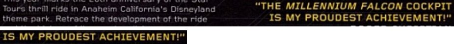

### Stat block notes (game mechanics, not feats)

- Ben Burtt sounds: It's impossible to watch the Star Wars movies without appreciating the amazing sounds. From the mechanical breathing of Darth Vader to the grunts and growls of Chewbacca and the chirpy beeps of R2-D2, it's all music to the ears of Ben Burtt. (Star Wars Insider 97, p. 67) (Source: *Star Wars Insider #97* (2007), scan p.67)

## scan p.68 (scan page 68)

Page contents: Ad: Official Pix licensed autographs and photographs (Star Wars, Indiana Jones); coupon code offer expires 12/31/2007 (hand-read)

## scan p.69 (scan page 69)

Page contents: Back cover ad: Star Wars Miniatures "The Force Unleashed" set — Vader's Apprentice, Maris Brood, Rahm Kota, Juno Eclipse; 15 new characters; release Nov. 16, 2007 (hand-read)

### Stat block notes (game mechanics, not feats)

- TFU miniatures: Vader's Apprentice. Maris Brood. Rahm Kota. Juno Eclipse. These are just 4 of the 15 new characters in the latest Star Wars Miniatures set, The Force Unleashed. (Star Wars Insider 97, p. 69) (Source: *Star Wars Insider #97* (2007), scan p.69)
