# Owner Material 038 — Star Wars Insider #1–153 plus specials (with The Lucasfilm Fan Club Magazine #1–22): Star Wars Insider #98 (2008)

- **Source:** *Star Wars Insider* magazine (issues 23–153, 1994–2014) and its predecessor *The Lucasfilm Fan Club Magazine* (issues 1–22, 1987–1994), plus seven special editions: articles, interviews, comics and short fiction Secondary source (licensed Legends reference). Scan OCR'd on the box; the scan stays box-only and is **not** published.
- **Method:** every scanned page was OCR'd and machine-screened sentence by sentence for power-relevant statements (fights, kills, defeats, Force feats, rankings, superweapons) that name a character on our roster; each kept sentence is quoted verbatim from the OCR text and has a crop of the printed passage directly under it. Pages with nothing power-relevant are still listed with what is on them.
- **Citation:** "*Star Wars Insider #98* (2008), p.X" by printed page ("scan p.X" where no printed number applies). **Weight:** Licensed magazine: a secondary source. Its short fiction and comics are Legends stories; its articles and interviews sum up or discuss lore and rank below the novels, comics and games they describe.

## scan p.1 (scan page 1)

Page contents: Cover: Star Wars Insider #98 January/February 2008, "The Galaxy's Greatest Heroes! Luke, Leia, Han, and Chewbacca Celebrate 30 Years!"; top boxes: Fabric Fantastic (John Mollo on Star Wars' style), Hear the Force (Ben Burtt talks space sounds), Roger Christian (building creatures and cockpits); "Plus: Meet the man who sold Star Wars!" (hand-read)

## scan p.2 (scan page 2)

Page contents: Ad: Kotobukiya Royal Guard ARTFX statue, "Available now! Direct from Japan"; approx. 12 inches tall (hand-read)

## scan p.3 (scan page 3)

Page contents: Editor's Welcome: "Remember, the Force will be with you... always.", Brian J. Robb, Editor; errata (501st photo credit); contact/masthead (hand-read)

- **none** — entry/section: Five more movies: ""Apparently there are another five movies to explore and a whole Expanded Universe beyond, too!" —Brian J. Robb, Star Wars Insider 98, p. 3" Source: *Star Wars Insider #98* (2008), scan p.3
  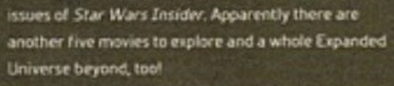

### Stat block notes (game mechanics, not feats)

- Galaxy's Greatest Heroes: Our cover proclaims that "The Galaxy's Greatest Heroes" feature inside the magazine. While this may apply to our cover stars—Luke, Leia, Han, and Chewie—it equally applies to those "heroes" who worked on the original Star Wars that we've interviewed this issue. (Brian J. Robb, Star Wars Insider 98, p. 3) (Source: *Star Wars Insider #98* (2008), scan p.3)

## scan p.4 (scan page 4)

Page contents: Ad: Collectible Grading Authority (AFA), "The Ordinary Becomes Extraordinary at CGA and You Own It" (hand-read)

## scan p.5 (scan page 5)

Page contents: Com-Scan: "Work Begins on Live Action TV Project! Lucas starts on second Star Wars TV series"; "Star Wars Characters Dominate Film Favorites" (Total Film poll) with Top 20 box (hand-read)

### Stat block notes (game mechanics, not feats)

- Film favorites poll: Star Wars' Darth Vader was knocked into second place by Johnny Depp's Captain Jack Sparrow from the recent Pirates of the Caribbean trilogy. Not bad for a 30-year-old character! ... The other Star Wars characters came in ninth and 15th respectively for Han Solo and Yoda. (Star Wars Insider 98, p. 5) (Source: *Star Wars Insider #98* (2008), scan p.5)

## scan p.6 (scan page 6)

Page contents: Com-Scan: "Luke's Lightsaber Takes Flight! Jedi prop goes where no Star Wars prop has gone before...." (STS-120, Space Center Houston) (hand-read)

- **Luke Skywalker** — entry/section: Six million miles: ""The Jedi lightsaber will have traveled more than six million miles in space after this mission. We'll have the honor of displaying this [historic] movie artifact once it returns." —Roger Bornstein, Marketing Director for Space Center Houston, Star Wars Insider 98, p. 6" Source: *Star Wars Insider #98* (2008), scan p.6
  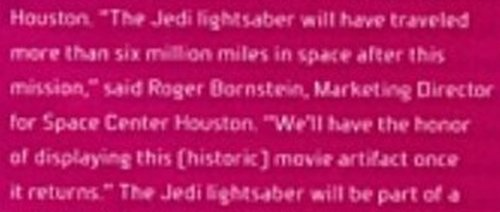

### Stat block notes (game mechanics, not feats)

- Lightsaber launched: Luke Skywalker's lightsaber from Return of the Jedi blasted into space for a real-life adventure on October 23, launched from NASA's Kennedy Space Center aboard space shuttle Discovery. ... flew into space with the seven STS-120 astronauts to the International Space Station. The shuttle returned to Earth 14 days later. (Star Wars Insider 98, p. 6) (Source: *Star Wars Insider #98* (2008), scan p.6)
- R2-D2 delivers saber: R2-D2 delivers the prop lightsaber (right: packaged for a space flight) to astronaut James F. Reilly II, who has flown three shuttle missions and logged 853 hours in space, including eight spacewalks. (caption, Star Wars Insider 98, p. 6) (Source: *Star Wars Insider #98* (2008), scan p.6)

## scan p.7 (scan page 7)

Page contents: Ad: Transformers Darth Vader Death Star, "The new Superweapon from the Empire." (hand-read)

### Stat block notes (game mechanics, not feats)

- Vader Death Star transformer: The two most powerful and destructive forces in the galaxy, Darth Vader and the Death Star, have been combined to create the ultimate superweapon. Incredible TRANSFORMERS technology lets you change the planet-annihilating Death Star into the towering Darth Vader mech, complete with light-up firing super "laser" and menacing phrases. (ad, Star Wars Insider 98, p. 7) (Source: *Star Wars Insider #98* (2008), scan p.7)

## scan p.8 (scan page 8)

Page contents: Best of StarWars.com: "Old-School Star Wars — Uncovering the uses that Star Wars was put in an attempt to be educational in the late 1970s," words Pete Vilmur (Pendulum Press kit; Random House "Attack on Reading" workbooks) (hand-read)

### Stat block notes (game mechanics, not feats)

- Pendulum Press kit: Pendulum Press started things off in 1978 with the release of an obscure educational kit that's been all but forgotten by old-school Star Wars fans ... The multi-media kit, which featured 80 slides cued to a taped soundtrack of dialog, sound effects, and music, included a read-along comic book for students and a series of purple mimeograph masters from which teachers could produce several worksheets. (Pete Vilmur, Star Wars Insider 98, p. 8) (Source: *Star Wars Insider #98* (2008), scan p.8)
- Attack on Reading workbooks: Publisher Random House's School Division also took advantage of the late 1970s' space craze with a set of four "Attack on Reading" workbooks, each containing 96 pages of Star Wars-inspired exercises to help kids with their reading skills. ... all sported colorful covers by classic Star Wars artists John Berkey and Tom Chantrell (Pete Vilmur, Star Wars Insider 98, p. 8) (Source: *Star Wars Insider #98* (2008), scan p.8)

## scan p.9 (scan page 9)

Page contents: Best of StarWars.com cont.: "Attack on Reading" covers (Comprehension 2, Word Study, Study Skills); dialog-bubble examples; Hardware Wars 16mm; box "Why not write to Star Wars Insider ... Best of starwars.com?" (hand-read)

- **Luke Skywalker; Han Solo; Chewbacca; Leia Organa Solo** — entry/section: Flee not flea: ""Han, Chewie, Princess Leia, and I had to flee from Death Star — not "flea". To flee means to escape. A flea is an annoying little bug. Flee and flea are homophones." —Luke Skywalker (workbook dialog bubble), Star Wars Insider 98, p. 9" Source: *Star Wars Insider #98* (2008), scan p.9
  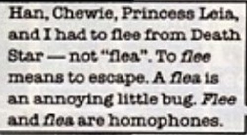

### Stat block notes (game mechanics, not feats)

- Hardware Wars in class: Finally, for students who had completed all their daily assignments, a special 16mm screening of Hardware Wars might be rewarded by teachers hip to late 1970s' pop culture. ... arrived in classrooms with a set of five questions attached in what was likely a ploy to establish the 13-minute short as an "educational tool." (Pete Vilmur, Star Wars Insider 98, p. 9) (Source: *Star Wars Insider #98* (2008), scan p.9)

## scan p.10 (scan page 10)

Page contents: Ad: Brian's Toys (figures, Master Replicas lightsabers and helmets, Gentle Giant) (hand-read)

## scan p.11 (scan page 11)

Page contents: Ad: Brian's Toys cont. (vintage carded, 30th Anniversary carded, Free Holiday Yoda offer, Sideshow, Kotobukiya, "We Are Buying Toys!!!") (hand-read)

## scan p.12 (scan page 12)

Page contents: Feature opener: "Galaxy Builder" — Roger Christian interview, words Jonathan Wilkins (hand-read)

### Stat block notes (game mechanics, not feats)

- Galaxy Builder intro: A filmmaker in his own right, Roger Christian has been an active presence in that galaxy far, far away for over 30 years. Given the task of helping to create environments that made sets look real and other-worldly, but at the same time a bit familiar, Christian rose to the challenge, and his creations became a vital part of the Star Wars saga. (Jonathan Wilkins, Star Wars Insider 98, p. 12) (Source: *Star Wars Insider #98* (2008), scan p.12)

## scan p.13 (scan page 13)

Page contents: Galaxy Builder cont.: intro box (Christian's career); caption "Oh no, we've given away how the landspeeder worked!" (hand-read)

### Stat block notes (game mechanics, not feats)

- Christian's Oscars: Originally recruited by George Lucas alongside Production Designer John Barry (they were both working on Lucky Lady, then expected to be the big hit film of 1977), set decorator Roger Christian found himself working on a low budget space fantasy trying to figure out what George Lucas' universe actually looked like. Christian succeeded so well that he won his first Oscar for his work on the original Star Wars, along with Barry and Norman Reynolds. (Jonathan Wilkins, Star Wars Insider 98, p. 13) (Source: *Star Wars Insider #98* (2008), scan p.13)
- Christian's later career: Christian's second Oscar followed two years later for set decoration on Ridley Scott's Alien. His first directorial credit came on a short film, The Black Angel, backed by his mentor, George Lucas, and shown in the U.K. along with The Empire Strikes Back. Besides doing some uncredited work on Return of the Jedi and becoming second unit director on Star Wars: Episode I The Phantom Menace, Christian pursued his own directorial career (Jonathan Wilkins, Star Wars Insider 98, p. 13) (Source: *Star Wars Insider #98* (2008), scan p.13)

## scan p.14 (scan page 14)

Page contents: Galaxy Builder interview cont.; captions (lightsaber "a weapon for a more civilized age" discovered in a photographer's shop; Dinner with the Lars family; Millennium Falcon cockpit, one of Christian's proudest moments); box "On Artoo's Different Shade...." (hand-read)

## scan p.15 (scan page 15)

Page contents: Galaxy Builder interview cont.; boxes "On Aunt Beru's Famous Blue Milk...." and "On Luke's Binoculars" (hand-read)

## scan p.16 (scan page 16)

Page contents: Galaxy Builder interview cont. (Alien, Academy Award, second unit on The Phantom Menace, Tunisia); caption "Christian on set with George Lucas on The Phantom Menace"; box "On Causing Creature Chaos...."; pull quote (hand-read)

## scan p.17 (scan page 17)

Page contents: Galaxy Builder interview cont.; sidebar "Giles Instone: Rebel Transporter"; box "On Chewie's Chance Cubes...." (hand-read)

### Stat block notes (game mechanics, not feats)

- Trip to Tunisia: The actual trip involved driving four days and taking a ferry from Dover to Calais. Once in Tunis, we had to wait two days for customs clearance and then it was another 12 hours to get to the location. (Giles Instone, Star Wars Insider 98, p. 17) (Source: *Star Wars Insider #98* (2008), scan p.17)

## scan p.18 (scan page 18)

Page contents: Feature opener: "Ben Burtt! Can You Hear the Force?" (cartoon art: X-wing pilot "Whummmm", Chewbacca "Wyaaaaa!") (hand-read)

## scan p.19 (scan page 19)

Page contents: "Can You Hear the Force?" Ben Burtt interview, words Patrick Jankiewicz, art JAKe; sections intro, "Droid Voices" (cartoon sound effects "Akeeeata!", "Pew Pew Peewww!") (hand-read)

- **Luke Skywalker** — entry/section: Landspeeder sound: ""What kind of sound should a landspeeder make? The movies never reveal what the propulsion system of a landspeeder is, but there is definite thrust from an engine. It isn't jet-propelled—they didn't make a roar like a rocket. The sounds were based more on hissing-sounding engines, like an airplane, not a continuous blast of flame and fire." —Ben Burtt, Star Wars Insider 98, p. 19" Source: *Star Wars Insider #98* (2008), scan p.19
  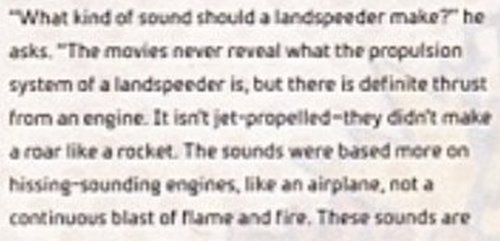
- **R2-D2** — entry/section: Voice of R2-D2: ""I'm proud to be the voice of R2-D2. Voices were very hard, especially on that first film. R2-D2's voice was the hardest one of all. There was no precedent before for a robot character who could really communicate through a movie without ever speaking English—or even using words! He communicates emotions just by making sounds." —Ben Burtt, Star Wars Insider 98, p. 19" Source: *Star Wars Insider #98* (2008), scan p.19
  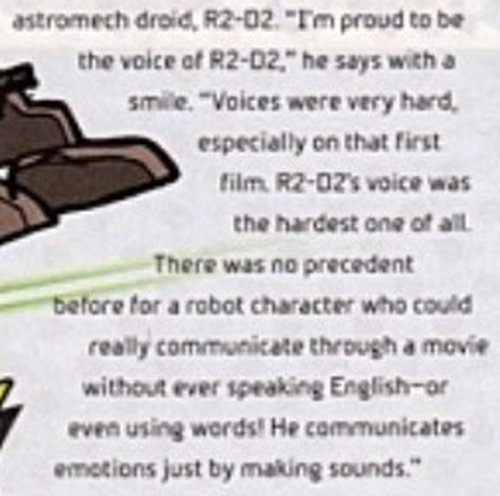
- **R2-D2; Obi-Wan Kenobi** — entry/section: Baby talk: ""I spent a year working on his voice. I wanted him to be perfect, because I knew R2-D2 had to act with Alec Guinness! That's a lot of pressure. ... Eventually I came upon the idea that I could combine a human voice—which would give him the emotion—with a synthesizer. He's essentially me talking 'baby talk' which I combined with a synthesizer keyboard." —Ben Burtt, Star Wars Insider 98, p. 19" Source: *Star Wars Insider #98* (2008), scan p.19
  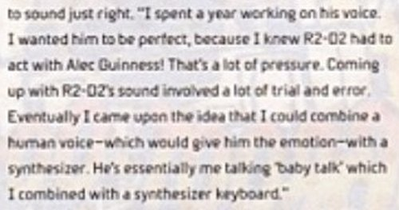
- **R2-D2; C-3PO** — entry/section: Big risk: ""The big question was, would people understand a movie where the opening dialogue was between two robots arguing, during a battle, and neither of them with a [moving] mouth? One beeping, the other with a British accent, as explosions erupt all around them? Would audiences buy it? It was a big risk, but it did work, and R2-D2 became an accepted character voice." —Ben Burtt, Star Wars Insider 98, p. 19" Source: *Star Wars Insider #98* (2008), scan p.19
  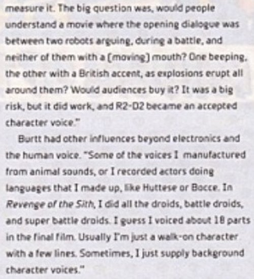

### Stat block notes (game mechanics, not feats)

- Sounds intro: It's impossible to watch the Star Wars movies without appreciating the amazing sounds that help bring each of the characters to life. From the roar of the TIE fighters to the grunts and growls of Chewbacca and the chirpy beeps of R2-D2, the Star Wars galaxy is instantly identifiable by any one of the unique noises made by its colorful characters. (Patrick Jankiewicz, Star Wars Insider 98, p. 19) (Source: *Star Wars Insider #98* (2008), scan p.19)

## scan p.20 (scan page 20)

Page contents: Ben Burtt interview cont.: "Projecting Sounds"; childhood and USC; Death Race 2000; box "Raiders of the Sound Archive!" (cartoon effects "Erraaahh-Hwwwww!", "Broot-Oot Voop Oo-Eet Vorp Beep!") (hand-read)

- **none** — entry/section: Lightsaber hum: ""The sound of the lightsaber came from an old 35mm film projector. I was a projectionist at USC and in the projection booth there was a big, old arc light movie projector. It had a motor that, when the projector was just idling, made a wonderful, musical hum that had an enchanting quality. ... I accidentally recorded an old TV set with a bad insulator when my microphone picked up the hum. Mixing the two sounds together made the sound of the lightsaber!" —Ben Burtt, Star Wars Insider 98, p. 20" Source: *Star Wars Insider #98* (2008), scan p.20
  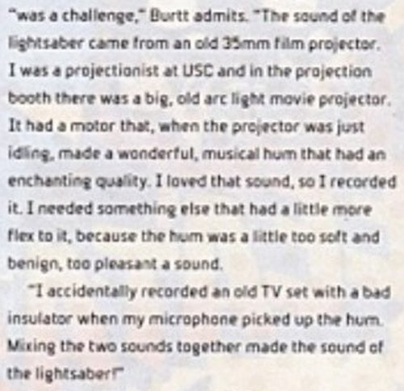
- **none** — entry/section: Wedding-ring blaster: ""The blaster sound is mostly the twang of a guide wire on a radio tower. I would hit the wire with my wedding ring. I'm not sure how my wife feels about that, but I hit the wire with different pieces of metal and only my wedding ring made the right sound! That's the sound we used in all six movies." —Ben Burtt, Star Wars Insider 98, p. 20" Source: *Star Wars Insider #98* (2008), scan p.20
  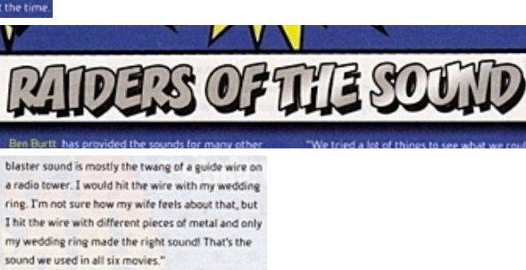
- **none** — entry/section: Tape recorder origin: ""When I was six, I had a serious illness and was confined to my bed for weeks. My father, a university professor, brought home a tape recorder. This was in the 1950s so a tape recorder was the future then." —Ben Burtt, Star Wars Insider 98, p. 20" Source: *Star Wars Insider #98* (2008), scan p.20
  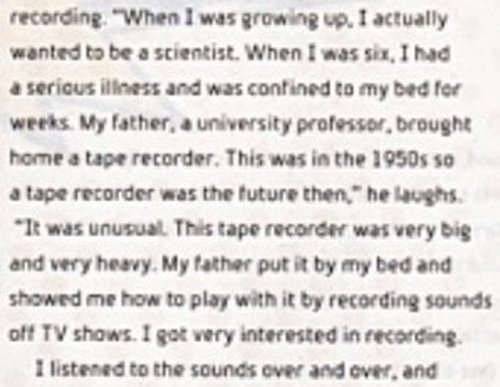

## scan p.21 (scan page 21)

Page contents: Ben Burtt interview cont.: "Ben Audio Dynamite"; pull quote (7,000 sound effects); cartoon effects ("Pheshhww! Phewssh!", "Zoom-Kesh Whumm-Kesh", "Peosch!", "Whuummmm!") (hand-read)

- **none** — entry/section: Hired to be trained: ""I was hired to work on the very first Star Wars movie because George was looking for someone who was young and interested in sound so he could train them." —Ben Burtt, Star Wars Insider 98, p. 21" Source: *Star Wars Insider #98* (2008), scan p.21
  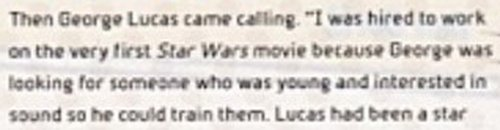
- **none** — entry/section: 30-year tour of duty: ""He wanted someone who could work in sound, recording, editing, and mixing, which are normally different divisions of labor, but shouldn't be. I was recommended for the job and went right to work on what ended up being a 30-year tour of duty, on and off, with Lucasfilm." —Ben Burtt, Star Wars Insider 98, p. 21" Source: *Star Wars Insider #98* (2008), scan p.21
  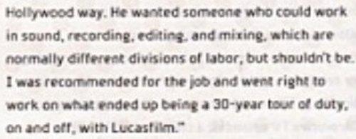
- **R2-D2; C-3PO; Luke Skywalker** — entry/section: Presenting to myself: ""It was announced prior to the ceremony, so all I had to do was show up! I was in good company, with Mark Hamill, R2-D2, and C-3PO as my presenters. I did Artoo's voice, so I was really presenting it to myself!" —Ben Burtt, Star Wars Insider 98, p. 21" Source: *Star Wars Insider #98* (2008), scan p.21
  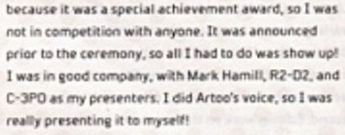

## scan p.22 (scan page 22)

Page contents: Ben Burtt interview cont.; pull quotes (R2-D2/Alec Guinness; lightsaber projector); box "E.T. Phones Home!"; next issue note (Vader's breathing, Wilhelm Scream) (hand-read)

- **none** — entry/section: Telephone pole: ""Two years before I won, I was outside, halfway up a telephone pole, trying to watch famous people walk down the red carpet, never imagining I would be among them in the near future!" —Ben Burtt, Star Wars Insider 98, p. 22" Source: *Star Wars Insider #98* (2008), scan p.22
  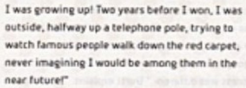
- **none** — entry/section: Eager to direct: ""I have been trained in writing, directing, editing, sound, miniatures, visual effects, and I am eager to bring all that together as a director." —Ben Burtt, Star Wars Insider 98, p. 22" Source: *Star Wars Insider #98* (2008), scan p.22
  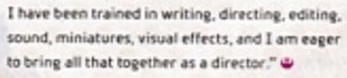
- **Leia Organa Solo** — entry/section: E.T. and Boushh voice: ""Pat Welsh ended up doing all of the classic E.T. lines, like 'E.T. phone home,' 'Elliot' and that sort of stuff. She was also the voice of Boussh in Return of the Jedi." —Ben Burtt, Star Wars Insider 98, p. 22" Source: *Star Wars Insider #98* (2008), scan p.22
  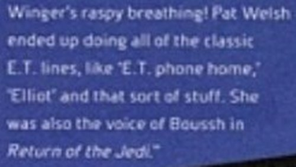

## scan p.23 (scan page 23)

Page contents: Ad: Acme Archives / Lucasfilm Fine Art, "Introducing... artist Christian Waggoner & 'Vader'" (giclée editions); also Family Guy Blue Harvest limited editions (hand-read)

### Stat block notes (game mechanics, not feats)

- Waggoner Vader: "Vader" is an exploration of light and reflection which captures this unforgettable moment in the classic film from an entirely new perspective. (ad, Star Wars Insider 98, p. 23) (Source: *Star Wars Insider #98* (2008), scan p.23)

## scan p.24 (scan page 24)

Page contents: Feature: Charles Lippincott, "the man who sold Star Wars" (Howard Chaykin poster art background; captions: Mann's Theater, Marvel Star Wars #1, Fox's "26 in '76" publicity campaign) (hand-read)

- **none** — entry/section: Two things for Fox: ""There were two things I did: one was to put together the visual package to sell the film to the Board of Directors at 20th Century Fox in December 1975, and the second one had to do with the rights for the novelization." —Charles Lippincott, Star Wars Insider 98, p. 24" Source: *Star Wars Insider #98* (2008), scan p.24
  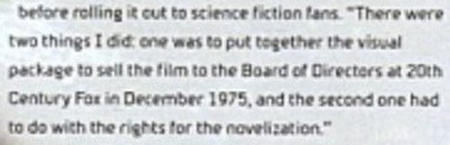

### Stat block notes (game mechanics, not feats)

- Lippincott pioneered: Charles Lippincott, Lucasfilm's first head of marketing "really pioneered what has now become commonplace—starting the buzz with the audience that counts, the true fans," according to Steve Sansweet in The Star Wars Vault. "That's how this little movie, which Fox wasn't sure how to market and theater owners thought so little of that only 32 of them booked it, caught fire." (Star Wars Insider 98, p. 24) (Source: *Star Wars Insider #98* (2008), scan p.24)

## scan p.25 (scan page 25)

Page contents: "The Man Who Sold Star Wars" — Charles Lippincott was Lucasfilm's first marketing chief, words Brian J. Robb; captions: Fox internal newsletter "Focus On Fox" from 1977; photo of George Lucas, Howard Kazanjian, Carol Kazanjian and Charles Lippincott at USC in December 1977 (hand-read)

- **none** — entry/section: Star Trek fans: ""I also based it on what had happened with Star Trek, where the fans were the first ones to merchandise the TV show themselves, showing there was a market for that kind of thing." —Charles Lippincott, Star Wars Insider 98, p. 25" Source: *Star Wars Insider #98* (2008), scan p.25
  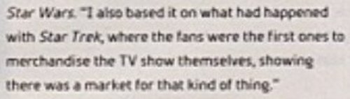
- **none** — entry/section: Comic-Con 1976: ""We went to Comic-Con with our presentation and a Howard Chaykin poster, which we sold for $1.75 a piece. No-one had done a film presentation at San Diego before. It was a real breakthrough and generated a lot of interest. ... I wanted licenses to go to the best companies that fans liked, rather than just to the highest bidders." —Charles Lippincott, Star Wars Insider 98, p. 25" Source: *Star Wars Insider #98* (2008), scan p.25
  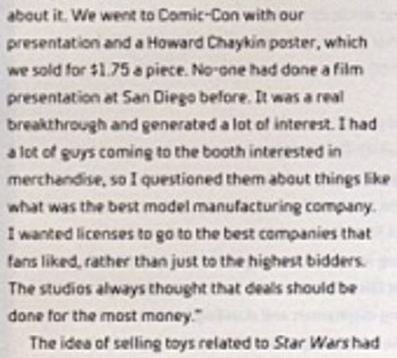
- **none** — entry/section: Can we sell toys?: ""George Lucas and I had a conversation, about six months before [the film started], right after I read the script. He was thinking 'Can we sell toys?' I thought 'Yeah!'" —Charles Lippincott, Star Wars Insider 98, p. 25" Source: *Star Wars Insider #98* (2008), scan p.25
  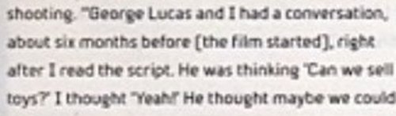
- **none** — entry/section: Novel sold out: ""The book deal was set so the novel was out at the end of 1976. Normally there'd be 100,000 books printed, but they did 250,000 and still got the surprise of their life ... They all got shipped out by February, and there were none left." —Charles Lippincott, Star Wars Insider 98, p. 25" Source: *Star Wars Insider #98* (2008), scan p.25
  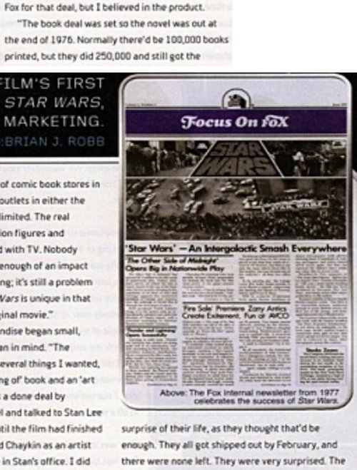
- **none** — entry/section: Opening day on Broadway: ""Opening day of the film, I went to the main theatre on Broadway in New York. The people coming out of the first screening were acting out lightsaber battles on the street! It was overwhelming, watching that. ... We got a cover strap on Time magazine declaring Star Wars to be 'Movie of the year.'" —Charles Lippincott, Star Wars Insider 98, p. 25" Source: *Star Wars Insider #98* (2008), scan p.25
  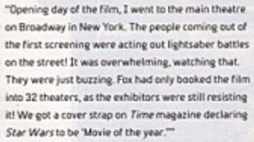
- **none** — entry/section: Tough campaign: ""Star Wars was a tough campaign. A lot of the other films I worked on were a lot simpler!" —Charles Lippincott, Star Wars Insider 98, p. 25" Source: *Star Wars Insider #98* (2008), scan p.25
  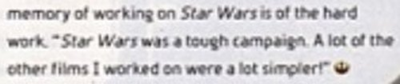

## scan p.26 (scan page 26)

Page contents: "The Other R2-D2!" — Mick Garris (Lippincott's assistant, later Stephen King's filmmaker of choice) interview, words Abbie Bernstein; captions: Gary Kurtz, George Lucas; Lippincott, Kurtz and Mark Hamill answer fan questions; slide show reveals Princess Leia at 1976's San Diego Comic-Con; Lippincott at a film fan convention; crowds at theaters May 1977; photos courtesy The Star Wars Vault (hand-read)

- **R2-D2** — entry/section: Coolest thing: ""I know, it's funny that nobody knows about that! It's one of the coolest things that I ever did!" —Mick Garris, Star Wars Insider 98, p. 26" Source: *Star Wars Insider #98* (2008), scan p.26
  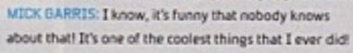
- **Han Solo** — entry/section: Um, Harrison Ford: ""One day a guy comes in, very shy, wearing glasses: 'Is Charlie Lippincott here?' 'Yeah, who should I say is calling?' 'Um, Harrison Ford.' I didn't recognize him. He's one of those movie stars where it's either on or off. When he's 'off,' you don't see Han Solo." —Mick Garris, Star Wars Insider 98, p. 26" Source: *Star Wars Insider #98* (2008), scan p.26
  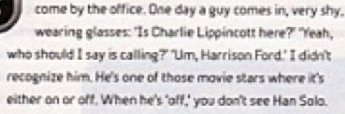
- **R2-D2** — entry/section: Battery charger: ""They needed someone to be R2-D2's manager, so they trained me how to work him. I took him to the [cinema] theater owners' convention in Las Vegas and operated him while he walked up to the stage, never knowing the battery charger wasn't working [laughs] until [does voice of slowing-down droid] Artoo started... to... die. We finally discovered there was a short in the unit." —Mick Garris, Star Wars Insider 98, p. 26" Source: *Star Wars Insider #98* (2008), scan p.26
  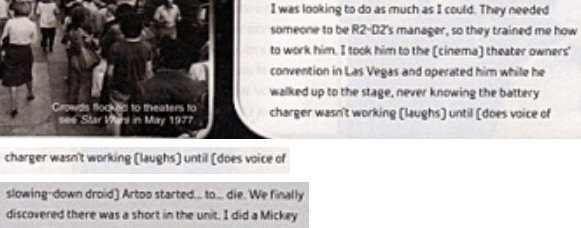
- **R2-D2** — entry/section: R2 controls: ""Very much like today's remote control. It was a little hand-held rectangle, probably about nine-inches wide, that had a collapsing TV antenna sticking out, and then two little joysticks, one for each thumb, and another switch. The switch would activate a little tape recorder inside that would do all the voices. Kenny Baker and I share that [laughs]." —Mick Garris, Star Wars Insider 98, p. 26" Source: *Star Wars Insider #98* (2008), scan p.26
  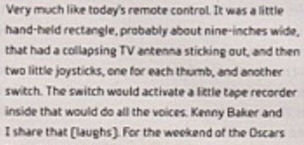
- **Chewbacca; R2-D2** — entry/section: Wolfman character: ""I saw this 'wolfman' character—I didn't know what a Wookiee was! I thought, "Gee, there's never been anything like this. This looks like my kind of movie!" A few months later, I'm working with R2-D2! It changed my life—an unbelievable education, and my entry into genre films, surrounded by stuff I loved." —Mick Garris, Star Wars Insider 98, p. 26" Source: *Star Wars Insider #98* (2008), scan p.26
  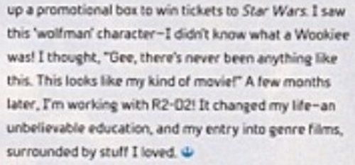

## scan p.27 (scan page 27)

Page contents: Ad: Entertainment Earth "A Trilogy of Great Exclusives!" — Elite Forces of the Republic (14 figures), Family Guy Darth Stewie character key (Blue Harvest), Holiday Special Boba Fett bobble head (Funko) (hand-read)

### Stat block notes (game mechanics, not feats)

- Holiday Special Fett: The Entertainment Earth Exclusive Holiday Special Boba Fett is modeled after the galaxy's ultimate bounty hunter as we first met him in the 1978 TV animated short. Fett's clothing and armor are brighter, more colorful, and much less battle-worn than they later appear in The Empire Strikes Back. (ad, Star Wars Insider 98, p. 27) (Source: *Star Wars Insider #98* (2008), scan p.27)

## scan p.28 (scan page 28)

Page contents: "Pirates of the Boards" (exclusive series part 6 of 6) — Joe Johnston's early storyboards (Oct-Dec 1975), words J.W. Rinzler; boards 204-221 with Edlund notations; script excerpt from Lucas' fourth draft (Jan 1, 1976); 30th anniversary logo (hand-read)

### Stat block notes (game mechanics, not feats)

- Never says it: As a result of that I learned a bit of trivia, which is that Luke Skywalker never actually says, "May the Force be with you," in the first film. But he was meant to. (J.W. Rinzler, Star Wars Insider 98, p. 28) (Source: *Star Wars Insider #98* (2008), scan p.28)
- Cut salutation: For whatever reasons, however, Luke's words were cut from the film (perhaps they exist in the film archives). It may have been just one salutation too many, as Han said it before and Obi-Wan will be saying it soon. (J.W. Rinzler, Star Wars Insider 98, p. 28) (Source: *Star Wars Insider #98* (2008), scan p.28)
- Fourth-draft script: LUKE: This is Blue Five, I have a problem here; I'll be right with you. From over the TIE pilot's shoulder... Suddenly he looks up in surprise as Biggs drops into view just ahead and races toward him, firing both guns. The TIE fighter explodes in a fiery hell. (script excerpt, Star Wars Insider 98, p. 28) (Source: *Star Wars Insider #98* (2008), scan p.28)

## scan p.29 (scan page 29)

Page contents: "The Boards" (exclusive series part 6 of 6): storyboards 219-227 (X-wings in formation, Luke CU, Blue Leader aiming); script box #2 (hand-read)

### Stat block notes (game mechanics, not feats)

- Blue Leader orders: BLUE LEADER: Blue Five, this is Blue Leader. Luke, take Blue Two and Three. Hold up here and wait for my signal to start your run. CU. Luke flying high over the Death Star surface. [board 221, shot slated for 36 frames] (script excerpt, Star Wars Insider 98, p. 29) (Source: *Star Wars Insider #98* (2008), scan p.29)
- Right trench?: BLUE LEADER: The magnetic disruption down here is unbelievable. I think my instruments are off. Is this the right trench? (script excerpt, Star Wars Insider 98, p. 29) (Source: *Star Wars Insider #98* (2008), scan p.29)

## scan p.30 (scan page 30)

Page contents: "Pirates of the Boards" cont.: storyboards 228-237 (trench run, exhaust port approach, Blue Leader POV); box #3 (hand-read)

### Stat block notes (game mechanics, not feats)

- Board 230: [board 230:] Blue Ten and Twelve blast through the wall of laser fire in the deep trench leading to the exhaust port. (Star Wars Insider 98, p. 30) (Source: *Star Wars Insider #98* (2008), scan p.30)

## scan p.31 (scan page 31)

Page contents: "Pirates of the Boards" cont.: storyboards 238-250 (Blue Leader looking up, TIEs in tight formation, Vader CU low angle, Blue Leader hit); boxes #4, #5; closing note pointing to the Making of Star Wars hardcover appendix (hand-read)

### Stat block notes (game mechanics, not feats)

- Board #4: [TIE fighters attack Blue Leader.] Vader's laser cannon flashes below the view of the front porthole. (Star Wars Insider 98, p. 31) (Source: *Star Wars Insider #98* (2008), scan p.31)
- Exploded on the surface: BLUE TEN: It's a hit, we've done it! BLUE LEADER: No, we haven't. It didn't go in. It just exploded on the surface. POV from Vader's ship as Blue Ten explodes, blowing debris toward the camera. CU. Vader as he swings his ship around for his next kill... (script excerpt, Star Wars Insider 98, p. 31) (Source: *Star Wars Insider #98* (2008), scan p.31)
- Two trench runs: To find out how Luke Skywalker and Han Solo save the day, and to see the rest of the Joe Johnston storyboards—including Luke's never-before-seen two trench runs, take a look at the appendix in the hardcover edition of The Making of Star Wars! (Star Wars Insider 98, p. 31) (Source: *Star Wars Insider #98* (2008), scan p.31)

## scan p.32 (scan page 32)

Page contents: Feature opener "Fabric of the Universe" — costume designer John Mollo, words Brian J. Robb & Jonathan Wilkins; concept sketches of Vader, TIE pilot, Rebel pilot; inset photo of Rebel pilot; 30th anniversary logo (hand-read)

### Stat block notes (game mechanics, not feats)

- Mollo bio: Costume designer John Mollo won the first of his two Academy Awards for his work on Star Wars: Episode IV A New Hope. Born in London in 1931, Mollo had followed his costume designer brother Andrew into the movies, bringing his enthusiasm for, and knowledge of, military uniforms to movies such as Tony Richardson's Charge of the Light Brigade in 1968. (Star Wars Insider 98, p. 32) (Source: *Star Wars Insider #98* (2008), scan p.32)

## scan p.33 (scan page 33)

Page contents: "Fabric of the Universe" John Mollo interview: concept sketches (Vader, Jawa, Imperial officer), inset photos of Vader and a Jawa (hand-read)

- **none** — entry/section: First costume film: ""Well, it was the first film I'd done as a costume designer. I'd worked on quite a lot of big films as a technical adviser, and as a military and historical adviser, but this was the first one where I was a proper costume designer." —John Mollo, Star Wars Insider 98, p. 33" Source: *Star Wars Insider #98* (2008), scan p.33
  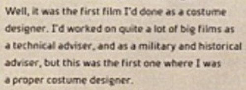
- **Han Solo** — entry/section: Nobody notices costumes: ""George wanted the good guys to look quite loose. He wanted those dust coats, which I think originally came out of Westerns. He didn't want it to look 'spacey' at all. In fact, he said he didn't want anyone to notice the costumes, which I thought was quite a good line!" —John Mollo, Star Wars Insider 98, p. 33" Source: *Star Wars Insider #98* (2008), scan p.33
  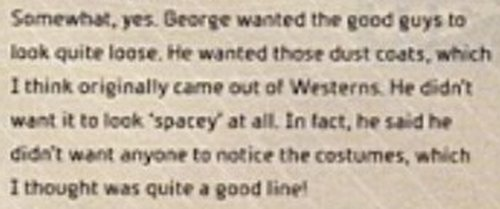

## scan p.34 (scan page 34)

Page contents: Mollo interview cont.: sketches of Imperial officers, Rebel pilot, TIE pilot; inset photos (Imperial officer, Obi-Wan in robe, TIE pilot) (hand-read)

- **none** — entry/section: Greeblies: ""There was one guy in the props department who was completely responsible for sticking bits onto things! He was the first chap who I ever heard use the term "greeblies," which is now in common usage. Greeblies came from all over the place. They came from Airfix model kits and Tiger tank kits." —John Mollo, Star Wars Insider 98, p. 34" Source: *Star Wars Insider #98* (2008), scan p.34
  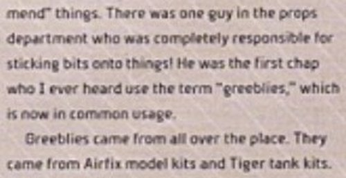
- **none** — entry/section: Chest boxes and cap badge: ""The Rebel pilots' chest boxes were made out of two plastic seed boxes glued together, with all these greeblies stuck on. The pipe that came out from it was a bath overflow pipe. I bought 50 of those from a plumber in Borehamwood ... The little Imperial cap badge came from another shop in Borehamwood. It was some sort of pulley, from the middle of a record player, with a notch out of it for some reason." —John Mollo, Star Wars Insider 98, p. 34" Source: *Star Wars Insider #98* (2008), scan p.34
  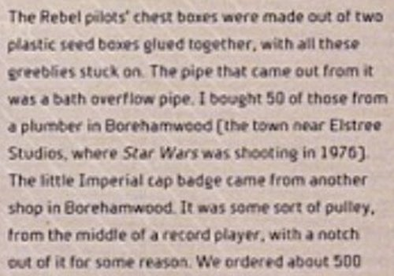
- **none** — entry/section: Rank badges: ""They were just push buttons from an electrical store on the Finchley Road! They came in blue and red. The Rebels had the round ones and the Imperials had the rectangles. ... I think the more senior they were, the more buttons they had!" —John Mollo, Star Wars Insider 98, p. 34" Source: *Star Wars Insider #98* (2008), scan p.34
  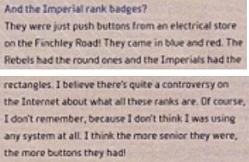
- **Leia Organa Solo** — entry/section: Silver necklace: ""She was very simple to dress in the first one. That look was really based on information we had from the U.S. The silver necklace I found in a jewellers in the Fulham Road." —John Mollo, Star Wars Insider 98, p. 34" Source: *Star Wars Insider #98* (2008), scan p.34
  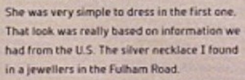

### Stat block notes (game mechanics, not feats)

- Planetary Valleys: [Editor's Note: It was made by Lapponia Jewelry of Finland, and sculpted by Björn Weckström as part of his "space silver" line. Called "The Planetary Valleys," the necklace is still being made. See Set Piece, p65] (Star Wars Insider 98, p. 34) (Source: *Star Wars Insider #98* (2008), scan p.34)

## scan p.35 (scan page 35)

Page contents: Mollo interview cont.: Han and Luke sketches, Han photo inset; sidebar "Dressing for the occasion" (homemade costumes, auction) (hand-read)

- **Luke Skywalker; Han Solo** — entry/section: Yellow ski jacket: ""Yes, I think Luke is wearing a yellow ski jacket—a stock Alpine jacket or something like that. Quite a lot of it was thrown together, but I'm sure I talked to George about that. It suggests that he's grown up a bit from the farm boy he was to a more Han Solo look." —John Mollo, Star Wars Insider 98, p. 35" Source: *Star Wars Insider #98* (2008), scan p.35
  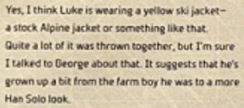
- **none** — entry/section: Racing driver overalls: ""They were racing driver overalls that we bought from stock. The Rebels got the orange ones, and the TIE fighter pilots had the same thing in black, with a variation of the stormtroopers' helmets." —John Mollo, Star Wars Insider 98, p. 35" Source: *Star Wars Insider #98* (2008), scan p.35
  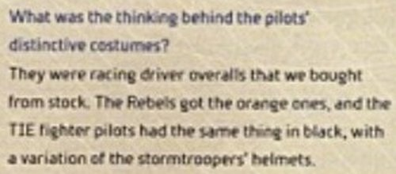
- **Chewbacca** — entry/section: Pink Angora suit: ""Chewbacca was perhaps the most complicated, because he had a one-piece, pink-knitted Angora suit, with all the hair put on by a wig maker. It was actually a complete wig-making job. I think we made two of them. It was all great fun!" —John Mollo, Star Wars Insider 98, p. 35" Source: *Star Wars Insider #98* (2008), scan p.35
  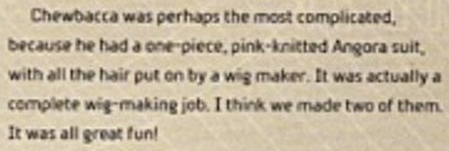
- **none** — entry/section: Car factory wardrobe: ""The stormtroopers, of course, were designed by McQuarrie, but they were wardrobe too. They were handed over to us to put together and put on people. That was quite a job. The wardrobe department was like a car factory, with pieces going past and people gluing things on." —John Mollo, Star Wars Insider 98, p. 35" Source: *Star Wars Insider #98* (2008), scan p.35
  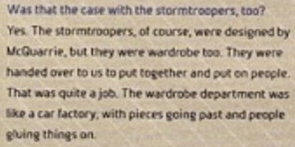
- **none** — entry/section: Riot police gear: ""Nowadays, some of those things have crept into modern day riot police gear. You see people on television looking like they came straight out of Star Wars." —John Mollo, Star Wars Insider 98, p. 35" Source: *Star Wars Insider #98* (2008), scan p.35
  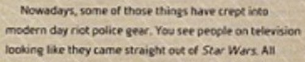
- **none** — entry/section: 501st at the pub: ""It's great! I'm amazed by what they do. I did a thing down in Brighton a couple of weeks ago and about 10 guys from the 501st Legion turned up out of the blue! Last night [at Celebration Europe] they were all outside the pub! They're great." —John Mollo, Star Wars Insider 98, p. 35" Source: *Star Wars Insider #98* (2008), scan p.35
  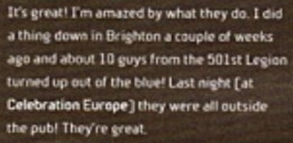

## scan p.36 (scan page 36)

Page contents: Feature opener "Star Players" — interviews Scott Chernoff & Jonathan Wilkins; Death Star, X-wings, TIE fighters montage; intro on unsung character actors (hand-read)

### Stat block notes (game mechanics, not feats)

- Unsung heroes: The unsung heroes of Star Wars are often those actors who played minor parts, unnamed characters, or even fairly major roles eventually cut from the film. Some have even enjoyed a new lease of life, Star Wars-style, thanks to the convention circuit. (Star Wars Insider 98, p. 36) (Source: *Star Wars Insider #98* (2008), scan p.36)

## scan p.37 (scan page 37)

Page contents: "Star Players": Anthony Forrest (stormtrooper confronting Obi-Wan; Fixer, cut from final film); caption: Anthony Forrest as Fixer, with Mark Hamill (hand-read)

## scan p.38 (scan page 38)

Page contents: "Star Players" cont.: Anthony Forrest (why Star Wars endured); Paul Blake (Greedo); photos of Greedo, Han in cantina, Fixer/Biggs-era Anchorhead scene (hand-read)

## scan p.39 (scan page 39)

Page contents: "Star Players" cont.: Colin Higgins (originally cast as Wedge, fired); Garrick Hagon (Biggs); photos of Greedo, Luke and Biggs, Rebel pilots in briefing room, Hagon with camera, Rebel pilot in cockpit (hand-read)

## scan p.40 (scan page 40)

Page contents: "Star Players" cont.: Garrick Hagon (why Star Wars endured); sidebar "Rebel, Rebel" — Derek Lyons (medal bearer and Massassi Temple guard); photos by Derek Lyons; throne room ceremony stills (hand-read)

### Stat block notes (game mechanics, not feats)

- Rebel, Rebel intro: Actor Derek Lyons played two parts in the original Star Wars. Not only did he get to present medals to be awarded to our heroes, but he was also a Massassi Temple Guard, standing firm to ensure the ceremony progressed without a hitch... (Star Wars Insider 98, p. 40) (Source: *Star Wars Insider #98* (2008), scan p.40)

## scan p.41 (scan page 41)

Page contents: Ad: Red 5 Collectibles USA, Las Vegas NV ("Your source for everything Star Wars"): Attakus, Kotobukiya, Hasbro Comic Packs, Gentle Giant maquettes (hand-read)

## scan p.42 (scan page 42)

Page contents: Section opener "Jawa's Corner — Packed with all the latest stuff from the Star Wars universe" (Tusken Raider photo); contents: Books 50, Comics 52, Toys 54, Star Wars Q&A 56, Scouting the Galaxy 58, International Collecting 62, Set Piece 64, Padawan's Corner 66, Bantha Tracks 69, Indy Vault 74, Comlink 76 (hand-read)

## scan p.43 (scan page 43)

Page contents: Books: "Fury Unleashed Upon the Galaxy — Aaron Allston tells the tale of a galaxy—and a family—coming apart", words Jason Fry; Allston photo; Legacy of the Force: Fury cover; sub-head "Lessons to Learn"; pull quote (Allston) (hand-read)

- **Luke Skywalker; Darth Vader (Anakin Skywalker); Palpatine (Darth Sidious); Jacen Solo (Darth Caedus)** — entry/section: Anime wreckage: ""the visual stylings of a lot of anime I've seen over the years. Gigantic, evocative wreckage on alien landscapes sometimes pops up in anime, with very striking results. Also, since Fury is all about the war, and the Legacy of the Force is to a certain extent about the parallels between the Luke/Vader/Palpatine conflicts and the Luke/Jacen conflict, having a visual reminder of that earlier conflict seemed like a natural element to include." —Aaron Allston, Star Wars Insider 98, p. 43" Source: *Star Wars Insider #98* (2008), scan p.43
  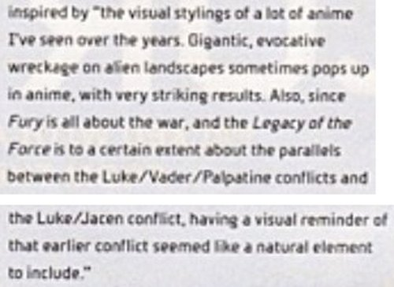
- **none** — entry/section: Cyclic events: ""Basically, it's all about demonstrating that these sorts of events and trends are cyclic in nature, but they don't recur exactly—they're different for each generation." —Aaron Allston, Star Wars Insider 98, p. 43" Source: *Star Wars Insider #98* (2008), scan p.43
  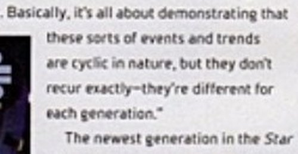

### Stat block notes (game mechanics, not feats)

- Seven books in: Jacen Solo is lost to the dark side of the Force, reinventing himself as the Sith Lord Darth Caedus. The Jedi Order, led by a grief-stricken Luke Skywalker, has broken with him and with Coruscant's government. And Jacen's parents, Han Solo and Leia Organa Solo, have accepted that they may have to see another son die to save the galaxy. (Jason Fry, Star Wars Insider 98, p. 43) (Source: *Star Wars Insider #98* (2008), scan p.43)
- Fury plot: Jacen and the fallen Twi'lek Jedi Alema Rar finally face their pursuers. Luke must confront his bottomless grief, and try to arrest the Jedi's drift. ... Jaina Solo, Zekk, and Jagged Fel must discover the secrets of the Sith Lumiya, but Alema Rar and a strange Sith craft await them. Coruscant and Corellia's war comes to a head at Centerpoint, a terrible weapon in the hands of a psychopath. (Jason Fry, Star Wars Insider 98, p. 43) (Source: *Star Wars Insider #98* (2008), scan p.43)
- Allana: The newest generation in the Star Wars saga is represented by Allana, the daughter produced by a secret liaison between Jacen and Tenel Ka, the Jedi turned Queen Mother of Hapes. (Jason Fry, Star Wars Insider 98, p. 43) (Source: *Star Wars Insider #98* (2008), scan p.43)

## scan p.44 (scan page 44)

Page contents: Books cont.: "Coming to a Conclusion" (Allston); box "Digging into the Vault — A new Star Wars volume unearths marvels from the Saga's history" (The Star Wars Vault, Stephen J. Sansweet & Peter Vilmur) (hand-read)

- **none** — entry/section: Tricky pacing task: ""for the first time I was aiming a series toward its conclusion, which meant bringing characters to the vicinity of their final emotional forms but not getting them all the way there. That is a tricky pacing task." —Aaron Allston, Star Wars Insider 98, p. 44" Source: *Star Wars Insider #98* (2008), scan p.44
  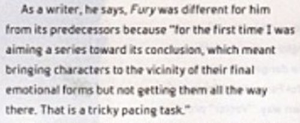
- **none** — entry/section: End of a convention: ""I got to the end and didn't want to be through ... It has some of the same qualities as staying to the very end of a fun convention and watching the staffers begin to break everything down." —Aaron Allston, Star Wars Insider 98, p. 44" Source: *Star Wars Insider #98* (2008), scan p.44
  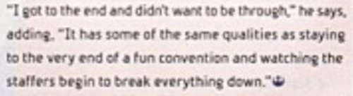
- **none** — entry/section: Holy Grail box: ""I think my supreme moment of ecstasy was sitting in a small, unoccupied office in the Chairman's suite and being presented with a cardboard box that truly contained the Holy Grail—or Grails—because it was filled with George's handwritten treatments and full scripts for the entire saga." —Stephen J. Sansweet, Star Wars Insider 98, p. 44" Source: *Star Wars Insider #98* (2008), scan p.44
  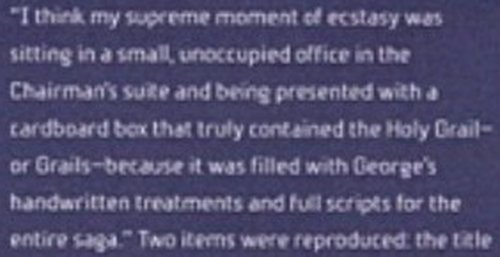
- **Leia Organa Solo** — entry/section: Life Day song: ""We needed a yes or no in two days—Carrie listened to it, apparently said something like 'Whatever!' and I was able to get a memo to George for a quick sign-off. I think she sounds pretty good!" —Stephen J. Sansweet, Star Wars Insider 98, p. 44" Source: *Star Wars Insider #98* (2008), scan p.44
  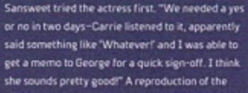

## scan p.45 (scan page 45)

Page contents: Comics: "Plotting the Vector — Four comics relate one story in 2008's big Star Wars crossover", words Daniel Wallace; sub-heads "Time Challenge", "Ancient Evil"; box "'Vector' Checklist" (Knights of the Old Republic #25-28; Dark Times #11-12; Rebellion #15-16; Legacy #29-32) (hand-read)

- **none** — entry/section: Same idea with Star Wars: ""We were commenting on how the two majors repeatedly bring out these crossover series ... and Warner said, 'That's the comics industry for you—we never run out of the same idea.' It was funny at the time, but a couple of days later I got to wondering if we could have 'the same idea' with Star Wars." —Randy Stradley, Star Wars Insider 98, p. 45" Source: *Star Wars Insider #98* (2008), scan p.45
  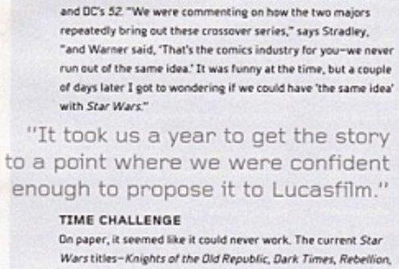
- **none** — entry/section: Cool story: ""We think we have the basis of a cool story, one that will compel readers to follow it through all four [comic books] of our series. And hopefully, win us some new readers along the way!" —Randy Stradley, Star Wars Insider 98, p. 45" Source: *Star Wars Insider #98* (2008), scan p.45
  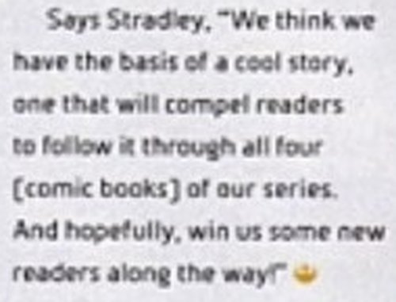

### Stat block notes (game mechanics, not feats)

- Vector crossover: In January 2008, for the first time in the publishing history of Star Wars comics, all four regular titles will unite in a multi-part crossover. Entitled "Vector," the story features Zayne Carrick, Darth Vader, Luke Skywalker, and Cade Skywalker in a 12-part saga that spans four millennia. (Daniel Wallace, Star Wars Insider 98, p. 45) (Source: *Star Wars Insider #98* (2008), scan p.45)
- Ancient evil: The adventure hinges on the unearthing of an ancient evil, one which grows more dangerous as the centuries pass. The four most powerful Force-users from each era will confront the threat in their own way. (Daniel Wallace, Star Wars Insider 98, p. 45) (Source: *Star Wars Insider #98* (2008), scan p.45)

## scan p.46 (scan page 46)

Page contents: Comics cont.: full-page Vector art (Vader, Luke, Zayne Carrick, Cade with lightsabers); box "'Vector' Primer" (KOTOR Vol. 3 Days of Fear, Nights of Anger; Dark Times Vol. 1 The Path to Nowhere; Rebellion Vol. 1 My Brother, My Enemy; Legacy Vol. 1 Broken) (hand-read)

### Stat block notes (game mechanics, not feats)

- KOTOR Vol. 3: Instead, the galaxy is rocked by the Mandalorian Wars and the threat of the Sith, as wrongfully-accused Padawan Zayne Carrick struggles to clear his name. (Daniel Wallace, Star Wars Insider 98, p. 46) (Source: *Star Wars Insider #98* (2008), scan p.46)
- Tank: The story of "Tank," Luke Skywalker's friend from his childhood on Tatooine, is told in this collection of issues #1-5. Set in the classic timeframe between A New Hope and The Empire Strikes Back, the tale seethes with conflict as Tank is torn between his loyalty to his friend and his duty as a commissioned Imperial officer. (Daniel Wallace, Star Wars Insider 98, p. 46) (Source: *Star Wars Insider #98* (2008), scan p.46)
- Legacy Vol. 1: A resurgent Sith and a fractured Empire provide the backdrop, as Luke Skywalker's descendent Cade struggles to live up to the expectations of his famous name. (Daniel Wallace, Star Wars Insider 98, p. 46) (Source: *Star Wars Insider #98* (2008), scan p.46)

## scan p.47 (scan page 47)

Page contents: Toys: "Bringing Battlefront to Life! — From console to collectible, Hasbro unleashes the armies of Battlefront II", words Jeremy Beckett; Hasbro Battlefront II Clone Set and Droid Set; Sideshow Luke Skywalker, Rebel Commander—Bespin 12" figure ($54.99) (hand-read)

### Stat block notes (game mechanics, not feats)

- Battlefront II multipacks: The Clone Set features the clone sharptrooper, heavy trooper, clone trooper, clone engineer with new helmet, galactic marine with new chain gun, and jet trooper with new jet pack, helmet, and gun. The Droid Set includes a destroyer droid, three battle droids (one of which has a new gun), Grievous' bodyguard, super battle droid, and ammunition droid. (Jeremy Beckett, Star Wars Insider 98, p. 47) (Source: *Star Wars Insider #98* (2008), scan p.47)
- Auto-tourniquet: Plus, if you order the Sideshow Exclusive edition it includes a unique accessory, the auto-tourniquet used to stabilize Luke after he suffered the loss of his right hand in his duel with Darth Vader. (Jeremy Beckett, Star Wars Insider 98, p. 47) (Source: *Star Wars Insider #98* (2008), scan p.47)

## scan p.48 (scan page 48)

Page contents: Toys cont.: Funko Shadow Stormtrooper Wacky Wobbler bobble head ($14.99, StarWarsShop.com/Action Figure Express exclusive); Gentle Giant Animated Han Solo Maquette (3000 pieces, $80); facing ad: Square Enix/Kotobukiya Final Fantasy VII Play Arts action figures (non-SW) (hand-read)

### Stat block notes (game mechanics, not feats)

- Animated Han maquette: The coolest smuggler of all is stylin' with this new release, limited to 3000 pieces worldwide, from Gentle Giant Studios. ... this 8" beauty has a specially-designed base that will interlock with the upcoming Animated Chewbacca Maquette. (Jeremy Beckett, Star Wars Insider 98, p. 48) (Source: *Star Wars Insider #98* (2008), scan p.48)

## scan p.49 (scan page 49)

Page contents: Star Wars Q&A: "Like Something Out of a Dream — Has Luke visited Dagobah before? Who survived the sail barge explosion? And who knew Vader's real identity?", words Leland Y. Chee; contact box (Titan US/UK addresses, email); reader questions (asker names omitted) (hand-read)

### Stat block notes (game mechanics, not feats)

- Yoda and Dagobah: The official continuity is Yoda arriving on Dagobah alone, as portrayed in the deleted scene from Revenge of the Sith. According to the earlier scripts, when he arrives on Dagobah, he emerges from his escape pod surveying the unfamiliar terrain. Yoda has never been to Dagobah before, so Yoda's battle with a Bpfasshi dark Jedi on Dagobah as described in Heir to the Empire is no longer considered part of continuity. It's still possible that a mortally wounded dark sider made it to Dagobah after a confrontation with Yoda, but the battle did not take place there. (Leland Y. Chee, Star Wars Insider 98, p. 49) (Source: *Star Wars Insider #98* (2008), scan p.49)
- Out of a dream: Luke has never been to Dagobah prior to The Empire Strikes Back. Why it is familiar to him is one of those unexplained mysteries. Maybe it really is "like something out of a dream." As for the portions of the cave that seem constructed, it's entirely possible that they are part of what Luke "takes with him" in his duel with Vader. (Leland Y. Chee, Star Wars Insider 98, p. 49) (Source: *Star Wars Insider #98* (2008), scan p.49)
- Sail barge survivors: Bib Fortuna, Tessek, Bubo, Saelt-Marae ("Yak Face"), Hermi Odle, J'Quille, and the members of the Max Rebo Band are among the survivors of the sail barge explosion. Bossk, whose appearance aboard the sail barge is often overlooked, also managed to survive. (Leland Y. Chee, Star Wars Insider 98, p. 49) (Source: *Star Wars Insider #98* (2008), scan p.49)

## scan p.50 (scan page 50)

Page contents: Q&A cont.: sail barge casualties; Palpatine's red hologram (not Death Star plans); post-ROTJ knowledge of Vader's identity; "We Break for Nobody" on Tyrant (Encyclopedia p.319, Decipher CCG image); Imperial cog/Rebel logo origins (John Mollo); Leia's age (asker names omitted) (hand-read)

- **none** — entry/section: Imperial insignia: ""The metal insignia used on the Imperial Officers' cap and belt buckles, was an aluminum pulley which was part of a record turntable mechanism, which we bought in bulk and used exactly as they were. The circular black and white logo used on the Imperial helmets was designed by me, and was based on a series of sketches working out the possible use of shapes occurring in 18th Century fortification." —John Mollo, Star Wars Insider 98, p. 50" Source: *Star Wars Insider #98* (2008), scan p.50
  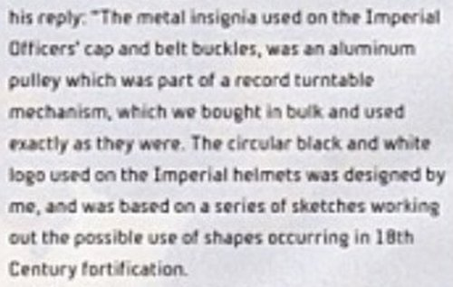
- **none** — entry/section: Rebel logo: ""The Rebel logo I take to be the one on the Fighter Pilots' helmets. This was again designed by me—no particular sources used this time." —John Mollo, Star Wars Insider 98, p. 50" Source: *Star Wars Insider #98* (2008), scan p.50
  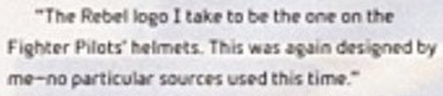

### Stat block notes (game mechanics, not feats)

- Sail barge deaths: Confirmed deaths from the destruction of the sail barge include Ree-Yees, Wooof, Gauron Nas Tal, Cane Adiss, Giran, and Salacious Crumb. (Leland Y. Chee, Star Wars Insider 98, p. 50) (Source: *Star Wars Insider #98* (2008), scan p.50)
- Not in the execution party: Characters like Dengar, Ephant Mon, Malakili, Amanaman, Yarna d'al' Gargan, Doallyn, Shasa Tiel, and of course, Arica (aka Mara Jade) survive due to the fact that they weren't part of the execution party. (Leland Y. Chee, Star Wars Insider 98, p. 50) (Source: *Star Wars Insider #98* (2008), scan p.50)
- Online poker: As a humorous aside, for a very early version of the scene, Visual Effects Supervisor John Knoll had Palpatine playing online poker (and losing). (Leland Y. Chee, Star Wars Insider 98, p. 50) (Source: *Star Wars Insider #98* (2008), scan p.50)
- Identity not known: Vader's true identity as Anakin Skywalker would not be known to the galaxy at large until many years after the Battle of Endor. This becomes an issue in the first novel of the Black Fleet Crisis trilogy, Before the Storm, that takes place 12 years after Return of the Jedi. ... Palpatine, on the other hand, never publicly revealed his identity as a Sith while he was Emperor. It would not be until after his death that this information would come to light. (Leland Y. Chee, Star Wars Insider 98, p. 50) (Source: *Star Wars Insider #98* (2008), scan p.50)
- Leia's age: Princess Leia is born during the events of Revenge of the Sith which take place 19 years before Star Wars: Episode IV A New Hope. ... Return of the Jedi takes place approximately four years after A New Hope, making Leia about 23 years old. In the real-world, actress Carrie Fisher was 19 years old when principal photography on Episode IV began and 25 years old when Episode VI principal photography began. (Leland Y. Chee, Star Wars Insider 98, p. 50) (Source: *Star Wars Insider #98* (2008), scan p.50)

## scan p.51 (scan page 51)

Page contents: Scouting the Galaxy: "Rancho Obi-Wan Reunion Tops Off a Busy Year! — Concerns about production safety and Cargo Bay; what happened to McQuarrie concept Vader's blaster?", words Steve Sansweet; reunion photos (collection-manager/visitor names omitted), cake photo (hand-read)

### Stat block notes (game mechanics, not feats)

- Rancho Obi-Wan Reunion: It's been nine years since the Rancho was purchased and—after a bit of remodeling—eight years since my private Star Wars museum began to take shape. ... So on a Saturday in September, a group of about 30 people gathered at the Rancho for some food, fun, and memories. (Steve Sansweet, Star Wars Insider 98, p. 51) (Source: *Star Wars Insider #98* (2008), scan p.51)
- Celebration attendance: In 2007 that virtual community had a chance to come together in the real world, with a total of nearly 70,000 attendees at Celebration IV and Celebration Europe and tens of thousands more who stopped by the Star Wars pavilion at San Diego Comic-Con International. (Steve Sansweet, Star Wars Insider 98, p. 51) (Source: *Star Wars Insider #98* (2008), scan p.51)

## scan p.52 (scan page 52)

Page contents: Scouting cont.: Q&A "Cargo Bay Concern", "Star Wars Safety", "Blaster Teaser", "Bounty Hunter" (reader names omitted); photos: pewter chess set, McQuarrie Concept Darth Vader (#28) figure (photo credits to collectors omitted) (hand-read)

### Stat block notes (game mechanics, not feats)

- Cargo Bay: the tiny editorial staff (basically three people) at starwars.com isn't happy about the situation either. (Steve Sansweet, Star Wars Insider 98, p. 52) (Source: *Star Wars Insider #98* (2008), scan p.52)
- Missile-firing Boba Fett: There's the famous case of the missile-firing Boba Fett that was never released in 1978/79 because of problems with the toy line of another company, where a small missile led to the choking death of an infant. Kenner Products was quick to react. (Steve Sansweet, Star Wars Insider 98, p. 52) (Source: *Star Wars Insider #98* (2008), scan p.52)
- McQuarrie Vader blaster: you have to be wary of Vader because he always has something up his sleeve, or under his cape. And that's where the blaster is, under Darth Vader's cape in his holster. (Steve Sansweet, Star Wars Insider 98, p. 52) (Source: *Star Wars Insider #98* (2008), scan p.52)
- Danbury Mint chess set: I think the Danbury Mint chess set is an amazing piece; I'm not sure how many folks persevered the full two years to complete the collection. ... For some reason, this set has not held its value. (Steve Sansweet, Star Wars Insider 98, p. 52) (Source: *Star Wars Insider #98* (2008), scan p.52)

## scan p.53 (scan page 53)

Page contents: Scouting cont.: "All Wrapped Up" (food wrappers, R2-D2 French fry holders), "Gone Missing" (Hasbro Republic Gunship versions); contact box ([email omitted], [postal address omitted]); photos: M&M's/Burger King wrappers, four Republic Gunship toys (Ep II 2002, Command 2003, Ep III 2005, Clone Wars animated 2006) (reader names, minor's name, collector photo credit omitted) (hand-read)

### Stat block notes (game mechanics, not feats)

- Bounty Hunters statuette: A full set plus chessboard recently sold for a buy-it-now price of $299. The Applause Bounty Hunters statuette is quite a nice piece too, limited to 5,000 worldwide. (Steve Sansweet, Star Wars Insider 98, p. 53) (Source: *Star Wars Insider #98* (2008), scan p.53)
- Food wrappers: Star Wars food wrappers, while inexpensive, are items most likely to be disposed of. So while there may be tens of millions released, only a relatively few survive. I love food wrappers and packaging because to me they show how Star Wars has become part of everyday life all over the world. (Steve Sansweet, Star Wars Insider 98, p. 53) (Source: *Star Wars Insider #98* (2008), scan p.53)
- Gunship versions: First you need to determine which version of the gunship it is that you have: is it the Episode II Republic Gunship (2002), the Command Gunship (2003), The Episode III Republic Gunship (2005), or the Clone Wars animated Gunship (2006)? There are some subtle—and not so subtle—differences among them. (Steve Sansweet, Star Wars Insider 98, p. 53) (Source: *Star Wars Insider #98* (2008), scan p.53)

## scan p.54 (scan page 54)

Page contents: International Collecting: "Swedish Spaceballs — From unique film posters to retail display cardboard standees and exclusive collector card series, Sweden has a lot to offer in unique Star Wars merchandise", words Gus Lopez; photos: 1977 "Stjärnornas Krig" poster, Vader figure display, Millennium Falcon play scene display, Power of the Force logo, Kellogg's Frosties/Choco Krispies promotions (hand-read)

### Stat block notes (game mechanics, not feats)

- Stjärnornas Krig poster: Star Wars was released in Sweden in late 1977 and promoted with a theatrical poster featuring the rather wonderful local version of the title, "STJÄRNORNAS KRIG". This poster is based on Tom Jung's classic "Style A" artwork of Luke holding his lightsaber overhead with the droids and Princess Leia by his side. However, in Sweden, the Jung artwork was altered to include an adapted screen image of Han Solo and Chewbacca and the addition of numerous X-wings along the top. Conspicuously missing is the large "that's no moon—it's Vader's head" design in the star field. (Gus Lopez, Star Wars Insider 98, p. 54) (Source: *Star Wars Insider #98* (2008), scan p.54)
- Swedish cardboard displays: These displays include the Return of the Jedi Kenner logo, a large image of the Darth Vader action figure, a play scene of the Millennium Falcon toy, and the collectors' favorite, the Power of the Force logo. These displays are so scarce that only one single example is known to exist for some of them. (Gus Lopez, Star Wars Insider 98, p. 54) (Source: *Star Wars Insider #98* (2008), scan p.54)

## scan p.55 (scan page 55)

Page contents: International cont.: photos/captions—"Jedi Läsk" soda labels and bottles, Hemglass ice cream popsicle boxes/wrappers/flyers with Vader artwork, 1985 Swedish Kenner POTF catalog (Imperial Shuttle, "Sortiment 1985"), Nellba Star Wars cards released in Sweden exclusively; author's thanks to a collector (name omitted) (hand-read)

### Stat block notes (game mechanics, not feats)

- Swedish POTF catalog: A Swedish Kenner catalog featuring the Power of the Force toy line was distributed to promote the toys from this series. Similar to other catalogs localized for different European markets, this catalog shows the Imperial Shuttle toy on the cover. (Gus Lopez, Star Wars Insider 98, p. 55) (Source: *Star Wars Insider #98* (2008), scan p.55)
- Nellba cards: The Swedish company, Nellba, released Star Wars cards that were exclusive to Sweden and remain popular with collectors today. Unlike many of the trading cards issued in other countries that were merely translated versions of the Topps cards, the Nellba cards had a unique style and graphic design based on images and design sketches from the Star Wars films. (Gus Lopez, Star Wars Insider 98, p. 55) (Source: *Star Wars Insider #98* (2008), scan p.55)
- Jedi Läsk: One of the most notable Swedish food products was the Jedi soda, or "Jedi Läsk" in Swedish, sold by Spendrup's. This Jedi soda came with three different colorful labels, Luke & Leia, Yoda, and, to satisfy the evidently thriving demand for Ewok-themed food products, Paploo. (Gus Lopez, Star Wars Insider 98, p. 55) (Source: *Star Wars Insider #98* (2008), scan p.55)
- Kellogg's Sweden: Kellogg's did an extensive cereal promotion in Sweden for Episodes I, II, and III, featuring boxes with character shots from the movies and offering toy premiums similar to those available elsewhere throughout Europe. (Gus Lopez, Star Wars Insider 98, p. 55) (Source: *Star Wars Insider #98* (2008), scan p.55)

## scan p.56 (scan page 56)

Page contents: Set Piece: "Massassi Temple Throne Room — Honoring the heroes of the Rebellion", words Chris Trevas & Chris Reiff; medal-ceremony stills; caption box "Costumes" (hand-read)

- **Luke Skywalker; Han Solo** — entry/section: Outfit like Han's: ""It was a very last-minute thing, but we concocted an outfit like Han's in different colors." —John Mollo, Star Wars Insider 98, p. 56" Source: *Star Wars Insider #98* (2008), scan p.56
  

### Stat block notes (game mechanics, not feats)

- Throne room filming: This ceremony was filmed over two days, May 13 and 14, 1976, on the H Stage at Shepperton Studios. Only a couple of hundred real life extras at most were present to play the parts of all the Rebel forces. For the expansive wide view their ranks would be multiplied and the set's height extended with a matte painting by artist Harrison Ellenshaw. (Chris Trevas & Chris Reiff, Star Wars Insider 98, p. 56) (Source: *Star Wars Insider #98* (2008), scan p.56)
- Set budget: With only around $3,000 originally budgeted for the creation of the entire Massassi Temple set, the production could not afford the scores of additional extras desired for this scene. ... Filling out the very back rows were a couple of hundred cardboard stand-ups of U.S. Marines found in boxes at the costume suppliers in London. (Chris Trevas & Chris Reiff, Star Wars Insider 98, p. 56) (Source: *Star Wars Insider #98* (2008), scan p.56)
- Luke's ceremony costume: The outfit is so similar, in fact, that the pants Luke wears in this scene are identical in style and detail to those that Han eventually wears in The Empire Strikes Back and Return of the Jedi. The yellow jacket Luke wears is the same, other than the color, as the one worn by the walrus-faced Mos Eisley denizen Ponda Baba. Luke also carries a blaster holstered at his side much like Han for the first time. The long barreled gun is actually the same exact prop that Leia defends herself with when her ship is boarded by Vader's troops. (Chris Trevas & Chris Reiff, Star Wars Insider 98, p. 56) (Source: *Star Wars Insider #98* (2008), scan p.56)
- Happy Birthday, dear Tony: May 14, 1976 was George Lucas' 32nd birthday. To mark the day Assistant Director Tony Waye prepped the extras to sing "Happy Birthday" when Lucas came on set. The crowd did sing on Tony's cue, but it was obvious they were a bit confused when some belted out "Happy Birthday, dear Tony." (Chris Trevas & Chris Reiff, Star Wars Insider 98, p. 56) (Source: *Star Wars Insider #98* (2008), scan p.56)
- Pilot helmets: These clean white pilot helmets with tinted visors and blue Rebel symbols only appear in scenes within the Massassi Temple, including the briefing room and hangar. (Chris Trevas & Chris Reiff, Star Wars Insider 98, p. 56) (Source: *Star Wars Insider #98* (2008), scan p.56)

## scan p.57 (scan page 57)

Page contents: Set Piece cont.: annotated throne-room still with caption boxes "Art" (medals; Luke's blaster), "Princess Leia", "Jewelry", "Chewbacca", "Han Solo", "The Extras", "The Droids" (hand-read)

### Stat block notes (game mechanics, not feats)

- Medals: The prestigious medals awarded our heroes were simple gold-painted props. George Lucas chose the medals from several designs created by the prop department. (Chris Trevas & Chris Reiff, Star Wars Insider 98, p. 57) (Source: *Star Wars Insider #98* (2008), scan p.57)
- Luke's blaster prop: Luke's blaster prop is based on a Margolin target pistol from a Soviet arms factory in the 1950s. The barrel was extended with a plumbing piece and coiled electrical cord. In the Expanded Universe this blaster model is designated a Drearian Defense Conglomerate Defender. (Chris Trevas & Chris Reiff, Star Wars Insider 98, p. 57) (Source: *Star Wars Insider #98* (2008), scan p.57)
- Hot plate special: Carrie Fisher's hairdo in this scene was referred to as the "hot plate special" by cast and crew. (Chris Trevas & Chris Reiff, Star Wars Insider 98, p. 57) (Source: *Star Wars Insider #98* (2008), scan p.57)
- Leia's necklace: Leia's silver necklace came from Lapponia Jewelry. The design is called Planetariska Dalarna (The Planetary Valleys) and was created by Finnish designer Björn Weckström. When the production purchased the necklace they didn't reveal what the film was about. (Chris Trevas & Chris Reiff, Star Wars Insider 98, p. 57) (Source: *Star Wars Insider #98* (2008), scan p.57)
- Chewbacca's line: The only line "spoken" in this entire scene is by Chewbacca. Sound designer Ben Burtt derived his "voice" from the growls of a black bear mixed with other animal vocalizations. (Chris Trevas & Chris Reiff, Star Wars Insider 98, p. 57) (Source: *Star Wars Insider #98* (2008), scan p.57)
- Hamill briefs the extras: The extras coming onto the film cold needed to be briefed as to the story. Mark Hamill enthusiastically took it upon himself to relay the tale of how the farm boy, scoundrel, and Princess came to stand before them in these hallowed halls. (Chris Trevas & Chris Reiff, Star Wars Insider 98, p. 57) (Source: *Star Wars Insider #98* (2008), scan p.57)
- The droids: Besides fixing R2-D2's extensive damage, Rebel engineers had time to repair the dent in C-3PO's head and polish him up. (Chris Trevas & Chris Reiff, Star Wars Insider 98, p. 57) (Source: *Star Wars Insider #98* (2008), scan p.57)

## scan p.58 (scan page 58)

Page contents: Padawan's Corner: "How to Draw: An Ewok — Only the brave enter the forests of Endor, for there await the Ewoks! Learn how to draw the critters who helped defeat the Empire!"; Steps 1-3 with sketches (hand-read)

### Stat block notes (game mechanics, not feats)

- Ewok proportions: Begin by lightly sketching a stick figure. An Ewok has short, stubby legs, a long torso, and a head that's very wide. (Star Wars Insider 98, p. 58) (Source: *Star Wars Insider #98* (2008), scan p.58)
- Ewok hood: You can also draw his leather hood. Some Ewoks adorn their hoods with feathers and bones. The bottom edge of the hood is a bit jagged. (Star Wars Insider 98, p. 58) (Source: *Star Wars Insider #98* (2008), scan p.58)

## scan p.59 (scan page 59)

Page contents: Padawan's Corner cont. ("Corner Jedi"), words & artwork Cynthia Cummens; Steps 4-8 sketches through finished color Ewok painting with stormtrooper helmet; tip box on practice (hand-read)

### Stat block notes (game mechanics, not feats)

- Ewok background ideas: Perhaps your Ewok is celebrating a victory, or maybe he's building a hut. Maybe he's chatting with R2-D2 or dancing with other Ewoks around a bonfire. (Cynthia Cummens, Star Wars Insider 98, p. 59) (Source: *Star Wars Insider #98* (2008), scan p.59)

## scan p.60 (scan page 60)

Page contents: Bantha Tracks Vol. 29 ("By the fans. For the fans."): "Bantha Tracks Best of the Year Annual Edition, 2007"; 501st Legion Celebration IV group photo with "Best Costumes — Worldwide costuming dominance: The 501st Legion" star; submission guidelines box (fan feature: photographer and member names omitted) (hand-read)

### Stat block notes (game mechanics, not feats)

- 30th anniversary year: What a 30th anniversary year it was for Star Wars fans! Starting with a bang on New Year's Day with the Star Wars Spectacular and George Lucas in the Tournament of Roses Parade, and continuing with Celebration IV, Celebration Europe, and local and national conventions, there was always a place and a reason to celebrate 30 years of the Star Wars Saga, and all that's yet to come... (Bantha Tracks, Star Wars Insider 98, p. 60) (Source: *Star Wars Insider #98* (2008), scan p.60)

## scan p.61 (scan page 61)

Page contents: Bantha Tracks cont.: "Best Parade: Tournament of Roses" (Star Wars Spectacular floats, photos); "Best New Droid" (R2-KT with Leias at SDCC); "Youngest Reader" (infant in Vader costume) (fan, child and photo-credit names omitted) (hand-read)

### Stat block notes (game mechanics, not feats)

- Rose Parade: The longest entry in parade history, the Star Wars Spectacular sported floats depicting Endor and Naboo, the world-famed Grambling Marching Tigers band decked out as Imperial officers, and more than 200 stormtroopers and costumed Star Wars characters from all over the world. George Lucas himself was the Grand Marshal for the parade. (Bantha Tracks, Star Wars Insider 98, p. 61) (Source: *Star Wars Insider #98* (2008), scan p.61)
- R2-KT: R2-KT, the custom-built pink droid created in loving memory of [the late daughter of the 501st Legion's founder], appeared at San Diego Comic-Con International both "life-size" and as a toy. The special action figures were sold by both StarWarsShop.com and Hasbro with a $100,000 contribution going to benefit the Make-A-Wish foundation. (Bantha Tracks, Star Wars Insider 98, p. 61; names omitted) (Source: *Star Wars Insider #98* (2008), scan p.61)

## scan p.62 (scan page 62)

Page contents: Bantha Tracks cont.: "Best Celebrations: Celebration IV & Celebration Europe"; "Best Bust" (one-of-a-kind Obi-Wan Kenobi bust sculpted by artist Lawrence Noble, won by a fan); "Best Rebel Dream" (Dream Girls-inspired costumes); "Best Lunch" (Darth Maul costumer with lunch tray) (fan, costumer and photo-credit names omitted) (hand-read)

### Stat block notes (game mechanics, not feats)

- Best Bust: At Star Wars Celebration IV, [a fan] was drawn to win the one-of-a-kind Obi-Wan Kenobi bust, sculpted by talented and noted artist Lawrence Noble. (Bantha Tracks, Star Wars Insider 98, p. 62; fan name omitted) (Source: *Star Wars Insider #98* (2008), scan p.62)

## scan p.63 (scan page 63)

Page contents: Bantha Tracks cont.: "Best Celebration Generations" (kids in Yoda/Leia costumes, Ewok-and-R2 plush) and "Best of the Worst" (cardboard-box Imperial costumes at 2007 Dragon*Con) (photo-credit names omitted) (hand-read)

### Stat block notes (game mechanics, not feats)

- Best of the Worst: Nothing beats cardboard boxes when you're looking to make Imperial armor, especially in the case of these costumers at the 2007 Dragon*Con in Atlanta, Georgia. One of the many wonderful things about the 30 years of Star Wars is that the Saga is so entrenched in our culture we still know exactly who the Whirlpool and Jack Daniels-clad characters are. (Bantha Tracks, Star Wars Insider 98, p. 63) (Source: *Star Wars Insider #98* (2008), scan p.63)

## scan p.64 (scan page 64)

Page contents: Indiana Jones: "Indy Vault #6 — From the Catacombs to Sallah's Balcony", words J.W. Rinzler; Raiders photo of Harrison Ford on the Kairouan set (hand-read)

### Stat block notes (game mechanics, not feats)

- Catacomb shoot: Karen Allen filmed her catacomb scenes during the days of July 25, 28, and 29, 1981, on Elstree's Stage 3, and found that even more terrifying than the Well of Souls shoot, where she'd been surrounded by thousands of snakes. Claustrophobia. Not fun. (J.W. Rinzler, Star Wars Insider 98, p. 64) (Source: *Star Wars Insider #98* (2008), scan p.64)
- Kairouan as Cairo: The other three photos were taken on September 17 of the same year, but on location in Kairouan, Tunisia. Production had built a terrace adjoining a penthouse apartment, and had removed about 300 television antennas so that this port town would resemble more accurately what is supposed to be Cairo circa 1936 ("Kairouan" actually means "little Cairo" in Arabic). (J.W. Rinzler, Star Wars Insider 98, p. 64) (Source: *Star Wars Insider #98* (2008), scan p.64)

## scan p.65 (scan page 65)

Page contents: Indy Vault #6 cont.: three B&W Raiders photos (Spielberg, John Rhys-Davies and Harrison Ford on Sallah's balcony set; catacomb skeletons set); no captions (hand-read)

## scan p.66 (scan page 66)

Page contents: Comlink ("The Star Wars Insider Mailbag"): "Let's Hear It for the Fans!" — letters "A Fan's Tale" (fan group with photo), "Names for Fans!", "Animated Possibilities?", "Fully Booked"; editor reply to animated Episodes VII-IX question: "It doesn't seem likely, but you never know"; write-to-us box (letter-writer names omitted) (hand-read)

### Stat block notes (game mechanics, not feats)

- Wants to hear from you: Next issue we're going to enter the dark world of the bounty hunters! Tell us who's your favorite and why! Maybe you think Aurra Sing is the coolest, or you might love poor Greedo! Could Boba Fett possibly be a popular choice? Let us know! (Star Wars Insider 98, p. 66) (Source: *Star Wars Insider #98* (2008), scan p.66)

## scan p.67 (scan page 67)

Page contents: Comlink cont.: end of "Fully Booked" letter; "One in a Hundred!" box (100th issue call); letter "A Toast to Vader?" (Woolworths advert); Bounty Hunters letters section sponsored by Kotobukiya (prize statue worth about $100): "Chums with Chewie!" (photo with Peter Mayhew at Celebration IV), "Face to Face with Vader!" (child meets Dave Prowse at Celebration Europe); photo call (letter-writer and family names omitted) (hand-read)

### Stat block notes (game mechanics, not feats)

- One in a Hundred!: We are looking towards our incredible 100th issue and want to know what you think is the very best single thing about Star Wars? It could be a character like Bib Fortuna or Mara Jade or music from a particular scene such as the asteroid chase in Empire. It might even be something really leftfield like Tin-Tin Dwarf or a particular scene in Splinter of the Mind's Eye! (Star Wars Insider 98, p. 67) (Source: *Star Wars Insider #98* (2008), scan p.67)
- Woolworths advert: It features a couple of puppets who have Darth Vader making their breakfast for them! One of them looks in a cupboard and, lo and behold, there's a stormtrooper hiding there! Vader then makes toast with his lightsaber and burns it! (reader letter, Comlink, Star Wars Insider 98, p. 67; writer name omitted) — editor reply: "It is weird, and really funny, but Expanded Universe? We're not so sure it's canon!" (Source: *Star Wars Insider #98* (2008), scan p.67)
- Mayhew's Chewie shirt: A member of the 501st Philippines Outpost presented him with a Chewie shirt. He was so impressed that they got his correct size that he even wore it later that day (see picture)! (reader letter on Peter Mayhew at Celebration IV, Comlink, Star Wars Insider 98, p. 67; writer names omitted) (Source: *Star Wars Insider #98* (2008), scan p.67)

## scan p.68 (scan page 68)

Page contents: Next-issue ad: "In the Next Issue... Bounty Hunters Special — Meet the Fetts: exclusive interviews with Jeremy Bulloch, Daniel Logan, and Temuera Morrison; Mandalorians: Who are the Mandalorians?; Boba Begins! Creating the ultimate hunter!"; UK newsstands January 15, US newsstands January 17 (hand-read)

## scan p.69 (scan page 69)

Page contents: StarWarsShop.com ad #22 "Presents Tosche Station": Exclusive Star Wars Celebration Europe T-Shirts — "Who Knew Star Wars Was This Hip!"; T-shirts $19.99 each, long sleeved $29.99 each; Celebration Act Show, Vader 77, R2/D2 designs (hand-read)

### Stat block notes (game mechanics, not feats)

- Celebration Europe tees: For the London show, fans could snag shirts sporting the standard iconic triangular logo or a "Vader 77" sports jersey, but also some very cool Anglo-centric standouts: A back-in-black R2-D2 tee, a vicious "God Save the Queen" tee, and an underground map of the galaxy backed with six translations of "May the Force Be With You!" (StarWarsShop.com ad, Star Wars Insider 98, p. 69) (Source: *Star Wars Insider #98* (2008), scan p.69)

## scan p.70 (scan page 70)

Page contents: Official Pix ad: "Officially licensed autographs and photographs from your favorite sagas" — Han Solo and Indiana Jones photos; save 10% with coupon code 'INSIDER', offer expires 12/31/2007; officialpix.com (hand-read)

## scan p.71 (scan page 71)

Page contents: Back cover: Wizards of the Coast Star Wars Miniatures ad — "From The Darkness, A New Force Arises." The Force Unleashed set, release date Nov. 16, 2007 (hand-read)

### Stat block notes (game mechanics, not feats)

- Force Unleashed Miniatures: Vader's Apprentice. Maris Brood. Rahm Kota. Juno Eclipse. These are just 4 of the 15 new characters in the latest Star Wars Miniatures set, The Force Unleashed. Based on the upcoming Star Wars: The Force Unleashed video game, this set marks your very first chance to see these new characters and experience greater Force powers than ever before. (Star Wars Miniatures ad, Star Wars Insider 98, p. 71) (Source: *Star Wars Insider #98* (2008), scan p.71)
