# Owner Material 038 — Star Wars Insider #1–153 plus specials (with The Lucasfilm Fan Club Magazine #1–22): Star Wars Insider #99 (2008)

- **Source:** *Star Wars Insider* magazine (issues 23–153, 1994–2014) and its predecessor *The Lucasfilm Fan Club Magazine* (issues 1–22, 1987–1994), plus seven special editions: articles, interviews, comics and short fiction Secondary source (licensed Legends reference). Scan OCR'd on the box; the scan stays box-only and is **not** published.
- **Method:** every scanned page was OCR'd and machine-screened sentence by sentence for power-relevant statements (fights, kills, defeats, Force feats, rankings, superweapons) that name a character on our roster; each kept sentence is quoted verbatim from the OCR text and has a crop of the printed passage directly under it. Pages with nothing power-relevant are still listed with what is on them.
- **Citation:** "*Star Wars Insider #99* (2008), p.X" by printed page ("scan p.X" where no printed number applies). **Weight:** Licensed magazine: a secondary source. Its short fiction and comics are Legends stories; its articles and interviews sum up or discuss lore and rank below the novels, comics and games they describe.

## scan p.1 (scan page 1)

Page contents: Cover, Issue #99 March 2008, $5.99: "Bounty Hunters — Enigmatic! Mysterious! Iconic! Meet Star Wars' villains for hire!"; top strip "No Disintegrations / Bounty Hunters Special!", "Boba Begins! Creating Boba Fett", "Young Indy Speaks: Sean Patrick Flanery"; "The Fett Family: Jeremy Bulloch & Daniel Logan interviewed; Crafting Kotobuyika [sic] collectibles; Ben Burtt's talking Wookiee; The origins of Boba Fett; Plus all your regular favorites; The Bounty Hunters' Guild Handbook"; Boba Fett cover art, Aurra Sing inset (hand-read)

## scan p.2 (scan page 2)

Page contents: Topps ad: Indiana Jones Heritage Trading Cards — "The Ultimate Hero Is Back!"; 90 retro-cool cards featuring new photos from the original movies, vintage grey-back stock, bubble gum in every pack; inserts: sketch cards, authentic autographs, sequentially-numbered parallels; shipping February 2008 (hand-read)

## scan p.3 (scan page 3)

Page contents: Contents. News: 07 Com-Scan (Rick McCallum on the live-action TV series). Features: 12 Tales of the Bounty Hunters; 20 Meet the Fetts (Jeremy Bulloch, Daniel Logan); 27 Bounty Hunters' Handbook; 32 Feat of Clay: Inside Kotobuyika; 38 Boba Begins; 44 May the Sound Be With You! (Ben Burtt); 48 First Crack of the Whip! (Rick McCallum, Sean Patrick Flanery, Young Indy). Departments: 05 Editor's Welcome; 53 Jawa's Corner; 54 Books: Mad About Star Wars; 56 Comics: Rebellion; 58 Games: Renegade Squadron; 60 Toys: Unconventional to Classic; 62 Star Wars Q&A; 64 Scouting the Galaxy; 68 International Collecting; 70 Set Piece: The Invisible Hand; 72 Padawan's Corner; 74 The Indy Vault; 76 Comlink (special edition, [fan couple name omitted]) (hand-read)

### Stat block notes (game mechanics, not feats)

- Boba Begins teaser: Think you know when Boba Fett's first appearance was? Prepare to be surprised as we reveal the secret origins of this most enigmatic of bounty hunters. (Star Wars Insider 99, p. 3) (Source: *Star Wars Insider #99* (2008), scan p.3)
- Q&A teaser: Is that IG-88 on Cloud City? Why doesn't Han Solo believe in the Force? Who's on the Jedi Council? (Star Wars Insider 99, p. 3) (Source: *Star Wars Insider #99* (2008), scan p.3)

## scan p.4 (scan page 4)

Page contents: Dark Horse ad: "Experience the next chapter of the Star Wars saga." — The Force Unleashed graphic novel (Haden Blackman, Brian Ching, Michael Atiyeh, Bong Dazo, Wayne Nichols), "An original graphic novel based upon the highly anticipated new video game", coming February 2008 (hand-read)

## scan p.5 (scan page 5)

Page contents: Editor's Welcome: "Bounty hunters? We don't need that scum...." (Brian J. Robb, Editor); Boba Fett costume photo; contact/letters box; masthead (Editor Brian J. Robb; Lucasfilm: Carol Roeder, Frank Parisi, Steve Sansweet, Troy Alders, Mary Franklin; contributors incl. Daniel Wallace, Pete Vilmur, Pat Jankiewicz, Jason Fry, Jeremy Beckett, Leland Y. Chee, Steve Sansweet, Gus Lopez, Chris Trevas, Cynthia Cummens, J.W. Rinzler, Jon Freel); Star Wars Insider #99 March 2008 (hand-read)

### Stat block notes (game mechanics, not feats)

- Screen time of bounty hunters: Despite the sentiments of Admiral Piett, it appears we DO need "that scum." The bounty hunters have amazingly little screen time across all six Star Wars films. Boba Fett makes the most impact; the others are around for only a few minutes. If you blink, you'll miss Aurra Sing's briefer-than-brief appearance in The Phantom Menace. But their impact on fans and Expanded Universe creators has been nothing short of phenomenal. (Brian J. Robb, Star Wars Insider 99, p. 5) (Source: *Star Wars Insider #99* (2008), scan p.5)
- Issue 100 plan: Next issue will be slightly different. It's issue #100 (at least for readers in the U.S.), so it is something of a significant milestone. To celebrate, we'll be featuring the "100 Greatest Things About Star Wars... Ever!" (Brian J. Robb, Star Wars Insider 99, p. 5) (Source: *Star Wars Insider #99* (2008), scan p.5)

## scan p.6 (scan page 6)

Page contents: Jerry VanderStelt Studio ad: The Lord of the Rings: The Fellowship of the Ring limited edition lithograph, hand-signed and numbered 24 x 30 reproduction by artist Jerry VanderStelt (non-Star Wars) (hand-read)

## scan p.7 (scan page 7)

Page contents: Com-Scan: "We Could Go On Forever!" — Rick McCallum predicts big things for the live action Star Wars TV show! "Hundreds of hours" of new Star Wars possible.... and Boba Fett will be "instrumental!" Words: Patrice Girod, Ian Spelling; interview recorded at Reunion II in Paris and in the U.S.; McCallum photo, Boba Fett figure (hand-read)

- **none** — entry/section: Story arc: ""I've been trying to get George to sit down and do the arc of the story since we came back from Cannes in 2005. And he has done everything to disappoint me [laughs]. He has had a lot of other things to do, like The Clone Wars animated series, and consulting for all the Lucasfilm companies, and also supervising the move of Lucasfilm to the Presidio." —Rick McCallum, Star Wars Insider 99, p. 7" Source: *Star Wars Insider #99* (2008), scan p.7
  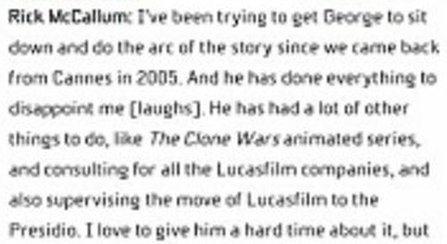
- **none** — entry/section: Artists and writers: ""Erik Tiemens, who helped design Episode III and part of Episode II, joined us recently. So the artwork is really starting to flow, we have a great story idea, which I cannot talk about yet. And we have a group of six talented writers. We have two great writers from England, one from Australia, and three from the United States." —Rick McCallum, Star Wars Insider 99, p. 7" Source: *Star Wars Insider #99* (2008), scan p.7
  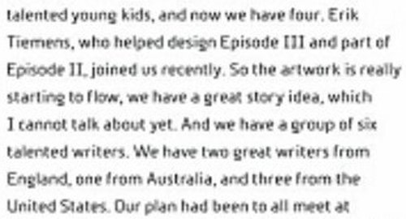
- **none** — entry/section: Shooting timeline: ""By the end of 2008, or early 2009, we hope to be able to start shooting." —Rick McCallum, Star Wars Insider 99, p. 7" Source: *Star Wars Insider #99* (2008), scan p.7
  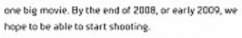
- **Luke Skywalker** — entry/section: Hundreds of hours: ""At the end of the day, if you really love the Star Wars saga, instead of six movies that last 12 or 13 hours, you will have hundreds of hours. We have this very rich period between Episode III and IV to do this—while Luke is growing up—a period of 20 years of the Empire pushing its influence around the galaxy." —Rick McCallum, Star Wars Insider 99, p. 7" Source: *Star Wars Insider #99* (2008), scan p.7
  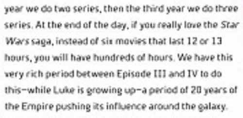

## scan p.8 (scan page 8)

Page contents: Com-Scan cont.: McCallum interview (viewers' expectations; Boba Fett in the series; fan reviews; technology; music scores; Internet stories; action sequences; broadcaster; favorite TV; George's non-Star Wars films; Joseph Losey bookcase anecdote); photos of young Boba Fett (Daniel Logan) and McCallum on set (hand-read)

- **none** — entry/section: Darker series: ""This takes place between Episode III and IV, but with all new characters. This is about what happens to an empire. It's a much darker, much more character-based thing. It's not as plot-driven [as the movies]." —Rick McCallum, Star Wars Insider 99, p. 8" Source: *Star Wars Insider #99* (2008), scan p.8
  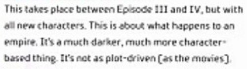
- **Boba Fett** — entry/section: Two words: Boba Fett!: ""Two words: Boba Fett! The series will be about brand new characters, a group of people that we haven't seen yet, except Boba Fett, who will be an instrumental part of it. The series will also showcase other bounty hunters." —Rick McCallum, Star Wars Insider 99, p. 8" Source: *Star Wars Insider #99* (2008), scan p.8
  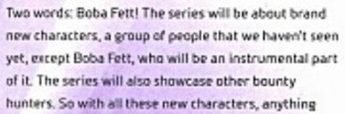
- **none** — entry/section: Technology challenge: ""We've got to create a new set of technologies that allows us to make the TV series look like a feature film, but on a television budget. Because it's Star Wars, it has to have the worlds, it has to be big. That's the biggest challenge for both George and me." —Rick McCallum, Star Wars Insider 99, p. 8" Source: *Star Wars Insider #99* (2008), scan p.8
  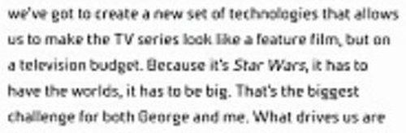
- **none** — entry/section: Music scores: ""It's our plan for each episode to have its own original music score, like we did for The Young Indiana Jones Chronicles TV series." —Rick McCallum, Star Wars Insider 99, p. 8" Source: *Star Wars Insider #99* (2008), scan p.8
  
- **none** — entry/section: Broadcast plans: ""We don't know if it will be cable or network television. It really depends on what will be happening to TV in general. It would be great to have the show ready for the fall of 2009." —Rick McCallum, Star Wars Insider 99, p. 8" Source: *Star Wars Insider #99* (2008), scan p.8
  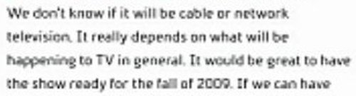
- **none** — entry/section: Favorite TV: ""Film has always been a director's medium, and TV used to be a producer's medium, but now it's really a writer's medium. My favorite series is Deadwood. It's absolutely extraordinary." —Rick McCallum, Star Wars Insider 99, p. 8" Source: *Star Wars Insider #99* (2008), scan p.8
  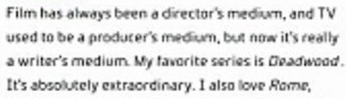
- **none** — entry/section: Losey's bookcase: ""When I first saw Losey in his house in London, he had a wonderful office full of scripts and he had a small bookcase with just eight scripts in it. I asked "What are those?" He said, "Those are the films that I have made, but all the others are the ones I still want to make."" —Rick McCallum, Star Wars Insider 99, p. 8" Source: *Star Wars Insider #99* (2008), scan p.8
  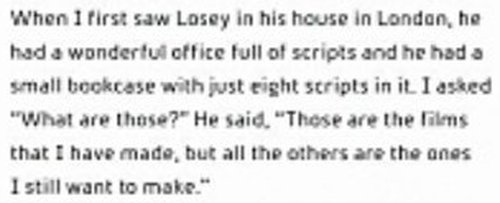
- **none** — entry/section: Red Tails and George: ""Here is what I'm hoping; if we can get Red Tails off and set up, and the Star Wars TV series, finally we've got enough going on to allow him to return to filmmaking." —Rick McCallum, Star Wars Insider 99, p. 8" Source: *Star Wars Insider #99* (2008), scan p.8
  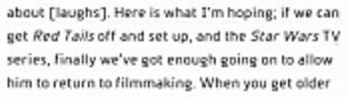

## scan p.9 (scan page 9)

Page contents: Red Five Collectibles USA ad: "Your source for everything Star Wars — Happy New Year"; Attakus and Gentle Giant maquettes (new items), red5collectiblesusa.com (hand-read)

## scan p.10 (scan page 10)

Page contents: Brian's Toys ad ("Home of the World's Largest Selection of Star Wars and G.I. Joe Toys and Collectibles from 1977 to Present"): 30th Anniversary waves, Comic 2-Packs, Saga II/30th Anniversary/Episode III exclusives, McQuarrie figures, Mighty Muggs, Master Replicas FX lightsabers, studio-scale helmets and signature-edition blasters, Vintage Star Wars (SW Boba Fett 21-back B AFA 85, POTF Nikto 92 back AFA 85Y); briantoys.com (hand-read)

## scan p.11 (scan page 11)

Page contents: Brian's Toys ad cont.: Gentle Giant statues and mini-busts, 30th Anniversary specials, "We Are Buying Toys!!!", Star Wars One of Each Figure Club Membership ($7.99) with FAQ, Premier Membership, other "One of Each" clubs (Expanded Universe 2-packs, Gentle Giant mini-busts, Sideshow 12" figures, Attakus statues, Gentle Giant Animated maquettes), 48-color-page catalog (hand-read)

## scan p.12 (scan page 12)

Page contents: "Tales of the Bounty Hunters" opener: full-page painting of Zuckuss, IG-88, Boba Fett and Bossk (magazine p. 12) (hand-read)

## scan p.13 (scan page 13)

Page contents: "Tales of the Bounty Hunters" title page — "They may be minor characters on screen, but beyond the six Star Wars films, bounty hunters have made a significant impact on that galaxy far, far away." Words: Daniel Wallace; IG-88 painting (hand-read)

## scan p.14 (scan page 14)

Page contents: Tales of the Bounty Hunters cont. (Daniel Wallace): intro, "Gray Morality" section; pull quote by LucasArts' Haden Blackman; Aurra Sing photo, Cloud City hunters still, Jango Fett with flamethrower (hand-read)

- **Darth Vader (Anakin Skywalker)** — entry/section: Blackman on the underworld: ""I think they've been firmly established as a major part of the Star Wars underworld—that seedy underbelly that isn't necessarily affiliated with the Jedi, Sith, Empire, or Rebellion. A lot of that stems from how we're first introduced to them. They are working for the evil Empire, and clearly have no qualms about killing, hence Vader's warning of 'No disintegrations.' During the Emperor's rule, it's probably safe to assume that the Rebels didn't pay nearly as well as the Empire or the Hutts, which means that most bounty hunters were working for the wrong side." —Haden Blackman, Star Wars Insider 99, p. 14" Source: *Star Wars Insider #99* (2008), scan p.14
  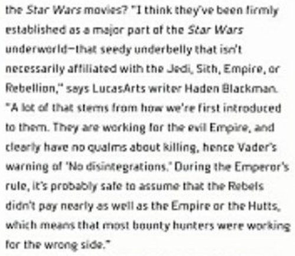
- **none** — entry/section: Stradley on expediency: ""The police are instruments of justice. They're supposed to do the right thing, enforce the law, and maintain order. Bounty hunters on the other hand are instruments of expediency. They care little for legal niceties or lawful due process. ... I think it takes a certain kind of mindset to make a career out of hunting your fellow sentients. A good and decent man probably wouldn't enjoy the job." —Randy Stradley, Star Wars Insider 99, p. 14" Source: *Star Wars Insider #99* (2008), scan p.14
  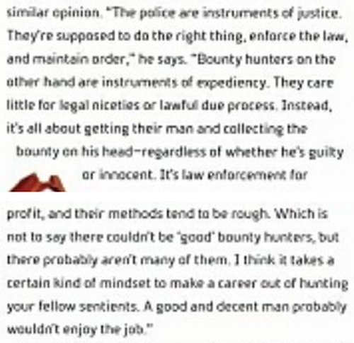

### Stat block notes (game mechanics, not feats)

- Moral ambiguity: Bounty hunters! Their appearance en masse in The Empire Strikes Back struck a note of moral ambiguity in a film series that had already started to deepen its themes. A New Hope reveled in a Flash Gordon-style depiction of good and evil—exemplified by white-garbed Luke Skywalker and black-armored Darth Vader—but the arrival of Boba Fett (clad, appropriately enough, in gray) provided a new window through which to view the struggle of Rebels vs. Empire. Admiral Piett may have sneered "We don't need that scum," but Vader proved that even the Empire sometimes needs specialists. (Daniel Wallace, Star Wars Insider 99, p. 14) (Source: *Star Wars Insider #99* (2008), scan p.14)
- Bounty hunter weapons: Weapons help, too. Boba Fett employs a rocket shooter, flamethrower, EE-3 carbine rifle, and extendable grappling-cord, while the lizard-faced Bossk eschews variety in favor of a brute-force micro-grenade launcher. The insectoid Zuckuss uses quasi-mystical rituals to track his quarry but finishes his fights with a GRS-1 snare rifle. Zam Wesell exhibited a fondness for venomous centipedes. Bounty hunters don't even have to be living beings—with their infrared scanners and tireless robot limbs, 4-LOM and IG-88 are weapons in themselves. (Daniel Wallace, Star Wars Insider 99, p. 14) (Source: *Star Wars Insider #99* (2008), scan p.14)
- Bounty Hunter Code: Despite their violent careers, bounty hunters aren't necessarily bereft of ethical standards. Most live by the Bounty Hunter Code, which specifies that no hunter shall kill without cause or interfere with another's hunt. Precepts such as these are the calling cards of the Bounty Hunters' Guild, an organization that streamlines the hiring process for prospective clients and provides them with a basic guarantee of contractor quality. (Daniel Wallace, Star Wars Insider 99, p. 14) (Source: *Star Wars Insider #99* (2008), scan p.14)

## scan p.15 (scan page 15)

Page contents: Tales of the Bounty Hunters cont.: group art of hunters (Aurra Sing, Jango Fett, 4-LOM, Cade Skywalker, Bossk, Durge, Zam Wesell); Embo-style caption (hand-read)

### Stat block notes (game mechanics, not feats)

- A bounty of hunters: A bounty of hunters (left-to-right): Aurra Sing, Jango Fett, 4-LOM, Cade Skywalker, Bossk, Durge, and Zam Wesell—all deadly in their different ways. (caption, Star Wars Insider 99, p. 15) (Source: *Star Wars Insider #99* (2008), scan p.15)

## scan p.16 (scan page 16)

Page contents: Tales of the Bounty Hunters cont. (Daniel Wallace): EU ubiquity; "The Hunt Is On!" (video games: Bounty Hunter 2002, Star Wars Galaxies); Tales of the Bounty Hunters book covers; game screenshots; pull quote by Dark Horse editor Randy Stradley (hand-read)

- **none** — entry/section: Iconic part of Star Wars: ""Bounty hunters are an iconic part of Star Wars, and when you hear the term, you instantly begin to dream of all the implied possibilities. Bounty hunters have a clearly defined mission and role, and are generally tough. A bounty hunter character could be working for the Empire one moment, and the Rebellion the next, and it all still makes sense." —Haden Blackman, Star Wars Insider 99, p. 16" Source: *Star Wars Insider #99* (2008), scan p.16
  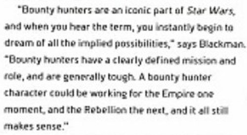

### Stat block notes (game mechanics, not feats)

- Death mark: If the movies made bounty hunters stars, the Expanded Universe has made them ubiquitous. Bounty hunters are familiar characters in novels, comics, and games, and they promise to electrify the upcoming live-action TV show. One thing is certain—no matter where they show up, they bring danger. As General Rieekan put it, "A death mark's not an easy thing to live with," and every day it's a bounty hunter's job to prove him right. (Daniel Wallace, Star Wars Insider 99, p. 16) (Source: *Star Wars Insider #99* (2008), scan p.16)
- Bounty Hunter game: A 2002 console game—inspired by the debut of Jango Fett in Attack of the Clones—changed that by giving the profession a starring role. The game was called, appropriately enough, Bounty Hunter. Project leader Jon Knoles set out to tell Jango's backstory as an Attack of the Clones prelude, explaining how and why Count Dooku selected Jango to be the template for the clone army. (Daniel Wallace, Star Wars Insider 99, p. 16) (Source: *Star Wars Insider #99* (2008), scan p.16)

## scan p.17 (scan page 17)

Page contents: Tales of the Bounty Hunters cont. (Daniel Wallace): Blackman on designing the Galaxies bounty hunter class; Calo Nord, Battlefront II; "By the Book" section begins; art of Aurra Sing, Jango Fett, comics hunters; caption "Multi-media stars: from novels to computer games, to featuring in comic books, the bounty hunters are everywhere!" (hand-read)

### Stat block notes (game mechanics, not feats)

- Hunters in every era: Bounty hunters have continued to pop up in games taking place in every time setting, from the ancient past (Calo Nord in Knights of the Old Republic) to the later struggle of the Galactic Civil War (Boba Fett is a playable character in Star Wars Battlefront II). (Daniel Wallace, Star Wars Insider 99, p. 17) (Source: *Star Wars Insider #99* (2008), scan p.17)

## scan p.18 (scan page 18)

Page contents: Tales of the Bounty Hunters cont.: "By the Book" (Shadows of the Empire, Boushh/Snoova, K.W. Jeter's Bounty Hunter Wars); "In the Frame" (Marvel's Valance; Archie Goodwin & Al Williamson newspaper strips); photos of Boushh, Boba Fett, Bossk, IG-88; caption "This spread: Being a bounty hunter can lead to a short life span—just ask Boba Fett, Greedo or IG-88!"; pull quote by Lucas Licensing Executive Editor Sue Rostoni (hand-read)

### Stat block notes (game mechanics, not feats)

- Snoova: Chewie took the identity of the Wookiee hunter Snoova, sporting a brush-cut hairdo and an angry snarl (also cast in plastic as a Hasbro action figure). Snoova's career came laden with irony, since Wookiees—classified as a slave species by the Empire—often found themselves the targets of hunters. (Daniel Wallace, Star Wars Insider 99, p. 18) (Source: *Star Wars Insider #99* (2008), scan p.18)
- Guild split: In the trilogy, Fett mercilessly disassembles the Guild by splitting it into warring factions, exposing the selfish hearts of its members. This takes place amid Fett's utter indifference to the chaos he's triggered. (Daniel Wallace, Star Wars Insider 99, p. 18) (Source: *Star Wars Insider #99* (2008), scan p.18)
- Ord Mantell strips: Over in the newspaper comics (later collected as Classic Star Wars), writer Archie Goodwin and artist Al Williamson told no less than two versions of the "bounty hunter on Ord Mantell" tale referenced in Empire dialogue; one showcasing a new hunter (Skorr, and his assistant Gribbet); and a second starring the familiar lineup of Boba Fett, Dengar, Zuckuss, 4-LOM, IG-88, and Bossk. (Daniel Wallace, Star Wars Insider 99, p. 18) (Source: *Star Wars Insider #99* (2008), scan p.18)

## scan p.19 (scan page 19)

Page contents: Tales of the Bounty Hunters concl. (Daniel Wallace): Dark Horse's Boba Fett (Dark Empire; Death, Lies, and Treachery by John Wagner & Cam Kennedy; Underworld drawn by Carlos Meglia, series editor Dave Land); "Big Screen Bounty" (prequel hunters, TV series); Greedo, 4-LOM/Zuckuss, IG-88 and comic Boba Fett images; pull quote by Star Wars producer Rick McCallum (hand-read)

- **none** — entry/section: Walk on the wild side: ""It's fun to walk on the wild side, to imagine the things we'd do if we were tough enough, or well-trained and well-equipped enough, or sometimes just crazy enough. The appeal the morally ambiguous anti-hero holds for readers is pretty much the same as the fondness we have for the hero—and the fascination we have with out-and-out villains." —Randy Stradley, Star Wars Insider 99, p. 19" Source: *Star Wars Insider #99* (2008), scan p.19
  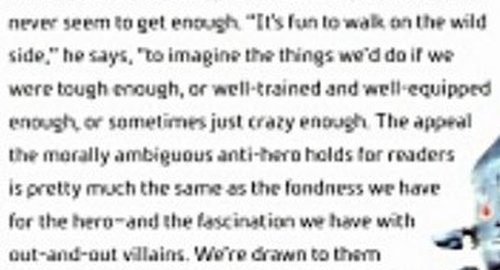
- **Han Solo; Greedo; Boba Fett** — entry/section: McCallum on prequel hunters: ""Ever since Han Solo faced off with Greedo, bounty hunters have been some of the most intriguing characters in the Star Wars galaxy. They have no rules to follow, they get the coolest weapons, and they're always living in a moral gray zone—which makes them endlessly fascinating. When we first caught sight of Boba Fett and his awesome armor, it was obvious there was a whole side of Star Wars that the movies couldn't explore. So, it was great to be able to incorporate some bounty hunters into the prequels." —Rick McCallum, Star Wars Insider 99, p. 19" Source: *Star Wars Insider #99* (2008), scan p.19
  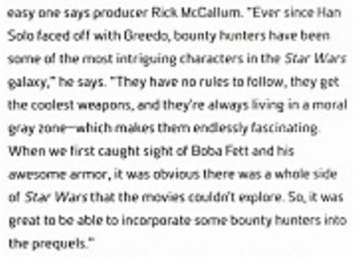

### Stat block notes (game mechanics, not feats)

- Fett confirmed for TV: While plot details are still under wraps, the drama will take place in the gap between Revenge of the Sith and A New Hope, and McCallum promises the return of some familiar faces. Boba Fett is already confirmed as a cast member. (Daniel Wallace, Star Wars Insider 99, p. 19) (Source: *Star Wars Insider #99* (2008), scan p.19)

## scan p.20 (scan page 20)

Page contents: "The Ultimate Hunter" opener (Jeremy Bulloch interview, Jonathan Wilkins): full-page close-up of Boba Fett's battle-damaged helmet; title lettering "ULTIMATE HUNTER" begins across spread (hand-read)

## scan p.21 (scan page 21)

Page contents: "The Ultimate Hunter" title spread concl.: standfirst "Although he's enjoyed a varied and prolific career over 40 years, Jeremy Bulloch is still best known as Star Wars bounty hunter Boba Fett." Words: Jonathan Wilkins; Fett blaster art (hand-read)

## scan p.22 (scan page 22)

Page contents: Jeremy Bulloch interview (Jonathan Wilkins) pt 1: casting, Holiday Special, movements, success, helmet; photos of Vader, Lando, Boba Fett on Cloud City; Fett on Cloud City set photo (hand-read)

## scan p.23 (scan page 23)

Page contents: Bulloch interview cont.: pull quote "To keep the mystique he shouldn't take the helmet off. You see Darth Vader unveiled, but with Fett I feel it would be best if you never see his face." —Jeremy Bulloch; box "Jeremy Bulloch: Films Without Fett" ("He may be best know [sic] as Boba Fett..."): Peter Sellers on Hoffman, Lindsay Anderson on O Lucky Man!, The Spy Who Loved Me; Fett, Jabba's palace hunters images (hand-read)

- **none** — entry/section: Bulloch on Peter Sellers: ""As a comedy actor he was excellent. When you look at him in things like The Pink Panther, it's wonderful stuff, and his timing is superb. You hear stories about his complicated life, but you must judge him for what he did for the whole profession." —Jeremy Bulloch, Star Wars Insider 99, p. 23" Source: *Star Wars Insider #99* (2008), scan p.23
  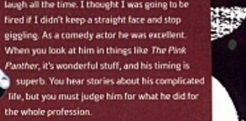
- **none** — entry/section: Bulloch on The Spy Who Loved Me: ""When I saw the huge set on The Spy Who Loved Me, it was just extraordinary. First of all there was the interior of the submarine: that was fantastic enough. Then I was getting shot to pieces on that super tanker set, with stuntmen falling into the water." —Jeremy Bulloch, Star Wars Insider 99, p. 23" Source: *Star Wars Insider #99* (2008), scan p.23
  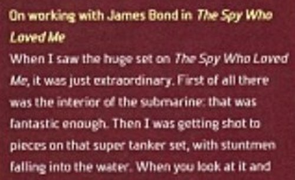

## scan p.24 (scan page 24)

Page contents: Bulloch interview concl. (new Fetts, voice dubbing, Episode III cameo, legacy); box "Daniel Logan: Being Boba" (Logan at Celebration Europe: acting start, becoming young Boba, George Lucas, discovering Fett); images of Boba Fett, Temuera Morrison, Logan, Jango Fett, Bulloch in ROTS (hand-read)

- **Boba Fett; Jango Fett** — entry/section: Fett's voice: ""People often ask me about the voice, which wasn't mine to start with. It was dubbed by an American actor named Jason Wingreen. On the new DVD versions it was re-dubbed by Temuera. I understand why they did it. It was originally raspy, but now has the New Zealand stress on different words. They've done it so there is strong continuity between films." —Jeremy Bulloch, Star Wars Insider 99, p. 24" Source: *Star Wars Insider #99* (2008), scan p.24
  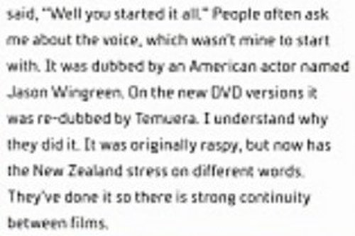
- **Boba Fett** — entry/section: Remembered as Boba Fett: ""I've done a lot of work, but at least I'll be remembered as Boba Fett. People will always remember Star Wars even in 50 years time. Hopefully people will remember the theatre plays and television, but to be known for being part of the Star Wars saga, it's a part of history." —Jeremy Bulloch, Star Wars Insider 99, p. 24" Source: *Star Wars Insider #99* (2008), scan p.24
  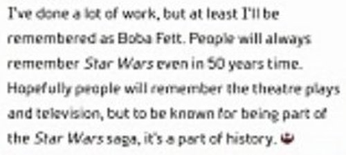
- **Boba Fett** — entry/section: Logan's audition: ""My agent called and screamed "I got you an audition for Star Wars!" I go "Alright. Is that another little movie in New Zealand, or something?" I really didn't know!" —Daniel Logan, Star Wars Insider 99, p. 24" Source: *Star Wars Insider #99* (2008), scan p.24
  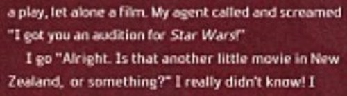

## scan p.25 (scan page 25)

Page contents: Ad: mimobot Star Wars series 1 Art Toy USB Flash Drives (Chewbacca, stormtrooper, Darth Vader, R2-D2) and gloomy bear x mimobot; www.mimobot.com; "Available in 512MB to 4GB capacities" (hand-read)

## scan p.26 (scan page 26)

Page contents: Ad: Entertainment Earth "Your Star Wars Destination Since 1996!": EE Exclusive Elite Forces of the Republic (14 figures incl. Omega Squad, Isabet Reau, Rav Bralor, Mij Gilamar) HS87467AA $66.99; Family Guy Darth Stewie Character Key AMFGCK02 $29.99 (limited 1,000); R2-D2 Interactive Astromech Droid HS87245 $109.99 (hand-read)

### Stat block notes (game mechanics, not feats)

- Interactive R2-D2 ad: Standing nearly 15-inches tall, R2-D2 is your plastic pal who's fun to be with and a handy aid to navigating your way around the universe. ... Resourceful and adventurous, R2-D2 is ready, willing, and able to serve. (Entertainment Earth advertisement, Star Wars Insider 99, p. 26) (Source: *Star Wars Insider #99* (2008), scan p.26)

## scan p.27 (scan page 27)

Page contents: "Bounty Hunters Guild Handbook" opener (Words: Jonathan Wilkins), datapad styling ("Update: Data card access accepted"); Jango/Boba-style Mandalorian armor image; standfirst "The ability to become a bounty hunter is open to all life forms in the galaxy. Success depends on a ruthless nature, cunning, and guile. It's a rancor-eat-rancor universe with glory—or death—just around the corner." (hand-read)

## scan p.28 (scan page 28)

Page contents: Guild Handbook: "Download" panel "The Bounty Hunters Creed"; "Intel" panel "Our Kind of Scum: Bossk" stat box; "Incoming Alerts" (Warning! Be Aware re Boussh; "Shoot first, ask questions later. A slow bounty hunter is a dead bounty hunter. Always!") with Greedo crosshair image (hand-read)

### Stat block notes (game mechanics, not feats)

- The Bounty Hunters Creed: No bounty is worth dying for. People don't have bounties, only acquisitions have bounties. Capture by design, kill by necessity. No hunter shall slay another hunter. No hunter shall interfere with another's hunt. In the hunt one captures or kills, never both. No hunter shall refuse aid to another hunter. (Jonathan Wilkins, Star Wars Insider 99, p. 28) (Source: *Star Wars Insider #99* (2008), scan p.28)
- Bossk stats: Species: Trandoshan. Gender: Male. Height: 1.9 meters. Weapon: Blaster rifle, grenade launcher, flamethrower. Vehicle: Hound's Tooth. (Jonathan Wilkins, Star Wars Insider 99, p. 28) (Source: *Star Wars Insider #99* (2008), scan p.28)
- Bossk regeneration and Guild: A native of the Kashyyyk system, the Trandoshan Bossk has regenerative abilities, allowing him to grow back lost limbs. Bossk is the son of Cradossk, the former head of the Bounty Hunters' Guild. Bossk was awarded the title Monarch of the Qotile system, and murdered the head of CorSec on Corellia, Hal Horn. Bossk gained considerable power by killing and eating his own father. However, under Bossk's flawed leadership, the Bounty Hunters' Guild split into two warring factions: Bossk's Guild Reform Committee and the True Guild backed by Cradossk's devoted followers. (Jonathan Wilkins, Star Wars Insider 99, p. 28) (Source: *Star Wars Insider #99* (2008), scan p.28)
- Bossk vs. Fett: Bossk joined the bounty hunters Tinian I'att and the Wookiee Chenlambec, whom he planned on double-crossing. However, he was conned into liberating a Wookiee prison camp and found himself captured by the Empire, and then barely managed to escape. Bossk's closest rival is Boba Fett, and although the two did team up for a brief period, he never got the better of Fett. With 4-LOM and Zuckuss he launched a bold attempt to intercept Boba Fett and capture Han Solo (who was still trapped in carbonite) en route to Jabba's palace on Tatooine, but the attempt was a dismal failure. (Jonathan Wilkins, Star Wars Insider 99, p. 28) (Source: *Star Wars Insider #99* (2008), scan p.28)
- Warning: Boushh: The bounty hunter known as Boussh [sic] is not to be trusted, especially when accompanied by a Wookiee prisoner. (Jonathan Wilkins, Star Wars Insider 99, p. 28) (Source: *Star Wars Insider #99* (2008), scan p.28)

## scan p.29 (scan page 29)

Page contents: Guild Handbook cont.: "Bounty Alert" WANTED poster (Han Solo and Chewbacca, "Dead or Alive! (Extra bounty if delivered frozen in carbonite!)", contact Bib Fortuna at Jabba's palace, Tatooine; reward courtesy of Jabba the Hutt; small warning text illegible even zoomed); "Intel" Zuckuss stat box with Zuckuss image; "Download" Slave I schematic with Boba Fett quote; "Data" Guild Leaders box (hand-read)

### Stat block notes (game mechanics, not feats)

- Wanted poster: Wanted. Han Solo ... Chewbacca. Dead or Alive! (Extra bounty if delivered frozen in carbonite!) For more information contact Bib Fortuna at Jabba's palace, Tatooine. Reward shall be paid in Republican credits courtesy of Jabba the Hutt. (Jonathan Wilkins, Star Wars Insider 99, p. 29) (Source: *Star Wars Insider #99* (2008), scan p.29)
- Zuckuss stats: Species: Gand. Gender: Male. Height: 1.5 meters. Weapon: Blaster pistol, vibroblade, stun grenades, Merr-Sonn Munitions GRS-1 snare rifle. Vehicle: Mist Hunter. (Jonathan Wilkins, Star Wars Insider 99, p. 29) (Source: *Star Wars Insider #99* (2008), scan p.29)
- Zuckuss and 4-LOM: Amongst the numerous bounties brought in by Zuckuss and his cohort 4-LOM, was Sector Governor Nardix. The capture of the Imperial helped them gain considerable notoriety when they turned him over to the Rebel Alliance. They soon changed allegiance however, helping to destroy the Rebel transport Bright Hope, but after becoming moved by the survivors' sense of comradeship, Zuckuss and 4-LOM joined the Rebellion for a very brief period. After 4-LOM was blasted into pieces while taking part in a mission to steal Han Solo from Boba Fett, Zuckuss put him back together and the pair returned to their old ways. (Jonathan Wilkins, Star Wars Insider 99, p. 29) (Source: *Star Wars Insider #99* (2008), scan p.29)
- Slave I: A Firespray-31-class patrol and attack craft that boasted deadly modifications, the legendary Slave I was a fast ship that boasted near matchless weaponary [sic], extensive countermeasures, and a military-grade sensor relay. With a detention area containing room for six prisoners and one Force cage designed for captured Jedi Knights, Slave I was the kind of ship that most bounty hunters could only dream of. (Jonathan Wilkins, Star Wars Insider 99, p. 29) (Source: *Star Wars Insider #99* (2008), scan p.29)
- Guild Leaders: Guild Leaders: Vossk (Old Republic era); Cradossk (Rebellion era); Guild Council (Legislature). (Jonathan Wilkins, Star Wars Insider 99, p. 29) (Source: *Star Wars Insider #99* (2008), scan p.29)

## scan p.30 (scan page 30)

Page contents: Guild Handbook cont.: "Info" boxes "Find a Hobby" (Aldar Beedo) and "Hunting in the Family" (Beedo/Greedo); IG-88 silhouette; "Intel Files" Dengar stat box with image; "Data" IG-88 box and "The Many Fates of IG-88" chart; 4-LOM stat box with image (hand-read)

### Stat block notes (game mechanics, not feats)

- Find a Hobby: The life of a bounty hunter is fraught with danger and the ever-present risk of sudden, painful death. For some, this isn't enough and certain hunters, such as Aldar Beedo, are happy to take part in the lethal Podraces (especially when there is a bounty on other racers' heads). (Jonathan Wilkins, Star Wars Insider 99, p. 30) (Source: *Star Wars Insider #99* (2008), scan p.30)
- Hunting in the Family: You think that the Fetts are the only related bounty hunters? Think again! Despite the unpleasant demise of his cousin, Greedo, Beedo was a part-time bounty hunter and loyal courtier for Jabba the Hutt. (Jonathan Wilkins, Star Wars Insider 99, p. 30) (Source: *Star Wars Insider #99* (2008), scan p.30)
- Dengar stats: Species: Human. Gender: Male. Height: 1.8 meters. Weapon: Blaster rifle, concussion grenades, vibroblade, blaster carbine. Vehicle: Punishing One Corellian Jumpmaster 5000. (Jonathan Wilkins, Star Wars Insider 99, p. 30) (Source: *Star Wars Insider #99* (2008), scan p.30)
- Dengar's revenge: A former swoop bike rider who fell afoul Han Solo, Dengar's resulting injuries were tended by the Empire. In doing so, the Empire removed any sense of compassion and emotion that Dengar once had, leaving only a burning desire for revenge. Dengar was one of the many bounty hunters sent in pursuit of Han Solo. Although he failed, he did find love with an Aruzan woman named Manaroo and went on to form a partnership with Boba Fett. His current whereabouts are unknown. (Jonathan Wilkins, Star Wars Insider 99, p. 30) (Source: *Star Wars Insider #99* (2008), scan p.30)
- IG-88 origin: Following the events of the Clone Wars, few felt comfortable seeing droids bearing arms. The war droid known as IG-88, a relic from that era did little to dispel the fears of the galaxy's war-weary citizens. Within seconds of activation, IG-88 had achieved sentience and killed the Holowan scientists who had created him. He downloaded his consciousness into three mechanical clones, denoted by letter-suffixes: IG-88B, C, and D. (Jonathan Wilkins, Star Wars Insider 99, p. 30) (Source: *Star Wars Insider #99* (2008), scan p.30)
- The Many Fates of IG-88: IG-88 A—programmed droids in preparation for mass uprising (destroyed during assault on Deathstar II). B—bounty hunter (destroyed on Cloud City). C—bounty hunter (destroyed by Boba Fett). D—bounty hunter (destroyed by Dash Rendar). Each stamped "Destroyed". (Jonathan Wilkins, Star Wars Insider 99, p. 30) (Source: *Star Wars Insider #99* (2008), scan p.30)
- 4-LOM stats: Species: Droid. Height: 1.6 meters. Manufacturer: Industrial Automaton. Type: Protocol droid. Weapon: Concussion rifle, blaster pistol, stun-gas blower. Vehicle: Mist Hunter. (Jonathan Wilkins, Star Wars Insider 99, p. 30) (Source: *Star Wars Insider #99* (2008), scan p.30)
- 4-LOM origin: 4-LOM began his droid life as a cabin steward aboard a luxury liner. A flaw in his programming resulted in him stealing from the passengers he was created to serve. He was soon noticed by Jabba the Hutt, who perverted his programming, giving him combat computer systems and adding the ability to harm sentient beings. He was then teamed with the Gand bounty hunter Zuckuss. (Jonathan Wilkins, Star Wars Insider 99, p. 30) (Source: *Star Wars Insider #99* (2008), scan p.30)

## scan p.31 (scan page 31)

Page contents: Guild Handbook concl.: "Female Hunters"/"Intel" panels: Zam Wesell and Aurra Sing stat boxes with images; Durge stat box with image; "Important Info: Permit to Hunt" (hand-read)

### Stat block notes (game mechanics, not feats)

- Zam Wesell: Species: Clawdite. Gender: Female. Height: 1.68 meters. Weapon: Blaster pistol, projectile rifle, explosives, kouhuns. Vehicle: Koro-2 airspeeder. Zam Wessell [sic] made her way in the universe by using her shapeshifting skills to hunt down and assassinate those with prices on their heads. Occasionally teaming up with Jango Fett, a bounty hunter she met on Oovo IV while tracking down smuggler Bendix Fust, the two hunters shared a mutual respect for one another. Zam even introduced Jango's son, Boba, to reading. Killed in an incident on Coruscant, she proved to be yet another worthy bounty hunter slain in action. (Jonathan Wilkins, Star Wars Insider 99, p. 31) (Source: *Star Wars Insider #99* (2008), scan p.31)
- Aurra Sing: Species: Unknown. Gender: Female. Height: 1.74 meters. Weapon: Lightsaber, blaster, projectile rifle. Vehicle: Modified swoop. Once a potential Jedi herself, Aurra Sing specialized in Jedi hunts, collecting at least six lightsabers from her fallen foes as trophies. Armed with twin blaster pistols and a long projectile rifle, she cut an imposing figure with chalk-white skin and long, bloodletting fingers. Surgically attached to her skull is a long, thin sensor implant that aids her in her hunts. Sing's fate is unknown. Although she disappeared for years, vague rumors suggest that during the Galactic Civil War she took part as a combatant in Jabba the Hutt's demolition contests. (Jonathan Wilkins, Star Wars Insider 99, p. 31) (Source: *Star Wars Insider #99* (2008), scan p.31)
- Durge stats: Species: Gen'Dai. Gender: Male. Weapon: Blaster pistols, explosives, power lance, energy bola, spiked flail. Vehicle: Modified swoop speeder bike. (Jonathan Wilkins, Star Wars Insider 99, p. 31) (Source: *Star Wars Insider #99* (2008), scan p.31)
- Durge: Although he identified himself as a bounty hunter, the Gen'Dai warrior Durge held no allegiance to the Bounty Hunters Guild. A member of a species able to sustain severe physical injury and trauma, yet still survive, Durge also boasted strong reflexes, making him practically unstoppable. Durge was born 2,000 years before the fall of the Republic. ... On being hired by Count Dooku, he joined Asajj Ventress, a dark Jedi and commander within the Separatist military. They unleashed a devastating chemical weapon attack on the Gungan colony moon of Ohma-D'un. Over numerous encounters Durge proved to be a formidable opponent for Jedi and Republic forces until, near the climax of the Clone Wars, he was propelled into a star by Anakin Skywalker. (Jonathan Wilkins, Star Wars Insider 99, p. 31) (Source: *Star Wars Insider #99* (2008), scan p.31)
- Permit to Hunt: A B23-1-14 permit is required to be submitted when collecting a bounty. This entitles a bounty hunter to collect the maximum reward—including local, system, sector, and regional bounties. (Jonathan Wilkins, Star Wars Insider 99, p. 31) (Source: *Star Wars Insider #99* (2008), scan p.31)

## scan p.32 (scan page 32)

Page contents: Kotobukiya feature opener: "Bounty Hunter Series" logo (Imperial crest, Japanese text); Kotobukiya Boba Fett statue firing blaster; concept sketches of 4-LOM-like/Zuckuss and IG-88 figures; Interviews & Translations: Shingo Nakagawa, Mariko Kawamura; "Thanks to" credit line (names omitted); Images: Courtesy Kotobukiya (hand-read)

## scan p.33 (scan page 33)

Page contents: "Feat of Clay" (Kotobukiya Bounty Hunter Series, tilted layout): standfirst "Star Wars Insider gets a truly inside view of the process of creating Kotobukiya's brand new Bounty Hunters Series"; unpainted prototype sculpts of 4-LOM, Zuckuss, Boba Fett, Bossk; intro text (hand-read)

### Stat block notes (game mechanics, not feats)

- Build-a-Vader: Kotobukiya's Bounty Hunter Series kicks off with Boba Fett but will include all the bounty hunters from The Empire Strikes Back: Dengar, 4-LOM, Zuckuss, Bossk, and IG-88. Each model will include a bonus part; when all the parts are collected, you'll be able to build Darth Vader. For example, Boba Fett comes complete with Vader's left arm. Additionally, each model comes with a hexagonal base that can be connected to others in the series in any order, allowing for a variety of display options. (Star Wars Insider 99, p. 33) (Source: *Star Wars Insider #99* (2008), scan p.33)

## scan p.34 (scan page 34)

Page contents: Feat of Clay cont.: Kohei Okui, sculptor of 4-LOM; Junnosuke Abe, sculptor of Zuckuss; sketches and prototype sculpts of 4-LOM and Zuckuss; Feat of Clay design-change captions (hand-read)

- **4-LOM; Han Solo** — entry/section: Okui on sculpting 4-LOM: ""After discussing ideas with Kotobukiya, I create a general sculpt. Once the sculpt is balanced, I try to capture as much detail as I can by going back to the sketch. I try to be careful converting the 2-D parts into real 3-D parts. It all takes about a month, and 4-LOM's eyes took the longest. I'm not an artist, but a creative technician. I'd really like to model Han Solo." —Kohei Okui, Star Wars Insider 99, p. 34" Source: *Star Wars Insider #99* (2008), scan p.34
  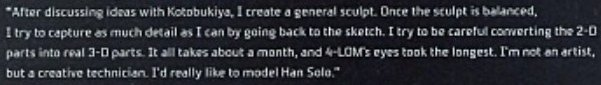
- **Zuckuss; Jabba the Hutt** — entry/section: Abe on sculpting Zuckuss: ""I usually take the sketch that our planning division provides us and draw out an overall image. Then I create a rough sculpt. Afterwards, I work on the detail. I mainly use Sculpey [clay] to mold. I try to maintain whatever makes the character unique. Zuckuss took me about 20 days, especially working on the skin texture. I'd like to work on Jabba the Hutt, all the Jedi, the Rancor that dwells under Jabba's palace—in fact, all creatures in general!" —Junnosuke Abe, Star Wars Insider 99, p. 34" Source: *Star Wars Insider #99* (2008), scan p.34
  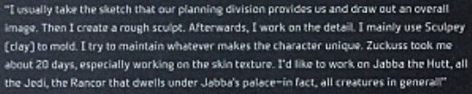

### Stat block notes (game mechanics, not feats)

- 4-LOM design changes: There were some major changes in the creation of this figure. In the original sketch 4-LOM was supposed to have two guns, but it was decided to go with just one gun held in an upright position. More reference material was received after the first approval, so it was possible to add more detail, especially on the head. The head was rounded, while the initial sculpt had a flat head at the top. (Star Wars Insider 99, p. 34) (Source: *Star Wars Insider #99* (2008), scan p.34)
- Zuckuss design changes: Between sculpts one and two several things changed. First Zuckuss was made larger since, when compared to the sandtrooper, Vader, and Boba Fett sculpts, he seemed tiny. The body was made a bit thicker, while the cape was lengthened to hide his shoes. The cape was also crinkled a little more, and the thickness of Zuckuss' fingers was evened out. The design of the sleeve was altered as it was too close to Darth Maul's cape, while the size of the head and tubes were increased. (Star Wars Insider 99, p. 34) (Source: *Star Wars Insider #99* (2008), scan p.34)

## scan p.35 (scan page 35)

Page contents: Feat of Clay cont.: Keiji Iwakura, sculptor of Bossk; Shinya Akao, sculptor of Dengar; Bossk and Dengar sketches and prototype sculpts with design-change captions (hand-read)

### Stat block notes (game mechanics, not feats)

- Bossk design changes: In the original sketch Bossk has a hand grenade in one hand and a gun in the other. Based on feedback from Lucasfilm, Bossk's pose was changed and the hand grenade removed. Between sculpts several things changed: Bossk's thighs and legs were resized because, when compared to the upper part of the body, they seemed too masculine. Because they seemed too thin the sculptor re-sized the waist and body while shortening the skin scales by about 0.5 cm. (Star Wars Insider 99, p. 35) (Source: *Star Wars Insider #99* (2008), scan p.35)
- Dengar scale: Approvals for this item went very smoothly. The only major change made was in the scale. After the first sculpt, the whole figure was reduced by 10 percent. (Star Wars Insider 99, p. 35) (Source: *Star Wars Insider #99* (2008), scan p.35)

## scan p.36 (scan page 36)

Page contents: Feat of Clay cont.: Ryouichi Itou, sculptor of IG-88; IG-88 sketch and prototypes (with/without guns); Boba Fett sketch and painted Boba Fett statue (hand-read)

- **none** — entry/section: Itou on Clone Wars figures: ""It would be challenging and fun to make something from the Clone Wars animation. It would look great if figures from the animation series, say about four inches high, were displayed on the same shelves as the regular statues." —Ryouichi Itou, Star Wars Insider 99, p. 36" Source: *Star Wars Insider #99* (2008), scan p.36
  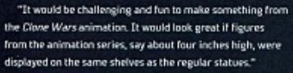

### Stat block notes (game mechanics, not feats)

- IG-88 guns: The first sculpt has no guns because Kotobuyika [sic] was still in the process of making the gun; the second sculpt has guns and more details. (Star Wars Insider 99, p. 36) (Source: *Star Wars Insider #99* (2008), scan p.36)

## scan p.37 (scan page 37)

Page contents: Feat of Clay concl.: Shunji Hagii, sculptor of Boba Fett; Boba Fett painted statue close-up, sketch/prototype photos, workshop photo with early statue; design-change captions (hand-read)

- **Boba Fett** — entry/section: Hagii on sculpting Fett: ""I put lots of effort into Fett's pose, trying to recreate his dynamic movements from the films. It's as if he is just about to fly away using his jet pack. I try to embody the ideas or images of the character. I would like to make a sculpt of an early clone trooper model, like the one which was made as a mock-up for the film. I really love the style and pose." —Shunji Hagii, Star Wars Insider 99, p. 37" Source: *Star Wars Insider #99* (2008), scan p.37
  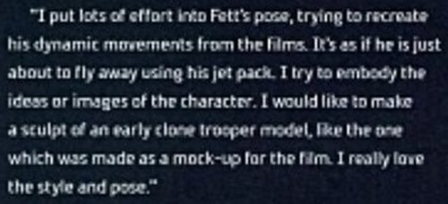
- **Boba Fett** — entry/section: Hagii's method: ""I often exaggerate the original sketch somewhat, trying to make my sculpt more impressive than the original sketch suggested. Generally it takes between one-and-a-half months to two months. It depends on how much time the approval process takes." —Shunji Hagii, Star Wars Insider 99, p. 37" Source: *Star Wars Insider #99* (2008), scan p.37
  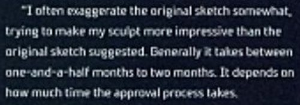

### Stat block notes (game mechanics, not feats)

- Fett sketch smoke removed: In the original sketch, Boba Fett had smoke coming from his back pack. However, it was decided that taking out the smoke would make the figure look much more dynamic and interesting. The smoke was removed from the second sculpt. (Star Wars Insider 99, p. 37) (Source: *Star Wars Insider #99* (2008), scan p.37)
- Fett design changes: Between the first and second sculpts several things changed: the armor fit too closely on Boba Fett's chest, so it was adjusted to stand out from the body. Enlarged shoulder pads were added and the collar was thinned down a little. The knee pad was made smaller, as it was a little bit too wide and looked box-like. (Star Wars Insider 99, p. 37) (Source: *Star Wars Insider #99* (2008), scan p.37)

## scan p.38 (scan page 38)

Page contents: StarWars.com logo; "Boba Begins" opener spread left: collage art of Boba Fett firing blaster against pink Mandalorian skull emblem graffiti, mirrored stencil lettering lower left (hand-read)

## scan p.39 (scan page 39)

Page contents: "Boba Begins" title (Words: Pete Vilmur); standfirst "True to his enigmatic nature, facts about Boba Fett remain as shifty as the sands of the Dune Sea. You may think Fett was first revealed in the infamous 1978 Star Wars Holiday Special, but the history of Proto-Fett tells a very different story."; Boba Fett image with pink Mandalorian emblem (hand-read)

## scan p.40 (scan page 40)

Page contents: Boba Begins pt 1 (Pete Vilmur): San Anselmo parade photos (Vader and Fett), Independent Journal clipping "Even outer space bad guys swelter in Marin", Holiday Special cartoon stills, animation model sheets; caption "This page: Boba Fett's first appearances, in person and in animation from 1978. Opposite page: Ben Burtt introduces Boba Fett in a Lucasfilm screentest."; pull quote George Lucas (hand-read)

### Stat block notes (game mechanics, not feats)

- Fett origin debates: Before Attack of the Clones, the origin of notorious bounty hunter Boba Fett had long been a subject of controversy. Was he a vestige of the Clone army, a Mandalorian mercenary, or a super-stormtrooper? Was he once called Jaster Mereel? Did he in fact survive the treacherous Pit of Carkoon? (Pete Vilmur, Star Wars Insider 99, p. 40) (Source: *Star Wars Insider #99* (2008), scan p.40)
- First public appearance, San Anselmo: Fett had, in fact, made a public appearance nearly two months before the show on a scorching hot day in the streets of San Anselmo, a small Marin County town just north of San Francisco. An unsuspecting press photographer snapped what is likely the very first public image of the intergalactic bounty hunter, marching alongside Darth Vader before droves of spectators at San Anselmo's Community Fair and Parade on September 24, 1978. The photo was plastered across the front page of The Marin Independent Journal the following day. Though the scene-stealing Vader was grand-marshal and consequently grabbed most of the coverage (Boba wasn't even mentioned in the story), the Fett costume must have struck many as exotic, battle-worn, and downright intimidating—which of course was the whole point. (Pete Vilmur, Star Wars Insider 99, p. 40) (Source: *Star Wars Insider #99* (2008), scan p.40)

## scan p.41 (scan page 41)

Page contents: Boba Begins cont.: "Costume Design" section; white Fett prototype costume photos (front/side/back), Ben Burtt with Fett screentest, test-shoot stills, Joe Johnston Fett sketch with serape (hand-read)

### Stat block notes (game mechanics, not feats)

- White Fett: Designing Fett's signature helmet, armor, and accoutrements fell primarily to Joe Johnston, who worked in tandem with Ralph McQuarrie to come up with the bounty hunter's distinctive look. Far removed from the black-on-black wardrobe of Vader, early concepts for Fett clad the bounty hunter in white, possibly a vestige of his "Super Trooper" origins. This all-white Fett was actually the first costume produced for the character, officially unveiled to Lucasfilm insiders in a screen test shot on June 28, 1978. (Pete Vilmur, Star Wars Insider 99, p. 41) (Source: *Star Wars Insider #99* (2008), scan p.41)
- Burtt hosts screentest: In the 20-minute black and white video, sound designer Ben Burtt "hosts" Fett's reveal for Lucas and crew, describing the different weapons, functions, and characteristics of the costume (worn for the test by Empire's assistant film editor Duwayne Dunham, who later directed episodes of TV's Twin Peaks). The somewhat amusing footage depicts Fett with a mocked-up laser rifle (which used a lightsaber hilt for the barrel) and a Star Wars beach towel doubling as the bounty hunter's tattered serape. (Pete Vilmur, Star Wars Insider 99, p. 41) (Source: *Star Wars Insider #99* (2008), scan p.41)

## scan p.42 (scan page 42)

Page contents: Boba Begins concl.: caption "This page: Duwayne Dunham becomes Boba Fett for a screentest shot on the grounds of an early Lucasfilm office."; white Fett screentest photo, signed-photo image, Fett helmet drawings, Fett with Lucas photo; Holiday Special, publicity tour, Bantha Tracks, Kenner figure, Empire release (hand-read)

### Stat block notes (game mechanics, not feats)

- Holiday Special colors: Fett's new color scheme was at least partially revealed in the Star Wars Holiday Special, which aired on November 17, 1978. Animators at Nelvana Studios in Canada simplified the costume's palette a bit by painting the character it in various shades of blue and green (a design scheme that was repeated for Fett's post-trilogy cameo in 1985's Droids cartoon series). The Holiday Special introduced Fett as a friend of the Rebels, but he was soon found to be in secret collusion with Darth Vader. (Pete Vilmur, Star Wars Insider 99, p. 42) (Source: *Star Wars Insider #99* (2008), scan p.42)
- Imperial Shocktroopers: In the summer of 1979, members of the Official Star Wars Fan Club got a glimpse of Boba Fett on the back page of the club's newsletter, Bantha Tracks. Describing Fett as a bounty hunter who "wears part of the uniform of the Imperial Shocktroopers, warriors from the olden time," the seeds were sown to breed rampant speculation about the origin and identity of the mysterious mercenary. (Pete Vilmur, Star Wars Insider 99, p. 42) (Source: *Star Wars Insider #99* (2008), scan p.42)
- Kenner rocket-firing Fett: Kenner Products launched its Boba Fett action figure as part of its second series for 1979. The figure had famously lost its much-publicized spring-loaded rocket-firing feature before release, due to fears of a choking hazard found in a similar toy line. A 13-inch version of Fett was released around the same time. (Pete Vilmur, Star Wars Insider 99, p. 42) (Source: *Star Wars Insider #99* (2008), scan p.42)
- Fett's mythos: Though Fett suffered cutbacks in script rewrites, ultimately the short amount of time he spent on screen probably helped bolster the mythos that surrounds him. With so little revealed about the "galaxy's best bounty hunter," fans were allowed to fill in the details, making for a much more evocative and intriguing character. (Pete Vilmur, Star Wars Insider 99, p. 42) (Source: *Star Wars Insider #99* (2008), scan p.42)

## scan p.43 (scan page 43)

Page contents: Ad: Collectible Grading Authority (CGA/AFA) "The Ordinary Becomes Extraordinary at CGA and You Own It." toygrader.com (hand-read)

## scan p.44 (scan page 44)

Page contents: "May the Sound Be With You!" (Words: Patrick Jankiewicz, Art: JAKe) Ben Burtt feature opener; cartoon Leia in slave outfit; "ZZAP" lettering; standfirst "In a career that has spanned more than three decades, sound designer Ben Burtt has made an immeasurable contribution to Star Wars. Oh, and he brought notoriety to the Wilhelm scream!"; section "Sith Sounds" (hand-read)

- **Darth Vader (Anakin Skywalker)** — entry/section: Burtt did Vader's breathing: ""That's me doing the breathing for Darth Vader. I was responsible for his sound, so I went the cheapest route and did it myself! We wanted a mechanical sound, because that's what allows him to breathe in the mask. I used a scuba tube to get that." —Ben Burtt, Star Wars Insider 99, p. 44" Source: *Star Wars Insider #99* (2008), scan p.44
  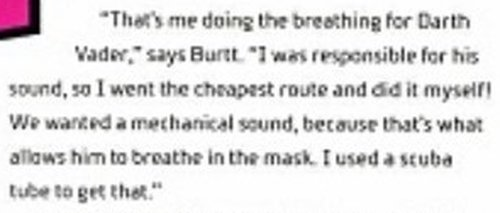
- **Darth Vader (Anakin Skywalker)** — entry/section: Prowse's accent: ""Prowse was used as a guide track. He had a very heavy dialect, a Cornish accent, that didn't really work. They were looking for an Orson Welles-type voice and George [Lucas] found James Earl Jones." —Ben Burtt, Star Wars Insider 99, p. 44" Source: *Star Wars Insider #99* (2008), scan p.44
  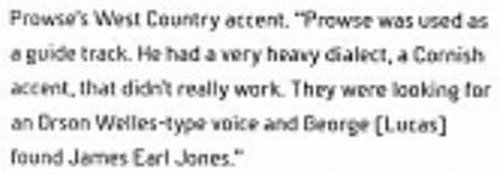
- **Chewbacca** — entry/section: Chewie's voice from bears: ""Chewie's basic voice was made up from the sounds of bears. I worked with a lot of animal trainers to get bears to vocalize. Out of those recordings, I extracted bits and pieces that seemed to have an emotional content to them. It was really just editing lots of little sounds, phrasing them together, that made Chewbacca's vocabulary." —Ben Burtt, Star Wars Insider 99, p. 44" Source: *Star Wars Insider #99* (2008), scan p.44
  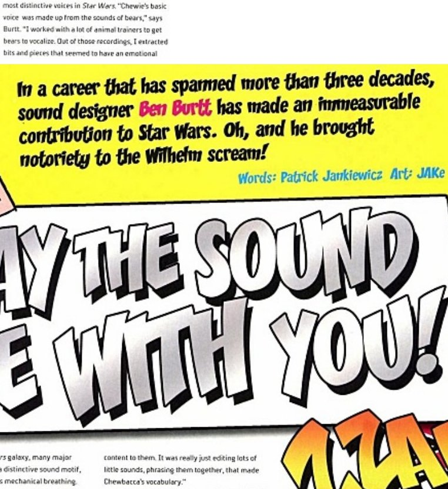
- **Chewbacca; R2-D2** — entry/section: Animal sounds: ""It's all actually animal sounds, with some dog, lion, and walrus in there, but it's mostly adolescent bears. To those of us who have worked on the Star Wars films for a long time, the characters voices become very familiar because we're always working with them. We can speak R2-D2 and make Wookiee sounds in the editing room to get our ideas across." —Ben Burtt, Star Wars Insider 99, p. 44" Source: *Star Wars Insider #99* (2008), scan p.44
  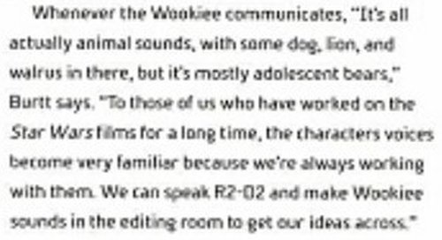
- **Chewbacca; C-3PO** — entry/section: Chewie library for Sith: ""For somebody as well established as Chewie, I have a sound library that goes all the way back to 1977. For Sith, we were able to re-use it, just as we use Anthony Daniels again for C-3PO, as that's how C-3PO should sound. For Chewbacca, all I had to do was open up my Chewbacca library of sounds. We didn't really add much to Chewie for Episode III. There are always things in the sound library that we haven't used yet, and we can make new Chewbacca sounds from components we already have. Nothing new was recorded for him in Episode III, but we used new combinations made from the building blocks of his distinctive sounds." —Ben Burtt, Star Wars Insider 99, p. 44" Source: *Star Wars Insider #99* (2008), scan p.44
  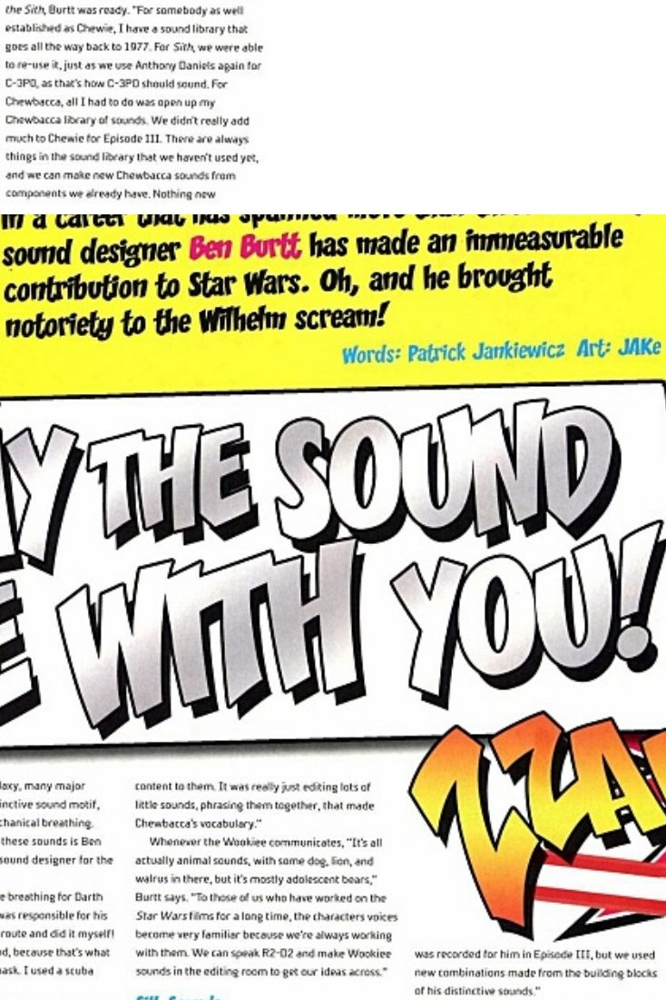
- **Greedo** — entry/section: Greedo's voice a favorite: ""I think Greedo's voice is one of my favorites of all the Star Wars creatures. There's quite a rhythm to it that was amusing and exotic. It worked well." —Ben Burtt, Star Wars Insider 99, p. 44" Source: *Star Wars Insider #99* (2008), scan p.44
  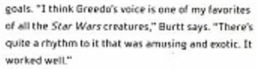

## scan p.45 (scan page 45)

Page contents: Burtt feature art spread: Ben Burtt photo; "Ben Burtt!" lettering; cartoon Vader "HUUHGH HAWWWWW..." with Emperor and Boba Fett; pull quote (hand-read)

## scan p.46 (scan page 46)

Page contents: Burtt feature concl.: cartoon Chewbacca, scout trooper "FREEZE!", Han; Yoda "WHHUUUMMM!"; section "Scream Play"; pull quote "Chewie was made up from the sounds of bears, with some dog, lion, and walrus in there." —Ben Burtt (hand-read)

- **none** — entry/section: Wilhelm scream origin: ""It was from an old Warner Bros. film. I eventually tracked it down to Distant Drums, starring Gary Cooper. Since it was in the Warner Bros. library, they tended to re-use the scream in lots of different films. I noticed this as a kid, listening to movies on television. That same scream tended to come up again and again in widely different contexts." —Ben Burtt, Star Wars Insider 99, p. 46" Source: *Star Wars Insider #99* (2008), scan p.46
  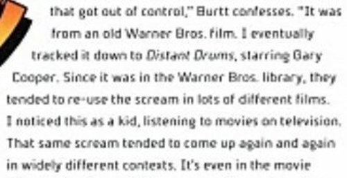
- **none** — entry/section: One-upmanship: ""That kind of one-upmanship went on for years; I used it in Star Wars, The Empire Strikes Back, and Raiders of the Lost Ark, while Richard used it in Batman and his other action movies, like Predator." —Ben Burtt, Star Wars Insider 99, p. 46" Source: *Star Wars Insider #99* (2008), scan p.46
  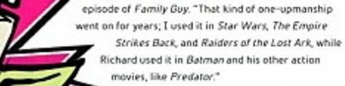

## scan p.47 (scan page 47)

Page contents: Burtt feature concl.: section "In Vision"; cartoon stormtrooper with dewback "WHAAGGH!", "PHESHHH! PHEWSSH!", AT-AT/"ERRAAAHH-HWWWWW!"; pull quote "I'm the guy who captures Han Solo! I say 'Freeze' and he surrenders!" —Ben Burtt (hand-read)

- **Han Solo** — entry/section: Burtt's Jedi cameo: ""I really enjoyed doing that. I'm the guy who captures Han Solo! I jump out and say 'Freeze!' and he surrenders. I did that in front of a blue screen, so it was shot separately from Harrison Ford; I never really worked with him! My acting business was filmed later at ILM, long after shooting the picture was done. Most people on the crew get an opportunity to have a minor part here or there and that was mine. I'm also a Naboo courier in The Phantom Menace." —Ben Burtt, Star Wars Insider 99, p. 47" Source: *Star Wars Insider #99* (2008), scan p.47
  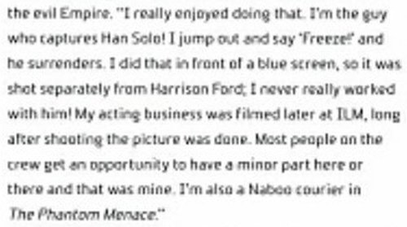
- **none** — entry/section: Poggle the Lesser's voice: ""I really love Poggle the Lesser in Attack of the Clones. He's an alien who is not well known because he wasn't used much, but it was fun trying to see if I could come up with a guy who talked like an insect. He chirps and makes buggy sounds, because he's like a cricket. Although he only has three or four lines and one minor background line in Revenge of the Sith, I really liked that voice. A talking insect was something I'd wanted to do for a long time." —Ben Burtt, Star Wars Insider 99, p. 47" Source: *Star Wars Insider #99* (2008), scan p.47
  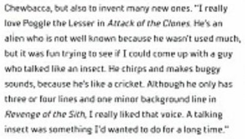
- **none** — entry/section: Ernie Fosselius as Poggle: ""The voice of Poggle was another talented associate of mine named Ernie Fosselius, who directed the early Star Wars parody Hardware Wars. Ernie's a genius in his own right and a talented mimic. I've known him since Hardware Wars, when he brought it to Lucasfilm to show us. Ernie's done many voices for me over the years. For Poggle, I had this idea that you could speak forward, then record it, play it backwards and record it again. Then, by taking a recording I made of blowing on the edge of a piece of paper, I gave it a buggy sound. That, combined with the backwards voice, became Poggle." —Ben Burtt, Star Wars Insider 99, p. 47" Source: *Star Wars Insider #99* (2008), scan p.47
  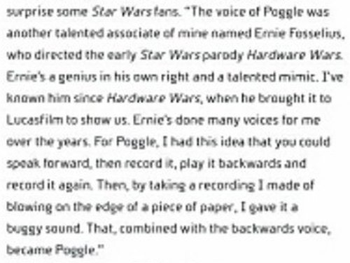
- **none** — entry/section: Matt Wood as Grievous: ""Grievous was voiced by my sound design partner, Matt Wood. We did a lot of the voices together in the last few films. Matt is a good actor and he tried out for the part of General Grievous—anonymously—and won it." —Ben Burtt, Star Wars Insider 99, p. 47" Source: *Star Wars Insider #99* (2008), scan p.47
  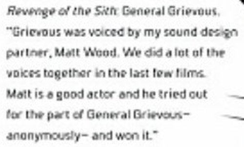
- **Darth Vader (Anakin Skywalker)** — entry/section: Grievous' cough: ""That was George Lucas' idea from the beginning, that Grievous would be coughing. We kind of questioned it, because we weren't sure what that meant for the story. Did it have something to do with Grievous' backstory? How did it connect to the history of the character? We were a little puzzled, but we do what George wants. He wanted Grievous to have these breathing troubles because he is a forerunner of the type of technology that eventually creates Darth Vader." —Ben Burtt, Star Wars Insider 99, p. 47" Source: *Star Wars Insider #99* (2008), scan p.47
  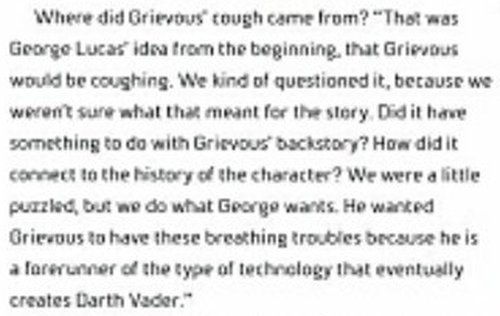
- **none** — entry/section: End of a long era: ""The end of Star Wars is, for me, the end of a long era. I stuck with it because I loved Star Wars and wanted to be part of finishing it. I am very proud to have done Star Wars. It was a great experience!" —Ben Burtt, Star Wars Insider 99, p. 47" Source: *Star Wars Insider #99* (2008), scan p.47
  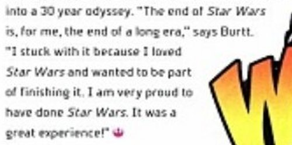

## scan p.48 (scan page 48)

Page contents: "First Crack of the Whip" (Words: Ian Spelling) Young Indiana Jones opener; standfirst "Now available on DVD, The Adventures of Young Indiana Jones was a training ground for the Star Wars prequels. Star Sean Patrick Flanery and producer Rick McCallum recall their real-life globe-trotting adventures making the ground-breaking TV series."; caption "Sean Patrick Flanery plays young Indiana Jones in The Adventures of Young Indiana Jones Volume One - Spring Break Adventure."; DVD box image (hand-read)

## scan p.49 (scan page 49)

Page contents: First Crack of the Whip cont. (Ian Spelling): photo strip with small captions (Corey Carrier as 10-year-old Indy in Passion for Life; Sean Patrick Flanery in Attack of the Hawkmen; Young Indy in Adventure in the Secret Service — partly legible); sections "From Jones to Jar Jar", "Keeping Up with the Jones"; Flanery and McCallum interview (Indiana Jones content, no SW character data) (hand-read)

## scan p.50 (scan page 50)

Page contents: First Crack of the Whip concl.: section "Crystal Skull"; Flanery career, Red Tails (John Ridley writer), McCallum on live-action SW TV series (see Com-Scan); caption "The search for the Treasure of the Peacock's Eye sees young Indiana Jones swing into action."; WWI trench photo caption (illegible); end note "The Adventures of Young Indiana Jones Volume One and Volume Two are available now on DVD. Volume Three will be released Spring 2008." (hand-read)

- **none** — entry/section: Flanery on working with Lucas: ""If you do anything with George Lucas, suddenly people look at you in a different light. I benefited from that. I have no regrets, no complaints. I have worked consistently." —Sean Patrick Flanery, Star Wars Insider 99, p. 50" Source: *Star Wars Insider #99* (2008), scan p.50
  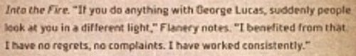

## scan p.51 (scan page 51)

Page contents: Ad: Cloud City collectible toys 1960-1994 "Travel Back in Time at www.cloudcity.com"; vintage C-3PO and R2-D2 figures pictured among other toys (hand-read)

## scan p.52 (scan page 52)

Page contents: Ad: CONDOR XV convention, Feb. 29-March 2, 2008, Handlery Hotel & Resort, San Diego; Guests of Honor Timothy Zahn (Star Wars Novels), Ellen Muth (Dead Like Me) (hand-read)

## scan p.53 (scan page 53)

Page contents: Jawa's Corner departments index ("Packed with all the latest stuff from the Star Wars universe"): Books 54, Comics 56, Games 58, Toys 60, Star Wars Q&A 62, Scouting the Galaxy 64, International Collecting 68, Set Piece 70, Padawan's Corner 72, Indy Vault 74, Comlink 76; Rebel trooper with blaster image (hand-read)

## scan p.54 (scan page 54)

Page contents: Books (Words: Jason Fry): "It's a MAD, MAD, MAD, MAD Galaxy!" — "Thirty years of Star Wars parodies from the 'Usual Gang of Idiots' at MAD!"; MAD About Star Wars (Del Rey, $21.95); captions "Above: Politics and Star Wars, MAD-style." and "Above: Yoda, a MAD favorite, in a page from the MAD collections showing the additional trivia boxes."; pull quote "I was a terrible stormtrooper. I was like a turtle flipped on its shell and I couldn't get back up," (hand-read)

### Stat block notes (game mechanics, not feats)

- Bresman credits: MAD senior editor followed a Lucasfilm college internship with stints as a postproduction assistant on The Young Indiana Jones Chronicles and a conceptual researcher for Episode I. Moreover, Bresman appears in the special edition of The Empire Strikes Back as one of the galaxy's more awkward stormtroopers, and once helped bring Jar Jar Binks to life. (Jason Fry, Star Wars Insider 99, p. 54) (Source: *Star Wars Insider #99* (2008), scan p.54)

## scan p.55 (scan page 55)

Page contents: Books cont.: MAD About Star Wars cover (Written by Jonathan Bresman, Foreword by George Lucas, "Thirty Years of Classic Parodies"); caption "Above and below: More images contained within MAD About Star Wars." (MAD Darth Maul cover, Lucas sketch, "Star Roars" pages); pull quote "The difference between 'Force' and 'farce' is just one letter, so how different could the two worlds really be?" (hand-read)

### Stat block notes (game mechanics, not feats)

- MAD's prescient Star Wars Log: It's also fascinating to see everything MAD anticipated, from products (R2-D2 really has become a wastebasket and a mailbox) to saga plotlines. Frank Jacobs' 1982 "The Star Wars Log" is almost spookily prescient: Jacobs imagines Episode II will be called "Send in the Clones" and predicts the introduction of Boba Fett's father, a Great Droid War, and the revelation that the Force is Luke's real father. (Jason Fry, Star Wars Insider 99, p. 55) (Source: *Star Wars Insider #99* (2008), scan p.55)
- Bresman as pre-Best Jar Jar: He was Jar Jar Binks before Ahmed Best did the honors: Lucasfilm's Ben Burtt recruited him and his colleague Koichi Kurisu as actors for a "videomatic" imagining the scene from Episode I where Qui-Gon and Jar Jar flee the Trade Federation forces. Kurisu was cast as the "strapping, heroic Jedi," while Bresman was tapped as the "awkward, lanky alien." So Bresman found himself running around the hills of Skywalker Ranch in a Jar Jar mask and a yellow-orange sweatsuit. (Jason Fry, Star Wars Insider 99, p. 55) (Source: *Star Wars Insider #99* (2008), scan p.55)
- Bresman's Empire stormtrooper: Then there's Bresman's turn as a stormtrooper in The Empire Strikes Back. Look for him in the scene with Vader leaving Cloud City, trailed by an Imperial officer and two pairs of stormtroopers. Bresman is the trooper closest to the viewer in the first pair. (Jason Fry, Star Wars Insider 99, p. 55) (Source: *Star Wars Insider #99* (2008), scan p.55)

## scan p.56 (scan page 56)

Page contents: Comics (Words: Daniel Wallace): "Unsung Heroes — The Alliance confronts the true face of heroism in Star Wars Rebellion's 'Small Victories'." (Issues #11-14); section "Personal Destiny"; caption "Sneak preview: Early, black-and-white images from Star Wars Rebellion's 'Small Victories'." (hand-read)

- **Luke Skywalker; Leia Organa Solo** — entry/section: Not everyone survives: ""I like the challenge of taking a character that some people don't like or for whom fans have low expectations and building them into someone the readers dig. It's not giving anything away to say that Luke and Leia make it out the other side alive—but others we've come to know aren't so lucky." —Jeremy Barlow, Star Wars Insider 99, p. 56" Source: *Star Wars Insider #99* (2008), scan p.56
  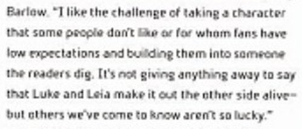

### Stat block notes (game mechanics, not feats)

- Small Victories setup: In "Small Victories," the damaged flagship Rebel One exits hyperspace prematurely and finds itself right beside a top-secret Imperial facility. With no way to contact their comrades, Luke Skywalker, Princess Leia, and everyday heroes like Deena Shan must decide if capitalizing on this one-of-a-kind opportunity is worth the cost of their lives. (Daniel Wallace, Star Wars Insider 99, p. 56) (Source: *Star Wars Insider #99* (2008), scan p.56)
- New faces; Able returns: New faces pop up among the heroes and villains, including Imperial commander D'Vox and his sadistic head of security. On the Rebel side, look for a high-energy squadron of Rebel fighter pilots who are likely to appear in further comics adventures. Able, an aging clone grown from the Jango Fett template, also makes a reappearance alongside other Rebellion supporting characters. (Daniel Wallace, Star Wars Insider 99, p. 56) (Source: *Star Wars Insider #99* (2008), scan p.56)

## scan p.57 (scan page 57)

Page contents: Comics cont.: Rebellion art (Star Destroyers, Leia and Luke panel); section "Fresh Eye" (artist Colin Wilson); pull quote "[We're continuing to] develop these familiar movie characters that we've all come to know inside and out." —Jeremy Barlow (hand-read)

- **Luke Skywalker; Leia Organa Solo; Darth Vader (Anakin Skywalker)** — entry/section: Vector ripples: ""Setting up a long running series in the era is tricky. There's only so much you can do with the big three before you completely strain all credibility. But it's not impossible. We sowed some seeds toward the end of our Empire series run that blossomed into 'My Brother, My Enemy' and left open a lot of possibilities for future stories. Our upcoming Vector crossover will leave some significant ripples, particularly concerning Luke and Leia's interactions with Darth Vader." —Jeremy Barlow, Star Wars Insider 99, p. 57" Source: *Star Wars Insider #99* (2008), scan p.57
  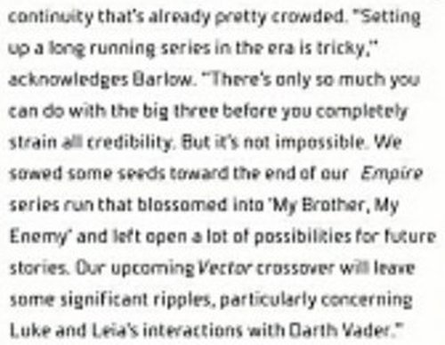
- **none** — entry/section: Wilson on aliens: ""Having not illustrated science fiction for over 10 years, it's the aliens that give me the most problems to draw. It's a huge challenge for me, as having lived in Europe for 16 years, I'm not fully up to speed on all the Star Wars comic work that has been published. I'd like to come up with some new, memorable bad guys!" —Colin Wilson, Star Wars Insider 99, p. 57" Source: *Star Wars Insider #99* (2008), scan p.57
  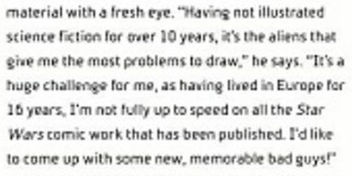

### Stat block notes (game mechanics, not feats)

- Black Eight and Tank: Barlow hints that fans may soon see the formation of the Empire's fearsome Black Eight squadron (introduced in "Walking the Path That's Given" in Star Wars Tales #22), as well as a return visit from Luke's Tatooine friend turned Imperial officer Janek "Tank" Sunber. (Daniel Wallace, Star Wars Insider 99, p. 57) (Source: *Star Wars Insider #99* (2008), scan p.57)

## scan p.58 (scan page 58)

Page contents: Games (Words: Jonathan Wilkins): "Start Wars! — Go into battle while on the move in Star Wars Battlefront: Renegade Squadron." (PSP); box art and screenshots; "Star Wars Battlefront: Renegade Squadron is out now" (hand-read)

### Stat block notes (game mechanics, not feats)

- Renegade Squadron content: The game begins with the evacuation of Yavin 4 and continues through to the Battle of Endor with players commanding a team—chosen by Han Solo—on a variety of daring missions. ... Quite how LucasArts packed in so many maps (Ord Mantell, Boz Pity, and Sullest, to name just three), so many ships (the Millennium Falcon and Slave I among others), and so many all-new playable characters (the Episode IV version of Ben Kenobi and Asajj Ventress—at last!) is a technological mystery. (Jonathan Wilkins, Star Wars Insider 99, p. 58) (Source: *Star Wars Insider #99* (2008), scan p.58)

## scan p.59 (scan page 59)

Page contents: Games cont.: Renegade Squadron screenshots (space battle, Star Destroyer, ground combat); no text (hand-read)

## scan p.60 (scan page 60)

Page contents: Toys (Words: Jeremy Beckett): "Unconventional to Classic — New Star Wars collectibles you can add to your wall, mantelpiece, and toy chest with additions from Acme Archives, Gentle Giant, Hasbro and LEGO"; Gentle Giant Kustomz TIE pilot (rotocast vinyl, $69.99); LEGO Anakin's Starfighter (model #7669) $19.99, 153 pieces; Hasbro Comic Two-Packs (Mouse and Basso; Lieutenant Jundland and Deena Shan; Republic Commando and Super Battle Droid) "All these fully poseable action figures, complete with a Star Wars comic book, are available this month for $9.99!" (hand-read)

### Stat block notes (game mechanics, not feats)

- LEGO Clone Wars starfighter: LEGO introduces a sneak peek in January with a model of Anakin's starfighter that is based on the TV show. For $19.99 you get 153 pieces that assemble into Anakin's new style of starfighter—armed with flick missiles and equipped with an ejection button for R2-D2—in which Anakin does battle with the forces of the Separatists (available in later sets). (Jeremy Beckett, Star Wars Insider 99, p. 60) (Source: *Star Wars Insider #99* (2008), scan p.60)
- Mouse and Basso: After the Rebellion's top cryptographer is captured by the Empire on Jabiim, Rebels infiltrate an Imperial base on Kalist IV to free Jorin Sol before he is tortured into revealing the location of the Alliance's fleet. Disguised as stormtroopers, Mouse and Basso enter the facility to carry out their assignments. While Mouse plants explosive charges to destroy the facility, Basso discovers that captured civilians are being used as slaves by the Imperials, and convinces the Rebels to free them. (Jeremy Beckett, Star Wars Insider 99, p. 60) (Source: *Star Wars Insider #99* (2008), scan p.60)
- Lieutenant Jundland: As part of the team sent to rescue Jorin Sol, Luke Skywalker and fellow agent Deena Shan go undercover as Imperial officers. During the mission, Luke, as Imperial officer Lieutenant Jundland, has his cover blown when he is recognized by an old friend from Tatooine, while Deena gets dragged into some Imperial entanglements of an entirely different nature. (Jeremy Beckett, Star Wars Insider 99, p. 60) (Source: *Star Wars Insider #99* (2008), scan p.60)
- Omega-288 and Oviedo: When a staged attack of Confederate super battle droids, droidekas, and battle droids leads to the defection of one of the Republic's chief weapons manufacturers, Lorca Oviedo, his surviving bodyguards remain loyal to the Republic. Omega-288 leads the remaining clone troopers to recapture Oviedo but as his squad-mates are cut down, only this elite Republic Commando lives to make it to the last remaining transport and bring Oviedo to justice on Coruscant. (Jeremy Beckett, Star Wars Insider 99, p. 60) (Source: *Star Wars Insider #99* (2008), scan p.60)

## scan p.61 (scan page 61)

Page contents: Toys cont.: Acme Archives Red Squadron Giclee print (Peter Ferk; limited to 500, 13"x19", $89.00); Gentle Giant Classic Busts wave 2 (Snowtrooper Commander, Momaw Nadon, Queen Amidala; $30 each); half-page ad: Final Fantasy VII Play Arts figures (Square Enix, distributed by Kotobukiya) (hand-read)

### Stat block notes (game mechanics, not feats)

- Classic Busts wave 2: The Snowtrooper Commander storms through the ice like an unstoppable blizzard bent on crushing the Rebels in Echo Base. In another part of the galaxy, the passive Momaw Nadon sits quietly in a dark corner of the Mos Eisley cantina enjoying a drink—an unsuspecting witness to the start of the end of the Empire. Meanwhile the prodigiously talented Padmé Naberrie represents the prequel trilogy as she becomes the ultimate leader of her people—Queen Amidala of Naboo. (Jeremy Beckett, Star Wars Insider 99, p. 61) (Source: *Star Wars Insider #99* (2008), scan p.61)

## scan p.62 (scan page 62)

Page contents: Q&A (Words: Leland Y. Chee): "The Secret Lives of the Bounty Hunters — Plus: Is IG-88 on Cloud City? Why doesn't Han believe in the Force? Who's on the Jedi Council in Sith?"; contact box (US Titan Magazines, [postal address omitted]; UK [postal address omitted]; [email omitted]); caption "Everyone loves the bounty hunters."; asker names omitted (hand-read)

### Stat block notes (game mechanics, not feats)

- Other bounty hunters' backstories: The other bounty hunters—Bossk, Dengar, IG-88, Zuckuss, and 4-LOM—have established quite a following since their brief, but memorable, scene aboard the Executor in The Empire Strikes Back. Their stories are chronicled in the short story anthology Tales of the Bounty Hunters based around backstories created for the West End Games roleplaying game. Both Bossk and Dengar had personal scores to settle in capturing the Millennium Falcon. Bossk's species, the Trandoshans, have feuded with Wookiees who share the same planetary system. To prove himself, Bossk sought to capture the mighty Chewbacca but was thwarted on several occasions. Dengar's scarred visage was attributed directly to Han Solo, whom Dengar had engaged in a treacherous swoop bike race. During the race, Dengar crashed and it was only through the Empire's efforts to rebuild him that he was able to survive. In so doing, they turned Dengar into a near-merciless killing machine. Dengar removed himself from the employ of the Empire to make a living as a bounty hunter while still harboring a grudge against Han Solo. IG-88 was actually part of a group of IG-88 prototype "Phlutdroids" designated IG-88A, IG-88B, IG-88C, and IG-88D who plotted to take over the galaxy. The IG-88 seen in Empire, is IG-88B who posed as a bounty hunter as a cover for the IG-88s' plot. Zuckuss was a Gand who followed the tradition of his species, learning the skills of the Gand Findsman, bounty hunters who call upon meditation techniques in locating their quarry. Jabba the Hutt partnered Zuckuss with 4-LOM, an insectoid LOM protocol droid who originally started off his criminal career as a master thief. Jabba then altered the droid's programming to turn 4-LOM into a fearsome bounty hunter. (Leland Y. Chee, Star Wars Insider 99, p. 62) (Source: *Star Wars Insider #99* (2008), scan p.62)
- Many Bothans / Manny Both-Hanz: Mon Mothma wears her heart on her sleeve, so any loss of life for the sake of the Alliance pains her. In the Shadows of the Empire comics and novel, we learn that the Bothans lost a small group of pilots to retrieve the Death Star II plans. Of course, for a much more hilarious take, check out Kevin Rubio's Tag and Bink comic which reveals that what we hear in the films as "many Bothans" actually refers to a man named Manuel "Manny" Both-Hanz who, from a simple picture on Mothma's desk, we learn was her lover. Boba Fett shot a hole through poor Manny leaving it to the titular characters Tag and Bink to deliver news of the second Death Star to the Alliance. (Leland Y. Chee, Star Wars Insider 99, p. 62) (Source: *Star Wars Insider #99* (2008), scan p.62)

## scan p.63 (scan page 63)

Page contents: Q&A cont. (Leland Y. Chee): IG-88 in Ugnaught junk room; 12 Jedi Council members in Episode III; Han's disbelief in the Force; Empire timeline (Pablo Hidalgo theory); captions "At least IG-88 didn't become a drink dispenser.", "Proof from Episode III that rumors of Shaak Ti's demise have been greatly exaggerated.", "Han the skeptic."; asker names omitted (hand-read)

- **none** — entry/section: Hidalgo sub-light theory: ""The Falcon traveled at sub-light speeds, unable to engage its hyperdrive. It took, oh, let's say a month. The Falcon approached but could not exceed the speed of light without a working hyperdrive. It managed to achieve 99 per cent lightspeed. According to physics, achieving that percentage of the speed of light means that time behaves differently for the traveler than for an external observer. At .99 the speed of light, one month experienced aboard the Falcon is equal to seven months experienced on Dagobah. Of course, we can vary any of these numbers to get the answer we want; it all depends on whether a ship without hyperdrive can achieve a significant fraction of lightspeed. Of course, in order for something like this to work, we'd have to accept that there would be two systems within a light month of one another, which is an entirely different bag of crazy." —Pablo Hidalgo (quoted by Leland Y. Chee), Star Wars Insider 99, p. 63" Source: *Star Wars Insider #99* (2008), scan p.63
  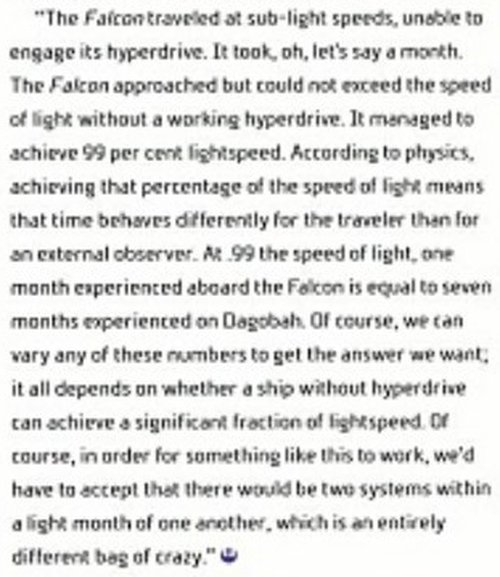

### Stat block notes (game mechanics, not feats)

- Fate of the IG-88s: Yes, the white IG-88 we see in the background in the Ugnaught junk room is IG-88B, the same IG-88 seen aboard the Executor. Calculating the chances that Boba Fett would be the bounty hunter most likely to capture Han Solo, IG-88B anticipated Fett's moves and attempted an ambush at Cloud City. But Fett came out victorious and left the charred remains of IG-88B in the Cloud City junk room. Following the destruction of IG-88B, IG-88s C and D pursued Fett as he was attempting to deliver the carbon-frozen Han Solo to Jabba the Hutt. Boba Fett destroyed IG-88C and his ship the IG-2000 following a duel in orbit above Tatooine. IG-88D found himself stranded on Ord Mantell where he was destroyed by Dash Rendar, a smuggler hired to protect the heroes of the Rebellion. The final IG-88, IG-88A, uploaded its systems into the computer core of the second Death Star at the time of the Battle of Endor, but the Death Star was destroyed by the Rebel Alliance before it could take control. (Leland Y. Chee, Star Wars Insider 99, p. 63) (Source: *Star Wars Insider #99* (2008), scan p.63)
- Episode III Jedi Council: The Jedi Council members we see in Episode III are: Yoda, Mace Windu, Plo Koon, Stass Allie, Shaak Ti, Kit Fisto, Saesee Tiin, Coleman Kcaj, Anakin Skywalker, Agen Kolar, Obi-Wan Kenobi, and Ki-Adi-Mundi. Though you don't see Shaak Ti's face in the film, you get a view of her from behind when Yoda is addressing the Jedi Council from Kashyyyk via hologram; the tell-tale montrals give her away. Her appearance in the upcoming The Force Unleashed video game indicates Shaak Ti survived Order 66. When Palpatine places Anakin on the Council as his personal representative, Anakin becomes the body's 12th member. We can only assume that he has taking the place of Even Piell who was on the Jedi Council in Episode II, but does not appear in Episode III. The ultimate fate of Even Piell has yet to be revealed. (Leland Y. Chee, Star Wars Insider 99, p. 63) (Source: *Star Wars Insider #99* (2008), scan p.63)
- Han and the Jedi: Even during the Old Republic when the Jedi were at their peak, it was very rare for anyone to have seen a Jedi, though they all knew of their exploits. But the Clone Wars stole much of their mystique as countless Jedi, even the greatest of heroes, fell in battle. Order 66 wipes out virtually all traces of the Jedi Order and Palpatine further smears their legacy by accusing them of instigating a coup to assassinate the Chancellor and take control of the Republic for themselves. When democracy "dies with thunderous applause," the majority of the Senate is actually cheering the downfall of the Jedi. Han would have been about 10 years old at the end of the Clone Wars. At that age, he was still a virtual slave aboard the Trader's Luck commanded by the criminally-minded Garris Shrike. He later escaped Shrike and joined the Imperial Academy, but his conscience drove him to desert the Empire. Despite having "flown from one side of this galaxy to the other," there's little chance he would have encountered the all-but extinct Jedi. Obviously from Episode III we know that Chewbacca's experience is much different, but we never get a sense of what his reaction is to Han's words. It should be noted that in a story in Star Wars Tales #11, a young Han crosses paths with Quinlan Vos at Socorro. In that story, Quinlan uses the Force to save Han from a Sarlacc and he also witnesses Vos dispatch a group of Jedi hunters with his lightsaber. Despite what's he's seen, Han is still disbelieving of the power of the Force. Quinlan leaves with an air of mystery and there's a suggestion that he has used to the Force to erase Han's memories of the event. Currently, this story is not considered part of continuity. (Leland Y. Chee, Star Wars Insider 99, p. 63) (Source: *Star Wars Insider #99* (2008), scan p.63)
- Hoth to Bespin timing: The timings might not seem to add up, but the main question has always been how long it takes to fly from Hoth to Bespin. This much we know: The Falcon escapes the Imperial blockade of Hoth and then goes into the nearby asteroid belt. After a brief stop in the belly of a space slug, our heroes emerge from the asteroids in the Anoat system. They then hobble their way toward Bespin. We know they don't have a fully functional hyperdrive, so any distance they travel is going to take some time, even if the Falcon were to have a cobbled together "back-up hyperdrive" as some official sources have suggested. I'm not even going to touch the question of why we don't see Han and Leia change clothes in the film if it's supposed to be a long trip. The timing of Luke's training is even more up in the air; it could be days, or weeks. Who knows? (Leland Y. Chee, Star Wars Insider 99, p. 63) (Source: *Star Wars Insider #99* (2008), scan p.63)

## scan p.64 (scan page 64)

Page contents: Collecting — Scouting the Galaxy (Words: Steve Sansweet): "If You Love Star Wars, Always Believe 'Mam'! — The French connection was a blast, as were 'Fan Days'; when real life collides with collecting"; caption "The lesser spotted Sansweet, in its natural environment." [photo credit omitted]; photo of Star Wars Le Livre-Culte; Star Wars Fan Days in Plano, Texas (put on by Ben Stevens of licensee OfficialPix [co-organizer collector-site owner omitted]); Star Wars Réunion II, Official French Fan Club convention at Le Grand Rex, Paris (Rick McCallum, Robert Watts); signings for The Star Wars Vault (with Pete Vilmur) at Galeries Lafayette and Virgin Megastore, Champs Élysées; CBS Morning Show segment; sidebar "Telegerists Unite!" reader letter on U.K. phone cards (P and J Promotions, 1996) [writer name omitted] (hand-read)

- **none** — entry/section: French fans and the OT: ""I saw a phenomenon I hadn't witnessed before: the French fans treated the original trilogy as if they were watching a midnight screening of The Rocky Horror Picture Show! They "sang" along with the opening music, they lit up their Master Replicas lightsabers and waved them, they cheered the entrance of the heroes... and to be truthful, the villains too. They clearly were having a great time!" —Steve Sansweet, Star Wars Insider 99, p. 64" Source: *Star Wars Insider #99* (2008), scan p.64
  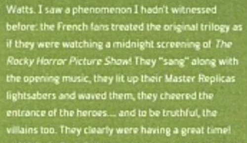

## scan p.65 (scan page 65)

Page contents: Scouting the Galaxy cont. (Steve Sansweet): reply on U.K. phone cards ("telegery"/"fusilately"; max 1,000 of each card; eBay $3–$14); "Video Vault?" reply on Japanese-import OT VCDs (Star Wars Trilogy set made 2000 by Wawasan Videovan in Malaysia, licensed for Malaysia and Singapore; Fox Studios Australia "Backlot" commercial); "Uncut and Unlisted" reply on Topps Widevision uncut sheet ("Star Wars Trilogy Complete Story" retail set, early 1997; est. $40–$50 on QVC); photos of phone cards, VCDs, uncut sheet [photo credits and all letter-writer names/towns omitted] (hand-read)

## scan p.66 (scan page 66)

Page contents: Scouting the Galaxy cont.: "Figure for Fun" reply on 1995+ figures; "Autographed Art" letter about a hand-drawn John Mollo production sketch of Hoth Rebel trooper costumes from The Empire Strikes Back, inscribed by Mollo "...Best wishes, John Mollo. An unpublished sketch." [recipient first name stripped]; Sansweet reply valuing it at $750–$1,000+; contact box ([email omitted]; Scouting the Galaxy, [postal address omitted]); photo of carded figures [credit omitted]; all letter-writer names omitted (hand-read)

## scan p.67 (scan page 67)

Page contents: Subscription ad: "Free Lightsaber and save 35% when you subscribe!" (cover of Insider 99 "Bounty Hunters"); scaled replica lightsabers (Yoda, Obi-Wan Kenobi, Anakin Skywalker), "Normally retails for $35!"; 6 issues for $24.95; www.titanmagazines.com/saber08 (hand-read)

## scan p.68 (scan page 68)

Page contents: Collecting — International (Words: Gus Lopez): "The French Connection — France may be famous as the birthplace of liberty, existentialism, and Jerry Lewis' career, but it has also left its mark in the world of Star Wars collectibles"; photos: La Guerre des Étoiles Meccano carded figure, Meccano Catalogue Général 1980, Miro-Meccano card back (hand-read)

### Stat block notes (game mechanics, not feats)

- Meccano cards: Meccano, the initial toy licensee in France, distributed original trilogy toys designed and made by Kenner Products, but with an unmistakable Gallic touch. The first "12-Back" action figures issued on Meccano cards appeared virtually identical to their Kenner counterparts in the U.S., except with a "La Guerre Des Étoiles" logo across the top and the Meccano logo across the bottom. For the second wave of 20-Back cards, Meccano changed to an innovative square-shaped card design that was unlike anything offered anywhere else in the world. The "La Guerre Des Étoiles" logo was embedded in the metallic-looking bars surrounding the figure image. One of the notable properties of this line was that the cardbacks featured the tall, blue Snaggletooth figure—the same figure from the Cantina Adventure Set sold by Sears in the U.S. Although Blue Snaggletooth was never sold anywhere individually on card, many collectors conjectured that such a figure could exist on a French Meccano card. But only the more common Red Snaggletooth was ever packaged on these Meccano cards. (Gus Lopez, Star Wars Insider 99, p. 68) (Source: *Star Wars Insider #99* (2008), scan p.68)
- 1980 Meccano catalog: The 1980 Meccano catalog is especially notable, as it contains images of unproduced toys from The Empire Strikes Back large-size action figure line, including 12-inch versions of Luke in Bespin outfit, Han in Hoth outfit, Leia in Bespin outfit, and Lando Calrissian. The Lando Calrissian figure didn't even have a sculpted Billy Dee Williams head, but rather a somewhat tacky painted Hardy Boys Parker Stevenson doll made to resemble Lando. As strange, the Tauntaun toy from the three and 3/4-inch figure line was placed, not in the small action-figure section, but among the 12-inch toys in the catalog. Perhaps Meccano thought the Tauntaun would look more attractive dressed in Princess Leia's Bespin outfit? (Gus Lopez, Star Wars Insider 99, p. 68) (Source: *Star Wars Insider #99* (2008), scan p.68)

## scan p.69 (scan page 69)

Page contents: International cont. (Gus Lopez): Cesar plastic masks and more; Lottery Cards (La Française des Jeux, The Phantom Menace); Le Gaulois food promotion (Revenge of the Sith); photos of Ewok masks, lottery cards, Le Gaulois "Célèbre la Saga" banner, Aiguillettes/Quiches Lorraines/Panés Régions packs, Ewoks/Droids boxed video set [traveling companion collector name omitted] (hand-read)

- **none** — entry/section: Le Gaulois display: ""We were determined to take home this display, so the store staff pointed us to the Le Gaulois representative who happened to be in one of the aisles setting up products. She said she'd let me have the Le Gaulois store display for a kiss. Only in France!" —Gus Lopez, Star Wars Insider 99, p. 69" Source: *Star Wars Insider #99* (2008), scan p.69
  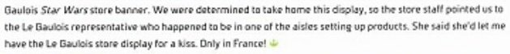

### Stat block notes (game mechanics, not feats)

- Cesar masks: Cesar was another early licensee in France. For A New Hope Cesar produced small plastic masks of C-3PO, Darth Vader, Chewbacca, Stormtrooper, and Tusken Raider; it followed up with a Yoda mask for The Empire Strikes Back. Cesar also issued masks for the Ewoks cartoon series including Chief Chirpa, Paploo, Wicket, and Princess Kneesaa in the same style as the animated characters. The Droids and Ewoks cartoon series were heavily promoted in France, and a boxed set of videos from both programs was sold by Fox Home Entertainment. It included a wristwatch, one Droids video, one Ewoks video, and a large poster. (Gus Lopez, Star Wars Insider 99, p. 69) (Source: *Star Wars Insider #99* (2008), scan p.69)
- French lottery cards: For the Star Wars prequels, La Francaise des Jeux introduced for the French market the first-ever Star Wars lottery cards, with nine different character images from The Phantom Menace. This sparked a controversy among some collectors about whether to save unscratched but potentially winning tickets or to save only non-winning tickets that have already been scratched off. Somewhere out there, there could be a lucky unscratched Jar Jar ticket worth millions! (Gus Lopez, Star Wars Insider 99, p. 69) (Source: *Star Wars Insider #99* (2008), scan p.69)

## scan p.70 (scan page 70)

Page contents: Set Piece (Words: Chris Trevas): "The Invisible Hand: General Dooku's Quarters"; sidebar "The Prisoner"; caption on Trisha Biggar's Palpatine robes (Ian McDiarmid quote) (hand-read)

### Stat block notes (game mechanics, not feats)

- Filming Dooku's final scene: "[I]'ve been looking forward to this," utters Count Dooku as the two Jedi confront him with lightsabers ablaze. They have come to free the Chancellor, but this scenario has been arranged by Dooku and his master to bring Anakin Skywalker closer to the dark side. It was Thursday, July 31, 2003 when the filming of this scene began, but construction of the set had yet to get underway. Christopher Lee stood alone in full costume reciting his lines on Stage 1 at Fox Studios Australia completely surrounded by bluescreen. Hayden Christensen, wearing his street clothes, replied with Anakin's lines from off camera. (Chris Trevas, Star Wars Insider 99, p. 70) (Source: *Star Wars Insider #99* (2008), scan p.70)
- Dooku's cut plea: Lee wrapped all his planned close-ups by the next day, including a few shots with his fellow actors and Dooku's final moments at Anakin's mercy. Lee felt it was out of character for Dooku to plead for help as written in the script, so in a quick change on set the word "help" was removed from his dialogue. Ultimately George Lucas dropped all of Dooku's last lines in the editing room. He felt Lee's expressions said all that was needed for the scene. (Chris Trevas, Star Wars Insider 99, p. 70) (Source: *Star Wars Insider #99* (2008), scan p.70)
- Stage 7 set and digital head: It was over a month later that the General's quarters were completely finished and ready for action. This set, one of the largest created for Revenge of the Sith, was erected on Stage 7 at Fox Studios. Stuntman Kyle Rowling filled Dooku's boots for the lightsaber dueling as he did previously on Attack of the Clones. Again, Industrial Light & Magic would be replacing his head with a digital model of Lee's although they made a completely new version. Lee's likeness had been captured photographically with a special set-up of six cameras shooting instantaneously to capture a precise still moment. This data combined with a digital scan of the actor's head resulted in a model far more detailed than ever before that could be used for much closer shots. (Chris Trevas, Star Wars Insider 99, p. 70) (Source: *Star Wars Insider #99* (2008), scan p.70)
- Shepperton pick-up: In early September of 2004, Christopher Lee returned for additional shooting at Shepperton Studios in his native England. Again there was no set. He was simply surrounded by a sea of greenscreen. Only one shot was required this time, Count Dooku using the Force to bring a balcony down on Obi-Wan's legs. After a couple of takes, Lee's work on the film was completed. On the big screen his character meets his demise in a stunning betrayal by his master Darth Sidious. For the actor, the decapitation merely marked the end of another role in a long, varied career, and the head he loses to Anakin Skywalker is merely digital. (Chris Trevas, Star Wars Insider 99, p. 70) (Source: *Star Wars Insider #99* (2008), scan p.70)
- The Prisoner: The glowing effects around the bands restraining Palpatine's wrists were a late addition in post-production. Something was needed to clarify that he was bound to the chair since the silver bands weren't obvious enough. Several colors were tried before the blue force field was chosen. (Chris Trevas, Star Wars Insider 99, p. 70) (Source: *Star Wars Insider #99* (2008), scan p.70)

## scan p.71 (scan page 71)

Page contents: Set Piece cont. (Chris Trevas): callout boxes "The Set" (handrails used by stunt performers for stretching), "Art" (Anakin and Dooku lightsabers), "Contingency", "Count Dooku", "The Cast" (hand-read)

- **Count Dooku** — entry/section: Dooku means poison: ""Not many people realize that dooku is Japanese for 'poison,'" says Christopher Lee. "Which is very appropriate, really, because he's lethal." —Christopher Lee, Star Wars Insider 99, p. 71" Source: *Star Wars Insider #99* (2008), scan p.71
  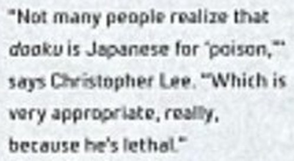

### Stat block notes (game mechanics, not feats)

- Lightsaber props: For Revenge of the Sith, the prop department constructed a more refined version of the Anakin lightsaber than the one we see in Episode IV. While the old prop was just a dressed up antique camera flash attachment, this new one was a completely custom machined, highly polished incarnation. Count Dooku's lightsaber changed very little since the making of Attack of the Clones. The one minor change was on the 'elbow' area, which became chrome after being painted only silver previously. The prop department could by now chrome plate a wider variety of materials allowing them to give the prop a more unified finish this time. (Chris Trevas, Star Wars Insider 99, p. 71) (Source: *Star Wars Insider #99* (2008), scan p.71)
- The Set: Handrails are not a common feature on Star Wars sets. In this Galaxy full of turmoil, safety regulations are typically a low concern. The stunt performers made use of the rails here for their stretching exercises between takes. (Chris Trevas, Star Wars Insider 99, p. 71) (Source: *Star Wars Insider #99* (2008), scan p.71)
- Contingency: The starship battle raging outside these windows was planned out in great detail to keep the continuity and flow of the battle from shot to shot. (Chris Trevas, Star Wars Insider 99, p. 71) (Source: *Star Wars Insider #99* (2008), scan p.71)
- The Cast: Between takes Christopher Lee recalled stories of various fight scenes he'd filmed during his long career, including multiple times when he's had to decapitate opponents in other films. (Chris Trevas, Star Wars Insider 99, p. 71) (Source: *Star Wars Insider #99* (2008), scan p.71)

## scan p.72 (scan page 72)

Page contents: "Padawan's How to Draw: Zuckuss — Your mission is to capture a likeness of notorious galactic bounty hunter Zuckuss!" (byline on p73: Cynthia Cummens); Steps 1–3 with sketches; final art on Bristol Vellum (hand-read)

### Stat block notes (game mechanics, not feats)

- Zuckuss intro: Throughout the Star Wars galaxy, there's a vast assortment of bounty hunters who will stop at nothing to capture those with a price on their head. Your mission today is a bit less dangerous—capture a likeness of Zuckuss, the bug-like bounty hunter hired to find the Millennium Falcon. He failed in his mission, but your creativity will succeed! (Cynthia Cummens, Star Wars Insider 99, p. 72) (Source: *Star Wars Insider #99* (2008), scan p.72)

## scan p.73 (scan page 73)

Page contents: Jedi Corner (Words & Artwork: Cynthia Cummens): Zuckuss drawing Steps 4–7 (shading, monochromatic underpainting, transparent local color/Photoshop, white highlights); closing "Remember, there's no limit to what you can do... Happy Sketching!" (applies also to p72 tutorial byline) (hand-read)

## scan p.74 (scan page 74)

Page contents: Indiana Jones — Indy Vault #7 (Words: J.W. Rinzler): "From the Mind—and Pencil—of Steven Spielberg, Chapter 1"; Temple of Doom cave matte painting image; "Next issue: Angry Wu Han!" (hand-read)

### Stat block notes (game mechanics, not feats)

- Spielberg sketch to matte painting: Hundreds of shots in the Indiana Jones films started out with a bare-bones, stick-figure sketchby director Steven Spielberg. Sometimes these drawings were so difficult to read or understand that the director would have to "translate" them for the storyboard artists. In this case Spielberg's drawing outlines what he wanted for the subterranean gorge leading up to the Temple of Doom: "side light on three heroes; teeth [descending from the ceiling]; rocks almost like eyes, spooky; red glowing lights on side." Around December 8, 1983, ILM storyboard artist Stanley Fleming transformed Spielberg's sketch into a matte painting visual effects storyboard. Indy, Willy, and Short Round would be shot on a stage; the cave would become a matte painting—or "MP9"—by Frank Ordaz. Some time later everything would be composited together for the film's final shot. (J.W. Rinzler, Star Wars Insider 99, p. 74) (Source: *Star Wars Insider #99* (2008), scan p.74)

## scan p.75 (scan page 75)

Page contents: Indy Vault #7 cont.: Spielberg's rough sketch, annotated "Spielberg's roughs for Stan Fleming's story board 'Indiana Jones' Dec 1983 MP-9"; ILM storyboard stamped "Indy II 1983 Dec 8 1983", "Description: INT. CAVE Indy, Willy & Shorty come toward camera at a slight 3/4 angle.", "MP 9" (hand-read)

## scan p.76 (scan page 76)

Page contents: Comlink — The Star Wars Insider Mailbag: fan-feature "[fan couple's online name] – A Star Wars Love Story...." (Canadian couple's Star Wars wedding/stormtrooper-helmet photos; first-person fan text; no character content); contact box (Titan addresses; [email omitted], [email omitted]); names, hometown and photo details of fan couple omitted (hand-read)

## scan p.77 (scan page 77)

Page contents: Comlink cont.: end of fan-couple feature (helmet photos, CBC open house, "Young Stormtroopers in Love") [names/hometown omitted]; "Bounty Hunters" photo section sponsored by Kotobukiya ("Meet the stars, show the evidence, win the bounty! ... Each winner will receive a super Kotobukiya Star Wars statue, worth about $100!"); letter "[501st ID omitted] Scores a Double Bounty": Southern California Garrison of the 501st Star Wars celebrity dinner in San Diego during Comic-Con 2004 with Peter Mayhew, Daniel Logan, Ray Park, Jeremy Bulloch and Kenny Baker (pictured: Bulloch and Baker); Mary Franklin and the Star Wars Emporium; footer "Can you guys go one better? Did you approach Anthony Daniels? Have you shaken hands with Harrison Ford? Or maybe you cuddled Christopher Lee? We want to see your photos!" (hand-read)

## scan p.78 (scan page 78)

Page contents: Next-issue ad: "In the Next Issue.... We celebrate 100 issues with 100 Greatest Things About Star Wars.... Ever!" (Vader helmet); US newsstands March 4, UK newsstands March 6 (hand-read)

## scan p.79 (scan page 79)

Page contents: Back-issue ad: "Missed an Issue of Star Wars Insider?" covers #94 Legacy, #95 The Clone Wars!, #96 Rise of the Empire, #97 Luke & Leia, #98 The Galaxy's Greatest Heroes!; issues $8.50, special issues $10.50; [phone number omitted], www.titanmagazines.com (hand-read)

## scan p.80 (scan page 80)

Page contents: StarWarsShop.com #23 ad, "Presents Tosche Station": Hasbro's Star Wars Mighty Muggs ("The 'Chunkies' are ready to take their place in your collection!"), $12.99 each: Stormtrooper, Darth Maul, Darth Vader, Boba Fett, Chewbacca, Han Solo ("Han Solo comes showing off his trusty blaster weapon – and a single chest hair!") (hand-read)

## scan p.81 (scan page 81)

Page contents: StarWarsShop ad 2: "501st Legion Trooper Helmet LE" $399.99 (Master Replicas; "weathered" Revenge of the Sith helmet, blue accents "representing the 501st Special Ops Squadron"; made from original ILM digital files; limited to 750 pieces worldwide) (hand-read)

## scan p.82 (scan page 82)

Page contents: StarWarsShop ad 3: "Star Wars: The Force Unleashed Deluxe Electronic Lightsaber" $29.99 each ("Will you join Darth Vader as the next great Sith? Or, will you choose to defend peace and justice as a noble Jedi knight?"; Jedi green / Sith red color-change blade over three feet long; spring-open Sith spikes) (hand-read)

## scan p.83 (scan page 83)

Page contents: Kotobukiya ad: "General Grievous ARTFX Statue, approximately 11" tall — Available Now! Direct from Japan"; "Link General Grievous with the Obi-Wan ARTFX statue" (each sold separately); www.KotoStarWars.com (hand-read)

## scan p.84 (scan page 84)

Page contents: Back cover ad: eFX (Vader helmet) "07·23·08", www.efxcollectibles.com (hand-read)

