# Owner Material 038 — Star Wars Insider #1–153 plus specials (with The Lucasfilm Fan Club Magazine #1–22): Star Wars Insider #100 (2008)

- **Source:** *Star Wars Insider* magazine (issues 23–153, 1994–2014) and its predecessor *The Lucasfilm Fan Club Magazine* (issues 1–22, 1987–1994), plus seven special editions: articles, interviews, comics and short fiction Secondary source (licensed Legends reference). Scan OCR'd on the box; the scan stays box-only and is **not** published.
- **Method:** every scanned page was OCR'd and machine-screened sentence by sentence for power-relevant statements (fights, kills, defeats, Force feats, rankings, superweapons) that name a character on our roster; each kept sentence is quoted verbatim from the OCR text and has a crop of the printed passage directly under it. Pages with nothing power-relevant are still listed with what is on them.
- **Citation:** "*Star Wars Insider #100* (2008), p.X" by printed page ("scan p.X" where no printed number applies). **Weight:** Licensed magazine: a secondary source. Its short fiction and comics are Legends stories; its articles and interviews sum up or discuss lore and rank below the novels, comics and games they describe.

## scan p.1 (scan page 1)

Page contents: Cover, Issue #100 April 2008, $7.99 (price glyph low-res; crop reads $7.99): top strip "Celebrate Star Wars Insider's 100th Issue"; Darth Vader helmet image; "We celebrate 100 issues with the 100 Best Things About Star Wars... Ever!"; (c) 2008 Lucasfilm Ltd. (hand-read)

## scan p.2 (scan page 2)

Page contents: Top Trumps ad (Winning Moves): "The World's Coolest Card Game"; "So How D'You Play?" rules (30 cards; choose best statistic, e.g. "Jedi Powers: 80"); sample Darth Maul "Sith Lord" card: Height (metres) 1.75, Brains 9, Dark Side 24, Jedi Powers 80, Battle Skills 48, Force Factor 1; online play box ("Wield your powers against other fans from around the world!") (hand-read)

### Stat block notes (game mechanics, not feats)

- Top Trumps Darth Maul card: Darth Maul is a creature of pure evil, a Sith warrior trained in the use of the dark side of the Force. Loyal to his Master, Darth Sidious, Maul yearns to avenge the destruction of the Sith. An accomplished fighter, with a red double-bladed lightsaber, Darth Maul takes on both Qui-Gon Jinn and Obi-Wan Kenobi in the Theed Palace on Naboo. (Top Trumps ad, Star Wars Insider 100, p. 2) (Source: *Star Wars Insider #100* (2008), scan p.2)

## scan p.3 (scan page 3)

Page contents: Top Trumps ad cont.: four packs — Star Wars Episodes IV-VI, Episodes I-III, Starships, Clone Wars (glow-in-the-dark cards & case); "Special Offer for Insider Readers!" all 4 titles for just $20 with free shipping & handling, www.toptrumps.com/insider; "Collect all 4 titles and master your knowledge of the saga..." (hand-read)

### Stat block notes (game mechanics, not feats)

- Top Trumps Episodes IV-VI pack: Are Boba Fett's 'Battle Skills' stronger than Han Solo's? Is Yoda taller than a Jawa? And who has the ultimate 'Brains'? (Top Trumps ad, Star Wars Insider 100, p. 3) (Source: *Star Wars Insider #100* (2008), scan p.3)
- Top Trumps Episodes I-III pack: Who is the more powerful Jedi - Anakin Skywalker or Obi-Wan Kenobi? Does General Grievous have better 'Battle Skills' than Darth Maul? Is there anyone with less 'Brains' than Jar Jar? And is Tarfful taller than the mighty Chewbacca? (Top Trumps ad, Star Wars Insider 100, p. 3) (Source: *Star Wars Insider #100* (2008), scan p.3)
- Top Trumps Clone Wars pack: Set between Episodes II and III of the Star Wars Saga, the Clone Wars animated series is the must see experience for fans everywhere! Featuring the amphibious Jedi Knight Kit Fisto, the evil Asajj Ventress and everyone's favorite Jedi Master, Yoda, these glow-in-the-dark cards include a Star Wars family tree on the reverse. (Top Trumps ad, Star Wars Insider 100, p. 3) (Source: *Star Wars Insider #100* (2008), scan p.3)

## scan p.4 (scan page 4)

Page contents: Contents, "Issue #100 Celebrations". Introduction: 07 George Lucas Letter; 09 Editor's Welcome (Issue 100 Sweepstakes). Starwars.com: 12 Best of Starwars.com (Top 10 most unlikely Unleashed action figure characters). The Big Feature: 16 The 100 Greatest Things About Star Wars... Ever! (Top 100 most popular starwars.com Databank entries by 2007 page views). Departments, "Jawa's Corner: The Force Unleashed Special": 68 Books (Sean Williams novelizing The Force Unleashed); 70 Comics (TFU graphic novel); 72 Games (Sam Witwer and LucasArts' Project Lead Haden Blackman); 74 Toys (Hasbro, LEGO TFU range); 76 Star Wars Q&A (Luke's replacement hand, which Ewok is which, Boss Nass); 78 Scouting the Galaxy (1977 Star Wars Toyota Celica Plus, Galactic Heroes combo conundrum, book recommendations; Steve Sansweet); 82 International Collecting (Germany); 84 Padawan's Corner (draw Yoda); 86 Set Piece (Watto's shop); 88 Indy Vault (Spielberg storyboards); 91 Comlink Letters & Bantha Tracks (Bounty Hunters celebrity photos). Photo: Princess Leia figure on stage before a crowd. (hand-read)

### Stat block notes (game mechanics, not feats)

- Big Feature blurb: An epic feature, 100 issues in the making! Star Wars Insider presents the Top 100 most popular entries from the starwars.com Databank section, as voted for by you! The Databank is one of the most popular sections of starwars.com, listing key characters, vehicles, locations, and other elements from the Star Wars galaxy. Based on your page views throughout 2007, we present your Top 100 choices! (Star Wars Insider 100, p. 4) (Source: *Star Wars Insider #100* (2008), scan p.4)

## scan p.5 (scan page 5)

Page contents: Painted art (signed Hugh Fleming): Star Wars rock concert — Darth Vader on guitar, Luke Skywalker on guitar, Chewbacca on drums, Han Solo, C-3PO at keyboards, R2-D2; "100" with the two Issue #100 covers (newsstand "100 Best Things About Star Wars... Ever!" and the silver/gold subscriber variant) (hand-read)

## scan p.6 (scan page 6)

Page contents: WizKids ad: Star Wars PocketModel TCG (Trading Card Game) — "Order 66 Executed March 2008"; "Includes decals for customizing your units"; cards shown: Imperial ..., 501st Legion, Peacekeepers; hooded Anakin with clone troopers; www.starwarspocketmodeltcg.com; (c)2008 WizKids, Inc. (hand-read)

## scan p.7 (scan page 7)

Page contents: George Lucas Letter, "Dear Readers of Star Wars Insider", signed George Lucas; full-page portrait of George Lucas; "Star Wars Celebrating 100 Issues" logo (hand-read)

- **none** — entry/section: Issue 100 milestone: ""It seems like it wasn't that long ago that I was congratulating Star Wars Insider for a milestone 50th issue, and here it is, Issue 100! Actually, it was only seven years ago, and we were shooting Episode II in Australia when the 50th issue came out. It had taken 13 years to reach that number, yet only about half that amount of time to reach the lofty century mark. So I have to assume that the editors and staff have been marching double-time to meet all of your needs." —George Lucas, Star Wars Insider 100, p. 7" Source: *Star Wars Insider #100* (2008), scan p.7
  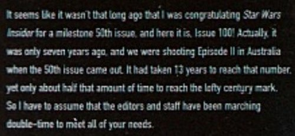
- **none** — entry/section: Insider after Bantha Tracks: ""The Insider took over as our main means of fan communications after our internal newsletter, Bantha Tracks, published its last issue in 1987. To some, it seemed like a strange time to start a new Star Wars magazine since there were no new movies on the horizon. But one fan had a dream, and he made it come true. That's one reason that Insider has always meant so much to us here at Lucasfilm—it's a magazine written and produced by fans for other fans." —George Lucas, Star Wars Insider 100, p. 7" Source: *Star Wars Insider #100* (2008), scan p.7
  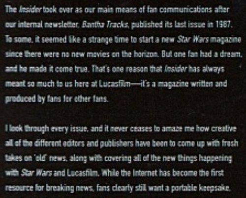

## scan p.8 (scan page 8)

Page contents: Mimoco ad: mimobot Designer USB Flash Drives — "Mimobot Series 2 Joins Forces with Mimobot Series 1"; Luke X-wing pilot, stormtrooper, Darth Vader, Boba Fett, Luke, Leia, Han, Chewbacca, R2-D2 drives; www.mimobot.com; starwars.com/fan; official Star Wars fan club logo (hand-read)

## scan p.9 (scan page 9)

Page contents: Masthead, Issue #100 April 2008: Contact US Star Wars Insider, Titan Magazines, [postal address omitted]; UK [postal address omitted]. Editorial: Editor Brian J. Robb; Deputy Editor Jonathan Wilkins; Senior Editor Simon Hugo; Art Editor Karl Barr; Assistant Editor Emma Matthews; Assistant Editors Zoe Hedges, Neil Edwards; Admin Assistant Hannah Tibbetts. Lucasfilm: Director of Publishing Carol Roeder; Lucasfilm Editor Frank Parisi; Director of Content Management and Fan Relations Steve Sansweet; Art Director Troy Alders; Bantha Tracks Mary Franklin. Contributors: Paul Simpson, Pablo Hidalgo, Bonnie Burton, Jason Fry, Zoe Hedges, Jeremy Beckett, Leland Y. Chee, Steve Sansweet, Gus Lopez, Chris Trevas, Cynthia Cummens, J.W. Rinzler. Special thanks: Lucas Licensing, Steve Sansweet. Editor's Welcome "'I've gotta GOOD feeling about this!'" (Brian J. Robb, Editor) with "100 Issues" cake surrounded by vintage action figures, "May the Force be with you." Box: "Star Wars Insider 100 Sweepstakes — 50+ Prizes To Be Won!" www.titanmagazines.com/Insider100; sweepstakes begins March 4, 2008, closes April 18, 2008; sponsor logos incl. Hasbro, Fathead.com, Cartamundi, Sideshow Collectibles, Trends International, Oregon Scientific (hand-read)

### Stat block notes (game mechanics, not feats)

- Insider history: Starting as The Lucasfilm Fan Club Magazine in 1987, this publication has grown and changed to meet your Star Wars needs across the years. Fantastic Media changed the name to Insider with issue 23. The flame was kept alight through the prequel years by various publishers, like Wizards of the Coast, Paizo Publishing, and IDG Entertainment, before Titan Magazines took over for the anniversary year. (Brian J. Robb, Star Wars Insider 100, p. 9) (Source: *Star Wars Insider #100* (2008), scan p.9)
- Editor's welcome: Having just closed the door on the 30th anniversary year of Star Wars itself, we needed another excuse to party before we gear up for our celebrations of the 30th anniversary of the Star Wars Holiday Special! (Kidding... or am I?) There is one reason—and one reason alone—that Insider has reached 100 issues and that's you, the fans. (Brian J. Robb, Star Wars Insider 100, p. 9) (Source: *Star Wars Insider #100* (2008), scan p.9)
- New look next issue: Hopefully you'll stick with Insider as we boldly march into the future: a future that has a whole lot more Star Wars to come! See you next issue when we unveil our exciting new look! (Brian J. Robb, Star Wars Insider 100, p. 9) (Source: *Star Wars Insider #100* (2008), scan p.9)

## scan p.10 (scan page 10)

Page contents: Dark Horse ad: Vector — "A yearlong Star Wars event with repercussions for every era begins here!"; begins with Star Wars Knights of the Old Republic #25, stretches over forty-one centuries (KOTOR, the Dark Times between Episode III and IV, Classic Era Rebellion, Legacy); darkhorse.com/starwars; 1.888.266.4226; Lucas Books logo (hand-read)

### Stat block notes (game mechanics, not feats)

- Vector crossover: Beginning with Star Wars Knights of the Old Republic #25, Vector will stretch over forty-one centuries of Star Wars history—from the time of the Knights of the Old Republic, through the unexplored Dark Times between Episode III, and Episode IV, into the "Classic Era" of the Rebellion, and all the way to the "future" of Legacy. (Dark Horse ad, Star Wars Insider 100, p. 10) (Source: *Star Wars Insider #100* (2008), scan p.10)

## scan p.11 (scan page 11)

Page contents: Next issue ad: "In the Next Issue..." — Richard Edlund on early ILM; Robert Watts (Star Wars Production Executive) on the original trilogy; "The Essential Expanded Universe!"; "The Top 10 Lightsaber Battles!"; "Plus, all your regular favorites and a whole host of new features"; Coming to a Galaxy Near You: US April 15, UK April 17; side note "Contents subject to change" (hand-read)

## scan p.12 (scan page 12)

Page contents: Best of Starwars.com (Words: Bonnie Burton; Concept art: Pablo Hidalgo): "Top 10 Most Unlikely Unleashed Figures" — sketches of Jira, Lobot, Aunt Beru Lars, Ackmena-type bartender; entries 10 Jira, 9 Lobot, 8 Aunt Beru Lars (hand-read)

### Stat block notes (game mechanics, not feats)

- Intro: But what about the unsung heroes of the saga—the bartenders, the clumsy power droids, the fruit-stand vendors and librarians—where are their Unleashed tributes? Here's a list of the most unlikely candidates for the Unleashed series, but maybe, just maybe, this will help rally the cause so one day we can all have an Ackmena Unleashed figure sitting proudly on our desks. (Bonnie Burton, Star Wars Insider 100, p. 12) (Source: *Star Wars Insider #100* (2008), scan p.12)
- 10. Jira: You can't fight the dark side if scurvy has ravaged your system. Without fruit vendors like good old Jira, the only thing the Mos Espa marketplace would have to offer is Podracer parts, death sticks, and deep-fried gorgs. An Unleashed figure of Jira could portray her doing a variety of exciting things—selling fruit, making change, retelling that old tale of the mysterious wandering "Nobot," or just looking vacantly into the distance for storm clouds. (Bonnie Burton, Star Wars Insider 100, p. 12) (Source: *Star Wars Insider #100* (2008), scan p.12)
- 9. Lobot: It's not easy being the chief administrative aide to a two-timing, backstabbing, card-playing, ladies man like Lando Calrissian. But on Cloud City Lobot is clearly the cool, silent type. Hipper than a hacker, Lobot's brain is actually connected directly to the city's central computer. (Bonnie Burton, Star Wars Insider 100, p. 12) (Source: *Star Wars Insider #100* (2008), scan p.12)
- 8. Aunt Beru Lars: Aunt Beru, the wife of Owen Lars, raised Luke Skywalker as her own after his mother died and his father went off the deep end. She's more than an adoptive parent and a moisture farmer; she's one of the few adults who puts up with Luke's constant pining for the Academy. She also has quite a way in the kitchen, as we see her tinkering around trying to make tasty meals from blue milk and fennel bulbs. Yum. (Bonnie Burton, Star Wars Insider 100, p. 12) (Source: *Star Wars Insider #100* (2008), scan p.12)

## scan p.13 (scan page 13)

Page contents: Top 10 Unlikely Unleashed Figures cont. (Bonnie Burton; sketches by Pablo Hidalgo): 7 Noa Briqualon vs. Teek; 6 Gonk; 5 Jocasta Nu (sketch with Obi-Wan and Yoda); 4 Janu Godalhi. Header strip lists the six episodes. (hand-read)

### Stat block notes (game mechanics, not feats)

- 7. Noa Briqualon vs. Teek: Long before actor Wilford Brimley tried to trick us into eating oatmeal, he played the hermit Noa Briqualon in Ewoks: The Battle for Endor. Noa spent decades living in a hollowed-out tree that he called home sweet home. His only companion was a small freaky-looking furry forest dweller named Teek. Actually scratch that; we want Teek Unleashed instead. Teek has close-set eyes, buckteeth, and often speaks with a giggle. Sold! He speeds around the forest like a sugar-rushed squirrel, which makes him a much better candidate than old man Noa for an Unleashed figure. (Bonnie Burton, Star Wars Insider 100, p. 13) (Source: *Star Wars Insider #100* (2008), scan p.13)
- 6. Gonk: Power droids might be little more than walking batteries, but without them, Luke would have been doing all the hard labor—and probably whining even more than usual. The popular power droid model (also known as the Industrial Automaton GNK unit) provides power to remote places like moisture farms. Affectionately called "Gonk" for its lovely clunking sound, the power droid may not shoot lasers or co-pilot X-wings, but imagine the Unleashed Gonk fallen on its side with its legs twitching in the Tatooine sand. Now that's action! (Bonnie Burton, Star Wars Insider 100, p. 13) (Source: *Star Wars Insider #100* (2008), scan p.13)
- 5. Jocasta Nu: Let's face it, nothing is more intimidating than an annoyed librarian. As the Chief Librarian of the Jedi Archives at the time of the Clone Wars, Jocasta Nu had that "Not in my Archives!" facial expression down to a science. Her long career training Padawans was impressive, but it's her constant condescension towards Jedi Masters who are snooping around her Archives searching for answers that got her a well-deserved rep for being like a search engine in need of an attitude adjustment. She'd make the perfect Unleashed figure—standing above a worried Obi-Wan as she tells him point blank, "If it is not in the Archives, then it does not exist." Oh snap! (Bonnie Burton, Star Wars Insider 100, p. 13) (Source: *Star Wars Insider #100* (2008), scan p.13)
- 4. Janu Godalhi: Blink and you might miss decorated constable Janu Godalhi walking off in the distance of the "Squid Lake" scene in Revenge of the Sith. Hailing from the planet Teth, Godalhi spent his time breaking up criminal gangs. And in real life he's the managing editor at StarWars.com, Pablo Hidalgo. (Bonnie Burton, Star Wars Insider 100, p. 13) (Source: *Star Wars Insider #100* (2008), scan p.13)

## scan p.14 (scan page 14)

Page contents: Top 10 Unlikely Unleashed Figures cont.: 3 Dexter Jettster; 2 Ackmena; 1 Mouse Droid; sketches of Dexter, Ackmena, mouse droid with gun turret (hand-read)

### Stat block notes (game mechanics, not feats)

- 3. Dexter Jettster: Just like any decent greasy spoon, Dex's Diner serves as a much-needed pit stop for hard-working blue collar Joes who want to sit down to enjoy a quick home-style bite and a cup of freshly-brewed Jawa juice or ardees. Dexter "Dex" Jettster is the diner's owner and head cook with a shady past. Unlike Jocasta, Dexter's more than happy to give Obi-Wan the info on Kamino he needs with a chuckle and a knowing smile. Sure Dex is covered in smelly stains we don't want to think too deeply about, but you have to admit the Besalisk's got moxie. (Bonnie Burton, Star Wars Insider 100, p. 14) (Source: *Star Wars Insider #100* (2008), scan p.14)
- 2. Ackmena: As Star Wars bartenders go, Ackmena (delightfully played by Bea Arthur) is not only an expert drink mixologist, but also an entertainer—after all, she gives the cantina theme song some catchy lyrics as seen in the Star Wars Holiday Special. Working as the nightshift bartender in Chalmun's Cantina in Mos Eisley, she also lends money to needy patrons and offers free drinks to those she really likes. (Bonnie Burton, Star Wars Insider 100, p. 14) (Source: *Star Wars Insider #100* (2008), scan p.14)
- 1. Mouse Droid: The MSE-series—also known as mouse droids—acted as mini-messengers on Imperial ships. They zip around ship corridors spying on everyone in their path. Mouse droids are like junior high school hall monitors without the clipboards and intimidating glares. They tend to beep and squeal when they spot intruders, then run away in a cowardly style. (Bonnie Burton, Star Wars Insider 100, p. 14) (Source: *Star Wars Insider #100* (2008), scan p.14)

## scan p.15 (scan page 15)

Page contents: Kotobukiya ad: Yoda vs. Emperor Palpatine ARTFX Statue Set (approx. 10 4/5" tall & 15 1/3" long), "Direct from Japan"; Royal Guard and Grievous ARTFX "Available Now! Each sold separately"; each stands approx. 12 inches tall, requires limited assembly; "Lightning does not glow"; www.KotoStarWars.com; ARTFX statues strip (hand-read)

## scan p.16 (scan page 16)

Page contents: The 100 Greatest Things About Star Wars... Ever! opening spread (left): montage — X-wings, Wicket, clone commander, Han Solo, Mace Windu, Jango/Mandalorian helmet, ARC-170, Darth Sidious (hand-read)

## scan p.17 (scan page 17)

Page contents: Opening spread (right): "About Star Wars... Ever!" — "As voted by you! One of the most popular sections of starwars.com is the Star Wars Galaxy Databank. Based on your page views throughout 2007, here are your 100 favorite Star Wars characters, vehicles, and locations!" Databank entries and commentary by Pablo Hidalgo; condensed from starwars.com by Paul Simpson. Montage: Obi-Wan, R2-D2, C-3PO, Chewbacca, Ben Kenobi, Luke, Leia, young Anakin, Boba Fett, Slave I, Naboo fighter (hand-read)

## scan p.18 (scan page 18)

Page contents: Top 100: 100 The Jedi Temple; 99 Mas Amedda; 98 E-wing Starfighter; 97 Kamino; 96 A-wing Fighter (each with orange commentary box) (hand-read)

### Stat block notes (game mechanics, not feats)

- 100 The Jedi Temple: When Darth Vader stormed the Temple with his elite clone trooper special forces, they cut down the Jedi ranks, not even sparing the younglings. The Jedi Temple still stood during Palpatine's regime as a stark reminder of the consequences of rebellion. With the great upheavals that would strike Coruscant throughout the Galactic Civil War, the Jedi Temple eventually crumbled, but when the New Republic became stewards of the Galactic capital, Luke Skywalker built a new Jedi headquarters on the old site. (Pablo Hidalgo, condensed by Paul Simpson, Star Wars Insider 100, p. 18) (Source: *Star Wars Insider #100* (2008), scan p.18)
- 100 commentary: The place to go to hone your Jedi skills, provided you've got the midi-chlorian count to make the cut. (Pablo Hidalgo, condensed by Paul Simpson, Star Wars Insider 100, p. 18) (Source: *Star Wars Insider #100* (2008), scan p.18)
- 99 Mas Amedda: A Chagrian male, with well-developed lethorns draped from his shoulders, Mas Amedda was the Vice Chair of the Galactic Senate during Chancellor Valorum's term, a position he continued to hold as Chancellor Palpatine transformed the Republic into the Galactic Empire. ... Amedda was fully aware of Chancellor Palpatine's Sith allegiance as the Clone Wars drew to a close. He tasked Palpatine's personal clone troopers to scour the Senate for any traces of the fugitive Jedi Master, Yoda. (Pablo Hidalgo, condensed by Paul Simpson, Star Wars Insider 100, p. 18) (Source: *Star Wars Insider #100* (2008), scan p.18)
- 99 commentary: In addition to non-stop election season coverage, people still want to know about their politicians from a galaxy far, far away. (Pablo Hidalgo, condensed by Paul Simpson, Star Wars Insider 100, p. 18) (Source: *Star Wars Insider #100* (2008), scan p.18)
- 98 E-wing Starfighter: The E-wing starfighter was the first small space superiority combat craft designed and built entirely under the auspices of the New Republic. ... The E-wing was capable of incredible speed, nearly achieving the top sublight speeds of an A-wing starfighter. It was very maneuverable despite its heavy armor, but its true strength lay in its ability to absorb and deliver firepower. Three laser cannons were fire-linked to form an impressive primary weapon. The fighter was designed for a single pilot, and could carry 110 kilograms of cargo. (Pablo Hidalgo, condensed by Paul Simpson, Star Wars Insider 100, p. 18) (Source: *Star Wars Insider #100* (2008), scan p.18)
- 98 commentary: An overpowered fighter craft rolled out in the pages of the Dark Empire graphic novel, the E-wing is the sole Expanded Universe starship to make the Top 100. (Pablo Hidalgo, condensed by Paul Simpson, Star Wars Insider 100, p. 18) (Source: *Star Wars Insider #100* (2008), scan p.18)
- 97 Kamino: The emergent Empire nonetheless kept a strong presence on Kamino – and some Kaminoans began surreptitiously cultivating a liberation army of Kamino-loyal clones who would oppose the Empire. The resultant uprising was put down by the elite 501st Legion of stormtroopers, specially led by Boba Fett. (Pablo Hidalgo, condensed by Paul Simpson, Star Wars Insider 100, p. 18) (Source: *Star Wars Insider #100* (2008), scan p.18)
- 97 commentary: Obi-Wan didn't have much luck finding it in the Jedi Archives, but databank readers found this stormy planet easy enough. (Pablo Hidalgo, condensed by Paul Simpson, Star Wars Insider 100, p. 18) (Source: *Star Wars Insider #100* (2008), scan p.18)
- 96 A-wing Fighter: Faster than even the TIE interceptor, the A-wing was well suited for lightning strikes. It sported a pair of pivoting laser cannons on each wingtip. Twin Novaldex J-77 Event Horizon engines pushed the tiny craft through realspace, giving it phenomenal sublight speed and performance. Though its Microaxial LpL computer worked hard to make the powerful vessel controllable, only the best pilots could take full advantage of the A-wing's velocity and weapons systems. The starfighters of Green Squadron, which flew in the Battle of Endor, were made up of A-wing starfighters. (Pablo Hidalgo, condensed by Paul Simpson, Star Wars Insider 100, p. 18) (Source: *Star Wars Insider #100* (2008), scan p.18)
- 96 commentary: The speedy Rebel Alliance starfighter that would make the most effective doorstop, this wedge-shaped ship is the David to the Empire's Goliath. Or, at the very least, the rock in his sling. (Pablo Hidalgo, condensed by Paul Simpson, Star Wars Insider 100, p. 18) (Source: *Star Wars Insider #100* (2008), scan p.18)

## scan p.19 (scan page 19)

Page contents: Top 100: 95 Banking Clan Frigate; 94 ARC-170 Fighter; 93 Admiral Ackbar (photo of Ackbar; A-wing image) (hand-read)

### Stat block notes (game mechanics, not feats)

- 95 Banking Clan Frigate: The ships also had two long-range ion cannons, 26 turbolaser cannons, 20 light turbolaser turrets, and 38 point-defense laser cannons, and could carry a complement of up to 150,000 deactivated battle droids in compressed configuration. During the Clone Wars, when the Banking Clan devoted its forces to the Confederacy of Independent Systems, these frigates were adorned with the hexagonal emblem of the unified Separatists, and were involved in major campaigns against the Republic. (Pablo Hidalgo, condensed by Paul Simpson, Star Wars Insider 100, p. 19) (Source: *Star Wars Insider #100* (2008), scan p.19)
- 95 commentary: Banks in our universe spend a lot trying to convince us that they care. In Star Wars, they can bombard your planet from orbit. (Pablo Hidalgo, condensed by Paul Simpson, Star Wars Insider 100, p. 19) (Source: *Star Wars Insider #100* (2008), scan p.19)
- 94 ARC-170 Fighter: Three clone trooper pilots operated this advanced combat craft, with a pilot handling the flight maneuvers, a co-pilot operating the laser cannons mounted on the ship's wide wings, and a tailgunner operating the dorsal rear-facing cannon. ... During the Battle of Coruscant, Squad Seven, led by Clone Commander "Odd Ball", provided cover to the Jedi starfighters piloted by Obi-Wan Kenobi and Anakin Skywalker. It was their duty to keep the droid starfighter forces off the tails of the Jedi so that they could rescue the captive Chancellor Palpatine. ARC-170s were used all over the Republic during the Clone Wars, including the aerial campaigns over Cato Neimoidia led by Jedi Master Plo Koon. (Pablo Hidalgo, condensed by Paul Simpson, Star Wars Insider 100, p. 19) (Source: *Star Wars Insider #100* (2008), scan p.19)
- 94 commentary: This was the gun-laden deep-space fighting bird of the clone forces, and one awesome toy to boot. (Pablo Hidalgo, condensed by Paul Simpson, Star Wars Insider 100, p. 19) (Source: *Star Wars Insider #100* (2008), scan p.19)
- 93 Admiral Ackbar: Ackbar developed the attack strategy for the Battle of Endor, and commanded the Mon Calamari Star Cruiser Home One. The combination of his proven military tactics and General Lando Calrissian's unorthodox maneuvers were enough to secure victory. Beyond the qualifications of his great skills and sterling character, Ackbar was a symbol to the rest of the galaxy that the Alliance was fighting for everyone, no matter what their background or origin. The Empire, in contrast, made discrimination against non-humans a long-standing policy. (Pablo Hidalgo, condensed by Paul Simpson, Star Wars Insider 100, p. 19) (Source: *Star Wars Insider #100* (2008), scan p.19)
- 93 commentary: All together now: "It's a trap!" (Pablo Hidalgo, condensed by Paul Simpson, Star Wars Insider 100, p. 19) (Source: *Star Wars Insider #100* (2008), scan p.19)

## scan p.20 (scan page 20)

Page contents: Top 100: 92 Wedge Antilles (large cockpit photo); 91 Aurra Sing (photo) (hand-read)

### Stat block notes (game mechanics, not feats)

- 92 Wedge Antilles: Young Corellian Wedge Antilles served as Red Two during the Battle of Yavin, and flew as Luke Skywalker's wingman during the final approach towards the Death Star's thermal exhaust port. ... Three years later, Wedge flew as part of Rogue Group during the Battle of Hoth. He and his gunner Janson perfected a daring maneuver in which a snowspeeder used its harpoon and tow-cable to trip up the legs of an attacking Imperial walker. During the climactic Battle of Endor, Wedge, as Red Leader, spearheaded the Alliance starfighter attack into the heart of the uncompleted Death Star. In later years, Wedge agreed to accept the rank of General under the condition that he could still lead Rogue Squadron, and eventually retired from active duty when peace between the New Republic and the Imperial Remnant was achieved. (Pablo Hidalgo, condensed by Paul Simpson, Star Wars Insider 100, p. 20) (Source: *Star Wars Insider #100* (2008), scan p.20)
- 92 commentary: A born survivor, Wedge has escaped every major tangle the Rebels have gone through and then some. We're actually a bit surprised he didn't place higher. (Pablo Hidalgo, condensed by Paul Simpson, Star Wars Insider 100, p. 20) (Source: *Star Wars Insider #100* (2008), scan p.20)
- 91 Aurra Sing: Aurra Sing's Force potential was discovered when she was an infant but she was a difficult, headstrong student. At age nine, she was kidnapped by star pirates and forced to turn her back on the Jedi Order. She was learning martial and hunting skills until a Hutt crime lord apprenticed her to a group of vampiric Anzati. ... She became an independent bounty hunter specializing in Jedi hunts, but also kidnapping the young Boba Fett for Count Dooku. Jedi Aayla Secura tracked her down and confronted her, scarring her, and severing her Rhen-Orm biocomputer antenna. Stunned, Aurra was sent to the prisons of Oovo 4. Forty years after the Battle of Yavin, Aurra Sing was hired to assassinate Hapan Queen Mother Tenel Ka and her young daughter Allana, but was ultimately foiled by Jacen Solo. (Pablo Hidalgo, condensed by Paul Simpson, Star Wars Insider 100, p. 20) (Source: *Star Wars Insider #100* (2008), scan p.20)
- 91 commentary: Intriguing enough to become an Expanded Universe superstar after the release of Episode I, Aurra enjoyed a resurgence in popularity following an appearance in the Legacy of the Force novel series. (Pablo Hidalgo, condensed by Paul Simpson, Star Wars Insider 100, p. 20) (Source: *Star Wars Insider #100* (2008), scan p.20)

## scan p.21 (scan page 21)

Page contents: Top 100: 90 Imperial Navy Trooper; 89 The Jawas (large Jawa photo); 88 R4-P17 (hand-read)

### Stat block notes (game mechanics, not feats)

- 90 Imperial Navy Trooper: These soldiers were recruited by the Imperial Navy to serve as a fighting force without having to rely on the ground-based troopers of the Imperial Army. It was from these ranks that Grand Moff Tarkin selected a corps of highly trained, elite men and women to become Death Star troopers. (Pablo Hidalgo, condensed by Paul Simpson, Star Wars Insider 100, p. 21) (Source: *Star Wars Insider #100* (2008), scan p.21)
- 90 commentary: We crave the big glossy black helmets. (Pablo Hidalgo, condensed by Paul Simpson, Star Wars Insider 100, p. 21) (Source: *Star Wars Insider #100* (2008), scan p.21)
- 89 The Jawas: The Jawas were a scavenger species. They combed the deserts of Tatooine in search of discarded scrap and wayward droids. Using their cobbled-together weaponry, they could incapacitate droids and drag them to their treaded fortress homes, immense sand-scarred vehicles known as sandcrawlers. ... Owing to their shoddy work and vagabond ways, they had a well-earned reputation as hucksters out to hoodwink the outlander colonists on Tatooine. (Pablo Hidalgo, condensed by Paul Simpson, Star Wars Insider 100, p. 21) (Source: *Star Wars Insider #100* (2008), scan p.21)
- 89 commentary: Utinni! (Pablo Hidalgo, condensed by Paul Simpson, Star Wars Insider 100, p. 21) (Source: *Star Wars Insider #100* (2008), scan p.21)
- 88 R4-P17: R4-P17 started off as a traditional R4 unit, complete with the characteristic conical head, when she was nearly destroyed in a trash compactor mishap on Byndine. While inspecting the Jedi customizations of the Delta-7 designs, Anakin Skywalker happened upon the wrecked little droid and rebuilt her. The faithful astromech was built into Obi-Wan Kenobi's assigned Jedi starfighter, and assisted the Jedi Knight during his mission to track down Senator Padmé Amidala's attacker. ... During the Battle of Coruscant, R4-P17 had her head ripped off by a buzz droid, bringing her operational life cycle to a violent end. (Pablo Hidalgo, condensed by Paul Simpson, Star Wars Insider 100, p. 21) (Source: *Star Wars Insider #100* (2008), scan p.21)
- 88 commentary: This was Obi-Wan's faithful droid—which as nitpickers point out, he didn't actually own. It sadly gets decapitated by a buzz droid. (Pablo Hidalgo, condensed by Paul Simpson, Star Wars Insider 100, p. 21) (Source: *Star Wars Insider #100* (2008), scan p.21)

## scan p.22 (scan page 22)

Page contents: Top 100: 87 Astromech Droid (R2-series photo); 84 P-38 Starfighter; 86 Wes Janson; 85 Kyle Katarn (comic panel) (hand-read)

### Stat block notes (game mechanics, not feats)

- 87 Astromech Droid: The R2 was marketed as a "droid of all trades." Although designed specifically for deep-space repair and maintenance, the R2 could be modified to maintain a variety of equipment. Built-in navigation software allowed it to calculate and store hyperspace jump coordinates, a definite benefit for those consumers who owned small starships with limited navicomputer capability. (Pablo Hidalgo, condensed by Paul Simpson, Star Wars Insider 100, p. 22) (Source: *Star Wars Insider #100* (2008), scan p.22)
- 87 commentary: These new astrodroids are getting quite out of hand. (Pablo Hidalgo, condensed by Paul Simpson, Star Wars Insider 100, p. 22) (Source: *Star Wars Insider #100* (2008), scan p.22)
- 84 P-38 Starfighter: Porax-38 fighters had acute sensors, strong shields, a limited hyperdrive, and twin laser cannons. The tiny cockpit could hold only the stubby Utai natives, and not the taller Pau'an species. They were employed by the natives during a battle to liberate their world from Separatist occupation forces in the Clone Wars. (Pablo Hidalgo, condensed by Paul Simpson, Star Wars Insider 100, p. 22) (Source: *Star Wars Insider #100* (2008), scan p.22)
- 84 commentary: Barely glimpsed in Episode III, this retro-styled fighter earned a two-page spread in the corresponding cross-sections book. It'll get more play in the upcoming Star Wars: The Clone Wars animated TV series. (Pablo Hidalgo, condensed by Paul Simpson, Star Wars Insider 100, p. 22) (Source: *Star Wars Insider #100* (2008), scan p.22)
- 86 Wes Janson: Wes Janson and Wedge Antilles had perfected their coordination as gunner and pilot during the Battle of Hoth. Janson was the first Alliance gunner to successfully use the snowspeeder's harpoon and tow cable to entangle and trip an Imperial walker. Years after the Battle of Hoth, Janson continued flying with Rogue Squadron for the New Republic, participating in vital missions to Mrlsst, Eiattu, and Brentaal IV. Alongside Wedge Antilles, Wes helped found Wraith Squadron. By the time of the Yuuzhan Vong invasion, Janson had retired from active duty, but returned to found the volunteer fighter group, the Taanab Yellow Aces. Janson had the reputation of a joker, often pulling memorable pranks on his squadron-mates. (Pablo Hidalgo, condensed by Paul Simpson, Star Wars Insider 100, p. 22) (Source: *Star Wars Insider #100* (2008), scan p.22)
- 86 commentary: In the movies, it's Janson who trips up an AT-AT walker during the Battle of Hoth. In the novels, he's a wisecracking prankster who can handle a cantina brawl or two. (Pablo Hidalgo, condensed by Paul Simpson, Star Wars Insider 100, p. 22) (Source: *Star Wars Insider #100* (2008), scan p.22)
- 85 Kyle Katarn: A human male with rugged good looks and an athletic build, Kyle brandished a green-bladed lightsaber, though he had a veritable arsenal of personal weaponry. He often traveled with Jan Ors aboard the battered starship, the Moldy Crow. Kyle was a highly capable Rebel agent, who secured the technical plans of the Death Star. His father had discovered ancient ruins on Ruusan pointing the way to the Valley of the Jedi, the fabled battleground between the ancient Jedi and Sith. Katarn defeated the Dark Jedi Jerec and his six underlings there, fulfilling an ancient prophecy that rendered the value of the Valley of the Jedi as a weapon ineffective. Though he at first refused Luke Skywalker's offer to become a Jedi apprentice, Katarn eventually conceded that he would benefit from Skywalker's tutelage, and joined the Jedi Master's fledgling Jedi academy. (Pablo Hidalgo, condensed by Paul Simpson, Star Wars Insider 100, p. 22) (Source: *Star Wars Insider #100* (2008), scan p.22)
- 85 commentary: There is no chin under Kyle Katarn's beard. There is only another fist. (Pablo Hidalgo, condensed by Paul Simpson, Star Wars Insider 100, p. 22) (Source: *Star Wars Insider #100* (2008), scan p.22)

## scan p.23 (scan page 23)

Page contents: Top 100: 83 Republic Cruiser; 82 Jedi Starfighter (Delta-7 and Eta-2 images) (hand-read)

### Stat block notes (game mechanics, not feats)

- 83 Republic Cruiser: The striking scarlet color scheme declared the ship's diplomatic immunity: red was the color of neutrality for spacecraft of the Galactic Republic before the Dark Times. Chancellor Valorum dispatched a Republic Cruiser carrying two important Jedi ambassadors to negotiate an end to the Trade Federation Blockade of Naboo. ... But with its shields down, the cruiser was no match for the destructive power unleashed by a concealed turbolaser turret inside the hangar bay. (Pablo Hidalgo, condensed by Paul Simpson, Star Wars Insider 100, p. 23) (Source: *Star Wars Insider #100* (2008), scan p.23)
- 83 commentary: You'd think a red starship would look garish, but this government transport carries it off with elegance. (Pablo Hidalgo, condensed by Paul Simpson, Star Wars Insider 100, p. 23) (Source: *Star Wars Insider #100* (2008), scan p.23)
- 82 Jedi Starfighter: The demands of the Clone Wars resulted in a new more compact craft, with a forked front, bracketing a bulbous cockpit pod. Lining the inner edges of the ship's "tines" were powerful long-barreled laser cannons with secondary cannons on the outer edge of each tine. A full-size astromech rested within a spring-loaded socket on the port wing, and the craft's wingtips could fold open, revealing hexagonal panels when the ship entered combat mode. (Pablo Hidalgo, condensed by Paul Simpson, Star Wars Insider 100, p. 23) (Source: *Star Wars Insider #100* (2008), scan p.23)
- 82 commentary: The main Jedi ride during the Clone Wars, available in triangle and forked varieties. (Pablo Hidalgo, condensed by Paul Simpson, Star Wars Insider 100, p. 23) (Source: *Star Wars Insider #100* (2008), scan p.23)

## scan p.24 (scan page 24)

Page contents: Top 100: 81 Sith Lightsaber (Darth Maul photos); 80 Shaak Ti (photo) (hand-read)

### Stat block notes (game mechanics, not feats)

- 81 Sith Lightsaber: The deadly Darth Maul used a double-ended blade as his primary weapon. In his skilled hands, the swinging blade became an arc of destructive energy, capable of cutting anything it came into contact with. ... Unlike the Jedi, who used natural crystals mined from such worlds as Ossus in the Adega system, the Sith preferred synthetic crystals to generate their lightsaber blades. While the crystals were being forged in a blazing furnace, it was not uncommon for a Sith to reach out with the Force and manipulate the process, focusing his hatred for the Jedi to increase the potency of the crystals. (Pablo Hidalgo, condensed by Paul Simpson, Star Wars Insider 100, p. 24) (Source: *Star Wars Insider #100* (2008), scan p.24)
- 81 commentary: The Master Replicas Force FX incarnation of Darth Maul's Jedi-killer weapon proved very popular. (Pablo Hidalgo, condensed by Paul Simpson, Star Wars Insider 100, p. 24) (Source: *Star Wars Insider #100* (2008), scan p.24)
- 80 Shaak Ti: An exotic Togruta female with colorful patterning decorating her flexible lekku, she was regarded as one of the most cunning warriors in the Jedi Order. She was made a General in the Grand Army of the Republic and assigned to the inner sanctums of Tipoca City when the Separatists attacked the cloning facilities of Kamino. She was also on Hypori when the Republic first faced General Grievous, barely escaping that encounter alive. When the Separatists made a daring attack on the Jedi Temple, Shaak Ti led the defense of Palpatine but was rendered helpless as Grievous escaped with the Chancellor as his prisoner. Shaak Ti was believed to have been killed in the onslaught in the Jedi Temple the night that Darth Vader descended upon the sanctuary with a phalanx of clone troopers. (Pablo Hidalgo, condensed by Paul Simpson, Star Wars Insider 100, p. 24) (Source: *Star Wars Insider #100* (2008), scan p.24)
- 80 commentary: Reports of this Jedi beauty's death appear greatly exaggerated. She's coming back this summer in The Force Unleashed. (Pablo Hidalgo, condensed by Paul Simpson, Star Wars Insider 100, p. 24) (Source: *Star Wars Insider #100* (2008), scan p.24)

## scan p.25 (scan page 25)

Page contents: Entertainment Earth ad: "These vehicles move fast!" — General Grievous Starfighter HS87468 $29.99; Anakin Skywalker's Green Jedi Starfighter HS87691 $29.99; AT-AP Republic Walker HS87469 $29.99; Obi-Wan Kenobi's Blue Jedi Starfighter HS87690 $29.99; "Own your very own droid!" Star Wars R2-D2 Interactive Astromech Droid HS87245 $109.99 (nearly 15 inches tall; requires 4x AA and 4x D batteries); [phone number omitted]; www.entertainmentearth.com (hand-read)

## scan p.26 (scan page 26)

Page contents: Top 100: 79 Plo Koon; 78 Boonta Eve Podrace; 77 Exar Kun (comic art); 76 TIE Fighter (hand-read)

### Stat block notes (game mechanics, not feats)

- 79 Plo Koon: Koon was on the Jedi Council when Jedi Master Qui-Gon Jinn presented Anakin Skywalker as a prospective Jedi candidate. A decade later he fought in the thick of the Geonosian execution arena and served valiantly as a General on many battlefronts. During the Outer Rim Sieges, Order 66 was enacted, branding every Jedi in the galaxy an enemy of the Republic. Plo Koon's clone wingmen carried out the order, communicated to them directly from Chancellor Palpatine. Aboard ARC-170 starfighters, the clone pilots opened fire. Plo Koon's starfighter spun out of control and crashed into the Neimoidian city below. (Pablo Hidalgo, condensed by Paul Simpson, Star Wars Insider 100, p. 26) (Source: *Star Wars Insider #100* (2008), scan p.26)
- 79 commentary: Sorry, Plo Koon fans, but we'll hear the masked one speak in the animated series. (Pablo Hidalgo, condensed by Paul Simpson, Star Wars Insider 100, p. 26) (Source: *Star Wars Insider #100* (2008), scan p.26)
- 78 Boonta Eve Podrace: The Boonta Eve Classic was the largest annual Podrace held on Tatooine, just outside Mos Espa. ... Pilots careened through the tight Canyon Dune Turn, then had to dodge the rocky obstacles in Bindy Bend before entering the last stretch of canyon and then emerging onto the Hutt Flats that led back to the arena. This entire circuit represented one lap, and the Boonta Eve Classic required three laps for completion. (Pablo Hidalgo, condensed by Paul Simpson, Star Wars Insider 100, p. 26) (Source: *Star Wars Insider #100* (2008), scan p.26)
- 78 commentary: Makes NASCAR look like old people mall-walking. (Pablo Hidalgo, condensed by Paul Simpson, Star Wars Insider 100, p. 26) (Source: *Star Wars Insider #100* (2008), scan p.26)
- 77 Exar Kun: Before Vader, before Maul, before Sidious... there was a Dark Lord of the Sith who cast a shadow of terror and destruction across the galaxy. After encountering the spirit of Freedon Nadd, an ancient Sith, Exar Kun voyaged to the Sith mausoleum world of Korriban, where he was fueled by the dark side of the Force. ... Kun practiced Sith magic and alchemy, and brandished a Sith lightsaber with twin blades that increased the potent weapon's lethal nature. Finally, a joint Republic and Jedi taskforce came to Yavin 4 to capture him. Knowing he could not survive the attack, he summoned his dark side energies and trapped his consciousness in the temple. For four millennia, Kun's disembodied spirit slumbered. (Pablo Hidalgo, condensed by Paul Simpson, Star Wars Insider 100, p. 26) (Source: *Star Wars Insider #100* (2008), scan p.26)
- 77 commentary: This ancient Expanded Universe Sith Lord was into double-bladed lightsabers long before they were popular. (Pablo Hidalgo, condensed by Paul Simpson, Star Wars Insider 100, p. 26) (Source: *Star Wars Insider #100* (2008), scan p.26)
- 76 TIE Fighter: It featured two fire-linked laser cannons chin-mounted on the ball-shaped cockpit. TIE fighters were typically employed en masse to make up for their shortcomings. Speedy and maneuverable, they were hard to hit but nonetheless fragile—even a glancing blow could destroy a TIE. (Pablo Hidalgo, condensed by Paul Simpson, Star Wars Insider 100, p. 26) (Source: *Star Wars Insider #100* (2008), scan p.26)
- 76 commentary: The classic Imperial cannon-fodder ship, the shrieking sound of its power-dives evokes happy memories for fanboys everywhere. (Pablo Hidalgo, condensed by Paul Simpson, Star Wars Insider 100, p. 26) (Source: *Star Wars Insider #100* (2008), scan p.26)

## scan p.27 (scan page 27)

Page contents: Top 100: 75 The Trade Federation (Neimoidian photo); 74 Commander Bly; 73 Commander Bacara; 72 Anakin's Custom Jedi Starfighter (ship art) (hand-read)

### Stat block notes (game mechanics, not feats)

- 75 The Trade Federation: The promise of a profitable outcome lured the Trade Federation's leaders into a partnership with a mysterious Sith benefactor, the shadowy Darth Sidious. Egged on by their Sith overlord, the Trade Federation began a full-scale invasion of Naboo. ... Betrayed by his Sith benefactor, leader Nute Gunray allied himself to Count Dooku, and in the first battle of the Clone Wars, the Trade Federation droid army fought against the clone army of the Republic. (Pablo Hidalgo, condensed by Paul Simpson, Star Wars Insider 100, p. 27) (Source: *Star Wars Insider #100* (2008), scan p.27)
- 75 commentary: This is an odd move for the Trade Federation. We best send Jedi to investigate. (Pablo Hidalgo, condensed by Paul Simpson, Star Wars Insider 100, p. 27) (Source: *Star Wars Insider #100* (2008), scan p.27)
- 74 Commander Bly: Clone commander 5052, also known as Bly, was the leader of the Star Corps of clone troopers assigned to Jedi General Aayla Secura. Bly was one of the first generation of clone commanders to be trained by the ARC trooper Alpha. ... Bly served with Secura on the exotic world of Felucia when he received Order 66. The executive command identified Secura as a traitorous enemy of the state. Demonstrating his unerring loyalty to the Republic, Bly and his troopers raised their rifles and opened fire on their commanding officer, coldly killing the unsuspecting Jedi. (Pablo Hidalgo, condensed by Paul Simpson, Star Wars Insider 100, p. 27) (Source: *Star Wars Insider #100* (2008), scan p.27)
- 74 commentary: This yellow-armored soldier blasted the lovely Aayla Secura in the back. Boo! (Pablo Hidalgo, condensed by Paul Simpson, Star Wars Insider 100, p. 27) (Source: *Star Wars Insider #100* (2008), scan p.27)
- 73 Commander Bacara: Bacara was a clone commander who worked alongside General Ki-Adi-Mundi against the Separatist droid armies on Mygeeto, an Outer Rim planet controlled by the InterGalactic Banking Clan. Commander Bacara also went by the numerical designation Commander 1138. ... When Palpatine contacted Bacara personally to execute Order 66, Bacara carried out the command without question. He and his fellow Galactic Marines opened fire on Ki-Adi-Mundi, killing their general. (Pablo Hidalgo, condensed by Paul Simpson, Star Wars Insider 100, p. 27) (Source: *Star Wars Insider #100* (2008), scan p.27)
- 73 commentary: The stone-cold baddest of the clone commanders. (Pablo Hidalgo, condensed by Paul Simpson, Star Wars Insider 100, p. 27) (Source: *Star Wars Insider #100* (2008), scan p.27)
- 72 Anakin's Custom Jedi Starfighter: Anakin's starfighter began as a standard Delta-7 Aethersprite that he extensively customized. With four Taim & Bak laser cannons bracketing each wingtip and a proton torpedo launcher along the ship's dorsal centerline, the speedy combat vessel had greater firepower than the standard fighter. Jedi Master Saesee Tiin, a skilled starfighter pilot, encouraged the young man to keep pushing the fighter's limits, hoping to integrate the improvements into the next generation of Jedi starfighters. Anakin raised a few eyebrows by including a color scheme similar to the one used for his beloved Podracer. ... Perhaps his boldest addition was a pair of TransGalMeg hyperdrive thrusters that gave his starfighter limited hyperspace capability. (Pablo Hidalgo, condensed by Paul Simpson, Star Wars Insider 100, p. 27) (Source: *Star Wars Insider #100* (2008), scan p.27)
- 72 commentary: Anakin pimps out his fighter with mag-wheels and thumpin' hydraulics during the Clone Wars. (Pablo Hidalgo, condensed by Paul Simpson, Star Wars Insider 100, p. 27) (Source: *Star Wars Insider #100* (2008), scan p.27)

## scan p.28 (scan page 28)

Page contents: Top 100: 71 Dusty Duck; 70 Republic Assault Ship; 69 Wookiee; 68 Yaddle (photo); 67 Ki-Adi-Mundi (photo) (hand-read)

### Stat block notes (game mechanics, not feats)

- 71 Dusty Duck: Aneesa Dym was a Pa'lowick raised by her smuggler father. She helped pilot a ship of his own design dubbed the Dusty Duck, partly for the waterfowl of Naboo and for the ship's penchant for many a rough landing. ... However, an image of the Dusty Duck was captured in the dying camera eye of a Sith probe droid. Darth Maul, the probe's owner, followed the trail since he thought it had something to do with the escape of Qui-Gon Jinn; when Aneesa professed no knowledge of the Jedi, Maul cut her down. The Duck became the object of local ghost stories and sadly, it never flew again. (Pablo Hidalgo, condensed by Paul Simpson, Star Wars Insider 100, p. 28) (Source: *Star Wars Insider #100* (2008), scan p.28)
- 71 commentary (fan name omitted): Congratulations Hyperspace member, [name omitted]! Your fan-created entry—a perk that was only available to Hyperspace members—is the only one of its kind to make it into the Top 100. (Pablo Hidalgo, condensed by Paul Simpson, Star Wars Insider 100, p. 28) (Source: *Star Wars Insider #100* (2008), scan p.28)
- 70 Republic Assault Ship: Instead, the wedge-shaped assault ships were foreboding harbingers of the new era to come. At the start of the Clone Wars, the Republic used these titanic transport vessels to deliver clone troopers to the battlefields of Geonosis. The Republic assault ship could carry four dozen AT-TEs, three dozen SPHA-Ts, 320 speeder bikes, 80 Republic gunships, and 16,000 clone troopers. (Pablo Hidalgo, condensed by Paul Simpson, Star Wars Insider 100, p. 28) (Source: *Star Wars Insider #100* (2008), scan p.28)
- 70 commentary: The predecessor of the triangular Star Destroyers seen in the classic trilogy, these ships appearing at the end of Episode II made for a nice harbinger of things to come. (Pablo Hidalgo, condensed by Paul Simpson, Star Wars Insider 100, p. 28) (Source: *Star Wars Insider #100* (2008), scan p.28)
- 69 Wookiee: Despite their fearsome and savage countenance, Wookiees were intelligent, sophisticated, loyal, and trusting. When peaceful, they were tender and gentle. Their tempers, however, were short; when angered, they could fly into a berserker rage. ... Perhaps the best-known free Wookiee was Chewbacca, loyal co-pilot and friend of famed Corellian smuggler Han Solo. (Pablo Hidalgo, condensed by Paul Simpson, Star Wars Insider 100, p. 28) (Source: *Star Wars Insider #100* (2008), scan p.28)
- 69 commentary: Let the Wookiee win! Or at least place in the Top 100. (Pablo Hidalgo, condensed by Paul Simpson, Star Wars Insider 100, p. 28) (Source: *Star Wars Insider #100* (2008), scan p.28)
- 68 Yaddle: Not as martial a figure as her fellow Council members, Yaddle was the head of the Librarian's Assembly of the Jedi Temple, and worked alongside such revered Jedi scholars as Ashka Boda in maintaining the Temple's impressive collection of holocrons, scrolls, and tomes. Exposure to obscure knowledge granted her powers that few could fathom, including the forbidden Jedi art of morichro, a technique that rapidly slowed the body functions of target beings. (Pablo Hidalgo, condensed by Paul Simpson, Star Wars Insider 100, p. 28) (Source: *Star Wars Insider #100* (2008), scan p.28)
- 68 commentary: More than just Yoda in drag, Yaddle was killed off in the books to make room for cooler Jedi on the council. (Pablo Hidalgo, condensed by Paul Simpson, Star Wars Insider 100, p. 28) (Source: *Star Wars Insider #100* (2008), scan p.28)
- 67 Ki-Adi-Mundi: Ki-Adi-Mundi was an alien representative on the Jedi Council whose enlarged conical cranium contained a binary brain. ... a decade later, he refused to believe that the Separatist movement's architect, former Jedi Count Dooku, was behind its more violent actions. ... He grew wary of the Chancellor and his bids for increased executive power and advised that the Jedi Order would have to take control of the Senate. However when Palpatine initiated Order 66, Commander Bacara and his galactic marines opened fire on Ki-Adi-Mundi, killing him. (Pablo Hidalgo, condensed by Paul Simpson, Star Wars Insider 100, p. 28) (Source: *Star Wars Insider #100* (2008), scan p.28)
- 67 commentary: The chattiest of the Jedi Council, the cone-headed Ki-Adi-Mundi is a lousy judge of character. Count Dooku a political idealist? Yeah, good call on that, Beldar (aka Conehead "dad" Dan Aykroyd). (Pablo Hidalgo, condensed by Paul Simpson, Star Wars Insider 100, p. 28) (Source: *Star Wars Insider #100* (2008), scan p.28)

## scan p.29 (scan page 29)

Page contents: Top 100: 66 Leviathan (ship image); 65 Clone Commando (photo); 64 ARC Trooper (art); large Chewbacca photo (hand-read)

### Stat block notes (game mechanics, not feats)

- 66 Leviathan: Four thousand years before the Battle of Yavin, the vanguard of interdicting technology was encased in a massive Republic warship, the Leviathan. The vessel was capable of preventing the use of hyperdrives of that era by simulating the presence of planet-sized masses with its four enormous gravity-well generators. It was a great blow to the Republic when the Leviathan's commander, Admiral Saul Karath, defected to the growing Sith forces. The pride of the Republic navy became its greatest threat. (Pablo Hidalgo, condensed by Paul Simpson, Star Wars Insider 100, p. 29) (Source: *Star Wars Insider #100* (2008), scan p.29)
- 66 commentary: This was Darth Malak's enormous flagship from the Knights of the Old Republic game. It was also the name of that underwater sci-fi film that came out in 1989 that wasn't The Abyss. Not even close. (Pablo Hidalgo, condensed by Paul Simpson, Star Wars Insider 100, p. 29) (Source: *Star Wars Insider #100* (2008), scan p.29)
- 65 Clone Commando: The Kaminoans had a great deal of difficulty with the independent and hard-to-command ARC troopers, so work was begun on a new type of warrior: the clone commando. Taking the fiercely efficient hunting pods of the native aiwha as their example, the Kaminoans plucked candidates from the regular clone batch, and segregated them into groups of four. ... Neither the regular clones nor the ARC troopers could match them when it came to organization and teamwork. (Pablo Hidalgo, condensed by Paul Simpson, Star Wars Insider 100, p. 29) (Source: *Star Wars Insider #100* (2008), scan p.29)
- 65 commentary: Hard-hitting novels by Karen Traviss, plus a first-person shooter game from LucasArts, have made these special ops troopers unforgettable. (Pablo Hidalgo, condensed by Paul Simpson, Star Wars Insider 100, p. 29) (Source: *Star Wars Insider #100* (2008), scan p.29)
- 64 ARC Trooper: The ultimate in the clone trooper ranks were the Advanced Recon Commandos, or ARC troopers, elite infantry hand-trained by Jango Fett. Only a select number of ARC troopers were bred and trained before Fett's untimely demise at the Battle of Geonosis, and they were used sparingly during the Clone Wars. ... Though these troopers underwent growth acceleration like the standard clones, their docility and independence had not been at all altered. (Pablo Hidalgo, condensed by Paul Simpson, Star Wars Insider 100, p. 29) (Source: *Star Wars Insider #100* (2008), scan p.29)
- 64 commentary: No one would dare make fun of their skirts. (Pablo Hidalgo, condensed by Paul Simpson, Star Wars Insider 100, p. 29) (Source: *Star Wars Insider #100* (2008), scan p.29)

## scan p.30 (scan page 30)

Page contents: Top 100: 63 Pash Cracken (comic art); 62 Shadow Troopers (art); 61 Darth Vader's Suit (photo); 60 C-3PO (photo) (hand-read)

### Stat block notes (game mechanics, not feats)

- 63 Pash Cracken: Pash Cracken and his entire wing of 72 starfighters defected from the Imperial Navy to the Rebel Alliance. They were dubbed the Cracken Flight Group, distinguishing themselves in hit-and-run raids against Imperial shipments. When Rogue Squadron announced that it was seeking pilots, Captain Cracken applied, and on his very first mission as a Rogue, he was instrumental in disabling the Vengeance, the Star Destroyer that was being used for the assault on the Rebels on Nar Shaddaa. ... Cracken was captured and held prisoner on Selvaris before being rescued by Galactic Alliance forces. (Pablo Hidalgo, condensed by Paul Simpson, Star Wars Insider 100, p. 30) (Source: *Star Wars Insider #100* (2008), scan p.30)
- 63 commentary: Pash Cracken? Really? Okay, yeah, he's been in a couple of books, and underwent that whole P.O.W thing in the New Jedi Order, but does he really warrant being listed here? Really? Who thinks about Pash Cracken? (Pablo Hidalgo, condensed by Paul Simpson, Star Wars Insider 100, p. 30) (Source: *Star Wars Insider #100* (2008), scan p.30)
- 62 Shadow Troopers: The shadow trooper division was created mainly as a reconnaissance tool. Their armor was based on standard Phase II clone armor, while strategically-placed magseals allowed the attachment of deceptive plating that altered their appearance. ... Their DC-19 "Stealth" carbine blasters had sound suppressors, and an optional mode that made their bolts invisible to the regular visual spectrum. (Pablo Hidalgo, condensed by Paul Simpson, Star Wars Insider 100, p. 30) (Source: *Star Wars Insider #100* (2008), scan p.30)
- 62 commentary (fan name omitted): Another fan-generated entry; congrats to [name omitted]. (Pablo Hidalgo, condensed by Paul Simpson, Star Wars Insider 100, p. 30) (Source: *Star Wars Insider #100* (2008), scan p.30)
- 61 Darth Vader's Suit: His grim black attire was a life-support system, his labored mechanical breathing the sound of a walking iron lung. Critically injured in a lightsaber battle with Obi-Wan Kenobi on Mustafar, Vader became "more machine than man," kept alive only by the devices built into his suit. ... Vader could remove his mask safely only in a special hyperbaric chamber. Allowing no one to assist him, Vader relied on mechanical devices to remove and replace his helmet and metal breath screen. (Pablo Hidalgo, condensed by Paul Simpson, Star Wars Insider 100, p. 30) (Source: *Star Wars Insider #100* (2008), scan p.30)
- 61 commentary: No, not Skywalker vs. Mustafar Scaffolding Limited. These are the black duds that give Vader his unmistakable presence. (Pablo Hidalgo, condensed by Paul Simpson, Star Wars Insider 100, p. 30) (Source: *Star Wars Insider #100* (2008), scan p.30)
- 60 C-3PO: A fussy and worry-prone protocol droid, C-3PO was cobbled together from discarded scrap and salvage by nine-year-old Anakin Skywalker on Tatooine. ... On Endor, an indigenous species of primitives, the Ewoks, worshipped the golden droid as a god. Were it not for the Ewoks' allegiance, won by Threepio's impressive retelling of key events of the Galactic Civil War, the Rebellion would not have been victorious at the Battle of Endor. (Pablo Hidalgo, condensed by Paul Simpson, Star Wars Insider 100, p. 30) (Source: *Star Wars Insider #100* (2008), scan p.30)
- 60 commentary: The golden droid is far from doomed. He's downright popular. This is his moment to shine. (Pablo Hidalgo, condensed by Paul Simpson, Star Wars Insider 100, p. 30) (Source: *Star Wars Insider #100* (2008), scan p.30)

## scan p.31 (scan page 31)

Page contents: OfficialPix.com ad: "Your search is over! Get your officially licensed autographs & photographs online today!" — signed photos (Luke in X-wing flight suit, Leia in slave costume, Indiana Jones images); "Indiana Jones and the Kingdom of the Crystal Skull images available May 2008"; Visit OfficialPix.com (hand-read)

## scan p.32 (scan page 32)

Page contents: Top 100: 59 Sith Fighter; 58 Commander Neyo (photo); 57 Aarrba the Hutt (comic art); 56 X-wing Fighter (large image) (hand-read)

### Stat block notes (game mechanics, not feats)

- 59 Sith Fighter: The Sith fighter was introduced during Darth Malak and Darth Revan's terrifying campaigns against the Old Republic some four millennia before the rise of the Empire. ... In combat, the wings unfolded, and blaster cannons were powered at each outward edge. This broad attack area allowed a small number of ships to produce devastating crossfire, while each remained difficult to target because of their undersized front and rear profile. (Pablo Hidalgo, condensed by Paul Simpson, Star Wars Insider 100, p. 32) (Source: *Star Wars Insider #100* (2008), scan p.32)
- 59 commentary: These speedy little ships are fun to shoot out of the sky in the gunport levels of Knights of the Old Republic. (Pablo Hidalgo, condensed by Paul Simpson, Star Wars Insider 100, p. 32) (Source: *Star Wars Insider #100* (2008), scan p.32)
- 58 Commander Neyo: One of the first 100 graduates from a clone commander training program administered by the elite ARC trooper Alpha, Commander Neyo was perhaps the coldest and most laconic of his class. Also known as unit 8826, Neyo served under Oppo Rancisis' multi-battalion taskforce that stormed Saleucami during the Outer Rim Sieges. While on speeder bike patrol with his Jedi general, Stass Allie, he received Order 66 directly from Supreme Chancellor Palpatine. Carrying out the order, he braked his BARC speeder bike, falling in behind the Jedi. He and a wingman opened fire with their speeder-bike mounted laser cannons, killing Stass Allie and destroying her speeder bike. (Pablo Hidalgo, condensed by Paul Simpson, Star Wars Insider 100, p. 32) (Source: *Star Wars Insider #100* (2008), scan p.32)
- 58 commentary: Daylight come and he wants to lead clones. (Pablo Hidalgo, condensed by Paul Simpson, Star Wars Insider 100, p. 32) (Source: *Star Wars Insider #100* (2008), scan p.32)
- 57 Aarrba the Hutt: Five thousand years before the Empire, Aarrba the Hutt operated a repair and salvage service dock in Cinnagar. Contrary to Hutt stereotypes, Aarrba was altruistic and extended credit to the supply runners Hok and Timar Daragon for repairs on their ship, Shadow Runner, while keeping their other vessel, Starbreaker 12, as collateral. ... Infuriated, Aarrba spat upon Gav as they were reunited, and Daragon's Massassi protectors slew the Hutt. (Pablo Hidalgo, condensed by Paul Simpson, Star Wars Insider 100, p. 32) (Source: *Star Wars Insider #100* (2008), scan p.32)
- 57 commentary: On second thought, we take back everything we said about Pash Cracken. (Pablo Hidalgo, condensed by Paul Simpson, Star Wars Insider 100, p. 32) (Source: *Star Wars Insider #100* (2008), scan p.32)
- 56 X-wing Fighter: The Incom T-65 X-wing starfighter became a symbol of the Rebellion's starfighter corps. ... The sleek fuselage of the X-wing starfighter is 12.5 meters long. The long, narrow spaceframe was flanked in the aft quarter by four massive realspace engines. Each engine had an aerodynamic S-foil mounted on it. (Pablo Hidalgo, condensed by Paul Simpson, Star Wars Insider 100, p. 32) (Source: *Star Wars Insider #100* (2008), scan p.32)
- 56 commentary: The unbeatable starfighter design against which all other fighters are judged. (Pablo Hidalgo, condensed by Paul Simpson, Star Wars Insider 100, p. 32) (Source: *Star Wars Insider #100* (2008), scan p.32)

## scan p.33 (scan page 33)

Page contents: Top 100: 54 Coruscant (cityscape image); 55 Jar Jar Binks (photo); 53 AT-AT (large image) (hand-read)

### Stat block notes (game mechanics, not feats)

- 54 Coruscant: Coruscant was a nexus of graft and corruption yet was home to the Jedi Temple. In the lower levels, where sunlight never reaches, was a haze of artificial lights and flickering holograms, promising entertainment catering to a myriad of alien species and the full spectrum of morality. ... This made it all the more of a shock when General Grievous attacked the capital. (Pablo Hidalgo, condensed by Paul Simpson, Star Wars Insider 100, p. 33) (Source: *Star Wars Insider #100* (2008), scan p.33)
- 54 commentary: If you can make it here, you can make it anywhere in the galaxy. (Pablo Hidalgo, condensed by Paul Simpson, Star Wars Insider 100, p. 33) (Source: *Star Wars Insider #100* (2008), scan p.33)
- 55 Jar Jar Binks: Jar Jar eventually became a Senior Representative for Naboo, serving alongside Padmé Amidala. His inherent gullibility and trusting nature were easily exploited, but he stood as a rare example of a non-corrupt politician. He was a member of the Loyalist Committee, a panel of Senators concerned with countering the increasing threat of a Separatist movement spreading throughout the galaxy. When it became apparent that desperate measures would be required, Jar Jar took the initiative and proposed the motion granting emergency powers to Supreme Chancellor Palpatine. (Pablo Hidalgo, condensed by Paul Simpson, Star Wars Insider 100, p. 33) (Source: *Star Wars Insider #100* (2008), scan p.33)
- 55 commentary: Take that Binks-bashers! Meesa muy muy popular than clone commandos! (Pablo Hidalgo, condensed by Paul Simpson, Star Wars Insider 100, p. 33) (Source: *Star Wars Insider #100* (2008), scan p.33)
- 53 AT-AT: Standing a towering 15 meters tall, these walkers were intimidating and used as much for psychological as for tactical effect. ... The crew consisted of a commander, a gunner, and a pilot. Inside the AT-AT's armored hull was enough space to carry five Imperial speeder bikes and up to 40 troops. (Pablo Hidalgo, condensed by Paul Simpson, Star Wars Insider 100, p. 33) (Source: *Star Wars Insider #100* (2008), scan p.33)
- 53 commentary: The toy every kid wanted to have. Remember the old TV ad where it was stomping coffee creamer cups? (Pablo Hidalgo, condensed by Paul Simpson, Star Wars Insider 100, p. 33) (Source: *Star Wars Insider #100* (2008), scan p.33)

## scan p.34 (scan page 34)

Page contents: Top 100: 52 Battle Droid (photo); 51 Commander Cody (photo); 50 Aayla Secura (photo) (hand-read)

### Stat block notes (game mechanics, not feats)

- 52 Battle Droid: Battle droids were tall, gaunt humanoids with exposed joints and bone-white metal finishes that gave them an eerie resemblance to animated skeletons. ... They would blindly obey orders given to them by their commanders or transmitted to them from an orbital Droid Control Ship. Bravo Squadron destroyed the Droid Control Ship, rendering the army useless. Following the Naboo debacle, the Galactic Republic enacted strict legislation that prohibited the use of battle droid armies. (Pablo Hidalgo, condensed by Paul Simpson, Star Wars Insider 100, p. 34) (Source: *Star Wars Insider #100* (2008), scan p.34)
- 52 commentary: Popular with guys named Roger. (Pablo Hidalgo, condensed by Paul Simpson, Star Wars Insider 100, p. 34) (Source: *Star Wars Insider #100* (2008), scan p.34)
- 51 Commander Cody: Clone Commander Cody, also known as unit 2224, was a loyal clone trooper serving the Galactic Republic during the Clone Wars. ... Often, Cody would employ a rocket pack, leading his elite units through individual aerial maneuvers. ... Cody developed a close and easygoing camaraderie with Kenobi, easily exchanging dry jokes with his Jedi General. ... Cody was ultimately subservient to the orders of the Republic, and when Order 66 was enacted, Cody willingly carried out the command to open fire on his former friend Kenobi. (Pablo Hidalgo, condensed by Paul Simpson, Star Wars Insider 100, p. 34) (Source: *Star Wars Insider #100* (2008), scan p.34)
- 51 commentary: We're pretty sure he's the only Star Wars character to share a name with a black-and-white movie serial and a country rock band, though admittedly, we really didn't do that much research. (Pablo Hidalgo, condensed by Paul Simpson, Star Wars Insider 100, p. 34) (Source: *Star Wars Insider #100* (2008), scan p.34)
- 50 Aayla Secura: With an athletic build, exotic beauty, and deep cerulean hue, Aayla Secura stood out among the Jedi ranks. ... As General Secura approached the opposing Separatist forces, Chancellor Palpatine activated Order 66, contacting Aayla's clone officer, Commander Bly, via hologram. Bly loyally carried out the order, raising his blaster rifle against his Jedi general. As a native Felucian bird drew Aayla's attentions skyward, Bly and his troops opened fire, riddling Secura's body with blaster bolts and killing her. (Pablo Hidalgo, condensed by Paul Simpson, Star Wars Insider 100, p. 34) (Source: *Star Wars Insider #100* (2008), scan p.34)
- 50 commentary: A skilled Jedi warrior, she rivals Smurfette as a blue beauty most fantasized about. (Pablo Hidalgo, condensed by Paul Simpson, Star Wars Insider 100, p. 34) (Source: *Star Wars Insider #100* (2008), scan p.34)

## scan p.35 (scan page 35)

Page contents: Red 5 Collectibles USA ad (Las Vegas, NV): Gentle Giant maquettes; "THOUSANDS of Items to choose from / Personalized Service / Competitive Pricing / Reduced Shipping Costs / WE SHIP WORLDWIDE..."; "The New Force in the Galaxy..."; www.red5collectiblesusa.com; figures shown include Royal Guard, stormtrooper, C-3PO, Yoda, Chewbacca, Luke in pilot gear, Emperor, Vader, X-wing (hand-read)

## scan p.36 (scan page 36)

Page contents: Top 100: 49 Kit Fisto (photo); 48 Imperial Star Destroyer (model photo); 47 Ask Aak (photo); 46 Stass Allie (photo) (hand-read)

### Stat block notes (game mechanics, not feats)

- 49 Kit Fisto: Fisto fought well against the Geonosian and battle droid forces, being one of the few Jedi to survive the extended melee within the carved walls of the execution arena. When Republic reinforcements arrived to spark the first battle of the epic Clone Wars, Kit Fisto led a special unit of clone troopers into the thick of the conflict. During the Clone Wars, General Kit Fisto's aquatic prowess led to his command of the Mon Calamari campaign. He led local Mon Cal forces partnered with Republic clone sea troopers in battling the Separatist-backed Quarren Isolationist League. (Pablo Hidalgo, condensed by Paul Simpson, Star Wars Insider 100, p. 36) (Source: *Star Wars Insider #100* (2008), scan p.36)
- 49 commentary: The tentacle-locks, bug eyes and pearly whites make him one of the most memorable background Jedi in the Republic. (Pablo Hidalgo, condensed by Paul Simpson, Star Wars Insider 100, p. 36) (Source: *Star Wars Insider #100* (2008), scan p.36)
- 48 Imperial Star Destroyer: While vessels of the Jedi Order were met with feelings of pride and relief as they came soaring in to solve galactic strife, the Imperial Star Destroyer's gargantuan size clearly inspired both awe and terror. ... But, as was typical of the Empire, not even the Star Destroyer was enough to sate the Imperial hunger for displays of power. Larger vessels, such as the Super Star Destroyer, dwarfed even these giants. (Pablo Hidalgo, condensed by Paul Simpson, Star Wars Insider 100, p. 36) (Source: *Star Wars Insider #100* (2008), scan p.36)
- 48 commentary: When that almost endless ship lumbered overhead back in 1977, audiences knew they were in for something very different. (Pablo Hidalgo, condensed by Paul Simpson, Star Wars Insider 100, p. 36) (Source: *Star Wars Insider #100* (2008), scan p.36)
- 47 Ask Aak: A three-eyed Gran from Malastare, Senator Ask Aak was a member of the Loyalist Committee determined to keep the Republic from fragmenting under the strain of Separatist forces. He was a strong proponent of a Republic military force. ... As one of the more hawkish members of the Senate, Aak had strong opinions about how the Clone Wars should be waged, and voiced them on numerous occasions. He was harshly critical of the Jedi Knights and their role in the war during the early months of the conflict. (Pablo Hidalgo, condensed by Paul Simpson, Star Wars Insider 100, p. 36) (Source: *Star Wars Insider #100* (2008), scan p.36)
- 47 commentary: The mush-mouthed three-eyed politician from Malastare knows what he wants. He wants a clone army. (Pablo Hidalgo, condensed by Paul Simpson, Star Wars Insider 100, p. 36) (Source: *Star Wars Insider #100* (2008), scan p.36)
- 46 Stass Allie: Jedi Knight Stass Allie was cousin to Adi Gallia, a member of the Jedi Council during the twilight years of the Republic. ... She worked with Shaak Ti to provide protection for Supreme Chancellor Palpatine, but failed in preventing General Grievous from kidnapping him. After the fall of Saleucami, Allie was reassigned to the planet to lead mop-up operations with a contingent of clone troopers. While she was on a speeder bike patrol, Order 66 was enacted. Her clone troopers blasted her speeder. Her vehicle exploded, killing her instantly, and the wreckage tumbled against the bleak Saleucami landscape in a fiery crash. (Pablo Hidalgo, condensed by Paul Simpson, Star Wars Insider 100, p. 36) (Source: *Star Wars Insider #100* (2008), scan p.36)
- 46 commentary: It's hard to say which of the Order 66 deaths was the cruelest, but there's something particularly heartbreaking about Stass's riderless speeder bike crashing into the gloomy Saleucami landscape while buzzards chew apart clone trooper bodies in the background. (Pablo Hidalgo, condensed by Paul Simpson, Star Wars Insider 100, p. 36) (Source: *Star Wars Insider #100* (2008), scan p.36)

## scan p.37 (scan page 37)

Page contents: Top 100: 45 Naboo (Theed image); 44 Twi'lek (photo); 42 The Millennium Falcon (image); 43 Super Star Destroyer (image) (hand-read)

### Stat block notes (game mechanics, not feats)

- 45 Naboo: When the Trade Federation blockaded Naboo, Queen Amidala recruited the help of the Gungans and together, Naboo's two cultures were able to repel the invasion. Naboo was spared from the worst of the Clone Wars. When the young monarch, Queen Apailana, quietly rebelled at the changes enacted by the Empire, and was believed to be harboring Jedi fugitives, the elite 501st Legion was dispatched to Naboo to eliminate her and bring the planet back in line. (Pablo Hidalgo, condensed by Paul Simpson, Star Wars Insider 100, p. 37) (Source: *Star Wars Insider #100* (2008), scan p.37)
- 45 commentary: The fanciest of the Star Wars planets, where everything feels like a museum piece, and you wouldn't dare request service without shirt or shoes. You know, like Jar Jar. (Pablo Hidalgo, condensed by Paul Simpson, Star Wars Insider 100, p. 37) (Source: *Star Wars Insider #100* (2008), scan p.37)
- 44 Twi'lek: Few things were as graceful as a female Twi'lek in motion. This beautiful image forever doomed generations of young Twi'leks into servitude, as the wealthy and corrupt took to brandishing enslaved Twi'leks as badges of prestige. In the waning years of the Republic, the Twi'lek homeworld of Ryloth was represented in the Galactic Senate by the corpulent blue-skinned politician Orn Free Taa. ... During the Galactic Civil War, the Twi'leks remained neutral. They viewed the Rebel Alliance and the Empire as two heat storms that would eventually dissipate. (Pablo Hidalgo, condensed by Paul Simpson, Star Wars Insider 100, p. 37) (Source: *Star Wars Insider #100* (2008), scan p.37)
- 44 commentary: Heads or tails? You get both rolled into one with the Twi'leks. (Pablo Hidalgo, condensed by Paul Simpson, Star Wars Insider 100, p. 37) (Source: *Star Wars Insider #100* (2008), scan p.37)
- 42 The Millennium Falcon: Its owners made "special modifications," boosting its speed, shielding, and performance to downright illegal levels. ... The Falcon paid a heavy price for its augmented performance, however. It was extremely unmanageable and often unpredictable, while its reconditioned hyperdrive often failed. The Falcon was owned by Lando Calrissian before Han Solo won it. Under Solo's command, the Falcon became famous, completing the Kessel Run at unprecedented speeds. ... During the Battle of Endor, under Lando Calrissian's command, it soared into the heart of the incomplete Death Star, and delivered a missile volley that helped seal the Empire's fate. (Pablo Hidalgo, condensed by Paul Simpson, Star Wars Insider 100, p. 37) (Source: *Star Wars Insider #100* (2008), scan p.37)
- 42 commentary: She may not look like much, but she's got it where it counts. (Pablo Hidalgo, condensed by Paul Simpson, Star Wars Insider 100, p. 37) (Source: *Star Wars Insider #100* (2008), scan p.37)
- 43 Super Star Destroyer: Thirteen colossal engine thrusters glowed blood red. The most distinguished of these Star Destroyers was Lord Vader's flagship, the Executor. This vessel led the Imperial Death Squadron after the Battle of Yavin. It also served as the command ship at the Battle of Endor. At that critical engagement, a wayward A-wing starfighter, crippled and out of control, spun directly into the Executor's bridge. Its control systems destroyed, the Executor was embraced by the second Death Star's gravity well, and the two collided in a colossal explosion that destroyed the flagship. (Pablo Hidalgo, condensed by Paul Simpson, Star Wars Insider 100, p. 37) (Source: *Star Wars Insider #100* (2008), scan p.37)
- 43 commentary: Mathematically more popular than a Star Destroyer, and we're not just eyeballing here—we have solid stats to back that up. (Pablo Hidalgo, condensed by Paul Simpson, Star Wars Insider 100, p. 37) (Source: *Star Wars Insider #100* (2008), scan p.37)

## scan p.38 (scan page 38)

Page contents: Top 100: 41 Anakin Solo (art); 40 Ewoks (photo); 39 Qui-Gon Jinn (photo); 38 Death Star (hand-read)

### Stat block notes (game mechanics, not feats)

- 41 Anakin Solo: During the Yuuzhan Vong invasion, the 15-year-old Anakin was forced to fly the Millennium Falcon in its escape from the doomed world of Sernpidal. Anakin kept the Falcon grounded as long as he could, to take on as many doomed refugees as possible, but this resulted in the death of Chewbacca. ... On a daring mission into the heart of Yuuzhan Vong territory, Anakin Solo led a strike force of Jedi to find and destroy the source of the deadly Jedi-hunting Voxyn. He died valiantly in combat, and the Force transmitted the resonance of his death across the galaxy to his family. (Pablo Hidalgo, condensed by Paul Simpson, Star Wars Insider 100, p. 38) (Source: *Star Wars Insider #100* (2008), scan p.38)
- 41 commentary: Anakin was the Solo kid whose legend grew exponentially after being killed off at a young age. There are those that still hold out hope, six years later, that this Anakin will somehow return. (Pablo Hidalgo, condensed by Paul Simpson, Star Wars Insider 100, p. 38) (Source: *Star Wars Insider #100* (2008), scan p.38)
- 40 Ewoks: Imperial operations were situated near the Ewok village led by Chief Chirpa. Princess Leia Organa befriended the Ewok scout Wicket W. Warrick. These Ewoks also erroneously worshipped the protocol droid C-3PO, thinking he was their god. ... They helped in a ground battle to destroy the Imperial shield generator on the forest floor, which paved the way to victory at the Battle of Endor. (Pablo Hidalgo, condensed by Paul Simpson, Star Wars Insider 100, p. 38) (Source: *Star Wars Insider #100* (2008), scan p.38)
- 40 commentary: Yub nub! (Pablo Hidalgo, condensed by Paul Simpson, Star Wars Insider 100, p. 38) (Source: *Star Wars Insider #100* (2008), scan p.38)
- 39 Qui-Gon Jinn: A venerable if maverick Jedi Master, Qui-Gon Jinn lived for the moment. ... During an unscheduled stop on Tatooine, Qui-Gon discovered a young slave boy named Anakin Skywalker who was strong in the Force. ... There Qui-Gon and Obi-Wan confronted the Sith Lord Darth Maul, who proved a deadly and fearsome opponent. Together, they fended off the Sith Lord's attacks, but as the battle progressed, Maul pressed his advantage, wearing down Qui-Gon's defenses and ultimately killing the Jedi Master. With his last breath, the Jedi Master asked Obi-Wan to train Anakin, a request Kenobi accepted. (Pablo Hidalgo, condensed by Paul Simpson, Star Wars Insider 100, p. 38) (Source: *Star Wars Insider #100* (2008), scan p.38)
- 39 commentary: Quite possibly the most intriguing character introduced in the prequel trilogy, Qui-Gon manages to follow both the path of the Jedi and his own ways. (Pablo Hidalgo, condensed by Paul Simpson, Star Wars Insider 100, p. 38) (Source: *Star Wars Insider #100* (2008), scan p.38)
- 38 Death Star: The Death Star project was commanded by Grand Moff Tarkin, one of the Empire's pre-eminent governors. It was developed in secret, over almost 20 years. Rebel Alliance spies transmitted vital technical schematics to Rebel leader Princess Leia Organa, who stored the plans in R2-D2's memory systems. In a brutal display of the Death Star's power, Tarkin targeted its prime weapon at Alderaan. Leia was forced to watch as the laser-blast split apart her homeworld. ... At first, the Empire didn't even launch TIE fighters to counter the attack. Luke Skywalker was able to successfully trigger the Death Star's explosive demise. (Pablo Hidalgo, condensed by Paul Simpson, Star Wars Insider 100, p. 38) (Source: *Star Wars Insider #100* (2008), scan p.38)
- 38 commentary: The Empire's moon-sized weapon with a two-meter wide Achilles' heel. (Pablo Hidalgo, condensed by Paul Simpson, Star Wars Insider 100, p. 38) (Source: *Star Wars Insider #100* (2008), scan p.38)

## scan p.39 (scan page 39)

Page contents: Top 100: 37 R2-D2 (large photo); 36 Tatooine (Lars homestead image); Death Star image (hand-read)

### Stat block notes (game mechanics, not feats)

- 37 R2-D2: R2-D2 came from the peaceful world of Naboo, where he and a team of astromechs served the elected monarch, Queen Amidala. When the Royal Starship set down on Tatooine, Artoo met the homemade protocol droid C-3PO, and struck up a friendship that would last decades. (Pablo Hidalgo, condensed by Paul Simpson, Star Wars Insider 100, p. 39) (Source: *Star Wars Insider #100* (2008), scan p.39)
- 37 R2-D2 (cont.): With the rise of the New Republic, Artoo stayed at Luke Skywalker's side, helping him run his Jedi academy on Yavin 4. Luke considers Artoo such a close friend and companion that the droid served as best man at his wedding to Mara Jade. (Pablo Hidalgo, condensed by Paul Simpson, Star Wars Insider 100, p. 39) (Source: *Star Wars Insider #100* (2008), scan p.39)
- 37 commentary: The galaxy's coolest toy and most reliable friend, R2-D2 has any tool you need to get you out of a jam. (Pablo Hidalgo, condensed by Paul Simpson, Star Wars Insider 100, p. 39) (Source: *Star Wars Insider #100* (2008), scan p.39)
- 36 Tatooine: Poor, and with very little industry to boast, Tatooine was a mixture of hard-working locals attempting to extract a living from the unforgiving environment and transients visiting the world for illegal ventures. It was controlled by the crime-lord Hutts, bringing many spacers, bounty hunters, thieves, and other malcontents to the planet's few spaceport cities. ... The official capital of Tatooine was Bestine, located some 200 kilometers west of Mos Eisley. (Pablo Hidalgo, condensed by Paul Simpson, Star Wars Insider 100, p. 39) (Source: *Star Wars Insider #100* (2008), scan p.39)
- 36 commentary: It may not rank high on galactic lists of places-to-visit, but as the cradle of the Skywalker clan and focal point of the entire Star Wars saga, Tatooine more than earns its slot in this Top 100. (Pablo Hidalgo, condensed by Paul Simpson, Star Wars Insider 100, p. 39) (Source: *Star Wars Insider #100* (2008), scan p.39)

## scan p.40 (scan page 40)

Page contents: Top 100: 35 Jek Porkins (photo); 33 Jacen Solo (art); 34 Mace Windu (photo) (hand-read)

### Stat block notes (game mechanics, not feats)

- 35 Jek Porkins: Lieutenant Porkins bore the com-designation Red Six during the Battle of Yavin. This young Rebel starfighter pilot was a friend of Biggs Darklighter. As a pilot in the Rebellion, Porkins ranked an impressive record of 16 confirmed kills in under 40 hours of actual combat flight time. His prowess remained unchallenged in the oft-neglected strafing run. For his expertise and his girth, he was nicknamed "Belly Runner." ... After his death at Yavin, Jek Porkins posthumously received the Kenobi Medallion. (Pablo Hidalgo, condensed by Paul Simpson, Star Wars Insider 100, p. 40) (Source: *Star Wars Insider #100* (2008), scan p.40)
- 35 commentary: Proof that you don't need to be able to do sit-ups to be a fighter ace. (Pablo Hidalgo, condensed by Paul Simpson, Star Wars Insider 100, p. 40) (Source: *Star Wars Insider #100* (2008), scan p.40)
- 33 Jacen Solo: Jacen disappeared, only to return as the "khattazz al'Yun," or Avatar of God, as part of the Vong. But young Solo's true allegiance was to himself. During a test of Jacen's faith, the Yuuzhan Vong ordered Solo to sacrifice captured Jedi Ganner Rhysode. Instead, the two Jedi turned against their captors and Jacen escaped. ... But as troubles continued galaxy-wide, Jacen was convinced that he had to become a Sith—but only to use his powers for good and to avoid the fate of his grandfather, Anakin Skywalker. However the lure of the dark side was too much as Jacen amassed more power, turned against his family, and felt the need to sacrifice a loved-one to complete his transformation into the Sith Lord Darth Caedus. (Pablo Hidalgo, condensed by Paul Simpson, Star Wars Insider 100, p. 40) (Source: *Star Wars Insider #100* (2008), scan p.40)
- 33 commentary: He's come a long way down from a likable tree-hugging jokester in the Young Reader books. Jacen, or Darth Caedus, has been stirring Sith up as a Jerk Lord-you-love-to-hate in the Legacy of the Force novels. (Pablo Hidalgo, condensed by Paul Simpson, Star Wars Insider 100, p. 40) (Source: *Star Wars Insider #100* (2008), scan p.40)
- 34 Mace Windu: Windu would be one of the few Jedi to return unscathed from the battle of Geonosis—at least physically. His spirit would suffer in the years that followed. ... Windu had disarmed Sidious and cornered the treacherous Sith Lord. Fearing that Sidious was too powerful to take prisoner, Windu moved to deliver a death blow. Torn between his loyalties, Anakin ignited his lightsaber blade and sheared off Windu's weapon hand. Defenseless, Windu was bombarded with Sith lightning. The final blast lifted him bodily into the air, sending him hurling into the Coruscant skies, to crash lifelessly somewhere in the vast cityscape below. (Pablo Hidalgo, condensed by Paul Simpson, Star Wars Insider 100, p. 40) (Source: *Star Wars Insider #100* (2008), scan p.40)
- 34 commentary: You really have to appreciate a fellow Star Wars fan who parlayed his love of the original saga into a dream role of a Jedi Master in the new trilogy. (Pablo Hidalgo, condensed by Paul Simpson, Star Wars Insider 100, p. 40) (Source: *Star Wars Insider #100* (2008), scan p.40)

## scan p.41 (scan page 41)

Page contents: Acme Archives / Lucasfilm Fine Art ad: "Introducing... 'Vader's Angels' by artist Sam Fout." Also "Mos Eisley Wise Guys" and "The Don" (Limited Edition Fine Art Giclee on Paper); Acme Archives Limited, 7575 San Fernando Rd, Burbank, California 91505; 818.252.1500; www.acmearchivesdirect.com (hand-read)

### Stat block notes (game mechanics, not feats)

- Vader's Angels ad copy: Sam Fout is a character designer, illustrator and animator from the Midwest whose list of clients includes Warner Bros., Hanna-Barbera, The Ramones and the World Cup. ... It was Fout's own innovatively designed creation, Project: Neptoon, which drew the attention of Acme Archives and eventually led to their asking him to create original Star Wars fine art. His strong line work and classic animation style were displayed prominently in his first two Star Wars pieces, "Mos Eisley Wiseguys" and "The Don," and his latest piece follows suit. (Acme Archives ad, Star Wars Insider 100, p. 41) (Source: *Star Wars Insider #100* (2008), scan p.41)

## scan p.42 (scan page 42)

Page contents: Top 100: 32 Chewbacca (photo); 31 Republic Attack Cruiser (image); 30 Count Dooku (Christopher Lee photo) (hand-read)

### Stat block notes (game mechanics, not feats)

- 32 Chewbacca: An immense, fur-covered warrior of great strength and loyalty, Chewbacca the Wookiee was born on Kashyyyk over two centuries before the Battle of Yavin. ... For a time, Chewbacca was a slave, until an impudent Imperial cadet named Han Solo freed him. Chewbacca swore loyalty to Han, and the two of them became well-known smugglers. ... When Chewbacca was cut off from the Falcon, Anakin piloted the ship away at the last possible moment, leaving Chewbacca behind. Chewbacca stood his ground, howling defiantly at the immense moon as it crashed into Sernpidal's surface, killing the mighty Wookiee. (Pablo Hidalgo, condensed by Paul Simpson, Star Wars Insider 100, p. 42) (Source: *Star Wars Insider #100* (2008), scan p.42)
- 32 commentary: The hardest-working Wookiee in the galaxy, even getting flattened by a moon back in 1999 hasn't hurt Chewie's popularity. (Pablo Hidalgo, condensed by Paul Simpson, Star Wars Insider 100, p. 42) (Source: *Star Wars Insider #100* (2008), scan p.42)
- 31 Republic Attack Cruiser: The Republic attack cruiser, or Star Destroyer, gave the new Republic starfleet considerable teeth. ... Its standard complement included 192 V-19 Torrent or V-wing fighters, 192 Jedi starfighters, 36 ARC-170 fighters, and 20 LAAT/i gunships. (Pablo Hidalgo, condensed by Paul Simpson, Star Wars Insider 100, p. 42) (Source: *Star Wars Insider #100* (2008), scan p.42)
- 31 commentary: The first ship that lumbers into view in Episode III, it signifies that shipbuilders in the galaxy have been busy during the Clone Wars. (Pablo Hidalgo, condensed by Paul Simpson, Star Wars Insider 100, p. 42) (Source: *Star Wars Insider #100* (2008), scan p.42)
- 30 Count Dooku: The Jedi didn't realize Dooku had been seduced to the dark side by Darth Sidious, a Dark Lord of the Sith. He adopted the name Darth Tyranus and began recruiting agents. ... On Geonosis, Anakin Skywalker and Obi-Wan Kenobi challenged Dooku to a lightsaber duel, but Dooku's masterful skills made short work of the younger combatants. As they lay wounded, Jedi Master Yoda and Dooku engaged in a titanic struggle of Force powers, neither besting the other. ... Dooku bested Kenobi, but was unable to overpower Skywalker who severed both of Dooku's hands and snatched the Sith Lord's red-bladed weapon. "Kill him," insisted Palpatine, and Dooku fully realized—far too late—that treachery was the way of the Sith. (Pablo Hidalgo, condensed by Paul Simpson, Star Wars Insider 100, p. 42) (Source: *Star Wars Insider #100* (2008), scan p.42)
- 30 commentary: Christopher Lee brought his stately elegance and trademark macabre polish to this role as the renegade Jedi swordmaster. (Pablo Hidalgo, condensed by Paul Simpson, Star Wars Insider 100, p. 42) (Source: *Star Wars Insider #100* (2008), scan p.42)

## scan p.43 (scan page 43)

Page contents: Top 100: 29 Jango Fett (Jango photo; Order 66 clone troopers/Vader image at top); 28 The 501st Legion (hand-read)

### Stat block notes (game mechanics, not feats)

- 29 Jango Fett: In the final years of the Republic, Jango Fett was regarded as the best bounty hunter in the galaxy. ... About a decade before the Clone Wars, Jango agreed to become the template of a clone army, but in addition to his fee, he wanted an unaltered clone of himself. ... Windu did not break stride as he deflected Jango's incoming blasts and swiftly cleaved off the bounty hunter's head with a single stroke of his luminescent blade. Jango's battle-dented helmet bounced along the dusty ground of the Geonosian arena, to be picked up by a stunned and newly orphaned Boba Fett. (Pablo Hidalgo, condensed by Paul Simpson, Star Wars Insider 100, p. 43) (Source: *Star Wars Insider #100* (2008), scan p.43)
- 29 commentary: Seen one Fett, you've seen them all. (Pablo Hidalgo, condensed by Paul Simpson, Star Wars Insider 100, p. 43) (Source: *Star Wars Insider #100* (2008), scan p.43)
- 28 The 501st Legion: For Vader's inaugural mission to raze the Jedi Temple, the Emperor provided him with a legion of elite clone troopers whose distinctive blue-marked armor set them apart from the other ranks. ... Within months, the 501st gained a well-deserved reputation as "Vader's Fist." ... Grand Admiral Thrawn resurrected the designation 501st when he created a new military force, the Empire of the Hand. (Pablo Hidalgo, condensed by Paul Simpson, Star Wars Insider 100, p. 43) (Source: *Star Wars Insider #100* (2008), scan p.43)
- 28 commentary: From fan organization to official place in Star Wars canon, there's almost nothing the 501st can't do. Like defeat #40. (Pablo Hidalgo, condensed by Paul Simpson, Star Wars Insider 100, p. 43) (Source: *Star Wars Insider #100* (2008), scan p.43)

## scan p.44 (scan page 44)

Page contents: Top 100: 27 Han Solo (ANH photo); Emperor Palpatine image (for #26) (hand-read)

### Stat block notes (game mechanics, not feats)

- 27 Han Solo: After a period of adventuring, Han won Lando Calrissian's freighter, the Millennium Falcon, in a heated sabacc game. ... After rescuing the captive Princess Leia Organa, Han initially decided not to participate in the Rebel Alliance's desperate attack against the Death Star, but joined the battle just in time to cripple Darth Vader's ship. ... Still worse was yet to come as their remaining son turned to the dark side and even threatened to kill his parents as he tried to assume complete control over the galaxy. (Pablo Hidalgo, condensed by Paul Simpson, Star Wars Insider 100, p. 44) (Source: *Star Wars Insider #100* (2008), scan p.44)
- 27 commentary: He's the one Star Wars character every guy, at some point in their lives, wanted to be. (Pablo Hidalgo, condensed by Paul Simpson, Star Wars Insider 100, p. 44) (Source: *Star Wars Insider #100* (2008), scan p.44)

## scan p.45 (scan page 45)

Page contents: Top 100: 25 Jabba the Hutt (photo); 26 Darth Sidious (left text column; first words of each line blurred in the scan, verbatim quoted only where legible); 24 The Galactic Republic (Senate chamber image) (hand-read)

### Stat block notes (game mechanics, not feats)

- 25 Jabba the Hutt: A loathsome slug of a gangster, Jabba the Hutt was the preeminent kingpin of crime in the Outer Rim Territories. ... Boba Fett delivered Solo, frozen in carbonite, to Jabba's palace in return for a large bounty. Solo was now little more than wall decoration for the grotesque crime lord. It wasn't long before Solo's friends rescued him. Princess Leia Organa, who had been subjected to the humiliation of being one of Jabba's slave girls, used the chain that bound her to strangle and destroy the Hutt, his body consumed by the flames that exploded from the sail barge as the Rebels raced for freedom. (Pablo Hidalgo, condensed by Paul Simpson, Star Wars Insider 100, p. 45) (Source: *Star Wars Insider #100* (2008), scan p.45)
- 25 commentary: Second only to Santa Claus for having the most famous "Ho, ho, ho" in the galaxy. (Pablo Hidalgo, condensed by Paul Simpson, Star Wars Insider 100, p. 45) (Source: *Star Wars Insider #100* (2008), scan p.45)
- 26 Darth Sidious (legible portions): [...] two survived: the Master Darth Plagueis and his [apprentice], Darth Sidious. Sidious killed Plagueis upon [learning] his secrets, then took an apprentice, who would [eventually] become Darth Maul. ... Sidious was pleased, for, in truth, he was Palpatine, [a secret] he had kept from the galaxy for decades. ... With Anakin's help, Sidious [was able] to defeat Mace Windu, though he was severely [scarred] by the reflected power of his own dark side [lightning]. ... By [the end] of his rousing speech, Sidious had declared his new [order] as the first Galactic Empire. He was now known as [Emperor] Palpatine, supreme ruler of the galaxy. (Pablo Hidalgo, condensed by Paul Simpson, Star Wars Insider 100, p. 45; bracketed words blurred in scan) (Source: *Star Wars Insider #100* (2008), scan p.45)
- 26 commentary (legible portion): [...] will puzzle over the fact that Sidious' [dual identity] as Palpatine could ever have been a point of [contention], and will giggle as stratified layers of message board [arguments] are unearthed to that effect. (Pablo Hidalgo, condensed by Paul Simpson, Star Wars Insider 100, p. 45; bracketed words blurred in scan) (Source: *Star Wars Insider #100* (2008), scan p.45)
- 24 The Galactic Republic: The Old Republic was the Republic of legend, the democratic union that governed a galaxy for thousands of years. ... Chancellor Valorum was voted out of office. In his place, Palpatine was elected Supreme Chancellor. ... Four years later, the Alliance was victorious at the Battle of Endor. With the Empire defeated, the Alliance declared a New Republic in the New Order's place. (Pablo Hidalgo, condensed by Paul Simpson, Star Wars Insider 100, p. 45) (Source: *Star Wars Insider #100* (2008), scan p.45)
- 24 commentary: It wasn't built in a day, but it was handily subverted within a generation. (Pablo Hidalgo, condensed by Paul Simpson, Star Wars Insider 100, p. 45) (Source: *Star Wars Insider #100* (2008), scan p.45)

## scan p.46 (scan page 46)

Page contents: Collectible Grading Authority (CGA) ad: "The Ordinary Becomes Extraordinary at CGA and You Own It." AFA-graded carded figure on museum plinth; www.toygrader.com; [postal address omitted]; [email omitted] (hand-read)

## scan p.47 (scan page 47)

Page contents: Top 100: 22 Darth Bandon (KOTOR image; first words of lines blurred in scan); 23 Darth Malak (figure art); 21 Mara Jade (green-jumpsuit costume photo) (hand-read)

### Stat block notes (game mechanics, not feats)

- 22 Darth Bandon (legible portions): [...] most of Darth Malak's followers, [Bandon] was once a student of the Jedi. ... [Malak] sought a single pupil, and Darth [Bandon] proved himself to be an excellent [choice]. Many Jedi fell beneath the blade of [his] lightsaber. ... Bandon was killed by [agents] of the Republic searching for the [location] of Darth Malak's secret source of [power], the Star Forge. (Pablo Hidalgo, condensed by Paul Simpson, Star Wars Insider 100, p. 47; bracketed words blurred in scan) (Source: *Star Wars Insider #100* (2008), scan p.47)
- 22 commentary (legible portion): [...] surprised that Bandon beat out Malak. [It] must have been really close. (Pablo Hidalgo, condensed by Paul Simpson, Star Wars Insider 100, p. 47; first words blurred in scan) (Source: *Star Wars Insider #100* (2008), scan p.47)
- 23 Darth Malak: Four millennia before the New Order, the Republic found itself on the defensive as Mandalorian raiders attacked. Foremost among the heroes of this era were the Jedi warriors Malak and Revan. ... The Sith Lords had somehow amassed a huge military force. Fueling the Sith conquest was the Star Forge, an immense space-bound factory station that churned out an endless supply of vessels and combat materiel. ... Malak was a tall human who was horridly injured in a lightsaber duel. A swipe from a laser sword severed his lower jaw, and Malak was forced to wear a metallic jaw guard that hid his disfigurement from view. The guard also included a vocoder, through which Malak spoke with an eerie, metallic tone. (Pablo Hidalgo, condensed by Paul Simpson, Star Wars Insider 100, p. 47) (Source: *Star Wars Insider #100* (2008), scan p.47)
- 23 commentary: The jawless villain from Knights of the Old Republic. (Pablo Hidalgo, condensed by Paul Simpson, Star Wars Insider 100, p. 47) (Source: *Star Wars Insider #100* (2008), scan p.47)
- 21 Mara Jade: If ever one person can be said to have had the greatest impact on Luke Skywalker's life, it was his beloved wife, the fiercely independent and stubbornly determined Mara Jade. She was once known as the Emperor's Hand, a highly skilled assassin and operative who could hear Emperor Palpatine's bidding from across the galaxy. ... Mara Jade and Luke Skywalker wed on Coruscant but while on a diplomatic mission to Monor II, Mara was secretly infected with a coomb spore, a deadly bio-engineered pathogen crafted by the Yuuzhan Vong. Mara discovered she was pregnant, and the healing glow of the Force cured Mara of the Yuuzhan Vong sickness as Mara Jade Skywalker welcomed their infant son, Ben, into the world. (Pablo Hidalgo, condensed by Paul Simpson, Star Wars Insider 100, p. 47) (Source: *Star Wars Insider #100* (2008), scan p.47)
- 21 commentary: Mara's had a very rough year. We'll just leave it at that for the four of you who still don't know. (Pablo Hidalgo, condensed by Paul Simpson, Star Wars Insider 100, p. 47) (Source: *Star Wars Insider #100* (2008), scan p.47)

## scan p.48 (scan page 48)

Page contents: Top 100: 20 Confederacy of Independent Systems (Grievous's flagship/droid image); 18 The Rebel Alliance; Mon Mothma and Bail Organa photos (illustrating #18) (hand-read)

### Stat block notes (game mechanics, not feats)

- 20 Confederacy of Independent Systems: Despite rosy recollections of a greater past, the Galactic Republic succumbed to undeniable decay as a feeling of disenfranchisement grew in the galaxy. Into this disarray stepped Count Dooku, a former Jedi, who led a popular Separatist movement that gained increasing momentum; in two years, he had a following of several thousand systems as he quietly geared up for war. ... The Separatists did not see their betrayal coming. The war was a sham, engineered by Chancellor Palpatine—who was really Darth Sidious. Having achieved his objective of building a New Order, Sidious liquidated his allies. Darth Vader arrived on Mustafar and soon slaughtered the Separatist Council. (Pablo Hidalgo, condensed by Paul Simpson, Star Wars Insider 100, p. 48) (Source: *Star Wars Insider #100* (2008), scan p.48)
- 20 commentary: Imagine if the power company had a droid army to collect on bills. That's how scary the Separatists can be. (Pablo Hidalgo, condensed by Paul Simpson, Star Wars Insider 100, p. 48) (Source: *Star Wars Insider #100* (2008), scan p.48)
- 18 The Rebel Alliance: Born shortly after Palpatine's transformation of the Old Republic into the New Order, the Alliance started as little more than a rag-tag group of freedom fighters. ... The Rebel leaders, including the Alliance's architect Mon Mothma, stayed with the ever-mobile and always-growing Alliance Fleet. The joining of the Mon Calamari bolstered the Rebellion's ranks and brought badly needed capital ships into the fleet. ... With the Galactic Civil War over, the Alliance to Restore the Republic became the Alliance of Free Planets—eventually paving the way for the New Republic. (Pablo Hidalgo, condensed by Paul Simpson, Star Wars Insider 100, p. 48) (Source: *Star Wars Insider #100* (2008), scan p.48)
- 18 commentary: The underdogs of the original trilogy, their crest was the inspiration for countless tattoos. (Pablo Hidalgo, condensed by Paul Simpson, Star Wars Insider 100, p. 48) (Source: *Star Wars Insider #100* (2008), scan p.48)

## scan p.49 (scan page 49)

Page contents: Top 100: 19 General Grievous (large figure/lightsaber image) (hand-read)

### Stat block notes (game mechanics, not feats)

- 19 General Grievous: From within the ranks of the Confederacy of Independent Systems arose General Grievous, a brilliant strategist unhindered by compassion or scruples. ... Grievous hunted Jedi for sport and kept his victims' lightsabers as trophies. His unorthodox fighting form and mechanical enhancements gave him an edge in close-quarter combat. Each of his six-fingered arms could split in two, resulting in an array of four limbs, each armed with a lightsaber. ... As Grievous closed to deliver a deathblow, Kenobi opened fire with a blaster. The shots tore into Grievous' open carapace. The blasts cracked the pressurized organ jar, igniting the preservative fluids. Grievous' vital organs exploded in an oily blaze, shooting jets of fire from his helmet's eyeholes, and his artificial body collapsed on the platform. (Pablo Hidalgo, condensed by Paul Simpson, Star Wars Insider 100, p. 49) (Source: *Star Wars Insider #100* (2008), scan p.49)
- 19 commentary: Robbed of screen-time in Episode III, Grievous gets more time to be truly nasty in the upcoming Star Wars: The Clone Wars animated TV series. (Pablo Hidalgo, condensed by Paul Simpson, Star Wars Insider 100, p. 49) (Source: *Star Wars Insider #100* (2008), scan p.49)

## scan p.50 (scan page 50)

Page contents: Top 100: 17 Palpatine (Ian McDiarmid ROTS portrait) (hand-read)

### Stat block notes (game mechanics, not feats)

- 17 Palpatine: However, hidden beneath a façade of wan smiles and smooth political speeches was a Sith Lord. With his cloaked identity of Darth Sidious, Palpatine had made contact with the scheming Neimoidians and plotted the invasion of his own homeworld. ... Palpatine unleashed a torrent of Sith lightning at the Jedi Master, but Windu was able to deflect it back at the Chancellor. The evil energies twisted Palpatine's face as they flowed through him, scarring and disfiguring his once handsome features. ... The Sith Lord bestowed upon Anakin the title of Darth Vader before enacting Order 66, a coded command that identified the Jedi Knights as traitors to the Republic and ordered their deaths. (Pablo Hidalgo, condensed by Paul Simpson, Star Wars Insider 100, p. 50) (Source: *Star Wars Insider #100* (2008), scan p.50)
- 17 commentary: He got his moment in the spotlight in Revenge of the Sith, when all his wicked plans finally came together. (Pablo Hidalgo, condensed by Paul Simpson, Star Wars Insider 100, p. 50) (Source: *Star Wars Insider #100* (2008), scan p.50)

## scan p.51 (scan page 51)

Page contents: Ad: The Force Among Us documentary DVD (directed by Cristan and Cortney Macht; filmed by Frank Yario and Rick Thomas); filmed on location in Finse, Norway (Hoth) and Tunisia (Tatooine); interviews incl. Dan Madsen, Dick Staub (author of Christian Wisdom of the Jedi Masters), members of the 501st, a fan-site webmaster [name omitted]; blurbs incl. Kyle Newman (Director of Fanboys) and two fan-community blurbs [names omitted]; limited edition DVD $19.77 plus shipping; www.theforceamongus.com; not authorized or affiliated with Lucasfilm (hand-read)

### Stat block notes (game mechanics, not feats)

- The Force Among Us ad copy: The Force Among Us is the first high-profile documentary that celebrates 30 years of diversity in Star Wars fandom while dispelling the stereotypes that are all too often attributed to Star Wars fans. (The Force Among Us ad, Star Wars Insider 100, p. 51) (Source: *Star Wars Insider #100* (2008), scan p.51)

## scan p.52 (scan page 52)

Page contents: Top 100: 16 Boba Fett (full costume photo) (hand-read)

### Stat block notes (game mechanics, not feats)

- 16 Boba Fett: A faceless enforcer, Boba Fett was a legendary bounty hunter. He carefully guarded his past, but was in truth a clone, an exact genetic replica of his highly skilled "father," Jango Fett. ... His gauntlets contained a flamethrower and a whipcord lanyard launcher. His kneepads concealed rocket dart launchers. ... Solo, suffering blindness from hibernation sickness, wildly swung a vibro-ax into an inattentive Fett's rocket pack. The pack activated, and the bounty hunter soared into the air, out of control. The airborne Fett slammed into the side of Jabba's sail barge, before tumbling into the deadly Sarlacc's mouth. (Pablo Hidalgo, condensed by Paul Simpson, Star Wars Insider 100, p. 52) (Source: *Star Wars Insider #100* (2008), scan p.52)
- 16 commentary: An unaltered clone of the original Jango and an undefeatable walking arsenal... unless you swat at him blindly with a broom. (Pablo Hidalgo, condensed by Paul Simpson, Star Wars Insider 100, p. 52) (Source: *Star Wars Insider #100* (2008), scan p.52)

## scan p.53 (scan page 53)

Page contents: Top 100: 15 Padmé Amidala (Natalie Portman AOTC photo with blaster; first words of text lines blurred in scan) (hand-read)

### Stat block notes (game mechanics, not feats)

- 15 Padmé Amidala (legible portions): [Born] Padmé Naberrie, at age 14 she was [elected] Queen of Naboo. ... Padmé was unaware that Chancellor [Palpatine] was in fact a Sith Lord. He lured [Anakin] to the dark side, and Skywalker [became] Darth Vader, his apprentice. ... As Anakin caught Padmé in a [telekinetic] chokehold, she gasped for breath [as] life began to escape from her. With her [dying] breath, she tried to convince Obi-Wan [that] there was still good in Anakin. Before [slipping] away, Padmé gave birth to twins: [Leia] and Luke Skywalker. (Pablo Hidalgo, condensed by Paul Simpson, Star Wars Insider 100, p. 53; bracketed words blurred in scan) (Source: *Star Wars Insider #100* (2008), scan p.53)
- 15 commentary: A strong-willed and idealistic politician and a crack shot—too bad she's also the galaxy's biggest enabler. (Pablo Hidalgo, condensed by Paul Simpson, Star Wars Insider 100, p. 53; first words faint in scan) (Source: *Star Wars Insider #100* (2008), scan p.53)

## scan p.54 (scan page 54)

Page contents: Top 100: 14 Leia Organa Solo (Carrie Fisher slave-costume photo) (hand-read)

### Stat block notes (game mechanics, not feats)

- 14 Leia Organa Solo: Four years into the New Republic's rule, the Hapan Prince Isolder proposed marriage to Leia, offering the vast wealth of the Hapes Cluster to the Republic for her hand. In a characteristically brash and reckless move, Han kidnapped Leia and stole away to Dathomir, a world he won in an incredible game of sabacc. Leia's heart still chose the scruffy-looking scoundrel over the dashing prince, and Han and Leia were married shortly thereafter. ... When Mon Mothma stepped down from her position of Chief of State, Leia Organa Solo ruled for several years, guiding the Republic through numerous crises as the government experienced growing pains. (Pablo Hidalgo, condensed by Paul Simpson, Star Wars Insider 100, p. 54) (Source: *Star Wars Insider #100* (2008), scan p.54)
- 14 commentary: Rebel, lover, mother, slave, Jedi, politician... she's worn a lot of hats, and a lot of memorable hairstyles. (Pablo Hidalgo, condensed by Paul Simpson, Star Wars Insider 100, p. 54) (Source: *Star Wars Insider #100* (2008), scan p.54)

## scan p.55 (scan page 55)

Page contents: Top 100: 13 Stormtroopers (photo); 12 Blaster (Han Solo with blaster photo); 11 Darth Maul (TPM duel photo). First words of lines on 13 and 12 blurred in scan. (hand-read)

### Stat block notes (game mechanics, not feats)

- 13 Stormtroopers (legible portions): [...] soldiers unswervingly loyal to the Emperor, stormtroopers represented [the most] visible extension of Imperial might. ... It was not until Grand Admiral Thrawn [procured] a working set of Spaarti cloning cylinders that the Imperial ranks of [stormtroopers] began to be replenished. (Pablo Hidalgo, condensed by Paul Simpson, Star Wars Insider 100, p. 55; bracketed words blurred in scan) (Source: *Star Wars Insider #100* (2008), scan p.55)
- 13 commentary (legible portion): [If you're] ever pursued by the faceless ranks of the Empire, press yourself flat against [the side] of a barn. You should be fine. (Pablo Hidalgo, condensed by Paul Simpson, Star Wars Insider 100, p. 55; bracketed words blurred in scan) (Source: *Star Wars Insider #100* (2008), scan p.55)
- 12 Blaster (legible portions): [The] standard ranged weapon of both military personnel and [civilians] in the galaxy, the blaster pistol fired cohesive bursts [of light]-based energy called bolts. ... A prismatic crystal focused the [beam], and passed it through a refinement chamber with [galven] circuitry that refined the plasma beam into bolt form. (Pablo Hidalgo, condensed by Paul Simpson, Star Wars Insider 100, p. 55; bracketed words blurred in scan) (Source: *Star Wars Insider #100* (2008), scan p.55)
- 12 commentary: [The standard] sidearm of a galaxy far, far away. (Pablo Hidalgo, condensed by Paul Simpson, Star Wars Insider 100, p. 55; first words blurred in scan) (Source: *Star Wars Insider #100* (2008), scan p.55)
- 11 Darth Maul: A creature of pure evil, Darth Maul had no personality beyond his ultimate devotion to his master, Darth Sidious. ... Maul pushed Obi-Wan over the edge of a deep mining pit, but Kenobi held onto an outcropping. Calling upon the light side of the Force, Kenobi was able to surprise Maul, and cleave him in half with his saber. Maul's body fell into the pit, splitting in two as it tumbled into oblivion. (Pablo Hidalgo, condensed by Paul Simpson, Star Wars Insider 100, p. 55) (Source: *Star Wars Insider #100* (2008), scan p.55)
- 11 commentary: He's not half the Sith Lord he used to be. (Pablo Hidalgo, condensed by Paul Simpson, Star Wars Insider 100, p. 55) (Source: *Star Wars Insider #100* (2008), scan p.55)

## scan p.56 (scan page 56)

Page contents: Top 100: 10 Yoda (CGI Yoda image); 9 Luke Skywalker (ESB Cloud City photo) (hand-read)

### Stat block notes (game mechanics, not feats)

- 10 Yoda: While meditating, Yoda felt a traumatic event befall young Anakin Skywalker. He also heard the voice of Qui-Gon Jinn, a Jedi Master slain a decade previously. Through meditation, he was able to commune with the spirit of Qui-Gon. The dead Jedi Master had discovered an esoteric, yet powerful, technique to preserve identity after death. A Force ability honed outside the Jedi order, this method had been discovered by a Shaman of the Whills. ... As he lay dying, Yoda shed some light on Luke's distant past: there was another Skywalker. Yoda died, disappearing as his body became one with the Force. (Pablo Hidalgo, condensed by Paul Simpson, Star Wars Insider 100, p. 56) (Source: *Star Wars Insider #100* (2008), scan p.56)
- 10 commentary: The embodiment of Jedi wisdom and also a great warrior, though he'll tell you that "Wars don't make one great." (Pablo Hidalgo, condensed by Paul Simpson, Star Wars Insider 100, p. 56) (Source: *Star Wars Insider #100* (2008), scan p.56)
- 9 Luke Skywalker: The day after the Battle of Endor, Luke Skywalker commanded an Alliance mission to the Bakura system. The discovery of a Force-sensitive named Dev Sibwarra galvanized Luke's conviction to find others like him in the galaxy. ... Inexplicably, the Yuuzhan Vong did not exist in the Force, and so the Jedi were robbed of their most powerful abilities against this new foe. ... Backing a pro-Jedi candidate, Luke saw Cal Omas elected Chief of State of the newly formed Galactic Federation of Free Alliances. Together, they resurrected the Jedi Council, which now included both Jedi representatives and members of the New Republic government. (Pablo Hidalgo, condensed by Paul Simpson, Star Wars Insider 100, p. 56) (Source: *Star Wars Insider #100* (2008), scan p.56)
- 9 commentary: The central hero of the Star Wars saga... that is until the prequel trilogy came along and tilted the perspective so that Anakin's tale came to the forefront. Still, Luke was our first guide to the galaxy, and it was through his eyes that we saw the twin sunset. (Pablo Hidalgo, condensed by Paul Simpson, Star Wars Insider 100, p. 56) (Source: *Star Wars Insider #100* (2008), scan p.56)

## scan p.57 (scan page 57)

Page contents: Ad: Calgary Comic & Entertainment Expo, April 26–27, Roundup Centre Hall D @ Stampede Park, 20 Roundup Way SE, Calgary AB; "Meet Amy Allen (Who Played Aayla Secura)" and "Daniel Logan (Who Played Young Boba Fett)"; also appearing: George Takei, Michael Rosenbaum, Kevin Sorbo, Bob Bowen, Doug Jones, Carolyn Lawrence, Laura Bailey, Vic Mignogna, Mark Waid; "Some guests charge Autograph Fees"; www.calgaryexpo.com; non-profit organization; sponsors listed (hand-read)

### Stat block notes (game mechanics, not feats)

- Calgary Expo ad: Meet Amy Allen (Who Played Aayla Secura) Daniel Logan (Who Played Young Boba Fett) ... Come and experience Western Canada's largest pop culture event! (Calgary Comic & Entertainment Expo ad, Star Wars Insider 100, p. 57) (Source: *Star Wars Insider #100* (2008), scan p.57)

## scan p.58 (scan page 58)

Page contents: Top 100: 8 Obi-Wan Kenobi (Ewan McGregor ROTS photo; Alec Guinness inset); 7 Clone Troopers (Kamino/briefing images) (hand-read)

### Stat block notes (game mechanics, not feats)

- 8 Obi-Wan Kenobi: The exploits of Skywalker and Kenobi became legendary throughout the Republic. While Anakin was elevated as the "Hero With No Fear" for his daring heroics, Obi-Wan's more measured tactics earned him the reputation as "the Negotiator." Many times Kenobi was able to cease hostilities without the raising of a single blaster. ... His most trusted clone soldier, Commander 2224—also known as Cody—served him well during close calls on Cato Neimoidia and elsewhere. (Pablo Hidalgo, condensed by Paul Simpson, Star Wars Insider 100, p. 58) (Source: *Star Wars Insider #100* (2008), scan p.58)
- 8 commentary: "Hello there." Whether played by Alec Guinness or Ewan McGregor, Kenobi is the archetypal Jedi Knight. (Pablo Hidalgo, condensed by Paul Simpson, Star Wars Insider 100, p. 58) (Source: *Star Wars Insider #100* (2008), scan p.58)
- 7 Clone Troopers: The clone army was apparently commissioned by the late Jedi Master Sifo-Dyas, a decade before their introduction on the battlefield. The original source of genetic material was an extremely skilled bounty hunter named Jango Fett. ... Units such as the Galactic Marines, the Shock Troopers, the Attack Battalion, and the Star Corps had distinct armor variations that made them stand out. (Pablo Hidalgo, condensed by Paul Simpson, Star Wars Insider 100, p. 58) (Source: *Star Wars Insider #100* (2008), scan p.58)
- 7 commentary: Same genes, but different gear and paint jobs. Collect them all! (Pablo Hidalgo, condensed by Paul Simpson, Star Wars Insider 100, p. 58) (Source: *Star Wars Insider #100* (2008), scan p.58)

## scan p.59 (scan page 59)

Page contents: Top 100: 6 The Empire (left column; first words of lines blurred in scan); 5 Anakin Skywalker (Hayden Christensen ROTS photo, Jake Lloyd TPM inset) (hand-read)

### Stat block notes (game mechanics, not feats)

- 6 The Empire (legible portions): [From] the bloated carcass of the Old [Republic], an ambitious politician carved [the Galactic] Empire, a New Order of [government] meant to sweep away the [injustices] and inefficiencies of its [predecessor]. ... Palpatine died at Endor, [and the] second Death Star was destroyed. ... Fifteen years after [the defeat] at Endor, Admiral Pellaeon [signed] an historic peace treaty with the [New Republic], thus formally ending [decades] of civil war. (Pablo Hidalgo, condensed by Paul Simpson, Star Wars Insider 100, p. 59; bracketed words blurred in scan) (Source: *Star Wars Insider #100* (2008), scan p.59)
- 6 commentary (legible portion): [The] ultimate villains of any saga. Heck, even [Ronald Reagan] co-opted them for political ends. (Pablo Hidalgo, condensed by Paul Simpson, Star Wars Insider 100, p. 59; bracketed words blurred in scan) (Source: *Star Wars Insider #100* (2008), scan p.59)
- 5 Anakin Skywalker: Despite Jedi platitudes about peace and patience, Anakin found the battles of the Clone Wars invigorating. He felt alive in combat, and his incredible Force abilities were further honed. It was Anakin who single-handedly transformed inevitable defeat into victory on numerous occasions. Skywalker became a celebrity, despite Jedi ascetics frowning upon such accolades. ... The Council accepted his appointment, but refused to grant him the rank of Jedi Master—an unheard of insult, Anakin complained. (Pablo Hidalgo, condensed by Paul Simpson, Star Wars Insider 100, p. 59) (Source: *Star Wars Insider #100* (2008), scan p.59)
- 5 commentary: The Chosen One and hero of the Republic, until he made a pact with the devil. (Pablo Hidalgo, condensed by Paul Simpson, Star Wars Insider 100, p. 59) (Source: *Star Wars Insider #100* (2008), scan p.59)

## scan p.60 (scan page 60)

Page contents: Top 100: 4 Sith (hooded Sidious corridor image); Darth Vader large photo (for #3 on p61) (hand-read)

### Stat block notes (game mechanics, not feats)

- 4 Sith: The current incarnation of the Sith was the result of a rogue Jedi dissident from the Order. Two thousand years before the rise of the Empire, this Jedi had come to the understanding that the true power of the Force lay not through contemplation and passivity. ... One Sith had the cunning to survive. Darth Bane restructured the cult, so that there could only be two—no more, no less—a master and an apprentice. Bane adopted cunning, subterfuge, and stealth as the fundamental tenets of the Sith Order. (Pablo Hidalgo, condensed by Paul Simpson, Star Wars Insider 100, p. 60) (Source: *Star Wars Insider #100* (2008), scan p.60)
- 4 commentary: Think how many years went by when we simply accepted Darth Vader was a "Dark Lord of the Sith" without asking exactly what being a Sith meant. Now, Sith lore spans millennia, and while we know a lot, they're still holding on to a few secrets. (Pablo Hidalgo, condensed by Paul Simpson, Star Wars Insider 100, p. 60) (Source: *Star Wars Insider #100* (2008), scan p.60)

## scan p.61 (scan page 61)

Page contents: Top 100: 3 Darth Vader (left column; first words of lines blurred in scan); 2 Lightsaber (ROTJ throne-room Luke photo) (hand-read)

### Stat block notes (game mechanics, not feats)

- 3 Darth Vader (legible portions): [Darth] Vader, Dark Lord of the Sith, [was the] scourge of the Jedi, a [master] of the dark side of the Force, [and one] of the Emperor's most [trusted] servants. ... [His] mother, Shmi, revealed that [there] was no biological father. ... The [child could] have been the creation of [sinister] Sith manipulations, as the [Dark Lords] Darth Plagueis and Darth [Sidious] conspired to bring about the [perfect] apprentice by coaxing life [from] lifelessness. ... [He was] no longer Anakin; he was [Darth] Vader. (Pablo Hidalgo, condensed by Paul Simpson, Star Wars Insider 100, p. 61; bracketed words blurred in scan) (Source: *Star Wars Insider #100* (2008), scan p.61)
- 3 commentary (legible portion): [...] he's been a grocery day-shift [manager], a baked potato, an art [installation], and shorthand for the U.S. [Vice President]. It doesn't matter how [...] him up, he's still the most [recognizable] Star Wars character [...]. (Pablo Hidalgo, condensed by Paul Simpson, Star Wars Insider 100, p. 61; bracketed words blurred in scan) (Source: *Star Wars Insider #100* (2008), scan p.61)
- 2 Lightsaber: The lightsaber was the weapon of a Jedi, an elegant armament of a more civilized time. In comparison, blasters were crude, inaccurate, and loud affairs. ... When deactivated, a lightsaber appeared as a polished metallic handle, about 30 centimeters long, lined with control studs. At the press of a button the energy contained within was liberated and formed as a shaft of pure energy about a meter long. ... Luke Skywalker, then the last of the Jedi, built his own lightsaber as the culmination of his training. (Pablo Hidalgo, condensed by Paul Simpson, Star Wars Insider 100, p. 61) (Source: *Star Wars Insider #100* (2008), scan p.61)
- 2 commentary: The classic weapon of the Star Wars saga, which makes the #1 slot all the more obvious... (Pablo Hidalgo, condensed by Paul Simpson, Star Wars Insider 100, p. 61) (Source: *Star Wars Insider #100* (2008), scan p.61)

## scan p.62 (scan page 62)

Page contents: Top 100: full-page image of Mace Windu (Samuel L. Jackson) and Obi-Wan Kenobi (Ewan McGregor) with lightsabers in the Jedi Council chamber (opening #1) (hand-read)

## scan p.63 (scan page 63)

Page contents: Top 100: 1 The Jedi Order (Jedi Council chamber image; Geonosis arena battle image). First words of left-column lines blurred in scan. (hand-read)

### Stat block notes (game mechanics, not feats)

- 1 The Jedi Order (legible portions): [A noble] order of protectors unified by their belief in, [and observance] of, the Force, the Jedi harked back [to a more] civilized, classical time in galactic history. ... [Headquartered] on Coruscant, the Jedi trained, [studied], and planned from the impressive Jedi [Temple], a towering edifice rising high above the [surrounding] structures of the city-planet. They [were governed] by a High Council of 12 Jedi, most [of them] Jedi Masters, who contemplated the very [nature] of the Force. ... The next level of rank in the Jedi Order was the Jedi Master, reserved for those who have shown exceptional devotion and skill in the Force. It is from the ranks of the Jedi Masters that the High Council was chosen. ... Founded by former Jedi, the Sith abandoned the precepts of knowledge and defense, and instead sought abandon and strength through the Force's hateful energies. (Pablo Hidalgo, condensed by Paul Simpson, Star Wars Insider 100, p. 63; bracketed words blurred in scan) (Source: *Star Wars Insider #100* (2008), scan p.63)
- 1 commentary (legible portion): [This makes] sense when you realize the Force and its followers are the central elements that make Star Wars so different from other sci-fi fare. With the release of the prequel trilogy, an [entire generation] of kids now aspires to Jedi Knighthood, and it has almost ended up as an option on some census forms as a religion thanks to crusading Force-believers... or jokesters. (Pablo Hidalgo, condensed by Paul Simpson, Star Wars Insider 100, p. 63; bracketed words blurred in scan) (Source: *Star Wars Insider #100* (2008), scan p.63)

## scan p.64 (scan page 64)

Page contents: Brian's Toys ad: "Home of the World's Largest Selection of Star Wars and G.I. Joe Toys and Collectibles from 1977 to Present"; www.brianstoys.com; [phone number omitted]; "Speedy Delivery-Orders Placed by 10am Central Standard Time Are Shipped the Same Business Day!!!"; 100% Satisfaction Guaranteed (14 Day Return Policy); product grid: 30th Anniversary Figures waves (e.g. Wave 7 Set of 5 $49.99), Comic 2-Packs, Saga II/Episode III exclusives, McQuarrie figures, Mighty Muggs, 30th Anniversary Vehicles (AT-AP Walker $39.99), Master Replicas FX lightsabers and helmets, vintage AFA-graded carded figures (e.g. POTF Nikto 92 Back AFA 85Y $7,999.99); prices and availability subject to change (hand-read)

## scan p.65 (scan page 65)

Page contents: Brian's Toys ad (cont.): Star Wars One of Each Figure Club Membership, $7.99 each (2008 Wave 1 pictured); Premier Membership; Other "One Of Each" Clubs (Expanded Universe 2-packs $11.99, Gentle Giant Mini-Busts 15% off, Sideshow 12" Figures $49.99, Gentle Giant Animated Maquettes 15% off, Attakus Statues 15% below SRP); Gentle Giant statues and mini-busts list; "We Are Buying Toys!!!"; Brian's Toys, [postal address omitted]; [phone number omitted]; free 48-page color catalog (hand-read)

### Stat block notes (game mechanics, not feats)

- Brian's Toys figure club copy: When you sign up for the One of Each Figure Club, you will no longer have to worry about scrambling to find new figures or pre-ordering the latest series of action figures. As soon as the latest wave arrives, we will charge your credit card and send you one of each new basic Hasbro Star Wars figure for $7.99 each. (Brian's Toys ad, Star Wars Insider 100, p. 65) (Source: *Star Wars Insider #100* (2008), scan p.65)

## scan p.66 (scan page 66)

Page contents: Coolwaters Productions LLC ad: "A Private Signing With Our Client Director Irvin Kershner"; poster images: Never Say Never Again, Eyes of Laura Mars, The Empire Strikes Back, RoboCop 2; www.coolwatersprods.com (hand-read)

### Stat block notes (game mechanics, not feats)

- Irvin Kershner signing ad: We are pleased to offer fans a chance to mail in their own personal items from their collection & Mr. Kershner will personally hand sign each item. Mr. Kershner has directed numerous well known films from the JAMES BOND 007 hit NEVER SAY NEVER AGAIN to the action packed film ROBO COP 2 to the mystery thriller THE EYES OF LAURA MARS and of course the film that many fans will label as "the best Star Wars film ever made" THE EMPIRE STRIKES BACK! (Coolwaters Productions ad, Star Wars Insider 100, p. 66) (Source: *Star Wars Insider #100* (2008), scan p.66)

## scan p.67 (scan page 67)

Page contents: Jawa's Corner section opener (Rancor figure with Jawa rider); contents: Books 68, Comics 70, Games 72, Toys 74, Star Wars Q&A 76, Scouting the Galaxy 78, International Collecting 82, Padawan's Corner 84, Set Piece 86, Indy Vault 88, Comlink 91, Bantha Tracks 92; "Packed with all the latest stuff from the Star Wars universe" (hand-read)

## scan p.68 (scan page 68)

Page contents: Books: "The Author Unleashed!" words Jason Fry; novelist Sean Williams on adapting video game The Force Unleashed (Del Rey, $25.95/Titan Books, £17.99); photo of Sean Williams; sidebar "Even More Unleashed!" (Haden Blackman graphic novel; The Force Unleashed: Art of the Game, Insight Editions/Palace Press, $29.95; The Force Unleashed Campaign Guide, Wizards of the Coast, $39.95, by Sterling Hershey, Owen K.C. Stephens and Rodney Thompson) (hand-read)

- **Galen Marek** — entry/section: Sean Williams on writing The Force Unleashed: ""Capturing the mood and feel of an action-packed, but at the same time deeply character-based, computer game was tricky, but again I like nothing better than a challenge. And I like conflicted characters—people with torn minds, conflicting desires, murky pasts. This story was perfect for me, and the more I worked on it, the more I loved it. Finding ways to build up characters by showing rather than telling—particularly inward-focused, incommunicative types like teenage Sith apprentices—kept me awake some nights. It's an adventure, but it's also a character study. It's a romp through the darker side of the Force, but it's also a love story." —Sean Williams, Star Wars Insider 100, p. 68" Source: *Star Wars Insider #100* (2008), scan p.68
  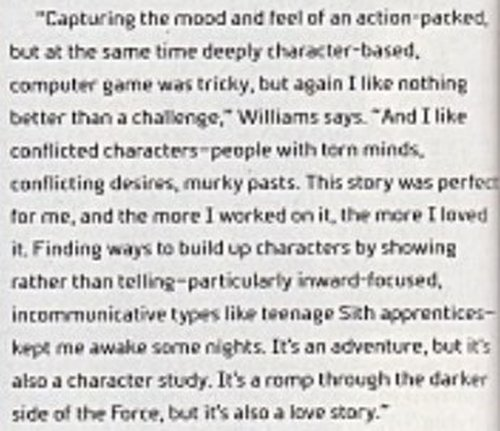

### Stat block notes (game mechanics, not feats)

- Force Unleashed plot (Secret Sith): The Force Unleashed follows Darth Vader's secret Sith apprentice through a series of missions undertaken on the Dark Lord's orders—missions that bring the apprentice to a number of beloved Star Wars locales, where he must hunt down survivors of the ruined Jedi Order. There's plenty of action amid some remarkable settings—a disintegrating space station above Nar Shaddaa, the hothouse terrain of Felucia, and the junkyard world of Raxus Prime—but also a dreadful tension. As the apprentice does Vader's bidding, he discovers clues to his own long-buried past, and must choose which path he will follow. (Jason Fry, Star Wars Insider 100, p. 68) (Source: *Star Wars Insider #100* (2008), scan p.68)
- Art of the Game sidebar: In The Force Unleashed: Art of the Game (Insight Editions/Palace Press, $29.95), Blackman reveals another saga—that of the game's development. Art of the Game chronicles the more than three years during which The Force Unleashed went from LucasArts concept to finished product. (Jason Fry, Star Wars Insider 100, p. 68) (Source: *Star Wars Insider #100* (2008), scan p.68)

## scan p.69 (scan page 69)

Page contents: Books (cont.): Williams on working from Haden Blackman's script (given the "cinematics" script in late 2005), sections "[Shading] Darkness" and "Hectic Universe"; Juno Eclipse as the way into the apprentice; earlier New Jedi Order books with Shane Dix; upcoming Earth Ascendant (Astropolis series) and The Changeling; cover art "Star Wars The Force Unleashed — Sean Williams — Based on a story by Haden Blackman — Based on the thrilling new video game from LucasArts!"; left column line starts blurred in scan (hand-read)

- **Galen Marek** — entry/section: Williams on the apprentice's power: ""There are only so many ways to say that the apprentice taps into the full power of the dark side and blows the crap out of something. My skills as a writer have really been put to the test!" —Sean Williams, Star Wars Insider 100, p. 69" Source: *Star Wars Insider #100* (2008), scan p.69
  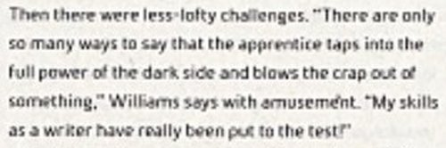

### Stat block notes (game mechanics, not feats)

- Apprentice has no name (novel): A lot more, in fact—consider that for [much of the] video game's story, the apprentice doesn't [even have a] name. (Jason Fry, Star Wars Insider 100, p. 69; bracketed words blurred in scan) (Source: *Star Wars Insider #100* (2008), scan p.69)

## scan p.70 (scan page 70)

Page contents: Comics: "Comics Unleashed" words Daniel Wallace; "Dark Horse adapts this summer's blockbuster video game"; graphic novel written by Haden Blackman (Clone Wars Adventures, Star Wars: Republic); section "Father Figure"; comic panels of PROXY, Juno, Vader; pull quote Haden Blackman (hand-read)

- **Galen Marek; Juno Eclipse; PROXY (droid); Darth Vader (Anakin Skywalker)** — entry/section: Blackman on the Apprentice's cast: ""But over time his goals and motivations change. The Apprentice is joined on his journey by a fairly large cast, including Juno Eclipse, the Imperial pilot handpicked by Darth Vader to fly the character on his missions, and PROXY, the character's droid sidekick. Princess Leia and a few other known characters make key appearances as well, and of course Vader has a major role to play as the Apprentice's mentor and warped father figure." —Haden Blackman, Star Wars Insider 100, p. 70" Source: *Star Wars Insider #100* (2008), scan p.70
  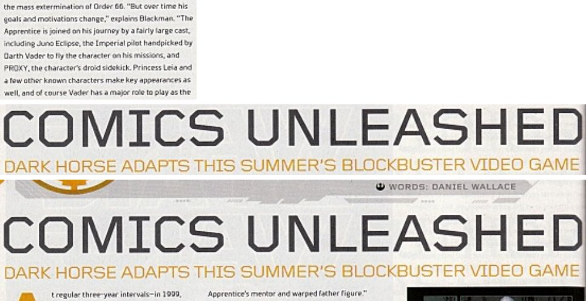
- **Darth Vader (Anakin Skywalker); Palpatine (Darth Sidious); Galen Marek** — entry/section: Blackman on George Lucas's input: ""George provided us with a wealth of feedback on the type of master Vader would be, giving us insight into Vader's secret desires and plans, his relationship with the Emperor, and the methods he'd use to motivate an apprentice. George also weighed in heavily on how we planned to use some of the other known characters, such as Leia, and encouraged us to invent new characters for key roles—a love interest, a sidekick, a mentor beyond Vader. Aside from a few minor points—we couldn't call the Apprentice 'Darth' for example—neither George nor Lucas Licensing put many restrictions on the scripts." —Haden Blackman, Star Wars Insider 100, p. 70" Source: *Star Wars Insider #100* (2008), scan p.70
  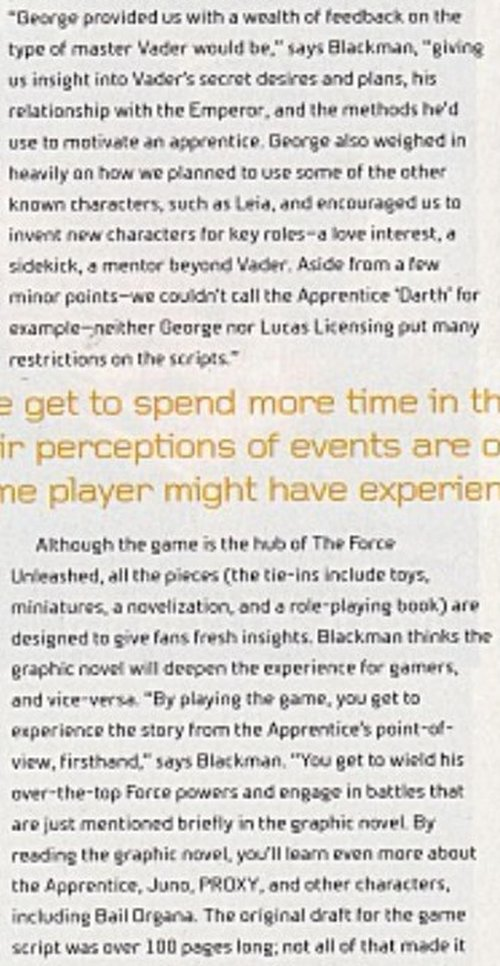
- **Galen Marek** — entry/section: Blackman on graphic novel vs game: ""The graphic novel is an adaptation of the game, but told from the point of view of two different characters. Because of the medium, we get to spend more time in the characters' heads, and their perceptions of events are often different than what the game player might have experienced." —Haden Blackman, Star Wars Insider 100, p. 70" Source: *Star Wars Insider #100* (2008), scan p.70
  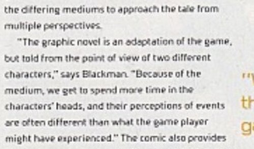
- **Galen Marek; Juno Eclipse; PROXY (droid); Bail Organa** — entry/section: Blackman on cut material: ""By playing the game, you get to experience the story from the Apprentice's point-of-view, firsthand. You get to wield his over-the-top Force powers and engage in battles that are just mentioned briefly in the graphic novel. By reading the graphic novel, you'll learn even more about the Apprentice, Juno, PROXY, and other characters, including Bail Organa. The original draft for the game script was over 100 pages long; not all of that made it into the game. In the interest of keeping the game moving along, we removed dozens of lines of dialogue and even entire scenes, much of which we were able to resurrect for the graphic novel." —Haden Blackman, Star Wars Insider 100, p. 70" Source: *Star Wars Insider #100* (2008), scan p.70
  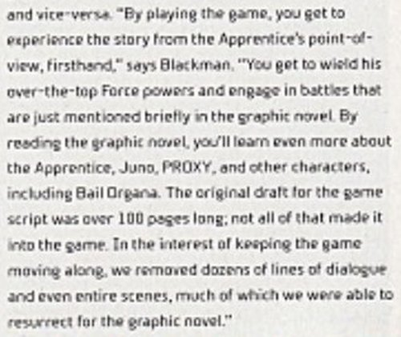

### Stat block notes (game mechanics, not feats)

- Force Unleashed meta-story (Father Figure): For those not yet up to speed on The Force Unleashed's meta-story, it follows Darth Vader's "Secret Apprentice" during the turbulent years between Revenge of the Sith and A New Hope. The story begins with the Secret Apprentice's early missions for the Dark Lord of the Sith, particularly his assassination of any Jedi who escaped the mass extermination of Order 66. (Daniel Wallace, Star Wars Insider 100, p. 70) (Source: *Star Wars Insider #100* (2008), scan p.70)

## scan p.71 (scan page 71)

Page contents: Comics (cont.): sidebar "Pixels to Panels" (game-to-comic collections: Dark Forces by William C. Dietz; Star Wars: Starfighter—Crossbones by Haden Blackman; X-wing Omnibus vol. 1-3 by Michael A. Stackpole; Knights of the Old Republic by John Jackson Miller); section "Art Masters": artists Brian Ching, Bong Dazo and Wayne Nichols; Dark Horse editor Randy Stradley quoted; comic panels; pull quote Haden Blackman (hand-read)

- **Darth Vader (Anakin Skywalker)** — entry/section: Blackman on Brian Ching's art: ""in one panel, he can convey Vader's emotional state with just body language or a head tilt. Because we were able to provide so much game reference I was very sparse in my panel-by-panel descriptions, but Brian was able to run with it and envision the world beyond the screenshots and concept art." —Haden Blackman, Star Wars Insider 100, p. 71" Source: *Star Wars Insider #100* (2008), scan p.71
  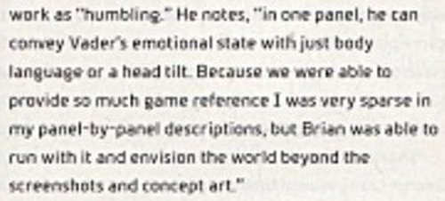
- **none** — entry/section: Blackman on the graphic novel's pleasures: ""Big glorious full-page spreads of action, more focus on the secondary characters, and more backstory. Plus some very cool montage pages that hark back to the Star Wars movie posters. Not to mention lots of aliens getting impaled on lightsabers." —Haden Blackman, Star Wars Insider 100, p. 71" Source: *Star Wars Insider #100* (2008), scan p.71
  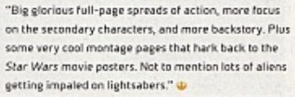

### Stat block notes (game mechanics, not feats)

- Pixels to Panels: Crossbones: The alien pirate Nym fights the Trade Federation in a comic that was spun off from the Starfighter console games. (Daniel Wallace, Star Wars Insider 100, p. 71) (Source: *Star Wars Insider #100* (2008), scan p.71)
- Pixels to Panels: Knights of the Old Republic: Dark Horse inaugurated the "ancient Star Wars" era with Tales of the Jedi, but LucasArts' Knights of the Old Republic game brought it to a new audience. The current Dark Horse comics series subtly weaves in game elements to create a compelling prequel tale. (Daniel Wallace, Star Wars Insider 100, p. 71) (Source: *Star Wars Insider #100* (2008), scan p.71)

## scan p.72 (scan page 72)

Page contents: Games: "Talent Unleashed!" words Zoe Hedges; "In their own words LucasArts project lead Haden Blackman and actor Sam Witwer take us inside The Force Unleashed!"; Haden Blackman, Project Lead, The Force Unleashed; game screenshots incl. PROXY droid (hand-read)

- **Galen Marek; Darth Vader (Anakin Skywalker)** — entry/section: Blackman on Force powers: ""We wanted to focus on this concept of the Force unleashed. My directive to the team was to start with the Force push. I wanted a Force push that doesn't just knock enemies over, it sends them flying backwards, shattering stuff. Once we got that right with the concept art, that became the foundation for all our Force powers. Because the Apprentice was trained by Vader—who's got a very unique perspective because he was Anakin Skywalker and trained as a Jedi—he also has access to dark side powers. There are also a bunch of new powers as well that are extensive. Force repulse is a power that sends out a kinetic shock wave that destroys everything around you, sending guys flying." —Haden Blackman, Star Wars Insider 100, p. 72" Source: *Star Wars Insider #100* (2008), scan p.72
  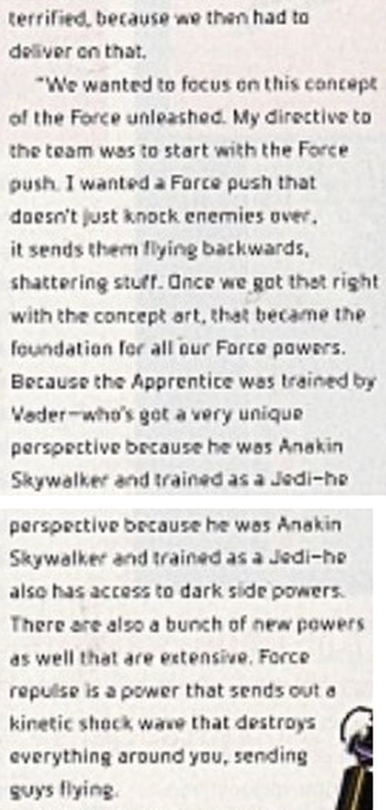

## scan p.73 (scan page 73)

Page contents: Games (cont.): pull quote Haden Blackman; Sam Witwer, Actor, Vader's Secret Apprentice (photo); game screenshots (hand-read)

- **Galen Marek; Juno Eclipse** — entry/section: Sam Witwer on the Apprentice and Juno: ""The most interesting thing I found about the character was that while he's extremely powerful, and unstoppable, confident, and good at what he does, if you put in front of him a beautiful woman like Juno Eclipse... Well, this guy has been raised in darkness, so you get him around Juno he doesn't know how to talk to her. She's the first beautiful woman he's ever seen, so he turns into a 12-year-old kid. His emotional growth has been stunted at an early age. That was the fun thing about this character, there are so many different sides to him. Underneath this incredible warrior is this scared kid who's trying to figure out what he's supposed to be doing. That was definitely a lot of fun." —Sam Witwer, Star Wars Insider 100, p. 73" Source: *Star Wars Insider #100* (2008), scan p.73
  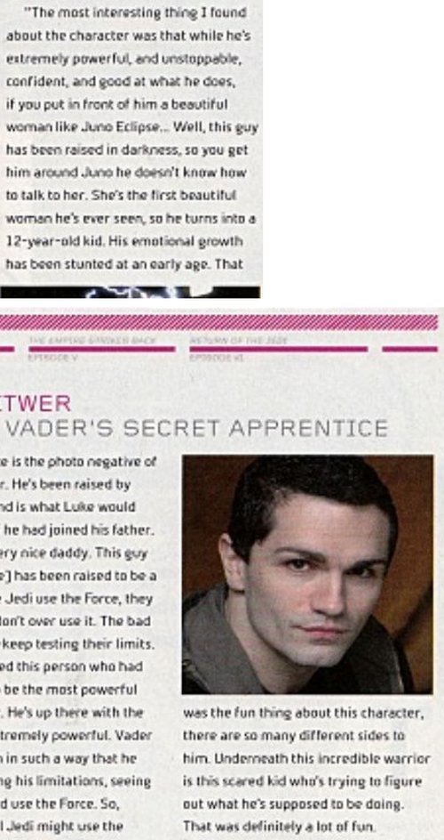
- **none** — entry/section: Sam Witwer on performance capture: ""These are not just vocal performances either. They built a complete digital duplicate of me and all the other actors. They put these dots on my face; I looked ridiculous. Those dots allow the computer to track your movements and make sure your digital double does exactly what you're doing. The drama comes from us; the voice comes from us; the acting comes from us. You have to imagine everything around you and make that real for yourself. You feel very silly reacting to nothing, but you trust the people who are guiding you. As a fan, the idea of being in Star Wars wasn't too hard to imagine." —Sam Witwer, Star Wars Insider 100, p. 73" Source: *Star Wars Insider #100* (2008), scan p.73
  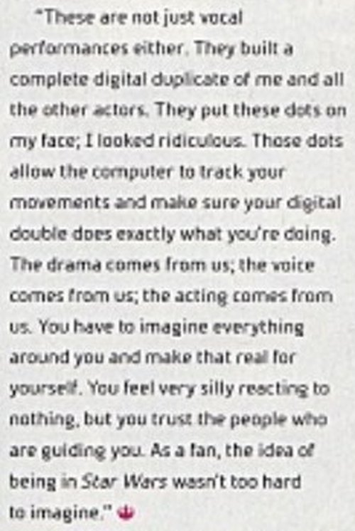

## scan p.74 (scan page 74)

Page contents: Toys: "Toys Unleashed" words Jeremy Beckett; "Bring The Force Unleashed video game to life through a full range of tie-in toys"; Felucian on rancor figure; Electronic Lightsaber with "Spring-Open Sith Spikes!"; LEGO Rogue Shadow ($50) with Battle-Damaged Darth Vader and Secret Apprentice minifigures; Force Unleashed mini-sculpture battle packs (hand-read)

### Stat block notes (game mechanics, not feats)

- Rogue Shadow LEGO caption: The Rogue Shadow is the personal craft of Vader's Secret Apprentice. It is piloted by Juno Eclipse, a female Imperial officer who promises to be an integral character in the game, and who proves to be a source of distraction for Vader's Secret Apprentice. (Jeremy Beckett, Star Wars Insider 100, p. 74) (Source: *Star Wars Insider #100* (2008), scan p.74)
- Felucian rancor caption: Felucians patrol their jungles astride ferocious battle rancors marked with warpaint. (Jeremy Beckett, Star Wars Insider 100, p. 74) (Source: *Star Wars Insider #100* (2008), scan p.74)
- Electronic Lightsaber caption: Join the Sith and help Vader conquer the galaxy, or choose to defend peace and justice as a noble Jedi Knight. Decide your ultimate destiny with this extendable color-changing lightsaber that has realistic sound effects! (Jeremy Beckett, Star Wars Insider 100, p. 74) (Source: *Star Wars Insider #100* (2008), scan p.74)

## scan p.75 (scan page 75)

Page contents: Toys (cont.): Evolutions 3-pack (Vader's Secret Apprentice, 3 3/4" scale); Stormtrooper Commander, EVO troopers, Imperial jumptrooper, Rahm Kota, Maris Brood, Juno Eclipse, Shadow Guard figures; left caption line starts blurred in scan. Facing ad: Kotobukiya Pirates of the Caribbean Jack Sparrow ARTFX Statue ("Direct from Japan!", "Removable pirate hat!", "Available NOW!", www.KotoUS.com, © Disney) (hand-read)

### Stat block notes (game mechanics, not feats)

- Evolutions caption: [Vader]'s Secret Apprentice (at 3 3/4" scale) must choose to join the dark side [and wipe] out the Jedi, or become a noble Jedi and bring hope to the galaxy. (Jeremy Beckett, Star Wars Insider 100, p. 75; bracketed words blurred in scan) (Source: *Star Wars Insider #100* (2008), scan p.75)
- Stormtrooper commander caption: Stormtrooper commanders patrol the front lines, leading their troops into fierce combat. (Jeremy Beckett, Star Wars Insider 100, p. 75) (Source: *Star Wars Insider #100* (2008), scan p.75)
- Jumptrooper caption: Equipped with jet backpacks, Imperial jumptroopers burst through the air in short spurts. (Jeremy Beckett, Star Wars Insider 100, p. 75) (Source: *Star Wars Insider #100* (2008), scan p.75)
- Rahm Kota caption: [Rahm] Kota's lack of faith in the [clone] troopers during the Clone [Wars] allowed this Jedi general to [escape] Order 66. (Jeremy Beckett, Star Wars Insider 100, p. 75; bracketed words blurred in scan) (Source: *Star Wars Insider #100* (2008), scan p.75)
- Juno Eclipse caption: Juno Eclipse is Captain of the Rogue Shadow, the starship provided by Vader to carry his Secret Apprentice throughout the galaxy. (Jeremy Beckett, Star Wars Insider 100, p. 75) (Source: *Star Wars Insider #100* (2008), scan p.75)
- Maris Brood caption: [Recently] separated from her [Master] during Order 66, Maris [Brood] survives alongside Shaak [Ti as a] fugitive on Felucia. (Jeremy Beckett, Star Wars Insider 100, p. 75; bracketed words blurred in scan) (Source: *Star Wars Insider #100* (2008), scan p.75)
- Shadow guard caption: Imperial shadow guards, the elites of Palpatine's security force, can use the Force and are exceptionally loyal. (Jeremy Beckett, Star Wars Insider 100, p. 75) (Source: *Star Wars Insider #100* (2008), scan p.75)
- Kotobukiya Jack Sparrow ad copy: Kotobukiya's ARTFX Statue captures the introduction of the Captain Jack from the classic first film, The Curse Of The Black Pearl. No detail has been overlooked - from the beads in his hair, to the compass hanging from his belt - making this one of the most intricate PIRATES collectibles ever produced. (Kotobukiya ad, Star Wars Insider 100, p. 75) (Source: *Star Wars Insider #100* (2008), scan p.75)

## scan p.76 (scan page 76)

Page contents: Q&A: "Give Luke a Hand!" words Leland Y. Chee; "Which Ewok is which? Whatever happened to Boss Nass? When is a war not a war?"; photo of the forearm prosthetic prop; photo "Boss Nass with Jar Jar, as seen in Episode III"; contact box (Titan Magazines, [postal address omitted]; [postal address omitted]; [email omitted]); askers' names omitted (hand-read)

### Stat block notes (game mechanics, not feats)

- Luke's mechanical hand (Q&A): First off, while it is true that the cut occurs at the wrist, the extent of the damage to Luke's forearm is unclear because we never see the stub of the rest of the arm, conveniently hidden within Luke's sleeve. Secondly, the circuitry in the forearm that controls Luke's mechanical hand mimics the functions of the tendons that control the human hand. So, even if Luke's original tendons miraculously remained intact, they were not compatible with the technology of the prosthetic, and thus needed to be replaced. (Leland Y. Chee, Star Wars Insider 100, p. 76) (Source: *Star Wars Insider #100* (2008), scan p.76)
- Ewoks in the AT-ST (Q&A): The Return of the Jedi novelization erroneously called them Wicket and Teebo. Such errors in novelizations are often due to changes made in the film during the course of production or post-production. According to the Star Wars Action Figure Archive, Warok is supposed to be one of the Ewoks, but the image on the vintage action figure doesn't quite match either of the Ewoks in the walker cockpit either. The Ewok with the reddish-brown hood and brown fur and tan cheeks is actually Widdle Warrick who also appears in the Ewok television movies. The dark-furred Ewok with a dark nose wearing the dark cloth hood is unnamed. (Leland Y. Chee, Star Wars Insider 100, p. 76) (Source: *Star Wars Insider #100* (2008), scan p.76)
- Boss Nass fate (Q&A): No word yet on whether or not Boss Nass, or anyone else from the films for that matter apart from Boba Fett, will appear in the live action television show. In the films, Nass is last seen at Padmé's funeral at the end of Revenge of the Sith but in the Expanded Universe he makes an appearance in the Star Wars Galaxies massive multi-player online video game that takes place in between Episodes IV and V. (Leland Y. Chee, Star Wars Insider 100, p. 76) (Source: *Star Wars Insider #100* (2008), scan p.76)
- AT-AT inspiration (Q&A): According to the George Lucas commentary on The Empire Strikes Back DVD, the Imperial walkers were inspired primarily by the original H.G. Wells novel War of the Worlds where the Martians walked the Earth atop giant walking spiders. George wanted to come up with a way of making this battle different and unusual without putting tanks and normal war materiel in there. (Leland Y. Chee, Star Wars Insider 100, p. 76) (Source: *Star Wars Insider #100* (2008), scan p.76)

## scan p.77 (scan page 77)

Page contents: Q&A (cont.): AT-AT legs (Joe Johnston, Syd Mead illustration); Republic "full-scale" wars and Ruusan Reformations; Rebel trooper helmet visors (John Mollo); Senate buildings in Episode III; Coleman Kcaj; fates of Thon, Tott Doneeta and Sylvar; Gray Leader; photos: "Y-wing, A-wing, B-wing (x2), and X-wing pilot helmets", Senate building image ("A funny thing happened to me on the way to the Senate Building..."), "That's Kcaj seated behind Anakin's left shoulder"; askers' names omitted; left column line starts blurred in scan (hand-read)

### Stat block notes (game mechanics, not feats)

- AT-AT legs (Q&A): According to Joe Johnston, Visual Effects [Art Director] on Empire, the look of the walker's legs [were inspired] by a Syd Meade illustration depicting a [walking truck]. (Leland Y. Chee, Star Wars Insider 100, p. 77; bracketed words blurred in scan) (Source: *Star Wars Insider #100* (2008), scan p.77)
- Ruusan Reformations (Q&A): In Attack of the Clones, Palpatine states: "[I will not let] this Republic that has stood for a [thousand] years be split in two." To deal with the [discrepancy], the EU established an event known [as the] Ruusan Reformations in which the Republic [was restructured] and in essence, reborn. (Leland Y. Chee, Star Wars Insider 100, p. 77; bracketed words blurred in scan) (Source: *Star Wars Insider #100* (2008), scan p.77)
- Rebel trooper helmets (Q&A): According to John Mollo, A New Hope's costume [designer], some of the Rebel ranger helmets were made [with the visor down]. These helmets were fixed [permanently] in the down position, and there was no mechanism for moving them up and down. (Leland Y. Chee, Star Wars Insider 100, p. 77; bracketed words blurred in scan) (Source: *Star Wars Insider #100* (2008), scan p.77)
- Senate buildings (Q&A): There are actually two dome-topped structures that make up the Senate buildings. The Galactic Senate Chamber rotunda is the taller mushroom-shaped building where the Senate convenes and the confrontation between Yoda and Palpatine takes place. A second structure near the rotunda is the Senate Office Building, which is a more traditional domed structure. This is the building we see when the Senators greet Obi-Wan and Anakin upon their rescue of Palpatine at the beginning of Episode III. We can see landing platforms for capital ships in this building and this is where the Tantive IV would be parked, which is why Bail and Yoda are headed there after Yoda's rescue. (Leland Y. Chee, Star Wars Insider 100, p. 77) (Source: *Star Wars Insider #100* (2008), scan p.77)
- Coleman Kcaj (Q&A): Coleman Kcaj is the Ongree Jedi Council member in Episode III. He is also in the background of the scene where Anakin is entering the Coruscant Opera House. He looks to be speaking to Vurk Senator Sweitt Concorkill. Kcaj and Concorkill had opposite roles early on during production but eventually their roles were swapped and Concorkill went from Jedi to Senator. Kcaj is the second Ongree Jedi seen in the films, the first being Pablo-Jill who was one of the Jedi on Geonosis in Episode II. Coleman Kcaj takes his name from the son of Episode III Animation Director Rob Coleman. Kcaj's Order 66 fate has never been revealed. (Leland Y. Chee, Star Wars Insider 100, p. 77) (Source: *Star Wars Insider #100* (2008), scan p.77)
- Tales of the Jedi survivors (Q&A): The ultimate fates of these surviving Jedi from the Tales of the Jedi comics is unknown. Whether any of them will appear in the current Knights of the Old Republic comic series which takes place decades after "Redemption" has yet to be revealed. (Leland Y. Chee, Star Wars Insider 100, p. 77) (Source: *Star Wars Insider #100* (2008), scan p.77)
- Gray Leader (Q&A): Gray Leader is Salm Horton from the X-Wing comics and novels. Earlier sources stated that all members of Gray Squadron were taken out early during the battle, but we have since learned that Gray Leader participated in the attack on the Death Star II's superstructure. Yeah, I know; Lando called for only "Red Group and Gold Group" to commence the attack on the main reactor, but who's going to pass up an opportunity to take out a Death Star? And yes, he survives the battle. (Leland Y. Chee, Star Wars Insider 100, p. 77) (Source: *Star Wars Insider #100* (2008), scan p.77)

## scan p.78 (scan page 78)

Page contents: Scouting the Galaxy: "Toyota Tale: The One That Got Away" words Steve Sansweet; "Your questions don't get old: they just mature like fine wine; a great U.K. find in the U.S., and the two-pack 'problem.'"; intro on the column's mailbag (emailed letters back to June 2001); section "Collection Update": a March 2005 letter (writer's name omitted) asking about an updated Action Figure Archive, Tomart's Price Guide, and Sansweet's collecting; reply begins: no further edition of the Tomart Price Guide to Worldwide Star Wars Collectibles (last edition 1997); photos of Sansweet's collection in Los Angeles, before Rancho Obi-Wan (hand-read)

## scan p.79 (scan page 79)

Page contents: Scouting the Galaxy (cont.): Sansweet's collecting today (Tomart's last edition; upcoming comprehensive guide by Gus Lopez and Duncan Jenkins; The Star Wars Collectors Archive, theswca.com; his own book due spring 2009; buying Hasbro cases from Entertainment Earth; garrison patches and challenge coins); section "Car Conundrum": a letter (writer's name, city and handle omitted) asks about the 1977 Star Wars Toyota Celica promotional giveaway (20th Century Fox & Toyota); reply cites Lucasfilm colleague Pete Vilmur's SWCA story; contest awarded 1,977 prizes, Sept 26–Dec 31, 1977; Sansweet passed on buying the car for $1,000 in an Antique Toy World ad; art "Art courtesy of Pete Vilmur."; left column line starts blurred in scan (hand-read)

### Stat block notes (game mechanics, not feats)

- Star Wars Celica caption: This special "Star Wars Celica" is being prepared by Delphi Auto Design of Costa Mesa, California, and will be given away as grand prize in a consumer sweepstakes drawing. The modified car will have a specialized paint job, a moonroof, tinted windows and black chrome on the outside, along with plush silver carpeting and silver piping on the seats inside. (Star Wars Insider 100, p. 79) (Source: *Star Wars Insider #100* (2008), scan p.79)

## scan p.80 (scan page 80)

Page contents: Scouting the Galaxy (cont.): section "Bonus Heroes" (letter on Galactic Heroes two-packs vs. boxed sets; writer's name omitted; reply on store exclusives, the "bonus" figure, rumor sites, Hasbro's online Q&A); section "Bargain Books" (letter on the "Completely, Fully Illustrated Script" of Return of the Jedi, Virgin Publishing 1999; writer's name omitted; reply: U.K.-exclusive series, Del Rey U.S. paperbacks of Nov 1998, Sansweet bought his in Dublin at £19.80 each, about $40 today); book cover photo; script page and still photos; contact box ([email omitted]; [email omitted]; Scouting the Galaxy, [postal address omitted]; Titan addresses) (hand-read)

## scan p.81 (scan page 81)

Page contents: Subscription ad: "Free Lightsaber and save 35% when you subscribe!"; Insider 100th issue cover ("We celebrate 100 issues with the 100 best things about Star Wars... ever!"); Master Replicas scaled lightsaber ("Normally retails for $35! Limited Supplies."); 6 issues for only $24.95 (international add $10.00); www.titanmagazines.com/saber08; [phone number omitted] (quote SABER08); [email omitted] (hand-read)

### Stat block notes (game mechanics, not feats)

- Subscription ad copy: Hold the Force in the palm of your hand with a Star Wars scaled replica. Crafted from durable machined and die-cast metals, the Yoda, Obi-Wan Kenobi, and Anakin Skywalker lightsaber scaled replicas are officially authorized by Lucasfilm Ltd. (Titan subscription ad, Star Wars Insider 100, p. 81) (Source: *Star Wars Insider #100* (2008), scan p.81)

## scan p.82 (scan page 82)

Page contents: International Collecting: "Star Bears!" words Gus Lopez (German flag); "Germany was one of the first countries in Europe to offer a unique range of Star Wars memorabilia"; Parker mini-puzzles (Tusken Raider, Luke's landspeeder; 12 images); Kenner in Germany: "YPS Hoth Stormtrooper" bundled with YPS comic #510 (G.I. Joe-style rifle); "Die Kraft Der Macht" Power of the Force three-packs under Parker (Germany) logo; YPS comic covers "Der Stormtrooper des Imperiums" (hand-read)

### Stat block notes (game mechanics, not feats)

- YPS Hoth Stormtrooper: One of the most unusual action figure pieces was the "YPS Hoth Stormtrooper," a mis-named Hoth snowtrooper bundled with a comic for kids called YPS. YPS evidently always included a toy, or "gimmick," bundled with it, and in issue #510 a Hoth snowtrooper was featured on the cover with the figure included inside the polybag. For some reason, instead of the regular Hoth snowtrooper rifle from the Kenner line, the figure was carrying a G.I. Joe-style military rifle. (Gus Lopez, Star Wars Insider 100, p. 82) (Source: *Star Wars Insider #100* (2008), scan p.82)
- Parker mini-puzzles caption: Some of the first items available on the market were these mini-puzzles issued by Parker. These pocket-sized puzzles showed some of the most memorable scenes from A New Hope, with 12 images in all. (Gus Lopez, Star Wars Insider 100, p. 82) (Source: *Star Wars Insider #100* (2008), scan p.82)

## scan p.83 (scan page 83)

Page contents: International Collecting (cont.): Zewa Star Wars tissue/paper towel/toilet paper (Revenge of the Sith); Helevetisches Münzkontor character coins (24 silver-plated); Kinder Eggs Star Wars "Hipperium" hippos ("Ein Star Wars-Hippo in jedem 7. Ei"); Jedi-Con conventions (Jedi-Con 2004 Convention Dokumentation DVD; "Sith Bear" keychain); left column line starts blurred in scan (hand-read)

### Stat block notes (game mechanics, not feats)

- Zewa products: [One] of the top lines of Star Wars [collectibles] of all time comes from [Germany]. For Revenge of the Sith, Zewa [produced] Star Wars themed tissue and [paper] towel products. ... There was even a paper towel [multipack] with a plush Yoda premium in [the] middle. But the destined-to-be classic [collectibles] from this line were the [multipacks] of Star Wars toilet paper, which give new meaning to wiping out [the] dark side. (Gus Lopez, Star Wars Insider 100, p. 83; bracketed words blurred in scan) (Source: *Star Wars Insider #100* (2008), scan p.83)
- Kinder Eggs hippos: Nothing screams Star Wars like blue plastic hippos! Several years ago, Kinder Eggs—one of the most popular kids' food products to come out of Germany—ran a tie-in based on Star Wars character hippos. These small plastic blue hippos came randomly inside Kinder Eggs, clad in outfits for characters such as Jango Fett, Han Solo, and R2-D2. (Gus Lopez, Star Wars Insider 100, p. 83) (Source: *Star Wars Insider #100* (2008), scan p.83)
- Jedi-Con conventions: If you've ever found yourself wishing to see a chorus line of 50 costumed stormtroopers dancing to "The Time Warp" from Rocky Horror Picture Show then you might consider attending one of the fabulous Jedi-Con conventions held in Germany. Each of the four Jedi-Cons held since 1994 also featured exclusive collectibles. (Gus Lopez, Star Wars Insider 100, p. 83) (Source: *Star Wars Insider #100* (2008), scan p.83)

## scan p.84 (scan page 84)

Page contents: Padawan's Corner (words & artwork Cynthia Cummens; Jedi Corner logo): "How to Draw: Yoda" ("He's a mean, green master from another galaxy... and you can draw him!"); supplies (newsprint, Bristol vellum or illustration board, carbon paper, HB or 2B pencil, markers or acrylic paint); Steps 1–3 with sketches (stick figure and basic shapes; eye placement lower than halfway on Yoda; sleeves, cane, something to sit on) (hand-read)

### Stat block notes (game mechanics, not feats)

- How to Draw intro: In this issue, you'll learn the basics of drawing the wise Jedi Master Yoda. ... So grab your supplies, and remember, as Yoda would say, "Practice drawing, you must!" (Cynthia Cummens, Star Wars Insider 100, p. 84) (Source: *Star Wars Insider #100* (2008), scan p.84)
- Yoda's eyes (Step 2): Before you begin sketching features, think about where you want the eyes to be. In humans, they're at the halfway point of the skull. But on Yoda, they're a bit lower than that. (Cynthia Cummens, Star Wars Insider 100, p. 84) (Source: *Star Wars Insider #100* (2008), scan p.84)

## scan p.85 (scan page 85)

Page contents: Padawan's Corner (cont.), words & artwork Cynthia Cummens: Steps 4–7 (work top to bottom; soft lines for fleshy Yoda; background; grisaille under painting; colored pencils, gouache, gel pens, delete white); closing box; finished colored Yoda drawings; left-column line starts blurred in scan (hand-read)

### Stat block notes (game mechanics, not feats)

- Step 4: Yoda is fleshy, so think about soft lines, [not] harsh or heavy ones which might be more [appropriate] for drawing sinister characters like [Darth] Vader or Jabba the Hutt. (Cynthia Cummens, Star Wars Insider 100, p. 85; bracketed words blurred in scan) (Source: *Star Wars Insider #100* (2008), scan p.85)
- Step 6 grisaille: One way to color this piece is to start with a monochromatic under painting (gray). The lighter you keep the gray, the more the color will show through. This technique is traditionally done with oil paint, but can work with markers or acrylic. It's a technique known as "grisaille" and it can be fun to do. (Cynthia Cummens, Star Wars Insider 100, p. 85) (Source: *Star Wars Insider #100* (2008), scan p.85)
- Closing box: Remember, there's no limit to what you can do with your drawing. ... Be patient with yourself, and practice, and you'll soon discover there's no limits or boundaries to your creativity! Happy Sketching! (Cynthia Cummens, Star Wars Insider 100, p. 85) (Source: *Star Wars Insider #100* (2008), scan p.85)

## scan p.86 (scan page 86)

Page contents: Set Piece: "Watto's Shop: Bits of this and bits of that", words Chris Trevas (Imperial insignia logo; X-wing art); photos of Anakin in shop, Watto (hand-read)

- **Watto** — entry/section: Peter Walpole on design: ""It should be cheap, but it should be creative. It's being able to see something and re-adapt it so it's not recognizable, but using its best facility to make it into something completely different." —Peter Walpole, set decorator, Star Wars Insider 100, p. 86" Source: *Star Wars Insider #100* (2008), scan p.86
  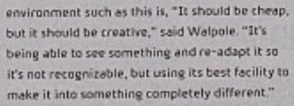
- **Watto** — entry/section: Rob Coleman on Secombe: ""He created little nuances with his hands, his face, his head, and his eyes, all of which I had the animators recreate," —Rob Coleman, animation director, Star Wars Insider 100, p. 86" Source: *Star Wars Insider #100* (2008), scan p.86
  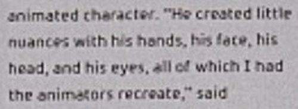
- **Watto** — entry/section: Rob Coleman box: ""The way Andy played him, there was something endearing about Watto, even though he's this shifty character." —Rob Coleman, animation director, Star Wars Insider 100, p. 86" Source: *Star Wars Insider #100* (2008), scan p.86
  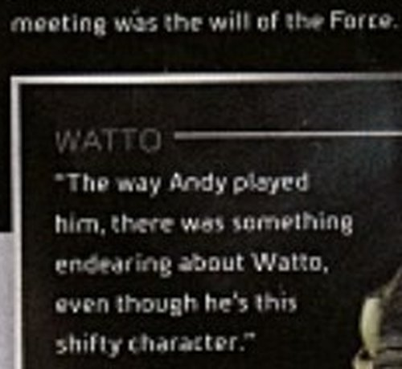

### Stat block notes (game mechanics, not feats)

- Set dressing: A human on Earth might have thought the exact same thing when walking through the set at Leavesden Studios in England. Set decorator Peter Walpole and his team dressed the space with a wide variety of real-world elements they uncovered at scrap yards, airfields, and a medical equipment warehouse. (Chris Trevas, Star Wars Insider 100, p. 86) (Source: *Star Wars Insider #100* (2008), scan p.86)
- Watto's ionizer prop: One example of recombined parts was a prop labeled "Watto's ionizer" that started out as an engine transmission casing. By stacking parts on top like a chrome shifter peg from a motorcycle, several gaskets, computer fan housings, ball bearings, and topping it off with an aerial cone from a fighter plane it became a hi-tech piece of Tatooine equipment. (Chris Trevas, Star Wars Insider 100, p. 86) (Source: *Star Wars Insider #100* (2008), scan p.86)
- Watto description: The proprietor of this unique shop is a small, pot-bellied Toydarian named Watto. He flutters about on tiny wings, perhaps resting in the rafters in his downtime or flitting up to the top shelves to place his newest stock items. Watto was completely computer generated by the artists at Industrial Light & Magic during post-production. On set, a simple foam-core cutout sometimes represented the grizzled shopkeeper. (Chris Trevas, Star Wars Insider 100, p. 86) (Source: *Star Wars Insider #100* (2008), scan p.86)
- Lip-sync compromise: His big walrus-like tusks and hanging snout obstructed too much of his mouth, making it difficult to lip-sync his dialogue. A compromise was struck between the character design and animators' needs by scaling his teeth down slightly and chipping off his left tusk. This way Watto could talk out of the side of his mouth, which actually emphasized his shady nature. (Chris Trevas, Star Wars Insider 100, p. 86) (Source: *Star Wars Insider #100* (2008), scan p.86)
- Wings and sound: George Lucas' advice was to not think of Watto as a terrestrial being and imagine his belly was full of helium or some other exotic lighter-than-air gas to help keep him afloat. The flapping noise of his little blue wings came from a recording of an umbrella opening and closing. Sound designer Ben Burtt looped the sound on a keyboard synthesizer, altering the speed and pitch as the junk dealer flutters about. (Chris Trevas, Star Wars Insider 100, p. 86) (Source: *Star Wars Insider #100* (2008), scan p.86)
- Watto hat caption: Initially Watto was going to have an Asian-inspired conical hat to shield his eyes from the harsh Tatooine suns. Andy Secombe was even given such a hat to wear on set. The hat idea later returned for Watto's appearance in Attack of the Clones. (Star Wars Insider 100, p. 86) (Source: *Star Wars Insider #100* (2008), scan p.86)
- Anakin caption: Anakin's fate was altered forever the day this tall "outlander" walked into Watto's shop. Qui-Gon Jinn believes that their meeting was the will of the Force. (Star Wars Insider 100, p. 86) (Source: *Star Wars Insider #100* (2008), scan p.86)

## scan p.87 (scan page 87)

Page contents: Set Piece (cont.): annotated Watto's shop set photo with callouts Ionizer, Art (Qui-Gon's holoprojector), Droids, Props, Temperature, Floors; Qui-Gon, Watto, Anakin, C-3PO in scene; temperature callout line start partly obscured (hand-read)

### Stat block notes (game mechanics, not feats)

- Ionizer callout: 'Watto's Ionizer' was a combination of many found parts held together with lots of very strong glue. The upper spokes spin around freely providing an interactive element if needed for a scene. (Chris Trevas, Star Wars Insider 100, p. 87) (Source: *Star Wars Insider #100* (2008), scan p.87)
- Holoprojector callout: Qui-Gon's holoprojector was actually a mechanically operational prop although we don't see it on film. It didn't project images, but if you pulled out the three outside prongs and turned them 90-degrees downwards, three points would rise out of the center. (Chris Trevas, Star Wars Insider 100, p. 87) (Source: *Star Wars Insider #100* (2008), scan p.87)
- Droids callout: These yellow box-shaped droids were made from plastic Rubbermaid storage containers turned upside down and dressed with miscellaneous bits. One of them even has a spare holoprojector from an R2 unit. The 'scrubber droids' can also be seen cleaning the floors of the Naboo Palace hangar. (Chris Trevas, Star Wars Insider 100, p. 87) (Source: *Star Wars Insider #100* (2008), scan p.87)
- Props and Floors callouts: These units lying about the counter were hard drives from an old mainframe computer. ... The floors were covered with interlocking rubber floor mats. Commonly used in industrial applications, the pattern of holes allows for drainage. Here the material provides traction among the loose sand. (Chris Trevas, Star Wars Insider 100, p. 87) (Source: *Star Wars Insider #100* (2008), scan p.87)
- Temperature callout: Though far from the deserts of Tunisia, temperatures on this set reached nearly 105 degrees fahrenheit. The large industrial air conditioner within the stage was too noisy to have on during filming and there was little time between camera setups to turn it on. (Chris Trevas, Star Wars Insider 100, p. 87) (Source: *Star Wars Insider #100* (2008), scan p.87)

## scan p.88 (scan page 88)

Page contents: Indiana Jones "Indy Vault #8: From the Mind—and Pencil—of Steven Spielberg, Chapter 2", words J.W. Rinzler; Temple of Doom opening (Kao Kan, son of Lao Che); 3 film stills (hand-read)

### Stat block notes (game mechanics, not feats)

- Spielberg sketches: On lined yellow paper Spielberg sketched out early ideas for Kan's pursuit of Jones: He rises from the floor, "gun up 1st!!!" and then "discards his own gun." With a "very low angle 50mm" lens Spielberg planned to film him running into frame with his new Thompson machine gun. Spielberg even describes how he'd look firing the gun: "demented-smiling crazy when he pulls trigger." (J.W. Rinzler, Star Wars Insider 100, p. 88) (Source: *Star Wars Insider #100* (2008), scan p.88)

## scan p.89 (scan page 89)

Page contents: Indy Vault (cont.): full-page reproduction of Steven Spielberg's handwritten yellow legal-pad sketch page "3" for the Temple of Doom club shootout (notes incl. "Wu Han up from floor", "gun up 1st!!!", "very low angle 50mm", "Kao Kan runs up into frame, cocks the Thompson", "slight camera Right", "Fires at Indy—fires 2 short bursts", "Do Tight CU of Kao Kan firing"); handwriting partly illegible, not quoted further (hand-read)

## scan p.90 (scan page 90)

Page contents: Titan Magazines ad "Fantastic Entertainment, Fantastic Magazines!": Star Trek, Stargate SG-1/Atlantis, Torchwood, Supernatural, Heroes, CSI, Charmed, Smallville, CSI:NY covers; "Available now at all good book stores!"; 1 877 363 1310; www.titanmagazines.com (hand-read)

## scan p.91 (scan page 91)

Page contents: Comlink "The Star Wars Insider Mailbag": "Jedi Go East!" ("To commemorate the 100th Star Wars Insider, we have a special look at the present, the past, and the future while celebrating the cross-cultural timeless appeal of the Star Wars saga."); "Present" star; write-to-us box (US: Titan Magazines, [postal address omitted]; UK: [postal address omitted]; [email omitted], [email omitted]); photos of costumed Jedi, Darth Vader, stormtroopers, Twi'leks, Yoda at a Japanese parade; "Jedi on Parade" fan letter (Jedi Order fan club, Midosuji Parade, Osaka, October 14, 2007; writer omitted); editor reply "Thanks for sharing your fantastic pictures! That looks like quite a day to be a part of!" (hand-read)

## scan p.92 (scan page 92)

Page contents: Bantha Tracks Vol. 30 "By the Fans. For the Fans.": "Bantha Babies!" (fan baby photos with R2-D2, Darth Vader costume; "Future" star; captions with fan names omitted); editorial "Celebrating the Magic of Star Wars" by Mary Franklin, Editor, Bantha Tracks (signed; cartoon self-portrait) (hand-read)

### Stat block notes (game mechanics, not feats)

- Bantha Babies intro: Whether they remain Star Wars fans after their parents' early influence wanes remains to be seen. After observing Star Wars families for a number of years, however, these guys could well be fans when Star Wars Insider hits its 200th issue! (Star Wars Insider 100, p. 92) (Source: *Star Wars Insider #100* (2008), scan p.92)
- Bantha Tracks history: The original Bantha Tracks ran for 35 issues, with publication being suspended in the winter of 1987. In his closing editorial, Jok Church encouraged fans to continue their involvement in local Star Wars fan clubs, and thanked contributors, including long-time Fan Club Director, Maureen Garrett. Issue 35 also encouraged members to attend the 10th anniversary Star Wars convention in Los Angeles, an event billed as a "once in a lifetime celebration." (Mary Franklin, Star Wars Insider 100, p. 92) (Source: *Star Wars Insider #100* (2008), scan p.92)
- Growth of fandom: Why does the growth continue? Because of the magic of Star Wars, the prequels, the Special Editions, and the Expanded Universe. Because of Star Wars on television, StarWars.com, the Official Star Wars Fan Club—now back here at Lucasfilm—and Titan Magazine's Star Wars Insider. And because the Star Wars fan community, now the cornerstone of Bantha Tracks content, is strong and vibrant and entertaining and involved. (Mary Franklin, Star Wars Insider 100, p. 92) (Source: *Star Wars Insider #100* (2008), scan p.92)

## scan p.93 (scan page 93)

Page contents: Bantha Tracks (cont.): 2 fan baby photos with lightsabers (captions with fan names omitted); Bantha Tracks Submission Guidelines box ([email omitted]; Bantha Tracks c/o Mary Franklin, [postal address omitted]; submitter must be a member of the Official Star Wars Fan Club); Bounty Hunters section sponsored by Kotobukiya (Boba Fett and clone trooper statue art; "Past" star); fan letter "A Winner at Last" (1977-era Vader costume contest with David Prowse and Anthony Daniels attending; writer omitted) (hand-read)

### Stat block notes (game mechanics, not feats)

- Bounty Hunters intro: Meet the stars, show the evidence, win the bounty! Star Wars Insider's Bounty Hunter section is sponsored by Kotobukiya. Each winner will receive a super Kotobukiya Star Wars statue, worth about $100! (Star Wars Insider 100, p. 93) (Source: *Star Wars Insider #100* (2008), scan p.93)
- Bounty Hunters closing: Can you guys go one better? Have you hugged Harrison Ford? Or maybe you cuddled Christopher Lee? We want to see your photos! (Star Wars Insider 100, p. 93) (Source: *Star Wars Insider #100* (2008), scan p.93)

## scan p.94 (scan page 94)

Page contents: Premier Collectible Auctions ad (Brian Semling of Brian's Toys, endorsement of Tom Derby of Collectible Investment Brokerage, formerly of Cloud City; first live auction July 24–26, 2008, San Diego, near Comic-Con); prototype vs production carded Rocket Firing Boba Fett; film-strip of carded Star Wars and G.I. Joe figures; right edge of copy cut off at scan gutter (hand-read)

### Stat block notes (game mechanics, not feats)

- Rocket Firing Boba Fett ad: This is the only known carded Rocket Firing Boba Fett to exist. This painted J-Slot Bo[ba] Fett was displayed at the 1979 New York Toy Fair. This is perhaps more desirable th[an] the first G.I. Joe action figure that auctioned for $250,000 several years ago. ... 1.The serial number in the upper left is No. 39430 on the prototype versus No. 3925[...] (Premier Collectible Auctions ad, Star Wars Insider 100, p. 94; bracketed text cut off at scan edge) (Source: *Star Wars Insider #100* (2008), scan p.94)

## scan p.95 (scan page 95)

Page contents: Premier Collectible Auctions ad (cont.): "Our first auction will include some of the finest AFA graded toy collections in the world, with merchandise of nearly $2,000,000 in value!"; vintage 3 3/4" and 12" Star Wars toys 1977–1986, G.I. Joe, Transformers, Masters of the Universe, Indiana Jones, Super Powers, Lord of the Rings; original Snake Eyes with Timber artwork circa 1985; original Star Wars 12 Back artwork; pre-production prototypes; complete set of all 16 3-packs; www.premiercollect.com; catalog $5.99 ($9.99 international), ships March/April 2008; contacts Brian Semling, Tom Derby (emails not logged); AFA 90 ESB Action Figure Display Stand; film-strip of carded Transformers, Alien figure (hand-read)

## scan p.96 (scan page 96)

Page contents: StarWarsShop.com #24 "Presents Tosche Station" ad: "Exclusive 12" Real Action Hero Shock Trooper", "Build Your Army With This Fully Articulated Figure"; In-Stock Exclusive at StarWarsShop.com; Price: TB[A]; "Order online at StarWarsShop.com – More Product. More Exclusive[s]"; right edge cut off at scan gutter (hand-read)

### Stat block notes (game mechanics, not feats)

- Medicom Shock Trooper: The Shock Troopers of Episode III, particula[rly] memorable for their signature red deco armor, n[ow] join this esteemed line of collectible figures fr[om] Japan. The figure is limited to just 1,000 piec[es] worldwide. (StarWarsShop ad, Star Wars Insider 100, p. 96; bracketed text cut off at scan edge) (Source: *Star Wars Insider #100* (2008), scan p.96)

## scan p.97 (scan page 97)

Page contents: StarWarsShop.com #2 ad "Luke Skywalker Maquette at StarWarsShop": LEGO Star Wars Luke Skywalker Maquette by Gentle Giant; In-Stock Exclusively at StarWarsShop.com; $64.99 (hand-read)

### Stat block notes (game mechanics, not feats)

- LEGO Luke maquette: The LEGO Star Wars Luke Skywalker maquette by Gentle Giant was previously a Toys 'R' Us exclusive, but StarWarsShop has managed to secure a number of these for its own shoppers to add to their growing LEGO Star Wars collection. Standing 6-inches tall, Luke's head is attached magnetically, allowing it to be turned in any direction. (StarWarsShop ad, Star Wars Insider 100, p. 97) (Source: *Star Wars Insider #100* (2008), scan p.97)

## scan p.98 (scan page 98)

Page contents: StarWarsShop.com #3 ad "A Pop-Up Guide to the Galaxy at StarWarsShop": Star Wars: A Pop-Up Guide to the Galaxy Special Edition, $299.99 each; signed by paper engineer/author Matthew Reinhart; slipcase with Max Rebo Band pop-up; right edge cut off at scan gutter (hand-read)

### Stat block notes (game mechanics, not feats)

- Pop-Up Guide special edition: The special edition includes an exclusi[ve] Max Rebo Band pop-up attached to the slipcas[e], a special "breathing" sound chip activated w[ith] the Darth Vader spread, and the signature of art[ist] Matthew Reinhart. (StarWarsShop ad, Star Wars Insider 100, p. 98; bracketed text cut off at scan edge) (Source: *Star Wars Insider #100* (2008), scan p.98)

## scan p.99 (scan page 99)

Page contents: Wizards of the Coast Star Wars Miniatures comic ad: Darth Krayt, Darth Talon and Darth Nihl confront Cade Skywalker and Deliah Blue; Boba Fett, Luke Skywalker and Han Solo (kicks Krayt) appear; tagline "With the Star Wars Miniatures Game, anything's possible!"; Legacy of the Force set; wizards.com/starwars (hand-read)

### Stat block notes (game mechanics, not feats)

- Krayt's threat: TREMBLE, CADE SKYWALKER, BEFORE THE TERRIBLE POWER OF I, DARTH KRAYT, WHO ALONG WITH DARTH TALON AND DARTH NIHL, WILL BRING YOU TO YOUR KNEES! / HA! IT IS YOU WHO SHOULD TREMBLE BEFORE ME, FOR I AM A TOUGH AS NAILS BOUNTY HUNTER! (Star Wars Miniatures ad comic, Star Wars Insider 100, p. 99) (Source: *Star Wars Insider #100* (2008), scan p.99)
- Fett and Luke: I'M A BOUNTY HUNTER TOO! AND YOU, CADE SKYWALKER, ARE MY BOUNTY! AND I GUESS I'LL TAKE THE PINK GIRL TOO. / STAY AWAY FROM THAT SKYWALKER! (Star Wars Miniatures ad comic, Star Wars Insider 100, p. 99) (Source: *Star Wars Insider #100* (2008), scan p.99)
- Han kicks Krayt: SILENCE! LET'S BRING IT BACK TO ME! FOR I, DARTH KRAYT, WILL--URKK! / YAHOO! YOU'RE ALL CLEAR, KID! / SOMEONE TELL ME HOW THIS IS HAPPENING! (Star Wars Miniatures ad comic, Star Wars Insider 100, p. 99) (Source: *Star Wars Insider #100* (2008), scan p.99)
- Miniatures ad copy: Mix it up with characters from any era across the entire Star Wars saga, for battles limited only by your imagination! And with the new 60-figure Legacy of the Force set, you'll be able to add 16 characters from the hit comic book "Star Wars: Legacy". (Wizards of the Coast ad, Star Wars Insider 100, p. 99) (Source: *Star Wars Insider #100* (2008), scan p.99)

## scan p.100 (scan page 100)

Page contents: Back cover: eFX Collectibles ad (Darth Vader helmet background): "Prop Replicas, Scaled Replicas, Studio Scale, Helmets, Die Cast"; "07·23·08"; www.efxcollectibles.com; © 2008 Lucasfilm Ltd & TM. © 2008 eFX Inc. (hand-read)

