# Owner Material 038 — Star Wars Insider #1–153 plus specials (with The Lucasfilm Fan Club Magazine #1–22): Star Wars Insider #101 (2008)

- **Source:** *Star Wars Insider* magazine (issues 23–153, 1994–2014) and its predecessor *The Lucasfilm Fan Club Magazine* (issues 1–22, 1987–1994), plus seven special editions: articles, interviews, comics and short fiction Secondary source (licensed Legends reference). Scan OCR'd on the box; the scan stays box-only and is **not** published.
- **Method:** every scanned page was OCR'd and machine-screened sentence by sentence for power-relevant statements (fights, kills, defeats, Force feats, rankings, superweapons) that name a character on our roster; each kept sentence is quoted verbatim from the OCR text and has a crop of the printed passage directly under it. Pages with nothing power-relevant are still listed with what is on them.
- **Citation:** "*Star Wars Insider #101* (2008), p.X" by printed page ("scan p.X" where no printed number applies). **Weight:** Licensed magazine: a secondary source. Its short fiction and comics are Legends stories; its articles and interviews sum up or discuss lore and rank below the novels, comics and games they describe.

## scan p.1 (scan page 1)

Page contents: Cover, Issue #101, May/June 2008, $5.99: "New Look!" Star Wars Insider masthead; Obi-Wan Kenobi (Ewan McGregor) with lightsaber; "Laser Sharp: Top 10 Lightsaber Battles Revealed!"; "More Than the Movies? The Essential Expanded Universe"; "Watts On.... Robert Watts on the original trilogy"; "Where Were You in 1980? A year in the life of Star Wars"; top strip "Celebration: The latest news on Celebration Japan" / "Clone Wars: Exclusive behind the scenes imagery" (Ahsoka art) / "Battle Royal! Chewbacca versus the Rancor! Who wins?"; inset Obi-Wan vs Anakin duel (hand-read)

## scan p.2 (scan page 2)

Page contents: Star Wars Top Trumps ad "The World's Coolest Card Game": "So How D'You Play?" rules (30 cards); Darth Maul Sith Lord card; "Wield your powers against other fans from around the world!" online play (lifelines incl. Jedi Leap and Jedi Mind Trick; Jar Jar Binks card shown) (hand-read)

### Stat block notes (game mechanics, not feats)

- Top Trumps intro: Top Trumps brings the classic card game "War" into the 21st Century! Each pack features in-game characters based on amazing subject matter, from Ultimate Military Jets to Marvel Super Heroes and from Sharks to Star Wars! Simply choose your best stat, beat your opponent's card, then win the entire deck! (Top Trumps ad, Star Wars Insider 101, p. 2) (Source: *Star Wars Insider #101* (2008), scan p.2)
- Darth Maul card: Height (metres) [1.75]; Brains [9]; Dark Side [24]; Jedi Powers [80]; Battle Skills [48]; Force Factor [1]. Darth Maul is a creation of pure evil, a Sith warrior trained in the use of the dark side of the Force. Loyal to his Master, Darth Sidious, Maul vows to avenge the destruction of the Sith. An accomplished fighter, with a red double-bladed lightsaber, Darth Maul takes on both Qui-Gon Jinn and Obi-Wan Kenobi in the Theed Palace on Naboo. (Top Trumps ad, Star Wars Insider 101, p. 2; bracketed values blurred in scan; card text tiny and soft, best reading) (Source: *Star Wars Insider #101* (2008), scan p.2)

## scan p.3 (scan page 3)

Page contents: Top Trumps ad (cont.): four Special Edition packs—Star Wars Episodes IV–VI, Episodes I–III, Starships, Clone Wars ("Glow-in-the-dark cards & case!"); "Special Offer For Insider Readers!" all 4 titles for just $20 with free shipping & handling at www.toptrumps.com/insider; Darth Vader art; "Top Trumps is a Registered Trademark of Winning Moves UK Ltd. ©2008 Lucasfilm Ltd. & ™" (hand-read)

### Stat block notes (game mechanics, not feats)

- Episodes IV–VI pack: Are Boba Fett's 'Battle Skills' stronger than Han Solo's? Is Yoda taller than a Jawa? And who has the ultimate 'Brains'? (Top Trumps ad, Star Wars Insider 101, p. 3) (Source: *Star Wars Insider #101* (2008), scan p.3)
- Episodes I–III pack: Join the dark side! The Sith return in this action packed prequel to the original series. Who is the more powerful Jedi - Anakin Skywalker or Obi-Wan Kenobi? Does General Grievous have better 'Battle Skills' than Darth Maul? Is there anyone with less 'Brains' than Jar Jar? And is Tarful taller than the mighty Chewbacca? (Top Trumps ad, Star Wars Insider 101, p. 3) (Source: *Star Wars Insider #101* (2008), scan p.3)
- Starships pack: Make the jump to lightspeed! Featuring the coolest starships and vehicles from all 6 movies, classic ships like the Millennium Falcon take on technology from the Clone Wars era, like the ARC-170. You can pit the forces of the Empire against the Old Republic and take your chances in mercenary ships like Boba Fett's Slave I as you venture further into the Star Wars universe than ever before. (Top Trumps ad, Star Wars Insider 101, p. 3) (Source: *Star Wars Insider #101* (2008), scan p.3)
- Clone Wars pack: Set between Episodes II and III of the Star Wars Saga, the Clone Wars animated series is the must-see experience for fans everywhere! Featuring the amphibious Jedi Knight Kit Fisto, the evil Asajj Ventress and everyone's favorite Jedi Master, Yoda, these glow-in-the-dark cards include a Star Wars family tree on the reverse. (Top Trumps ad, Star Wars Insider 101, p. 3) (Source: *Star Wars Insider #101* (2008), scan p.3)

## scan p.4 (scan page 4)

Page contents: Docking Bay "This Issue...." May/June 2008 contents: Features—The Big Star Wars Insider Interview "Watts the Story" (16 Robert Watts); 27 Lightsaber Battles; 36 The Essential Expanded Universe (Ahsoka art spread); 49 Effects Maestros (Richard Edlund); "Top Ten 27"; Obi-Wan vs Anakin photo (hand-read)

### Stat block notes (game mechanics, not feats)

- Contents blurbs: Robert Watts discusses his varied work across the first three Star Wars movies, with exclusive photos from his private collection! ... More than action, when a lightsaber ignites it's often an emotionally charged moment! ... You no longer have to bluff your non-movie knowledge, with our handy guide! ... First in a new series on Star Wars' special effects wizards kicks off with Richard Edlund. (Star Wars Insider 101, p. 4) (Source: *Star Wars Insider #101* (2008), scan p.4)

## scan p.5 (scan page 5)

Page contents: Contents (cont.): "The Special Edition!" variant cover box ("As well as our regular newsstand edition, Star Wars Insider is also available with this exclusive variant cover (same content). Only available from selected comic stores or www.titanmagazines.com"; Subscribe now: 6 issues for only $24.95 plus a free miniature replica lightsaber, while stocks last); Departments—06 Editor's Welcome; 08 Launch Pad (new look; Clone Wars, Celebration in Tokyo, a very expensive desk); Inside Blaster!, the new Insider review section: 56 Space Gear (Toy Fair), 59 Books (Troy Denning, Legacy of the Force), 60 Ask Lobot (new), 61 Comics (Legacy), 64 Scouting the Galaxy (Samurai Vader, giant sandcrawler), 66 Toys (Emperor, Clone Wars LEGO), 68 International Collecting (Russia, Mongolia, China), 70 Bounty Hunters, 72 Bantha Tracks (exhibitions), 76 Classic Moment (Luke's training on Dagobah); 24 Science of Star Wars (new); 34 Versus (Chewbacca vs the Rancor; new); 44 A Long Time Ago.... 1980 (new) (hand-read)

### Stat block notes (game mechanics, not feats)

- Versus / Science blurbs: Just how close is reality coming to duplicating some Star Wars gadgets? ... Two Star Wars icons go head-to-head, only one can survive! Place your bets! ... What was happening in the world of Star Wars 28 years ago? Can you remember? (Star Wars Insider 101, p. 5) (Source: *Star Wars Insider #101* (2008), scan p.5)

## scan p.6 (scan page 6)

Page contents: Editor's Welcome by Brian J. Robb, Editor (signed): header quote "I've made a few special modifications myself...." —Han Solo, Star Wars: A New Hope; Millennium Falcon art; Contact Us box ([email omitted]; www.titanmagazines.com / .co.uk; US: Star Wars Insider, Titan Magazines, [postal address omitted]; UK: [postal address omitted]; subscribe US [phone number omitted], UK [phone number omitted]); "Full Throttle: Top 10 Lightsaber Face-Offs!" box ("Jump now to page 27 as we countdown the best lightsaber duels in the galaxy!"); Ahsoka Tano art (hand-read)

### Stat block notes (game mechanics, not feats)

- New-look Insider: Much like Han Solo customizing the Millennium Falcon, we took out our hydrospanners and set to work, rebuilding Star Wars Insider, making some modifications here and there. What you are holding in your hands is the new look Insider. Faster, sleeker, she's got it where it counts. (Brian J. Robb, Star Wars Insider 101, p. 6) (Source: *Star Wars Insider #101* (2008), scan p.6)
- Reason for redesign: We felt that with so much fresh, new Star Wars on its way — some in the near future like The Clone Wars and The Force Unleashed, some not quite in our galaxy yet, like the Star Wars live action television series — the time was right to implement changes that would echo the exciting new directions that our beloved saga is set to take over the next few years. (Brian J. Robb, Star Wars Insider 101, p. 6) (Source: *Star Wars Insider #101* (2008), scan p.6)
- Ahsoka caption: Asohka [sic] Tano, part of an ever-increasing Expanded Universe (Star Wars Insider 101, p. 6) (Source: *Star Wars Insider #101* (2008), scan p.6)
- Blaster launch: Launching this issue is the fun and dynamic "Blaster" section, packed with familiar favorites such as Steve Sansweet's ever-popular Scouting the Galaxy and Bantha Tracks along with the opportunity to Ask Lobot and even more in-depth examinations of the latest books, comics and games from the Star Wars universe than ever before. (Brian J. Robb, Star Wars Insider 101, p. 6) (Source: *Star Wars Insider #101* (2008), scan p.6)

## scan p.7 (scan page 7)

Page contents: Hasbro ad: Indiana Jones Adventure Heroes ("Small figures. Big adventures."); Indiana Jones and Cairo Swordsman; Marion Ravenwood & Indiana Jones, Sallah & Mummy pairs; "Collect them all!"; "Available Spring '08—Don't miss out!"; myindyadventure.com (hand-read)

### Stat block notes (game mechanics, not feats)

- Adventure Heroes ad copy: They may be just 2" high, but these action heroes cast a very long shadow. Each pair captures classic character match-ups from the iconic Indiana Jones films. No need to enter a snake-filled tomb to get 'em — just head down to your nearest retailer! (Hasbro ad, Star Wars Insider 101, p. 7) (Source: *Star Wars Insider #101* (2008), scan p.7)

## scan p.8 (scan page 8)

Page contents: Launch Pad: "The Clone Wars Begin...." ("Star Wars: The Clone Wars launches into theaters in August ahead of its fall television debut!"); Insider exclusive image—General Grievous concept art by Atsushi Takeuchi with Plo Koon note; caption also previews sculptor Darren Marshall (hand-read)

- **none** — entry/section: Dan Fellman: ""This is a breakthrough project. It returns Star Wars to the big screen in a completely new way, while beginning an exciting new chapter in George Lucas' legendary saga. We immediately felt that it would be a fantastic theatrical event and are thrilled to be bringing it to moviegoers." —Dan Fellman, Warner Bros. Pictures President of Domestic Distribution, Star Wars Insider 101, p. 8" Source: *Star Wars Insider #101* (2008), scan p.8
  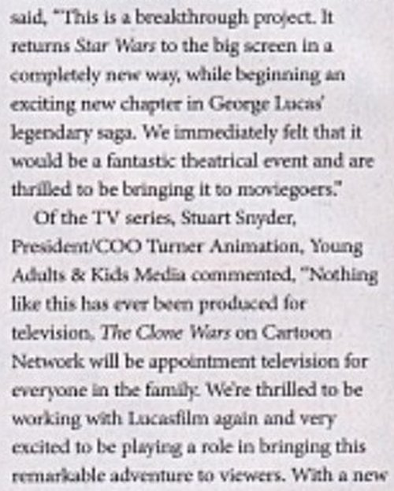
- **none** — entry/section: Stuart Snyder: ""Nothing like this has ever been produced for television. The Clone Wars on Cartoon Network will be appointment television for everyone in the family. We're thrilled to be working with Lucasfilm again and very excited to be playing a role in bringing this remarkable adventure to viewers." —Stuart Snyder, President/COO Turner Animation, Young Adults & Kids Media, Star Wars Insider 101, p. 8" Source: *Star Wars Insider #101* (2008), scan p.8
  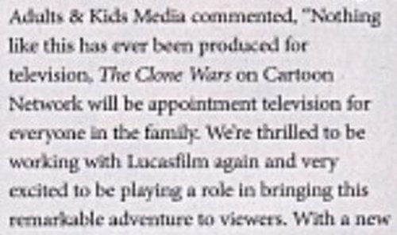

### Stat block notes (game mechanics, not feats)

- Clone Wars announcement: A bold new era of Star Wars entertainment is set to begin this summer when Star Wars: The Clone Wars, premieres as a spectacular, all-new feature film on August 15, followed by a weekly television series in the fall. (Star Wars Insider 101, p. 8) (Source: *Star Wars Insider #101* (2008), scan p.8)
- Clone Wars cast: Expect to see old favorites such as Obi-Wan Kenobi, Anakin Skywalker, and Yoda ignite their lightsabers as they command a hardened legion of (at this point in the saga) loyal clone warriors into battle against a host of enemies including Darth Sidious, Asajj Ventress, and the fearsome commander of the droid armies, General Grievous (see this spread's exclusive images). (Star Wars Insider 101, p. 8) (Source: *Star Wars Insider #101* (2008), scan p.8)
- Ahsoka and Rex debut: Set between Episodes II and III, the movie features the debut appearence [sic] of a new character, Ahsoka Tano, a mysterious but lively Padawan who looks set to be a key player in the chapters to come. Also look out for clone trooper Captain Rex, described as a "central figure" in The Clone Wars. (Star Wars Insider 101, p. 8) (Source: *Star Wars Insider #101* (2008), scan p.8)
- Broadcast and release: Following the theatrical debut, the television series will premiere in the U.S. on Cartoon Network, followed by airings on TNT. ... Each week, viewers will see a thrilling, 30-minute "mini-movie" created by the talented artists at Lucasfilm Animation. ... Star Wars: The Clone Wars opens in North American theaters on Friday, August 15. (Star Wars Insider 101, p. 8) (Source: *Star Wars Insider #101* (2008), scan p.8)
- Concept art caption: Above: Concept art by Atsushi Takeuchi, who started out doing design work and ended up as a guest director of an episode of The Clone Wars. Next Page, Top: Sculptor Darren Marshall translates General Grievous into three dimensions. (Star Wars Insider 101, p. 8) (Source: *Star Wars Insider #101* (2008), scan p.8)

## scan p.9 (scan page 9)

Page contents: Launch Pad (cont.): banner "All the latest news, fun, games and gossip from the Star Wars universe"; photo of sculptor (Darren Marshall per p8 caption) with General Grievous maquette, "Insider Sneek [sic] Peek!" badge; Clone Wars stills (Ahsoka Tano, Anakin Skywalker, Obi-Wan Kenobi); Expanded Universe box: "Check out www.starwars.com/theclonewars for all the latest Clone Wars news!"; sidebar "10 Essential Need to Know Facts on the Clone Wars" (only 7 bullets printed) (hand-read)

### Stat block notes (game mechanics, not feats)

- Clone Wars facts 1-3: The Clone Wars were fought between the Republic and the Confederacy of Independent Systems. / They began with the Battle of Geonosis and ended when Darth Vader assassinated the remaining Separatist leaders on Mustafar. / The Wars ravaged the galaxy for over three years (22 BBY–19 BBY) and resulted in unprecedented massacres and the deaths of most leading representatives from both sides. (Star Wars Insider 101, p. 9) (Source: *Star Wars Insider #101* (2008), scan p.9)
- Vader ends the war: They began with the Battle of Geonosis and ended when Darth Vader assassinated the remaining Separatist leaders on Mustafar. (Star Wars Insider 101, p. 9) (Source: *Star Wars Insider #101* (2008), scan p.9)
- Grand Army size: The Battle of Geonosis was the first time in Republic history that they deployed the Grand Army of the Republic, consisting of 3,000,000 troops. (Star Wars Insider 101, p. 9) (Source: *Star Wars Insider #101* (2008), scan p.9)
- Invisible Hand feat: General Grievous' flagship, Invisible Hand, was the most feared ship in the galaxy. It boasted a terrifying arsenal of weaponry—one of its quad turbolasers could produce the equivalent impactof [sic] a magnitude 10 groundquake. (Star Wars Insider 101, p. 9) (Source: *Star Wars Insider #101* (2008), scan p.9)
- Rimsoos: In the final year of fighting, the Republic deployed MedStar frigates carrying mobile field hospitals known as "Rimsoos" (Republic Mobile Surgical Units). (Star Wars Insider 101, p. 9) (Source: *Star Wars Insider #101* (2008), scan p.9)
- Palpatine seizes control: When Emperor Palpatine declared the Clone Wars over, he reorganized the clone troopers under the name Imperial stormtroopers and seized control of the galaxy. (Star Wars Insider 101, p. 9) (Source: *Star Wars Insider #101* (2008), scan p.9)

## scan p.10 (scan page 10)

Page contents: Launch Pad: "...As the Celebration Hits Japan!" ("Star Wars Celebration set to continue in the land of the rising sun(s)!"); Celebration Japan logo art; Why Japan? / How to Get There box; Expanded Universe box (www.starwars.com/community/event/celebrati[on...]; bracketed text cut off at scan edge); "The Star Wars Fan Movie Challenge" strip with Get Shooting! box; George Lucas photo with camera (hand-read)

- **none** — entry/section: Sansweet on Japan: ""Japan is the ideal site for a Star Wars Celebration," Steve Sansweet said, "since there are many Japanese influences in the saga. Star Wars has roots in the culture and mythos of Japan, and we look forward to celebrating this unique connection during the event," —Steve Sansweet, Star Wars Insider 101, p. 10" Source: *Star Wars Insider #101* (2008), scan p.10
  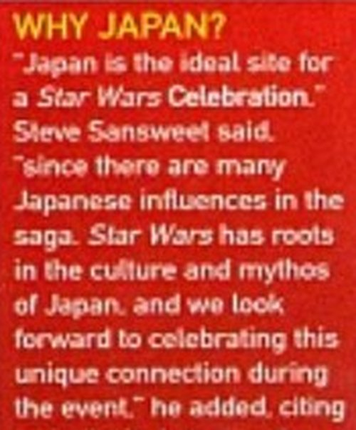
- **none** — entry/section: Sansweet on anniversary: ""Star Wars has enjoyed incredible popularity in Japan for three decades, and we are honored to show our appreciation to Japanese audiences on this milestone anniversary of the movie's opening there," ... "Japanese audiences have been among the most enthusiastic and devoted Star Wars fans and we couldn't let this anniversary pass without thanking them. We are very pleased to add Celebration Japan to a growing worldwide line-up of Star Wars Celebration events." —Steve Sansweet, Director of Content Management and Head of Fan Relations for Lucasfilm, Star Wars Insider 101, p. 10" Source: *Star Wars Insider #101* (2008), scan p.10
  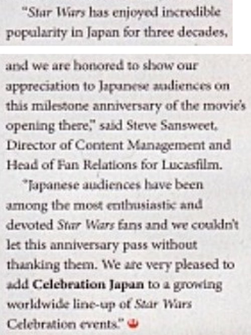

### Stat block notes (game mechanics, not feats)

- Samurai and Jedi: he added, citing a similarity between the stoic Samurai and Jedi Knights of Star Wars as one example. (Star Wars Insider 101, p. 10) (Source: *Star Wars Insider #101* (2008), scan p.10)
- Celebration Japan dates: Star Wars Celebration Japan will welcome fans to the Makuhari-Messe Convention Center starting July 19, 2008 for a three-day festival commemorating 30 years of Star Wars in the Land of the Rising Sun, and looking ahead to great new Star Wars events on the horizon. (Star Wars Insider 101, p. 10) (Source: *Star Wars Insider #101* (2008), scan p.10)
- Lucas and Kurosawa: Star Wars has enjoyed a stellar history in Japan, and has become an integral part of the culture since the movie opened there in June of 1978. George Lucas has frequently referred to the inspiration he drew from Japanese director Akira Kurosawa's films, and from other facets of Japanese culture, when he created the Star Wars movies. (Star Wars Insider 101, p. 10) (Source: *Star Wars Insider #101* (2008), scan p.10)
- Turning Japanese: Plans are in the works for celebrities from the movies, as well as talent—including Japanese talent—involved in creating many aspects of Star Wars through the years, to appear at Celebration Japan. Fans can plan to enjoy stage entertainment, unique exhibits, an exhibit hall floor, Star Wars Art Show, and Celebration Store featuring memorable collectibles and displays. (Star Wars Insider 101, p. 10) (Source: *Star Wars Insider #101* (2008), scan p.10)
- How to get there: The Makuhari-Messe Convention Center is located in Chiba, between Tokyo and Narita Airport, and is easily accessible by rail, car, and public transportation. ... The Lewis+Daniel Group, Lucasfilm's partner in Celebration Japan, has information on tickets, travel packages, and hotels. For more info visit: www.celebrationjapan.com (Star Wars Insider 101, p. 10) (Source: *Star Wars Insider #101* (2008), scan p.10)
- Fan Movie Challenge 2008: The Star Wars Fan Movie Challenge is accepting entries now, and once again AtomFilms and Lucasfilm will partner with Spike TV to showcase the very best movies of the 2008 competition. The 2008 Award Ceremony will take place at San Diego Comic-Con International this July. With the winning movie chosen by George Lucas himself ... the winners receive worldwide exposure on http://starwars.atomfilms.com, as well as one of the Challenge's signature trophies featuring R2-D2 and C-3PO. (Star Wars Insider 101, p. 10) (Source: *Star Wars Insider #101* (2008), scan p.10)
- Get Shooting!: The deadline for entries is May 27, 2008. Finalists are scheduled to be announced on June 26 for viewing and online voting to determine the Audience Choice award. Winners are scheduled to be announced at San Diego Comic-Con International at the Fan Movie Challenge Awards on July 24. (Star Wars Insider 101, p. 10) (Source: *Star Wars Insider #101* (2008), scan p.10)

## scan p.11 (scan page 11)

Page contents: eFX Collectibles teaser ad: Darth Vader helmet montage (Death Star, TIE fighters, Millennium Falcon, Obi-Wan Kenobi, stormtrooper, Emperor); "07·23·08"; www.efxcollectibles.com (hand-read)

## scan p.12 (scan page 12)

Page contents: Launch Pad: "Carbonite Coolness! Rest your drinks on Jabba's trophy!" (Han-in-carbonite desk by Tom Spina Designs for Mark Hall of Casting Crowns); caption "Now you can chill at your desk, in true Solo-style!"; "Hoth and Cold" meter (Frozen in Carbonite / Banished to Hoth / Bound for Kessel) with Hercules, NASA, Waiting for the Force items; Emperor Palpatine cutout (hand-read)

### Stat block notes (game mechanics, not feats)

- Carbonite desk: This one-of-a-kind functional art piece was designed and assembled by Tom Spina and Richard Riley of Tom Spina Designs, a New York-based company specializing in the creation of custom sculptures, functional art, and the restoration and display of original movie props. This desk was designed and fabricated for the home theater/office of Mark Hall, lead singer of the Grammy Award-winning group Casting Crowns (www.CastingCrowns.com). (Star Wars Insider 101, p. 12) (Source: *Star Wars Insider #101* (2008), scan p.12)
- Carbonite desk build: Created over the course of two months, the desk is composed of four main components: two internally-lit side panels, the iconic "carbonite block," and a glass work surface. ... The "carbonite" section began life as a licensed Star Wars prop from the 1990s, which was refitted into a custom fabricated sheet steel housing and embellished with resin fan-created pieces cast from "found objects" such as an old car dashboard! The 1/2" thick glass-work surface is suspended over the desk's frozen prisoner with eight custom metal supports. (Star Wars Insider 101, p. 12) (Source: *Star Wars Insider #101* (2008), scan p.12)
- Desk goes viral: Within 24 hours, countless blogs and tech sites ran stories about the art piece and its "geek chic" appeal. Within five days, the company web site had over 70,000 page requests and over 3.25 million individual image requests. (Star Wars Insider 101, p. 12) (Source: *Star Wars Insider #101* (2008), scan p.12)
- Hoth and Cold: Hercules (Frozen in Carbonite): A real life laser called HERCULES has been created that boasts firepower akin to the Death Star! Quick! Someone name a military target! (Star Wars Insider 101, p. 12) (Source: *Star Wars Insider #101* (2008), scan p.12)
- Hoth and Cold: NASA (Banished to Hoth): NASA using ION technology to propel ships deep into space to investigate asteroids? Surely they know that asteroids and TIE's don't mix? (Star Wars Insider 101, p. 12) (Source: *Star Wars Insider #101* (2008), scan p.12)
- Hoth and Cold: Waiting for the Force (Bound for Kessel): We can't wait for The Force Unleashed, so much so that even the slightest delay in getting what is shaping up to be the ultimate Star Wars videogame into our consoles makes us really antsy. But now that the release date has been set for Septmeber [sic] 16 in the U.S. and September 19 in Europe, we're jazzed! (Star Wars Insider 101, p. 12) (Source: *Star Wars Insider #101* (2008), scan p.12)

## scan p.13 (scan page 13)

Page contents: Launch Pad: "Why Haven't They Made...?" sidebar; "John Alvin Remembered" (photo; John Alvin art of C-3PO one-man band and R2-D2 drinks/drum unit); "Who's cool and who's cold in this month's Star Wars popularity stakes?" meter (Picnicing on Naboo / Podracing on Tatooine / Red Hot on Mustafar): Chris Pine, Saul Bass vs Star Wars, Coming Soon...; Ahsoka Tano cutout (hand-read)

- **none** — entry/section: Lucas on John Alvin: ""Thirty years ago, John Alvin created one of the most memorable - and whimsical - illustrations ever to grace a Star Wars poster. In the years since, he became one of the finest illustrators in his trade, flourishing in a field that is quickly becoming a lost art. We are so fortunate to count John's talent among the treasures of the saga's legacy, and will deeply miss him and the passion for Star Wars he so successfully expressed through his art." —George Lucas, Star Wars Insider 101, p. 13" Source: *Star Wars Insider #101* (2008), scan p.13
  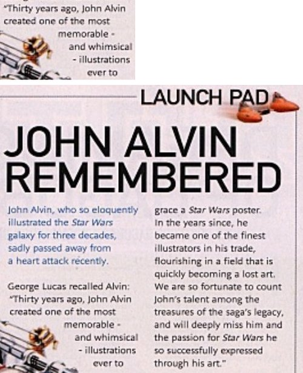

### Stat block notes (game mechanics, not feats)

- Why haven't they made: Blue Milk: OK, so it would be tough for collectors to keep in mint condition (but hey, they'd find a way!) but surely there's a market for Aunt Beru's most popular lunchtime beverage? (Star Wars Insider 101, p. 13) (Source: *Star Wars Insider #101* (2008), scan p.13)
- Why haven't they made: R2-D2 drink server: While we are on the subject of liquid refreshments, how about an Artoo that can distribute drinks at your latest soiree? (Star Wars Insider 101, p. 13) (Source: *Star Wars Insider #101* (2008), scan p.13)
- Why haven't they made: Jabba sofa: Okay, Leia looked less than comfortable sitting with the evil crime lord, but we are willing to bet good credits that sitting on this Jabba would be a comfortable experience. (Star Wars Insider 101, p. 13) (Source: *Star Wars Insider #101* (2008), scan p.13)
- Why haven't they made: Toaster: What better way to start your day than with a slice of Star Wars toast? Just hope it doesn't end up burnt to a crisp, like a certain Sith Lord (Star Wars Insider 101, p. 13) (Source: *Star Wars Insider #101* (2008), scan p.13)
- John Alvin obituary: John Alvin, who so eloquently illustrated the Star Wars galaxy for three decades, sadly passed away from a heart attack recently. (Star Wars Insider 101, p. 13) (Source: *Star Wars Insider #101* (2008), scan p.13)
- Chris Pine (Picnicing on Naboo): The new Captain Kirk in the forthcoming Star Trek movie has admitted the inspiration for the portrayal of his character is none other than Han Solo. We always knew Han was the coolest! (Star Wars Insider 101, p. 13) (Source: *Star Wars Insider #101* (2008), scan p.13)
- Saul Bass vs Star Wars (Podracing on Tatooine): For a look at what the title sequence might have been had A New Hope been made 20 years earlier go to www.youtube.com/watch?v=z25t-PQDn5A (Star Wars Insider 101, p. 13) (Source: *Star Wars Insider #101* (2008), scan p.13)
- Coming soon (Red Hot on Mustafar): to a theater near you.... Star Wars – back on the big screen! Bring on The Clone Wars! (Star Wars Insider 101, p. 13) (Source: *Star Wars Insider #101* (2008), scan p.13)

## scan p.14 (scan page 14)

Page contents: Launch Pad / Comlink: "Dreaming of Dagobah" ("Was Luke's dream of Dagobah a premonition of things yet to come...?")—reader letter (writer and town omitted) theorizing that Luke, like Anakin, sees "things before they happen," citing Qui-Gon Jinn's Episode I line; editorial reply; "Schoolyard Theories!" box; Luke (Hoth gear) and R2-D2 photo; masthead (May/June 2008; Editor Brian J. Robb, Deputy Editor Jonathan Wilkins, Senior Editor Simon Hugo, Art Editor Karl Barr, Assistant Editor Sarah Herman; Lucasfilm: Director of Publishing Carol Roeder, Editor Frank Parisi, Director of Content Management and Fan Relations Steve Sansweet, Art Director Troy Alders, Bantha Tracks Mary Franklin; Contributors Paul Simpson, Daniel Wallace, Calum Waddell, David Maddox, Craig Anderson, Alex Jones, Jon Freel, Jason Fry, Jeremy Beckett, Leland Y. Chee, Steve Sansweet, Gus Lopez; Special Thanks incl. "And all who helped during the Editor's illness!"; Titan Magazines staff list incl. Publisher Nick Landau; Star Wars Insider US#101 UK#77; USPS 003-027 ISSN 1041-5122; [email omitted]; fine print partly blurred in scan) (hand-read)

### Stat block notes (game mechanics, not feats)

- Dagobah premonition theory (reader letter, name omitted): Qui-Gonn's [sic] observation: "He can see things before they happen," tells us a lot. ... This is all George Lucas' way of showing that seeing the future through dreams tormented Anakin, and it is starting to torment Luke. (reader letter, Star Wars Insider 101, p. 14) (Source: *Star Wars Insider #101* (2008), scan p.14)
- Schoolyard Theories!: Can you remember being a kid and filling in the gaps about the Star Wars saga yourself? It all seemed easier in those pre-prequel days when we knew only half the story and had crazy theories about what Vader looked like under the mask, insane ideas about the droids adventures prior to their narrow escape from the Tantive IV, and rumors as to who Luke and Leia's mother was. We'd love to hear your childhood speculation. Write in and tell us! (Star Wars Insider 101, p. 14) (Source: *Star Wars Insider #101* (2008), scan p.14)

## scan p.15 (scan page 15)

Page contents: Dark Horse ad: "Vector" ("A yearlong Star Wars event with repercussions for every era!"); Dark Times #11 cover (Darth Vader over figure on medical slab); darkhorse.com/starwars; 1.888.266.4226; Lucas Books logo (hand-read)

### Stat block notes (game mechanics, not feats)

- Vector crossover: Beginning with Star Wars: Knights of the Old Republic #25, Vector will stretch over forty-one centuries of Star Wars history—from the time of the Knights of the Old Republic, through the unexplored Dark Times between Episode III and Episode IV, into the "Classic Era" of the Rebellion, and all the way to the "future" of Legacy. (Dark Horse ad, Star Wars Insider 101, p. 15) (Source: *Star Wars Insider #101* (2008), scan p.15)

## scan p.16 (scan page 16)

Page contents: Big Interview opener: "Watts the Story" (Words: Jonathan Wilkins); Robert Watts in Hoth snow gear (photo) (hand-read)

### Stat block notes (game mechanics, not feats)

- Robert Watts standfirst: Robert Watts' association with Lucasfilm began as production supervisor on the original Star Wars. He worked on all three films of the original trilogy, as well as the first three Indiana Jones movies. (Jonathan Wilkins, Star Wars Insider 101, p. 16) (Source: *Star Wars Insider #101* (2008), scan p.16)
- Who's That Man?: Robert Watts was the guy who brought the Star Wars unit to shoot in Norway: bet the crew loved him! (Star Wars Insider 101, p. 16) (Source: *Star Wars Insider #101* (2008), scan p.16)

## scan p.17 (scan page 17)

Page contents: Big Interview: full-page photo of Robert Watts in Empire Strikes Back crew parka with "Robert Watts" name tag and Empire Strikes Back patch, snow goggles (hand-read)

## scan p.18 (scan page 18)

Page contents: Big Interview: Robert Watts Q&A (Words: Jonathan Wilkins) pt. 1; photos: Empire unit on location in Norway (courtesy Robert Watts), Harrison Ford and George Lucas on Return of the Jedi location, George Lucas in director's chair (hand-read)

- **none** — entry/section: Watts hired via Gary Kurtz: ""A producer rang and said he had heard there was an English production manager in the studio. That was Gary Kurtz and it was just before they began shooting American Graffiti, in 1972. ... Fox flew me to see Gary. They had all the usual suspects lined up for the production management supervisor role, but because I'd met him before I got the job!" —Robert Watts, Star Wars Insider 101, p. 18" Source: *Star Wars Insider #101* (2008), scan p.18
  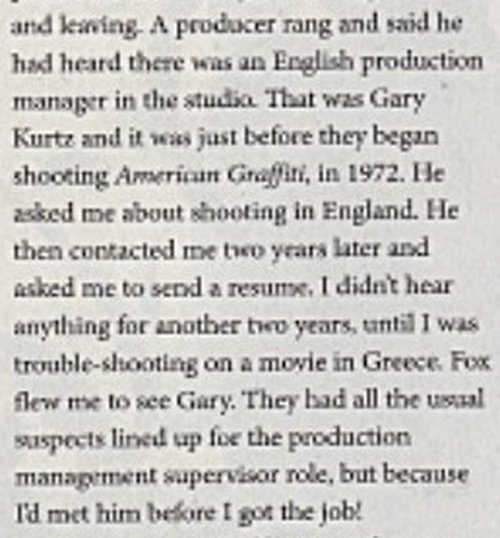
- **none** — entry/section: Watts on Rick McCallum: ""History repeats itself because the same thing happened years later when I was leaving Lucasfilm. Rick McCallum had met George before, so it was similar to my situation. I re-introduced Rick to George, as I had been re-introduced to Gary, and Rick went on to do a truly magnificent job." —Robert Watts, Star Wars Insider 101, p. 18" Source: *Star Wars Insider #101* (2008), scan p.18
  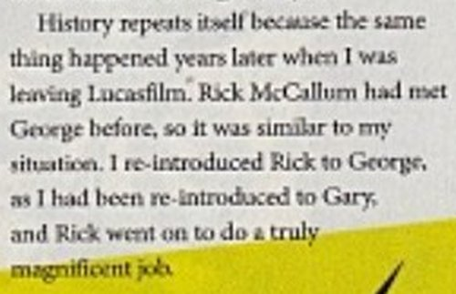
- **none** — entry/section: Watts on 2001 vs Star Wars: ""In a sense, the difference between those two movies is that 2001 was what you might call hard science fiction. Stanley Kubrick insisted that everything was correct, that airlocks worked, that there was no sound in space, and so on. Star Wars is more of a science fantasy because we didn't really bother with any of that stuff. While everything in Kubrick's film was immaculate, in Star Wars it was grubby, so the Millennium Falcon needed oil and it didn't always get into hyperspace. I think that sense of reality — albeit in a fantastical setting — is partially what caught the public imagination." —Robert Watts, Star Wars Insider 101, p. 18" Source: *Star Wars Insider #101* (2008), scan p.18
  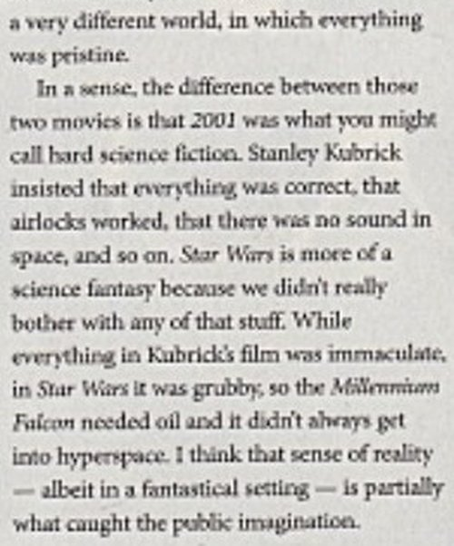
- **none** — entry/section: Watts on Lucas's reference films: ""George showed us four movies before we began the shoot: 2001, Silent Running, Fellini's Satyricon and Sergio Leone's Once Upon a Time in the West. Satyricon contains all those kind of elements you see in the cantina sequence. He wanted us to get that dusty, used look into it that you find in Once Upon a Time in the West." —Robert Watts, Star Wars Insider 101, p. 18" Source: *Star Wars Insider #101* (2008), scan p.18
  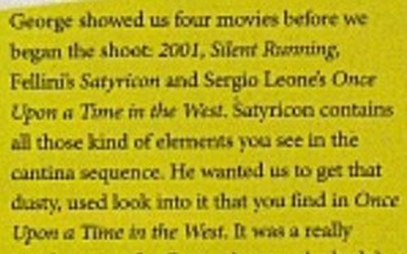
- **none** — entry/section: Watts on Fox and sequel rights: ""Luckily, Alan Ladd Jr. stood by us and when the movie opened, it doubled the price of Fox's stock on Wall Street. Fox never tied up the sequel rights, which shows the lack of confidence it had in what George was doing. So when it became a huge hit, George owned it all! When we came back to make The Empire Strikes Back things were different because we weren't being beaten up by Fox. In fact, George financed it, with his own money, but Fox was distributing." —Robert Watts, Star Wars Insider 101, p. 18" Source: *Star Wars Insider #101* (2008), scan p.18
  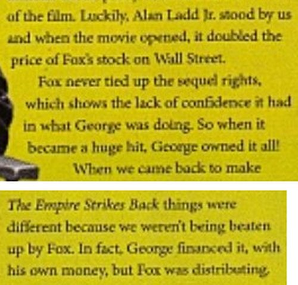
- **none** — entry/section: Watts learns of the hit: ""I was making a film in Northern Afghanistan. I used to buy Time magazine and Newsweek as it was the only way to keep in touch. I bought my copy of Time one week and I opened it up straight onto a bunch of color pages of pictures from Star Wars. I thought, "Bloody hell!" I had no idea it had taken off to such a huge extent." —Robert Watts, Star Wars Insider 101, p. 18" Source: *Star Wars Insider #101* (2008), scan p.18
  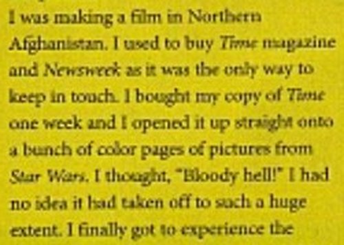

### Stat block notes (game mechanics, not feats)

- Watts photo captions: Main Photo: The Empire Strikes Back unit, on location in Norway (courtesy Robert Watts). Above: Harrison Ford and George Lucas in a very different location for Return of the Jedi. Below Left: George Lucas (Star Wars Insider 101, p. 18) (Source: *Star Wars Insider #101* (2008), scan p.18)

## scan p.19 (scan page 19)

Page contents: Big Interview: Robert Watts pt. 2; photo of Empire crew outside Finse hotel in Norway snow; pull quote (hand-read)

- **none** — entry/section: Pull quote: ""Star Wars was grubby, so the Millennium Falcon needed oil and it didn't always get into hyperspace. I think that sense of reality caught the public imagination." —Robert Watts, Star Wars Insider 101, p. 19" Source: *Star Wars Insider #101* (2008), scan p.19
  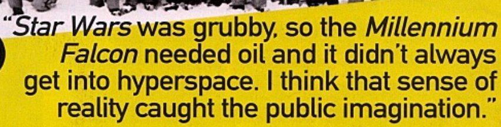
- **none** — entry/section: Watts on Kubrick vs Lucas: ""They're very different characters. Stanley is portrayed as a reclusive genius, but he was one of the funniest men I've ever met. George is perhaps a little more straight-laced. With Kubrick you'd be pretty much married to him when you started a film. He'd call you up on Christmas Day to discuss business! George is a very different person. He's very private. In some ways he's shy, but he's treated me with such fairness ever since the start that I have nothing but praise for him and what he's achieved." —Robert Watts, Star Wars Insider 101, p. 19" Source: *Star Wars Insider #101* (2008), scan p.19
  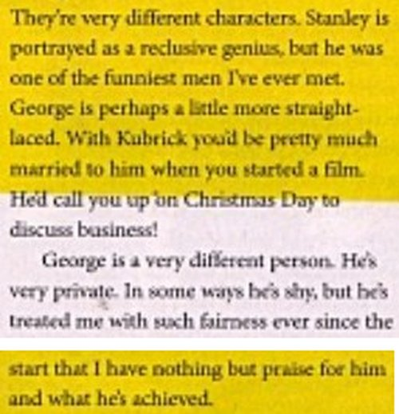
- **Han Solo; Luke Skywalker; Leia Organa Solo** — entry/section: Watts on the young cast: ""I've done six films with Harrison Ford, who evolved into a huge star! That's a strange thing because when we made Star Wars the two most famous actors in it were Alec Guinness and Peter Cushing! Mark Hamill, Harrison Ford, and Carrie Fisher hadn't really made any movies of note. Harrison had done a small part in American Graffiti, but he was well under everybody's radar." —Robert Watts, Star Wars Insider 101, p. 19" Source: *Star Wars Insider #101* (2008), scan p.19
  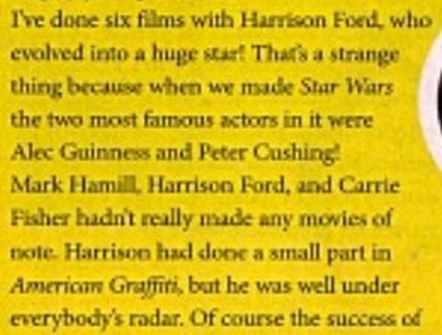
- **none** — entry/section: Watts on Empire schedule: ""The second film went over schedule and budget for a variety of reasons. Irvin Kershner is a very particular director and in many ways it's the best of the three" —Robert Watts, Star Wars Insider 101, pp. 19-20" Source: *Star Wars Insider #101* (2008), scan p.19
  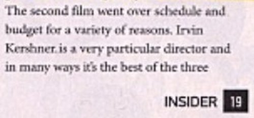

## scan p.20 (scan page 20)

Page contents: Big Interview: Robert Watts pt. 3; photo caption "Riding High: Watts takes a trip on a tauntaun!" (hand-read)

- **none** — entry/section: Watts on Empire as middle episode: ""It's the one that had the ability to establish character better because it was definitively a middle episode that didn't resolve. It didn't have to because we knew we were going to do the third one—there wasn't any question. Return of the Jedi was bang on schedule and budget. We were very good at it by then!" —Robert Watts, Star Wars Insider 101, p. 20" Source: *Star Wars Insider #101* (2008), scan p.20
  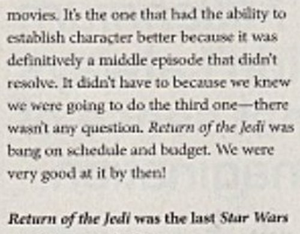
- **Jabba the Hutt** — entry/section: Watts on Jedi locations: ""Return of the Jedi was the only one of three where we didn't start on location. We did all of the studio interiors like Jabba's palace first, at Elstree. Once we'd wrapped up in England we went to Yuma, Arizona. We actually stayed in California, just across the state line. We shot the exterior of Jabba's sail barge with the Sarlacc pit. ... Then we moved up from there to the most north-westerly point in California, a place called Smith River." —Robert Watts, Star Wars Insider 101, p. 20" Source: *Star Wars Insider #101* (2008), scan p.20
  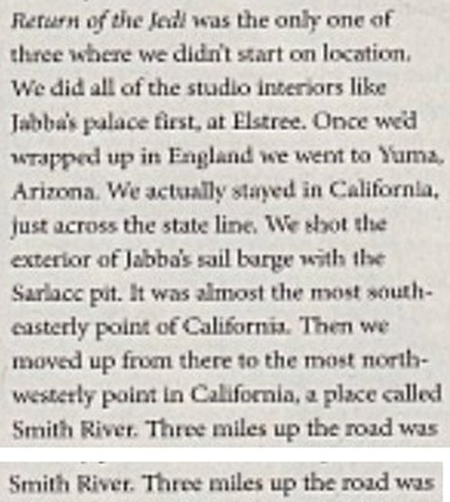
- **none** — entry/section: Watts's AT-ST cameo: ""We completed the film there and then we went back to do all the bluescreen work with the speeder bikes. That's when Richard [Marquand, director] and I performed our brief roles [as AT-ST drivers]. I didn't know I was going to be in the movie until I came in to work that morning. It was a last minute decision!" —Robert Watts, Star Wars Insider 101, p. 20" Source: *Star Wars Insider #101* (2008), scan p.20
  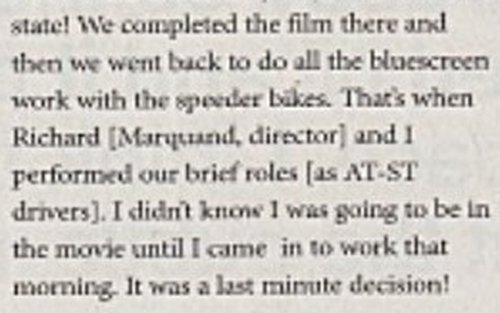
- **none** — entry/section: Watts on Lucas on set: ""George is very hands-on. He was much more around on the Star Wars movies than he was on the Indy films. George trusted us and we got on with it. If we were ever in trouble he'd come to help out, but that was very rare. We did lose Harrison for eight weeks on Temple of Doom, but Steven and I resolved the problem of shooting around him before George arrived." —Robert Watts, Star Wars Insider 101, p. 20" Source: *Star Wars Insider #101* (2008), scan p.20
  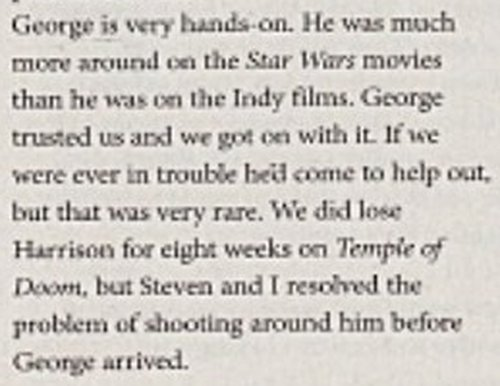
- **none** — entry/section: Watts's appendix: ""I'd had acute appendicitis in the middle of shooting Raiders of the Lost Ark. There was a book about the making of the film and that was mentioned." —Robert Watts, Star Wars Insider 101, p. 20" Source: *Star Wars Insider #101* (2008), scan p.20
  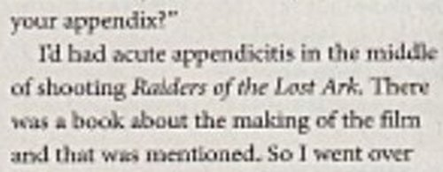

## scan p.21 (scan page 21)

Page contents: Big Interview: Robert Watts pt. 4; Expanded Universe box "The Indy Adventures"; photos: Harrison Ford as Indiana Jones; "Blue Harvest!" Watts with Richard Marquand; "The Gang's All Here!" Endor group photo (hand-read)

- **none** — entry/section: Watts joins Raiders: ""At the end of The Empire Strikes Back we were doing some bluescreen work in London when George said, 'Read this' and he gave me the screenplay for Raiders of the Lost Ark. I read it and said, 'This is a very busy script, George.' He said he wanted me to work on the film, but I needed to meet Steven Spielberg. I ended up working on three Indiana Jones movies!" —Robert Watts, Star Wars Insider 101, p. 21" Source: *Star Wars Insider #101* (2008), scan p.21
  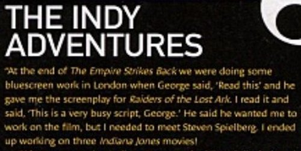
- **none** — entry/section: Watts on Indy casting: ""When were [sic] casting Indiana Jones, we had Tom Selleck signed to do it, but he'd done a pilot called Magnum P.I. that was picked up. We were stuck until somebody realized we had the man for the job in our own backyard: Harrison Ford, who proved to be magnificent in the part." —Robert Watts, Star Wars Insider 101, p. 21" Source: *Star Wars Insider #101* (2008), scan p.21
  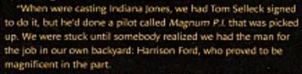
- **none** — entry/section: Watts on Raiders schedule: ""I scheduled the film initially for 23 weeks. I showed the plan to Steven and he said, 'No, I'll do it in 17 weeks.' By that point I was getting even more nervous. But we shot it in 15 weeks! We came in two weeks under schedule. It'd never happened before. When you are ahead of schedule, it really raises the morale of the crew!" —Robert Watts, Star Wars Insider 101, p. 21" Source: *Star Wars Insider #101* (2008), scan p.21
  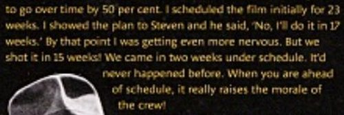

### Stat block notes (game mechanics, not feats)

- Captions: Blue Harvest! Watts with Return of the Jedi director Richard Marquand, bringing about Horror Beyond Imagination! / The Gang's All Here! Robert Watts, the cast of Jedi and co-producer Jim Bloom (far right). (Star Wars Insider 101, p. 21) (Source: *Star Wars Insider #101* (2008), scan p.21)

## scan p.22 (scan page 22)

Page contents: Big Interview: Robert Watts pt. 5 (end); Expanded Universe box "Name & Rank"; photos: Watts as AT-ST driver ("Cometh the Hour, Cometh the Man! It's AT-ST driver Lt. Watts"), Boba Fett; pull quote (hand-read)

- **none** — entry/section: Pull quote: ""I always thought Star Wars would be a hit. I expected James Bond business, but I don't think anybody expected it to take off like it did." —Robert Watts, Star Wars Insider 101, p. 22 (right edge of pull quote cut off at scan edge; wording matches p. 18 text)" Source: *Star Wars Insider #101* (2008), scan p.22
  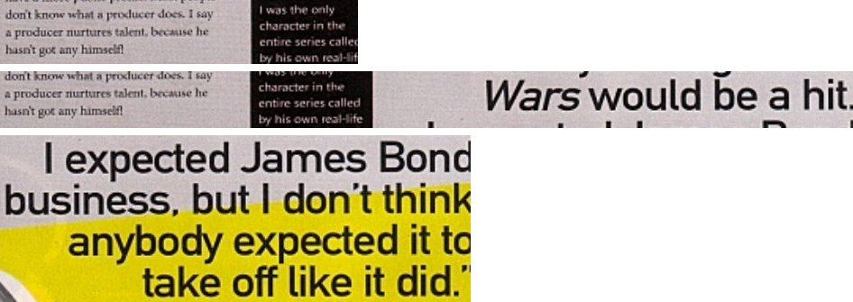
- **none** — entry/section: Watts at Celebration: ""So I said, "What happens on the fourth day? Do you turn back into a child?" Even small kids came up, and because it was Sunday their tickets said "Sun Child" ... I said "No, my grandkids will kill me if I give that to you!" I signed autographs for 40 minutes." —Robert Watts, Star Wars Insider 101, p. 22" Source: *Star Wars Insider #101* (2008), scan p.22
  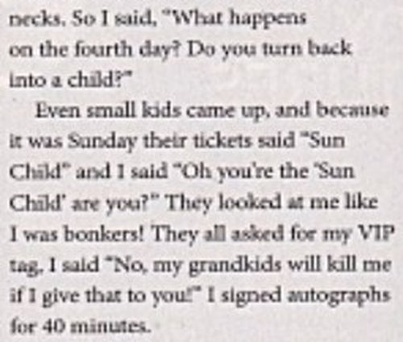

## scan p.23 (scan page 23)

Page contents: TFAW.com (Things From Another World, "Since 1979") ad: "No matter what you're into, we've got just the thing for your collection!"; Kotobukiya vinyl statues (Obi-Wan Kenobi, C-3PO, R2-D2, Darth Vader); Star Wars "Vector" covers; Star Wars Omnibus Collection: X-Wing Rogue Squadron Vol. 1-3; Star Wars 1:6 Scale Helmet Replicas (Luke X-wing helmet); "Save 20-50%"; www.TFAW.com/offer/swinsider; Star Wars, Hasbro, DC, Marvel, Dark Horse logos (hand-read)

### Stat block notes (game mechanics, not feats)

- TFAW ad copy: Things From Another World has searched the galaxy for the best Star Wars statues, graphic novels, comics and collectibles. Now you can bring them home! (TFAW ad, Star Wars Insider 101, p. 23) (Source: *Star Wars Insider #101* (2008), scan p.23)

## scan p.24 (scan page 24)

Page contents: Feature: "Science of [Star Wars]: Could a Real Lightsaber Be Possible?" ("Don't get your hopes up: science has a long way to go!"); photos: Obi-Wan Kenobi (Ewan McGregor) and Yoda with lightsabers; "Watch Online" badge; Expanded Universe box (Your Lightsaber & You, http://www.atomfilms.com/film/your_lightsaber.jsp; Jedi Lightsaber Laboratory, http://www.atomfilms.com/film/lab_1138.jsp, fan-film director name omitted) (hand-read)

- **none** — entry/section: Dr Karl Lyons on plasma sabers: ""Let's assume that we can attach our plasma lightsabers to vast power sources. As soon as two blades clash, the magnetic fields would knot together, completely distorting the blades and making them unstable. The plasma could spill out and quickly ruin your day. Oh, and you'd have to perform your lightsaber fight in a vacuum, as fresh air would immediately quench the plasma blade." —Dr Karl Lyons, physicist at the National Center for Scientific Research (CNRS), France, Star Wars Insider 101, p. 24" Source: *Star Wars Insider #101* (2008), scan p.24
  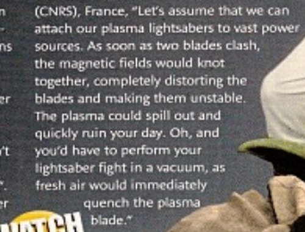

### Stat block notes (game mechanics, not feats)

- Lightsaber in-universe: In the Star Wars universe the lightsaber is built by hand by each Jedi. It contains a power source and crystals that focus the energy into a light blade capable of cutting through practically anything, except another lightsaber blade. The most obvious real-world equivalent is the laser. (Star Wars Insider 101, p. 24) (Source: *Star Wars Insider #101* (2008), scan p.24)
- Laser problems: As laser beams are merely "coherent" beams of light, controlling the length of a laser lightsaber is currently beyond science. The beam would spill out like a torch and our Jedi would have to make sure he or she didn't point it at a mirror! The other problem would be making the beam "substantial". Laser beams can pass through each other with ease, being made purely of light. (Star Wars Insider 101, p. 24) (Source: *Star Wars Insider #101* (2008), scan p.24)
- Plasma lightsaber: Plasma is just ionised gas that glows. ... Because it is ionised it responds to magnetic fields, so theoretically it should be possible to generate a lightsaber beam of plasma with a strong magnetic field around it. As the fourth state of matter, however, plasma is very hot, with temperatures ranging from thousands to millions of degrees. If the plasma was dense enough, and if the magnetic field failed, then our Jedi could end up a bit scorched. (Star Wars Insider 101, p. 24) (Source: *Star Wars Insider #101* (2008), scan p.24)
- Expanded Universe box: "Instructional" video on how to handle your homemade lightsaber! ... This is a convincing and funny fake news report on the development of a "real" lightsaber (Star Wars Insider 101, p. 24) (Source: *Star Wars Insider #101* (2008), scan p.24)
- Byline note: Words: David Hawksett (byline printed on p. 25 for the Science of Star Wars spread) (Star Wars Insider 101, p. 25) (Source: *Star Wars Insider #101* (2008), scan p.24)

## scan p.25 (scan page 25)

Page contents: Feature: "Science of Star Wars" (cont.; "Where real world science and technology meets Star Wars fantasy"; Words: David Hawksett): "A Real Ion Drive" (TIE fighter image), "What a Piece of Junk!" (Millennium Falcon / ATV), sidebar "How Many Planets Are Out There?" and "One More Step to C-3PO"; C-3PO cutout (hand-read)

### Stat block notes (game mechanics, not feats)

- A Real Ion Drive: Until recent years, ion drives have belonged purely in science fiction but several have now been tested in space. In January 2008, the latest version of this technology was given the green light as the primary propulsion method for the European Space Agency's BepiColombo mission to the planet Mercury. (David Hawksett, Star Wars Insider 101, p. 25) (Source: *Star Wars Insider #101* (2008), scan p.25)
- What a Piece of Junk!: It may not have twin gun turrets or a smuggling compartment, but the latest space freighter is state-of-the-art when it comes to 21st Century space travel. The Automated Transfer Vehicle (ATV) is the largest and most complex spacecraft ever built by the European Space Agency. ... the unmanned freighter is designed to resupply the International Space Station with more than seven tons of cargo at a time. (David Hawksett, Star Wars Insider 101, p. 25) (Source: *Star Wars Insider #101* (2008), scan p.25)
- How many planets: But since 1995 astronomers have discovered around 270 planets in our galaxy; so far most have been large gas giants like Jupiter or Yavin. ... It may not be too many years before we spot our first Naboo or Tatooine out there. (David Hawksett, Star Wars Insider 101, p. 25) (Source: *Star Wars Insider #101* (2008), scan p.25)
- One more step to C-3PO: The robot gas station attendant made its debut as an experiment inspired by milking machines! ... It's hardly C-3PO, but it is another advancement that proves that the combination of artificial intelligence and robotic dexterity still holds a lot of potential. (David Hawksett, Star Wars Insider 101, p. 25) (Source: *Star Wars Insider #101* (2008), scan p.25)

## scan p.26 (scan page 26)

Page contents: Mimoco ad: "mimobot Designer USB Flash Drives — Mimobot Series 2 joins forces with Mimobot Series 1" (Luke X-wing pilot, stormtrooper, Darth Vader, Boba Fett, Luke, Leia, Han Solo, Chewbacca, R2-D2 figures); www.mimobot.com; Official Star Wars Fan Club logo, starwars.com/fan[club] (bracketed text cut off at scan edge) (hand-read)

## scan p.27 (scan page 27)

Page contents: Top Ten opener: "The Greatest Ever... Lightsaber Battles" (Words: Paul Simpson); Obi-Wan vs Anakin Mustafar silhouette art (hand-read)

### Stat block notes (game mechanics, not feats)

- Top Ten standfirst: For some people they are what Star Wars is all about—those moments when the lightsaber blade is ignited and battle commences. But they're not just about action! These confrontations are often the most emotionally charged moments of the saga. (Paul Simpson, Star Wars Insider 101, p. 27) (Source: *Star Wars Insider #101* (2008), scan p.27)

## scan p.28 (scan page 28)

Page contents: Top Ten #10 Obi-Wan Kenobi & Anakin Skywalker vs. Count Dooku (Revenge of the Sith, DVD Chapter 5); #9 Obi-Wan Kenobi vs. Darth Vader (A New Hope, DVD Chapter 38); photos: Invisible Hand duel, Ben Kenobi, General Grievous cutout (hand-read)

### Stat block notes (game mechanics, not feats)

- #10 Kenobi & Anakin vs Dooku: The first lightsaber battle of the final Star Wars movie is a rematch between the Jedi Master, his apprentice, and the Sith Lord; Dooku speaks for the whole audience when he says he's been looking forward to it. The action is fast and furious even before Dooku improves the odds by incapacitating Obi-Wan, but it steps up another notch when an angry Skywalker faces off against Dooku. When Anakin gives in to his hate, and maybe even the fear that Dooku senses, the Jedi takes the advantage. Anakin gets his revenge for losing his arm, cutting Dooku off at the wrists, before giving in to the dark side and obeying Palpatine's orders to kill the Count. The hatred in Anakin's eyes doesn't bode well for anyone who crosses his path in the future, and gets Revenge of the Sith off to a stunningly dramatic start. (Paul Simpson, Star Wars Insider 101, p. 28) (Source: *Star Wars Insider #101* (2008), scan p.28)
- #9 Kenobi vs Vader: It's the lightsaber battle that has been re-enacted in schoolyards around the world for over 30 years, but it's on our list at number nine because, compared with the other lightsaber fights we see in the later installments of the Star Wars saga, it's a bit slow. There are still hints of Anakin's arrogance in Darth Vader's demeanor as he's convinced that defeating his old teacher is going to be easy. Despite his age, Kenobi is still spry, even if neither he nor Vader indulge in any of the acrobatics that characterized their battle a mere 19 years earlier. It's still incredibly powerful, and marks a key emotional moment in the saga as Obi-Wan surrenders himself to the Force. (Paul Simpson, Star Wars Insider 101, p. 28) (Source: *Star Wars Insider #101* (2008), scan p.28)

## scan p.29 (scan page 29)

Page contents: Top Ten (cont.; running head "The Greatest Ever Lightsaber Battles"): #8 Obi-Wan Kenobi vs. General Grievous (ROTS, DVD Chapters 21 & 24); #7 "Qui-Gonn [sic] Jinn & Obi-Wan Kenobi vs. Darth Maul" (TPM, DVD Chapter 39); #6 Yoda vs. the Emperor (ROTS, DVD Chapter 39 onwards); photos: Grievous, Naboo hangar duel, Yoda (hand-read)

### Stat block notes (game mechanics, not feats)

- #8 Kenobi vs Grievous: "So uncivilized," Obi-Wan mutters after he's had to use a blaster to dispose of General Grievous. And it sums up their battle. This isn't a heroic contest between Jedi Knights and Sith Lords—it's a down and dirty, no holds barred, old-fashioned fight-to-the-death. After seeing Grievous in action in the Clone Wars micro-series, expectations were running high for this particular fight, and audiences weren't disappointed. However, it's fairly low on our list because a large part of it doesn't involve lightsabers at all: Kenobi disarms Grievous (literally!) and then loses his own lightsaber during their chase across the planet. (Paul Simpson, Star Wars Insider 101, p. 29) (Source: *Star Wars Insider #101* (2008), scan p.29)
- #7 Qui-Gon & Obi-Wan vs Maul: It's the first big lightsaber duel of the new trilogy, and it doesn't disappoint. The first time Qui-Gon Jinn faced off against Darth Maul, the Jedi Master looked hopelessly out of his depth, so it's no surprise that he's better prepared when he and Obi-Wan meet Maul in the hangar on Naboo. ... Maul harnesses the power of the dark side against his Jedi opponents; when they get separated, it gives him another advantage over and above his skills with his unique double-bladed lightsaber. When Qui-Gon is killed, Obi-Wan has to be equally vicious, leading to one of the Star Wars moments to treasure the most: the look of surprise on Maul's face as he realizes that Obi-Wan has used the Force to grab Qui-Gon's lightsaber to cut him in two! (Paul Simpson, Star Wars Insider 101, p. 29) (Source: *Star Wars Insider #101* (2008), scan p.29)
- #6 Yoda vs the Emperor: It doesn't start well for the Jedi Master, and the Emperor may have a point when he accuses Yoda of arrogance and too much self-confidence. The two seem equally matched no matter the weapon: lightsabers, Force pushes, or Force lightning. The battles between Yoda and Dooku, and Palpatine and Mace Windu seem like warm-ups, as both employ every tactic used in those fights, yet still find themselves unable to take the upper hand. Cutting between this battle and Obi-Wan and Anakin's final duel makes Yoda's defeat seem even more powerful, and there's a definite air of unfinished business as Yoda makes his hasty retreat. (Paul Simpson, Star Wars Insider 101, p. 29) (Source: *Star Wars Insider #101* (2008), scan p.29)

## scan p.30 (scan page 30)

Page contents: Top Ten #5 Mace Windu vs. Palpatine (ROTS, DVD Chapter 27); #4 Luke Skywalker vs. Darth Vader (ESB, DVD Chapters 42, 44, 46); photos: Windu/Sidious Force lightning, Bespin duel silhouette (hand-read)

### Stat block notes (game mechanics, not feats)

- #5 Windu vs Palpatine: Let's be honest here: as soon as Samuel L. Jackson was cast as Mace Windu, we all looked forward to seeing him in serious fighting mode. He had a bit of action on Geonosis, but it's at this key point in Revenge of the Sith that he comes into his own. Windu is up against an enemy he really doesn't understand or even recognize until it's far too late. Despite Palpatine's revelation that he's a Sith Lord, Windu doesn't give up. It's another fast and furious battle that ends with Windu disarming the treacherous Chancellor and apparently having him at his mercy. How much Palpatine is faking his weakness, hoping Anakin will take the initiative and deal with Windu, we'll never know. But it certainly looks like Windu is going to deliver the ultimate sanction until Anakin takes the fateful step on his path to becoming Darth Vader and chooses to defend Palpatine. (Paul Simpson, Star Wars Insider 101, p. 30) (Source: *Star Wars Insider #101* (2008), scan p.30)
- #4 Luke vs Vader (Bespin): "I am your father." Darth Vader's revelation tends to overshadow the battle between father and son that precedes it, yet it's one of the strongest in the entire saga. This isn't an almost-civilized duel, like the fight between Ben Kenobi and Vader on the Death Star. Luke is no pushover, and is able to use the Force to a much greater extent than Vader anticipates. Vader has little option but to keep Luke at bay, using the dark side to throw objects at him. Yet Luke continues to survive, and the final phase of their lightsaber duel sees Vader at his most unrestrained, almost using his lightsaber as a broadsword, hacking at his son to force him backwards. In the end the only way to stop Luke from fighting is to cut his hand off and as the shocked youngster clings on, Vader reveals the truth—but doesn't anticipate Luke's decision to sacrifice himself rather than join him. (Paul Simpson, Star Wars Insider 101, p. 30) (Source: *Star Wars Insider #101* (2008), scan p.30)

## scan p.31 (scan page 31)

Page contents: Top Ten #3 Yoda vs. Count Dooku (AOTC, DVD Chapter 46); #2 Luke Skywalker vs. Darth Vader & the Emperor (ROTJ, DVD Chapter 37 onwards); photos: Geonosis hangar duel, Emperor's Force lightning, Vader silhouette (hand-read)

### Stat block notes (game mechanics, not feats)

- #3 Yoda vs Dooku: When word got out before Attack of the Clones opened that Yoda was going to be in a lightsaber duel, fans wondered aloud whether it would be the film's highlight or low point. After all, Christopher Lee's Count Dooku is up there in age for a human, and we'd never seen the wizened 800-plus year-old Jedi Master do much more than walk very slowly. The small figure who hobbles on his walking stick into the secret hangar on Geonosis seems almost pathetically frail as he adopts a stance preparing for battle. He may look a bit comic, but there's nothing funny about what follows. After all, it's Yoda who's been teaching Jedi apprentices for the past eight centuries! There are more parries and thrusts, jumps and attacks than in any of the previous fights. It's a battle between two masters of their art, lightsabers flashing so fast you can hardly follow it. Incredibly, the whole confrontation takes less than two and a half minutes, with only 45 seconds or so of lightsaber action! (Paul Simpson, Star Wars Insider 101, p. 31) (Source: *Star Wars Insider #101* (2008), scan p.31)
- #2 Luke vs Vader & the Emperor: It's the battle that the entire saga has been building towards, as the "new hope" of the Jedi confronts the ultimate evil in Emperor Palpatine—but which side will Darth Vader be on? The Emperor doesn't have any loyalty to Vader, no more than he did to Dooku, and whichever Skywalker wins, he will still have a pawn. ... Then when Vader's arm is chopped off, and Luke refuses the Emperor's "invitation" to join him, Palpatine turns on Luke. Only Vader can save his son. At most times, and particularly in his weakened state, Vader wouldn't have stood a chance against the power emanating from his Master, but the light side of the Force gives him the strength he needs. This is the only battle in the saga in which both opponents die: The Emperor's body explodes as it enters the reactor core, and Anakin Skywalker dies in his son's arms a few minutes later. Although Vader had claimed that the circle was complete when he encountered Ben Kenobi on the Death Star, it really was complete now, as the good side in Anakin finally helped return balance to the Force. (Paul Simpson, Star Wars Insider 101, p. 31) (Source: *Star Wars Insider #101* (2008), scan p.31)

## scan p.32 (scan page 32)

Page contents: Top Ten #1 Obi-Wan Kenobi vs. Anakin Skywalker (ROTS, DVD Chapter 38 onwards); Expanded Universe box "The Greatest Ever... Lightsaber Battles" (EU picks); "And Finally: Han vs the tauntaun!" box; "Agree? Disagree?" footer ([email omitted]) (hand-read)

### Stat block notes (game mechanics, not feats)

- #1 Kenobi vs Anakin: For nearly 30 years we knew that the battle between Darth Vader and Ben Kenobi on board the Death Star was a rematch between the former Jedi Master and his apprentice. Revenge of the Sith finally provided us with the original, cataclysmic clash of the titans. ... It came down to a massive lightsaber duel between two evenly matched opponents. The lightsabers flash furiously against the backdrop of volcanic Mustafar; while it's said that only a fool fights in a burning house, these two don't have an option. The planet erupts around them as neither will give ground. John Williams' magnificent score is operatic in scope as the two men duel back and forth, their lightsabers often the only items that aren't glowing orange or red on screen. It's epic, it dominates the movie—and fittingly, the final filmed battle of the saga is the finest. (Paul Simpson, Star Wars Insider 101, p. 32) (Source: *Star Wars Insider #101* (2008), scan p.32)
- EU lightsaber battles box: Jedi: Mace Windu (comic book) Sam Jackson's Mace Windu wields his purple-bladed lightsaber against a group of rogue Jedi. / Tales of the Jedi: The Sith War (comic book) An epic, with a lot of double-bladed lightsaber action. / Legacy of the Force: Tempest (novel) Luke Skywalker faces off against his first love in a knock-down, drag-out lightsaber fight. / Republic: "Show of Force." (comic book) Mace Windu lights up his purple blade once again. / Jedi Knight: Dark Forces II (video game) Kyle Katarn sometimes swaps his Bryar pistol for a lightsaber. / Darth Maul: Shadow Hunter (novel) The moody Zabrak with the double-bladed lightsaber gets a back-story! / The New Jedi Order: Dark Tide (novels) Features awesome lightsaber duels. / Clone Wars (animated micro-series) Asajj Ventress is not only tested by her Master, Count Dooku (Chapter VII) but she also faces Anakin Skywalker in a rain-drenched super-duel in the jungles of Yavin 4 (Chapter XVIII). (Star Wars Insider 101, p. 32) (Source: *Star Wars Insider #101* (2008), scan p.32)
- Han vs the tauntaun: Even in the movies, lightsabers can be put to novel uses. Our favorite is Han vs the tauntaun, in which the heroic Corellian waits until the creature freezes to death before daring to tackle it. We can only assume the awful smell he discovers is the tauntaun's revenge... (Star Wars Insider 101, p. 32) (Source: *Star Wars Insider #101* (2008), scan p.32)

## scan p.33 (scan page 33)

Page contents: Kotobukiya ad: Bounty Hunter Series Boba Fett ArtFX Statue ("Collect all six Bounty Hunters and assemble Darth Vader!"; Bossk, IG-88, 4-LOM; "Direct from Japan"; approximately 11" tall; each stands approximately 12 inches tall and requires limited assembly); www.KotoStarWars.com; Kotobukiya ArtFX Statues strip (hand-read)

## scan p.34 (scan page 34)

Page contents: Versus: Chewbacca (Databank, Profile, Skills, stat bars) vs. the rancor, intro text (hand-read)

### Stat block notes (game mechanics, not feats)

- Chewbacca Databank: An immense, fur-covered Wookiee warrior of great strength and loyalty, Chewbacca was a well-known figure in both the underworld and in the Rebel Alliance. Born on Kashyyyk over two centuries before the Battle of Yavin, Chewbacca was a wise, sophisticated being with exceptional skills in starship piloting and repair. A veteran of the Clone Wars, Chewbacca was part of the high command tasked with protecting Kashyyyk from droid invasion, serving with Jedi Master Yoda. Wookiees were enslaved by the Empire for use as labor, including Chewbacca, who was freed by an impudent Imperial cadet named Han Solo. Chewbacca swore loyalty to Han, and the two of them became a well-known smuggling duo. (Star Wars Insider 101, p. 34) (Source: *Star Wars Insider #101* (2008), scan p.34)
- Chewbacca Profile & Skills: Homeworld: Kashyyyk / Species: Wookiee / Height: 2.28 meters / Gender: Male / Weapons: Bowcaster / Vehicle: Millennium Falcon / Affiliation: Rebel Alliance. Skills: A fearsome warrior, Chewbacca can rely on his strength, size, and mechanical skills. He has great courage and is not afraid to put himself in danger to save others. Strength 90, Speed 70, Jedi Power 20, Leadership 50, Mobility 70, Loyalty 90, Special Ability 80, Bonus Skill 60. (Star Wars Insider 101, p. 34) (Source: *Star Wars Insider #101* (2008), scan p.34)
- Versus intro: It may seem an unlikely showdown, but it could easily have been Chewbacca who fell into Jabba the Hutt's pit rather than Luke Skywalker, so the Wookiee could have come bowcaster-to-claw with the rampant rancor. So, if that had happened, who would have survived the encounter? We've seen Chewbacca—and other Wookiees—in action in Revenge of the Sith. They have the advantage of brute force, supplemented by intelligent cunning. That's where the rancor loses out: it's big, strong, fierce and furious, but it is a slow beast. It can't draw on intelligence and cunning in the way that Chewbacca the Wookiee can, so (Star Wars Insider 101, p. 34) (Source: *Star Wars Insider #101* (2008), scan p.34)

## scan p.35 (scan page 35)

Page contents: Versus: The Rancor (Databank, Profile, Skills, stat bars); conclusion of intro; "Who triumphs?.... Turn to page 79 now for the answer!" (hand-read)

### Stat block notes (game mechanics, not feats)

- Rancor Databank: A terrible creature hidden in a chamber beneath Jabba the Hutt's throne room, the rancor was a five-meter tall towering hulk of muscle and reptilian flesh. It walked on two stubby legs and had disproportionately long arms to capture prey. Dominating its flat face was a salivating tooth-filled maw. Its armored skin was so tough that the beast could slough off blaster bolts. The rancor would make short work of any unfortunate soul dropped into the pit. (Star Wars Insider 101, p. 35) (Source: *Star Wars Insider #101* (2008), scan p.35)
- Rancor Profile & Skills: Homeworld: Unknown (possibly Dathomir) / Gender: Unknown / Height: 5-10 meters (Dathomirian rancors are taller) / Weapons: None, except teeth and claws / Vehicle: None / Diet: Carnivore / Affiliation: None. Skills: A slow and ponderous creature of great bulk, the rancor is both fierce and relentless. However, it is also slow-witted and suffers from delayed reaction times. Strength 100, Speed 60, Jedi Power 00, Leadership 10, Mobility 30, Loyalty 30, Special Ability 30, Bonus Skill 50. (Star Wars Insider 101, p. 35) (Source: *Star Wars Insider #101* (2008), scan p.35)
- Versus intro (cont.): those purely physical advantages don't add up to much. Afterall [sic], Luke Skywalker used his Jedi smarts to outwit the beast and bring about its demise. We can only guess that Chewbacca would be able to manage a similar feat. Having said that, though, could the rancor's sheer bulk and impervious hide give it a significant advantage? It may not be a smart creature, but it only has to be lucky once to deliver a killing blow. If Chewbacca's endurance were to run out, perhaps the plodding, dumb-as-a-battle droid rancor could get the upper hand? (Star Wars Insider 101, p. 35) (Source: *Star Wars Insider #101* (2008), scan p.35)

## scan p.36 (scan page 36)

Page contents: Feature opener: "The Essential Expanded [Universe]" (title continues p. 37); art: Splinter of the Mind's Eye cover, Aurra Sing-style bounty hunter/clone troopers, female Sith figure, Asajj Ventress-style figure (hand-read)

### Stat block notes (game mechanics, not feats)

- EU intro: Several hundred Star Wars books have been published to date—enough pages to reach to Tatooine and back. The growing roster of stories known as the Expanded Universe (everything in non-film media including television, novels, video games, and comics) has added gigabytes of detail and events to the history of that galaxy far, far away. ... Fortunately, the Expanded Universe is like a salad bar—you don't have to eat the whole thing. (Daniel Wallace, Star Wars Insider 101, p. 36) (Source: *Star Wars Insider #101* (2008), scan p.36)
- EU is official: In Star Wars, the Expanded Universe is official, albeit on a slightly lower level—sometimes called C-canon (see box on page 40)—than the absolute authority of the six Star Wars films. The evidence is everywhere, from comic book character Aayla Secura popping up in Revenge of the Sith to the name of the planet Coruscant, which originally appeared in a Timothy Zahn novel. Reference works such as The New Essential Chronology fit every major storyline into a timeline spanning more than 30,000 "standard" or Earth years, with the movie saga occupying only a fraction of its pages. ... Lucasfilm maintains an internal continuity bible, the Holocron, to keep track of the additions to official lore. (Daniel Wallace, Star Wars Insider 101, p. 36) (Source: *Star Wars Insider #101* (2008), scan p.36)
- EU history: The first true Expanded Universe tale appeared in 1978 with the comic book Star Wars #7, when Marvel Comics moved beyond A New Hope to tell an original tale of Han and Chewie on the run from bounty hunters. TV followed the same year, with the strangely popular Star Wars Holiday Special, debuting on November 17, 1978—and never to be aired again. ... A spin-off novel, Splinter of the Mind's Eye, debuted in 1978, and original Star Wars newspaper strips began appearing across the U.S. the following year. Guidebooks and supplements for the Star Wars role-playing game added minutiae starting in 1987. Video games came late to the party, not providing unique, in-universe narratives (if you don't count the Disney theme-park ride Star Tours) until 1993's X-Wing: Space Combat Simulator. (Daniel Wallace, Star Wars Insider 101, p. 36) (Source: *Star Wars Insider #101* (2008), scan p.36)

## scan p.37 (scan page 37)

Page contents: "The Essential Expanded Universe!" title (cont.); Clone Wars-style art (Ahsoka Tano, Anakin, Thrawn-like officer, bounty hunter, Mace Windu-type Jedi); standfirst; Words: Daniel Wallace (hand-read)

### Stat block notes (game mechanics, not feats)

- EU standfirst: Tired of bluffing through your Expanded Universe knowledge at various Celebrations? Here's everything you need to get you started in your exploration of Star Wars beyond the big screen. (Daniel Wallace, Star Wars Insider 101, p. 37) (Source: *Star Wars Insider #101* (2008), scan p.37)

## scan p.38 (scan page 38)

Page contents: Essential EU: Novels (Must Read: Thrawn trilogy; Don't Overlook: New Jedi Order: Traitor) and Comics (Must Read: Dark Empire; Don't Overlook: Star Wars Legacy); covers: Heir to the Empire, Dark Force Rising, The Last Command, Traitor (Matthew Stover), Marvel Star Wars, Boba Fett comic art (hand-read)

### Stat block notes (game mechanics, not feats)

- Novels intro: Many of the Expanded Universe's biggest events happen in the books, from the death of Chewbacca to the birth of Luke Skywalker's son. But due to the sheer weight of material, they can also seem the most daunting for newcomers. (Daniel Wallace, Star Wars Insider 101, p. 38) (Source: *Star Wars Insider #101* (2008), scan p.38)
- Must Read: Thrawn trilogy: The Thrawn trilogy. This three-book series (Heir to the Empire, Dark Force Rising, and The Last Command) is widely credited with tapping a wellspring of underground Star Wars fandom when the first book shot up to the top of the New York Times bestseller list in 1991. Its characters and situations have influenced Star Wars fiction ever since. Famous for introducing blue-skinned Imperial tactician Grand Admiral Thrawn, Timothy Zahn's trilogy (set five years after Return of the Jedi) also marked the debut of former Imperial assassin Mara Jade—the woman who would win Luke's heart and spawn a legion of fan fiction. (Daniel Wallace, Star Wars Insider 101, p. 38) (Source: *Star Wars Insider #101* (2008), scan p.38)
- Don't Overlook: Traitor: New Jedi Order: Traitor. One of the most controversial Star Wars novels, Matthew Woodring Stover's starkly grim psychological dissection of morality finds Han and Leia's oldest son the prisoner of the fanatical Yuuzhan Vong. This "last temptation of Jacen Solo" uses metaphor and nightmarish imagery to explore the nature of good and evil. Its central theme, that the dark side of the Force is only a matter of perspective, sparked spirited fan debate. (Daniel Wallace, Star Wars Insider 101, p. 38) (Source: *Star Wars Insider #101* (2008), scan p.38)
- Comics intro: George Lucas found inspiration for Star Wars in the Flash Gordon comics of his youth, so it's fitting that his brainchild has found such success in the four-color medium. Marvel Comics published 107 issues from the late 1970s to the early 1980s, and Dark Horse currently tells tales spanning more than 4,000 years of Star Wars history. (Daniel Wallace, Star Wars Insider 101, p. 38) (Source: *Star Wars Insider #101* (2008), scan p.38)
- Must Read: Dark Empire: Dark Empire. Like the Thrawn trilogy, the appearance of the six-issue Dark Empire in 1991-92 (written by Tom Veitch and richly illustrated by Cam Kennedy) ushered in a resurgence of Star Wars comics that had been scarce on racks since the cancellation of the Marvel series in 1986. It's also a whopper of a story. Set six years after Jedi, the series brings Emperor Palpatine back from the grave in a clone body and spares Boba Fett from the Sarlacc, allying both antagonists with potent Imperial forces that have reduced Coruscant to rubble. Remembered for its Palpatine resurrection, the series also earned notoriety for (temporarily) luring Luke to the dark side. (Daniel Wallace, Star Wars Insider 101, p. 38) (Source: *Star Wars Insider #101* (2008), scan p.38)
- Don't Overlook: Legacy: Star Wars Legacy. This ongoing Dark Horse title, created by writer John Ostrander and artist Jan Duursema, dared to go where no series had gone before by setting its action more than 130 years after Return of the Jedi. In doing so, it essentially "killed off" every member of the main Star Wars cast (although Luke Skywalker, in fact, has appeared several times as a Force spirit). The action, involving lightsaber-wielding Imperial Knights and a new, benevolent Emperor, centers on the struggle between Cade Skywalker and his nemesis, Darth Krayt. (Daniel Wallace, Star Wars Insider 101, p. 38) (Source: *Star Wars Insider #101* (2008), scan p.38)

## scan p.39 (scan page 39)

Page contents: Essential EU: "Books" banner; sidebar "Want to Know the Whole Picture?" (film lines explained by EU, per film); covers: Emissaries to Malastare, The Approaching Storm; art: Quinlan Vos-style Jedi, Biggs, Ord Mantell bounty hunter, Bothan (hand-read)

### Stat block notes (game mechanics, not feats)

- Whole Picture intro: The Star Wars movies are packed with offhand references to places and things for which you'll find answers only in the EU (Daniel Wallace, Star Wars Insider 101, p. 39) (Source: *Star Wars Insider #101* (2008), scan p.39)
- The Phantom Menace: "Yud-say boom da gasser, un crash der boss's heyblibber, den banished." Jar Jar's clumsy accident and exile from Otoh Gungah occurred in the young-adult adventure Episode I Adventures: The Bongo Rally. (By the way, a heyblibber is a luxury submarine.) / "They have Podracing on Malastare. Very fast, very dangerous." For a taste of just how dangerous, read the comic collection Emissaries to Malastare. Better yet, experience the tracks firsthand in the game Star Wars: Episode I Racer. (Daniel Wallace, Star Wars Insider 101, p. 39) (Source: *Star Wars Insider #101* (2008), scan p.39)
- Attack of the Clones: "That's possible—he has just returned from a border dispute on Ansion." Anakin and Obi-Wan's diplomacy mission on the steppes of Ansion is the subject of The Approaching Storm, a novel by Alan Dean Foster (who also wrote the first Expanded Universe novel, Splinter of the Mind's Eye). / "I haven't felt you this tense since we fell into that nest of gundarks." This tale, providing fodder for Anakin and Obi-Wan's joking game of one-upmanship, is related in the young-adult novel Jedi Quest: The Moment of Truth. (Daniel Wallace, Star Wars Insider 101, p. 39) (Source: *Star Wars Insider #101* (2008), scan p.39)
- Revenge of the Sith: "Saleucami has fallen, and Master Vos has moved his troops to Boz Pity." Obi-Wan's line refers to Quinlan Vos, the EU star of many prequel-era comics. The fighting on Saleucami occurs in Clone Wars Vol. 8: The Last Siege, The Final Truth, while the Boz Pity operation is the subject of Star Wars: Obsession. / "I have seen a security hologram of him killing younglings." The Jedi Temple massacre, largely unseen in the movie, takes center stage in the Revenge of the Sith video game. As Anakin, players must fight their way through Jedi defenders to achieve their grim objective. (Daniel Wallace, Star Wars Insider 101, p. 39) (Source: *Star Wars Insider #101* (2008), scan p.39)
- A New Hope: "Several transmissions were beamed to this ship by Rebel spies." Princess Leia's receipt of the Death Star plans first appeared in the Star Wars: Episode IV A New Hope radio adaptation. For the other side of the coin, the novel Rebel Dawn details the grim fate of the planet-bound team manning the satellite relay. / "That's what you said when Biggs and Tank left." Luke's Tatooine buddies went on to adventures of their own in the Dark Horse comics. For Biggs, check out Star Wars Empire Vol. 2: Darklighter, for Tank, try Star Wars Rebellion Vol. 1: My Brother,My Enemy. (Daniel Wallace, Star Wars Insider 101, p. 39) (Source: *Star Wars Insider #101* (2008), scan p.39)
- The Empire Strikes Back: "That bounty hunter we ran into on Ord Mantell changed my mind." Multiple tellings of this incident exist: two versions in Archie Goodwin and Al Williamson's newspaper strip (reprinted as Classic Star Wars: In Deadly Pursuit and Escape to Hoth), another in the 1983 read-along record Rebel Mission to Ord Mantell, and a "sort of" version that can be gleaned from Troy Denning's choose-your-own-adventure gaming book Scoundrel's Luck. (Daniel Wallace, Star Wars Insider 101, p. 39) (Source: *Star Wars Insider #101* (2008), scan p.39)
- Return of the Jedi: "We have stolen a small Imperial shuttle." The theft of the Tydirium is another victim of dueling narratives. The video games X-Wing Alliance and Rogue Squadron II: Rogue Leader both detailed the risky mission. / "Many Bothans died to bring us this information." The sad fate of the Bothans can be seen in the novel Shadows of the Empire and the game X-Wing Alliance, in which an Imperial freighter decimates the Bothan fighter squadron. (Daniel Wallace, Star Wars Insider 101, p. 39) (Source: *Star Wars Insider #101* (2008), scan p.39)

## scan p.40 (scan page 40)

Page contents: Essential EU: Reference Works (Must Read: The New Essential Chronology; Don't Overlook: Behind the Magic CD-ROM); sidebar "Did Any of This Really Happen?" (G/C/S/N-canon); covers: Star Wars ultimate visual guide-style book, Behind the Magic, The Essential [Guide] (text by Daniel Wallace); photo: Luke with macrobinoculars (hand-read)

### Stat block notes (game mechanics, not feats)

- Did any of this really happen?: A common critique of the Expanded Universe is its size—no one, some say, should have to consume that much media to get the full Star Wars story. In fact, the six Star Wars movies have always been the core of the saga, and the only absolutely essential parts to being a fan. But most of the EU is part of the broader story too. Leland Y. Chee, the keeper of Lucasfilm's Holocron—an internal continuity base—has his own way of differentiating among all the different sources: (Daniel Wallace, Star Wars Insider 101, p. 40) (Source: *Star Wars Insider #101* (2008), scan p.40)
- Canon levels: G-Canon (for "George Lucas") Made up only of the six Star Wars movies and unpublished internal notes from Lucas or the movie production department. / C-Canon (for "Continuity") Just about anything created by authors; so that includes most of the Expanded Universe. / S-Canon (for "Secondary") Used for older published materials created when there was less attention to making everything in the EU fit with everything else in the EU. If it gets referenced someplace else, it moves up to C-canon. It also can include video game-play mechanics. / N-Canon (for "Non-Continuity") Rarely used except in the case of a blatant contradiction. But it also can be used for "Infinities" type stories that are developed outside of continuity intentionally, or crossovers and cross-branding like a Darth Tater or Star Wars Transformers that might have a small back-story. (Daniel Wallace, Star Wars Insider 101, p. 40) (Source: *Star Wars Insider #101* (2008), scan p.40)
- Reference works intro: The denseness of the Star Wars universe has given rise to a host of guides for streamlining the chaos. Online resources include the starwars.com databank and the fan-generated content at Wookieepedia, but other works have earned their place on bookshelves and desks. (Daniel Wallace, Star Wars Insider 101, p. 40) (Source: *Star Wars Insider #101* (2008), scan p.40)
- Must Read: New Essential Chronology: The New Essential Chronology. Nothing will get you up to speed on the Expanded Universe faster than this volume, which covers tens of millennia of fictional history. Its bibliography and source list are current up to the time of its publication in 2005 (and it was written by the author of this piece.) (Daniel Wallace, Star Wars Insider 101, p. 40) (Source: *Star Wars Insider #101* (2008), scan p.40)
- Don't Overlook: Behind the Magic: Behind the Magic. A jaw-dropping resource that has gone overlooked in the technological march of time, this 1998 CD-ROM contained just about everything a fan could possibly want to know about the classic trilogy. Highlights included script variations, thematic influences, interviews with George Lucas and other creators, extensive scene-by-scene notations detailing the EU back-stories of on-screen items, and a set of deleted scenes including Biggs' visit to Anchorhead. (Daniel Wallace, Star Wars Insider 101, p. 40) (Source: *Star Wars Insider #101* (2008), scan p.40)

## scan p.41 (scan page 41)

Page contents: Essential EU: Games (Must Play: Knights of the Old Republic; Don't Overlook: Dark Forces II: Jedi Knight); box art: Jedi Knight, Knights of the Old Republic; art: Republic Commando clones, KOTOR characters, Kyle Katarn (hand-read)

### Stat block notes (game mechanics, not feats)

- Games intro: The first Star Wars video games (including the original Atari Star Wars arcade game and the "Super Star Wars" series for the SuperNES) simply adapted elements from the films. Eventually, however, increased technical sophistication led to deeper storytelling. (Daniel Wallace, Star Wars Insider 101, p. 41) (Source: *Star Wars Insider #101* (2008), scan p.41)
- Must Play: KOTOR: Knights of the Old Republic. This expansive RPG takes place in an era 4,000 years before the movies. Its lively characters, agonizing moral choices, and the biggest plot shocker since "Luke, I am your father" led to its appearance on many "game of the year" lists in 2003. (Daniel Wallace, Star Wars Insider 101, p. 41) (Source: *Star Wars Insider #101* (2008), scan p.41)
- Don't Overlook: Jedi Knight: Dark Forces II: Jedi Knight. A groundbreaking first-person shooter, this game perfected lightsaber combat and provided gamers with an arsenal of Force abilities from speed to choke. Its storyline, which varied based on user choices, had a cinematic feel thanks to live-action cut scenes. (Daniel Wallace, Star Wars Insider 101, p. 41) (Source: *Star Wars Insider #101* (2008), scan p.41)

## scan p.42 (scan page 42)

Page contents: Essential EU: Television (Must See: Clone Wars seasons 1 and 2; Don't Overlook: The Clone Wars CG series and live-action TV); Clone Wars micro-series art (Ahsoka Tano, Ki-Adi-Mundi, Grievous, Anakin); DVD covers: Caravan of Courage, Ewoks, Droids (hand-read)

### Stat block notes (game mechanics, not feats)

- Television intro: The Star Wars Holiday Special kicked things off, but subsequent Star Wars projects for the small screen thankfully set the bar a little higher. Two feature-length films, Caravan of Courage: An Ewok Adventure and Ewoks: The Battle for Endor, took place on the Forest Moon with storylines aimed at younger audiences. Two short-lived animated series, Droids and Ewoks, followed in 1985. After a long absence, Star Wars is in the process of coming back to television in a big way. (Daniel Wallace, Star Wars Insider 101, p. 42) (Source: *Star Wars Insider #101* (2008), scan p.42)
- Must See: Clone Wars: Clone Wars seasons 1 and 2. This award-winning, highly-stylized animated micro-series, designed by Genndy Tartakovsky, is blisteringly kinetic in every frame—even when its characters are standing still, they seem to explode with motion. Filling in some of the events between Attack of the Clones and Revenge of the Sith, Clone Wars is packed with memorable sights including a joust on speeder bikes and an army boarding an enemy vessel in zero-G vacuum. (Daniel Wallace, Star Wars Insider 101, p. 42) (Source: *Star Wars Insider #101* (2008), scan p.42)
- Don't Overlook: TV future: After the CG animated Star Wars: The Clone Wars comes to theaters this August, it will become a weekly television series. Next up, the Star Wars live-action TV series later this decade. Both TV series will likely reach more fans than anything outside of the movies themselves. The biggest EU projects to date, or an official "G-canon" extension of the film saga? Either way, we can't wait! (Daniel Wallace, Star Wars Insider 101, p. 42) (Source: *Star Wars Insider #101* (2008), scan p.42)

## scan p.43 (scan page 43)

Page contents: Red5 Collectibles USA ad: "Your source for everything Star Wars"; "Believe it..."; "Collector's #1 Site"; figures (clone trooper, stormtroopers, Grievous, Leia, Luke X-wing pilot, Aayla Secura, Royal Guard, R2-D2, Yoda, C-3PO); "redscollectiblesusa.com — There's a New Force in the Galaxy..."; Visa/MasterCard/Amex logos (hand-read)

## scan p.44 (scan page 44)

Page contents: "A Long Time Ago.... 1980": Real Life 1980 sidebar (World News, Also Hitting the Headlines, Cost of Living, Hit Songs, At the Box Office); The Big Event "The Empire Strikes Back Opens! May 21, 1980"; "The Empire Posters" (Gone With the Wind, Special Premiere Posters, Licensee Displays); Hype-O-Meter 1980; poster images with caption (hand-read)

### Stat block notes (game mechanics, not feats)

- Real Life 1980: World News Dec 8, 1983 [sic: 1980] John Lennon is shot and killed outside his New York apartment by Mark Chapman. Also hitting the headlines.... Millions of viewers tune into the TV soap opera Dallas to discover who shot J.R. Ewing. • Mount St. Helens erupts in Washington causing $3 billion in damage and killing 57 people. • Cable News Network (CNN) — the first 24-hour news TV network — debuts. • Rubik's Cube hits U.S. toy stores. Cost of Living: Cost of a movie ticket averages $2.69, while gas is $1.19 a gallon. A first-class stamp costs just 15 cents. Hit Songs: All Out of Love by Air Supply; Ace of Spades by Motörhead and Another One Bites The Dust by Queen. At the Box Office: Top-grossing films: 1. The Empire Strikes Back ($290.2m) 2. Superman II ($108.2m) 3. 9 to 5 ($103.3m) 4. Stir Crazy ($101.3m) 5. Airplane! ($83.4m) (Star Wars Insider 101, p. 44) (Source: *Star Wars Insider #101* (2008), scan p.44)
- ESB opens: Three years after Star Wars, and movie theatres had changed. Most were now upgraded to showcase Dolby-encoded stereo prints, or Six-Track Dolby Stereo 70mm prints. Star Wars had proven that a theater's aural presentation was a marketable asset, so many theater owners were prepared to dazzle their audiences with superior sound and image resolution for the saga's first sequel. (Star Wars Insider 101, p. 44) (Source: *Star Wars Insider #101* (2008), scan p.44)
- Gone With the Wind poster: A variety of posters were produced for The Empire Strikes Back in the classic insert, half-sheet, one-sheet, 30"x40", and two-sheet sizes. Roger Kastel's Gone With The Wind-inspired artwork became an instant classic, beautifully depicting the icy tones of Hoth amid luminous auroras and a classically-composed Han/Leia embrace. These were quickly replaced by Tom Jung's more traditional Style "B", when the campaign messaging shifted from romance to action. Yoda would not appear on an Empire poster until the film's re-release in July, 1981. (Star Wars Insider 101, p. 44) (Source: *Star Wars Insider #101* (2008), scan p.44)
- Special premiere posters & licensee displays: Because there was much more public awareness for Empire than there had been for Star Wars, some theaters printed up special premiere posters exclusive to their venues. Though not "official" release posters, they are notable for their historical interest, preserving the date, time and venue of early screenings. / Theater fixture Coca-Cola finally tied in their Star Wars license to a concession sales premium for The Empire Strikes Back, offering an exclusive poster by fantasy artist Boris Vallejo. A trio of smaller Empire posters by Vallejo was offered at Burger Chef restaurants at the same time, causing some confusion among modern collectors. (Star Wars Insider 101, p. 44) (Source: *Star Wars Insider #101* (2008), scan p.44)
- Hype-O-Meter 1980: How Star Wars gripped the nation throughout 1980: May 21 Release of The Empire Strikes Back; August 12 Han Solo and the Lost Legacy published; November Your chance to spend Christmas in the Stars with C-3PO and Jon Bon Jovi! (Star Wars Insider 101, p. 44) (Source: *Star Wars Insider #101* (2008), scan p.44)
- Poster caption: Clockwise: ESB Gone with the Wind; the Coke poster; and the Style B theater release poster, circa 1983 (Star Wars Insider 101, p. 44; caption partly cut off at scan edge) (Source: *Star Wars Insider #101* (2008), scan p.44)

## scan p.45 (scan page 45)

Page contents: "A long time ago... 1980" cont.: "1980" header; Mark Hamill Guest Stars on The Muppet Show (photo caption); comic box US Star Wars #39 / UK Empire Strikes Back UK Weekly Comic #119; Han Solo and the Lost Legacy (Aug 1980); John Ratzenberger box "More Than a Bit Player" (Q&A); Christmas in the Stars (Released: Nov 1980) with R2-D2 antlers and C-3PO Santa photo (hand-read)

### Stat block notes (game mechanics, not feats)

- Muppet photo caption: On the set of Empire, Mark Hamill and Yoda have some visitors (Star Wars Insider 101, p. 45) (Source: *Star Wars Insider #101* (2008), scan p.45)
- Muppet Show: In 1980, the stars of Star Wars guest-starred on The Muppet Show, including Mark Hamill, C-3PO, R2-D2, and Peter Mayhew as Chewbacca. In one skit starring Kermit, all the Muppets are entertaining the theater audience, when out of nowhere C-3P0 and R2-D2 walk onto the stage and start babbling. At one point Hamill does Muppet impressions before showing off his singing and dancing skills. Later, there's another Star Wars parody with Muppets playing various characters, including Gonzo as Darth Vader! (Star Wars Insider 101, p. 45) (Source: *Star Wars Insider #101* (2008), scan p.45)
- Comics: Star Wars #39 / UK #119: US: Star Wars #39: The Empire Strikes Back: Beginning. UK: The Empire Strikes Back UK Weekly Comic #119. The Rebel Alliance has a new base on the ice planet Hoth, but an Imperial probe droid discovers their location and transmits the data before it can be destroyed. Luke Skywalker has been attacked by a wampa, but escapes and, with the help of Han Solo, returns to Echo Base. Captain Firmus Piett reports his findings to Darth Vader who immediately orders the fleet to Hoth. This is part one of six adaptating [sic] The Empire Strikes Back. Only small references link the story arc with the rest of the series; otherwise we have no clue of when the Alliance colonized Hoth. (Star Wars Insider 101, p. 45) (Source: *Star Wars Insider #101* (2008), scan p.45)
- Han Solo and the Lost Legacy: August, 1980. Novel by Brian Daley. There's a fabled treasure at stake and a price on Han's head. So he and Chewbacca head for a planet rumored to hide undreamed-of riches. But once they get there, Han's beloved spacecraft, the Falcon, is hijacked by a band of assassins and killer robots. Their chances for survival are so slim, they might as well risk it all.... (Star Wars Insider 101, p. 45) (Source: *Star Wars Insider #101* (2008), scan p.45)
- John Ratzenberger intro: Blink and you'll miss him! John Ratzenberger may have been a bit player in The Empire Strikes Back, but he would go on to star for more than a decade in Cheers, one of TV's most popular sitcoms. (Star Wars Insider 101, p. 45) (Source: *Star Wars Insider #101* (2008), scan p.45)
- Christmas in the Stars: What do droids, Chewbacca, legendary disco producer Meco, and rocker Jon Bon Jovi have in common? They all celebrate the holidays on Christmas in the Stars. With memorable tunes such as "What Can You Get a Wookiee for Christmas (When He Already Owns a Comb?)" and C-3PO's retelling of a sci-fi infused "Twas the Night Before Christmas," the album is a quirky addition to any holiday music collection. The album's story takes place in a droid factory where robots build toys year round for S. Claus. However they don't understand the meaning of Christmas until C-3PO and R2-D2 show them how to appreciate the holiday spirit. Even Artoo adds to the season festivities by learning how to whistle the catchy Christmas ditty, "Sleigh Ride." Later we learn who gets what from their wish list: a scarf for Luke Skywalker, perfume for Princess Leia, and earmuffs for Han Solo! (Star Wars Insider 101, p. 45) (Source: *Star Wars Insider #101* (2008), scan p.45)
- Christmas in the Stars: production: Recorded in 1980, many of the album's songs were written by Yale University music professor Maury Yeston. Producer Meco Monardo, who already topped the charts with his best-selling disco album Star Wars And Other Galactic Funk envisioned and supervised the unusual project. The most trivia-worthy album liner note is the debut of a then 18-year-old Jon Bon Jovi, who ends up singing on "R2-D2 We Wish You A Merry Christmas." At the time, the then John Bongiovi swept floors at New York City recording studio Power Station, run by Jon's cousin Tony Bongiovi. As Meco auditioned singers for Christmas in the Stars, Tony suggested Jon for one of the lead vocal parts! (Star Wars Insider 101, p. 45) (Source: *Star Wars Insider #101* (2008), scan p.45)

## scan p.46 (scan page 46)

Page contents: Brian's Toys ad (www.brianstoys.com): "Home of the World's Largest Selection of Star Wars and G.I. Joe Toys and Collectibles from 1977 to Present"; "100% Satisfaction Guaranteed (14 Day Return Policy)"; 30th Anniversary figures/multipacks/vehicles/evolutions/exclusives, Galactic Hunt Carded Set of 12 $199.99, McQuarrie figures, Expanded Universe comic 2-packs, Battle Packs, Saga II/Episode III exclusives, Gentle Giant mini-busts, Master Replicas FX lightsabers and blasters, Sideshow (Duel of the Fates $299.99), LEGO Star Wars/Indiana Jones; footer "Please go to www.brianstoys.com or call [phone number omitted] to place an order. Prices and availability are subject to change." (hand-read)

## scan p.47 (scan page 47)

Page contents: Brian's Toys ad cont.: Indiana Jones 3.75" figures (pre-order); Vintage Star Wars carded/AFA-graded figures; "Star Wars One of Each Figure Club Membership" ($7.99) with FAQ (How does the club work?, cost, figures, shipping, sign-up); "Premier Membership - Be the FIRST to get your new figures!"; Other "One of Each" Clubs (EU comic 2-packs, Gentle Giant mini-busts, Sideshow 12" figures, Gentle Giant animated maquettes, Attakus statues); "We Are Buying Toys!!!"; Star Wars Toys A to Z; Brian's Toys [postal address omitted], [phone number omitted]; "Get Our Latest Catalog! 48 Color Pages of Our Complete Inventory" (hand-read)

## scan p.48 (scan page 48)

Page contents: Collectible Grading Authority ad (CGA/AFA/DCA/VGA): "The Power of Grading" table (1985 Kenner Star Wars POTF Barada Coin ungraded $5 / AFA 90 $62; 1980 Kenner Star Wars ESB Yoda $150 / AFA 85 $750; 1987 Hasbro Transformers Scattershot $250 / AFA 80 $825); "The Ordinary Becomes Extraordinary at CGA and You Own It."; "The World's Largest Toy Grading Service Since 200[0]" (edge cut); www.toygrader.com; Roswell, GA address (hand-read)

## scan p.49 (scan page 49)

Page contents: Star Wars Effects Maestros (new series) opener "Making the Falcon Fly" (Words: Calum Waddell); Millennium Falcon model image; Richard Edlund portrait (hand-read)

### Stat block notes (game mechanics, not feats)

- Effects Maestros standfirst: Kick-starting a new Insider series on the men behind the effects, Oscar winning special effects maestro Richard Edlund looks back at the making of A New Hope. (Calum Waddell, Star Wars Insider 101, p. 49) (Source: *Star Wars Insider #101* (2008), scan p.49)

## scan p.50 (scan page 50)

Page contents: Making the Falcon Fly interview pt 1 (Richard Edlund); photos: "Then & Now: Richard Edlund (below, today) and in action on Star Wars", George Lucas on set, Falcon motion-control/bluescreen shoot; Expanded Universe box: Robert Abel and Associates (RA&A) (hand-read)

- **none** — entry/section: Edlund: beginnings: ""I came out of the Navy and went to the University of Southern California where I studied film. There I became interested in visual effects. Just before Star Wars I had been working with Bob Abel, who had been breaking new ground since his work on Stanley Kubrick's 2001: A Space Odyssey. I was working on this very expensive robotic photography with him: we were basically doing some animated graphic camerawork. We had a really good gang back then, which included Dick Alexander; he was a machinist who went on to work on Star Trek. He was working alongside me and we built a new camera with Abel. We only had one "cameraman" at the time, a guy called David Stewart, and he went off to work for Steven Spielberg and shoot Close Encounters of the Third Kind. That work led to me becoming the first cameraman employed at Industrial Light & Magic (ILM)." —Richard Edlund, Star Wars Insider 101, p. 50" Source: *Star Wars Insider #101* (2008), scan p.50
  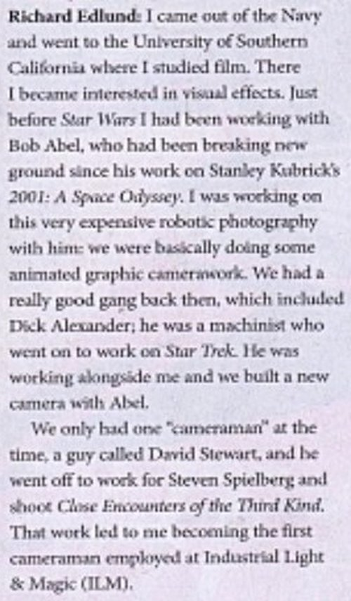
- **Han Solo** — entry/section: Edlund: pre-production expectations: ""Yeah—to an extent. If you remember, Jaws was the big money-maker back then. That was the movie that we all wanted to surpass at the box office. I think that George made some great casting decisions as well and they helped his movie enormously. Obviously Alec Guinness was a big one, but there was also Harrison Ford as the John Wayne character. I thought he was excellent and such a good choice. After the cast was in place, I became even more excited." —Richard Edlund, Star Wars Insider 101, p. 50" Source: *Star Wars Insider #101* (2008), scan p.50
  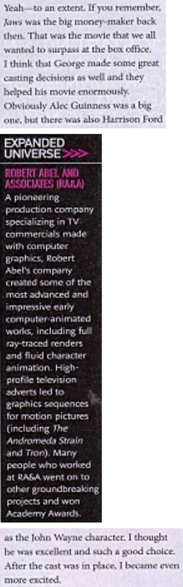
- **none** — entry/section: Edlund: Dykstra, bluescreen and the hyperspace shot: ""Yes I was. Even though the budget was tight, especially as we had to build essential optical printers, I remember that John Dykstra pulled together a great team. For example, we had groundbreaking motion control photography. I also insisted on using bluescreen, where John was leaning more towards the front light/back light technique when it came to shooting the special effects. That only really works if the objects in front of the camera are not moving. However, if you have bluescreen you can begin extracting things from the picture. The flow of movement becomes much more believable. We had a great motion control system. That was absolutely necessary. In fact, some of the bests [sic] shot in the film were, ironically, the ones that took the least time to do. The famous hyperspace shot, when the Millennium Falcon speeds off: that was shot at 32 frames and it lasts for a little over a second onscreen. I did that as a test, but we ended up using it. It only took me about two hours to shoot! Audiences always cheered that shot. It was one of the biggest cheers in the picture! To do that we took a four by five [inch] color Polaroid of the Millennium Falcon and put it on glass, then we zoomed away from it! Believe it or not, that is what got us such big applause. All credit to George because dramatically he set that scene up brilliantly." —Richard Edlund, Star Wars Insider 101, p. 50" Source: *Star Wars Insider #101* (2008), scan p.50
  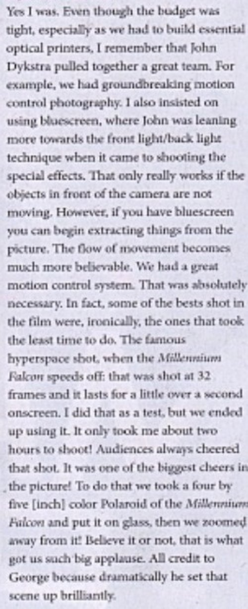

### Stat block notes (game mechanics, not feats)

- Edlund intro: Richard Edlund is one of the most decorated special effects experts in Hollywood. Having won an Oscar for his work on the original Star Wars, he was awarded special achievement Academy Awards for his accomplishments on The Empire Strikes Back and Return of the Jedi. Not that working within the Lucas universe is Edlund's sole claim to fame. Indeed, the artist gained further Oscar nominations for his work on films such as Poltergeist, Die Hard and Ghostbusters. (Calum Waddell, Star Wars Insider 101, p. 50) (Source: *Star Wars Insider #101* (2008), scan p.50)
- EU box: Robert Abel and Associates: A pioneering production company specializing in TV commercials made with computer graphics, Robert Abel's company created some of the most advanced and impressive early computer-animated works, including full ray-traced renders and fluid character animation. High-profile television adverts led to graphics sequences for motion pictures (including The Andromeda Strain and Tron). Many people who worked at RA&A went on to other groundbreaking projects and won Academy Awards. (Star Wars Insider 101, p. 50) (Source: *Star Wars Insider #101* (2008), scan p.50)

## scan p.51 (scan page 51)

Page contents: Making the Falcon Fly pt 2: Falcon model frame strip; photo "Team Players" (John Dykstra); EU boxes John Dykstra and Don Trumbull; pull quote; photo "Lucas Leads" (George Lucas, Richard Edlund, Joe Johnston); Effects Maestros logo (hand-read)

- **none** — entry/section: Pull quote: hyperspace shot: ""Some of the best shots in the film were, ironically, the ones that took the least time to do. The famous hyperspace shot, when the Millennium Falcon speeds off, only took me about two hours to shoot!" —Richard Edlund, Star Wars Insider 101, p. 51" Source: *Star Wars Insider #101* (2008), scan p.51
  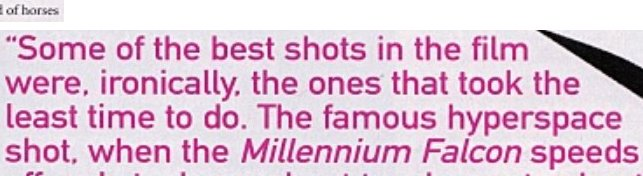

### Stat block notes (game mechanics, not feats)

- Captions: Team Players: John Dykstra led the team that included Richard Edlund at ILM / Lucas Leads: George Lucas was hands-on in supervising the movie's unique special effects. He is shown here with Richard Edlund and Joe Johnston. (Star Wars Insider 101, p. 51) (Source: *Star Wars Insider #101* (2008), scan p.51)
- EU box: John Dykstra: John Dykstra is a two-time Academy Award-winning special effects supervisor and pioneer in the development of the use of computers in film making. He worked with Douglas Trumbull on Silent Running. On Star Wars, Dykstra led the development at Industrial Light & Magic of the motion-controlled camera, responsible for many of the groundbreaking effects. Dykstra won Academy Awards for best special effects and special technical achievement. He went on to work on a variety of projects, including the first two Spider-Man films, winning an Oscar for Spider-Man 2. (Star Wars Insider 101, p. 51) (Source: *Star Wars Insider #101* (2008), scan p.51)
- EU box: Don Trumbull: Donald Trumbull (1909-2004) was a pioneer in the field of motion picture special effects, who worked on many films including The Wizard of Oz (1939), Silent Running (1972, directed by his special effects creator son Douglas Trumbull), Close Encounters of the Third Kind (1977), Star Wars: Episode IV A New Hope (1977), and Spaceballs (1987). (Star Wars Insider 101, p. 51) (Source: *Star Wars Insider #101* (2008), scan p.51)

## scan p.52 (scan page 52)

Page contents: Making the Falcon Fly pt 3 (end): interview Q&A; photos (Edlund at camera rig, opening crawl board "It is a period of civil war...", X-wing models on stage); EU box "The Best of Edlund"; pull quote; Effects Maestros logo (hand-read)

- **none** — entry/section: Edlund: not on the prequels: ""I felt like I had spent eight years of my life on Star Wars and the two sequels. I had given a lot of my ideas and energy to it. When I found out George was going to make The Empire Strikes Back, I made a deal with myself to do the whole trilogy. I am the only person from that period to have Academy Awards from all three films. After Return of the Jedi, I wanted to do other things and I did. I did Ghostbusters, 2010, and Ghost and about 30 other movies. I remain very proud of them all." —Richard Edlund, Star Wars Insider 101, p. 52" Source: *Star Wars Insider #101* (2008), scan p.52
  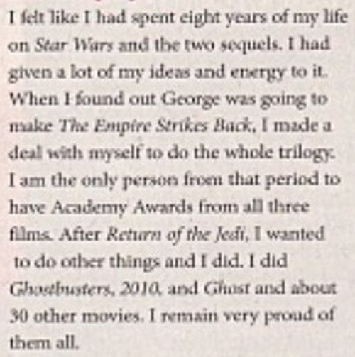
- **none** — entry/section: Edlund: favorite movies: ""A recent film that I worked on, which I am very proud of, is Angels in America, which is not even a special effects movie. I have enjoyed working on Charlie Wilson's War with Mike Nichols as well. Again, that isn't a genre picture, but it was a lot of fun. I do think that the original Ghostbusters is just about damn near perfect in terms of visual effects and so is the first Die Hard. I loved doing those. And there was Species as well. So I have a lot of favorites, but, of course, I'm very appreciative to George Lucas and Star Wars. I have some great memories." / "And three Oscars!" "Yeah, exactly!" —Richard Edlund, Star Wars Insider 101, p. 52" Source: *Star Wars Insider #101* (2008), scan p.52
  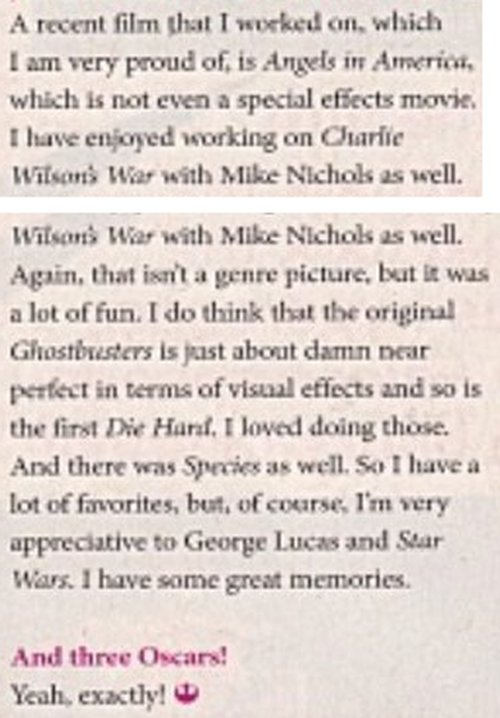
- **none** — entry/section: Pull quote: whole trilogy: ""When I found out George was going to make The Empire Strikes Back, I made a deal with myself to do the whole trilogy. I am the only person from that period to have Academy Awards from all three films." —Richard Edlund, Star Wars Insider 101, p. 52" Source: *Star Wars Insider #101* (2008), scan p.52
  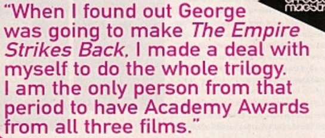

### Stat block notes (game mechanics, not feats)

- Opening crawl board (photo): It is a period of civil wars [sic: board reads "civil wars"] in the galaxy. A brave alliance of underground freedom fighters has challenged the tyranny and oppression of the awesome GALACTIC EMPIRE. Striking from a fortress hidden among the billion stars of the galaxy, rebel spaceships have won their first victory in a battle with the powerful Imperial starfleet. The EMPIRE fears that another defeat could bring a thousand more solar systems into the [rest cut off by photo edge] (Star Wars Insider 101, p. 52; early pre-release crawl text shown in photo) (Source: *Star Wars Insider #101* (2008), scan p.52)
- EU box: The Best of Edlund: Although Star Wars reinvigorated the sci-fi genre and made previously unimaginable special effects possible, Richard Edlund's CV worked on some other genre classics. We pick a few of the best: Raiders of the Lost Ark (1981): Credited as the Visual Effects Supervisor, Edlund famously helped to perfect the ghoulishly gruesome finale to Spielberg's classic Saturday morning serial throwback as the Nazis open the Ark and all hell breaks loose! Amazingly, Edlund's gory handiwork still managed to obtain a PG rating. Poltergeist (1982): Another stint with Spielberg, Edlund had the challenge of making faces disintegrate and ghosts burst forth from television sets in the pre-digital effects age. Ghostbusters (1984): Cited by the man himself as one of his favorites, and no wonder! Even with today's photorealistic CGI, the Marshmallow Man, a levitating Sigourney Weaver, and Slimer, the green ghoul, are still truly spellbinding accomplishments. (Star Wars Insider 101, p. 52) (Source: *Star Wars Insider #101* (2008), scan p.52)

## scan p.53 (scan page 53)

Page contents: OfficialPix.com ad: "Your search is over! Get your officially licensed autographs & photographs online today!"; signed photos (Luke X-wing pilot, Leia slave outfit, Indiana Jones images); "Visit OfficialPix.com"; Indiana Jones and the Kingdom of the Crystal Skull "Images available May 2008" (hand-read)

## scan p.54 (scan page 54)

Page contents: Entertainment Earth ad "Bring Hollywood Home!": Star Wars Darth Maul and Bloodfin Sith Speeder Statue GE8130 $199.99 (Gentle Giant, limited edition of 2,250); EE Exclusive Star Trek Original Series Communicator Replica DC17711 $29.99; Star Wars Boba Fett Kotobukiya Statue DH15199 $124.99; "Indiana Jones is coming to Entertainment Earth"; [phone number omitted] (hand-read)

### Stat block notes (game mechanics, not feats)

- Ad copy: Maul statue: Darth Maul looks as real as life in this fantastic statue of the Sith and his speeder bike named "Bloodfin." Through the magic of Gentle Giant's impressive sculpting techniques, Maul glares menacingly while the precise replica of the speeder actually appears to be hovering in the air above the display base! (Entertainment Earth ad, Star Wars Insider 101, p. 54) (Source: *Star Wars Insider #101* (2008), scan p.54)
- Ad copy: Fett statue: The enigmatic Boba Fett stands 11 3/4-inches tall in a dynamic combat pose, simultaneously flying and firing his flamethrower. Based on his appearance in Episode VI: Return of the Jedi, this piece has been replicated with stunning accuracy. Boba Fett is the first installment in Kotobukiya's line of six bounty hunters and features a unique hexagonal base and a build-a-figure piece—Darth Vader's left arm. (Entertainment Earth ad, Star Wars Insider 101, p. 54) (Source: *Star Wars Insider #101* (2008), scan p.54)

## scan p.55 (scan page 55)

Page contents: Blaster section cover: "Packed full with the latest stuff from the Star Wars universe"; Luke portrait; Page 70 Bounty Hunters; Steve Sansweet's Scouting the Galaxy p64; Bantha Tracks p72; Page 76 Classic Moment "Luke's Training: Luke Skywalker meets his master on Dagobah!"; 66 Toys "A round-up of the latest gear to hit toy shelves"; 59 Books "Legacy of the Force reaches a dramatic end in Invincible"; 61 Comic Books "Family matters of a different kind feature in the Legacy arc 'Home'"; Plus: Space Gear 56 » Ask Lobot 60 » Far East Collecting 68 » and much more; "There's nothing like a good blaster at your side, kid"; Palpatine and Cade Skywalker art (hand-read)

### Stat block notes (game mechanics, not feats)

- Blaster cover line: Classic Moment: Luke's Training — Luke Skywalker meets his master on Dagobah! (Star Wars Insider 101, p. 55) (Source: *Star Wars Insider #101* (2008), scan p.55)

## scan p.56 (scan page 56)

Page contents: Space Gear: "Insider rounds up the latest must-have stuff!" — Mighty Muggs waves two and three; Hasbro Captain Rex helmet; Hasbro Star Wars Legacy Collection wave 1 ("Must Have!") (hand-read)

### Stat block notes (game mechanics, not feats)

- Mighty Muggs: Mighty Muggs Waves Two and Three $9.99 each Out June! The cute side of the Star Wars saga is once again represented by these irresistably [sic] cool characters. No wonder Lando's smiling! (Star Wars Insider 101, p. 56) (Source: *Star Wars Insider #101* (2008), scan p.56)
- Captain Rex helmet: Hasbro Captain Rex Helmet $29.99 Out July! As well as being an amazing approximation of the headgear worn by the Republic's finest, this helmet also acts as a voice changer, putting the wearer on the frontline, ready for battle! (Star Wars Insider 101, p. 56) (Source: *Star Wars Insider #101* (2008), scan p.56)
- Legacy Collection wave 1: Hasbro Star Wars Legacy Collection Wave 1 $9.99 each Out Now! Sandstorm versions of Han, Luke, and Chewie are flanked by dancer Yarna d'al' Gargan, skiff guard Bane Malor, Darth Vader with removeable helmet, and the Ewoks Leektar and Nippet. (Star Wars Insider 101, p. 56) (Source: *Star Wars Insider #101* (2008), scan p.56)

## scan p.57 (scan page 57)

Page contents: Space Gear cont. ("New York Toy Fair reporting by Alex Jones & Craig Anderson"): Hasbro AT-TE Transport Vehicle; Gentle Giant Obi-Wan Kenobi in Clone Armor mini-bust; Gentle Giant Count Dooku & Asajj Ventress statue ("Must Have!") (hand-read)

### Stat block notes (game mechanics, not feats)

- AT-TE: Hasbro AT-TE Transport Vehicle $99.99 Out July! First appearing during the Battle of Geonsis, the AT-TE is able to carry an amazing 20 action figures and has movement, sounds, and firing missiles! (Alex Jones & Craig Anderson, Star Wars Insider 101, p. 57) (Source: *Star Wars Insider #101* (2008), scan p.57)
- Obi-Wan clone armor bust: Gentle Giant Obi-Wan Kenobi in Clone Armor $55 Out Now! This stunning mini-bust of General Obi-Wan Kenobi, as first seen during his battle with Durge on Muunilinst, shows the Jedi ready to fulfill his destiny as a hero of the Clone Wars. (Alex Jones & Craig Anderson, Star Wars Insider 101, p. 57) (Source: *Star Wars Insider #101* (2008), scan p.57)
- Dooku & Ventress statue: Gentle Giant Count Dooku & Asajj Ventress Statue $230 Out May! The dark side of the Force has never seemed so seductive as when represented by Count Dooku and Asajj Ventress in this stunning statue. (Alex Jones & Craig Anderson, Star Wars Insider 101, p. 57) (Source: *Star Wars Insider #101* (2008), scan p.57)

## scan p.58 (scan page 58)

Page contents: Premier Collectible Auctions ad: "Specializing in investment grade collectible action figures, toys, comics, & other pop culture memorabilia from the 1960's to the present day"; world's largest collectible action figure auction by Brian Semling of Brian's Toys with endorsement of Tom Derby (Collectible Investment Brokerage, formerly Cloud City); first live auction July 24-26, 2008, San Diego, near Comic-Con; AFA graded toys, merchandise of nearly $2,000,000 in value; vintage 3 3/4" and 12" Star Wars toys 1977-1986, G.I. Joe, Transformers, Masters of the Universe, Indiana Jones, Super Powers, Lord of the Rings; original artwork from the Star Wars 12 Back action figures; catalog $5.99 ($9.99 international), ships March/April 2008; www.premiercollect.com; vintage carded figures border (contact emails not transcribed) (hand-read)

## scan p.59 (scan page 59)

Page contents: Books: "Troy Denning brings Legacy of the Force to a dramatic conclusion" (Words: Jason Fry) — "Twin Torment" review of Invincible; Spoiler Warning! box "Character Studies" (Words: Brigid Cherry); Invincible cover; pull quote; "Collect Them All! Make sure your collection is complete" (Legacy of the Force covers: Betrayal, Bloodlines, Tempest, Exile, Sacrifice, Inferno, Fury, Revelation, Invincible) (hand-read)

- **Jaina Solo; Jacen Solo (Darth Caedus)** — entry/section: Denning: siblings and Caedus: ""For anyone close to a sibling, it's easy to imagine the tangle of memories that must blur her thoughts," Denning says, adding, "Her parents think of Jacen as 'already dead' and view Darth Caedus as the monster who has taken his place, which is the only way they can handle the horror of setting one child against another. Jaina doesn't have that luxury. When she attacks Caedus, it won't be some monster she sees in front of her. It will be her brother." —Troy Denning, Star Wars Insider 101, p. 59" Source: *Star Wars Insider #101* (2008), scan p.59
  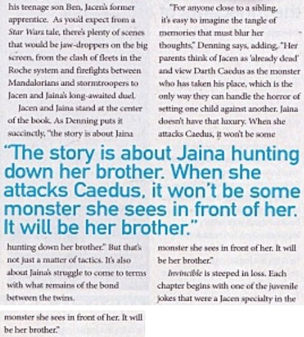
- **Jaina Solo; Jacen Solo (Darth Caedus)** — entry/section: Denning: act of love: ""Only Jaina feels Jacen's anguish," Denning says, adding: "For Jaina, Jacen doesn't deserve to be hunted out of hatred or vengeance. Stopping him should be an act of love, and that is the duty she takes on herself." —Troy Denning, Star Wars Insider 101, p. 59" Source: *Star Wars Insider #101* (2008), scan p.59
  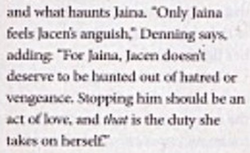

### Stat block notes (game mechanics, not feats)

- Character Studies: The Star Wars saga continues to develop characters from the original trilogy and the Expanded Universe in Legacy of the Force. Luke Skywalker is now in his 60s and has reluctantly become the Jedi Grand Master. His relationship with his son Ben, born to Luke and Mara Jade, has not been easy. Ben looks up to his cousin Jacen Solo, but his apprenticeship to Jacen leads Ben onto paths his father cannot approve of. This proves traumatic as Ben begins to suspect Jacen of dangerous leanings. The murder of Mara causes deep grief for both father and son. Luke's twin sister, Leia Organa Solo has become a fully-fledged Jedi Knight, though it is her diplomatic skills that she often prefers, when she is not co-piloting the Millennium Falcon with her husband. Although Han is now in his 70s, he shows no sign of slowing down. Embroiled in the Corellian independence movement and taking a stand against their son Jacen leads to Han and Leia being outlawed. Jacen, traumatized by the Yuuzhan Vong, is turning to the dark side. He eventually rejects his twin sister Jaina as well as his parents and Ben, and then ensnares the young Jedi Knight Tahiri Veila. (Brigid Cherry, Star Wars Insider 101, p. 59) (Source: *Star Wars Insider #101* (2008), scan p.59)
- Twin Torment: Over nine books, the Legacy of the Force series has given readers a ringside seat for a galaxy once again torn apart by war—and a family once again facing unimaginable loss. Jacen Solo, once the hero of the struggle against the Yuuzhan Vong, has been lost to the dark side, transformed into the Sith Lord Darth Caedus. Having already seen one child die, Han Solo and Leia Organa Solo have come to terms with the heart-rending idea that another child of theirs must die, lest the galaxy be plunged into further darkness. Worse, Han and Leia must face the possibility of losing their third child, for Jaina Solo has taken it on herself to eliminate the threat posed by her twin brother. Jaina's hunt for Jacen dominates the action in Troy Denning's Invincible (Del Rey, $27), but it's not the only story that unfolds in the finale of the series crafted by Denning, Aaron Allston, and Karen Traviss. Boba Fett is back, leading the Mandalorians in battle and trying to do the same in what passes for peacetime for those armored warriors. Luke Skywalker must find a way to contain the dark side without letting it infect his new generation of Jedi, particularly his teenage son Ben, Jacen's former apprentice. As you'd expect from a Star Wars tale, there's plenty of scenes that would be jaw-droppers on the big screen, from the clash of fleets in the Roche system and firefights between Mandalorians and stormtroopers to Jacen and Jaina's long-awaited duel. (Jason Fry, Star Wars Insider 101, p. 59) (Source: *Star Wars Insider #101* (2008), scan p.59)
- Jaina and the twin bond: But that's not just a matter of tactics. It's also about Jaina's struggle to come to terms with what remains of the bond between the twins. (Jason Fry, Star Wars Insider 101, p. 59) (Source: *Star Wars Insider #101* (2008), scan p.59)
- Invincible steeped in loss: Invincible is steeped in loss. Each chapter begins with one of the juvenile jokes that were a Jacen specialty in the Young Jedi Knights series. They're poignant reminders of what's been lost, and what haunts Jaina. (Jason Fry, Star Wars Insider 101, p. 59) (Source: *Star Wars Insider #101* (2008), scan p.59)
- Jacen still the same person (lead-in): A question certain to be debated by Star Wars fans is whether the Jacen we see in Invincible is truly lost, or still retains a spark of humanity. Intriguingly, Denning sees Jacen as "still the same person at heart [continued p. 60] as when he was a teenage student," pointing out that Jacen was always more interested in making peace than in battle; even after his ordeal as a Vong captive he was key to preventing their annihilation after the galactic invasion. (Jason Fry, Star Wars Insider 101, pp. 59–60) (Source: *Star Wars Insider #101* (2008), scan p.59)

## scan p.60 (scan page 60)

Page contents: Ask Lobot question (reader, name omitted): identities of the senators on the balcony at the end of Attack of the Clones besides Bail Organa, Palpatine and Mas Amedda — Onaconda Farr (or Dar Wac?), Gorothin Vagger, Ask Aak, Gume Saam — and who the Sy Myrthian is, given Sy Myrth left the Republic during the Separatist Crisis (hand-read)

- **Jacen Solo (Darth Caedus)** — entry/section: Denning: impose peace from the top down: ""He's grown up in a galaxy where good intentions seem ineffective, where no amount of compromise, negotiation, or even 'civilized' fighting ever seems to produce a lasting peace," Denning says. "He's bright enough to see that this is because those with selfish intentions don't feel restrained by the rules of common decency. So he takes the logical step and decides that the only way to achieve a true peace is to ignore the rules himself and impose peace from the top down. What he fails to see, of course, is that it's really the struggle that counts, that how one chooses to fight is just as important as what he's fighting for." —Troy Denning, Star Wars Insider 101, p. 60" Source: *Star Wars Insider #101* (2008), scan p.60
  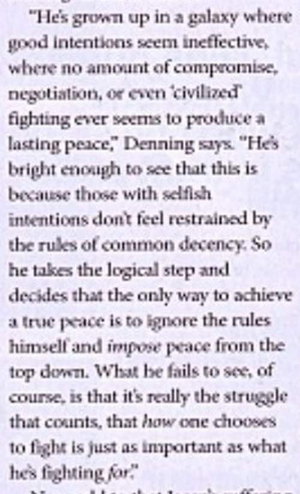
- **Jacen Solo (Darth Caedus)** — entry/section: Pull quote: ""Jacen's not just trying to protect himself, he's trying to protect all the innocents of the galaxy." —Troy Denning, Star Wars Insider 101, p. 60" Source: *Star Wars Insider #101* (2008), scan p.60
  

### Stat block notes (game mechanics, not feats)

- Ben's insight: In one of Invincible's most-intriguing scenes, Ben muses that it wasn't power that drove his cousin mad. What opened the door to the dark side was Jacen's belief that nothing he did mattered. (Jason Fry, Star Wars Insider 101, p. 60) (Source: *Star Wars Insider #101* (2008), scan p.60)
- Expanded Universe: The Hapes Cluster: The Hapes Cluster: A grouping of several hundred stars within the area of nebulous gases known as the Transitory Mists within the Inner Rim. It was once an impediment to hyperspace navigation that kept the stars of the cluster isolated from the rest of the Galaxy. (Star Wars Insider 101, p. 60) (Source: *Star Wars Insider #101* (2008), scan p.60)
- Hidden Connections: Major events are throwing the galaxy into upheaval, although the Legacy of the Force series clearly parallels events from the movies. Fifteen years after the invasion by the Yuuzhan Vong, many planets including Coruscant are still recovering. The Galactic Alliance replaced the New Republic but despite attempts at reconstruction and peace, some planets resist the imposition of order. Corellia, in particular, is unhappy at being prevented from operating an independent military. Strike and counter-strike are followed by several planets joining Corellia to form a Confederation. A new civil war begins. This recalls resistance fighters versus the Empire. After coming to the conclusion that only Sith rule can unite the galaxy, by force if necessary, Jacen Solo becomes an apprentice to the Sith Lady Lumiya. As head of the Galactic Alliance Guard, he fights a war against terror, rounding up all who oppose him, and engineering a military coup when he deposes the president Cal Omas. After Omas' death, the Jedi split with the Alliance, leave Coruscant, and go into hiding. After murdering Mara Jade, Jacen's fall to the dark side is complete and he becomes Darth Caedus. Further tragedies follow as Jacen burns Kashyyyk, kidnaps his own daughter, and starts to behave in a manner reminiscent of his grandfather, Darth Vader. (Brigid Cherry, Star Wars Insider 101, p. 60) (Source: *Star Wars Insider #101* (2008), scan p.60)
- Ask Lobot: AOTC balcony senators: Beside the three Senators you listed, the Rodian is Onaconda Farr; the Aqualish is Gorothin Vagger; the Gran is Ask Aak; the Ishi Tib is Gume Saam; and the Sy Myrthian is Toonbuck Toora. During production, the Toonbuck Toora costume was used in the Geonosis Conference Room scene. An image of Toora from this scene appeared as a George Lucas Selects image. During post-production, the character was replaced with a CG character dubbed by Production as "Gatorhead." Gatorhead became a female Holwuff named Rogwa Wodrata from the planet Alliga. Toora was reinserted later, appearing in the closing balcony scene. By then, the continuity introducing the Sy Myrthians as Separatists had been released. There has been some suggestion that the Toonbuck Toora we see on Geonosis was actually a Shi'ido shape-shifter involved in a duplicitous ploy to bring Sy Myrth to the Confederacy. In that scenario, the plot is ultimately foiled, leaving the planet firmly loyal to the Republic. (Ask Lobot, as related to Leland Y. Chee, Star Wars Insider 101, p. 60) (Source: *Star Wars Insider #101* (2008), scan p.60)

## scan p.61 (scan page 61)

Page contents: Ask Lobot question (reader, name omitted): in the ESB Cloud City junk room scene with Chewbacca, something like blue stormtrooper armor that also looks like a robot — what is it? (hand-read)

- **Cade Skywalker** — entry/section: Duursema: the Rawks: "Says artist Jan Duursema, "Bantha and his clan are the closest thing to family  for Cade. He never knew his mother, though by now he has at least met her, and at some point he had to find Bantha after the fall of Ossus. John and I knew a lot about Bantha, but what kind of woman would he find compatible? Droo is a rare, one of a kind woman who can kill a man a dozen different ways before breakfast, as well as make a mean bilaberry patoga. The 'kits' were also  fun to invent and each has their own personality. I see the Rawks as another layer in Cade's life where he can go when things get too hot." —Jan Duursema, Star Wars Insider 101, p. 61" Source: *Star Wars Insider #101* (2008), scan p.61
  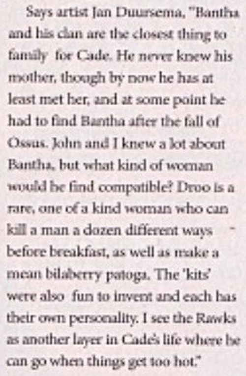
- **none** — entry/section: Pull quote: ""We all have two kinds of family in our life, the family we're born into and the family we make." —writer John Ostrander, Star Wars Insider 101, p. 61" Source: *Star Wars Insider #101* (2008), scan p.61
  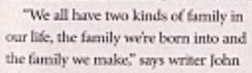

### Stat block notes (game mechanics, not feats)

- Ties That Bind (opening): Admit it: when it comes to families, the Star Wars saga leaves a lot to be desired. Anakin abandons his mother, interrogates his daughter, and tries to kill his son. Jango's little boy is a vat-grown clone of his pop. And don't get us started on Luke and Leia's mistaken-identity attraction. Okay, maybe blood ties aren't everything. You don't have to be related to form a family, and bonds of a different sort take center stage in the latest Star Wars Legacy arc. "Home," covering issues #22-23, centers on a fateful decision by Cade Skywalker to end Darth Krayt's reign once and for all, but it's grounded in strong family units: the kinds that are chosen, not inherited. (Daniel Wallace, Star Wars Insider 101, p. 61) (Source: *Star Wars Insider #101* (2008), scan p.61)
- Cade's chosen family: Legacy's Cade Skywalker is a loner and an antihero, orphaned when the Sith murdered his father during the massacre of Ossus' Jedi Temple. Yet his time on the run led him to outlaw technician "Bantha" Rawk and his motley clan of cast-offs: his spitfire Kiffar wife Droo; her beautiful and dangerous daughter Ahnah; the adopted, Force-sensitive Skeeto; and Micah, a young Cathar adoptee with cybernetic legs. (Daniel Wallace, Star Wars Insider 101, p. 61) (Source: *Star Wars Insider #101* (2008), scan p.61)
- Jedi Order as surrogate family: There's another surrogate "family" that exists in the Star Wars galaxy: the Jedi Order. In the days of the Old Republic, the Jedi took Force-sensitive babies from their parents to be raised in the Jedi Temple. The bond between Master and Padawan was as strong as that between a parent and child, yet by the time of Legacy the Jedi are decimated and scattered. Filling their role are the Imperial Knights, one of Legacy's most fascinating contributions to the Star Wars canon. (Daniel Wallace, Star Wars Insider 101, p. 61) (Source: *Star Wars Insider #101* (2008), scan p.61)
- Ask Lobot: ESB junk-room droid: Good eye. Strewn amongst the debris in the Cloud City junk room, the upper torso of a droid with a silver face plate can be seen. The body and arms actually resemble blue metallic stormtrooper armor, but the jutting wires definitely suggest that this thing is droid-like in nature. There has been some desire internally to give a name and backstory to the droid, but as of yet, nothing has been officially established. (Ask Lobot, as related to Leland Y. Chee, Star Wars Insider 101, p. 61) (Source: *Star Wars Insider #101* (2008), scan p.61)

## scan p.62 (scan page 62)

Page contents: Ask Lobot question (reader, name omitted): "Soldiers of the Empire!" in Star Wars Official Poster Monthly #4 (1978) as the first source claiming stormtroopers are clones, removed as fetuses after 60 weeks of gestation and trained — is it official continuity, and what cloning process is it (not Spaarti cloning)? (hand-read)

- **Luke Skywalker; Darth Vader (Anakin Skywalker); Cade Skywalker; Darth Krayt** — entry/section: Duursema: different affiliation: ""Luke and Vader's story is one of a wayward father redeemed," explains Duursema. "Cade and Krayt have a different sort of affiliation." —Jan Duursema, Star Wars Insider 101, p. 62" Source: *Star Wars Insider #101* (2008), scan p.62
  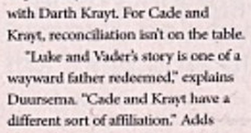
- **Luke Skywalker; Darth Vader (Anakin Skywalker); Cade Skywalker; Darth Krayt** — entry/section: Ostrander: Krayt needs to die: "Adds Ostrander, "Luke could turn Vader only because of the ties between them. We've seen just how merciless and dangerous Krayt can get when mad. Cade understands that, so long as Krayt lives, the Sith Order will be intact and Cade will never know peace. Cade is not concerned about redeeming Krayt or about saving the galaxy, when you come right down to it. He wants people to leave him alone. He wants to live his life on his own terms, not anyone else's. Krayt needs to die. Now, whether or not he can do that is an entirely different question. Cade's gotten himself in over his head before. We'll see if it happens again." —John Ostrander, Star Wars Insider 101, p. 62" Source: *Star Wars Insider #101* (2008), scan p.62
  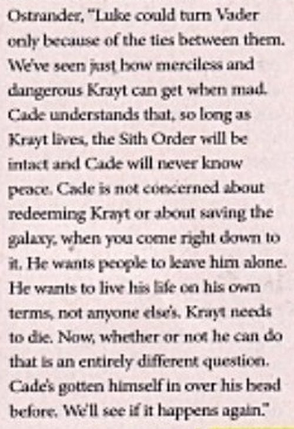
- **Cade Skywalker** — entry/section: Duursema: Cade grew on me: ""Cade is so much more than I initially saw him as," admits Duursema. "He really rankled me at first, but with each story we have done, I have seen more of his personality revealed. That's not to say that at times I don't think he wouldn't suffer much for a whack upside his head, but I am enjoying the journey." —Jan Duursema, Star Wars Insider 101, p. 62" Source: *Star Wars Insider #101* (2008), scan p.62
  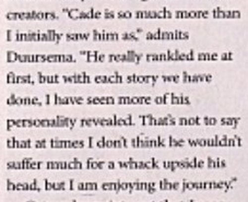
- **none** — entry/section: Ostrander: collaboration and the future: "Ostrander points out that Legacy couldn't happen without the continued collaboration of Dark Horse editor Randy Stradley and Lucasfilm. "Sure, sometimes there have been disagreements, but answers have always been found and they have always made for better stories. We're all real clear about where we're going through the end of this year and, by the time the fans read this, we'll have some real good ideas for 2009. But where will we end up? We've barely started to scratch the surface. We're ongoing, baby! This ride hasn't hit the big twist yet." —John Ostrander, Star Wars Insider 101, p. 62" Source: *Star Wars Insider #101* (2008), scan p.62
  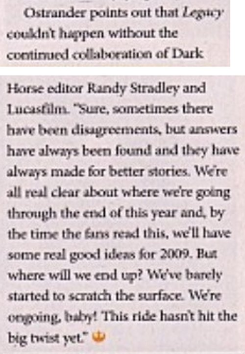

### Stat block notes (game mechanics, not feats)

- Cade is not Luke: In the movie saga, the ties between father and son allowed Luke to bring Vader back from the dark side. And although Cade Skywalker is Luke's descendent [sic], he isn't Luke. More importantly, he shares no filial bond with Darth Krayt. For Cade and Krayt, reconciliation isn't on the table. (Daniel Wallace, Star Wars Insider 101, p. 62) (Source: *Star Wars Insider #101* (2008), scan p.62)
- Legacy at two years: As Legacy hits its two-year mark, the series that sounded outrageous at its outset (Star Wars 100 years in the future?) has attracted a loyal fan base through solid storytelling and regular surprises. As the characters have evolved, they've even grown on their creators. (Daniel Wallace, Star Wars Insider 101, p. 62) (Source: *Star Wars Insider #101* (2008), scan p.62)
- Expanded Universe: Darth Krayt: Darth Krayt served as a General during the Clone Wars and was one of the few Jedi to have escaped the Great Purge. He fell to the dark side, proclaimed himself Darth Krayt, and became the leader of the new Sith Order. (Star Wars Insider 101, p. 62) (Source: *Star Wars Insider #101* (2008), scan p.62)
- Incoming (comics schedule): May 14: Star Wars: Dark Times #11 (Mick Harrison, Dave McCaig, Douglas Wheatley, and Travis Charest) — Beginning the second phase in a year-long, galaxy-changing storyline, part five of "Vector" puts the smuggling crew of the Uhumele in their toughest predicament yet. Star Wars: Rebellion #14 (Jeremy Barlow, Colin Wilson, and Wil Glass) — Luke Skywalker and Princess Leia lead a team of Rebels to their destinies in the full-tilt conclusion to the "Small Victories" arc! May 21: Star Wars: Clone Wars Photo Comic — This 96-page manga-sized volume adapts the first Star Wars: Clone Wars animated series using images directly from the Emmy Award-winning micro-series! Star Wars: Legacy #26 (John Ostrander, Jan Duursema, Dan Parsons, and Brad Anderson) — Introduces a surprising new member to the Legacy cast! May 28: Knights of the Old Republic #29 (John Jackson Miller, Bong Dazo, Michael Atiyeh, and Dustin Weaver) — "Exalted," a new two-part adventure, promises Star Wars at its most personal. (Star Wars Insider 101, p. 62) (Source: *Star Wars Insider #101* (2008), scan p.62)
- Ask Lobot: Poster Monthly clone stormtroopers: Another great find by one of our readers! Until now I was unaware that any official Star Wars source pre-Episode II said conclusively that stormtroopers were clones. For continuity purposes, we can certainly consider this method as one of several cloning technologies employed by the Empire after the end of the Clone Wars to grow stormtroopers, but it is not Spaarti cloning or any of the of the [sic] other cloning methods already established. We'll just have to wait and see whether any future authors will want to use this source as reference to explore this cloning process in detail. (Ask Lobot, as related to Leland Y. Chee, Star Wars Insider 101, p. 62) (Source: *Star Wars Insider #101* (2008), scan p.62)

## scan p.63 (scan page 63)

Page contents: Ad: Titan Magazines — "Discover the adventure with..." Indiana Jones and the Kingdom of the Crystal Skull: The Official Magazine, Special Commemorative Movie Edition, "#1 On sale May 22"; cover lines "Treasures Unearthed: Relive Indy's Greatest Exploits", "Discover the Secrets! Inside Indy's Newest and Most Daring Adventure", "Exclusive Harrison Ford, Steven Spielberg, Shia LaBeouf", "The Hero is Back!" (cover photos LaBeouf, Spielberg, Allen, Winstone); bullets "Exclusive interviews with the cast and crew of the movie!" and "Plus, don't miss the collector's guide to Indiana Jones!"; "100 pages!"; "Subscribe now!" with titanmagazines.com / titanmagazines.co.uk / indianajones.com; "© 2008 Lucasfilm Ltd & TM"; "Cover subject to change" (hand-read)

## scan p.64 (scan page 64)

Page contents: Letter "Hasbro's Help" (writer omitted): following the earlier "Gone Missing" letter about gunship parts, notes that parts can still be obtained from Hasbro (gunship and Anakin's Clone Wars fighter) (hand-read)

### Stat block notes (game mechanics, not feats)

- Sansweet's View: favorite item: "What's your very favorite item in your collection?" I've been asked that question so many times that you'd think I'd have a ready answer, my version of a politician's constantly-repeated stump speech. Sometimes, if the person asking the question is a parent, I'll say, "That's like me asking you which of your three kids is your favorite." Sometimes I'll say that I really love the entire category of fan-made items because they show the passion, creativity, and skill of so many Star Wars fans all over the world; then I might mention something that a skilled customizer has made or a prize-winning entry in craft contest, which I later purchased. And sometimes I'll answer, only half jokingly, "Whatever arrived in the mail today!" Truth be told, I do have favorites. But they change over time as I discover new things or rediscover old ones. As I write this, my overwhelming favorite is Yoshitoku's Darth Vader Samurai Armor. Through a blending of traditional Japanese artistry and the modern-day iconography of the Dark Lord of the Sith, the venerable Yoshitoku Company has truly merged the cultures of two worlds and two eras. Yoshitoku was started in 1711 and today is run by an 11th generation heir of the company's founder; so while Star Wars has been celebrating its 30th anniversary, the company will soon be celebrating its 300th! The oldest doll company in Japan, Yoshitoku is renowned for its traditional dolls made for Japan's Boys' Day festivals. One of the day's traditions is for a family to display Samurai armor and helmet to protect the boy's spirit and insure his health and prosperity. (Steve Sansweet, Star Wars Insider 101, p. 64) (Source: *Star Wars Insider #101* (2008), scan p.64)
- Sansweet's View: Samurai Vader details: Since one of concept designer Ralph McQuarrie's initial inspirations for the look of Vader came from the noble samurai of Japanese tradition, the high-end armor collectible seems very fitting. It took more than a year to go from idea to concept to finished prototype, and Yoshitoku made two versions of Vader: The complete version includes the yoroi (armor) and kabuto (helmet); the smaller version is just the helmet display. Both come withan [sic] elaborate hitsu (the lid-covered container on which the quarter-scale replica sits) and a magnificent byôbu (folding screen) that uses traditional Japanese style to portray the fierce lava planet of Mustafar in black, red, and gold. Both versions of Vader come with a time-honored Japanese bow and a sword scaled to size, with red lacquer paint to emulate the color of a Sith lightsaber blade. I ordered my Samurai Vader when it was first introduced last year and patiently waited several months while its more than 100 metal and cloth pieces were handmade and assembled. Then it sat in its two boxes for a few more months while I figured out where to place it, and also because I thought it might be challenging to assemble (it was not). I finally took advantage of a 56-hour power blackout during the year-end holidays (no email to answer!) to assemble the armor display in my home office across from my desk so that I can admire it constantly. No wonder that starwars.com called it the collectible of the year... or maybe that's because it comes with its own white gloves and white feather duster for handling and cleaning! (Steve Sansweet, Star Wars Insider 101, p. 64) (Source: *Star Wars Insider #101* (2008), scan p.64)
- Scouting answer: giant sandcrawler: What if I said in two years and, oh, maybe $6,000-plus? Sorry [name omitted], but in your excitement you didn't read far enough. This incredible piece is a custom job built by a model-maker in South America and now owned by [collector's name omitted] of Brooklyn, NY according to his postings and photos. I've seen some of the model-maker's [continues p. 65] (Steve Sansweet, Star Wars Insider 101, p. 64) (Source: *Star Wars Insider #101* (2008), scan p.64)
- Scouting answer: Hasbro replacement parts: It does indeed, [name omitted]. Anyone can go to www.hasbro.com, click on Customer Service, and then either fill out a form, send an email, or get a telephone number to check if your missing or broken part is still available to order. (Steve Sansweet, Star Wars Insider 101, p. 64) (Source: *Star Wars Insider #101* (2008), scan p.64)

## scan p.65 (scan page 65)

Page contents: Letter "Piggy Bank Treasure!" (writer omitted) begins: fan since first seeing A New Hope at seven or eight, became an almost obsessive collector after the prequels, now in college with a five-shelf collection; during a trip in Michigan stumbled upon a C-3PO piggy bank [continued p. 66] (hand-read)

### Stat block notes (game mechanics, not feats)

- Scouting answer: giant sandcrawler (cont.): [continued from p. 64] other large custom vehicles on eBay over the years and have salivated myself. [Collector's name omitted] did one better. He bought this from a friend of the model-maker and had the original builder convert it into a "rolling, functioning, steerable RC toy with working treads!" [Collector's name omitted] writes that the sandcrawler is made of hardboard, plastic, fiberglass, and magnetic links to hold removable panels in place. It weighs about 21 pounds, and I can only imagine the cost to ship it to the U.S. For years many collectors have been beseeching Hasbro to make large play sets and vehicles, but in their wildest fantasies I don't think they imagined anything this large. The cost of building the tooling to mass-produce something this size would be astronomical, not to mention the cost of materials. How about the box? And where do you think a Toys 'R' Us or Target would find room for them? Would you be willing to rent a truck to haul one home? But we can go on dreaming and thank [collector's name omitted] for posting the details and photos. He's a long-time collector and customizer with a most impressive collection! Maybe we could get him to bring the sandcrawler along to the next Star Wars Celebration! (Steve Sansweet, Star Wars Insider 101, pp. 64–65) (Source: *Star Wars Insider #101* (2008), scan p.65)
- Scouting answer: silver clone trooper: [Name omitted], I'm afraid you've answered your own question at the very end of your query. This is not a variation figure, although there have been many legitimate variant clone trooper repacks with different "deco" or other changes. The question is why someone would take the time and trouble to do this... unless they were shooting a hidden-camera fan movie or TV show. You didn't happen to see any suspicious lurkers nearby when you picked this off the peg, did you? (Steve Sansweet, Star Wars Insider 101, p. 65) (Source: *Star Wars Insider #101* (2008), scan p.65)
- Scouting answer: 20th anniversary calendar art: Thanks for the heads-up [name omitted]. It's actually still the 30th anniversary year in Japan, where Star Wars didn't open until June 1978. However, that's not the issue. Trends International didn't make a mistake. The January art was originally painted by Japanese artist Tsuneo Sanda for the 20th anniversary of our favorite film—a year after you were born. (Steve Sansweet, Star Wars Insider 101, p. 65) (Source: *Star Wars Insider #101* (2008), scan p.65)

## scan p.66 (scan page 66)

Page contents: Letter "Lights Out for Big Fig" (writer omitted): a Mickey Mouse Jedi Big Fig bought last October now lights only at the bottom and top of the lightsaber; Disney could not say whom to contact for replacement lightsabers (hand-read)

### Stat block notes (game mechanics, not feats)

- Scouting answer: C-3PO ceramic bank: I'm not sure C-3PO would like being called a piggy but I get your meaning [name omitted]. You picked up what looks like a nice example of a 1978 Roman Ceramics bank. There were three ceramic banks released, and they were among the earliest Star Wars collectibles: Darth Vader, R2-D2, and C-3PO—which is far rarer than the first two. If memory serves, it also came out a while after the first two; perhaps they were having problems with the metallic glaze. The banks came in small cardboard cartons with a color photo of the bank on one side. On eBay recently, a dealer was seeking $175 or "best offer" for the Threepio bank and the box, both mint. That's probably at least $75 to $100 more than it should fetch, but I'd say if you didn't overpay you made a great find! (Steve Sansweet, Star Wars Insider 101, p. 66) (Source: *Star Wars Insider #101* (2008), scan p.66)
- Scouting answer: Jedi Mickey lightsaber: I'm sorry to have to be the one to tell you that your quest hasn't been successful because Jedi Mickey's lightsaber isn't replaceable, at least not without some knowledge of electronics and a source for the strange tube light that's used. You can carefully unscrew the top of Mickey's lightsaber and slide off the covering of the "blade." There you'll find a 3/8-inch diameter solid light tube a little over six inches long; embedded inside the tube are as many as nine small LEDs. The bulb appears permanently attached to the top of the lightsaber hilt, or at least well glued in. My guess is that this was specially engineered in China for this piece. It would have been great to have some sort of replaceable light, but when you look at it you'll see why that would have been difficult, if not impossible. LEDs are supposed to give many thousands of hours of illumination before failing; it seems that yours is defective. (Steve Sansweet, Star Wars Insider 101, p. 66) (Source: *Star Wars Insider #101* (2008), scan p.66)
- Toys: Gentle Giant Animated Emperor Maquette: GENTLE GIANT ANIMATED EMPEROR MAQUETTE This limited edition, nine-inch tall maquette is available from May, priced $9[text cut off at scan edge] (Jeremy Beckett, Star Wars Insider 101, p. 66) (Source: *Star Wars Insider #101* (2008), scan p.66)

## scan p.67 (scan page 67)

Page contents: Toys (cont.): LEGO Clone Wars Mini-Figs panel with eight mini-fig captions; Hasbro Star Wars Transformers (Must Have! badge; Republic Gunship and Jedi starfighter); Kotobukiya 3-D Cross-Section X-Wing Set box; footer "INSIDER 67" (hand-read)

### Stat block notes (game mechanics, not feats)

- LEGO Clone Wars Mini-Figs intro: For nearly half a decade the Clone Wars rocked the galaxy and led to the downfall of the Republic and the Jedi Order. To tie-in with the new CGI Star Wars: The Clone Wars motion picture and television series, LEGO has produced a series of all-new mini-figs, giving Insider a first look. (Jeremy Beckett, Star Wars Insider 101, p. 67) (Source: *Star Wars Insider #101* (2008), scan p.67)
- LEGO mini-fig: Asajj Ventress: Asajj Ventress: A dark-side disciple and follower of Count Dooku, she is skilled in lightsaber combat and a sworn enemy of the Jedi. (Jeremy Beckett, Star Wars Insider 101, p. 67) (Source: *Star Wars Insider #101* (2008), scan p.67)
- LEGO mini-fig: Obi-Wan Kenobi: Obi-Wan Kenobi: This Jedi General in the Grand Army of the Republic is ready for combat in his clone trooper armor. (Jeremy Beckett, Star Wars Insider 101, p. 67) (Source: *Star Wars Insider #101* (2008), scan p.67)
- LEGO mini-fig: Captain Rex: Captain Rex: An ARC Trooper with attitude, this character will play a significant role in the Clone Wars. (Jeremy Beckett, Star Wars Insider 101, p. 67) (Source: *Star Wars Insider #101* (2008), scan p.67)
- LEGO mini-fig: Magna Droid: Magna Droid: An advanced type of battle droid, formidable enough to take on Jedi and clone troopers with ease. (Jeremy Beckett, Star Wars Insider 101, p. 67) (Source: *Star Wars Insider #101* (2008), scan p.67)
- LEGO mini-fig: Commander Cody: Commander Cody: A highly trained and experienced trooper, this veteran of more than a dozen major battles commands the Republic's elite forces. (Jeremy Beckett, Star Wars Insider 101, p. 67) (Source: *Star Wars Insider #101* (2008), scan p.67)
- LEGO mini-fig: Plo Koon: Plo Koon: After serving on the Jedi Council, this Master went on to serve the Republic on countless worlds after surviving the Battle of Geonosis. (Jeremy Beckett, Star Wars Insider 101, p. 67) (Source: *Star Wars Insider #101* (2008), scan p.67)
- LEGO mini-fig: Ahsoka Tano: Ahsoka Tano: This young female Togruta is Anakin Skywalker's Padawan, and a new force to be reckoned with. (Jeremy Beckett, Star Wars Insider 101, p. 67) (Source: *Star Wars Insider #101* (2008), scan p.67)
- LEGO mini-fig: Anakin Skywalker: Anakin Skywalker: This headstrong and powerful Force-warrior is equally fearless in his Jedi starfighter and on the ground leading clone troopers. (Jeremy Beckett, Star Wars Insider 101, p. 67) (Source: *Star Wars Insider #101* (2008), scan p.67)
- Hasbro Star Wars Transformers: HASBRO STAR WARS TRANSFORMERS Vehicle to droid, and back again! Convert the Republic Gunship into a combat droid figure. Features two projectile launchers and a clone pilot figure that fits inside! The Jedi starfighter vehicle turns into a Jedi warrior and comes with two spring-loaded lightsaber projectiles and an Obi-Wan Kenobi pilot figure that fits inside the starfighter! (Jeremy Beckett, Star Wars Insider 101, p. 67) (Source: *Star Wars Insider #101* (2008), scan p.67)
- Kotobukiya 3-D Cross-Section X-Wing Set: KOTOBUKIYA 3-D CROSS-SECTION X-WING SET Taking the concept of cross-section illustrations to the realm of three dimensions, Kotobukiya presents the iconic X-wing fighter as the inaugural release in this bold new line. Measuring over a foot in length this 1:35 scale starfighter has cutaway sections that can be removed to reveal the ship's inner workings. Eight different mini-figures come with this model, including two X-wing pilots, two astromech units, ground crew, mechanics, and more. Accessories such as the mini-convoy, cables, and missile loaders are all part of the final Yavin 4 hanger [sic] diorama. Fully painted and finished to perfection, all you need to do is snap-fit it together. The set is made up of six component parts sold in one master box for $250, available from this July. (Jeremy Beckett, Star Wars Insider 101, p. 67) (Source: *Star Wars Insider #101* (2008), scan p.67)

## scan p.68 (scan page 68)

Page contents: "The Group" sidebar: a group of seven collecting adventurers, named in the box: the author Gus Lopez, his wife, and five other private collectors (names omitted); the photo caption names four of them, left to right (private names omitted; Gus Lopez is among them) (hand-read)

### Stat block notes (game mechanics, not feats)

- Toys Я Us-sia standfirst: CELEBRATION EUROPE BROUGHT TOGETHER STAR WARS FANS FROM NEARLY EVERY CONTINENT. THEN ONE GROUP FROM THE U.S. DECIDED TO TRAVEL PART OF THE WAY AROUND THE WORLD VIA THE TRANS-SIBERIAN RAILWAY, WITH STOPS IN RUSS[IA,] MONGOLIA, AND CHINA, PICKING UP STAR WARS COLLECTIBLES EN ROUTE. THIS IS THEIR STORY. (Gus Lopez, Star Wars Insider 101, p. 68) (Source: *Star Wars Insider #101* (2008), scan p.68)
- St Petersburg, Russia: Immediately after Celebration Europe our gang took off to Riga, Latvia where we spent a day before flying to St. Petersburg, Russia. These days, St. Petersburg is a bustling town with young crowds strolling past newly-restored and brightly-colored buildings housing nearly every branded shop, boutique, and eatery found in the U.S. Almost immediately we happened upon the Star Wars influence along Nevsky Prospekt, the main drag. One shop had a large Yoda statue out on the street, as an obvious draw with no apparent connection to the store itself. On another trip through the city, a street tattoo artist handed us his card that prominently showed a massive Yoda tattoo on his shoulder. (Gus Lopez, Star Wars Insider 101, p. 68) (Source: *Star Wars Insider #101* (2008), scan p.68)
- St Petersburg: keychains and coloring books: We spent some time looking at displays by street vendors and asking for tips on flea markets, hoping to find elusive and obscure Star Wars items. We had good luck with street vendors years earlier, finding among other things, unusual hardcover Russian versions of the Star Wars novels. We did find some Episode III keychains from one magazine vendor in what appeared to be a premium bundled with a magazine that had been printed months earlier. The General Grievous keychain I got included a trading card with the character's image and a release date for the film. Additional searching at retail stores turned up a few other Russian Star Wars items including licensed coloring books from Episodes I and II. (Gus Lopez, Star Wars Insider 101, p. 68) (Source: *Star Wars Insider #101* (2008), scan p.68)
- St Petersburg: bootleg figures: On the final day of our stay, a tip from the hostel staff led us to a wholesale market with every variety of retail goods. A few of the shops offered toys, but we were having difficulty locating any Star Wars items. Eventually, we were able to find one shop that had several bootleg Yoda and Chewbacca action figures in gloriously tacky Russian packaging. These solid, barely-poseable chunks of plastic came on brightly-colored cards with Russian text, and the figures had been molded in non-canonical colors, including, fittingly, a bright red Russian Chewie. We negotiated to buy their entire supply to bring back for friends. (Gus Lopez, Star Wars Insider 101, p. 68) (Source: *Star Wars Insider #101* (2008), scan p.68)
- Moscow, Russia: As we moved onto Moscow, we continued to stumble upon unmistakable signs of Star Wars influence. We searched many flea markets and vendor stalls and saw a share of Star Wars-themed matryoshka or "nesting" dolls, a classic Russian collectible. One of our favorite sights in Moscow was VDNK, the former Soviet "Economic Achievement Park" containing over 80 massive and kitschy monuments and buildings to honor great achievements of the workers' paradise during the Soviet e[ra]. History loves irony, so today the par[k is a] shopping mall, with each building containing different categories of ret[ail] goods. Not far from the statue of Sov[iet] leader Vladimir Lenin we found ano[ther] large figure which celebrated anothe[r] kind of hero: Chewbacca the Wooki[ee] [text cut at scan edge; continuation not visible] (Gus Lopez, Star Wars Insider 101, p. 68) (Source: *Star Wars Insider #101* (2008), scan p.68)

## scan p.69 (scan page 69)

Page contents: Left: "Toys Я Us-sia" concludes (Gus Lopez): Ulan Bator, Mongolia and Beijing, China sections; photos of Mongolcom Mongolian phone cards (one showing a child in a Spider-Man costume) and metal Star Wars cigarette cases (Episode III stormtrooper, Knights of the Old Republic, C-3PO/R2-D2 with Coca-Cola logo); ends with a Rebel insignia. Right: Kotobukiya ad for Devil May Cry Dante and Vergil statues ("Direct from Japan!!", each about 10 2/3" tall, "Available NOW!", Capcom/Kazuma Kaneko/Atlus credit; not Star Wars) (hand-read)

### Stat block notes (game mechanics, not feats)

- Ulan Bator, Mongolia: We boarded the Trans-Siberian train in Moscow and spent several days crossing Europe and Asia and seeing dramatic scenery along the way including deserts, mountain ranges, and Lake Baikal in Siberia. About five minutes before we entered Mongolia, [name omitted], the only non-American among our crew, asked me if Australians need visas for Mongolia. After several minutes of panic, other passengers confirmed that indeed he would need a visa, and [name omitted] was forced off the moving train at gunpoint. After some interesting adventures and an outlay of cash, he was able to secure a visa at the border and join us on our journey into Mongolia. We stopped in Ulan Bator to see the sights of the city and get out into the Mongolian countryside. Although Star Wars items were few and far between in Mongolia, we were struck by the wooden dolls and posters showing the traditional Mongolian costumes that greatly resembled Queen Amidala's Senate gown from The Phantom Menace. The headdress and gown bear an unmistakable Mogolian [sic] influence. (Gus Lopez, Star Wars Insider 101, p. 69) (Source: *Star Wars Insider #101* (2008), scan p.69)
- Beijing, China: Leaving Ulan Bator, we headed to Beijing, China to see the Forbidden City, the Great Wall of China, Tiananmen Square, and countless other sights in the area. As usual, we also focused on finding Star Wars memorabilia. China is legendary for its loose interpretation of copyright laws and open markets for bootleg materials. Fortunately for license holders, the upcoming Beijing Olympics has caused the government to do a massive clean-up effort, making bootleg goods now virtually non-existent on the streets. A tip from one of our guidebooks led us to a section of the city containing major wholesale markets for a variety of retail goods. After a lengthy attempt to persuade a Beijing taxi driver to pick up a group of obviously clueless Americans, we found the building serving as a toy wholesale market and walked the aisles in search of elusive Star Wars items. One vendor had a series of unposeable preschool Star Wars figures arranged in a plastic box. The major find was a set of small metal Star Wars cases from Episode III and Knights of the Old Republic that were designed as cigarette containers. Since these pieces lifted graphics from other licensed Star Wars items, the Coca Cola logo was still prominently displayed on the front of the cigarette case. Our adventures ended in Shanghai and we reflected on our journey, awed that wherever you go in the world, Star Wars is always nearby. (Gus Lopez, Star Wars Insider 101, p. 69) (Source: *Star Wars Insider #101* (2008), scan p.69)

## scan p.70 (scan page 70)

Page contents: "Meeting Mark" (submitter omitted): stood two hours on a cold Wisconsin winter day to meet Mark Hamill at a local Blockbuster promoting the movie Walking Across Egypt; for a donation to the Make A Wish Foundation fans could have a picture taken; promoters refused a second donation/picture but "Mark graciously agreed" and gave "the big squeeze" (hand-read)

### Stat block notes (game mechanics, not feats)

- Bounty Hunters sponsor line: MEET THE STARS, SHOW THE EVIDENCE, WIN THE BOUNTY! INSIDER'S BOUNTY HUNTER SECTION IS SPONSORED BY KOTOBUKIYA. EACH WINNER WILL RECIEVE [sic] A SUPER KOTOBUKIYA STAR WARS STATUE WORTH ABOUT $100. (Star Wars Insider 101, p. 70) (Source: *Star Wars Insider #101* (2008), scan p.70)
- Bounty Hunters editorial reply: Not many people get to share sushi with a Sith Lord! A prize is on its way... (Star Wars Insider 101, p. 70) (Source: *Star Wars Insider #101* (2008), scan p.70)
- Can You Go One Better?: CAN YOU GO ONE BETTER? HAVE YOU HUNG OUT WITH HARRISON FORD? OR MAYBE YOU CUDDLED CHRISTOPHER LEE? WE WANT TO SEE YOUR PHOTOS! (Star Wars Insider 101, p. 70) (Source: *Star Wars Insider #101* (2008), scan p.70)

## scan p.71 (scan page 71)

Page contents: Full-page Titan Magazines subscription ad. US offer: "Subscription Offer! Save 35% off the newsstand price! 6 issues for only $24.95" (cover shown: "New Look!" issue with Obi-Wan Kenobi, "Laser Sharp — Top 10 Lightsaber Battles Revealed!", "More Than the Movies? The Essential Expanded Universe", "Watts On... Robert Watts on the original trilogy", "Where Were You in 1980?", "Celebration", "Clone Wars"). UK offer: "Save 15% plus free membership to the Official Star Wars Fan Club! Only £10.95 every 3 issues* (*by direct debit, UK only)"; fan club membership includes a 10% discount on Star Wars merchandise at participating Forbidden Planet stores, two exclusive Star Wars A2 posters, two exclusive Star Wars art cards, and personal membership cards; fine print lists participating stores (Birmingham, Bristol, Cambridge, Coventry, Croydon, Dartford, Liverpool, Newcastle, Southampton and the Shaftesbury Avenue Megastore); order lines/web addresses and quote code SWM77; © 2008 Lucasfilm Ltd. (phone numbers not transcribed) (hand-read)

## scan p.72 (scan page 72)

Page contents: Bantha Tracks Submission Guidelines: original art, envelope art, comics, illustrations, news, stories, meeting information or other materials voluntarily submitted become the property of Bantha Tracks; no compensation, no guarantee of publication, submissions not returned; each must include the creator's name, age, contact information, date created, and a statement that the work is original and that the person is a member of the Official Star Wars Fan Club; electronic and postal submissions go to Bantha Tracks c/o Mary Franklin (Lucasfilm) (email and postal address not transcribed) (hand-read)

### Stat block notes (game mechanics, not feats)

- We Belong in a Museum! standfirst: IT MIGHT BE A SPIN OFF A FAVORITE LINE FROM INDIANA JONES AND THE LAST CRUSADE, BUT BANTHA TRACKS READERS HAVE BEEN BUSY PROVING THAT ARCHEOLOGICAL ARTIFACTS ARE NOT ALL THAT BELONGS IN MUSEUMS. FANS CONTRIBUTE THEIR TIME TO BENEFIT MUSEUMS AND EXHIBITS IN THEIR COMMUNITIES, AND FIND THAT THEY END UP BECOMING ONE OF THE MAIN ATTRACTIONS. (Bantha Tracks, Star Wars Insider 101, p. 72) (Source: *Star Wars Insider #101* (2008), scan p.72)

## scan p.73 (scan page 73)

Page contents: Captions (fan names and photo credits omitted): members of four Star Wars costuming groups volunteered throughout the Chicago run; an Obi-Wan Kenobi costumer celebrated his birthday during one of the event days in Chicago and "Somehow, 'Ben' was able to score some blue milk for the festivities"; school kids cluster around droids C-3PO and a purple-looking R2-D2 unit at the Chicago Museum of Science and Industry, with R2-D2 Builders' Group members who both wear and power their self-crafted Threepio costume and Artoo (hand-read)

### Stat block notes (game mechanics, not feats)

- Chicago, Illinois report: Before Philadelphia, Where Science Meets Imagination enjoyed a successful run in Chicago, and there was enthusiastic support from Star Wars fans there as well. The exhibit closed in Chicago on January 6, but not before the local fans helped make it a special event for all. Joining the 501st and Rebel Legions were members of the Jedi Assembly and the R2-D2 Builders' group. (Bantha Tracks, Star Wars Insider 101, p. 73) (Source: *Star Wars Insider #101* (2008), scan p.73)

## scan p.74 (scan page 74)

Page contents: Oshkosh report and captions (fan names/photo credits omitted): the Wisconsin Public Museum opening weekend of the "Out of This World" exhibit saw members of the Midwest bases of the 501st and Rebel Legions lend atmosphere and fun; captions: a stormtrooper helmet under glass with a stormtrooper standing by his exhibit counterpart; 501st Garrison and Rebel Legion members take time for a group shot; meeting a tiny Yoda at the museum (hand-read)

### Stat block notes (game mechanics, not feats)

- USPS Yoda Stamp Dedication: While an outdoor stamp dedication is not a museum, the collectible nature of commemorative postage stamps makes them treasures worth keeping. The USPS held a dedication for its Star Wars Yoda stamp in San Francisco this past fall. Fans and collectors remember the Post Office issued an entire sheet of Star Wars stamps of different characters in 2007 to commemorate the 30th anniversary of the saga. Early in the year, people voted for their favorite stamp, and Jedi Master Yoda won. The Post Office held a traditional dedication to honor the diminutive Jedi, whose image was then used for sheets of stamps. Costumed fans from the Golden Gate Garrison of the 501st, the Endor Base Rebel Legion, and the San Francisco and Tulare Fan Force attended, dressed up for the occassion [sic]. (Bantha Tracks, Star Wars Insider 101, p. 74) (Source: *Star Wars Insider #101* (2008), scan p.74)
- Editorial: Preserving Star Wars Fans: I've spent a little time thinking about museums, and how they help preserve what is precious to us: our popular culture; Star Wars memorabilia; costumes and props from the movies; traditions like school field trips; and the opportunity for communities to come together and honor a shared history, whether modern or ancient. Then I thought about our Star Wars community. How do we preserve Star Wars fans for generations to come? Do they need special care and handling? White gloves? Climate control? It appears, truly, that Star Wars fans are doing a fine job preserving themselves. We at the Lucasfilm companies are producing more great reasons to be—and stay—a Star Wars fan. George and the crew at Lucasfilm Animation have produced the cool new movie and animated series, Star Wars: The Clone Wars, with beloved characters and soon-to-be-loved new characters, great stories and action, and a new look for television that fans will find thrilling. We've got hot new Star Wars video games, like The Force Unleashed, that will make fans feel like they are playing inside the saga. There are new comics and novels brimming with Star Wars stories. The new non-fiction books celebrate the entire saga, including everything from behind-the-scenes history to collectibles to crafts. Collectors and toy fans have plenty to love, too. That said, the foundation of Star Wars devotion seems to be built as much on shared community as on individual favorite things. Fans began laying the foundation for a worldwide community back in the days when we thought there would not be any more Star Wars movies. Meeting at conventions, talking about Star Wars in local sci-fi and collecting clubs—Star Wars fans did what they could to keep the flames burning. Once we found each other online we discovered we were part of a worldwide community, and that has been weaving itself together more tightly ever since. Our fan community is so much more than hanging around waiting for the next Star Wars event. Of course we love these, but we have museum openings to dress for, charities to volunteer for, and an array of good deeds to do for our communities. We have new books and comics to discuss, and new costumes to finish before the next benefit or convention. Between the passion that the worldwide community turns into positive action, and the great new things coming from Lucasfilm, Star Wars fans should have a well-curated place in the museum of the world for a long time to come. Get in tracks! (Mary Franklin, Editor, Bantha Tracks, Star Wars Insider 101, p. 74) (Source: *Star Wars Insider #101* (2008), scan p.74)

## scan p.75 (scan page 75)

Page contents: Full-page Titan Magazines house ad: "Fantastic Entertainment Fantastic Magazines!" showing covers of Star Trek ("Starfleet: The Early Years"), Stargate SG-1/Atlantis ("John Sheppard"), Torchwood ("Harper's Bizarre!"), Supernatural ("Jensen Ackles"), Heroes ("Danger Girl!"), Lost ("New Season Secrets!"), Charmed ("Shannen"), Smallville ("Taking Aim!", "100-Page Special!") and CSI: NY ("New York Revealed") magazines; "Available now at all good book stores!"; subscription web addresses (phone numbers not transcribed); vertical fine-print copyright notices for the licensed properties (hand-read)

## scan p.76 (scan page 76)

Page contents: Classic Moment: Episode V The Empire Strikes Back (DVD Chapter 28), "Luke's Training — The Empire Strikes Back 1980 [Script]"; large still of Yoda and Luke on Dagobah; "What They Said" panel with photos of Frank Oz and Irvin Kershner; "Why It's a Classic" box; footer "76 INSIDER" (hand-read)

### Stat block notes (game mechanics, not feats)

- Luke's Training: intro: On the planet Dagobah, with venerable jedi Master Yoda, Luke Skywalker is learning the ways of the Force, but he's not finding it easy.... (Star Wars Insider 101, p. 76) (Source: *Star Wars Insider #101* (2008), scan p.76)
- Luke's Training: script excerpt: LUKE is about to attempt to levitate his crashed X-wing from out of the Dagobah swamp. LUKE (focusing, quietly): All right, I'll give it a try. YODA: No! Try not. Do. Or do not. There is no try. LUKE closes his eyes and concentrates on thinking the ship out. Slowly the X-wing's nose begins to rise above the water. It hovers for a moment and then slides back, disappearing once again. LUKE (panting heavily): I can't. It's too big. YODA: Size matters not. Look at me. Judge me by my size, do you? Mn? Mmmm? LUKE shakes his head. YODA: And well you should not. For my ally is the Force. And a powerful ally it is. Life creates it, makes it grow. Its energy surrounds us and binds us. Lumionous [sic] beings are we... YODA pinches LUKE's shoulder YODA (continues): ...Not this crude matter. You must feel the force around you. (Gesturing) Here... between you... me... the tree... the rock... everywhere! Yes, even between the land and the ship. LUKE (discouraged): You want the impossible. Quietly, YODA turns towards the sunken X-wing. With his eyes closed he gestures with his arm and the ship slowly rises from the swamp, as Artoo beeps in terror and scoots away. The X-wing settles gently on the shore. LUKE stares in astonishment and walks towards YODA. LUKE: I don't... I don't believe it. YODA: That is why you fail. (Star Wars Insider 101, p. 76) (Source: *Star Wars Insider #101* (2008), scan p.76)
- Why It's a Classic: This is the first major elaboration of the mysterious 'Force' since Obi-Wan's comments in A New Hope. Yoda hints at a much more organic basis for the almighty Force, long before the advent of midichlorians. It's a pivotal moment for Luke Skywalker, too. Here he fails a test laid down by a venerable Jedi Master and this leads to him cutting his training short and rushing off to save his friends. It also hints at greater depths to Yoda, depths that would not be explored until the prequel trilogy, especially Episode III. (Star Wars Insider 101, p. 76) (Source: *Star Wars Insider #101* (2008), scan p.76)

## scan p.77 (scan page 77)

Page contents: Full-page back-issues ad: "Grab Your Back Issues Now!" (Order Online; Yoda art) with covers and issue badges: "The Clone Wars!" (#95 US/#71 UK), "Rise of the Empire" (#96 US/#72 UK), "Luke & Leia" (#97 US/#73 UK), "The Galaxy's Greatest Heroes!" (#98 US/#74 UK), "Bounty Hunters" (#99 US/#75 UK) and "100 Best Things About Star Wars... Ever!" (#100 US/#76 UK); "Missed an issue of Star Wars Insider? Order Now!"; USA/CAN: regular issues cost $8.50, special issues 10.50 (currency symbol unclear in scan); UK/EIRE/ROW: issues cost £6.20, EIRE £7.25, ROW £8.20; web addresses for the full back-issue list (toll-free numbers not transcribed); © 2008 Lucasfilm Ltd. (hand-read)

## scan p.78 (scan page 78)

Page contents: Full-page Dreamwatch ad: "dreamwatch www.dwscifi.com Total Sci Fi — The Future is Online" (not Star Wars) (hand-read)

## scan p.79 (scan page 79)

Page contents: "Next Time..." preview page (Rebel insignia; Yoda photo with lightsaber; "Creature Special!" badge with Chewbacca): next issue on sale US newsstands June 17, UK newsagents July 10; includes the Versus answer box (hand-read)

### Stat block notes (game mechanics, not feats)

- Next Time: Stuart Freeborn: STUART FREEBORN Meet the now 93-year-old creature creator who modelled Yoda's distinctive features on his own face and that of Albert Einstein (Star Wars Insider 101, p. 79) (Source: *Star Wars Insider #101* (2008), scan p.79)
- Next Time: other features: THE CLONE WARS! Inside the creation of the latest Star Wars movie, and the lowdown on the TV show 25 YEARS OF JEDI! Celebrate the anniversary of the final film of the original Star Wars trilogy CANTINA MANIA! How one Star Wars fan developed an obsession with the cantina creatures TIPPETT TALKS! Continuing our special effects series, we talk with stop motion guru Phil Tippett PLUS ALL YOUR NEW-LOOK DEPARTMENTS AND MUCH, MUCH MORE! COMING TO A GALAXY NEAR YOU US NEWSSTANDS: JUNE 17 UK NEWSAGENTS: JULY 10 (Star Wars Insider 101, p. 79) (Source: *Star Wars Insider #101* (2008), scan p.79)
- Versus: Who Wins? (answer): VERSUS: WHO WINS? And the winner is... Chewbacca! Intelligence and cunning win out over brute strength and animal instinct every time. Well, almost every time. (Star Wars Insider 101, p. 79) (Source: *Star Wars Insider #101* (2008), scan p.79)

## scan p.80 (scan page 80)

Page contents: Star Wars Shop #25 page ("Star Wars Shop .com presents Tosche Station"; Tatooine twin-suns banner; photos of the boxed Shadow Troopers two-pack and two figures); right edge cut at scan edge, missing letters reconstructed in [brackets]; footer "Order Online at StarWarsShop.com – More Product. More Exclusive[s]" (hand-read)

### Stat block notes (game mechanics, not feats)

- Star Wars Shop: Jedi-Con Exclusive Shadow Trooper 2-Pack: Jedi-Con Exclusive Shadow Trooper 2-Pac[k] Jedi-Con Exclusive at StarWarsShop[.com] Availability: In-Stock a[t] StarWarsShop.com Web Si[te] Price: $16.9[9] If you couldn't make it to last month's Jedi-Con in Germany, you've probably been ca[l]ling in favors to locate one of the exclusive Shadow Trooper two-packs offered at th[e] show. Well hold on to those favors, becaus[e] StarWarsShop just made it a lot easier f[or] fans and collectors on this side of the pon[d] to snag one of these stunning sets. Outfitted with black and gray armor, thre[e] rifles, a pistol, a sinister red pauldron an[d] visors, this Shadow Trooper duo is as intim[id]ating as they come. Tubular packaging showcases the figures nicely, and will loo[k] right at home next to the recent Order 6[6] series of two-pack[s]. StarWarsShop is the only place to get the [re]mainder of these German-exclusive sets, s[o] make sure to stop by and pick up yours today[.] [bracketed letters reconstructed; text cut at scan edge] (Star Wars Insider 101, p. 80) (Source: *Star Wars Insider #101* (2008), scan p.80)

## scan p.81 (scan page 81)

Page contents: Star Wars Shop page 2, "Really Fun Stuff": photos A–E (poker chip set, Mimobot flash drives, R2-D2 trash can, Chunk T-shirts, LEGO R2-D2 watch); starburst "Visit www.starwars.com/creditcard to apply for your Star Wars reward credit card today!" with Yoda/Vader card art; right edge of text column cut at scan edge, missing letters reconstructed in [brackets] (hand-read)

### Stat block notes (game mechanics, not feats)

- Star Wars Shop: Poker Chip Set: A Poker Chip Set $149.99 Availability: In-Stock at StarWarsShop.com Web Sit[e] Star Wars poker anyone? The poker chip set includes 20[0] chips at 10.2 grams each. The case features 72 LED's that make the see-through chips glow like lightsabers. Also included are two standard poker decks that come in foil boxes--one blue deck and one red deck (Rebel/Imperial[).] (Star Wars Insider 101, p. 81) (Source: *Star Wars Insider #101* (2008), scan p.81)
- Star Wars Shop: Mimobot Flash Drives: B Mimobot Flash Drives 2GB: $84.99, 4GB: $124.99 Availability: In-Stock at StarWarsShop.com Web Sit[e] Store all your data, pictures, music, and more on these limited edition designer 2GB or 4GB USB flash drives. All Star Wars mimobots are preloaded with removable bonu[s] Star Wars mimobot content like wallpapers, avatars, videos, and soundbites. (Star Wars Insider 101, p. 81) (Source: *Star Wars Insider #101* (2008), scan p.81)
- Star Wars Shop: R2-D2 Trash Can: C R2-D2 Trash Can $114.99 Availability: In-Stock at StarWarsShop.com Web Sit[e] Imported from Japan, the R2-D2 trash can operates via a foot pedal that lifts the little droid's "head" to reveal a removable waste receptacle. Stands 23-inches tall. (Star Wars Insider 101, p. 81) (Source: *Star Wars Insider #101* (2008), scan p.81)
- Star Wars Shop: Chunk T-Shirts: D Chunk T-Shirts $29.99 Availability: In-Stock at StarWarsShop.com Web Sit[e] These adult T-Shirts are from from [sic] CHUNK, one of the hottest pop culture brands in Europe. Available in sizes S[,] M, L, XL and 2XL. Many designs and styles are available t[o] choose from. (Star Wars Insider 101, p. 81) (Source: *Star Wars Insider #101* (2008), scan p.81)
- Star Wars Shop: LEGO R2-D2 Watch: E LEGO Star Wars R2-D2 Watch $29.99 Availability: In-Stock at StarWarsShop.com Web Sit[e] Watch case and links are made of plastic, and includes a quartz movement, mineral crystal glass, and is water resistant to 50 meters. Includes a LEGO R2-D2 mini-fig and extra links. (Star Wars Insider 101, p. 81) (Source: *Star Wars Insider #101* (2008), scan p.81)

## scan p.82 (scan page 82)

Page contents: Star Wars Shop page 3, "Toys and Games": photos A–E (LEGO Rebel Scout Speeder 7668, LEGO Rogue Shadow, Stormtrooper Wacky Wobbler, Mighty Muggs Series 2 figures, 30th Anniversary action figures); same credit-card starburst; right edge of text column cut at scan edge, missing text reconstructed in [brackets] where evident (hand-read)

### Stat block notes (game mechanics, not feats)

- Star Wars Shop: LEGO Rebel Scout Speeder: A LEGO Star Wars Rebel Scout Speeder $11.99 Availability: In-Stock at StarWarsShop.com Web [Site] Help keep the Empire at bay with the Rebel Scout Speeder. Equipped with a detachable heavy blast[er] cannon and four new Rebel troopers, each armed [with] blasters, the vehicle is ready for action. (Star Wars Insider 101, p. 82) (Source: *Star Wars Insider #101* (2008), scan p.82)
- Star Wars Shop: LEGO Rogue Shadow: B LEGO Star Wars Rogue Shadow $49.99 Availability: In-Stock at StarWarsShop.com Web [Site] The very latest starship as featured in the Star W[ars:] The Force Unleashed video game. Set includes ne[w] minifigures of Juno Eclipse, battle-damaged Darth Vader and Vader's Apprentice. (Star Wars Insider 101, p. 82) (Source: *Star Wars Insider #101* (2008), scan p.82)
- Star Wars Shop: Stormtrooper Wacky Wobbler: C Stormtrooper Wacky Wobbler $12.99 Availability: In-Stock at StarWarsShop.com Web [Site] Will this stormtrooper nod his head, allowing you [to] pass? The stormtrooper bobble-head measures approximately six inches tall. (Star Wars Insider 101, p. 82) (Source: *Star Wars Insider #101* (2008), scan p.82)
- Star Wars Shop: Mighty Muggs Series 2: D Mighty Muggs Series 2 Figures $12.99 each Availability: In-Stock at StarWarsShop.com Web [Site] Welcome to the trendy side of the Force! Whether fo[r play] or display, these hip versions of the popular chara[cters] from the Star Wars epic are sure to bring a smile [to] the faces of collectors and fans alike! Figures sta[nd] approximately 5-inches tall. (Star Wars Insider 101, p. 82) (Source: *Star Wars Insider #101* (2008), scan p.82)
- Star Wars Shop: 30th Anniversary Action Figure Case 2008 Wave 2: E Star Wars 30th Anniversary Action Figure Ca[se] 2008 Wave 2 $83.99 Availability: In-Stock at StarWarsShop.com Web [Site] The 2008 Action Figure Collection from Hasbro st[arts] with a bang! This case pack includes 12 differen[t] action figures, some of which are characters feat[ured] in the upcoming game: Star Wars: The Force Unleashed. Each figure comes with a display stan[d]... [text cut at scan edge] (Star Wars Insider 101, p. 82) (Source: *Star Wars Insider #101* (2008), scan p.82)

## scan p.83 (scan page 83)

Page contents: Full-page Hasbro Indiana Jones ad: "Indiana Jones A Collection to Treasure"; figures (l to r, from top) Indiana Jones with idol, Belloq, Marion Ravenwood, Cairo Swordsman, Monkey Man, Indiana Jones with whip-cracking action, German Soldier, Sallah; copy: "Relive the excitement of Indy's legendary exploits with this awesome new collection of 3 3/4" action figures. Each one boasts incredible detail, styling and articulation. Live the adventure. Share the adventure. Collect the adventure!"; "Go to myindyadventure.com for figures, news and much more! Available Spring '08 — Don't miss out!"; legal line © 2008 Lucasfilm Ltd./Hasbro (not Star Wars) (hand-read)

## scan p.84 (scan page 84)

Page contents: Back-cover Hasbro Star Wars ad, "Expand your universe": Battle-Damaged Darth Vader figure in a Force Unleashed scene with Vader's Apprentice art; row of 3 3/4" figures with tiny name labels (Rahm Kota, Maris Brood, Imperial EVO Trooper, Juno Eclipse, Imperial Jumptrooper, Emperor's Shadow Guard; labels barely legible in scan); Star Wars: The Force Unleashed logo; starwars.hasbro.com; legal line © 2008 Lucasfilm Ltd./Hasbro (hand-read)

### Stat block notes (game mechanics, not feats)

- Hasbro ad: Expand your universe: Expand your universe The timeless saga continues – in a galaxy of new directions! Inspired by a treasure trove of books, video games and more, these all-new 3 3/4", highly articulated action figures introduce characters and stories never before told in the Star Wars universe! (Hasbro advertisement, Star Wars Insider 101, p. 84) (Source: *Star Wars Insider #101* (2008), scan p.84)
