# Owner Material 038 — Star Wars Insider #1–153 plus specials (with The Lucasfilm Fan Club Magazine #1–22): Star Wars Insider #102 (2008)

- **Source:** *Star Wars Insider* magazine (issues 23–153, 1994–2014) and its predecessor *The Lucasfilm Fan Club Magazine* (issues 1–22, 1987–1994), plus seven special editions: articles, interviews, comics and short fiction Secondary source (licensed Legends reference). Scan OCR'd on the box; the scan stays box-only and is **not** published.
- **Method:** every scanned page was OCR'd and machine-screened sentence by sentence for power-relevant statements (fights, kills, defeats, Force feats, rankings, superweapons) that name a character on our roster; each kept sentence is quoted verbatim from the OCR text and has a crop of the printed passage directly under it. Pages with nothing power-relevant are still listed with what is on them.
- **Citation:** "*Star Wars Insider #102* (2008), p.X" by printed page ("scan p.X" where no printed number applies). **Weight:** Licensed magazine: a secondary source. Its short fiction and comics are Legends stories; its articles and interviews sum up or discuss lore and rank below the novels, comics and games they describe.

## scan p.1 (scan page 1)

Page contents: Cover, Issue #102 (Creature Special): Star Wars Insider masthead; Yoda close-up with lightsaber; "Creature Special!" badge with Chewbacca; "Yoda Man! Creature Designer Stuart Freeborn"; "Beast Wars! Monsters Take Over Insider!"; top strip "Cantina Fan! One man's creature obsession pays off!" (Momaw Nadon figure) / "Special FX Phil Tippett talks creature comforts" / "Grand Slam! Master Yoda and General Grievous face-off!" (Grievous figure); bottom left The Clone Wars logo with Captain Rex: "The New Star Wars Movie! Director Dave Filoni Prepares to Send in the Clones!"; "Blaster! Space Gear, Books, Toys, Classic Moment, Comics, Collectibles, Ask Lobot & more!"; no date/price visible in scan (hand-read)

## scan p.2 (scan page 2)

Page contents: Full-page Premier Collectible Auctions ad "The Greatest Toy Auction on Earth — It's Closer Than You Think. Do You Have Your Catalog?": Q&A (pop culture collectibles dating from 1960–present; Summer 2008 auction features well over $2,000,000 in rare and unique collectibles; San Diego, CA • Comic-Con, July 24-26, 2008; 196-page catalog $10 plus shipping, or free PDF; www.premiercollect.com); catalog-page thumbnails; "Buy The Complete Catalog Today." bullets (196 full color pages, over 1500 items, investment grade toys, prototypes/pre-production, props, cards, comics, video games); not Star Wars-specific (hand-read)

## scan p.3 (scan page 3)

Page contents: Premier Collectible Auctions ad (cont.): "The New Auction Standard in Collectible Toys and Pop Culture Memorabilia."; "Coming Soon" filmstrip of carded toys; "The Greatest Toy Auction on Earth" San Diego, CA • July 25th-26th, 2008 (p2 says July 24-26, as printed); www.premiercollect.com (tel/fax not transcribed) (hand-read)

## scan p.4 (scan page 4)

Page contents: Docking Bay "This Issue...." July/Aug 2008, "New Look!" badge; header quote "Do, or do not. There is no try" Master Yoda; Yoda photo; Phil Tippett photo; Features: 16 The Clone Wars; 20 The Big Interview (Stuart Freeborn); 29 Nick Dudman; 36 Cantina Creatures; 40 Top Ten Toughest Ever Creatures (wampa art); 53 Effects Maestros (hand-read)

### Stat block notes (game mechanics, not feats)

- Contents: Features: 16 THE CLONE WARS Star Wars: The Clone Wars Supervising Director Dave Filoni offers Insider an exclusive peek! 29 NICK DUDMAN As apprentice to Stuart Freeborn, Nick Dudman learned the make-up trade on Empire. 36 CANTINA CREATURES How one man's fascination with the Star Wars cantina scene turned a hobby into a career. 40 THE TOUGHEST EVER CREATURES Which Star Wars beasts deserve to be the galactic heavyweights, and which should stay at home? 53 EFFECTS MAESTROS Phil Tippett comes under the spotlight in the second of our series on Star Wars' special effects stars! 20 THE BIG STAR WARS INSIDER INTERVIEW! STUART FREEBORN TALKS TO INSIDER ABOUT CREATING YODA, CHEWBACCA, AND OTHER DRAMATIC STAR WARS CREATURES! (Star Wars Insider 102, p. 4) (Source: *Star Wars Insider #102* (2008), scan p.4)

## scan p.5 (scan page 5)

Page contents: Contents (cont.): "The Special Edition!" box with regular and "Exclusive Limited Edition Collectors' Cover" (Yoda) images; Departments list with Robot Chicken and Clone Wars poster images, General Grievous figure, Aayla Secura bust, Lobot photo; "Blaster New!" header (hand-read)

### Stat block notes (game mechanics, not feats)

- Contents: The Special Edition!: THE SPECIAL EDITION! As well as our regular newsstand edition, Star Wars Insider is also available with this exclusive variant cover (same content). Only available from selected comic stores or www.titanmagazines.com SUBSCRIBE NOW: 6 ISSUES FOR ONLY $24.95 Visit www.titanmagazines.com for full details. (Star Wars Insider 102, p. 5) (Source: *Star Wars Insider #102* (2008), scan p.5)
- Contents: Departments: 06 EDITOR'S WELCOME The view from inside Insider, plus details on how to contact the magazine team. 08 LAUNCH PAD The latest Star Wars news, with a focus on the new movie Star Wars: The Clone Wars, plus Star Wars goes steampunk! 26 VERSUS Lightsabers at the ready as Yoda prepares to do battle with alien-machine General Grievous! 34 SCIENCE OF STAR WARS Star Wars is chock full of alien creatures, but where are all the real aliens hiding? 48 A LONG TIME AGO.... Insider flashes back to 1999, the year of The Phantom Menace! BLASTER INSIDE THE NEW INSIDER REVIEW SECTION: 61 BOOKS Prolific Star Wars author Jude Watson brings her epic run of 47 novels to an end with Last of the Jedi: Reckoning. 62 ASK LOBOT 63 COMICS Star Wars: Rebellion sees "Vector" reach the period of the classic trilogy. Plus: The Clone Wars in comic books! 66 SPACE GEAR The Muppets meet Star Wars, with Kermit Skywalker, Fozzie Solo, and Miss Piggy Leia! 67 TOYS A pictorial round-up of some of the forthcoming Star Wars: The Clone Wars toys and collectibles. 70 BOUNTY HUNTERS C-3PO (Anthony Daniels) gets frisky when he meets a fan at Celebration IV! 72 BANTHA TRACKS As Star Wars fans prepare for Celebration Japan, take a look back at a past Celebration highlights. 76 CLASSIC MOMENT The Emperor taunts Luke Skywalker, from 1983's Return of the Jedi. (Star Wars Insider 102, p. 5) (Source: *Star Wars Insider #102* (2008), scan p.5)

## scan p.6 (scan page 6)

Page contents: Editor's Welcome by Brian J. Robb, Editor (signed); Rebel insignia; C-3PO and R2-D2 in landspeeder art; Yoda with lightsaber photo; Contact Us box (Titan email, web and postal addresses and phone numbers, not transcribed); "Full Throttle" box with Obi-Wan Kenobi (Clone Wars) art (hand-read)

### Stat block notes (game mechanics, not feats)

- Editor's Welcome: Threepio's terrifying description of the Sarlacc creature that inhabits the Pit of Carkoon counjures [sic] up a fearsome beast indeed. In the Star Wars galaxy, however, the Sarlacc has an awful lot of competition when it comes to the battle to determine who's the toughest creature in the universe. This issue of Insider is a creature special, focusing on the monsters and creatures of Star Wars. Veteran monster maker Stuart Freeborn took time out to talk with our intrepid reporter Jonathan Wilkins, as did the dude who helped make the creatures for Return of the Jedi, Nick Dudman. As with so many fans, when I was a kid I was fascinated by all the diverse creatures who appeared in the cantina scene in Star Wars. Another who developed his obsession with that scene into a career was Tom Spina, who gives his First Person view of how he turned his interest in Star Wars creatures into a profession, as well as a hobby. If you think you've got a First Person story to tell about how Star Wars or being a Star Wars fan has dramatically affected your life, please get in touch with Insider (see the details on this page). You never know, your dramatic or heart-warming story might well be the next one we publish! Remember, we're keen to hear feedback on Insider's new look. If you want to suggest a scene for our Classic Moment slot or a year we should cover in 'A Long Time Ago...', get writing or emailing! What about the Blaster! section: are we covering the merchandise and collectibles ou [sic] want to read about? Let us know! Finally, are you as excited as we are about this summer's double dose of the Star Wars: The Clone Wars animated movie and the release of The Force Unleashed videogame? We've seen both in action, and they're brilliant additions to the ever-expanding Star Wars universe. There'll always be something new to read about in Insider, as well as new ways of exploring those areas of Star Wars that you might think you're really familiar with. Stay on target! (Brian J. Robb, Editor, Star Wars Insider 102, p. 6) (Source: *Star Wars Insider #102* (2008), scan p.6)
- Editor's Welcome: Full Throttle box: FULL THROTTLE DAVE FILONI ON STAR WARS: THE CLONE WARS! JUMP NOW to page 8 to get the lowdown on the new Star Wars: The Clone Wars movie! (Star Wars Insider 102, p. 6) (Source: *Star Wars Insider #102* (2008), scan p.6)

## scan p.7 (scan page 7)

Page contents: Full-page Hasbro Signature Series ad: "Hasbro Signature series presents An Elegant Weapon From a More Civilized Time"; crossed Darth Vader and Luke Skywalker Force FX lightsabers; Star Wars logo; starwars.hasbro.com; © 2008 Lucasfilm/Hasbro legal line (hand-read)

### Stat block notes (game mechanics, not feats)

- Hasbro ad: Force FX Lightsaber Collectible: FORCE FX LIGHTSABER COLLECTIBLE The weapon of the Jedi – in comparison, all other mechanisms seem crude indeed. The Force FX Lightsaber Collectibles embody all the technological wonder of this Jedi icon. Each fully functioning replica features all the lights, sounds and heft of the actual weapon. But rest assured, for all their amazing features these lightsabers are no toys, but rather elegant reminders of a galaxy far, far away. SEE THE COMPLETE COLLECTION AT STARWARS.HASBRO.COM (Hasbro advertisement, Star Wars Insider 102, p. 7) (Source: *Star Wars Insider #102* (2008), scan p.7)

## scan p.8 (scan page 8)

Page contents: Launch Pad: "Lifting the Lid on.... The Clone Wars" (Clone Wars logo); Clone Wars theatrical poster (Anakin, Obi-Wan, Yoda, Ahsoka, Captain Rex; credits Executive Producer George Lucas, Director Dave Filoni, Producer Catherine Winder, Writers Henry Gilroy, Steve Melching, Scott Murphy, Jason Tucker, Score by Kevin Kiner, Original Star Wars Themes and Score by John Williams; In Theaters August 15); Obi-Wan Kenobi Clone Wars render (hand-read)

- **none** — entry/section: Filoni on The Clone Wars becoming a feature: ""George [Lucas] became more and more involved, especially when he saw the final footage of what it was going to look like. He said that the fans really should get to see this up on the big screen and that's really where the seed started. We started to think of it in terms of this really working as a feature." —Dave Filoni, Star Wars Insider 102, p. 8" Source: *Star Wars Insider #102* (2008), scan p.8
  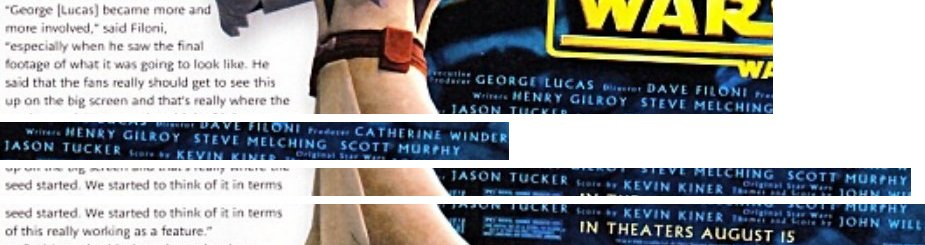

### Stat block notes (game mechanics, not feats)

- Launch Pad: Lifting the Lid on The Clone Wars (opening): SUPERVISING DIRECTOR DAVE FILONI AND GEORGE LUCAS REVEAL THEIR INSPIRATION FOR THE NEW STAR WARS MOVIE. It's almost time to go back to theatres for a new instalment in the Star Wars saga! On August 15, Star Wars: The Clone Wars arrives in theatres in the U.S. and Europe. The Clone Wars Supervising Director Dave Filoni and his team were developing a CGI animated TV series before the idea came to release it as a movie, as he explained exclusively to Star Wars Insider. "George [Lucas] became more and more involved," said Filoni, "especially when he saw the final footage of what it was going to look like. He said that the fans really should get to see this up on the big screen and that's really where the seed started. We started to think of it in terms of this really working as a feature." On his work with the animated series, George Lucas told starwars.com: "I felt it was time to explore animation, and then at the (Star Wars Insider 102, p. 8) (Source: *Star Wars Insider #102* (2008), scan p.8)

## scan p.9 (scan page 9)

Page contents: Launch Pad (cont.): banner "All the latest news, fun, games and gossip from the Star Wars universe"; Clone Wars still (Anakin, Captain Rex helmet); Star Wars: The Force Unleashed box with Darth Vader's Apprentice/PROXY figure art; photos of costumed stormtroopers, Darth Vader and Darth Maul reading Insider, and Deputy Editor Jonathan Wilkins playing the game opposite a Darth Maul costumer (costumers unnamed); Expanded Universe box; "Tales Artist for The Clone Wars" box (hand-read)

### Stat block notes (game mechanics, not feats)

- Launch Pad: Lifting the Lid (cont.): same time be able to explore a part of Star Wars that is so vast that you can't deal with the Luke Skywalker/ Anakin Skywalker saga... you get to deal a little bit more with the minutiae of the Clone Wars." One of the most obvious things about Star Wars: The Clone Wars is the heavily stylized look of the main characters. Developing the look of the new animated Star Wars was a challenge that inspired Dave Filoni. "We looked at the first Clone Wars TV series that Genndy Tartakovsky had done at Cartoon Network and looked at the design that Paul Rudish had done and used those for a lot of inspiration," he told Star Wars Insider. "They had a lot of the exact same challenges that we did in terms of: How do you translate these well known characters into animated form? We all love anime, too, so I think there's a broad range of influence from that area as well." Lucas revealed an unexpected inspiration for the look of the characters in the new Star Wars movie. "Everybody was fairly amused in the animation community that we picked Gerry Anderson and Thunderbirds to be our inspiration," he told starwars.com. "I didn't want it to look like Beowulf, which we could've done, or The Incredibles. When you're doing animation [based on] live action actors, everyone knows what they look like. You really do have to come up with a sophisticated and dynamic caricature of these people." Following the movie, Star Wars: The Clone Wars will continue as an on-going TV series this fall, airing on Cartoon Network and TNT in the U.S. with details of international broadcasters to follow. EXPANDED UNIVERSE >>> Turn to page 16 for Insider's exclusive interview with The Clone Wars' Dave Filoni! (Star Wars Insider 102, p. 9) (Source: *Star Wars Insider #102* (2008), scan p.9)
- Launch Pad: The Force Will Be Unleashed in September!: THE FORCE WILL BE UNLEASHED IN SEPTEMBER! LucasArts has announced that its highly anticipated video game Star Wars: The Force Unleashed will be released on September 16, 2008 in the United States, September 17 in Southeast Asia and Australia, and September 19 in Europe. The game's expansive story is set during the largely unexplored era between Star Wars: Episode III Revenge of the Sith and Star Wars: Episode IV A New Hope. In it, players will assist Vader in his quest to rid the universe of Jedi. The game is one of the most ambitious projects LucasArts has ever launched. "The combination of a great new Star Wars story with revolutionary new gameplay means more fun than you've ever had in the Star Wars universe," said Peter Hirschmann, Vice-President of Product Development, LucasArts. Below, the Empire's finest are distracted by copies of Star Wars Insider, while Deputy Editor Jonathan Wilkins faces Darth Maul in battle! (Star Wars Insider 102, p. 9) (Source: *Star Wars Insider #102* (2008), scan p.9)
- Launch Pad: Tales Artist for The Clone Wars: TALES ARTIST FOR THE CLONE WARS Killian Plunkett, artist for several of the Dark Horse Star Wars comic book titles, has been working on the look of the Star Wars: The Clone Wars movie and TV series. Irish-born Plunkett joined Dark Horse in the early 1990s to work on an Aliens graphic novel, and is now based at Lucasfilm Animation in Marin County. Talking with Insider, Dave Filoni confirmed that some of the inspiration for the show was coming from the Star Wars Tales series. "Killian Plunkett did the story about C-3PO and Darth Vader on Cloud City. You see inside C-3PO's head and he has these reflective moments. It's great, because Killian's now working on the show. Those are all great stories and we're doing some similar things." (Star Wars Insider 102, p. 9) (Source: *Star Wars Insider #102* (2008), scan p.9)

## scan p.10 (scan page 10)

Page contents: Launch Pad: "George Lucas Speaks.... The Creator Strikes Back!" (starwars.com logo, Republic cruiser art; George Lucas photo; Captain Rex helmet photos; Expanded Universe box); right-hand column is the Insider masthead (July/August 2008; Editorial: Editor Brian J. Robb, Deputy Editor Jonathan Wilkins, Senior Editor Simon Hugo, Art Editor Karl Barr, Assistant Editor Sarah Herman; Lucasfilm: Director of Publishing Carol Roeder, Lucasfilm Editor Frank Parisi, Director of Content Management and Fan Relations Steve Sansweet, Art Director Troy Alders, Bantha Tracks Mary Franklin; Contributors David Hawksett, Tom Spina, Daniel Wallace, Calum Waddell, Jon Freel, Jason Fry, Jeremy Beckett, Leland Y. Chee, Steve Sansweet, Gus Lopez; Titan Magazines production staff; postal addresses, phones and emails not transcribed) (hand-read)

### Stat block notes (game mechanics, not feats)

- Launch Pad: The Creator Strikes Back! (Lucas interview): SPEAKING TO STARWARS.COM, STAR WARS CREATOR GEORGE LUCAS DISCUSSES THE FORTHCOMING ANIMATED MOVIE THE CLONE WARS starwars.com: Why was now the right time to bring Star Wars to animation? Lucas: This is a project we've actually been working on since the end of Revenge of the Sith. I've worked in animation before with Steven [Spielberg] in A Land Before Time, John Korty on a film [Twice Upon a Time] and a few other things. I love animation. I started out in film school in animation, and I felt it was time to explore that medium, and then at the same time be able to explore a part of Star Wars that is so vast that you can't deal with the Luke Skywalker/ Anakin Skywalker saga... you get to deal a little bit more with the minutiae of the Clone Wars. Clearly this has a different look than anything that's come before. Can you share with us the method you went ahead and developed to do this, and the thinking behind the design of The Clone Wars, and also the design of the characters? In order to create The Clone Wars, I had to develop a whole new studio. We've really been able to advance our animation ambitions. When it comes to the look and feel of The Clone Wars project, I wanted to do something that was in the realm of anime, design-wise, but still different. So I said, "How can we do this along with a strong storytelling sensibility?" I have a tendency that — just like with Star Wars, which is based in the 1930s Republic Saturday matinee serials, or Indiana Jones, which is based on the same thing — I wanted to give it a look and the feel of something that's from the past. So everybody was fairly amused in the animation community that we picked Gerry Anderson and Thunderbirds to be our inspiration. It has a very stylized look. I didn't want it to look like Beowulf, which we could've done, or The Incredibles, and when you're doing animation about live action actors and everyone knows what they look like, you really do have to come up with a sophisticated and dynamic caricature of these people. A lot of people are excited about the new characters that you've incorporated into the storyline, great new good guys and great new villains. We added a new character. We needed to change the dynamic between Obi-Wan the mentor and Anakin the Padawan, which is where we left them. That's how they entered the Clone Wars. We wanted to make that relationship become more dynamic... sort of like Butch Cassidy and the Sundance Kid. They're now equal. They're now partners. They're now working together. But we really wanted to have that Padawan-mentor relationship, so we gave the most unlikely person a Padawan, which is Anakin, and we made the Padawan a girl. She's very feisty. She's very outgoing and independent-minded, which gives Anakin a real challenge, because he's sort of like that too. He's trying to clean up his act by teaching her to settle down and think and not be so aggressive. She gets in her share of action. She's a great character. She's turned out really fantastic. EXPANDED UNIVERSE >>> Keep an eye on starwars.com between issues of Insider for up-to-date info on The Clone Wars feature and forthcoming TV series. (Star Wars Insider 102, p. 10) (Source: *Star Wars Insider #102* (2008), scan p.10)

## scan p.11 (scan page 11)

Page contents: Full-page ad for the game Secret Files: Tunguska (Wii/Nintendo DS; "Unravel one of the greatest mysteries of our time"; "Mature adventure for those who enjoy pushing their brains to the limit" Official Nintendo Magazine February 2008; Coming Soon; www.secretfiles-game.com; 12+); not Star Wars (hand-read)

## scan p.12 (scan page 12)

Page contents: Launch Pad: "Chicken Roast" (Robot Chicken Star Wars DVD; puppet figures incl. George Lucas puppet; Emperor/Luke still) by Jeremy Beckett; and the "Hoth and Cold" gossip strip (Frozen in Carbonite / Banished to Hoth / Bound for Kessel; Darth Maul and Jar Jar Binks images; Complete Star Wars Encyclopedia box set image) (hand-read)

- **Yoda** — entry/section: Senreich on Yoda's absence: ""The Star Wars universe is so vast that it's hard to touch upon everything in the short time frame we had. If you notice, Yoda doesn't even show up." —Matt Senreich, Star Wars Insider 102, p. 12" Source: *Star Wars Insider #102* (2008), scan p.12
  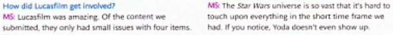

### Stat block notes (game mechanics, not feats)

- Launch Pad: Chicken Roast (Robot Chicken interview): YOU'VE SEEN ROBOT CHICKEN, RIGHT? IT'S A WHOLE NEW WAY OF HAVING FUN WITH ACTION FIGURES — AT LEAST IT IS FOR SETH GREEN AND MATT SENREICH, CREATORS AND PRODUCERS OF THE OFFBEAT POP CULTURE SATIRE SHOW. THE PAIR CHATTED TO INSIDER ABOUT THE DVD RELEASE OF THEIR ROBOT CHICKEN STAR WARS SPECIAL. WORDS: JEREMY BECKETT Insider: Star Wars has a huge cultural following and has been referenced in many forms of media, so what made you want to satirize it? Matt Senreich: Star Wars was the movie I watched every day of my life when I was growing up. It was the first movie my dad took me to see in the theater and it was the movie on TV that I would watch over and over again. I bought all the toys and still have them. It inspired me to be where I am today. There are very few properties that are as far reaching as Star Wars and have become so ingrained in pop culture. The urge to play in this world was always there. Seth Green: Who doesn't know about Star Wars? I grew up loving all the characters and wild settings and scenarios. I think it's natural to really investigate the things you're passionate about, and that exploration often leads to parody. If you look at all the fan films, you can see this is a sentiment shared around the world. How did Lucasfilm get involved? MS: Lucasfilm was amazing. Of the content we submitted, they only had small issues with four items. For the most part, they were just as excited to play with us as we were with them. When we started, they just told us to write and we did. SG: It was kind of incredible. We got very few notes, and the ones we got weren't intrusive or altering of our intention. The only reference to the Star Wars Holiday Special was a promo skit that had George Lucas discussing his hatred for it, making the absence of any gags notable. Was this something that you decided to avoid? MS: The Star Wars universe is so vast that it's hard to touch upon everything in the short time frame we had. If you notice, Yoda doesn't even show up. (Jeremy Beckett, Star Wars Insider 102, p. 12) (Source: *Star Wars Insider #102* (2008), scan p.12)
- Hoth and Cold: Mauled by Maul: HOTH AND COLD FROZEN IN CARBONITE MAULED BY MAUL We loved attending the launch of The Force Unleashed and playing the game, but we were not too thrilled at being thrashed by Darth Maul! Who knew he was a top gamer, as well as a Sith! (Star Wars Insider 102, p. 12) (Source: *Star Wars Insider #102* (2008), scan p.12)
- Hoth and Cold: Prequel Pique: BANISHED TO HOTH PREQUEL PIQUE So, MSN Movies critic Sean Nelson calls the Star Wars prequel movies "lackluster blockbusters..." that promised "greatness but gave us misery." Bah, humbug! (Star Wars Insider 102, p. 12) (Source: *Star Wars Insider #102* (2008), scan p.12)
- Hoth and Cold: Encyclopedia Weight: BOUND FOR KESSEL ENCYCLOPEDIA WEIGHT The new edition of Steve Sansweet's Official Star Wars Encyclopedia promises to be a mighty tome: we've booked our sessions at the gym just to get in training so we can lift the thing. Alternatively, is it too late to become a Jedi Padawan and learn the ways of the Force? What letter ya on now, Steve? (Star Wars Insider 102, p. 12) (Source: *Star Wars Insider #102* (2008), scan p.12)

## scan p.13 (scan page 13)

Page contents: Launch Pad (cont.): Robot Chicken interview conclusion (stills: Boba Fett figure, Ackbar eating cereal, cantina dancers with Max Rebo puppet); Expanded Universe box "Robot Chicken: Star Wars Special DVD from July 22"; "Speeder News in Brief" box (scout trooper on speeder bike art); bottom strip "What's Cool and What's Cold in this month's Star Wars popularity stakes?" (Picnicing on Naboo / Podracing on Tatooine / Red Hot on Mustafar; Captain Rex, Kenny Baker photo, PROXY droid) (hand-read)

- **none** — entry/section: Seth Green on directing George Lucas: ""With everything that's come from Star Wars, it's easy to forget that it was once just an idea from an upstart filmmaker who loves sci-fi. My whole approach was as a collaborator, not an 'in-awe' fan." —Seth Green, Star Wars Insider 102, p. 13" Source: *Star Wars Insider #102* (2008), scan p.13
  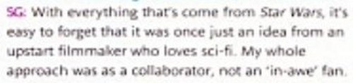
- **none** — entry/section: Senreich on working with Lucas: ""Working with George was surreal. I had never met him before our voice recording. He walked in, jovial and joking around with a wicked sense of humor." —Matt Senreich, Star Wars Insider 102, p. 13" Source: *Star Wars Insider #102* (2008), scan p.13
  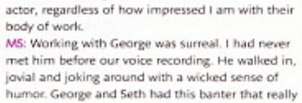

### Stat block notes (game mechanics, not feats)

- Robot Chicken interview (cont.): Heck, we don't have Ewoks. Everything was fair game, but it boiled down to what we thought were our funniest ideas while writing. SG: In addition to all the stuff we cut we had several ideas that were pitched and rejected internally. We didn't set out to avoid anything, we just went where the inspiration took us. You even had George Lucas feature in a 'cameo'! SG: With everything that's come from Star Wars, it's easy to forget that it was once just an idea from an upstart filmmaker who loves sci-fi. My whole approach was as a collaborator, not an 'in-awe' fan. This is the guy that made American Graffiti, who owns an original Tucker car. I've tried to approach him in that way. With Robot Chicken, it's my responsibility to get the takes we need from the actor, regardless of how impressed I am with their body of work. MS: Working with George was surreal. I had never met him before our voice recording. He walked in, jovial and joking around with a wicked sense of humor. George and Seth had this banter that really is hard to explain. I just wanted to be a normal guy and not super geek. Luckily, it was easy to forget who I was with because ultimately, we had a job to do. We needed a performance like any other actor's performance to make the sketch work. Once I slipped into that head space, I lost my nervousness and just enjoyed the process. Winning product ideas: Admiral Ackbar cereal, Mustafar lava lamp or a Death Star garbage masher for your kitchen. Which would you buy? MS: Admiral Ackbar cereal! I already bought an illegal bootleg T-shirt of that on eBay. I will admit that I hated that sketch when it was written, but Breckin [Meyer]'s performance sold it for me. SG: I actively fought to get Ackbar cereal in the show, so I'd be thrilled to have it as part of this nutritious breakfast. Your Star Wars special was mentioned in the Blue Harvest episode of Family Guy: was becoming a parody in a parody the ultimate accolade? MS: When Seth came back from recording that part of Blue Harvest, I couldn't believe it and just laughed and laughed. We love MacFarlane. Just wait till you see him on our DVD. Priceless. SG: There's lots of love between the shows. It's awesome. We're all just nerdy friends getting to play together. Finally, if the Robot Chicken got to appear in Star Wars what would its droid designation be? MS: RC2-CKN2. EXPANDED UNIVERSE >>> Robot Chicken: Star Wars Special DVD from July 22 (Jeremy Beckett, Star Wars Insider 102, p. 13) (Source: *Star Wars Insider #102* (2008), scan p.13)
- Speeder News in Brief: Clone Wars Books; Crystal Skull Official Magazine: SPEEDER NEWS IN BRIEF STAR WARS: THE CLONE WARS BOOKS The Penguin Group will publish a series of books based on The Clone Wars, set to debut this summer, in advance of the August 15 theatrical release of Star Wars: The Clone Wars. The U.S. on-sale date is July 26 and the U.K. on-sale date is August 7. Planned books include a novel of the new Star Wars movie, sticker books and visual guides, plus illustrated and photo-based adventure books. CRYSTAL SKULL OFFICIAL MAGAZINE The 100 page Indiana Jones and the Kingdom of the Crystal Skull official movie magazine is out now, packed full of information about the new movie, including full details on the making of Indiana Jones and the Kingdom of the Crystal Skull and exclusive interviews with Harrison Ford, George Lucas, and Steven Spielberg. (Star Wars Insider 102, p. 13) (Source: *Star Wars Insider #102* (2008), scan p.13)
- Speeder News in Brief: Threats of the Galaxy; Disney Star Wars Weekends: THREATS OF THE GALAXY Out now: Threats of the Galaxy, a ready-to-play expansion for Star Wars: The Roleplaying Game. The hardcover volume adds an assortment of new challenges to any storytelling game session. The book includes ready-to-play game statistics, tactics, and encounter ideas for more than 140 creatures, droids, and characters from the Star Wars universe. DISNEY STAR WARS WEEKENDS The annual Star Wars Disney Weekends are well underway! Here's who's due in the next few weeks at the Disney Hollywood Studios in Florida—June 20-22: Amy Allen (Aayla Secura) & Matthew Wood (voice of the evil General Grievous); June 27-29: Dave Filoni (Supervising Director of The Clone Wars animated feature and series) & Jake Lloyd (the boyhood incarnation of Anakin Skywalker in Episode I). (Star Wars Insider 102, p. 13) (Source: *Star Wars Insider #102* (2008), scan p.13)
- What's Cool and What's Cold: WHAT'S COOL AND WHAT'S COLD IN THIS MONTH'S STAR WARS POPULARITY STAKES? PICNICING [sic] ON NABOO THE CLONE WARS MOVIE TRAILER Opening with familiar sounds and images, this trailer quickly introduces us to Star Wars in a style we've never seen before. The action scenes look totally awesome! PODRACING ON TATOOINE R2-OK! After contracting an unknown illness as he flew back to the U.K., we are all pleased to hear that actor Kenny Baker, 73, has made a full recovery. We all knew he was the toughest little guy in the galaxy! RED HOT ON MUSTAFAR UNLEASHED LAUNCH Insider got some hands-on experience with the eagerly awaited next chapter in the Star Wars saga. What's it like? They had to call security to stop us playing... (Star Wars Insider 102, p. 13) (Source: *Star Wars Insider #102* (2008), scan p.13)

## scan p.14 (scan page 14)

Page contents: Launch Pad: "Steampunk Star Wars!" (photo of steampunk custom figures incl. boiler R2-D2 and Obi-Wan with powerpack lightsaber; Eric Poulton clockwork Death Star rendering); "New Star Wars Prints to Grace Your ID-Wall!" (dark box) with "Win Print #1 from ID-Wall!" contest box (TIE-fighter manga print image); yellow column "Auction Offers Rare Star Wars Collectibles—At a Price!" (carded Rocket Firing Boba Fett prototype photo; nine vintage Special Action Figure Set three-packs); Expanded Universe boxes (hand-read)

### Stat block notes (game mechanics, not feats)

- Steampunk Star Wars!: STEAMPUNK STAR WARS! IT'S STAR WARS, KID, BUT NOT AS YOU'VE EVER SEEN IT BEFORE... Among online communities and artists there has been a growing vogue for steampunk Star Wars: re-inventing Star Wars characters, concepts, vehicles, and environments through a prism of Victorian technology. Within science fiction steampunk is described as being work set in an era or on a world where steam power still prevails, usually the 19th Century or Victorian England, often drawing on the works of science fiction pioneers like H.G. Wells or Jules Verne. It's regarded as a retro spin-off from cyberpunk. Various artists across the blogosphere have been applying the steampunk ethic to Star Wars, with a great degree of success. Some discussion forums have challenged artist members to re-invent a Star Wars character in steampunk style: R2-D2 as an overheating boiler is a popular image. See this online thread for some key examples across the past two years: [CGSociety forum thread URL — not transcribed] Artist Eric Poulton has posted a whole series of artistic renderings of characters in the steampunk style at his Star Wars steampunk blog. Especially impressive is his clockwork-like re-invention of the Death Star (below). See more here: [blog URL — not transcribed] Others have gone further, with one site even proposing a range of steampunk Star Wars action figures. Custom figure designer [name omitted] developed a whole range of steampunk figures, from the obligatory 'boiler' R2-D2 to Obi-Wan wielding a lightsaber connected to a powerpack (above). Check out this site for the full range: [URL — not transcribed] EXPANDED UNIVERSE >>> Steampunk Star Wars is a growing area, and one that Insider is likely to return to in the future. (Star Wars Insider 102, p. 14) (Source: *Star Wars Insider #102* (2008), scan p.14)
- New Star Wars Prints to Grace Your ID-Wall! + Win Print #1: NEW STAR WARS PRINTS TO GRACE YOUR ID-WALL! Got any big, blank wall spaces that need filling? Look no further than ID-WALL's new Star Wars: Classic Manga acrylic prints. The 16-strong collection of black and white Tokyopop images, from artists including Hisao Tamaki, Toshiki Kudo and Shin-ichi Hiromoto will be released in waves throughout 2008-2009—two are already available. At £750 a pop, they come mounted, ready to hang, and tucked up safe in a presentation box, but with just 50 available of each print worldwide, you better be prepared to fight for them, Lightsabers ready! WIN PRINT #1 FROM ID-WALL! To support the release of the first two prints in ID-Wall's new Star Wars: Classic Manga collection, we've got #1 (of 50) of their 'Approaching the Death Star' print to give away to an Insider reader! Simply send your name and address to Insider (details on p6) and you'll be entered into our lucky-dip draw... and May the Force be With You! (Star Wars Insider 102, p. 14) (Source: *Star Wars Insider #102* (2008), scan p.14)
- Auction Offers Rare Star Wars Collectibles—At a Price!: AUCTION OFFERS RARE STAR WARS COLLECTIBLES—AT A PRICE! Brian's Toys Premier Collectible Auction is now underway. The unique event includes nearly 700 vintage AFA (Action Figure Authority) graded and rare Star Wars pieces valued at over $1 million, including many of the most valuable items that exist. It also boasts a large selection of G.I. Joe, Transformers, and Indiana Jones items, bringing the total value of the auction to over $2 million. The actual auction will take place in San Diego on July 25-26, with almost 800 Star Wars lots offered. Key lots include the world's highest graded set of 16 different early action figure three-packs; the only carded prototype Rocket Firing Boba Fett; a complete set of vehicles/playsets with Special Offers; and tons of original artwork and pre-production packaging, plus hundreds of vintage items sealed in the original packaging. Brian Semling of Brian's Toys said, "Our target audience consists of vintage toy collectors of graded toys and collectibles from Star Wars, G.I. Joe, Transformers, Masters of the Universe, Nintendo, Indiana Jones, and many more action figure lines. The auction appeals to average collectors as well as wealthier clients. While the most sought-after lots start at $50,000 and up, there are several hundred lots that start at $100-$200, so there really is something for everyone." EXPANDED UNIVERSE >>> Check out the auction items online at www.premiercollect.com (Star Wars Insider 102, p. 14) (Source: *Star Wars Insider #102* (2008), scan p.14)

## scan p.15 (scan page 15)

Page contents: Ad: OfficialPix.com (Darth Vader photo; signed photo strip: Luke X-wing pilot, Leia slave outfit, Jango Fett, Padmé) (hand-read)

### Stat block notes (game mechanics, not feats)

- OfficialPix ad: NOW SHIPPING TO YOUR GALAXY OFFICIALLY LICENSED AUTOGRAPHS & PHOTOGRAPHS AT OFFICIALPIX.COM ENTER CODE 'DARTHVADER' AT CHECKOUT TO RECEIVE 10% OFF ANY. [sic] ORDER! HURRAY OFFER ENDS 7/31/2008. ©2008 Lucasfilm Ltd. & TM. All rights reserved. (Star Wars Insider 102, p. 15) (Source: *Star Wars Insider #102* (2008), scan p.15)

## scan p.16 (scan page 16)

Page contents: Launch Pad Extra: "Directing the Troops" — Dave Filoni interview, words Jonathan Wilkins (Filoni headshot; Clone Wars logo; Ahsoka close-up with clone trooper; AT-TE/gunship battle still) (hand-read)

### Stat block notes (game mechanics, not feats)

- Directing the Troops (pt 1): LAUNCH PAD EXTRA DIRECTING THE TROOPS STAR WARS: THE CLONE WARS SUPERVISING DIRECTOR DAVE FILONI—CURRENTLY WORKING FLAT OUT ON THE FORTHCOMING THE CLONE WARS MOVIE AND TV SERIES—FOUND TIME TO OFFER REVEALING INSIGHTS INTO THE EAGERLY ANTICIPATED ANIMATED FEATURE. WORDS: JONATHAN WILKINS Insider: What prompted the decision to produce a full-length theatrical version of The Clone Wars? Dave Filoni: George [Lucas] saw completed footage of what it was going to look like. We always watch our dailies in an actual theater, and when we started showing him the results he instantly said "Wow, this looks great on a big screen." So from the get-go, once George saw what was being produced, he said the fans really should get to see this on the big screen—and the seed was planted. We started to think of it in terms of this really working as a feature. We are all eager to show fans something they know is Star Wars, but that's different. It's that difference that makes us all so excited about this, and the opportunity to work with Star Wars in animation. The Clone Wars has a unique look, yet it retains that distinctive Star Wars feel. Was it difficult to ensure it felt like part of Star Wars? I think that's something you worry about, since Star Wars is so well known. You want to make it something that the fans are going to relate to, but also something that the average viewer who's not into Star Wars relates to. I think it grabs both those groups. The first thing we had to do was get a really talented group of people that were familiar with the look—production staff, artists who loved the material—and we looked at the films and used them as a source, because it's already so well designed. Of course, George Lucas being a big part of it was the capper that really said, "OK, this is going to be Star Wars" because George is the crucial ingredient. (Jonathan Wilkins, Star Wars Insider 102, p. 16) (Source: *Star Wars Insider #102* (2008), scan p.16)
- Directing the Troops (pt 2): Were there any particular styles of animation that provided inspiration for the project? We looked at the first Clone Wars TV series that Genndy Tartakovsky had done for Cartoon Network and looked at the design that Paul Rudish had done for it, and used those for inspiration. They had a lot of the same challenges that we did: How do you translate these well-known characters into animated form? We wanted to respect the work that they had done. I had just come off Avatar at Nickelodeon so I was very much in that frame of mind and brought a lot of what I was doing there to Star Wars, so that was definitely an influence. I brought Justin Ridge, one of the assistant directors, with me and several people from Avatar followed; we all love anime, so I think there's a broad range of influence from that area as well. How exactly do you direct animation? Well, it's collaboration. Animation is a group project, and you need to have a clear vision of what you want to do. Then you need to work with your artists and your writers to make sure that you're all on the same page and to see what they can bring to the project and to the story. Once you're sitting in editorial, looking at the shots and pacing out the story, that's where you really start to get more creative and bring the story to life. Really, it's the collaboration that's the important thing. There are just so many people involved, from the initial story idea to what you finally see up on the screen; it's really an amazing effort. Is it helpful that everybody knows Star Wars? I'll say it time and again at work, "Well, did you look at the reference?" If we're talking about clone troopers or certain guns, or certain other weapons or vehicles, I'll say "Well, did you watch Attack of the Clones? Because those are in Attack of the Clones." It's definitely great to have the six films as our style guide for everything we're doing. So I guess you don't get to shout "Faster! More intense!" like George has been known to do? Actually I do that all the time! It works for Star Wars! It's one of the things that maybe I've adopted from George, but you need that intensity. It sounds clichéd, because as fans we all know he says that, but I can tell you, there's really something to it! How important is continuity versus storytelling? We're very aware of continuity, we want to maintai[n] it, and so it's very important. Yet when you look at [cont. p17; final letter of "maintain" cut at scan edge] (Jonathan Wilkins, Star Wars Insider 102, p. 16) (Source: *Star Wars Insider #102* (2008), scan p.16)

## scan p.17 (scan page 17)

Page contents: Directing the Troops (cont.): full-page Clone Wars Obi-Wan Kenobi close-up; inset hologram-table still; text panel lower left (hand-read)

### Stat block notes (game mechanics, not feats)

- Directing the Troops (pt 3): what George did with the prequels, there are obviously some things that I think the fans assumed would have been one way but that George decided would be different. There's Threepio being built by Anakin Skywalker—I never saw that coming! It all depends on what the purpose is and what you're trying to tell in the story. Then you have to balance that version for the continuity argument. We have tried to stay very looped-in with people who focus specifically on continuity to make sure. Each decision, each judgment, is made carefully, so it's really a balance between the two. Do you have any parts of the movie that made you think "Wow! That worked better than I thought!"? It's easy to cite a lot of action sequences, but I think that Anakin and Ahsoka have some moments where they're talking and really figuring out how they're going to relate to one another. Those scenes really work well and that holds the whole thing together. Is there anything that you'd do differently following the rapid developments in CGI movie technology? It's almost a joke between George and me, because when you make a movie, you learn so much in doing it that you would probably do it differently next time. I think that (Jonathan Wilkins, Star Wars Insider 102, p. 17) (Source: *Star Wars Insider #102* (2008), scan p.17)

## scan p.18 (scan page 18)

Page contents: Directing the Troops (cont.): stills — Ahsoka & Anakin on bridge, Anakin & Ahsoka lightsaber duel stance, Rex/clone under blue light; Asajj Ventress close-up; pull quote (hand-read)

- **none** — entry/section: Filoni on becoming a better director: ""I love so many parts of it, and yet because of the experience, and working with George, I'm a better director now than I was." —Dave Filoni, Star Wars Insider 102, p. 18" Source: *Star Wars Insider #102* (2008), scan p.18
  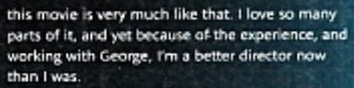

### Stat block notes (game mechanics, not feats)

- Directing the Troops (pt 4): this movie is very much like that. I love so many parts of it, and yet because of the experience, and working with George, I'm a better director now than I was. I would do things differently now, of course. He'll tell me "Well, David, you can't change everything." I'll say "Wait a minute!" because, of course, he's known for making changes! You've mentioned George has been very hands-on with the production: what's the most important or surprising thing that you've learned from him? I think it's really editing. Nathan Tucker, my editor, would really attest to that fact. We work very hard on the footage and George comes in and looks at it with us. He's really amazing, how he can get sequences and move them around to really push the tension and dynamics of what's going on in the story. I've had to be a real student of that in the last few years, and that's probably one of the most important things I've really tried to grasp. What was it like hearing the fan reaction to The Clone Wars trailer at Celebration IV? That was pretty amazing, I have to say. Luckily, there were some of the crew from The Clone Wars in the audience. I think that was really uplifting because we work in secrecy a lot, up on the Ranch, and we're not able to get a reaction from people that aren't working on it. To finally get some kind of reaction from the fans was great for everybody. We went back to the Ranch doubly energized to really do this, do it well, and do it for the people that care about the movies. Was there a sense of pressure that you had to live up to huge expectations? Yes, there's always that because it's Star Wars. If I wasn't on this side, I'm sure I'd be the fan out there saying "Well, this better be good!" You know, we're all trying to live up to that. That's our focus. Given the fact that audiences and fans in particular know the characters really well, what sort of challenges were there in getting them exactly right? It was very difficult early on when we were designing the characters. It was a real trick to get them, especially Anakin and Obi-Wan, to look right. They went through a lot of interpretations. We had a lot of opinions from the crew because people love and know these characters. In particular, Anakin was very difficult to nail down. Instead of going for a dead-on actor likeness we'd just go for, "Well, what makes someone a Skywalker?" and look at that. That's what really got us over the hump for Anakin. [Pull quote:] "I LOVE SO MANY PARTS OF IT, AND YET BECAUSE OF THE EXPERIENCE, AND WORKING WITH GEORGE, I'M A BETTER DIRECTOR NOW THAN I WAS." -DAVE FILONI (Jonathan Wilkins, Star Wars Insider 102, p. 18) (Source: *Star Wars Insider #102* (2008), scan p.18)

## scan p.19 (scan page 19)

Page contents: Directing the Troops (conclusion): still of Anakin, Ahsoka, Captain Rex and hologram on bridge; large lightsaber hilt in hand (Ventress) art; Clone Wars logo; credit line (hand-read)

- **Asajj Ventress** — entry/section: Filoni on Ventress: ""Asajj Ventress was a natural because of her role in the previous Clone Wars [animated micro-series]. She was somebody that we all thought we could use and develop." —Dave Filoni, Star Wars Insider 102, p. 19" Source: *Star Wars Insider #102* (2008), scan p.19
  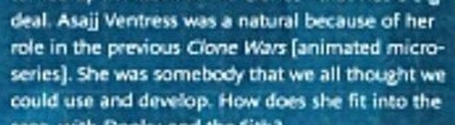
- **Kit Fisto; Plo Koon** — entry/section: Filoni on Jedi Council: ""In truth, there's so many characters in the films that we didn't really get to see a lot, like Kit Fisto and Plo Koon. You could go around the [Jedi] Council's chairs, and have 12 episodes right there." —Dave Filoni, Star Wars Insider 102, p. 19" Source: *Star Wars Insider #102* (2008), scan p.19
  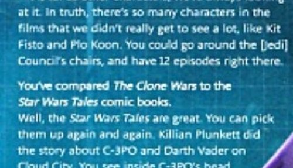

### Stat block notes (game mechanics, not feats)

- Directing the Troops (pt 5): Ahsoka: Anakin is obviously an established character, but you get to introduce an all-new character. What can you tell us about his new Padawan Ahsoka? Ahsoka really stands between Anakin and Obi-Wan. If you look at Obi-Wan, he's the Jedi who believes in the Old Republic, and Anakin's leaning towards a new order. Then you have this young girl who's in between. She's really trying to figure out what is going on and deal with decisions she has to make. She was trained as a peacekeeper, [but] now she's forced into being a soldier, like all the Jedi. How do these young Padawans react to that? It's one of the interesting stories that we get to tell. Anakin is so adept at what he's doing, as is Obi-Wan, so she's a great character to have. We took a lot of notes from Carrie Fisher's performance as Princess Leia and how she reacted to very strong characters like Luke Skywalker and Han Solo. We try to get a bit of that into this young girl. That's a big inspiration. (Jonathan Wilkins, Star Wars Insider 102, p. 19) (Source: *Star Wars Insider #102* (2008), scan p.19)
- Directing the Troops (pt 6): EU characters, Tales, restrictions, Easter eggs: The movie also features Asajj Ventress. Whose decision was it to use Expanded Universe characters and is this something that we might see more of? I think it's always interesting to see which Expanded Universe characters turn up in a Star Wars movie or the Star Wars TV show, like when Aayla Secura turned up in Attack of the Clones—that was a big deal. Asajj Ventress was a natural because of her role in the previous Clone Wars [animated micro-series]. She was somebody that we all thought we could use and develop. How does she fit into the saga, with Dooku and the Sith? As far as other characters, we're always looking at it. In truth, there's so many characters in the films that we didn't really get to see a lot, like Kit Fisto and Plo Koon. You could go around the [Jedi] Council's chairs, and have 12 episodes right there. You've compared The Clone Wars to the Star Wars Tales comic books. Well, the Star Wars Tales are great. You can pick them up again and again. Killian Plunkett did the story about C-3PO and Darth Vader on Cloud City. You see inside C-3PO's head and he has these reflective moments. It's great, because Killian's now working on the show. Those are all great stories and we're doing similar things, like looking at the clones. You can do so many different stories just about the clones to try and get into the heads of these guys. What kind of soldiers were they? How individual were they? There are just a ton of questions around them, so we look at those and look at the Jedi Council . [sic] We were all so excited the first time we saw a Jedi Council member: who were these guys? Why does that guy look like that? What does their lightsaber look like? It's just exciting to get to explore things like that, if George wants to, and if we find that character interesting. We know how most of these characters end up—does that create any restrictions on the story? Sometimes there are certain situations that we just have to observe and be aware of. Obviously, in Revenge of the Sith General Grievous and Anakin have, quite plainly, never met each other face to face. You're constantly amazed that what seems like a restriction becomes a really creative outlet, something that's not done the easy way but done the hard way. It's thrilling and exciting. Are there any cool Easter eggs that dedicated fans should look out for in the movie? I'm a fan, and because so many people working on this are fans, there are Easter eggs throughout this movie and the series that fans will appreciate; things that my mother would not have a clue about, but will be nice little winks to the fans. Someone out there will get a big thrill! That's fun and exciting. Special thanks to Dave Filoni, John Singh and Steve Sansweet (Jonathan Wilkins, Star Wars Insider 102, p. 19) (Source: *Star Wars Insider #102* (2008), scan p.19)

## scan p.20 (scan page 20)

Page contents: Big Interview opener (Stuart Freeborn): full-page CGI Yoda with green lightsaber; ghosted Jabba the Hutt and Yoda puppet images in background; "Big Interview" logo (hand-read)

### Stat block notes (game mechanics, not feats)

- More Than a Muppet caption: More Than a Muppet Stuart Freeborn's design for Yoda survived as the character evolved from foam rubber to CGI! (Star Wars Insider 102, p. 20) (Source: *Star Wars Insider #102* (2008), scan p.20)

## scan p.21 (scan page 21)

Page contents: Big Interview title spread: "The Man Behind the Monsters!" (green slime-letter title; creature claw art); deck; byline Words: Jonathan Wilkins (hand-read)

### Stat block notes (game mechanics, not feats)

- The Man Behind the Monsters! deck: THE MAN BEHIND THE MONSTERS! MAKE-UP MAN STUART FREEBORN'S IMPRESSIVE BODY OF WORK STRETCHES ALL THE WAY BACK TO THE FILMS OF CHARLIE CHAPLIN, BUT IT'S HIS DESIGN OF THE DISTINCTIVE STAR WARS CHARACTERS LIKE YODA AND CHEWBACCA THAT INTERESTS INSIDER! Words: Jonathan Wilkins (Jonathan Wilkins, Star Wars Insider 102, p. 21) (Source: *Star Wars Insider #102* (2008), scan p.21)

## scan p.22 (scan page 22)

Page contents: The Man Behind the Monsters (cont.): photo of Frank Oz, Stuart Freeborn and Jim Henson with Yoda head; captions; pull quote; "Naming Snaggletooth" yellow box with Snaggletooth costume photo (hand-read)

- **none** — entry/section: Freeborn on the script: ""Well, to be honest, I started reading the script before I accepted the job and I didn't think much of it! I was going to turn it down, but I kept on with it and by the time I got to the end, I really liked it." —Stuart Freeborn, Star Wars Insider 102, p. 22" Source: *Star Wars Insider #102* (2008), scan p.22
  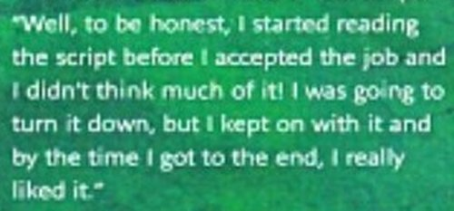
- **none** — entry/section: Freeborn on cantina creatures: ""George [Lucas] was very hands on in terms of what the cantina creatures should look like. It's much easier to work like that." —Stuart Freeborn, Star Wars Insider 102, p. 22" Source: *Star Wars Insider #102* (2008), scan p.22
  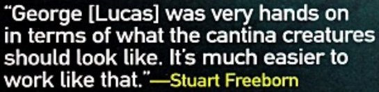

### Stat block notes (game mechanics, not feats)

- Freeborn feature (pt 1): A make-up man of considerable experience as well as a well-respected innovator, Stuart Freeborn's impressive resume includes work with Alexander Korda, Charlie Chaplin, Peter Sellers, and even the Muppets, as well as creating the stunningly realistic apes for Stanley Kubrick's 2001: A Space Odyssey before he accepted the challenge to work on the original Star Wars. Now enjoying his retirement with his wife Kathleen (a talented make up artist in her own right) the 93-year-old veteran of over 70 films shared some of his personal memories of making the original Star Wars trilogy. Hailing from Beckenham, South London, Stuart Freeborn had always harbored an interest in the craft of make-up. Practicing on himself, he could often be found on the leafy streets of Beckenham as assorted characters such as an old man, a monster, or even an alarmingly convincing woman! He produced his own set of pictures showing off his skills and sent them off to various movie studios in England. After much persistence Freeborn was hired by Guy Pearce, the head of make-up at Denham Studios, which lead [sic] to an illustrious career on a number of films including making 34-year-old Alec Guinness into Fagin for David Lean's Oliver Twist. While working on Richard Donner's horror film The Omen, Freeborn was offered a job on something called The Star Wars. "A young man walked into my make-up lab and asked me if I was Stuart Freeborn and introduced himself as George Lucas. He told me that he was preparing this film called The Star Wars and that he had a sequence called the 'cantina scene' that would feature lots of weird aliens. At that time, science fiction films tended to be very clean and didn't have a lived-in quality, so I really wanted to do something a bit different, more real if you like. He had heard that I had made some creatures and he wanted to see them. They were in my attic at home, so I said I'd bring them in the next day. The funny thing was that he seemed very young, and for a moment I thought he was just joking. You have to remember that directors were a lot older in those days, so George was rather unusual." The next day, Freeborn brought some of his work into the studio to present to Lucas, but one creature in particular caught the young director's eye. "He was fascinated by this 'Little Green Man' that I had built for a TV advertisement for Birdseye Peas. It had this head shaped like a pea, odd round insectoid eyes and a small mouth with a tiny little nose and no ears. It didn't have a split [a zippered opening], so the actor wearing it had to just pull it over the head. George really liked this design, but we couldn't use it because Birdseye had already used it and owned the copyright. In the end I changed it a little bit and a version of the creature appears in the film." Given the sheer scale of ambition, what did Freeborn make of the script? "Well, to be honest, I started reading the script before I accepted the job and I didn't think much of it! I was going to turn it down, but I kept on with it and by the time I got to the end, I really liked it." Making the movie, Freeborn found himself working closely with Lucas to develop the look for the various otherworldly creatures. "George was very hands on in terms of what the various creatures in the cantina should look like. "I would make a character in clay and he would say, 'How about we do it like this,' and suggest a change. It's much easier to work like that, rather than by using a drawing. You [cont. p23] Above: Frank Oz comes face-to-face with Yoda, as Stuart Freeborn (left) and Muppet creator Jim Henson (right) look on. Below Right: It's Snaggletooth! [Pull quote:] "George [Lucas] was very hands on in terms of what the cantina creatures should look like. It's much easier to work like that."—Stuart Freeborn NAMING SNAGGLETOOTH Kathleen Freeborn: "I was working on one of the characters one day when George Lucas put his head around the door and asked what he was called. I looked down at his face and saw his funny looking teeth and said 'Snaggletooth' which George seemed to find funny, so it stuck!" (Jonathan Wilkins, Star Wars Insider 102, p. 22) (Source: *Star Wars Insider #102* (2008), scan p.22)

## scan p.23 (scan page 23)

Page contents: Freeborn feature (cont.): photos Chewbacca, Leia (slave costume) with Jabba the Hutt, Yoda puppet close-up, Greedo head; pull quote; "Fan Response" and "Vital Equipment!" yellow boxes (hand-read)

- **Jabba the Hutt** — entry/section: Freeborn on Jabba's face: ""I envisaged Jabba as having a more pointed face, but when the latex was stretched across the framework, it flattened his face." —Stuart Freeborn, Star Wars Insider 102, p. 23" Source: *Star Wars Insider #102* (2008), scan p.23
  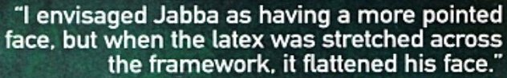

### Stat block notes (game mechanics, not feats)

- Freeborn feature (pt 2): have to remember that the creatures are supposed to be three-dimensional so you need to see the creature exactly as it is going to appear on screen. I modelled everything [some based on 2-D concept sketches from the U.S.] and once production was happy with it, the pieces were cast in foam rubber and the mechanics were added to make them move." One of Freeborn's most popular and enduring characters was Chewbacca but, as he recalls, Han Solo's Wookiee sidekick didn't appear in the early scripts. "George came in to see me one day and said that he wanted to introduce a big, but lovable, character who would appeal to children. He also wanted him to be ferocious and strong if his friends were in trouble. George told me he wanted him to be like a dog, so I modelled a dog-like creature that night and took it in to show him the next day. He looked at it and I could tell he was thinking very carefully. He looked up and said that he thought that perhaps he should be more catlike. The next morning I brought in something that mixed a little bit of cat with the original dog design. George was delighted with the design, he was always very enthusiastic when he saw something he liked, so I made the foam rubber version and got sticking all the hair on!" Creating Chewbacca threatened to be a time-consuming task, but Freeborn had the benefit of his previous experience to draw upon."I managed to put Chewbacca together fairly quickly. We used some mechanisms from 2001: A Space Odyssey. It speeded up a process that might have taken longer than we had. "Peter Mayhew was wonderful. He is such a gentle giant, and very easy to work with. He'd use his jaw to operate the face so we had to make the foam pieces as [cont. p24] [Pull quote:] "I envisaged Jabba as having a more pointed face, but when the latex was stretched across the framework, it flattened his face." —Stuart Freeborn FAN RESPONSE Stuart Freeborn: "It astounds me that I still get lots of mail from people who have enjoyed the films and like what I did. The postman always seems to have pictures of the little fellow [Yoda] to sign." VITAL EQUIPMENT! Kathleen Freeborn: "It's always a good idea to have straws handy for the masked actors to breathe through! It could get very hot on set with the lights shining." (Jonathan Wilkins, Star Wars Insider 102, p. 23) (Source: *Star Wars Insider #102* (2008), scan p.23)

## scan p.24 (scan page 24)

Page contents: Freeborn feature (cont.): photo of Freeborn sculpting Yoda head (Yoda maquette in background); Ewok (Wicket-style) photo; Luke's hand pull quote; "Building an Empire" subhead; "Working with the Cast" yellow box (hand-read)

- **Yoda** — entry/section: Freeborn on Yoda's creation: ""He looked at it very carefully and, as he did with Chewbacca, said 'Yes! That's it' and that's how Yoda was born." —Stuart Freeborn, Star Wars Insider 102, p. 24" Source: *Star Wars Insider #102* (2008), scan p.24
  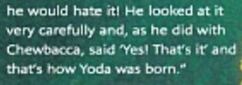
- **Yoda** — entry/section: Freeborn on Einstein's eyes: ""I also gave him Einstein's eyes to really drive home the sense of intelligence. I wanted to give him a little moustache, but it didn't seem right somehow. In the end I compromised by giving him the shape of a moustache on his bottom lip. It's very subtle, but it's there." —Stuart Freeborn, Star Wars Insider 102, p. 24" Source: *Star Wars Insider #102* (2008), scan p.24
  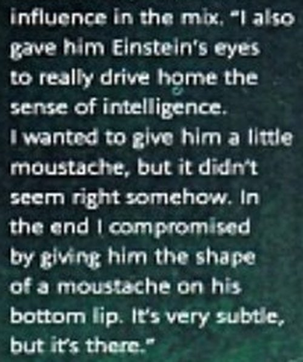
- **Luke Skywalker** — entry/section: Freeborn on Luke's hand: ""We made Luke's hand from hardened resin, the two inner parts painted red to give a realistic flesh color. You always have to be prepared to make odd little things like that on films!" —Stuart Freeborn, Star Wars Insider 102, p. 24" Source: *Star Wars Insider #102* (2008), scan p.24
  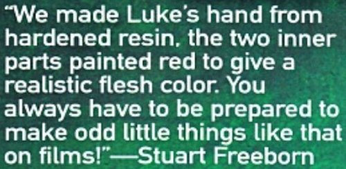
- **Leia Organa Solo** — entry/section: Kathleen Freeborn on Carrie Fisher: ""Carrie Fisher was so sweet and fun. We could hear her coming down the corridor, singing and laughing with everybody she met!" —Kathleen Freeborn, Star Wars Insider 102, p. 24" Source: *Star Wars Insider #102* (2008), scan p.24
  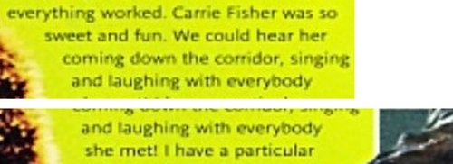

### Stat block notes (game mechanics, not feats)

- Freeborn feature (pt 3): Building an Empire: thin as possible while maintaining their flexibility. They were always wearing out, and had to be regularly replaced. I had to get members of my team to produce lots of extra pieces, especially for problem areas such as the lips, which seemed to wear out extremely quickly." Another problem with Chewbacca was the fact that detailed hair work was involved. "You can't just lay hair on latex. I had to mix it with glue and we just about got there. The other consideration was that an authentic color comes through where the hair is thinner." BUILDING AN EMPIRE Following the success of Star Wars, Freeborn found himself a key member of the creature creating team. Soon he was enlisted to work on a very special character for the next movie in the trilogy. The creation of Yoda for The Empire Strikes Back fell to Freeborn after initial illustrations from designers in America. "Things were getting very tight with production due to start very soon. George Lucas came to my workshop one morning and asked if I could have a go at creating a design for this little fellow who was secretly a powerful and wise warrior. The catch was that he needed to see it that afternoon as he was flying back to the States! I had a sculpture of my own head that I had been working on and thought about modifying that. I added the ridges to the head as George had described the character as very wise and I thought they might indicate thought. "The trouble was, he didn't look alien enough. I was wondering what I could do to make him look alien, but without losing his character and charm, and then I had a flash of inspiration and added the ears. When George came back that afternoon, I had covered the sculpt under a large wet rag. He asked to see the piece and I took the rag off and covered my eyes, convinced that he would hate it! He looked at it very carefully and, as he did with Chewbacca, said 'Yes! That's it' and that's how Yoda was born." Yoda's distinctive features weren't entirely modelled on Freeborn's own, though. There was another very important influence in the mix. "I also gave him Einstein's eyes to really drive home the sense of intelligence. I wanted to give him a little moustache, but it didn't seem right somehow. In the end I compromised by giving him the shape of a moustache on his bottom lip. It's very subtle, but it's there." Freeborn's work wasn't restricted to masks and body casts though. For The Empire Strikes Back he came up with a crucial appendage of [sic] certain Jedi Knight. "We made Luke's hand from hardened resin holding the handle of his sword [lightsaber] that contained a cable release. The two inner parts were painted red to give a realistic flesh color. You always have to be prepared to make odd little things like that on films!" [Pull quote:] "We made Luke's hand from hardened resin, the two inner parts painted red to give a realistic flesh color. You always have to be prepared to make odd little things like that on films!"—Stuart Freeborn (Jonathan Wilkins, Star Wars Insider 102, p. 24) (Source: *Star Wars Insider #102* (2008), scan p.24)
- Working with the Cast box: WORKING WITH THE CAST Kathleen Freeborn: "The cast was truly wonderful to work with. Our son, Graham, was the make-up artist for Sir Alec Guinness and Mark Hamill and did the make-up on the bully in the cantina who picks a fight with Luke Skywalker. Stuart had worked with Sir Alec on Oliver Twist years before and he was charming and very polite. Mark Hamill was young, but so keen to learn how everything worked. Carrie Fisher was so sweet and fun. We could hear her coming down the corridor, singing and laughing with everybody she met! I have a particular affection for the little people who played the Ewoks. They were so excited to be working on the film and really embodied those little characters." (Jonathan Wilkins, Star Wars Insider 102, p. 24) (Source: *Star Wars Insider #102* (2008), scan p.24)

## scan p.25 (scan page 25)

Page contents: Freeborn feature (end): Yoda puppet photo; Jabba the Hutt puppet photo; "Expanded Universe" yellow box; "Jabba Meets Jedi!" section; special-thanks line; folio INSIDER 25 (hand-read)

- **Jabba the Hutt** — entry/section: Freeborn on Jabba's face: ""I envisaged him having a more pointed face, but when the latex was stretched across the framework it flattened his face!" —Stuart Freeborn, Star Wars Insider 102, p. 25" Source: *Star Wars Insider #102* (2008), scan p.25
  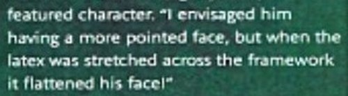
- **Jabba the Hutt** — entry/section: Freeborn on the toad scene: ""Just as the director was about to call action, he suddenly decided to place the bowl on the other side! It shows that no matter how ready you think you might be, something can always go wrong." —Stuart Freeborn, Star Wars Insider 102, p. 25" Source: *Star Wars Insider #102* (2008), scan p.25
  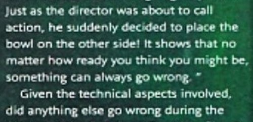
- **none** — entry/section: Freeborn on the wampa: ""The ice creature [wampa] was very hard to put together. We made two versions in the end. There's one with tusks that you see for a split second that we spent weeks working on!" —Stuart Freeborn, Star Wars Insider 102, p. 25" Source: *Star Wars Insider #102* (2008), scan p.25
  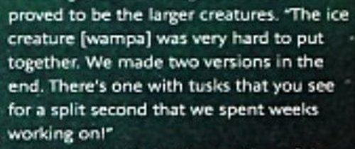
- **Yoda** — entry/section: Freeborn on Yoda's longevity: ""It's astonishing to see that there is an animated Yoda now, and I'm surprised and delighted to see that he's made it onto a stamp! Not bad, eh?" —Stuart Freeborn, Star Wars Insider 102, p. 25" Source: *Star Wars Insider #102* (2008), scan p.25
  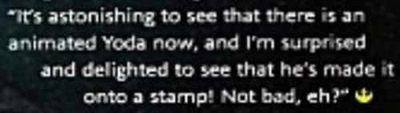

### Stat block notes (game mechanics, not feats)

- Expanded Universe box (Freeborn feature): EXPANDED UNIVERSE Creating the apes of Stanley Kubrick's 2001: A Space Odyssey required plenty of tests before make-up was perfected.'[sic] One of the actors who the Freeborns worked with was the British comedy actor Ronnie Corbett who was the model for some of the early tests, but did not appear in the completed film. (Jonathan Wilkins, Star Wars Insider 102, p. 25) (Source: *Star Wars Insider #102* (2008), scan p.25)
- Freeborn feature (pt 4): Jabba Meets Jedi!: JABBA MEETS JEDI! It was during the pre-production of Return of the Jedi that Freeborn faced his greatest challenge. Jabba the Hutt was to be the largest and most complex creature he had ever created, but Freeborn's original intention was for a slightly sharper featured character. "I envisaged him having a more pointed face, but when the latex was stretched across the framework it flattened his face!" Creating such a large character as Jabba also presented another problem. "We made the character's hand articulate so that he could pop a toad in his mouth. I made two throats, and one had water in it. So the hand was especially put together so Jabba could take the toad and put it down this throat. Well, the scene was rehearsed and it was all going very well. Just as the director was about to call action, he suddenly decided to place the bowl on the other side! It shows that no matter how ready you think you might be, something can always go wrong. " Given the technical aspects involved, did anything else go wrong during the filming of the first three Star Wars films? "I can't recall which one it was, but I did become rather poorly at one stage. I'd been using so much foam and chemicals that I collapsed and had to take a few days off. Luckily I had a very good team who carried on the work while I recovered." The diversity of the characters required certainly made the Star Wars films a challenge, but the toughest to realize proved to be the larger creatures. "The ice creature [wampa] was very hard to put together. We made two versions in the end. There's one with tusks that you see for a split second that we spent weeks working on!" Ultimately, it's for the creation of the ever popular Yoda that Freeborn will be best remembered, and while he has yet to get around to watching the prequels, he is delighted at the longevity of the character. "It's astonishing to see that there is an animated Yoda now, and I'm surprised and delighted to see that he's made it onto a stamp! Not bad, eh?" Special thanks to Tom Spina, Tim Lawes at Propstore and Stuart and Kathleen Freeborn for their time, effort and enthusiasm. (Jonathan Wilkins, Star Wars Insider 102, p. 25) (Source: *Star Wars Insider #102* (2008), scan p.25)

## scan p.26 (scan page 26)

Page contents: Versus: General Grievous vs. Master Yoda (pt 1): Versus logo; Grievous photo with lightsaber; Databank/Profile/Skills orange panel with stat bars; intro text box; folio 26 INSIDER (hand-read)

### Stat block notes (game mechanics, not feats)

- Versus: General Grievous databank/profile/skills: DATABANK General Grievous was a brilliant strategist unhindered by compassion or scruples. A twisted melding of flesh and metal, General Grievous' body was a deadly weapon. Inside the hardened carapace beat the heart of a remorseless killer. A pressurized gut-sack held his vital organs, while his skull-like mask contained his living eyes and brain. Grievous hunted Jedi for sport and kept his victims' lightsabers as trophies. His unorthodox mechanical enhancements gave him an edge in close-quarter combat. Each of his six-fingered arms could split in two, resulting in four limbs, each armed with a lightsaber. Grievous could spin these arms in a storm of deadly lacerating light that few could withstand. PROFILE HOMEWORLD: KALEE SPECIES: KALEESH GENDER: MALE HEIGHT: 2.16 METERS (at full height) WEAPONS: LIGHTSABERS, BLASTER PISTOL, ELECTROSTAFF VEHICLE: WHEEL BIKE, STARFIGHTER AFFILIATION: CIS SKILLS Ruthless and driven by a strong sense of his own need to survive, Grievous is vicious and unforgiving in combat, doing anything to win. His cyborg enhancements give him an edge, but his organics prove vulnerable. STRENGTH 90 SPEED 90 JEDI POWER 30 LEADERSHIP 60 MOBILITY 70 LOYALTY 40 SPECIAL ABILITY 60 BONUS SKILL 60 (Star Wars Insider 102, p. 26) (Source: *Star Wars Insider #102* (2008), scan p.26)
- Versus: General Grievous vs. Yoda intro: GENERAL GRIEVOUS It was the one face-off that Star Wars: Episode III Revenge of the Sith did not offer us. We've seen the mini-Jedi Master take on Count Dooku in Attack of the Clones, and then face the Emperor himself in Episode III. How would the mean, green fighting machine have fared up against the cyborg from Kalee? Both have significant advantages. Yoda is srgart [sic], skilful and mobile in combat. Grievous takes any advantage offered, using his cyborg enhancements to dominate his opponent. Could Yoda's diminutive stature allow him to confound Grievous in a similar fashion to how he tackled Count Dooku? (Star Wars Insider 102, p. 26) (Source: *Star Wars Insider #102* (2008), scan p.26)

## scan p.27 (scan page 27)

Page contents: Versus pt 2: Master Yoda with green lightsaber photo; Versus logo; green Databank/Profile/Skills panel; concluding text box; folio INSIDER 27 (hand-read)

### Stat block notes (game mechanics, not feats)

- Versus: Master Yoda databank/profile/skills: MASTER YODA DATABANK Yoda, an ancient and revered Jedi Master, lived his final years hiding on the swamp planet of Dagobah. However, at 900-years-old, Yoda had trained Jedi for eight centuries, and in his prime he was very powerful in the Force, and skilled with a lightsaber. Yoda had been a respected senior member of the Jedi Council and he was one of the few to survive the Sith resurgence. When Darth Sidious enacted Order 66, Yoda felt the sudden loss of life across the galaxy through the Force. Yoda leapt into action, escaping an attempt on his life on Kashyyyk and eventually faced Emperor Palpatine himself. For one so small, the venerable Jedi packed quite a punch when it counted. PROFILE HOMEWORLD: UNKNOWN SPECIES: UNKNOWN GENDER: MALE HEIGHT: 0.66 METERS WEAPONS: LIGHTSABER AFFILIATION: JEDI SKILLS A very intelligent strategist, Yoda could draw on the Force and his formidable skill with a lightsaber. Small he may have been, but this often led his enemies to underestimate him, and they suffered the consequences of such mistakes. STRENGTH 70 SPEED 80 JEDI POWER 95 LEADERSHIP 70 MOBILITY 60 LOYALTY 70 SPECIAL ABILITY 70 BONUS SKILL 70 (Star Wars Insider 102, p. 27) (Source: *Star Wars Insider #102* (2008), scan p.27)
- Versus: Grievous vs. Yoda intro (cont.): Might Grievous' whirling lightsabers prove too accurate for the Jedi Master to tackle? In intelligence, the pair are quite evenly matched, but Grievous has the cunning of one turned to evil, while Yoda fights only because he has to. Could this be a fatal weakness in the Jedi? Is he not motivated enough to win? Whichever way it goes down, this would be a colorful conflict to observe: the whirling green dervish facing off against the gleaming silver-limbed alien-droid. WHO TRIUMPHS? Turn to page 79 now for the answer! (Star Wars Insider 102, p. 27) (Source: *Star Wars Insider #102* (2008), scan p.27)

## scan p.28 (scan page 28)

Page contents: Full-page ad: Dark Horse Comics "VECTOR" crossover / Rebellion #15 (cover art: Jedi with yellow lightsaber and elderly Jedi Master); Dark Horse and Lucas Books logos (hand-read)

### Stat block notes (game mechanics, not feats)

- Vector / Rebellion ad: VECTOR A YEARLONG STAR WARS EVENT WITH REPERCUSSIONS FOR EVERY ERA! REBELLION #15 COMING JULY 2008 Beginning with Star Wars: Knights of the Old Republic #25, Vector will stretch over forty-one centuries of Star Wars history—from the time of the Knights of the Old Republic, through the unexplored Dark Times between Episode III and Episode IV, into the "Classic Era" of the Rebellion, and all the way to the "future" of Legacy. For a complete lineup of the Vector crossover visit darkhorse.com/starwars Available at your local comics shop. To find a comics shop in your area, call [phone number not transcribed]. © 2008 Lucasfilm Ltd. & ™. All rights reserved. Used under authorization. Text and illustrations for Rebellion are © 2008 Lucasfilm Ltd. Dark Horse Comics® and the Dark Horse logo are trademarks of Dark Horse Comics, Inc., registered in various categories and countries. All rights reserved. (Dark Horse Comics advertisement, Star Wars Insider 102, p. 28) (Source: *Star Wars Insider #102* (2008), scan p.28)

## scan p.29 (scan page 29)

Page contents: "Master & Apprentice" Nick Dudman interview opener: Bib Fortuna full-figure photo; Return of the Jedi 25 logo (top-left box); inset headshot of Nick Dudman; large title; deck; folio INSIDER 29 (hand-read)

### Stat block notes (game mechanics, not feats)

- Master & Apprentice deck: [Top-left box:] 25 RETURN of the JEDI MASTER & APPRENTICE MULTI AWARD-WINNING NICK DUDMAN'S CAREER IN MAKE-UP STARTED WHEN STUART FREEBORN HIRED HIM FOR THE EMPIRE STRIKES BACK. HIS BIGGEST CONTRIBUTION, THOUGH, WAS TO THE CREATURE-FEST THAT WAS RETURN OF THE JEDI, CELEBRATING ITS 25TH ANNIVERSARY THIS YEAR. WORDS: JONATHAN WILKINS (Jonathan Wilkins, Star Wars Insider 102, p. 29) (Source: *Star Wars Insider #102* (2008), scan p.29)

## scan p.30 (scan page 30)

Page contents: Dudman interview pt 1: B&W photo of Stuart Freeborn with Chewbacca mask; claw/feet prop photo; Yoda and bald alien head photos; pull quote; Q&A column; folio 30 INSIDER (hand-read)

- **none** — entry/section: Dudman on Star Wars: ""I went to see Star Wars when it came out and I just wanted to know everything about the guy who'd done that stuff and how he had done it." —Nick Dudman, Star Wars Insider 102, p. 30" Source: *Star Wars Insider #102* (2008), scan p.30
  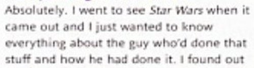
- **Chewbacca** — entry/section: Dudman on the cantina scene: ""Chewbacca was fantastic, but the cantina scene with all the creatures that Rick Baker had done in the background and Stuart's in the foreground was wonderful." —Nick Dudman, Star Wars Insider 102, p. 30" Source: *Star Wars Insider #102* (2008), scan p.30
  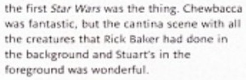

### Stat block notes (game mechanics, not feats)

- Dudman interview pt 1: [Pull quote:] "I WENT TO SEE STAR WARS WHEN IT CAME OUT AND I JUST WANTED TO KNOW EVERYTHING ABOUT THE GUY WHO'D DONE THAT." What got you interested in make-up? Originally I did make-up for school plays. I was always curious watching movies with characters that weren't human or only half-human. Characters like the Wolfman or Frankenstein's monster made me curious as to how it was done. I taught myself those basic amateur tricks, and photographed them. That was before I went to college. I did make-up and effects-type stuff on a very basic level at college. When I graduated, I was lucky enough to meet up with Stuart Freeborn, who hired me. I fell into it. I thought it was [sic] hobby. I never thought about it as a career until I met Stuart. Were you a big fan of his work? Absolutely. I went to see Star Wars when it came out and I just wanted to know everything about the guy who'd done that stuff and how he had done it. I found out about other movies he'd made in the past, like 2001. I must admit, until I met him it never really dawned on me for some inexplicable reason that anyone really did this as a career. He galvanized me in many ways. I think that the cantina scene from the first Star Wars was the thing. Chewbacca was fantastic, but the cantina scene with all the creatures that Rick Baker had done in the background and Stuart's in the foreground was wonderful. (Jonathan Wilkins, Star Wars Insider 102, p. 30) (Source: *Star Wars Insider #102* (2008), scan p.30)

## scan p.31 (scan page 31)

Page contents: Dudman interview pt 2: wampa head photo; B&W photo of Freeborn at work on a Chewbacca head; Gamorrean-type green mask photo; pull quote; Q&A columns; vertical ghosted "Master and Apprentice" graphic (hand-read)

- **Yoda** — entry/section: Dudman on the Yoda puppet race: ""Stuart's Yoda was literally down to the wire with myself, Stuart, Bob, and the team being up all night, frantically trying to get it together." —Nick Dudman, Star Wars Insider 102, p. 31" Source: *Star Wars Insider #102* (2008), scan p.31
  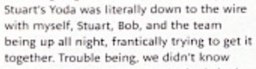
- **Yoda** — entry/section: Dudman on Yoda rushes: ""I do remember that feeling of, 'It's a character and it works.'" —Nick Dudman, Star Wars Insider 102, p. 31" Source: *Star Wars Insider #102* (2008), scan p.31
  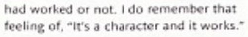

### Stat block notes (game mechanics, not feats)

- Dudman interview pt 2: You served your apprenticeship on The Empire Strikes Back. Was it daunting to work on such a big movie? It was terrifying. I had an invitation from Stuart to go up to Elstree where they were shooting The Empire Strikes Back. I went along with my photos, the stuff I'd got from school and college. I was shown into his office where he was working on Yoda. I looked at all this stuff: I mean, I couldn't fathom how on Earth he'd done it. I was very lucky, as he offered me a job on the spot, and asked if I'd be able to start the next day. It was terrifying. I was very fortunate because it was a small team. Nick Maley and Bob Keen and the rest of the team were lovely, very easy to work with. Stuart really wanted me to assist him in finishing the Yoda puppet, so I built early control systems for the Yoda puppet with him, with no real idea what I was doing. I was doing what I was told, but it was a wonderful learning curve just sitting there watching this guy work. Was there a sense of pressure, because Yoda was such a big character in the movie? I think initially there wasn't, but certainly I very much became aware of the pressure to get it right. We had a back-up Yoda that Nick Maley had put together that didn't have the subtleties of Stuart's, and that was at least going to be ready in an emergency. Stuart's Yoda was literally down to the wire with myself, Stuart, Bob, and the team being up all night, frantically trying to get it together. Trouble being, we didn't know what we were doing because nobody had ever done it before quite that way. It was a real race against time, and quite scary when we first took our finished work to the set. So was Yoda your favorite character to work on? I think Yoda was the one I felt was magical, because it was the first time I went to rushes, and saw the dailies of something that I'd helped to do, however minimally, actually functioning on film. It's something, of course, that nowadays is rare because with digital you don't go to rushes and see this wonderful thing suddenly there. Back then, you shot the stuff and you went the next day and you sat in the theatre and you watched it. You knew instantly whether it had worked or not. I do remember that feeling of, "It's a character and it works." Was there anything you worked on for the movies that didn't quite work? On Empire I do remember helping construct the wampa. That was always a nightmare because it was made with sheepskins and weighed a ton. I do remember problems with that because they'd already shot it in [Pull quote:] "STUART FREEBORN OFFERED ME A JOB ON THE SPOT, AND ASKED IF I'D BE ABLE TO START THE NEXT DAY!" (Jonathan Wilkins, Star Wars Insider 102, p. 31) (Source: *Star Wars Insider #102* (2008), scan p.31)

## scan p.32 (scan page 32)

Page contents: Dudman interview pt 3: montage of Return of the Jedi creature masks/puppets (Gamorrean guard, Bib Fortuna, Jawa-like, Ewok and Jabba's palace aliens); vertical "Master and Apprentice" graphic; pull quote; Q&A column; folio 32 INSIDER (hand-read)

- **Jabba the Hutt** — entry/section: Dudman on Jabba: ""Certainly with Jabba the Hutt, we were pushing an envelope." —Nick Dudman, Star Wars Insider 102, p. 32" Source: *Star Wars Insider #102* (2008), scan p.32
  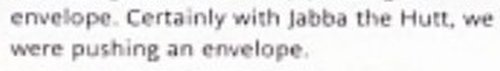

### Stat block notes (game mechanics, not feats)

- Dudman interview pt 3: Norway before I came on the picture. Then there were first pick-up shots being done at Elstree, so they were putting the shoot back together. I remember that being an absolute pain. You came back to work on creatures for Return of the Jedi, including Jabba. Jabba the Hutt worked well on-set and was much appreciated by the fans. The first prosthetic make-up I ever did was Bib Fortuna and that worked. I applied the Emperor's make-up and that was okay. I can look at those things now, with the benefit of hindsight and 25 years of advances in materials and processes, and think they're actually very basic and in some cases, quite primitive. But for the time, a lot of what was being done was really pushing an envelope. Certainly with Jabba the Hutt, we were pushing an envelope. Nowadays would you approach it that way? Actually, no you wouldn't, you'd just do it digitally. If you were to try and build something practical you would approach it very differently now with the benefit of everything we have learned since. Are characters who have got dialogue, like Yoda, harder to realize in comparison with, say, a monster? Anything that is approaching the human norm — the closer it is the much harder it gets. If something's a great big monster you [Pull quote:] "I BUILT EARLY CONTROL SYSTEMS FOR THE YODA PUPPET, WITH NO REAL IDEA WHAT I WAS DOING." (Jonathan Wilkins, Star Wars Insider 102, p. 32) (Source: *Star Wars Insider #102* (2008), scan p.32)

## scan p.33 (scan page 33)

Page contents: Dudman interview end: Jabba's palace throne-room miniature/diorama photo (Jabba and court); wampa head photo; pull quote; Q&A columns; folio INSIDER 33 (hand-read)

- **none** — entry/section: Dudman on lip-synch: ""You can't claim, 'Oh, I'm sorry, this alien doesn't lip-synch because on his planet they don't.' Nobody's going to buy that, and so it does become much harder." —Nick Dudman, Star Wars Insider 102, p. 33" Source: *Star Wars Insider #102* (2008), scan p.33
  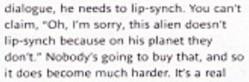
- **none** — entry/section: Dudman on George Lucas: ""Having somebody like George in charge is great because it's one person. There's no committee, no people in suits having arguments over what you can or can't do or what something should look like." —Nick Dudman, Star Wars Insider 102, p. 33" Source: *Star Wars Insider #102* (2008), scan p.33
  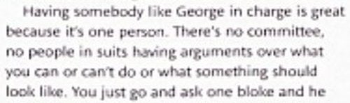

### Stat block notes (game mechanics, not feats)

- Dudman interview pt 4 (end): can make up your own rules; the minute you get near a humanoid character, you're forced into behaving and following the rules that people expect. If a character has dialogue, he needs to lip-synch. You can't claim, "Oh, I'm sorry, this alien doesn't lip-synch because on his planet they don't." Nobody's going to buy that, and so it does become much harder. It's a real challenge to identify what works and what doesn't. In the past, lip-synching was the responsibility of the puppeteer. That works very well to a degree. If it's something you can't get a puppeteer inside of, and it's mechanical, in the past you'd have millions of people pulling cables or running the camera at different speeds, like they did with Little Shop of Horrors. Nowadays, if you were going to do a practical creature that behaved like that, you would use a computer to run a voice program. We've done a lot of stuff where you take dialogue files and you put them in the computer and you can actually program the puppet to lip-synch to that file. That works fantastically because it will always do the dialogue perfectly. We never had anything like that in the past, it was people pulling on bits of string! When you went back on the Star Wars set to work on The Phantom Menace was it noticeable how things had changed? Oh yes, it was 15 years or more later, wasn't it? Yes, the way in which the movie was being made was completely different. It was great fun to do because we got to do loads of alien heads which were ones that I'd known, so there was a great nostalgic feeling. That was great fun. Going to the Ranch and trawling through the Archives, that was great. Having somebody like George in charge is great because it's one person. There's no committee, no people in suits having arguments over what you can or can't do or what something should look like. You just go and ask one bloke and he gives you a straightforward answer. You know where you are, and that's great. Obviously things had changed a lot on The Phantom Menace. If you just read the script you'd go, "How are we going to do that?" You knew perfectly well it was all going to be CG, because that film, especially, was a showcase for technology they were developing. That was interesting, because I was able once again to talk to the ILM people, like Jeff Olson and John Knoll, and actually get a pretty good insight as to where the technology actually was going. So it was a very interesting movie to work on and certainly set people like me up for knowing how to work on that kind of film because of the whole way of shooting it, with blue sets everywhere and people jumping over blue boxes... You never quite knew where you were. It was very different. [Pull quote:] "THE FIRST PROSTHETIC MAKE-UP I EVER DID WAS BIB FORTUNA." (Jonathan Wilkins, Star Wars Insider 102, p. 33) (Source: *Star Wars Insider #102* (2008), scan p.33)

## scan p.34 (scan page 34)

Page contents: "Science of Star Wars: The Search for Alien Life" (byline on p.35: David Hawksett): title over planets; Kaminoan figures photo (right); main text in two columns; folio 34 INSIDER (hand-read)

### Stat block notes (game mechanics, not feats)

- Science of Star Wars: The Search for Alien Life: SCIENCE OF [STAR WARS] THE SEARCH FOR ALIEN LIFE STAR WARS IS FULL OF ALIENS—SO WHERE ARE THEY? From the harsh environment of Hoth to the lush ecosystem of Naboo, the worlds of Star Wars with their diverse wildlife have been some of the greatest stars of the movies. Alien life forms have been a staple of science fiction since the days of H. G. Wells, but is science any closer to finding any life out there in the real universe? Around 1900 the newspaper mogul William Randolph Hearst allegedly asked an astronomer to telegram him 1,000 words on whether or not there was life on Mars. The astronomer reportedly replied "nobody knows," written 500 times. Things have indeed moved on and, now that we have seen Mars up close, and directly sampled its surface, the jury on Martians is actually still out. What we do know is that when life started arising on the young Earth, more than 3.5 billion years ago, Mars and Earth had very similar environments. We do not know whether or not life got started on Mars but, if it did, there is a slim chance that it is still around in the form of hardy microbes, sheltering underground from the harsh conditions on the Martian surface. If evidence of past or current life on Mars is ever found, the implications will be staggering. It will mean that, in our 'average' solar system, life started not once, but twice. Some astronomers would view this as evidence that life essentially springs forth everywhere it possibly can. The other view, that the origins of life require so many chance events that life itself is rare, remains equally valid. Life as we know it requires planets to live on and, since the mid-1990s astronomers for the first time have been finding planets orbiting other stars. It is starting to look like planetary systems are common in the universe — something we were not sure about just 20 years ago. If this is the case, then the sheer number of stars out there gives us plenty of rolls of the dice to give chances of life starting in the universe. In our galaxy alone there are more than 200 thousand million stars, and there could be as many as 500 thousand million galaxies! Even if life only starts one [sic] in a million times, we would have a universe teeming with life. But would any of it look like a bantha, a tauntaun or rancor? The answer lies with evolution on Earth: for most of life's existence here, it was in the form of humble microbes. It was only around 580 million years ago that a rapid diversification occurred, leading to an explosion in the complexity of life, resulting in the millions of complex species on Earth today. If life on other worlds has managed to move past its microbial stage, then the enormous number of potential habitats out there means that virtually any kind of creature has probably happened somewhere. So could mynocks, dewbacks, acklays, and varactyls be out there? Almost certainly. (David Hawksett, Star Wars Insider 102, p. 34) [Note: "SCIENCE OF" title continues off the spread; some words printed over a light background were verified at high zoom.] (Source: *Star Wars Insider #102* (2008), scan p.34)

## scan p.35 (scan page 35)

Page contents: Science of Star Wars (cont.): strapline + byline; giant "STAR WARS" title (completes "SCIENCE OF STAR WARS"); Da Vinci robot photo; missile launch photo; EPOC headset photo; five news boxes; folio INSIDER 35 (hand-read)

### Stat block notes (game mechanics, not feats)

- Science of Star Wars strapline and robot surgeon box: WHERE REAL WORLD SCIENCE AND TECHNOLOGY MEETS STAR WARS FANTASY WORDS: DAVID HAWKSETT STAR WARS A REAL ROBOT SURGEON... ...BUT HE'S NO 2-1B, THAT'S FOR SURE! The Da Vinci robot surgeon chalked up another successful operation in February 2008 when it was used to remove a prostate gland at a Canadian hospital. The growing use of the robot in operations means that a surgeon's hands need to actually enter a patient less and less, so surgery as a whole is gradually becoming less invasive and traumatic to the body. Those already scared of going to the hospital need not worry even more — the Da Vinci system still requires a real surgeon to operate it! (David Hawksett, Star Wars Insider 102, p. 35) (Source: *Star Wars Insider #102* (2008), scan p.35)
- Cloaking Devices Come One Step Closer box: CLOAKING DEVICES COME ONE STEP CLOSER In February 2008 U.S. scientists revealed their new paper-thin material that acts as the darkest man-made substance ever created. Absorbing some 99.955 per cent of all light that hits it, it is described as 'blacker than black' and is made from microscopic carbon nanotubes. This super absorber could one day be used for applications such as solar energy conversion but, if a satellite or other spacecraft were coated with this stuff, it would effectively be invisible. (David Hawksett, Star Wars Insider 102, p. 35) (Source: *Star Wars Insider #102* (2008), scan p.35)
- It's Hardly Star Wars, But It's a Start box: IT'S HARDLY STAR WARS, BUT IT'S A START It could hardly be called a space battle, but the U.S. controversially flexed its military muscles in space recently when, on 20 February 2008, it took out one of its own satellites in orbit around the Earth. A single SM-3 tactical missile from the USS Lake Erie was fired at the spy satellite USA-193 and successfully intercepted the satellite, which was travelling at 17,000 mph. The destruction of the satellite was criticised by some as an excuse to test ballistic missile defense systems. The official reason was that the out-of-control satellite was in danger of landing partially intact and contaminating anyone nearby with hydrazine fuel. (David Hawksett, Star Wars Insider 102, p. 35) (Source: *Star Wars Insider #102* (2008), scan p.35)
- I'm a Computer: Mind Tricks Don't Work on Me box: I'M A COMPUTER: MIND TRICKS DON'T WORK ON ME Without being as glamourous as using the Force, a big step towards mind control was announced in January 2008. The EPOC neuroheadset by Emotiv Systems is on its way! Due to go on sale later in 2008, the headset can detect human emotions such as anger and excitement, as well as facial expressions. By reading the brain's electrical signals, the new gadget should allow game developers to create ways of using thoughts alone to control the next generation of video games. (David Hawksett, Star Wars Insider 102, p. 35) (Source: *Star Wars Insider #102* (2008), scan p.35)
- Controlling the Weather box: CONTROLLING THE WEATHER The presence of all those lifeforms and all that technology on the capital planet of Coruscant means its climate has to be controlled to keep it hospitable to life. On Coruscant giant orbital mirrors can regulate the amount of heat and light the planet gets. On Earth, much more modest techniques, such as cloud seeding, can be used to influence local weather. In January 2008 Chinese officials said they would use this method to ensure clear weather in Beijing for the Olympics by seeding the clouds and encouraging them to drop their rain before reaching the city. (David Hawksett, Star Wars Insider 102, p. 35) (Source: *Star Wars Insider #102* (2008), scan p.35)

## scan p.36 (scan page 36)

Page contents: "First Person: Fan's Star Wars Stories" logo (top-left box); opener photo of Ponda Baba and Dr. Evazan cantina masks; giant "MONSTE[RS]" title (continues on p.37); deck and byline; folio 36 INSIDER (hand-read)

### Stat block notes (game mechanics, not feats)

- First Person: cantina monsters deck: [Top-left box:] FIRST PERSON FAN'S STAR WARS STORIES ONE YOUNG FAN'S FASCINATION WITH THE STAR WARS CANTINA—AND THE CREATURES WITHIN—LED TO A LIFETIME OBSESSION AND A CAREER.... Words: Tom Spina (Tom Spina, Star Wars Insider 102, p. 36) (Source: *Star Wars Insider #102* (2008), scan p.36)

## scan p.37 (scan page 37)

Page contents: First Person (cont.): Bith-like cantina mask photo (left); "[MONSTE]R MASH" title completion; photo of Tom Spina with a yellow cantina-alien head; caption; pink pull quote; body text in two columns; folio INSIDER 37 (hand-read)

- **Luke Skywalker; Darth Vader (Anakin Skywalker)** — entry/section: Spina on wanting to be Freeborn: ""My friends all wanted to be Luke Skywalker or Darth Vader. Not me. I wanted to be Stuart Freeborn or Rick Baker!" —Tom Spina, Star Wars Insider 102, p. 37" Source: *Star Wars Insider #102* (2008), scan p.37
  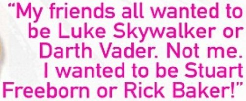

### Stat block notes (game mechanics, not feats)

- First Person: Monster Mash pt 1: I like monsters. Movies about aliens, werewolves, and all manner of creatures.... I like them all. One of the few things I like more than watching monsters is making them. Star Wars, and the  cantina scene in particular, has had a lot to do with that. I believe I was the perfect age when I first saw Star Wars on the big screen. The film had a tremendous impact on my five-year-old brain, and inspired many hours of creativity and play; hours filled with a mix of Kenner toys, Play Doh and the creation of masks, puppets, and props. Yet, as young as I was, I never got completely taken by the fantasy of the film. Sure, I could wield a broomstick like a lightsaber as well as the next kid, but when I left the theater after seeing Star Wars, my friends all walked around wanting to be Luke Skywalker or Darth Vader. Not me. I wanted to be Stuart Freeborn or Rick Baker! MONSTER PASSION Of course, I had no idea who these people were at the time. While the story of the film inspired my friends, it was the making of the film that inspired me. Young as I was, I knew someone had made all those cantina monsters. What's more, I knew that was just the sort of thing I wanted to do. At five years old, I didn't yet have access to professional materials, so my creations were usually crafted from paper shopping bags, markers, my father's stapler and masking tape. Years later, I worked my way up to clay and plaster. I learned how to create latex masks from books by Tom Savini and Dick Smith. Some of the first pieces I did were cantina aliens, as that scene remained a huge inspiration to me. Today, I operate my own business (www.TomSpinaDesigns.com) offering custom sculptures for clients of all kinds. I also pour energy into designing unique displays for movie prop and wardrobe collectors and restoring original movie masks and puppets. At any given time, I might be creating trade show pieces for companies, crafting a display for the original Snaggletooth costume, restoring an original Ugnaught from The Empire Strikes Back, or working with [name omitted] to fabricate something special to help a collector create their dream home theater. This is what I do now, and I love every minute of it. My passion for monsters and behind-the-scenes tidbits about the cantina has driven me to collect toys, props and masks, but more importantly, it's led me around the country and across the Atlantic to meet other fans and collectors, talk with Star Wars crewmembers, and has sparked some amazing friendships. Several of those friends invited my wife [name omitted] and I to England to visit Stuart and Kay Freeborn. We met at the Freeborns' home and went to a small curry house down the road. For hours, we ate while discussing their 50 years in the movie make-up field. [Name omitted], whose interest is cosmetology, got on great with Kay. Stuart entertained us with all manner of stories, [Caption:] Tom Spina and friend: Inspired by Stuart Freeborn's Star Wars creature designs, young Tom knew what he wanted to do for a living! [Pull quote:] "My friends all wanted to be Luke Skywalker or Darth Vader. Not me. I wanted to be Stuart Freeborn or Rick Baker!" (Tom Spina, Star Wars Insider 102, p. 37) (Source: *Star Wars Insider #102* (2008), scan p.37)

## scan p.38 (scan page 38)

Page contents: First Person (end): "Monster Mash" header; photo of Stuart Freeborn holding an Ewok head with caption; inset photos of cantina creature heads and Doug Beswick with Bith band heads; photo of Tom Spina with Stuart Freeborn (caption); pink pull quote; body text; folio 38 INSIDER (hand-read)

- **none** — entry/section: Freeborn to Spina: ""If they call me to do another Star Wars, I'm sending them to you!" —Stuart Freeborn (as recalled by Tom Spina), Star Wars Insider 102, p. 38" Source: *Star Wars Insider #102* (2008), scan p.38
  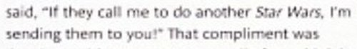
- **none** — entry/section: Doug Beswick on the cantina monsters: ""Everybody pretty much did their own characters. That was the fun of it. It's something you don't get to do much nowadays; everything is more department oriented." —Doug Beswick, Star Wars Insider 102, p. 38" Source: *Star Wars Insider #102* (2008), scan p.38
  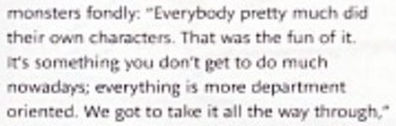
- **none** — entry/section: Bob Burns on the cantina masks: ""When I saw my heads in there, I thought, 'Oh man, this is so cool!'" —Bob Burns, Star Wars Insider 102, p. 38" Source: *Star Wars Insider #102* (2008), scan p.38
  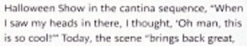
- **none** — entry/section: Doug Beswick on the Fox fanfare: ""Even the 20th Century Fox logo and fanfare says Star Wars to me. The first thing that comes to mind when that comes up is Star Wars. For some reason, no other movie registers." —Doug Beswick, Star Wars Insider 102, p. 38" Source: *Star Wars Insider #102* (2008), scan p.38
  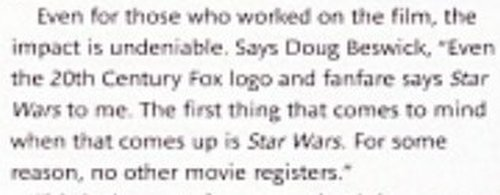

### Stat block notes (game mechanics, not feats)

- First Person: Monster Mash pt 2 (end): MONSTER MASH discussing the man-apes from 2001: A Space Odyssey, his start in the business, and even one story about doing a special "body make-up" for Jayne Mansfield, which led Kay to roll her eyes and say, "Oh, it's difficult being Stuart Freeborn!" At one point in the evening, the Freeborns took a look at some photos of my work, and upon seeing my cantina masks, Stuart looked up and said, "If they call me to do another Star Wars, I'm sending them to you!" That compliment was deeply touching to me! It was well after midnight when we departed, and the then-90-year-old Stuart was still going strong. MONSTER MAKERS As many fans know, the cantina sequence was filmed in two parts: the original shoot in the U.K. with the Freeborn crew's creatures, and a smaller U.S. shoot featuring monsters by a team headed by Rick Baker. Doug Beswick was on that team, and is best remembered for not only playing a cantina band member in the film, but creating the band as well. His elegant alien sculptures would capture the imagination of millions. Think of the cantina, and you see the band in your mind's eye (and hear John Williams' alien jazz in your mind's ear!). I've had the good fortune of getting to know Doug and discussing his work on films such as Star Wars, The Empire Strikes Back, Aliens, An American Werewolf in London, and The Terminator. Doug remembers working on the cantina monsters fondly: "Everybody pretty much did their own characters. That was the fun of it. It's something you don't get to do much nowadays; everything is more department oriented. We got to take it all the way through," he added. "Maybe that's what's so nice about the original? It wasn't that complicated." He continues to create special effects for film and television today. Another person I've gotten to know quite well is enthusiastic prop collector and historian Bob Burns. Bob's an old friend of Rick Baker and many of the special effects guys who worked on Star Wars. "He [Baker] mentioned some 'cantina', but not having seen the film, I didn't even know what the cantina was!" Bob recalled how Baker used several masks originally created for Burns' 1974 Halloween Show in the cantina sequence, "When I saw my heads in there, I thought, 'Oh man, this is so cool!'" Today, the scene "brings back great, great memories for me." Even for those who worked on the film, the impact is undeniable. Says Doug Beswick, "Even the 20th Century Fox logo and fanfare says Star Wars to me. The first thing that comes to mind when that comes up is Star Wars. For some reason, no other movie registers." This is the sort of memory that brings so many people together. At Celebration III and IV, I was a part of the Original Props and Wardrobe collector panels with my good friends [names omitted]. In the audience were hundreds of other fans like us who shared this passion for Star Wars, monsters, and film props. For me, meeting those collectors was, by far, the highlight of those conventions. Over the years, these film creatures have given me the opportunity to bring my work and hobbies together in a way that makes life really special. They've helped me find kindred spirits all over the world, who I might never have known otherwise. They've even allowed me to "talk shop" with the artists who inspired me to become a sculptor. You know what? I don't just like monsters, I love 'em! [Captions:] Monster Maker: Stuart Freeborn and an Ewok Inset Images: Cantina creature heads, and Doug Beswick with the band! Meeting the Master! Tom Spina meets his make-up idol, Stuart Freeborn [Pull quote:] "My passion for monsters has led me to meet other fans and collectors, talk with Star Wars crewmembers, and sparked some amazing friendships." (Tom Spina, Star Wars Insider 102, p. 38) (Source: *Star Wars Insider #102* (2008), scan p.38)

## scan p.39 (scan page 39)

Page contents: Full-page ad: Kotobukiya Star Wars ARTFX Bounty Hunter Series statues (IG-88 large; Darth Vader, Zuckuss, Boba Fett, Bossk, 4-LOM); "Direct from Japan" top-right box; Bounty Hunter Series seal; Kotobukiya ARTFX Statues footer strip with stormtroopers/clone troopers (hand-read)

### Stat block notes (game mechanics, not feats)

- Kotobukiya ARTFX Bounty Hunter ad: STAR WARS [Top-right box:] Direct from Japan Collect all six Bounty Hunters and assemble Darth Vader! [Seal:] Bounty Hunter Series ZUCKUSS. COMING SOON! BOBA FETT. AVAILABLE NOW! BOSSK. COMING SOON! 4-LOM. COMING SOON! BOUNTY HUNTER SERIES IG-88™ ARTFX STATUE APPROXIMATELY 11" TALL AVAILABLE IN STORES NOW!* KOTOBUKIYA www.KotoStarWars.com ARTFX Each stands approximately 12 inches tall, and requires limited assembly. Each sold separately. Prototypes shown; final products may vary. © 2008 Lucasfilm Ltd. & TM. All rights reserved. Used under authorization. STAR WARS KOTOBUKIYA ARTFX STATUES (Kotobukiya advertisement, Star Wars Insider 102, p. 39) (Source: *Star Wars Insider #102* (2008), scan p.39)

## scan p.40 (scan page 40)

Page contents: "Top Ten: The Toughest Ever Creatures" opener by Dan Wallace: Top Ten logo (top-left box); red claw-slash graphic; deck; title; folio 40 INSIDER (hand-read)

### Stat block notes (game mechanics, not feats)

- The Toughest Ever Creatures deck: [Top-left box:] TOP TEN FORGET THE BEST CREATURES IN THE STAR WARS UNIVERSE. WHAT ARE THE TOUGHEST? IN OUR ENTIRELY UNSCIENTIFIC RANKINGS, LEARN WHICH BEASTS DESERVE THE GALACTIC HEAVYWEIGHT BELT AND WHICH SHOULD STAY HOME. WORDS: DAN WALLACE THE TOUGHEST EVER CREATURES (Dan Wallace, Star Wars Insider 102, p. 40) (Source: *Star Wars Insider #102* (2008), scan p.40)

## scan p.41 (scan page 41)

Page contents: Full-page close-up photo of a wampa's snarling face (Toughest Ever Creatures spread, left page); no text except folio INSIDER 41 (hand-read)

## scan p.42 (scan page 42)

Page contents: Top Ten entries #10 Tauntauns and #9 Aiwhas; Top Ten logo (top-left box); photos of Luke on tauntaun, aiwha, and creature photos at bottom right (continued on next spread); folio (hand-read)

### Stat block notes (game mechanics, not feats)

- #10 Tauntauns: [Top-left box:] TOP TEN 10 TAUNTAUNS A tauntaun wouldn't hurt a fly — though they do tend to spit when ornery — and for this reason tauntauns rank the lowest on our creature list. That doesn't mean they aren't winners. Loyal and tireless, they act as the cowboys' horses in The Empire Strikes Back to carry Luke and Han across the ice plains of Hoth. Too bad, then, that all those we meet wind up dead. Luke's tauntaun has its throat opened by a  Han's perishes of exposure (guess that Rebel who said "Your tauntaun will freeze before you reach the first marker" knew what he was talking about!), and if you look close you'll spot a lifeless tauntaun being examined by a Too-Onebee medical droid on the floor of Echo Base. This mystery corpse is a holdover from a deleted sequence showing a wampa attack on the Rebel stronghold. Tauntauns logically numbered among the victims, since they are the wampas' primary prey. Nighttime temperatures are also capable of killing tauntauns despite a type of antifreeze found in the animals' blood. When Han's tauntaun dropped dead, the smart smuggler chose to fillet the beast and use its body temperature to slow Luke's case of near-terminal frostbite. By the way, Han's complaint about tauntaun stink is a biological fact. Tauntauns excrete their waste in an oily goo released through their skin pores, making them smell like open sewers. (Dan Wallace, Star Wars Insider 102, p. 42) (Source: *Star Wars Insider #102* (2008), scan p.42)
- #9 Aiwhas: AIWHAS 9 The name says it all — "aiwha" is a contraction of "air whale," and the beast is clearly a cetacean with wings. The idea behind this mash-up dates back to the making of The Empire Strikes Back, when artists sketched flying whales as conceptual mounts for Cloud City background characters. For a time it seemed like the aiwha might appear in 1999's The Phantom Menace, until the proposed Gungan air force was scratched from the movie's climactic battle. Attack of the Clones finally made room for the beasts. A short snippet shows an aiwha, with a Kaminoan rider in the saddle, breaking the surface of a churning ocean under a storm-gray sky. What sort of biology would allow such a huge creature to become airborne? The in-universe explanation is that the aiwha possesses absorbent body tissues, allowing it to soak in seawater and shed its water weight as soon as it launches into the sky. The aiwha's mouth contains rows of baleen (a kind of 'teeth' composed of keratin, the same substance as hair) to filter microscopic organisms from Kamino's salty brine. Teryl Whitlach, author and illustrator of The Wildlife of Star Wars, used the Phantom Menace concept drawings to introduce the aiwhas in her book as a species native to Naboo. Whether the aiwhas of Attack of the Clones are from the same breeding stock is open to debate, though the Kaminoans can achieve almost anything through cloning. (Dan Wallace, Star Wars Insider 102, p. 42) (Source: *Star Wars Insider #102* (2008), scan p.42)

## scan p.43 (scan page 43)

Page contents: Top Ten entries #8 Space Slug, #7 Banthas, #6 Acklay, Reek, and Nexu; running head "The Toughest Ever CREATURES" (top-right); photos of space slug, bantha with Tusken rider, acklay and nexu; folio INSIDER 43 (hand-read)

### Stat block notes (game mechanics, not feats)

- #8 Space Slug: 8 SPACE SLUG Hands down, the space slug is the biggest and strongest creature on this list. So why didn't it rank higher? Because it can barely move. Han, Leia, and Chewie park in its mouth, walk in its throat, and shoot its tongue, and still get away scot-free. The slug's sluggishness shouldn't come as a surprise in light of its bulk and its home in cold vacuum. Space slugs are beings based on stony silicon instead of organic carbon, and reproduce by splitting themselves in two. They prefer to dwell in asteroid fields, pushing themselves off from one rock and drifting through zero-G to reach the next. By burrowing into asteroids, space slugs can leech nutrients from the surrounding ore. The beasts also eat bat-like mynocks (which survive as parasites inside larger slug specimens) and are known to attack passing starships. The comic Knights of the Old Republic — set 4,000 years before the Star Wars movies — recently revealed the secret history of space slugs and also dubbed them "exogorths." Ambitious weapons merchants during the Knights era decided that animals capable of biting through durasteel and dividing by fission were essentially weapons of mass destruction. After genetically tweaking exogorths to increase their growth rate, they fitted the worms with hyperdrive engines and shipped them to galactic power players as potential shipyard-wreckers. The space slug used during Empire filming wasn't nearly so threatening. The moment when it rises from its hole to snap at the fleeing Millennium Falcon was achieved with the humblest visual effect: hand puppetry. (Dan Wallace, Star Wars Insider 102, p. 43) (Source: *Star Wars Insider #102* (2008), scan p.43)
- #7 Banthas: 7 BANTHAS Banthas aren't much tougher than tauntauns, but judge your enemies by the company they keep. Because banthas and Tusken Raiders almost always travel together (in single file, of course, to hide their numbers), you definitely want to steer clear unless you want to find yourself on the wrong end of a Sand Person's gaffi stick. Wooly herd animals, banthas are found all over the galaxy but most commonly on Tatooine. There, they roam the desert wastes in herds (you can spot a herd in the new footage added to the Special Edition of Return of the Jedi). Both males and females sport curling, segmented horns, and the long tongues of banthas are used to probe for groundwater or edible tubers beneath the sand. In the realm of in-universe pop culture, banthas have left a big footprint. A bedtime story, "The Little Lost Bantha Cub," is referenced in the Jedi Academy novels, and a stuffed bantha toy is carried by Chewbacca's son Lumpy in the infamous Star Wars Holiday Special. According to old roleplaying sourcebooks, the Dim-U cult on Tatooine reveres the bantha as an object of religious worship. During the filming of Star Wars: A New Hope the bantha was portrayed by Mardji, a trained elephant from a California animal park. The filmmakers had only enough money to dress up a single elephant; the scene where Luke spots two banthas through his macrobinoculars was a trick of optical compositing. (Dan Wallace, Star Wars Insider 102, p. 43) (Source: *Star Wars Insider #102* (2008), scan p.43)
- #6 Acklay, Reek, and Nexu: 6 ACKLAY, REEK, AND NEXU We couldn't decide how to evaluate these Attack of the Clones monsters on their own, so we lumped them all into a single entry. Their debut in the Geonosis arena linked the three in the minds of fans, and they exhibit a certain rock-paper-scissors balance of strengths and weaknesses: the reek can crush the nexu, the nexu can gut the acklay, and the acklay can spear the reek. The acklay is arguably the most memorable, sporting all the most unpleasant qualities of a lobster, a scorpion, and a crocodile. Native to the planet Vendaxa, the acklay has spawned variant species across the galaxy including water-breathing mutants in Geonosis' shallow seas. A scene in which Obi-Wan threatens the monster with a spear is an intentional tribute to a similar exchange with a giant crab in Ray Harryhausen's Mysterious Island. The reek is a big Star Wars bull, right down to the ring in its nose and the way it paws the earth before charging. Found on Ylesia, the Codian Moon, and elsewhere, the reek possesses a brown leathery hide that turns red when the animal is fed a meat-heavy diet. Although Anakin calmed the arena reek and even used it as a ride, the beast proved no match for a single shot from Jango Fett's blaster pistol. Vicious but fragile, the nexu is a tiger-like jungle predator with a face only its mother could love. Found mostly in the dense forests of Cholganna, nexus are often the target of big-game hunters who kill them for sport or capture them for sale on the galactic black market as watch-beasts. The nexu in Attack of the Clones gave evidence of the species' delicate bone structure when it injured itself after falling from a pillar and fell down dead when broadsided by the reek. (Dan Wallace, Star Wars Insider 102, p. 43) (Source: *Star Wars Insider #102* (2008), scan p.43)

## scan p.44 (scan page 44)

Page contents: Top Ten entries #5 Dianogas and #4 Wampas; Top Ten logo (top-left box); photo of Luke and Han in stormtrooper armour in the trash compactor; dianoga eye photo; wampa photo (lower left); large creature (continued from right edge); folio 44 INSIDER (hand-read)

### Stat block notes (game mechanics, not feats)

- #5 Dianogas: [Top-left box:] TOP TEN 5 DIANOGAS The dianoga ranks high on the toughness scale, and not just because it very nearly prevented the return of the Jedi by proving that Luke Skywalker can't breathe underwater. Cribbed from nightmares, its hideous appearance includes a rubbery, squishy body, squeezy octopus-tentacles, and a baleful eye that pops above the water like the periscope of a German U-boat. Seen only in partial view during Star Wars: A New Hope, the dianoga's true appearance remained a mystery at first. An early Kenner toy molded it in green plastic with a fat torso and two stubby "wings." Later artwork canonized the creature as a gelatinous cephalopod with a central, tooth-lined mouth and seven ropy arms. Originating on the marshy planet Vodran, dianogas spread across the galaxy in their microscopic larval forms by hitching rides in the waste systems of star liners and cargo ships. Although not inherently dangerous, dianogas attack when threatened or starving, and are difficult to spot since their bodies change color to match the hue of their last meal (and even become transparent if it's been a long time between feedings). It's a safe bet that the stormtroopers aboard the Death Star had no desire to venture into the sewage chambers to root out the lurking "garbage squids." One little-noticed bit of irony — when Luke destroys the Death Star at the end of the film, he also kills the dianoga. How's that for karmic payback? (Dan Wallace, Star Wars Insider 102, p. 44) (Source: *Star Wars Insider #102* (2008), scan p.44)
- #4 Wampas: 4 WAMPAS Combine face-slashing claws, bone-munching fangs, and the appearance and mystique of the Abominable Snowman and you have the fearsome wampa. In the wampa's first appearance it pops up from nowhere to K.O. Luke Skywalker and deliver a death blow to his tauntaun. Behind the scenes, however, the beast seemed far less menacing. For this sequence its head was a small hand puppet capable only of opening and closing its mouth, while its arm was a furry prop attached to a pole. Attempts to build a full-size wampa costume caused so many headaches — actor Des Webb, his height augmented by the costume's built-in stilts, kept falling over — that Empire director Irvin Kirschner [sic] scrapped a planned segment of a horde of the beasts erupting into Echo Base. It wasn't until the 1997 Special Edition that all of the wampa's body appeared on-screen at the same time, in new scenes with a suit built and worn by ILM employee Howie Weed. Wampas are popular video-game villains, appearing in Super Empire Strikes Back and Star Wars Trilogy Arcade. Games such as Shadows of the Empire and Mysteries of the Sith didn't feel the need to confine such a fun enemy to Hoth, plopping down (re-colored) wampas in rocky and marshy settings and giving rise to the in-universe variants known as cliff wampas and swamp wampas. None of these appearances, however, have answered the most vexing mystery about the wampa — how do they freeze their prey's feet to the ceiling? (Dan Wallace, Star Wars Insider 102, p. 44) (Source: *Star Wars Insider #102* (2008), scan p.44)

## scan p.45 (scan page 45)

Page contents: Top Ten entries #3 Sando Aqua Monsters and #2 Sarlaccs; photos of sando aqua monster, opee sea killer, sarlacc pit; folio INSIDER 45 (hand-read)

- **C-3PO** — entry/section: C-3PO on the sarlacc (as quoted): ""In his belly you will find a new definition of pain and suffering as you are slowly digested over a thousand years." —C-3PO (Return of the Jedi, as quoted by Dan Wallace), Star Wars Insider 102, p. 45" Source: *Star Wars Insider #102* (2008), scan p.45
  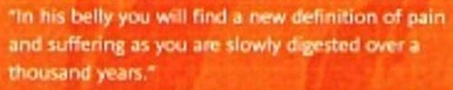

### Stat block notes (game mechanics, not feats)

- #3 Sando Aqua Monsters: 3 SANDO AQUA MONSTERS The sando aqua monster can eat just about any other creature in the Star Wars movies, provided its competition somehow finds its way underwater. In fact, the sando aqua monster devoured the opee sea killer and the colo claw fish just before press time, preventing either of those ocean beasts from making our Top 10 list. At 200 meters in length, the sando aqua monster is six times the length of a blue whale. Background lore reveals the sando to be a mammalian-based water breather originally adapted for life on land. Its panther-like forelimbs and sinuous neck give it the appearance of a lithe predator, yet it remains so scarce most inhabitants of Naboo consider the creature to be a myth akin to our own Loch Ness Monster. While a carcass from such a beast would be difficult evidence to ignore, the animals live in the depths and apparently die down there too. The Gungans are well aware of the hazards of the deep, and Jar Jar Binks was quick to warn Qui-Gon Jinn and Obi-Wan Kenobi about traveling through the planet's core. The sando's hungry debut during the movie's submarine chase even prompts a bit of philosophizing from the older Jedi: "There's always a bigger fish." (Dan Wallace, Star Wars Insider 102, p. 45) (Source: *Star Wars Insider #102* (2008), scan p.45)
- #2 Sarlaccs: 2 SARLACCS The sarlacc earns its spot near the top of the list for sheer digestive creepiness. C-3PO couldn't have said it better: "In his belly you will find a new definition of pain and suffering as you are slowly digested over a thousand years." Threepio wasn't kidding. According to Star Wars lore, the sarlacc embalms its victims inside its primary stomach or one of several secondary stomachs, where they are kept alive through a nutrient drip while the sarlacc's digestive acids consume skin and muscle tissue. By all accounts, the ordeal is excruciatingly painful. The sarlacc is reminiscent of the real-world ant lion, which lies in wait at the bottom of tiny dimples of sand waiting for insects to tumble into its mouth. But the sarlacc isn't necessarily a desert denizen. It reproduces by releasing sarlacci spores that can be carried from world to world, often thriving in wet, swampy biospheres. Perhaps the most unusual aspect of the sarlacc is its ability to absorb the memories of its victims, becoming semi-intelligent in the process. Boba Fett is one potential meal who fought his way free before he could become a member of the sarlacc's macabre collection. The sarlacc is a popular hazard in Star Wars video games, appearing everywhere from Battlefront to Super Bombad Racing. In the films, the sarlacc underwent a makeover with the Special Edition of Return of the Jedi, when a CGI beaklike tongue provided enhanced enemy-chomping menace. (Dan Wallace, Star Wars Insider 102, p. 45) (Source: *Star Wars Insider #102* (2008), scan p.45)

## scan p.46 (scan page 46)

Page contents: Top Ten #1 Rancors; Top Ten logo (top-left box); rancor photo; right-column Expanded Universe box "25 Years of Jedi" (Unearthly Creatures quote, Overlooked Creature: The Worrt with worrt photo, Jedi Awards); "Agree? Disagree?" strip with reader email address (not transcribed); folio 46 INSIDER (hand-read)

### Stat block notes (game mechanics, not feats)

- #1 Rancors: [Top-left box:] TOP TEN 1 RANCORS "Oh no! The rancor!" For once, C-3PO had good reason to be terrified. The rancor tops our list for toughness, possessing an unbeatable combo of mobility, bad temper, face-melting ugliness, and a reach that would put any professional boxer to shame. The rancor's introduction is perfectly petrifying, as its flexing talons and toothy, flat-faced maw emerge from beneath an iron portcullis. It's Luke Skywalker's job to slay this dragon — but the rancor then raises the threat level by grabbing a Gamorrean guard and munching him in three delighted bites. Luke wins by dropping the gate on the rancor's skull. This causes the beast to emit a puppy-dog death whine, as its handler breaks down in tears. The notion that rancors could make terrifyingly good pets gained currency with the publication of "A Boy and his Monster: The Rancor Keeper's Tale" in Tales From the Mos Eisley Cantina, as well as with The Courtship of Princess Leia's planetful of trained rancor mounts under the command of Force-using witches. In the Star Wars galaxy, rancors are found on enough worlds that no one quite remembers where they originally evolved. This fact has been a boon to video game designers, who love to include rancors as level bosses. Think you're ready to fight a rancor? You can try, in games such as Mysteries of the Sith, Knights of the Old Republic, and The Force Unleashed. We still think Chewbacca could take a rancor in a one-on-one fight, though! AGREE? DISAGREE? >> Now that you've seen our rankings, have your say via email to [email omitted]. Did we pick the right creatures and get them in the right order? Set the record straight and have your say! (Dan Wallace, Star Wars Insider 102, p. 46) (Source: *Star Wars Insider #102* (2008), scan p.46)
- Expanded Universe: 25 Years of Jedi box: EXPANDED UNIVERSE >>> 25 YEARS OF JEDI UNEARTHLY CREATURES "George felt that a lot of the creatures in Star Wars looked like something out of an Egyptian hieroglyphic panel. We made a conscious effort on Return of the Jedi to make things look more alien. We were concerned that they be less animalistic and more unearthly." —Phil Tippett, Creature Design Supervisor OVERLOOKED CREATURE: THE WORRT Found lurking in the rocks outside of Jabba's palace on Tatooine is this variety of warty roadside scavenger. The dim-witted creature has a lightning-fast tongue, which it uses to catch smaller prey. Native to Tatooine, worrts are blindingly stupid and will attack anything that appears remotely edible: metal, poisonous plants, and large rocks have been found in the guts of dead worrts. Though they have been known to pester human-sized targets, they generally avoid prey larger than themselves. Worrts can be domesticated as pest-catchers, but their stupidity makes them difficult to train. Jabba the Hutt was believed to have maintained several worrts as pets, which explains the unusual concentration of the creatures near his palace. For the movie, the worrt was a puppet, like many of the creatures seen at Jabba's palace in Return of the Jedi. Its production nickname was simply "road creature." JEDI AWARDS At the 56th Academy Awards in 1984, Richard Edlund, Dennis Muren, Ken Ralston, and Phil Tippett received the Special Achievement Award for Visual Effects. Norman Reynolds, Fred Hole, James L. Schoppe, and Michael Ford were nominated for Best Art Direction/Set Decoration. Ben Burtt received a nomination for Best Sound Effects Editing. John Williams received the nomination for Best Music, Original Score. Burtt, Gary Summers, Randy Thom, and Tony Dawe all received the nominations for Best Sound. At the 1984 BAFTA Awards, Edlund, Muren, Ralston, and Kit West won for Best Special Visual Effects. Tippett and Stuart Freeborn were also nominated for Best Make-up. Reynolds received a nomination for Best Production Design/Art Direction. Burtt, Dawe, and Summers also received nominations for Best Sound. Williams was also nominated Best Album of Original Score Written for a Motion Picture or Television Special. The film also won for Best Dramatic Presentation at the 1984 Hugo Awards. (Dan Wallace, Star Wars Insider 102, p. 46) (Source: *Star Wars Insider #102* (2008), scan p.46)

## scan p.47 (scan page 47)

Page contents: Full-page ad: eFX The Original Clone Trooper Helmet, Episode II: Attack of the Clones, Worldwide Edition: 1000; ranks of clone troopers behind (hand-read)

### Stat block notes (game mechanics, not feats)

- eFX Clone Trooper helmet ad: NOT ALL CLONES ARE THE SAME! THE ORIGINAL CLONE TROOPER™ HELMET EPISODE II: ATTACK OF THE CLONES™ WORLDWIDE EDITION: 1000 STAR WARS™ eFX HELMET www.efxcollectibles.com © 2008 Lucasfilm Ltd & TM. All rights reserved. © 2008 eFX Inc. All rights reserved. *actual product not shown (eFX advertisement, Star Wars Insider 102, p. 47) (Source: *Star Wars Insider #102* (2008), scan p.47)

## scan p.48 (scan page 48)

Page contents: "The Big Event" timeline feature (unbylined): big Darth Maul face photo; "The Phantom Menace Opens!" May 19, 1999; Celebration 1999 poster (Denver, Colorado, April 30th–May 2nd 1999); "First Celebration"; Real Life 1999 World News sidebar; "Death of Chewbacca!" with Vector Prime cover; "The Big Event" top-right badge (hand-read)

### Stat block notes (game mechanics, not feats)

- The Phantom Menace Opens!: [Top-right badge:] THE BIG EVENT May 19, 1999 THE PHANTOM MENACE OPENS! Long awaited, the new Star Wars film created a media storm. Fans began camping out at theaters months before the release date, while rumors abounded about who would appear in the movie. Did you know that the late Charlton Heston was to play Yoda? That Carol Channing would appear and sing a song by Stephen Sondheim? Or that Alec Guinness would feature, thanks to CGI, as Obi-Wan Kenobi?! That much anticipated mid-May day (or July if you were in the U.K.) couldn't come quick enough! [Poster:] STAR WARS CELEBRATION APRIL 30th, MAY 1st & MAY 2nd 1999 DENVER, COLORADO (Star Wars Insider 102, p. 48) (Source: *Star Wars Insider #102* (2008), scan p.48)
- First Celebration: FIRST CELEBRATION April 30-May 2, Denver, Colorado The first Star Wars Celebration took place in 1999, and it has spawned three more U.S. events (two in Indianapolis, one in Los Angeles), as well as international off-shoots in London and Toyko [sic]. With in excess of 65,000 fans attending during 2007's anniversary year, the Celebrations have been a great success, even if all anyone can remember about the 1999 event is the torrential rain and muddy conditions! (Star Wars Insider 102, p. 48) (Source: *Star Wars Insider #102* (2008), scan p.48)
- Real Life 1999 sidebar: REAL LIFE 1999 WORLD NEWS • Nelson Mandela, first black president of South Africa, steps down (June 16), and Thabo Mbeki takes over. • Russian president Boris Yeltsin survives series of impeachment hearings (May) and takes military action against Islamic separatists in Dagestan and Chechnya. • War erupts in Kosovo after Yugoslavia's president Slobodan Milosevic clamps down on the province. NATO launches air strikes against Belgrade for 78 consecutive days until Milosevic relents. • Magnitude 7.4 earthquake kills more than 15,600 and leaves 600,000 homeless in Turkey (Aug. 17). (Star Wars Insider 102, p. 48) (Source: *Star Wars Insider #102* (2008), scan p.48)
- Death of Chewbacca!: DEATH OF CHEWBACCA! THE NEW JEDI ORDER: VECTOR PRIME OCTOBER 7, 1999 The first book in a new and promising story arc, The New Jedi Order: Vector Prime was published in October 1999 by Del Rey/LucasBooks. The action takes place 21 years after the Battle of Endor. Han and Leia have married and have teenage children who are Jedi. Luke, too, has married, and peace and prosperity have prevailed for a generation. But now the New Republic is threatened by a danger from which no one is safe. Not even Jedi Knights. The New Jedi Order: Vector Prime was penned by R.A Salvatore, the New York Times bestselling author known for his vivid battle scenes, well-developed characters and compelling adventure stories. However, Vector Prime was extremely controversial among Star Wars fans as it featured the death of Chewbacca, making the Wookiee the first major character from the original trilogy to be permanently killed off in the Expanded Universe novels. [Cover:] STAR WARS VECTOR PRIME R. A. SALVATORE (Star Wars Insider 102, p. 48) (Source: *Star Wars Insider #102* (2008), scan p.48)

## scan p.49 (scan page 49)

Page contents: "A Long Time Ago.... 1999" feature (unbylined): Time and Rolling Stone covers; Media: Time Magazine Covers Episode I; Entertainment 1999 sidebar; Month by Month (Jan–Dec) with photos of Rick McCallum, Episode I teaser poster, Yves Saint-Laurent One Love Amidala cosmetics, Lucas companies' holiday cards; running head "A long time ago.... 1999" (top right) (hand-read)

- **none** — entry/section: Rick McCallum on why Lucas made the prequels: ""The turning point for George was when he was supervising the postproduction on Jurassic Park. George saw the handheld shot of Jeff Goldblum being chased by the T-Rex in the Jeep. You couldn't achieve that before. He finally felt that everything was coming together." —Rick McCallum, Star Wars Insider 102, p. 49" Source: *Star Wars Insider #102* (2008), scan p.49
  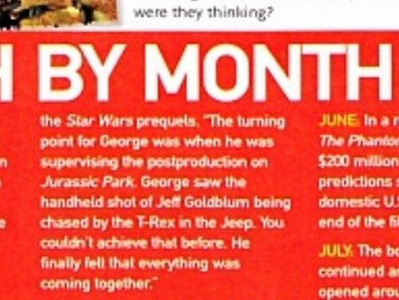

### Stat block notes (game mechanics, not feats)

- Media: Time Magazine Covers Episode I: A LONG TIME AGO.... 1999 [Covers:] TIME Star Wars ... Rolling Stone JAR JAR SUPERSTAR MEDIA: TIME MAGAZINE COVERS EPISODE I The April 18, 1999 edition of Time Magazine featured a story on Star Wars: Episode I The Phantom Menace, including a conversation between George Lucas and Bill Moyers about the mythos of Star Wars. The cover story quoted Liam Neeson on the secrecy surrounding the making of the movie. "It had to be a leap of faith," said Neeson. "I couldn't get a script. Forget Woody Allen: this was like trying to get into Fort Knox. I finally got to read the whole script in George's office with Darth Vader standing outside the door. Seriously." Rolling Stone, meanwhile, opted for a Jar Jar Binks cover! What were they thinking? (Star Wars Insider 102, p. 49) (Source: *Star Wars Insider #102* (2008), scan p.49)
- Entertainment 1999 sidebar: [Top-right:] A long time ago.... 1999 ENTERTAINMENT 1999 • About 48.5 million people tune in to Monica Lewinsky's first televised interview with Barbara Walters during 20/20. • Stanley Kubrick, the iconoclastic director of such legendary films as Dr. Strangelove, 2001: A Space Odyssey, and A Clockwork Orange, dies at his home outside London. He was 70. • The Blair Witch Project emerges as an instant cult classic and becomes the most profitable film of all time, grossing more than $125 million. The film cost just $30,000 to make. • The year's biggest movies are Blair Witch Project, American Beauty, Three Kings, The Sixth Sense, and Star Wars: Episode I The Phantom Menace. Best Picture Oscar goes to Shakespeare in Love. (Star Wars Insider 102, p. 49) (Source: *Star Wars Insider #102* (2008), scan p.49)
- Month by Month 1999: MONTH BY MONTH JANUARY: The Phantom Menace is predicted to dominate the Summer film season. Variety said: "More than two decades and nearly $4 billion in box office and merchandising receipts later, the anticipation for the May opening is building to huge proportions. [There are] up to 900 web sites dedicated to various aspects of Star Wars, people are lining up just to see the trailer and PR professionals are being forced to practice a kind of anti-hype." FEBUARY [sic]: 360-degree images of Anakin Skywalker's childhood home appear on starwars.com, allowing fans to move around 'within' the 'virtual' images. MARCH: An online chat with Rick McCallum sees the Star Wars producer explain that The Phantom Menace is the genuine title of the film and not a decoy. He also explained why George Lucas had decided the time was right for the Star Wars prequels. "The turning point for George was when he was supervising the postproduction on Jurassic Park. George saw the handheld shot of Jeff Goldblum being chased by the T-Rex in the Jeep. You couldn't achieve that before. He finally felt that everything was coming together." APRIL: Variety revealed that fans were preparing to fly from all over the world to see Episode I in the US on opening day. "Tour company Sports Mondial, which usually brings fans to sporting events, is offering a New York air-hotel package for the prequel's May 19 opening. Howard Gough of London's STA travel agency said, 'We've had people coming in specifying that going to see Star Wars is the reason they're booking.'" MAY: A small, little heralded movie had a very quiet opening. JUNE: In a record-breaking 13 days, The Phantom Menace grossed over $200 million by June 1, with predictions suggesting a $400 domestic U.S. box office tally by the end of the film's run. JULY: The box office bonanza continued as The Phantom Menace opened around the world, topping $150 million in non-U.S. takings. AUGUST: Star Wars Insider #45 was released, chronicling 1999's Summer of Star Wars with extensive Episode I coverage, including comments from George Lucas, Liam Neeson, Natalie Portman, Samuel L. Jackson, and of course, the fans. There's a special focus on fan favorite(!) Jar Jar Binks and how Ahmed Best and ILM created the digital character. SEPTEMBER: The Phantom Menace opened for the fourth time in Switzerland, this time in Italian, one of the country's four national languages! OCTOBER: One Love, by Yves Saint-Laurent. Inspired by the character of Queen Amidala in the new chapter of the Star Wars saga, the celebrated French fashion designer Yves Saint-Laurent launched One Love, a range of cosmetics with unique color harmonies for the new millennium. They were certainly unique Star Wars collectibles! NOVEMBER: The first anniversary of fans' first sight of any moving clips from Star Wars: Episode I: The Phantom Menace as the first teaser trailer debuted on November 19, 1998. DECEMBER: Lucas companies issued seasonal greetings to fans and colleagues with three holiday cards from Lucasfilm, Lucas Learning and Lucas Digital (the last one bravely featuring that fan favorite Jar Jar Binks). (Star Wars Insider 102, p. 49) (Source: *Star Wars Insider #102* (2008), scan p.49)

## scan p.50 (scan page 50)

Page contents: Full-page Brian's Toys retailer ad: product photos and price blocks (McQuarrie Figures, 30th Anniversary Figures/Multipacks/Evolutions/Vehicles/Exclusives, Battle Packs, Episode III Exclusives, Saga II Exclusives, Expanded Universe Comic 2-Packs, Gentle Giant Mini-Busts); footer with ordering phone number (not transcribed); some right-edge price text cut off in the scan (hand-read)

### Stat block notes (game mechanics, not feats)

- Brian's Toys ad: BRIAN'S TOYS WWW.BRIANSTOYS.COM Home of the World's Largest Selection of Star Wars and G.I. Joe Toys and Collectibles from 1977 to Present We strive to provide the most reliable customer service in the indust[ry — cut at page edge] Speedy Delivery-Orders Placed by 10am Central Standard Tim[e — cut] Are Shipped the Same Business Day!!! 100% Satisfaction Guaranteed (14 Day Return Poli[cy — cut]) TIRED OF SCRAMBLING TO FIND NEW FIGURES OR PRE-ORDERING THE LATEST SERIES OF ACTION FIGURES? ONE OF EACH BRIAN'S $7.99 FIGURE CLUB As soon as the latest wave arrives, we will charge your credit card and send you one of each new basic Hasbro Star Wars figure for $7.99 each. There is no cost to join the club. You may cancel at any time. Join today go to www.brianstoys.com/club for complete information. McQuarrie Figures Boba Fett $14.99 • Chewbacca $15.99 Darth Vader $14.99 • Han Solo $14.99 Leia Starkiller Hero $16.99 Rebel Trooper $19.99 Snowtrooper $19.99 Stormtrooper $19.99 30th Anniversary Figures Wave 7: Set of 5 $49.99 Wave 7.5: Set of 7 $69.99 Wave 8: Set of 6 $49.99 2008 Wave 1: Set of 8 $69.99 2008 Wave 2: Set of 7 $69.99 Expanded Universe Comic 2-Packs Wave 4 Set of 3 $39.99 Wave 5 Set of 3 $39.99 Exclusives Set of 3 Website 30th Anniversary Multipacks Republic Elite Forces $39.99 each Battlefront II Clones & Droids $69.99 The Max Rebo Band Sets Website 30th Anniversary Evolutions $29.99 each 30th Anniversary Galactic Hunt Carded Set of 12 $199.99 30th Anniversary Exclusives ARC-170 Battle Squad Battle Pack $49.99 ARC-170 Fighter $69.99 Concept Grievous $29.99 Mail-in Set of 7 Coins $39.99 McQuarrie Ben and Yoda $39.99 McQuarrie Luke Skywalker $39.99 McQuarrie R2-D2 & C-3PO $24.99 Obi-Wan Jedi starfighter with Hyperspace Ring Website Shadow Scout with Bike $24.99 Unleashed ARC Trooper $24.99 Unleashed Shadow Trooper $39.99 Y-wing Fighter $79.99 Battle Packs Attack on Kashyyyk $39.99 Battle of Mygeeto $29.99 Speeder Bike Patrol (Hoth) $29.99 30th Anniversary Vehicles Aayla Secura's Starfighte[r — cut] Anakin Skywalkers [sic] Green Starf[ighter — cut] $39.99 AT-AP Walker $39.99 General Grievous' Starfighter $39.99 Obi-Wan Kenobi's Blue Starfighter $39.99 Saga II Exclusives Action Figure Tins Figrin D'an and the Modal Nodes $29.99 Endor AT-AT $169.99 Holiday Darth Vader $19.99 Lucas Family $39.99 Luke's X-Wing (Dagobah) $59.99 Mail-in George Lucas Stormtrooper $49.99 Rogue 2 Snowspeeder $59.99 Imperial Briefing Room Scene Pack $39.99 Republic Commando Scene Pack $39.99 Episode III Exclusives Clone Attack On Coruscant $49.9[9 — cut] Imperial Throne Room $49.99 Clone Trooper (Target) C-8/9 $24.[99 — cut] Covert Ops Clone Trooper $39.9[9 — cut] Darth Vader Lava Target Exclusive C-8/9 $4[cut] Duel at Mustafar Darth Vader $19.[cut] Duel at Mustafar Obi-Wan Kenobi $1[cut] Leia Holographic $19.99 • Wedge $[cut] ROTS KB 9 Pack $39.9[9 — cut] Gentle Giant Mini-Bus[ts — cut] AT-AT Driver Classics $29.99 Jar Jar Binks Classics $29.99 Obi-Wan Kenobi (ROTS) Classics $29.99 Boba Fett Classics $29.99 Jawa in Sandcrawler Kustomz $69.99 Obi-Wan Kenobi (General) $49.[cut] Aayla Secura $49.99 Admiral Ackbar $49.99 Shaak Ti $49.99 PLEASE GO TO WWW.BRIANSTOYS.COM OR CALL [phone number omitted] TO PLACE AN ORDER. PRICES AND AVAILABILITY ARE SUBJECT TO CHANGE. (Brian's Toys advertisement, Star Wars Insider 102, p. 50) (Source: *Star Wars Insider #102* (2008), scan p.50)

## scan p.51 (scan page 51)

Page contents: Full-page Brian's Toys retailer ad (page 2): Sideshow 12" figures, Medicom, Master Replicas FX Lightsabers and Limited Edition, Indiana Jones figures, Vintage Star Wars graded carded figures, Lego Star Wars, "We Are Buying Toys!!!" box, catalog offer, store contact block (postal address, phone, fax and emails not transcribed); top yellow strip with ordering phone (not transcribed) (hand-read)

### Stat block notes (game mechanics, not feats)

- Brian's Toys ad p2: [Top strip:] PLEASE CALL [phone number omitted] TO PLACE AN ORDER PRICES AND AVAILABILITY ARE SUBJECT TO CHANGE. PLEASE CALL, FAX, OR E-MAIL TO CONFIRM PRICES AND AVAILABILITY. Sideshow 12" Figures Commander Praji Website Han Solo $64.99 Indiana Jones (Raiders of the Lost Ark) $89.99 Luke Skywalker (Tatooine) $69.99 Obi-Wan General (CW) Website Medicom 12" Figures 501st Clone Trooper $149.99 Clone Trooper Website Darth Maul Website Medicom VCD OVERSIZE Darth Vader $199.99 Emperor's Royal Guard $59.99 Premium Format Figures Anakin Skywalker $299.99 Biker Scout with Speeder Bike Website Busts • Diorama Emperor Palpatine $499.99 Duel of the Fates $299.99 [Logo panel:] STAR WARS SAGA REVENGE OF THE SITH TRILOGY CLONE WARS SAGA 30 Star Wars Toys A to Z only at www.brianstoys.com Master Replicas FX Lightsabers Anakin Skywalker (ROTS) Website Darth Maul Single-Blade Website Darth Maul Double Blade Website Darth Vader (ANH) Website Luke Skywalker (ANH) $89.99 Luke Skywalker (ROTJ) $134.99 Mace Windu Website Yoda $79.99 Master Replicas Limited Edition Anakin ROTS Saber $249.99 Boba Fett LE Blaster $399.99 Boba Fett Helmet SE $549.99 Han Solo ESB Blaster $319.99 Luke ROTJ V2 $374.99 Stormtrooper Blaster $599.99 Yoda ROTS Saber $249.99 INDIANA JONES 3.75" Action Figure By Hasbro $9.99 Each Belloq • Cario Swordsman Indiana Jones • Marion Ravenwood Monkey Man with Monkey Check Out our website for the full line of Indian [sic] Jones Toys Brian's Toys [postal address omitted] Phone: [omitted] Fax: [omitted] email: [omitted] www.brianstoys.com WE ACCEPT ALL MAJOR CREDIT CARDS Prices and availability are subject to change. Please call, fax, or e-mail to confirm prices and availability. [Card logos: Discover, Visa, MasterCard, American Express, PayPal] Vintage Star Wars POTF Nikto AFA 80Y $4,999.99 POTF AT-AT Driver AFA 70Y $1,999.99 Tri-Logo Jawa AFA 85 $6,999.99 12 Back Vinyl Cape Jawa AFA 85 $7,999.99 12 Back Chewbacca AFA 85 $1,999.99 12 Back Darth Vader AFA 85 $1,999.99 12 Back Han Solo AFA 85 $2,199.99 12 Back Princess Leia AFA 85 $1,399.99 Loose Unpainted Weechee AFA 90 $2,999.99 Lego Star Wars ARC-170 Starfighter $119.9[9 — cut] B-Wing at Rebel Control Center $114.[99 — cut] Death Star II $399.99 Ewok Attack $99.99 Final Duel I $89.99 Jedi Defense II $79.99 Landspeeder $69.99 Motorized Walking AT-AT $174.9[9 — cut] Republic Gunship $499.99 Slave I $64.99 Speeder Bikes $69.99 TIE Fighter & Y-Wing $149.9[9 — cut] Over 100 Different Star Wars Legos in Stock[!] We Are Buying Toys!!! We Buy Vintage & Modern Collection[s] Please email your list of items for sale to [email omitted] or fax to [fax omitted] For A Complete Buy List Please Visit www.brianstoys.com/buylist.htm[l] Get Our Latest Catalog! 48 Color Pages of Our Complete Inventory Log onto www.brianstoys.com and click on "Request a Catalog" or yo[u ... — last line cut off at page edge] (Brian's Toys advertisement, Star Wars Insider 102, p. 51) (Source: *Star Wars Insider #102* (2008), scan p.51)

## scan p.52 (scan page 52)

Page contents: Full-page Entertainment Earth ad: Mighty Muggs (Star Wars figures incl. Luke, Grievous, Yoda, a hooded Sith; Indiana Jones; Marvel); mystery Hasbro Star Wars exclusive silhouette; order phone number (not transcribed) (hand-read)

### Stat block notes (game mechanics, not feats)

- Entertainment Earth Mighty Muggs ad: BRING HOLLYWOOD HOME! MIGHTY MUGGS made from 100% recycled awesome Mighty Muggs are groovy, eye-catching figures that feature bright colors and a distinctive design. Each 6-inch character is sure to bring smiles to the faces of collectors and fans alike! STAR WARS MIGHTY MUGGS VINYL FIGURES Check entertainmentearth.com for the latest. HS78016 Search STAR WARS PLUS Don't miss our new Hasbro Star Wars Exclusive! HS87923 Search INDIANA JONES MIGHTY MUGGS VINYL FIGURES Check entertainmentearth.com for the latest. HND40549 Search INDIANA JONES MARVEL MIGHTY MUGGS VINYL FIGURES Check entertainmentearth.com for the latest. HMV78025 Search MARVEL Hasbro Order Today! [phone number omitted] MINT CONDITION GUARANTEED RISK FREE SHOPPING HASSLE FREE 30-DAY RETURNS Action Figures, Toys, Gifts, Collectibles, and Hundreds of Star Wars Items! Entertainment Earth www.entertainmentearth.com © 2008 Entertainment Earth, Inc. All rights reserved. Logos and terms displayed may be trademarks of their respective companies. Product descriptions, items, specifications, case and set assortments, variations, prices, and ship dates are subject to change and availability without notice. © 2008 Lucasfilm Ltd. & ® or ™ where indicated. All rights reserved. Used under authorization. (Entertainment Earth advertisement, Star Wars Insider 102, p. 52) (Source: *Star Wars Insider #102* (2008), scan p.52)

## scan p.53 (scan page 53)

Page contents: Feature opener "Creature Creator" (Star Wars Effects Maestros logo); full-page bleed photo of the Hammerhead (Ithorian; Momaw Nadon) cantina mask with AT-AT walkers in blue; inset portrait of Phil Tippett; Words: Calum Waddell (hand-read)

### Stat block notes (game mechanics, not feats)

- Creature Creator — standfirst: [Top-right box:] STAR WARS effects maestros Words: Calum Waddell CREATURE CREATOR SPECIAL EFFECTS MAESTRO PHIL TIPPETT MADE HIS DEBUT ON STAR WARS AND HAS SINCE WON AN OSCAR, WORKED ON SOME OF HOLLYWOOD'S BIGGEST HITS, AND REMAINED THE INDUSTRY'S FOREMOST STOP-MOTION EXPERT. STAR WARS INSIDER TRACKED HIM DOWN. (Calum Waddell, Star Wars Insider 102, p. 53) (Source: *Star Wars Insider #102* (2008), scan p.53)

## scan p.54 (scan page 54)

Page contents: Creature Creator p2: photo of the rancor; inset of creature team with human-size rancor on Return of the Jedi set; AT-AT walker cut-out; Effects Maestros logo; sections Lucky Connections and Amazed Audiences (hand-read)

- **none** — entry/section: Tippett on the cantina masks: ""We were to fabricate a bunch of alien type masks for the scene in the cantina. That is how my work on Star Wars began." —Phil Tippett, Star Wars Insider 102, p. 54" Source: *Star Wars Insider #102* (2008), scan p.54
  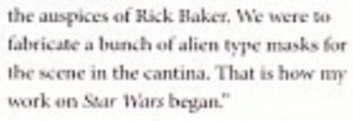

### Stat block notes (game mechanics, not feats)

- Creature Creator — intro: Oscar winning special effects artist Phil Tippett is one of a handful of genre effects icons who got their big break in the movie business thanks to meeting George Lucas and being hired to work on the original Star Wars back in the mid-1970s. As with other visual effects visionaries who helped in the creation of A New Hope, such as John Dykstra, Richard Edlund, and Dennis Muren, Tippett would go on to launch his own studio as the post-Lucas boom in special effects-led blockbusters created more work and led to such movies as 1981's Dragonslayer and Lucas' own Raiders of the Lost Ark. Finally winning an Academy Award for his work on Steven Spielberg's 1993 smash hit Jurassic Park (and having a dinosaur species named after him in the prehistoric mania that followed in the wake of the movie), Tippett would eventually direct the straight-to-DVD sequel Starship Troopers 2 in 2004. Nevertheless, creature effects remain his true passion — as evidenced by his work on The Spiderwick Chronicles — and his career also takes in such high profile fantasy epics as RoboCop (1987), Willow (1988) and Starship Troopers (1997). Naturally, when Star Wars Insider caught up with him we wanted to know all about how he came to be involved in the most important — and certainly the most popular — science fiction flick of all time. (Calum Waddell, Star Wars Insider 102, p. 54) (Source: *Star Wars Insider #102* (2008), scan p.54)
- Creature Creator — captions: [Caption:] Rancor Rumble. Above: The deadly rancor in all his toothy glory. Inset: On the set of Return of the Jedi, the creature team wrestles with the human-size rancor. Below Left: AT-AT walker. (Calum Waddell, Star Wars Insider 102, p. 54) (Source: *Star Wars Insider #102* (2008), scan p.54)
- Lucky Connections: LUCKY CONNECTIONS "Basically I got really lucky," laughs the ever-so-modest Tippett in regards to his career-making position in the stop motion animation unit at Industrial Light & Magic. "There were a bunch of us back then, including Dennis Muren and Ken Ralston, who were working in television commercials. That was the only place that would do stop motion and the kind of effects that we were interested in." For the effects whiz it was the old Hollywood saying of "It's not what you know but who you know" that led to him being hired by George Lucas. "When Star Wars came along I had a connection that was going to a university in Irvine, California at the time," continues the artist. "It so happened that this guy was an old Navy buddy of Richard Edlund and he had heard that Richard was looking for some crew to work on this new movie." The project was still very hush-hush, however. "I had no idea what this new movie was, so I talked to Richard on the phone and it turned out that he was looking for camera operators, which I was not. I gave him my buddy Dennis Muren's number," reveals Tippett. "He called Dennis, hired him and everything happened from there. Dennis got Ken Ralston involved and it turned out that they were making this science fiction movie called Star Wars and George Lucas was behind it. We all knew about George from American Graffiti and I thought 'this should be fun — he's a pretty good filmmaker. I hope that I might be able to work on it.'" Tippett made sure that he was a common sight at ILM, then located in Los Angeles. "[That was] because I knew Ken and Dennis. I would go along and check out what they were doing," says the artist. "They were part of the night crew and running behind schedule, so Dennis proposed to George that a bunch of us out-of-work stop motion animators get together and put together a shop under the auspices of Rick Baker. We were to fabricate a bunch of alien type masks for the scene in the cantina. That is how my work on Star Wars began." (Calum Waddell, Star Wars Insider 102, p. 54) (Source: *Star Wars Insider #102* (2008), scan p.54)
- Amazed Audiences (start): AMAZED AUDIENCES When Tippett started on Star Wars it was 1976, just a year before the picture's release. However, Lucas expected the young effects genius to work his talents on creature masks and alien creations, work that is most evident in the cantina scene. "By the time I got involved the die had been cast," admits Tippett. "When you look at the film today there aren't that many creatures in it," he continues, "especially in comparison to the sequels. I created much more on Return of the Jedi for example. So by the time I was hired a lot of the creature stuff had already been shot and put together by Stuart Freeborn in England. In fact, I remember that the big issues were really with the visual effects. The questions being asked on the set were, 'Are the motion control cameras going to work and are the matting techniques going to work?' That was the biggest jump into the unknown for George and his crew. I really think that until Dennis and Ken got there they had [continued p. 55] (Calum Waddell, Star Wars Insider 102, p. 54) (Source: *Star Wars Insider #102* (2008), scan p.54)

## scan p.55 (scan page 55)

Page contents: Creature Creator p3: large photo of Phil Tippett with a tauntaun puppet; pull quote; Expanded Universe box "The Best of Tippett" (RoboCop, Starship Troopers, Evolution) (hand-read)

- **none** — entry/section: Tippett on Starship Troopers: ""Once I realized the scope of what Paul wanted to do, that project went from being a dream to a nightmare! At that point in time we hadn't really worked on CGI effects at my studio." —Phil Tippett, Star Wars Insider 102, p. 55" Source: *Star Wars Insider #102* (2008), scan p.55
  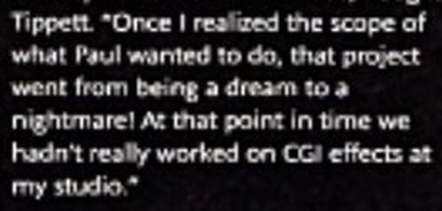

### Stat block notes (game mechanics, not feats)

- Amazed Audiences (cont.): [continued from p. 54] more of a sense of animating things. There is a ramp-up time for how long it takes you to learn how to manipulate the motion control equipment in order to get the effects you are looking for and I'm not sure how far into that they were. So everything hinged on those two things working — the motion control system and the matting — and it took forever for them to get that going." Of course, it all worked out in the end, although that didn't stop Lucas from mixing the already impressive special effects with CGI for the original trilogy's 1997 theatrical re-release and later DVD debut. Naturally, we cannot help but ask Tippett what he thinks of the Special Editions. "You know, I think Star Wars amazed audiences because it was really terrific and very smart, a hybrid of many different genres," he answers. "So I think the original version was a lot more fun than gluing a bunch of CGI together. I look at it all as part of the business. Hopefully the originals don't get lost again and remain out there for further generations." (Calum Waddell, Star Wars Insider 102, p. 55) (Source: *Star Wars Insider #102* (2008), scan p.55)
- Pull quote: [Pull quote:] "Dennis proposed to George Lucas that us out-of-work stop motion animators put together a shop to fabricate a bunch of alien masks for the scene in the cantina." (Calum Waddell, Star Wars Insider 102, p. 55) (Source: *Star Wars Insider #102* (2008), scan p.55)
- Caption: [Caption:] Tippett and tauntaun: Among other Star Wars creatures, stop motion expert Phil Tippett brought the tauntaun to animated life. (Calum Waddell, Star Wars Insider 102, p. 55) (Source: *Star Wars Insider #102* (2008), scan p.55)
- Expanded Universe: The Best of Tippett: EXPANDED UNIVERSE >>> THE BEST OF TIPPETT Phil Tippett hasn't just worked his magic on the original Star Wars trilogy. Here's some of his other great sci-fi work. Robocop (1987): Politically smart, and ultra-violent, Reagan-era criticism of free market capitalism. Only with lots of gunplay, Nancy Allen in a tight-fitting policewoman's uniform, and missing limbs. "RoboCop was a complete surprise because the politics are definitely in the Edward Neumeier script if you read it," states Tippett, "but the wonderful significance of that film is that they really snuck all of that stuff in there without anyone noticing. Paul Verheoven's [sic] handling of the material brought a lot to the script. It was certainly there but it didn't leap off the page." Starship Troopers (1997): Director Paul Verheoven [sic] makes his return to sci-fi after the ill-advised Showgirls and once again uses the genre to make a non-too-subtle [sic] political message about U.S. imperialism. "Obviously in Troopers Paul's politics were so obvious," laughs Tippett. "Once I realized the scope of what Paul wanted to do, that project went from being a dream to a nightmare! At that point in time we hadn't really worked on CGI effects at my studio." Evolution (2001): Although it was not quite the big blockbuster summer hit that many expected, this Ivan Reitman-directed opus, which stars David Duchovny, certainly has its moments. "Ivan was great to work with on that," says Tippett, "and I had the chance to work on some pretty cool special effects." (Calum Waddell, Star Wars Insider 102, p. 55) (Source: *Star Wars Insider #102* (2008), scan p.55)

## scan p.56 (scan page 56)

Page contents: Creature Creator p4: photo of Chewbacca and C-3PO at the hologram chess table; ILM group shot with Tippett; Expanded Universe box "Motion Control Photography"; Hammerhead (Momaw Nadon) close-up; Effects Maestros logo (hand-read)

- **none** — entry/section: Tippett on Lucas vs. Verhoeven: ""The only real difference is that George is a lot nicer than Paul Verheoven [sic]. Actually, I have a great relationship with Verheoven [sic]. He is one of my favorite directors to work with." —Phil Tippett, Star Wars Insider 102, p. 56" Source: *Star Wars Insider #102* (2008), scan p.56
  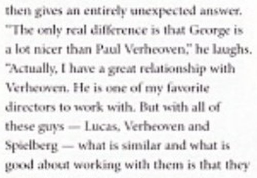
- **Jabba's Rancor** — entry/section: Tippett on his creations: ""Most of the stuff that I have done is the creation of characters, like the rancor, which you mentioned, so they become like your kids. They can be really frustrating during the creation process, but you love them all the same." —Phil Tippett, Star Wars Insider 102, p. 56" Source: *Star Wars Insider #102* (2008), scan p.56
  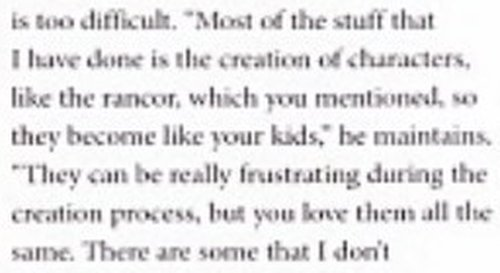

### Stat block notes (game mechanics, not feats)

- Creature Creator — digital effects and directors: Although he did not work on the Star War [sic] prequels, how does Tippett feel about genre film's increasing reliance on digital effects? "A lot of that has to do with the decision making and the budget of your film and how quickly you have to shoot things," he answers. "It all boils down to the director's proclivity on having things there or having to imagine them being there and adding them in post.… I don't have a strong feeling one way or the other." Indeed, Tippett did lend his talents to the film that would help to popularize the boom in CGI and which would, ultimately, encourage George Lucas to embark on The Phantom Menace, namely Spielberg's Jurassic Park, with ILM doing the visual effects. Following that he collaborated with Paul Verheoven [sic] on the big budget monster mash, Starship Troopers, which expertly blended digital and practical effects, offering further proof that the two can compliment [sic] each other. Asked if he can compare these hugely influential directors with Lucas, whom Tippett continued to work with after Star Wars, including on The Empire Strikes Back, Return of the Jedi and Caravan of Courage, he pauses and then gives an entirely unexpected answer. "The only real difference is that George is a lot nicer than Paul Verheoven [sic]," he laughs. "Actually, I have a great relationship with Verheoven [sic]. He is one of my favorite directors to work with. But with all of these guys — Lucas, Verheoven [sic] and Spielberg — what is similar and what is good about working with them is that they are inclusive. They involve you and engage you and make you feel like you are part of the filmmaking process. George did that with Star Wars and he was always around for Return of the Jedi. All of these guys listen to you and give you a lot of latitude in bringing what you have got to the table. They get you involved very early on and consult with you continually. I have a very good relationship with all three, and that is how good special effects really come to happen. Plus, these are three guys that have all studied visual effects work and really know what it is about. They know how to set up scenes and shots and really get the most out of it. They also, every one of them, wear a producer's hat, so everything has a very concrete value in terms of the budget. They really know how not to drive their movie into a wall and crash, ruining the resources." (Calum Waddell, Star Wars Insider 102, p. 56) (Source: *Star Wars Insider #102* (2008), scan p.56)
- Creature Creator — favorites and Howard: As one of Hollywood's top creature designers, Tippett has not only been involved in the Star Wars cantina sequence and Return of the Jedi's monstrous rancor but also RoboCop's ED-209 and the title character in Lucas' subsequent, but critically underappreciated, fantasy opus, Howard the Duck. Asked if he has a favorite, however, the artist claims that it is too difficult. "Most of the stuff that I have done is the creation of characters, like the rancor, which you mentioned, so they become like your kids," he maintains. "They can be really frustrating during the creation process, but you love them all the same. There are some that I don't particularly care for however…" One of them wouldn't be Howard would it? "Actually what I did with Howard I was really happy with," he laughs, "but, yeah, the movie was kind of silly. But the thing that is most rewarding in this line of work, ultimately, is when you have a good relationship and a creative partnership with the producers, directors, writers, director of photography, and so on, when it isn't a political situation and no one is paranoid. That is when you can do your best work. George was very good at setting up that kind of dynamic on Star Wars. It was an experience I am really grateful for." [Rebel insignia end mark] (Calum Waddell, Star Wars Insider 102, p. 56) (Source: *Star Wars Insider #102* (2008), scan p.56)
- Caption: [Caption:] "Let the Wookiee win!": Tippett animated the unusual hologram chess pieces. Below right: An ILM group shot featuring Tippett (center, with 'gloves') (Calum Waddell, Star Wars Insider 102, p. 56) (Source: *Star Wars Insider #102* (2008), scan p.56)
- Expanded Universe: Motion Control Photography: EXPANDED UNIVERSE >>> MOTION CONTROL PHOTOGRAPHY A special effects technique that enables precise repetition of camera movement. Its first large-scale application was in Star Wars: Episode IV A New Hope, where a computer-controlled camera could perform complex, repeatable motions around stationary spaceship models, creating the illusion that the models were moving. This enabled a greater complexity in battle sequences, as separate effects elements were better coordinated with one another, and such elements were duplicated precisely. More recently, widespread use of CGI has made motion control photography all but obsolete. (Calum Waddell, Star Wars Insider 102, p. 56) (Source: *Star Wars Insider #102* (2008), scan p.56)

## scan p.57 (scan page 57)

Page contents: Full-page Acme Archives / Lucasfilm Ltd. Fine Art ad: Indiana Jones limited edition giclée prints — Eric Tan poster "If Adventure Has a Name…", Brian Rood "Resolve", Patrick Schoenmaker "Escaping the Tomb"; postal address and phone (not transcribed) (hand-read)

### Stat block notes (game mechanics, not feats)

- Acme Archives Indiana Jones prints ad: INDIANA JONES™ Acme Archives is proud to introduce a new line of limited edition fine art prints focused on one of the most iconic characters in film history, Indiana Jones. Artists Brian Rood, Patrick Schoenmaker and Eric Tan each took a unique approach to Indy resulting in three very strong pieces to launch the program. Several additional exciting pieces are coming soon, so keep an eye on the Acme website for more! "If Adventure Has a Name…" by Eric Tan 10"x21" Fine Art Giclee on Paper Edition size of 195 pieces "Resolve" by Brian Rood 20"x30" Fine Art Giclee on Canvas Edition size of 45 pieces 13"x19" Fine Art Giclee on Paper Edition size of 245 pieces "Escaping the Tomb" by Patrick Schoenmaker 18"x30" Fine Art Giclee on Paper Edition size of 25 pieces 13"x19" Fine Art Giclee on Paper Edition size of 245 pieces [Poster art text:] IF ADVENTURE HAS A NAME… CAIRO FILMED IN COLOR IT MUST BE INDIANA Jones and the RAIDERS of the LOST ARK [artist signature] ACME ARCHIVES LIMITED [postal address omitted] Phone: [phone number omitted] www.acmearchivesdirect.com LUCASFILM Ltd FINE ART (Acme Archives advertisement, Star Wars Insider 102, p. 57) (Source: *Star Wars Insider #102* (2008), scan p.57)

## scan p.58 (scan page 58)

Page contents: Full-page Mimoco ad: Star Wars Mimobot designer USB flash drives — Luke Skywalker X-wing pilot (large), stormtrooper, Darth Vader, Boba Fett, Luke Skywalker, Princess Leia, Han Solo, Chewbacca, R2-D2; Official Star Wars Fan Club logo (hand-read)

### Stat block notes (game mechanics, not feats)

- Mimobot Series 2 ad: STAR WARS™ mimobot® refresh your memory Designer USB Flash Drives MIMOBOT SERIES 2 JOINS FORCES WITH MIMOBOT SERIES 1 by: mimoco www.mimobot.com THE OFFICIAL STAR WARS FAN CLUB starwars.com/fan [copyright line too small to read] (Mimoco advertisement, Star Wars Insider 102, p. 58) (Source: *Star Wars Insider #102* (2008), scan p.58)

## scan p.59 (scan page 59)

Page contents: Blaster section cover (pull-out section): Asajj Ventress 12" figure; Bounty Hunters roundel (Boba Fett), Bantha Tracks roundel (bantha), Fozzie Bear as Chewbacca, Last of the Jedi: Reckoning book cover, armored creature figure from comics (hand-read)

### Stat block notes (game mechanics, not feats)

- Blaster cover: PACKED FULL WITH THE LATEST STUFF FROM THE STAR WARS UNIVERSE STAR WARS BLASTER BOUNTY HUNTERS PAGE 70 BANTHA TRACKS PAGE 72 67 TOYS WHAT A FIGURE! ASAJJ VENTRESS PROVES EVIL DOESN'T HAVE TO BE UGLY! 66 SPACE GEAR THE MUPPETS MEET STAR WARS IN A POP CULTURE COLLISION! 61 BOOKS JUDE WATSON REACHES THE END OF AN ERA WITH LAST OF THE JEDI 63 COMICS "VECTOR" REACHES REBELLION! KNIGHTS OF THE OLD REPUBLIC AND THE CLONE WARS PREVIEWS PLUS: BOUNTY HUNTERS 70 >> ASK LOBOT 62 >> CLASSIC MOMENT 76 >> AND MUCH MORE "THERE'S NOTHING LIKE A GOOD BLASTER AT YOUR SIDE, KID" (Blaster cover, Star Wars Insider 102, p. 59) (Source: *Star Wars Insider #102* (2008), scan p.59)

## scan p.60 (scan page 60)

Page contents: Full-page Red Five Collectibles USA ad: X-wing fighter, Coruscant-style city skyline, repeating Red Five logos, credit card logos (Discover Novus, Visa, MasterCard, American Express) (hand-read)

### Stat block notes (game mechanics, not feats)

- Red Five Collectibles USA ad: We accept all major credit cards. YOUR SOURCE FOR EVERYTHING STAR WARS BLOWOUT SPECIALS FOR SPRING RED FIVE COLLECTIBLES USA RED5COLLECTIBLESUSA.COM (Red Five Collectibles USA advertisement, Star Wars Insider 102, p. 60) (Source: *Star Wars Insider #102* (2008), scan p.60)

## scan p.61 (scan page 61)

Page contents: Blaster Books: "The Last of 'Last of the Jedi'" (Words: Jason Fry), cover of Last of the Jedi: Reckoning (Scholastic); Spoiler Warning sidebar "Saving Ferus"; bottom box "Always in Motion the Future Is" (hand-read)

- **Ferus Olin** — entry/section: Watson on Ferus's change: ""He loses his strong connection to the Force; he makes attachments. He gains a sense of humor; he's easier in his own skin. He knows what it's like to be loved, and that makes him vulnerable." —Jude Watson, Star Wars Insider 102, p. 61" Source: *Star Wars Insider #102* (2008), scan p.61
  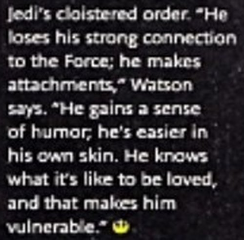
- **none** — entry/section: Watson on her favorite period: ""I have to confess that my favorite period of Star Wars was that of Last of the Jedi. There's something about that dark time, when the Empire is just forming, that caught my imagination. There could be a lot more to explore there." —Jude Watson, Star Wars Insider 102, p. 61" Source: *Star Wars Insider #102* (2008), scan p.61
  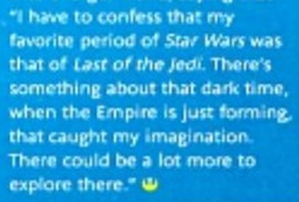

### Stat block notes (game mechanics, not feats)

- Books header: BOOKS JUDE WATSON SAYS FAREWELL (FOR NOW) WITH HER 47TH STAR WARS BOOK WORDS: JASON FRY (Jason Fry, Star Wars Insider 102, p. 61) (Source: *Star Wars Insider #102* (2008), scan p.61)
- The Last of "Last of the Jedi" (start): THE LAST OF "LAST OF THE JEDI" The Star Wars universe has had long-running series and prolific authors, but Jude Watson stands alone. For almost 50 books, she's told a tale spanning generations, chronicling the decline and fall of the Jedi Knights in the final days of the Old Republic and the first days of the new Empire. In three linked series — Jedi Apprentice, Jedi Quest, and Last of the Jedi — Watson has traced a succession of Masters and Padawans from Yoda to Dooku, Qui-Gon Jinn to Obi-Wan Kenobi and Anakin Skywalker. She's shown the bond between Jedi and their Padawans, and what happens when those bonds fray and break. She chronicled the Jedi's struggle with their proper role in the galaxy, and charted the tug of war between service to their cause and attachment to those they hold dear. Now, in Reckoning (Scholastic, $5.99), she's brought that tale to a sad but satisfying conclusion. The Last of the Jedi series began on a challenging note: Watson could only make use of Obi-Wan briefly before returning him to his exile on Tatooine. In need of a new protagonist, she made a bold choice: Ferus Olin, Anakin's bitter rival in Jedi Quest. "I could have created a new hero, but I really wanted a sense of continuity between one series and the next," Watson says, adding that "Ferus had so many things that made him ideal. He'd left the Jedi, so it made sense that he'd still be alive, but his character as it had been was also an interesting place to build from." Last of the Jedi sees Ferus become a freedom fighter and walk a tightrope between betraying the Empire from within and falling to the dark side. He's investigated the mystery of the identity of Darth Vader, and battled Vader's master alongside a cast of characters including the young >>> [continued p. 62] (Jason Fry, Star Wars Insider 102, p. 61) (Source: *Star Wars Insider #102* (2008), scan p.61)
- Pull quote: [Pull quote:] "I could have created a new hero, but I really wanted a sense of continuity between one series and the next." (Jason Fry, Star Wars Insider 102, p. 61) (Source: *Star Wars Insider #102* (2008), scan p.61)
- Spoiler Warning: Saving Ferus: SPOILER WARNING! SAVING FERUS Jude Watson talks about her rehabilitation of one of her "harder to like" characters: Ferus Olin from Jedi Quest Words: Jason Fry Jude Watson acknowledges Ferus Olin "was hard to like in Jedi Quest. He was a loner, a know-it-all. He was the Padawan who worked the hardest and had no sense of humor. I started thinking about how leaving the Jedi would have changed him. Up until that point, he lived without having to make the decisions that most of us do — not only big decisions like how to make a living, but small daily decisions. I thought about how difficult it must have been for him to suddenly have the galaxy open to him in a way it hadn't been before. When you've committed to a life of service, what do you have when that life is gone?" Her answer: Ferus was humbled — and that humility helped teach him to live a life outside the Jedi's cloistered order. "He loses his strong connection to the Force; he makes attachments," Watson says. "He gains a sense of humor; he's easier in his own skin. He knows what it's like to be loved, and that makes him vulnerable." [end mark] (Jason Fry, Star Wars Insider 102, p. 61) (Source: *Star Wars Insider #102* (2008), scan p.61)
- Always in Motion the Future Is: ALWAYS IN MOTION THE FUTURE IS How does one author approach the task of writing 47 Star Wars novels? With imagination! Words: Jason Fry So how do you get a job writing 47 books? "A long time ago, in a galaxy far far away, I got a call about writing a tie-in to the re-release of A New Hope," Watson jokes. (That was 1998's Captive to Evil, a Princess Leia diary.) Forty-six more books followed: 19 of the 20 Jedi Apprentice books (Dave Wolverton wrote the series opener); the 11 Jedi Quest books; the 10 novels that make up Last of the Jedi; and the multi-generational Legacy of the Jedi and Secrets of the Jedi. Then there's Captive to Evil, Episode I Journals for Darth Maul and Queen Amidala, and the two books in the short-lived Star Wars Science Adventures series, co-written with K. D. Burkett. For extra credit, track down three Watson short stories — you'll find "The Last One Standing" in an omnibus combining Legacy and Secrets, "Ghosts of the Sith" in [US] Star Wars Insider #88 and "Storm Fleet Warnings" on starwars.com. Watson isn't slated to write more Star Wars books at the moment, and says "I think I need a bit of a hiatus." But she won't rule out a 48th step into a larger world, saying that "I have to confess that my favorite period of Star Wars was that of Last of the Jedi. There's something about that dark time, when the Empire is just forming, that caught my imagination. There could be a lot more to explore there." [end mark] (Jason Fry, Star Wars Insider 102, p. 61) (Source: *Star Wars Insider #102* (2008), scan p.61)

## scan p.62 (scan page 62)

Page contents: Books continued (Jason Fry) with "Collect Them All! Jude Watson's Star Wars Novels" list sidebar; two Ask Lobot boxes (answers as related to Leland Y. Chee) with Force-spirit still (Anakin, Yoda, Obi-Wan) and stormtrooper photo (hand-read)

- **none** — entry/section: Watson on writer's denial: ""I was so in the moment with Jedi Apprentice that when my editor at Scholastic, David Levithan, said that at some point almost all the Jedi I'd created would have to die, it was a shock. I had pushed out of my head the eventual fate of the Jedi, which I find an amusing case of writer's denial." —Jude Watson, Star Wars Insider 102, p. 62" Source: *Star Wars Insider #102* (2008), scan p.62
  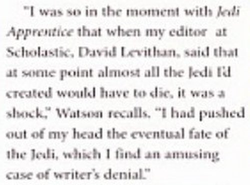

### Stat block notes (game mechanics, not feats)

- Books continued — No Happy Endings: [continued from p. 61] BOOKS continued… thief Trever Flume and former diner owner Dexter Jettster. Now, in Reckoning, these brave rebels' struggles reach their conclusion. NO HAPPY ENDINGS Not all the endings can be happy. But then a sense of gathering doom has haunted all Watson's books, giving them a weight not often seen in writing for young adults. Most readers know Qui-Gon will die, Obi-Wan will spend his last years in hiding, and the Jedi Temple will be destroyed — and knowing that, they sense the best hope for Ferus and his friends is to stay alive, not to win. "I was so in the moment with Jedi Apprentice that when my editor at Scholastic, David Levithan, said that at some point almost all the Jedi I'd created would have to die, it was a shock," Watson recalls. "I had pushed out of my head the eventual fate of the Jedi, which I find an amusing case of writer's denial." How does this sense of loss affect young readers? Watson says that "I'd assumed that the younger readers [are] reading for lightsaber battles and spaceships, but when I meet my readers, I find out that it's not true for many of them. Young readers also want to read about relationships and emotions. We tend to forget, as adults, that many children are well-acquainted with loss." Reckoning delivers more of that, but Watson offers a bit of hope: "It was important to me that there be a sense of reconciliation and redemption, too. I always kept in mind in this series that, even as it dawns on Ferus Olin and his friends that there really are no Jedi left to gather — in essence, that their mission is doomed — seeds are being planted everywhere in the galaxy for an eventual rebellion to flower." [Rebel insignia end mark] (Jason Fry, Star Wars Insider 102, p. 62) (Source: *Star Wars Insider #102* (2008), scan p.62)
- Collect Them All! sidebar: COLLECT THEM ALL! JUDE WATSON'S STAR WARS NOVELS LEGACY OF THE JEDI (88.5 BBY - 20 BBY) Legacy of the Jedi Secrets of the Jedi JEDI APPRENTICE SERIES (44 BBY - 38 BBY) The Dark Rival The Hidden Past The Mark of the Crown The Defenders of the Dead The Uncertain Path The Captive Temple The Day of Reckoning The Fight for Truth The Shattered Peace The Deadly Hunter The Evil Experiment The Dangerous Rescue Special Edition #1: Deceptions The Ties That Bind The Death of Hope The Call to Vengeance The Only Witness The Threat Within Special Edition #2: The Followers JEDI QUEST SERIES (28 BBY - 25 BBY) Path to Truth The Way of the Apprentice The Trail of the Jedi The Dangerous Games The Master of Disguise The School of Fear The Shadow Trap The Moment of Truth The Changing of the Guard The False Peace The Final Showdown LAST OF THE JEDI (18 BBY - 10 BBY) The Desperate Mission Dark Warning Underworld Death on Naboo A Tangled Web Return of the Dark Side Secret Weapon Against the Empire Master of Deception Reckoning STAR WARS: EPISODE I JOURNALS Kumbiya Padmé Amidala Darth Maul Anakin Skywalker Princess Leia (Jason Fry, Star Wars Insider 102, p. 62) (Source: *Star Wars Insider #102* (2008), scan p.62)
- Ask Lobot — Anakin's Force spirit: ASK LOBOT CLOUD CITY'S COMPUTER LIAISON OFFICER ANSWERS ALL YOUR STAR WARS QUERIES, AS RELATED TO LELAND Y. CHEE [Caption:] The mysterious Force spirit. Why does Anakin revert to the petulant younger version of himself when he becomes one with the Force at the end of Return of The Jedi and Obi-Wan stays old when he dies? [name omitted] In the original release of Return of the Jedi, the spirit of Anakin Skywalker was played by Sebastian Shaw, who portrayed the unmasked Vader earlier in the film. For the DVD release, Shaw's head was replaced in the final scene with Hayden Christensen's. According to George Lucas on the commentary on the DVD, Anakin retains his original identity as he was when he died. That is, at the point when Anakin Skywalker ceased to exist and only Darth Vader remained. (Ask Lobot, Leland Y. Chee, Star Wars Insider 102, p. 62) (Source: *Star Wars Insider #102* (2008), scan p.62)
- Ask Lobot — trooper color designations: ASK LOBOT What happened to the color designations on the trooper armor? The clone troopers in Attack of the Clones had color designations for their rank and in Revenge of the Sith, the clone troopers had color designations for the unit they were in. What happened to the color designations for the stormtrooper units in A New Hope? [name omitted] The sandtroopers in A New Hope are the only examples of original trilogy troopers who actually have rank distinctions based on color differences. Orange shoulder pauldrons indicate squad leaders, white indicate sergeants, and black pauldrons indicate enlisted personnel. While rank designations were designated by color at the Battle of Geonosis, months of battle during the Clone Wars created solidarity within units and their Jedi generals. As a result, the clone troopers began to decorate their armor to reflect this. At the same time, new generations of clone commanders gained a greater sense of individuality under the training of ARC troopers. After the creation of the Empire and the eradication of the Jedi, there was no longer any need for solidarity amongst individual units, since their loyalty now only lay with the Emperor. (Ask Lobot, Leland Y. Chee, Star Wars Insider 102, p. 62) (Source: *Star Wars Insider #102* (2008), scan p.62)

## scan p.63 (scan page 63)

Page contents: Comics (Words: Daniel Wallace): "Star Wars: Rebellion 'Vector' Hits the Classic Trilogy", "Time Warp!" (continues p64); top-right box "76 Classic Moment: The Emperor Taunts Luke" (Emperor photo); Rebellion art of Luke and Celeste Morne; clone trooper photo; box "Dark Horse Launches Two New Titles" with The Clone Wars logo and "Sneak Peek!" tag (hand-read)

- **Celeste Morne** — entry/section: Williams on Celeste: ""But Celeste's been abandoned for thousands of years with the ghost of an ancient Sith for company. She's not really in a Q&A type of mood." —Rob Williams, Star Wars Insider 102, p. 63" Source: *Star Wars Insider #102* (2008), scan p.63
  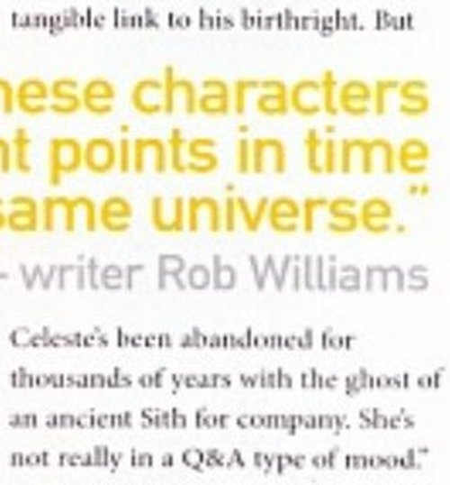

### Stat block notes (game mechanics, not feats)

- Top-right box: [Top-right box:] 76 CLASSIC MOMENT: THE EMPEROR TAUNTS LUKE (Star Wars Insider 102, p. 63) (Source: *Star Wars Insider #102* (2008), scan p.63)
- Comics — Time Warp!: COMICS STAR WARS: REBELLION "VECTOR" HITS THE CLASSIC TRILOGY WORDS: DANIEL WALLACE TIME WARP! "Vector," the year-long crossover running through all of Dark Horse's ongoing Star Wars titles, has raced from the ancient past of Knights of the Old Republic through the prequel timeframe of Empire. Now that the threat has grown in strength, it menaces the nostalgic heart of the saga: the classic trilogy era of Han, Luke, and Leia. Rebellion #15 kicks off a two-part crossover that introduces a Jedi of the Old Republic, Celeste Morne, to Luke Skywalker — a novice fresh from the destruction of the Death Star who is eager to learn the ways of the Force. When Luke meets Celeste, a living history book, it seems that his wishes have come true. "Obi-Wan told him his father was a Jedi, started him on the path to the Force, and then he was cut in half by Vader," says writer Rob Williams (2000AD, Indiana Jones and the Temple of the Gods). "Now Luke has all these questions and no one to ask. Like an adopted child, he's desperately looking for a tangible link to his birthright. But Celeste's been abandoned for thousands of years with the ghost of an ancient Sith for company. She's not really in a Q&A type of mood." Taking up the "Vector" storyline required Williams to raise the stakes while simultaneously setting the [continues p. 64] [Pull quote:] "You buy that these characters exist at different points in time in the same universe." — writer Rob Williams (Daniel Wallace, Star Wars Insider 102, p. 63) (Source: *Star Wars Insider #102* (2008), scan p.63)
- Dark Horse Launches Two New Titles box: DARK HORSE LAUNCHES TWO NEW TITLES With the fall launch of the all-new animated The Clone Wars television series (preceded by a theatrical premiere on August 15), Dark Horse is rolling out a Clone Wars assault on all fronts. First up is a new monthly The Clone Wars series distributed to the comics specialty and newsstand markets. Appearing at the same time, in bookstores and comics markets, is a quarterly series of digest-sized graphic novellas, similar to 2004-2007's Clone Wars Adventures but with full-length stories instead of collections of short tales. Both series will feature the stylized, chunky character designs that are a trademark of the computer-animated show. Providing further continuity is the involvement of Henry Gilroy, head writer for the animated series' first season. Gilroy is writing the majority of the scripts for both the monthly comic and the comic digests to ensure that the stories are true to the flavor of their inspiration. Both series will debut in September. Look for a detailed, behind-the-scenes look at the new projects in the next issue of Star Wars Insider. [end mark] [Logo:] STAR WARS THE CLONE WARS SNEAK PEEK! (Daniel Wallace, Star Wars Insider 102, p. 63) (Source: *Star Wars Insider #102* (2008), scan p.63)

## scan p.64 (scan page 64)

Page contents: Comics continued (Daniel Wallace): KOTOR/Vector art; Incoming release box (top-right); "The Jedi Conspiracy Busts Wide Open" sidebar; Ask Lobot box on Revenge of the Sith Visual Dictionary background characters with photos captioned Sweitt Concorkill, Veedaaz Awmetth, Solipo Yeb (hand-read)

### Stat block notes (game mechanics, not feats)

- Comics continued: COMICS continued… stage for the crossover's conclusion in Star Wars Legacy, set more than 130 years later. "For me, the vital thing was making sure that Celeste's encounter with Luke feels important to both of them and not just a contrived crossover tale. Celeste is on a journey in "Vector" and Rebellion is where she makes a definite move in a certain direction — either towards the light or the dark." Even though he's dealing with the most iconic characters of all, Williams didn't feel any disconnect when working them into a centuries-spanning storyline. "You buy that all these characters exist at different points in time in the same universe, and 'Vector' directly connects them all. There's a moment I liked where, in slightly cryptic form, Celeste asks Luke if he's been sent by Zayne Carrick. That's great, to feel that Luke is just one person removed from meeting an Expanded Universe character from another age." [end mark] (Daniel Wallace, Star Wars Insider 102, p. 64) (Source: *Star Wars Insider #102* (2008), scan p.64)
- Incoming box (top-right): [Top-right box:] INCOMING June 11 STAR WARS: DARK TIMES #12 Mick Harrison, Dave McCaig, and Douglas Wheatley. Part five of "Vector" puts the smuggling crew of the Uhumele in their toughest predicament yet. Darth Vader confronts the legacy of the ancient Sith — and the ancient Jedi — as the Star Wars event of the year wraps its second chapter! June 18 STAR WARS: LEGACY #25 John Ostrander, Jan Duursema, Dan Parsons and Brad Anderson. Danger comes to the most secret location in the galaxy as Cade Skywalker travels there with a mission of upmost [sic] importance! An undetected pursuer may put his clandestine destination at terrible risk! Discover the Hidden Temple, but enter at your own risk! June 18 STAR WARS OMNIBUS: DROIDS Those two troublesome droids amazing [sic] early adventures are revealed in this 440-page collection! June 25 STAR WARS: KNIGHTS OF THE OLD REPUBLIC #30 John Jackson Miller, Bong Dazo, Michael Atiyeh, and Dustin Weaver. Zayne Carrick faces off against one of the Jedi Masters who framed him for the murder of his fellow Padawans in this shocking conclusion to the two-part "Exalted" story arc! (Daniel Wallace, Star Wars Insider 102, p. 64) (Source: *Star Wars Insider #102* (2008), scan p.64)
- The Jedi Conspiracy Busts Wide Open: THE JEDI CONSPIRACY BUSTS WIDE OPEN Over in Knights of the Old Republic, the "Vector" baton has been passed to other comics. John Jackson Miller, who used his "Vector" issues to expose secrets behind the Jedi Covenant that has framed Zayne Carrick for murder, now moves into the three-part "Exalted"/"Turnabout," which sets up the end game in Zayne's plan to clear his name and take revenge on his betrayers. Issues #29-31 take Zayne and his con-artist tagalong Marn "Gryph" Hierogryph to Odryn, the previously unseen world of the tentacle-headed Feeorin people and all the way to the galaxy's capital, Coruscant. On the way they discover a dumping ground for forbidden Sith artifacts, have a run-in with the Republic Navy, and come closer to a face-to-face encounter with Master Lucien, Zayne's former teacher and the mastermind behind the Covenant plot — not to mention the newest member of the Jedi Council. "From the beginning, Zayne has found himself an unwilling pawn in a much larger game: a tug-of-war over the Jedi Order," says Miller. "Revan's crusaders want the Jedi involved in the war against the Mandalorians; Lucien and the Covenant believe the Mandalorians are a distraction from the real danger, the potential return of the Sith. Zayne's attempts to uncover the Covenant would change the dynamic — although perhaps not in ways he or our readers might expect!" The series has been building momentum since issue #1, as Zayne struggles for exoneration and the Mandalorian invaders seize even more territory. But there's something fishy going on with the Mandalorians, who seem to have achieved their recent successes using very non-Mandalorian methods. More revelations are in store for supporting character Jarael, who has earned the attention of many others, including some who find her secrets worth killing for. "It's all a set up for our story for later this year, called simply 'Vindication,'" explains Miller. "But that title doesn't necessarily mean what readers might think. Stay tuned!" [end mark] (Daniel Wallace, Star Wars Insider 102, p. 64) (Source: *Star Wars Insider #102* (2008), scan p.64)
- Ask Lobot — Visual Dictionary background characters: ASK LOBOT Who are the characters Veedaaz Awmetth, Solipo Yeb, and Sweitt Concorkill mentioned in Revenge of the Sith: The Visual Dictionary? Which species do they belong to, and what planets are they from? [name omitted] During production, reference photos are taken of many of the background characters regardless of whether it is known if they will be visible in the final film. Veedaaz Awmetth is from the planet Sarrish, but his species is unknown. Solipo Yeb is a human, but his home planet is unknown. Though he wears an "Andalian cloak," we don't assume the name of his planet. The story of Sweitt Concorkill is a bit more complex in that the original Revenge of the Sith: The Visual Dictionary showed an incorrect image of the Vurk Senator from Sembla. The image was corrected for Star Wars: The Complete Visual Dictionary. [Captions:] Sweitt Concorkill / Veedaaz Awmetth / Solipo Yeb (Ask Lobot, Leland Y. Chee, Star Wars Insider 102, p. 64) (Source: *Star Wars Insider #102* (2008), scan p.64)

## scan p.65 (scan page 65)

Page contents: Ad: Collectible Grading Authority (CGA) — museum-style display of a graded carded Return of the Jedi figure with a security guard; sub-brand logos CDA, VGA (New), AFA, DCA (hand-read)

### Stat block notes (game mechanics, not feats)

- CGA ad: Collectible Grading Authority The World's Largest Toy Grading Service Since 2000 Visit us at www.toygrader.com Print Our Submission Form Online and Mail to: [postal address omitted] Email: [email omitted] Phone: [phone number omitted] The Ordinary Becomes Extraordinary, and You Own It. [Logos:] CDA New VGA AFA DCA (CGA advertisement, Star Wars Insider 102, p. 65) (Source: *Star Wars Insider #102* (2008), scan p.65)

## scan p.66 (scan page 66)

Page contents: Space Gear (Words: Jeremy Beckett): "Pigs In... Magic Kingdom!" on Disney Muppets/Star Wars vinyl figures (photo of Gonzo as Vader, Beaker as C-3PO, Kermit as Luke, Miss Piggy as Leia, Fozzie as Chewbacca, Rizzo as Yoda); top-right International Collectibles box (Words: Gus Lopez) on Japanese Panasonic George Lucas/C-3PO standee; Ask Lobot box on Porkins ejecting (hand-read)

### Stat block notes (game mechanics, not feats)

- Pigs In... Magic Kingdom!: SPACE GEAR INSIDER ROUNDS UP THE LATEST MUST HAVE STUFF WORDS: JEREMY BECKETT PIGS IN... MAGIC KINGDOM! Veteran Star Wars fans will have fond memories of the crazy capers of Jim Henson's The Muppet Show — especially the "Pigs In Space" serial and the 1980 The Empire Strikes Back special in which Mark Hamill, Peter Mayhew, and Anthony Daniels guest starred. Viewers will remember how Luke and the droids gatecrashed the show in search of Chewbacca, who had been kidnapped by Dearth Nadir (aka Gonzo the Great), and Mark Hamill (posing as Luke's "cousin") stepped in as the guest presenter. Disney first started selling cross-over Disney/Star Wars products in conjunction with the popular Star Wars Weekends in 2005 with the Yoda & Jedi Mickey two-pack, and expanded the range further with a number of mash-up figures, die-cast cars, and pins. In July of this year the Muppets will finally get their due as a boxed set of six vinyl figurines: Fozzie as Chewbacca, Beaker as C-3PO, Rizzo as Yoda, Kermit as Luke, Miss Piggy as Princess Leia and, best of all, Gonzo as Darth Vader. (Fans of these maniacal puppet might [sic] recall that only Gonzo and Miss Piggy appeared in Star Wars garb on TV, while Kermit and Fozzie later materialized in a 1983 issue of Muppet Magazine.) These figures will only be available at selected Disney Parks with the Star Tours ride, so if you were planning on going to any of the Disney Parks this year make sure to keep your mouseket-ears pressed firmly to the ground because these are sure to be a phenomenon! [end mark] (Jeremy Beckett, Star Wars Insider 102, p. 66) (Source: *Star Wars Insider #102* (2008), scan p.66)
- International Collectibles — Japan (top-right box): [Top-right box:] WORDS: GUS LOPEZ INTERNATIONAL COLLECTIBLES WEIRD AND WONDERFUL STAR WARS STUFF FROM AROUND THE GLOBE GEORGE LUCAS AND C-3PO PANASONIC CARDBOARD STAND-UP JAPAN The years following the original trilogy release were the most challenging ones for finding licensed Star Wars product. During this era, collectors could count the number of collectibles produced on their fingers, but one rare exception was the Panasonic promotion in Japan in 1987 to 1991; it used Star Wars characters and even their creator, George Lucas. Lucas appeared in various posters, store displays, and even television commercials in Japan to promote Panasonic electronic products. The item pictured here is a small table top standee for retail stores that featured Lucas holding a Panasonic camera while standing alongside C-3PO, and a similar image was also used on a larger-scale poster. Images from this Panasonic campaign included characters like Wicket, Chewbacca, Jabba the Hutt, C-3PO, R2-D2, Darth Vader, and Yoda, and due to their scarcity, high grade pieces can fetch top dollar today. Although it may seem unusual to have George Lucas on a product ad, it is not uncommon to have top American celebrities promoting products in Japan, such as Harrison Ford's (non-Star Wars) beer commercials during the same period. [Standee text:] マックロード いつも SOMETHING NEW (Gus Lopez, Star Wars Insider 102, p. 66) (Source: *Star Wars Insider #102* (2008), scan p.66)
- Ask Lobot — Porkins ejecting: ASK LOBOT In A New Hope, Biggs suggests that Porkins eject from his X-wing. Had he been able to do so, how would Porkins have survived in space and escaped the battle? [name omitted], via Internet Anyone who saw poor "Goose" buy it in Top Gun knows that ejecting from any fighter craft in the heat of battle is a risky proposition. But yes, the X-wing is equipped with an ejection system. Of course, had he survived the launch of the ejection seat, he would have had to pray that an Alliance retrieval vehicle would arrive to pick him up. The likelihood of that happening with space around the Death Star crawling with TIE fighters and about 20 minutes to go before Luke blows the Death Star to smithereens are probably worse than the odds of successfully navigating an asteroid field. (Ask Lobot, Leland Y. Chee, Star Wars Insider 102, p. 66) (Source: *Star Wars Insider #102* (2008), scan p.66)

## scan p.67 (scan page 67)

Page contents: Toys (Words: Jeremy Beckett) intro and LEGO Clone Wars sets with product photos (Republic Gunship, V-19 Torrent, MagnaGuard Starfighter, AT-TE Walker); "Must Have!" badge; Porkins photo (illustrates p66 Ask Lobot); "More Toys Next Page" tag (hand-read)

### Stat block notes (game mechanics, not feats)

- Toys — LEGO Clone Wars sets: TOYS THE CIRCLE IS COMPLETE: WHAT STARTED IN ATTACK OF THE CLONES AND BECAME AN ANIMATED MICRO-SERIES IS ABOUT TO COME FULL CIRCLE WITH AN ALL-NEW COMPUTER ANIMATED MOVIE AND TV SHOW! ALL THE STAR WARS LICENSEES ARE READY. ARE YOU? WORDS: JEREMY BECKETT LEGO CLONE WARS SETS Late in 2007 fans were treated to a sneak peek at the new Clone Wars line when LEGO released Anakin Skywalker's Jedi starfighter but since then it's been all quiet on the Outer Rim. With the launch of The Clone Wars movie followed by the TV series this fall, LEGO is making a pre-emptive strike and deploying its armies in advance of the onslaught. Fans can look forward to a full range of small, medium, and large sets to build and display. Look for all these new construction toys in August! REPUBLIC GUNSHIP Features crew bay doors that open and close, flick-firing action, and separate speeder bike. Includes seven mini-figures: four Clone Troopers, Obi-Wan Kenobi, Plo Koon, and Asajj Ventress. 1,034 pieces/$119.99 V-19 TORRENT Includes a geared wing and landing system, flick-firing action, opening cockpit, and new clone trooper pilot. 471 pieces/$54.99 MAGNAGUARD STARFIGHTER Includes opening cockpit and engine compartments, and two MagnaGuard mini-figures. 421 pieces/$44.99 AT-TE WALKER The six-legged AT-TE model features flick-firing action and hatches that open to reveal a detailed cabin and crew bay. Includes two clone troopers, battle droid on STAP, Anakin Skywalker, Ahsoka, and Rotta mini-figures. 798 pieces/$89.99 MUST HAVE! MORE TOYS NEXT PAGE >>> (Jeremy Beckett, Star Wars Insider 102, p. 67) (Source: *Star Wars Insider #102* (2008), scan p.67)

## scan p.68 (scan page 68)

Page contents: Toys continued (Jeremy Beckett): Hasbro The Clone Wars figure line-up photo (Obi-Wan, Anakin, R2-D2, Yoda, Grievous, Captain Rex, battle droid, clone trooper); Ask Lobot box on Death Star plans; Sideshow Asajj Ventress Premium Format Figure (black panel, "Must Have!" badge) (hand-read)

### Stat block notes (game mechanics, not feats)

- Hasbro The Clone Wars Action Figures… and More!: HASBRO THE CLONE WARS ACTION FIGURES... AND MORE! Hasbro will be offering a new line of 3-3/4" The Clone Wars action figures based on the animated styling of the new movie and TV series. The basic first wave includes Obi-Wan Kenobi, Anakin Skywalker, R2-D2, Yoda, General Grievous, Captain Rex, Trade Federation Battle Droid, and Clone Trooper. Now underway is a mail-in offer for an exclusive Captain Rex figure with a 3-D diorama. In Hasbro's popular The Legacy Collection there will be 36 Droid Factory basic figures across five waves. Droid Factory delivers a unique "bonus" part with each new figure in the lineup, which can be combined to form unique, never-before-produced droids: six different astromechs and two new protocol droids. One Legacy wave is comprised of "realistically" styled original Clone Wars micro-series figures. There will also be 12 new comic pack collections based on Dark Horse comic stories. (Jeremy Beckett, Star Wars Insider 102, p. 68) (Source: *Star Wars Insider #102* (2008), scan p.68)
- Sideshow Asajj Ventress Premium Format Figure: SIDESHOW ASAJJ VENTRESS PREMIUM FORMAT FIGURE The mistress of the Sith began her career in the Force as a Jedi but fell to the dark side at an early age. Following his defeat on Geonosis, Dooku discovered her prodigious talents and she became his dark acolyte. During the Clone Wars she assassinated a number of Jedi on Dooku's orders and went on to wage a personal war against Obi-Wan Kenobi and his padawan, Anakin. This Premium Format figure is 1/4th scale (about 18 inches tall) and made of polystone with mixed media costuming. The detailing on Asajj Ventress makes her an ideal display piece in a more artistic style than the previous 12" version. Pre-orders are open now and this is due to ship in the third quarter of 2008. Price $249.99. MUST HAVE! (Jeremy Beckett, Star Wars Insider 102, p. 68) (Source: *Star Wars Insider #102* (2008), scan p.68)
- Ask Lobot — Death Star plans: ASK LOBOT In the opening crawl of Episode IV, we are told that the retrieving of the Death Star plans is the Rebels' first major victory. In the deleted scenes of Revenge of the Sith, the Rebel Alliance is set up, so how could they go 19 years without a major victory, then destroy two Death Stars and the Emperor in three years? Also how did they get the plans, as in the game Lethal Alliance your character finds them? I have heard of other ways the plans were "liberated" as well. [name omitted] via Internet From the novelization of Revenge of the Sith, we learn that the actions of the Delegation of Two Thousand exposed them as a threat to Palpatine's power. Upon declaring himself Emperor, Palpatine begins to deal with this threat almost to the point of declaring the Delegation as enemies of the state. Like Obi-Wan and Yoda, Senators such as Bail Organa, Mon Mothma, and Garm Bel Iblis are forced to conceal their opposition to the Empire until it is time to strike. Without the Jedi or any sort of military backing, any attempts to openly go against the Empire beforehand would be useless. The Rebel Alliance (aka the Alliance to Restore the Republic), does not officially declare its opposition to the Empire until a couple of years before Episode IV. The retrieval of the plans is a favored story told multiple times in various ways by Star Wars game developers and authors, each of which contains elements of the full story. So yes, Rianna Saren from Lethal Alliance was involved, as was Kyle Katarn, mentioned in the same game, and featured in the very first level of Dark Forces. Plus there were scores of other Rebel agents involved in transmitting the plans to Leia's ship as depicted in the X-wing games, the A New Hope radio drama, and the novel Rebel Dawn. (Ask Lobot, Leland Y. Chee, Star Wars Insider 102, p. 68) (Source: *Star Wars Insider #102* (2008), scan p.68)

## scan p.69 (scan page 69)

Page contents: Toys continued (left half): Gentle Giant Shaak Ti and Aayla Secura mini-busts photo and text; Funko Clone Wars bobbleheads (General Grievous, Anakin, Rex). Right half: Kotobukiya Evangelion 1.0 Misato Katsuragi statue ad (hand-read)

### Stat block notes (game mechanics, not feats)

- Gentle Giants Mini-Busts: GENTLE GIANTS MINI-BUSTS Two of the most fearsome female Jedi — Shaak Ti and Aayla Secura — get the Gentle Giant mini-bust treatment this June. Aayla Secura first served the Republic as a rookie Jedi Knight when she joined the 200 Jedi who went to Geonosis to rescue Obi-Wan Kenobi, Padmé Amidala, and Anakin Skywalker from Count Dooku. Afterwards she became a general and commanded the 327th Star Corps and fought at the Outer Rim sieges. Her mini-bust is part of a limited run of 4250, stands eight inches tall, and will retail at $55 when it is released. Prior to the start of the Clone Wars Shaak Ti served on the Jedi Council as Yaddle's replacement. With the escalation of Separatist violence she soon found herself serving as a General, and witnessed action on Geonosis, Ando, Kamino, Hypori, Brentaal IV, Coruscant, Dagu, and countless other worlds in defense of the Republic. The 1/6th scale mini-bust of Shaak Ti is limited to 4000 units and will cost $55. (Jeremy Beckett, Star Wars Insider 102, p. 69) (Source: *Star Wars Insider #102* (2008), scan p.69)
- Funko Clone Wars Bobbleheads: [Captions:] GENERAL GRIEVOUS / ANAKIN / REX FUNKO CLONE WARS BOBBLEHEADS Caricature or collectible? Either way these wobbly-headed space oddities from Funko get a makeover this summer, just in time for the start of The Clone Wars. The first assault includes Anakin Skywalker, Captain Rex, and the scourge of the Jedi, General Grievous! Look for these in August and expect to pay $19.99 each. (Jeremy Beckett, Star Wars Insider 102, p. 69) (Source: *Star Wars Insider #102* (2008), scan p.69)
- Kotobukiya Evangelion ad: FROM THE NEW MOVIE ヱヴァンゲリヲン新劇場版 EVANGELION:1.0 YOU ARE (NOT) ALONE. GOD'S IN HIS HEAVEN. Direct from Japan EVANGELION : 1.0 MISATO KATSURAGI 7 1/2" TALL 1/6th SCALE STATUE Available NOW ! © カラー・GAINAX KOTOBUKIYA Prototypes shown; final products may vary. www.Koto[cut].com (Kotobukiya advertisement, Star Wars Insider 102, p. 69) (Source: *Star Wars Insider #102* (2008), scan p.69)

## scan p.70 (scan page 70)

Page contents: Bounty Hunters (sponsored by Kotobukiya; Boba Fett art header, Kotobukiya Vader-vs-Luke statue): reader photo submission with Anthony Daniels at Celebration IV; "Bounty Winner!" badge; "Can You Go One Better?" strip. Reader's name and photos' subject not identified (hand-read)

### Stat block notes (game mechanics, not feats)

- Bounty Hunters — Just the Droid He's Looking For!: BOUNTY HUNTERS KOTOBUKIYA MEET THE STARS, SHOW THE EVIDENCE, WIN THE BOUNTY! INSIDER'S BOUNTY HUNTER SECTION IS SPONSORED BY KOTOBUKIYA. EACH WINNER WILL RECIEVE [sic] A SUPER KOTOBUKIYA STAR WARS STATUE WORTH ABOUT $100. JUST THE DROID HE'S LOOKING FOR! I loved the lines outside of the LA Convention Center's Celebration IV! I walked the lines taking pictures of costumes and meeting fellow Star Wars fans. It seems that most fans click with a common bond. Suddenly, I heard my husband frantically screaming my name. He said, "Anthony Daniels just tapped me on my shoulder and nonchalantly cut through the line!" I replied "yeah, right". Then I looked about 30 feet in front of us and there he stood! I was wearing my custom made C-3PO T-shirt that says 'Chicks dig droids' on the back. I ran to him like I have never ran [sic] before and pointed at my T-shirt and everything around us stopped. A crowd began to gather. To see the C-3PO shirt better, he helped unbutton a knit vest that I had on top of it. We talked, I kissed him on the cheek and said goodbye. I cried all the way back to my husband in line. I will never forget when "C-3PO" interacted with me on the streets of LA! He is approachable, kind and we thoroughly enjoyed his discussion panel where I learned all about C-3PO's cereal! What a truly talented artist. I love you Anthony, thanks for making my millennium! [name omitted] Thanks for sending in these photos [name omitted]. We didn't know protocol droids could be quite so flirtatious! BOUNTY WINNER! CAN YOU GO ONE BETTER? CAN YOU GUYS GO ONE BETTER? HAVE YOU HUNG OUT WITH HARRISON FORD? OR MAYBE YOU CUDDLED CHRISTOPHER LEE? WE WANT TO SEE YOUR PHOTOS! (Star Wars Insider 102, p. 70) (Source: *Star Wars Insider #102* (2008), scan p.70)

## scan p.71 (scan page 71)

Page contents: Ad: The Force Among Us documentary DVD (globe logo; two location photos of costumed fans in desert and snow) (hand-read)

### Stat block notes (game mechanics, not feats)

- The Force Among Us ad: THE FORCE AMONG US THIS IS NO FAN FILM AND THIS IS NOT THE STAR WARS™ VERSION OF TREKKIES! The Force Among Us is the first high-profile documentary that celebrates 30 years of diversity in Star Wars fandom while dispelling the stereotypes that are all too often attributed to Star Wars fans. Directed by the brother and sister team of Cristan and Cortney Macht (passionate Star Wars fans) and filmed by the Hollywood team of Frank Yario (Spider-Man 2) and Rick Thomas (Flags of Our Fathers and Prison Break) The Force Among Us is a journey into the minds of Star Wars fans. FILMED ON LOCATION IN FINSE, NORWAY (HOTH) AND TUNISIA (TATOOINE) Includes rare and exclusive interviews with: + Dan Madsen (former president of the Star Wars Fan Club and Founder of Star Wars Insider) + Members of the 501st + Dick Staub (author of Christian Wisdom of the Jedi Masters) + [name omitted] ([fan URLs omitted]) and many others! "Enjoyable and Heartfelt" - [name omitted] (Founder of the 501st) "This film belongs on your shelf next to the original three Star Wars movies!" - [name omitted], Host of The Force-Cast "FUN, ENTERTAINING, ECLECTIC" - KYLE NEWMAN (Director of Fanboys) THE LIMITED EDITION DVD IS AVAILABLE FOR ONLY $19.77 (PLUS SHIPPING) ORDER YOURS TODAY BEFORE THEY ARE SOLD OUT AT WWW.THEFORCEAMONGUS.COM This film is not authorized or affiliated with Lucasfilm Ltd. in any way. Star Wars is (c) 2008 Lucasfilm Ltd. and TM. All rights reserved. (The Force Among Us advertisement, Star Wars Insider 102, p. 71) (Source: *Star Wars Insider #102* (2008), scan p.71)

## scan p.72 (scan page 72)

Page contents: Bantha Tracks Vol. 32 opener "The Worldwide Celebration" (header "VOL. 32 BANTHA TRACKS BY THE FANS, FOR THE FANS"; spine "BANTHA TRACKS: BY THE FANS FOR THE FANS"); photos: stormtroopers greeting visitors at the Exhibit Hall, fan in line with a sign; Bantha Tracks Submission Guidelines box ([email omitted]; c/o Mary Franklin, [postal address omitted]); footer "GET IN TRACKS!" (hand-read)

### Stat block notes (game mechanics, not feats)

- Bantha Tracks: The Worldwide Celebration: Star Wars Celebration Japan is on the horizon, next month in the Land of the Rising Sun. Star Wars fandom is certainly a worldwide phenomenon, and people from all over are gearing up to have a wonderful time for three days in Tokyo, July 19-21. As fans look forward to all the good memories they will take home from Celebration Japan, the first official Star Wars Celebration in that country, Bantha Tracks looks back with some of your favorite images and memories from Celebrations past. [Caption:] Stormtroopers stand ready to greet visitors to the "biggest Star Wars party ever." Photo by [name omitted] [Caption:] The line starts here. "Celebration IV was a blast!" writes [name omitted]. "Just as Celebration III was. The best two vacations I have ever had. Can't wait for five!" (Bantha Tracks, Star Wars Insider 102, p. 72) (Source: *Star Wars Insider #102* (2008), scan p.72)
- Bantha Tracks Submission Guidelines: BANTHA TRACKS SUBMISSION GUIDELINES Any original art, envelope art, comics, illustrations, news, stories, meeting information, or any materials voluntarily submitted become the property of Bantha Tracks. No compensation will be given for voluntary submissions, and there is no guarantee of publication. Submissions will not be returned. Each submission must include the creator's name, age, contact information, date the work was created, and a statement that the work is original, created by the person submitting it, and that the person is a member of the Official Star Wars Fan Club. Send electronic files to [email omitted] or send your snail mail to Bantha Tracks, c/o Mary Franklin, [postal address omitted] (Bantha Tracks, Star Wars Insider 102, p. 72) (Source: *Star Wars Insider #102* (2008), scan p.72)

## scan p.73 (scan page 73)

Page contents: Bantha Tracks photo page: Dave Filoni with young fans in Celebration Exhibit Hall (Chewbacca costume, Ahsoka cosplayer); Chewbacca costumer hugging a fan; Anthony Daniels with a young fan holding a C-3PO photo; stormtrooper at a coffee stand; Bantha Tracks logo top-right; folio "INSIDER 73" (hand-read)

### Stat block notes (game mechanics, not feats)

- Bantha Tracks: Celebration captions: [Caption:] The Clone Wars Supervising Director, Dave Filoni meets new fans in the Celebration Exhibit Hall. "Dave was so cool to everyone he met," writes [name omitted], who snapped the photo. "You could tell he was having as much fun as the rest of us fans." New looks at The Clone Wars will be a special treat for fans at Celebration Japan. [Caption:] [name omitted] caught this couple muzzle-to-muzzle. [Caption:] Meeting Star Wars heroes and celebrities is a highlight of the Celebrations. Here, [name omitted] meets Anthony Daniels, the actor behind C-3PO. Photo by [name omitted] [Caption:] Some favorite things have worldwide appeal – like a good cup of coffee and Star Wars. Photo by [name omitted] (Bantha Tracks, Star Wars Insider 102, p. 73) (Source: *Star Wars Insider #102* (2008), scan p.73)

## scan p.74 (scan page 74)

Page contents: Bantha Tracks: "The Way We Were...." box (Chris Spitale, Lucasfilm, childhood photo with action figures and current photo); Editorial by Mary Franklin "The Worldwide Celebration" (Fun, Celebrities, Community, Charity, Creativity, Family); Bantha Tracks logo top-right; footer "GET IN TRACKS!"; folio "74 INSIDER" (hand-read)

- **none** — entry/section: Spitale on his first Luke figure: ""I believe this Luke was fairly new, as I actually flushed my first Luke (who was my very first Star Wars action figure) down the toilet by accident the same day I got it." —Chris Spitale, Star Wars Insider 102, p. 74" Source: *Star Wars Insider #102* (2008), scan p.74
  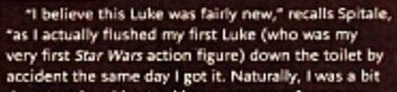

### Stat block notes (game mechanics, not feats)

- The Way We Were....: Chris Spitale, Manager of Global Product Development at Lucasfilm, remembers insisting that his favorite action figures be in the photo with him when he lost his first tooth. "I believe this Luke was fairly new," recalls Spitale, "as I actually flushed my first Luke (who was my very first Star Wars action figure) down the toilet by accident the same day I got it. Naturally, I was a bit devastated and kept asking my parents for a new one, because at the time, I remember the figures being so popular that it was hard to find all of the main characters at the local stores back home." Spitale still appreciates the value of great action figures. His job with Lucas Licensing involves the development of soon-to-be-coveted Star Wars collectibles. (Bantha Tracks, Star Wars Insider 102, p. 74) (Source: *Star Wars Insider #102* (2008), scan p.74)
- Editorial: The Worldwide Celebration: With Celebration Japan coming up in a few short weeks, reading letters and seeing pictures sent in by readers who recall their memories from Celebrations past makes anticipation for the new show even more keenly felt. We are a worldwide fan community, and these Celebrations give us the opportunity to get together with other fans who share our love for Star Wars. As you remember past Celebrations, what stands out the most in your memory? FUN. You don't have to look very far at all at a Celebration to see that fans are having fun. Laughing at rolling droids, playing new games with their kids, watching a great show, shopping for collectibles, strolling through a unique exhibit or art show. There is non-stop entertainment, plus fans excel at making up fun all on their own. CELEBRITIES. Whether they are actors from the movies, famous folks who love Star Wars, or crewmembers who make the magic happen, celebrities are accessible at the Celebrations. Fans can hear them on stage, meet them in the autograph hall, and often are able to ask them questions and hear their unique views on being a part of the saga. COMMUNITY. Stars are certainly a vital part of the Celebrations, but a shared sense of community might be just as important for fans. Fans travel to be with their fellow fans and celebrate their passion for the Star Wars saga together. CHARITY. Even though they have traveled, sometimes halfway around the world, to attend a Celebration, fans in clubs and organizations often spend their time and talent raising money for charities and doing good deeds for the local community. The 501st and Rebel Legions often schedule local children's hospital visits, calling on the many costumed characters in town to help spread good Star Wars cheer. CREATIVITY. The Kessel Run. The Galactic Games. Costume Contests. Celebration Star. Costuming Panels. Fans have a knack for adding some of the best entertainment to the Celebrations through their creativity and talent. FAMILY. Many Star Wars fans today grew up loving Star Wars. The saga profoundly affected them as kids, and now they share that same passion and sense of fun with their own kids. Families abound at the Celebrations, and family attendance is definitely on the rise. The Celebrations continue! See you in Japan, and then maybe here in the pages of Bantha Tracks. GET IN TRACKS! Mary Franklin (Editor, Bantha Tracks) (Mary Franklin, Star Wars Insider 102, p. 74) (Source: *Star Wars Insider #102* (2008), scan p.74)

## scan p.75 (scan page 75)

Page contents: Ad: Things From Another World (tfaw.com, "SINCE 1979"; "NO MATTER WHAT YOU'RE INTO, WE'VE GOT JUST THE THING FOR YOUR COLLECTION!"; "With hundreds of in-stock Star Wars® products and dozens more being added each month, it's easy to see that Things From Another World has just the thing for your collection!"; "Hurry over to www.TFAW.com/Offer/Bossk for discounted shipping on your next order!"; Star Wars Omnibus "400+ PAGES OF COMICS IN EACH VOLUME!"; "NEW COMICS EVERY MONTH!"; Kotobukiya Vinyl Statues (Bossk, 4-LOM); Limited Edition Han Solo Statue; Star Wars: Legacy, Dark Times and Knights of the Old Republic comics; logos Star Wars, Kotobukiya, Hasbro, DC, Marvel, Dark Horse; © 2008 Lucasfilm fine print) (hand-read)

## scan p.76 (scan page 76)

Page contents: Classic Moment: "The Emperor Taunts Luke" (Episode VI "REURN [sic] OF THE JEDI" [DVD CHAPTER 28]; Return of the Jedi 1983 [SCRIPT]); What They Said box (Ian McDiarmid, Mark Hamill); Why It's a Classic box; photo of the Emperor on the Death Star throne room; spine "CLASSIC MOMENT"; footer "NEXT: TAUN WE SHOWS OBI-WAN THE CLONE ARMY"; folio "76 INSIDER" (hand-read)

### Stat block notes (game mechanics, not feats)

- Classic Moment: The Emperor Taunts Luke (script): On the Death Star, Luke Skywalker battles his father, Darth Vader, as the evil Emperor watches. Slashing Vader's right hand off at the wrist, Luke holds the blade of his sword to the Dark Lord's throat. The Emperor watches with uncontrollable, pleased agitation... EMPEROR: Good! Your hate has made you powerful. Now, fulfil your destiny and take your father's place at my side! Luke looks at his father's mechanical hand, then to his own mechanical, black-gloved hand, and realizes how much he is becoming like his father. He makes the decision for which he has spent a lifetime in preparation. Luke switches off his lightsaber. LUKE: Never! Luke casts his lightsaber away. LUKE: I'll never turn to the dark side. You've failed, Your Highness. I am a Jedi, like my father before me. The Emperor's glee turns to rage. EMPEROR: So be it... Jedi. If you will not be turned, you will be destroyed. The Emperor raises his arms towards Luke. Blinding bolts of energy, evil lightning, shoot from the Emperor's hands at Luke with such speed and power the young Jedi shrinks before them, his knees buckling. Vader struggles to his feet and moves to his Master's side. EMPEROR: Young fool... Only now, at the end, do you understand. Luke is almost unconscious beneath the continuing assault of the Emperor's lightning. EMPEROR: You're [sic] feeble skills are no match for the power of the dark side. You have paid the price for your lack of vision. Luke writhes on the floor in unbearable pain, reaching weakly up toward where Vader stands watching. LUKE (groans): Father, please. Help me. EMPEROR: Now, young Skywalker... You will die. (Classic Moment, Star Wars Insider 102, p. 76) (Source: *Star Wars Insider #102* (2008), scan p.76)
- Classic Moment: Why It's a Classic: Perhaps the key moment around which the Star Wars saga revolves, Luke refuses to fight and become his father's replacement at the Emperor's side. Despite the pain of the Emperor's assault, Luke is relying on the remaining good he senses in Darth Vader rising to the surface and inspiring him to action. It's also a wonderful scene for the performances of Ian McDiarmid as the delightfully evil Emperor, Mark Hamill as Luke and David Prowse, who manages to communicate Vader's dilemma even through that classic mask. (Classic Moment, Star Wars Insider 102, p. 76) (Source: *Star Wars Insider #102* (2008), scan p.76)

## scan p.77 (scan page 77)

Page contents: Ad: Star Wars Insider subscription offer. US Offer: "SAVE 35% OFF THE NEWSSTAND PRICE! 6 ISSUES FOR ONLY $24.95"; order online at www.titanmagazines.com/starwars or call toll free [phone number omitted]; cover art of the "NEW LOOK!" Insider "BEAST WARS! MONSTERS TAKE OVER INSIDER!" (Yoda; "YODA MAN! CREATURE DESIGNER STUART FREEBORN"; "CANTINA FAN!", "SPECIAL FX GR..." , "CREATURE SPECIAL!", "THE NEW STAR WARS MOVIE!" Clone Wars, "BLASTER! Space Gear, Books..."; "Subject to change. Not final cover."). UK Offer: "SAVE 15% PLUS FREE MEMBERSHIP TO THE OFFICIAL STAR WARS FAN CLUB! ONLY £10.95 EVERY 3 ISSUES* *BY DIRECT DEBIT (UK ONLY)"; "FAN CLUB MEMBERSHIP INCLUDES: 10% DISCOUNT ON STAR WARS MERCHANDISE AT PARTICIPATING FORBIDDEN PLANET STORES*; TWO EXCLUSIVE STAR WARS A2 POSTERS; TWO EXCLUSIVE STAR WARS ART CARDS; PERSONAL MEMBERSHIP CARDS"; fine print (kit sent over the course of subscription; participating stores Birmingham, Bristol, Cambridge, Coventry, Croydon, Dartford, Liverpool, Newcastle, Southampton and the Shaftesbury Avenue Megastore); "FOR MORE OFFERS PLEASE VISIT WWW.TITANMAGAZINES.CO.UK OR CALL [phone number omitted] (quoting SWM78)"; www.titanmagazines.co.uk/starwars (hand-read)

## scan p.78 (scan page 78)

Page contents: Ad: Indiana Jones The Official Magazine #1, Special Commemorative Movie Edition, Kingdom of the Crystal Skull ("#1 ON SALE NOW!"; "DISCOVER THE ADVENTURE WITH..."; "Exclusive interviews with the cast and crew of the movie!"; "Plus, don't miss the collector's guide to Indiana Jones!"; "100 PAGES!"; cover lines "EXCLUSIVE HARRISON FORD STEVEN SPIELBERG SHIA LABEOUF", "DISCOVER THE SECRETS! Inside Indy's Newest and Most Daring Adventure", "TREASURES UNEARTHED Relive Indy's Greatest Exploits", "THE HERO IS BACK", "YOUR ULTIMATE COMPANION TO THE MOVIE EVENT OF THE SUMMER!"); "SUBSCRIBE NOW!" U.S. [phone number omitted] or visit www.titanmagazines.com; U.K. [phone number omitted] or visit www.titanmagazines.co.uk; www.indianajones.com; © 2008 Lucasfilm Ltd. & TM (hand-read)

## scan p.79 (scan page 79)

Page contents: Next Time... preview for Insider 103 (Ahsoka Tano art; The Clone Wars logo; "NEW STAR WARS MOVIE!"; "INSIDE THE CLONE WARS! EVERYTHING YOU NEED TO KNOW ABOUT THE BRAND NEW STAR WARS MOVIE AND THIS FALL'S BRAND NEW TV SERIES"; "THE FORCE IS UNLEASHED (AT LAST!) AN EXCLUSIVE LOOK INSIDE THE NEW GROUND-BREAKING, AND LONG-AWAITED, STAR WARS VIDEO GAME"; "JAW DROPPERS! THE TOP 10 STAR WARS MOMENTS THAT MADE YOU GO 'WOW!'"; "DYKSTRA DECLARES! CONTINUING OUR SPECIAL EFFECTS SERIES, WE TALK WITH VISUAL EFFECTS INNOVATOR JOHN DYKSTRA" (Star Wars Effects Maestros logo); "VERSUS! WHAT HAPPENS WHEN JUNO ECLIPSE TAKES ON MARA JADE? PLACE YOUR BETS!"; "PLUS ALL YOUR NEW-LOOK DEPARTMENTS AND MUCH, MUCH MORE!"; "COMING TO A GALAXY NEAR YOU US NEWSSTANDS: AUG 5 UK NEWSAGENTS: AUG 28"); Versus: Who Wins? result box (hand-read)

### Stat block notes (game mechanics, not feats)

- Versus: Who Wins? (result): VERSUS: WHO WINS? And the winner is... Yoda! As Grievous looks more machine than alien to us, we think a wholly organic, Force-fuelled Jedi must have the tactical advantage over a desperate-for-survival-at-all costs near-droid! (Versus, Star Wars Insider 102, p. 79) (Source: *Star Wars Insider #102* (2008), scan p.79)

## scan p.80 (scan page 80)

Page contents: Ad: StarWarsShop.com Presents Tosche Station #26: Exclusive Star Wars Senate Guard ARTFX Statue, "A KOTOBUKIYA Japanese import!"; "Availability: In-Stock at StarWarsShop.com Web Site"; "Price: $99.99"; starburst "Save 10% at StarWarsShop.com. Simply Use the PROMO Code [promo code] by July 1, 2008."; footer "ORDER ONLINE AT STARWARSSHOP.COM – MORE PRODUCT. MORE EXCLUSIVES" (hand-read)

### Stat block notes (game mechanics, not feats)

- Tosche Station: Senate Guard ARTFX Statue: The elite security force of Coruscant, the Senate Guards are equally adept with a blaster rifle or unarmed combat. In addition to their work as bodyguards and police, the Guard would often investigate crime scenes alongside members of the Jedi Council. Standing almost 12-inches tall, the ARTFX statue captures the Senate Guard poised to defend the Galactic Senate. The blue Guard's robes and Spartan-esque helmet have been reproduced in exacting detail, and the flowing cloak reveals many details of the uniform not normally seen in any of the films! With its detailed construction, grand size, and accurate styling, this ARTFX Statue is a 1/7 scale snap-fit kit that can be easily put together in seconds without glue or modeling skill. This release is available exclusively in North America from StarWarsShop.com. (StarWarsShop.com ad, Star Wars Insider 102, p. 80) (Source: *Star Wars Insider #102* (2008), scan p.80)

## scan p.81 (scan page 81)

Page contents: StarWarsShop.com catalog p.2 "Hyperspace Membership Has Its Rewards": "Not a Hyperspace Member? What are You Waiting For? Hyperspace Fan Club Kit pictured below" (kit: posters incl. The Force Unleashed, Boba Fett Japanese poster, Mighty Muggs magnets, Star Wars comic, bookmark, etc.); "U.S. Hyperspace Membership $14.95; International Hyperspace Membership $19.95 ($14.95 without kit)"; bullets "See exclusive Clone Wars Hyperspace documentaries before anyone else!", "Read original Star Wars fiction by John Jackson Miller (Knights of the Old Republic comic series)", "Read original Star Wars source material that expands the universe", "Download and print the exclusive Bantha Tracks PDF newsletter"; items A Hyperspace Exclusive Adult T-Shirt: "Star Wars: The Solution to Everything" $16.99; B Hyperspace Exclusive Holiday Animation Boba Fett Character Key $29.99; C Hyperspace Exclusive "Sith Circus" Poster with Concept Sketch Print $19.99; D Hyperspace Exclusive Star Wars: The Clone Wars Ahsoka Adult T-Shirt $16.99 (back/front shown); footer "ORDER ONLINE AT STARWARSSHOP.COM – MORE PRODUCT. MORE EXCLUSIVES." (hand-read)

## scan p.82 (scan page 82)

Page contents: StarWarsShop.com catalog p.3 "Bargain Bay – Home of the Steal on StarWarsShop" (header "Save 10% at StarWarsShop.com. Simply Use the PROMO Code [promo code] by July 1, 2008."): A Exclusive 6-Inch Shadow Stormtrooper Wacky Wobbler Sale Price: $11.99 (You save 23%); B Exclusive The Empire Strikes Back Super-Deformed Boba Fett Sale Price: $25.00 (You save 50%); C Kotobukiya Bespin Luke Skywalker Sale Price: $59.99 (You save 40%); D Exclusive Gray Star Wars Celebration Europe Logo Tee Sale Price: $11.99 (You save 40%); E Limited Edition Black Chrome Anakin Skywalker Mini Lightsaber Sale Price: $25.00 (You save 29%); F Worldwide Exclusive Lucas Family Action Figure Collector Set Sale Price: $10.00 (You save 71%); G Exclusive 12" x 18" Padmé Amidala 3-D Animation Lenticular Poster Sale Price: $15.00 (You save 50%); H Limited Edition Star Wars: Revenge of the Sith 24 Medallionz Box Set Sale Price: $25.99 (You save 48%); footer "ORDER ONLINE AT STARWARSSHOP.COM – MORE PRODUCT. MORE EXCLUSIVES." (hand-read)

## scan p.83 (scan page 83)

Page contents: Ad: Dungeons & Dragons 4th Edition (Wizards of the Coast; beholder art; book covers Dungeon Master's Guide, Player's Handbook, Monster Manual); www.dndinsider.com, www.findyourgamestore.co.uk; "All trademarks are property of Wizards of the Coast, Inc. © 2008 Wizards." (hand-read)

### Stat block notes (game mechanics, not feats)

- D&D 4th Edition ad copy: IF YOU'VE EVER ROLLED A D20, YOU WANT TO CHECK OUT 4TH EDITION. Level up. We all know it's one of the best parts of the game. You reap the rewards of all that hard work—all those thrilling encounters; all those moments when your back was against the wall. Whether you're a 1st-level fighter seeing 2nd for the first time, or a 19th-level wizard looking toward epic levels, you get better, faster, more powerful. Now it's the game's turn: After eight years of incredible 3rd-edition play, D&D is leveling up. Better. Faster. More powerful. LEVEL UP. JUNE 6TH, 2008. At game, hobby, and book shops everywhere. (Wizards of the Coast ad, Star Wars Insider 102, p. 83) (Source: *Star Wars Insider #102* (2008), scan p.83)

## scan p.84 (scan page 84)

Page contents: Ad: Star Wars Miniatures Legacy of the Force set (Wizards of the Coast; wizards.com/starwars; booster pack images; © 2008 Lucasfilm Ltd. & TM fine print) as a comic strip: Darth Krayt, Darth Talon, Darth Nihl vs Cade Skywalker, Deliah Blue, Boba Fett, Luke Skywalker's spirit, Han Solo (hand-read)

### Stat block notes (game mechanics, not feats)

- Star Wars Miniatures ad comic: [Darth Krayt:] TREMBLE, CADE SKYWALKER, BEFORE THE TERRIBLE POWER OF I, DARTH KRAYT, WHO ALONG WITH DARTH TALON AND DARTH NIHL, WILL BRING YOU TO YOUR KNEES! [Cade Skywalker:] HA! IT IS YOU WHO SHOULD TREMBLE BEFORE ME, FOR I AM A TOUGH AS NAILS BOUNTY HUNTER! [Deliah Blue:] HE'S TOUGH! [Boba Fett:] I'M A BOUNTY HUNTER TOO! AND YOU, CADE SKYWALKER, ARE MY BOUNTY! AND I GUESS I'LL TAKE THE PINK GIRL TOO. [Luke Skywalker:] STAY AWAY FROM THAT SKYWALKER! [Boba Fett:] EH, HOW'D YOU GET HERE! [Luke:] I SHOULD ASK YOU THE SAME THING! [Han Solo:] YAHOO! YOU'RE ALL CLEAR, KID! [Darth Krayt:] SILENCE! LET'S BRING IT BACK TO ME! FOR I, DARTH KRAYT, WILL--URKK! [Cade:] SOMEONE TELL ME HOW THIS IS HAPPENING! [Ad box:] WITH THE STAR WARS MINIATURES GAME, ANYTHING'S POSSIBLE! MIX IT UP WITH CHARACTERS FROM ANY ERA ACROSS THE ENTIRE STAR WARS SAGA, FOR BATTLES LIMITED ONLY BY YOUR IMAGINATION! AND WITH THE NEW 60-FIGURE LEGACY OF THE FORCE SET, YOU'LL BE ABLE TO ADD 16 CHARACTERS FROM THE HIT COMIC BOOK "STAR WARS: LEGACY". (Wizards of the Coast ad, Star Wars Insider 102, p. 84) (Source: *Star Wars Insider #102* (2008), scan p.84)

## scan p.85 (scan page 85)

Page contents: Back cover: graphic illustration of Chewbacca's bandolier across brown fur (no text) (hand-read)

