# Owner Material 038 — Star Wars Insider #1–153 plus specials (with The Lucasfilm Fan Club Magazine #1–22): Star Wars Insider #103 (2008)

- **Source:** *Star Wars Insider* magazine (issues 23–153, 1994–2014) and its predecessor *The Lucasfilm Fan Club Magazine* (issues 1–22, 1987–1994), plus seven special editions: articles, interviews, comics and short fiction Secondary source (licensed Legends reference). Scan OCR'd on the box; the scan stays box-only and is **not** published.
- **Method:** every scanned page was OCR'd and machine-screened sentence by sentence for power-relevant statements (fights, kills, defeats, Force feats, rankings, superweapons) that name a character on our roster; each kept sentence is quoted verbatim from the OCR text and has a crop of the printed passage directly under it. Pages with nothing power-relevant are still listed with what is on them.
- **Citation:** "*Star Wars Insider #103* (2008), p.X" by printed page ("scan p.X" where no printed number applies). **Weight:** Licensed magazine: a secondary source. Its short fiction and comics are Legends stories; its articles and interviews sum up or discuss lore and rank below the novels, comics and games they describe.

## scan p.1 (scan page 1)

Page contents: Cover: Star Wars Insider (The Clone Wars art of Obi-Wan Kenobi and Anakin Skywalker, clone trooper; Juno Eclipse bottom-left). Cover lines: "CLONE WORDS! SCREENWRITER HENRY GILROY SPEAKS!"; "MALEVOLENCE! WHAT FOLLOWS THE MOVIE STAR WARS: THE CLONE WARS?"; "SMACK DOWN! MARA JADE AND JUNO ECLIPSE FACE-TO-FACE!"; "WHO'S WHO? Meet the Gang from The Clone Wars!"; "JAW DROPPERS! Top 10 Amazing Star Wars Moments"; "SPECIAL EFFECT! John Dykstra Interviewed!"; "THE CLONE WARS OBI-WAN & ANAKIN LEAP INTO ACTION!"; "THE FORCE UNLEASHED! Inside the Stunning Videogame Locations!"; "BLASTER! Space Gear, Toys, Books, Collectibles, Ask Lobot, Comics, & Classic Moment" (hand-read)

## scan p.2 (scan page 2)

Page contents: Docking Bay "This Issue...." contents, Features (folio 04; "NEW LOOK!" badge; Clone Wars art of Obi-Wan Kenobi and Anakin Skywalker): 16 Henry Gilroy; 23 The Clone Wars: A Who's Who Guide; 30 Jaw Droppers (Top Ten); 40 The Worlds of The Force Unleashed; 50 John Dykstra (Star Wars Effects Maestros) (hand-read)

### Stat block notes (game mechanics, not feats)

- This Issue: Features: "THE SHROUD OF THE DARK SIDE HAS FALLEN. BEGUN, THIS CLONE WAR HAS!" MASTER YODA. FEATURES 16 HENRY GILROY INSIDER GOES STRAIGHT TO THE SOURCE—THE SHOW'S CHIEF WRITER—FOR NEWS ON STAR WARS: THE CLONE WARS MOVIE AND TV SERIES! 23 THE CLONE WARS: A WHO'S WHO GUIDE You know the characters, but you've never seen them quite like this before: meet the new faces of Star Wars: The Clone Wars. 30 JAW DROPPERS Here are the Star Wars moments that made us go "Wow!" From astounding revelations to dark betrayals, it's all here! 40 THE WORLDS OF THE FORCE UNLEASHED Haden Blackman and Brett Rector offer a unique insider's perspective in this extract from their book on The Force Unleashed videogame. 50 JOHN DYKSTRA An innovator in movie special effects, John Dykstra talks about Industrial Light & Magic's earliest days making Star Wars! (This Issue, Star Wars Insider 103, p. 2) (Source: *Star Wars Insider #103* (2008), scan p.2)

## scan p.3 (scan page 3)

Page contents: Contents, Departments (folio "INSIDER 05"; Juno Eclipse art; Captain Rex and clone troopers photo; TIE pilot statue; Lobot photo); top box "The Special Edition!" with standard and exclusive limited edition collector's covers (hand-read)

### Stat block notes (game mechanics, not feats)

- The Special Edition! box: THE SPECIAL EDITION! As well as our regular newsstand edition, Star Wars Insider is also available with this exclusive variant cover (same content). Only available from selected comic stores or www.titanmagazines.com SUBSCRIBE NOW: 6 ISSUES FOR ONLY $24.95 Visit www.titanmagazines.com for full details. (Star Wars Insider 103, p. 3) (Source: *Star Wars Insider #103* (2008), scan p.3)
- Contents: Departments: DEPARTMENTS 06 EDITOR'S WELCOME The view from inside Insider, plus details on how to contact the magazine team. 08 LAUNCH PAD The latest Star Wars news, with a focus on the new Star Wars: The Clone Wars movie, plus Celebration Japan guests! 28 A LONG TIME AGO.... Insider flashes back to 2005, the year of Revenge of the Sith! 38 VERSUS It's blaster versus lightsaber as Juno Eclipse takes on the formidable Mara Jade! 48 SCIENCE OF STAR WARS Could a real planet be like hot, fiery Mustafar? Plus real-world protocol droids! NEW! BLASTER INSIDE THE NEW STAR WARS INSIDER REVIEW SECTION: 59 BOOKS Star Wars: The Clone Wars has led to a whole range of new Star Wars books, featuring art and activities. 60 ASK LOBOT 61 COMICS Another Star Wars: The Clone Wars spin-off sees the action come to comic-books. 64 SCOUTING THE GALAXY Han's frozen in carbonite, but how much is he worth? Plus posters, banners and bobble heads. 66 TOYS A pictorial round-up of some of the forthcoming Star Wars toys and collectibles, including the giant LEGO Death Star! 70 BOUNTY HUNTERS A host of lucky fans get up close and personal with their Star Wars idols—and win prizes, too! 72 BANTHA TRACKS Star Wars fans get crafty in Bantha Tracks, as we showcase their homemade achievements. 76 CLASSIC MOMENT Obi-Wan Kenobi tours the Kamino clone factory with Lama Su and Taun We, from 2002's Attack of the Clones. (Contents, Star Wars Insider 103, p. 3) (Source: *Star Wars Insider #103* (2008), scan p.3)

## scan p.4 (scan page 4)

Page contents: Editor's Welcome (Brian J. Robb) with headline quote; Contact Us box ([email omitted]; www.titanmagazines.com, www.titanmagazines.co.uk; US and UK [postal address omitted]; subscription [phone number omitted] x2); Clone Wars Obi-Wan Kenobi art; Full Throttle box "Henry Gilroy talks about The Clone Wars!"; Errata box; Republic gunship/starfighter art top-right (hand-read)

- **none** — entry/section: Gilroy on Lucas writing Clone Wars outlines: ""George got so excited about the show, he started writing his own story outlines! Just about every story now comes from 'The Maker' himself." —Henry Gilroy, Star Wars Insider 103, p. 4" Source: *Star Wars Insider #103* (2008), scan p.4
  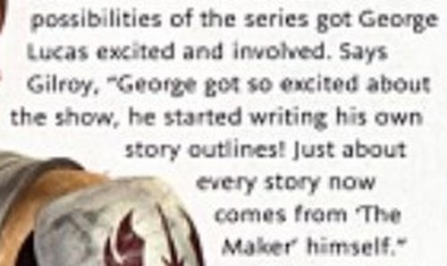

### Stat block notes (game mechanics, not feats)

- Editor's Welcome: "General Kenobi, years ago you served my father in the Clone Wars." — Princess Leia Organa, A New Hope. After Revenge of the Sith, we didn't think we'd ever be here again: certainly not so soon! Yet here we are: hotly anticipating a brand new Star Wars movie at theatres! Star Wars: The Clone Wars may have grown from what was originally intended as a TV series, but make no mistake: this is a proper movie event! It's got all the Star Wars elements: great action, superb characters, mystery and intrigue, and it expands our favorite fictional universe even further. As the writers for Star Wars: The Clone Wars discovered, there's plenty of story material in the Clone Wars period between Episodes II and III. Interviewed this issue, Henry Gilroy one of three credited writers on the movie, tells how ideas began to flow freely among him, director Dave Filoni, and the other writers. Not only that, their enthusiasm and the possibilities of the series got George Lucas excited and involved. Says Gilroy, "George got so excited about the show, he started writing his own story outlines! Just about every story now comes from 'The Maker' himself." After Revenge of the Sith, Lucas declared that he would likely move on to the kinds of projects that he had always intended to do when he came out of film school in 1967. Just like the rest of us, though, George seems to be finding it hard to let the Star Wars fire die out. A new generation came to the franchise with the prequel movies, and the forthcoming animated movie and TV series looks set to make them fans for life. Following in a few years is the planned live-action TV series, which could take the Star Wars story to even greater heights. All-in-all, now is a great time to be a Star Wars fan. I'm sure some readers have been involved since 1977 (I certainly have!), but many of you will have come to Star Wars in recent years, thanks to the new record-breaking prequels. Now, Star Wars: The Clone Wars looks set to kick off a whole new era. Long may Star Wars be with us all! Brian J. Robb, Editor [Full Throttle box:] HENRY GILROY TALKS ABOUT THE CLONE WARS! JUMP NOW to page 16 to get the lowdown on the new Star Wars: The Clone Wars! [Errata:] Last issue, in our Dave Filoni interview the text mistakenly mentioned Star Wars: The Clone Wars editor Jason Tucker as "Nathan Tucker." Apologies to all. (Brian J. Robb, Star Wars Insider 103, p. 4) (Source: *Star Wars Insider #103* (2008), scan p.4)

## scan p.5 (scan page 5)

Page contents: Launch Pad opener spread left (folio "08 INSIDER"): header "LAUNCH PAD ALL THE LATEST NEWS, FUN, GAMES AND G[obscured by lightsaber] FROM THE STAR WARS UNIVERSE"; Clone Wars art of Captain Rex, Anakin Skywalker, Obi-Wan Kenobi (hand-read)

## scan p.6 (scan page 6)

Page contents: Launch Pad opener spread right (folio "INSIDER 09"): The Clone Wars logo; art of Yoda, Ahsoka Tano, Commander Cody; "Clone Wars Begin!" box (hand-read)

### Stat block notes (game mechanics, not feats)

- Launch Pad: Clone Wars Begin!: CLONE WARS BEGIN! On August 15, a brand new Star Wars movie arrives! The first-ever animated feature from Lucasfilm Animation, Star Wars: The Clone Wars takes Star Wars in a dazzling new direction. As the Clone Wars sweep through the galaxy, the heroic Jedi Knights struggle to maintain order and restore peace. Anakin Skywalker and his Padawan learner Ahsoka Tano are on a mission with far-reaching consequences, one that brings them face-to-face with crime lord Jabba the Hutt and into conflict with Count Dooku and the sinister Asajj Ventress. See you all in line! (Launch Pad, Star Wars Insider 103, p. 6) (Source: *Star Wars Insider #103* (2008), scan p.6)

## scan p.7 (scan page 7)

Page contents: Launch Pad: Space Gear "INSIDER ROUNDS UP THE LATEST MUST HAVE STUFF!" (folio "10 INSIDER"): Gentle Giant Galactic Marine bust (photo, "MUST HAVE!" badge, Gentle Giant Studios logo); Inside the Process: Scanning for Life box (3-D head scan image of Jonathan Wilkins); Lt. Renz bust (photo of Barrie Holland with the bust and signed card) (hand-read)

- **Han Solo** — entry/section: Barrie Holland on the Lt. Renz scene: ""It was a lot of fun to do, but required very precise timing as it was a small set. I remember Harrison said, 'Let's go and have a coffee and discuss how we should do this.' I had to run onto the set with seven stormtroopers. I had to be there when he turned to catch another satchel bomb, but turned into my gun instead. If I got there too late he'd turn into empty air and if I got there too early my gun would be in his back." —Barrie Holland, Star Wars Insider 103, p. 7" Source: *Star Wars Insider #103* (2008), scan p.7
  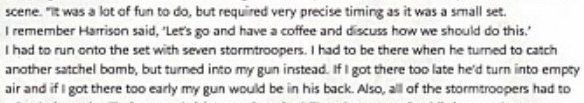

### Stat block notes (game mechanics, not feats)

- Space Gear: Galactic Marine: GALACTIC MARINE On October 24 the Forbidden Planet London store will be offering an exclusive limited edition Galactic Marine bust at their instore event. With a special guest to be announced and the chance to get your head scanned (see below) by the Gentle Giant wizards, it promises to be a fantastic event—for updates check out www.forbiddenplanet.com. (Space Gear, Star Wars Insider 103, p. 7) (Source: *Star Wars Insider #103* (2008), scan p.7)
- Inside the Process: Scanning for Life: INSIDE THE PROCESS SCANNING FOR LIFE For those wondering what the scanning process involves, it's relatively simple. All you need to do is sit still for two minutes! A large machine slowly rotates around your head and downloads a 3-D scan into a computer. Having a beard is inadvisable as they can prove awkward to scan (that didn't stop Insider Deputy Editor Jonathan Wilkins, right!) The result is then stored and used to create a fully authentic and accurate representation of the character! How long until we get an Insider Dep Ed action figure? (Space Gear, Star Wars Insider 103, p. 7) (Source: *Star Wars Insider #103* (2008), scan p.7)
- Space Gear: Lt. Renz: LT. RENZ With his sneer of "You Rebel scum" to Han Solo in Return of the Jedi, few could forget Barrie Holland's brief but impactful performance as the cruel Imperial Officer Lt. Renz. Holland told Insider recently that the scene took one and a half days to shoot with Harrison Ford playfully slapping him on the face and demanding "What did you call me?!" when they first rehearsed the scene. "It was a lot of fun to do, but required very precise timing as it was a small set. I remember Harrison said, 'Let's go and have a coffee and discuss how we should do this.' I had to run onto the set with seven stormtroopers. I had to be there when he turned to catch another satchel bomb, but turned into my gun instead. If I got there too late he'd turn into empty air and if I got there too early my gun would be in his back. Also, all of the stormtroopers had to take their marks. Their general vision was impaired like a horse wearing blinkers so they were relying on me to get it right. It's not a long sequence, but it was a very difficult one to get right!" Flash forward 25 years and the versatile actor has been immortalized as a limited edition bust from Gentle Giant. Not only is the bust the first Imperial Officer (apart from Grand Moff Tarkin) to be given the Gentle Giant treatment, but it is also the first talking bust in the line! Packaged with a signed Official Pix card this piece is limited to 2,500. Available from gentlegiantltd.com and [fan URL omitted] (where else!) starting in September. (Space Gear, Star Wars Insider 103, p. 7) (Source: *Star Wars Insider #103* (2008), scan p.7)

## scan p.8 (scan page 8)

Page contents: Launch Pad: Space Gear 2 (folio "12 INSIDER"; note folio jumps 10→12 in scan): Kotobukiya ARTFX Cross-Section 3-D X-wing review "Cutaway Heaven!" (Words: Jeremy Beckett; four photos; "MUST HAVE!" badge); right column Hoth & Cold sidebar with lightsaber gauge (Red Hot on Mustafar / Podracing on Tatooine / Banished to Hoth / Frozen in Carbonite), Clone Wars Yoda art, Harrison Ford as Indiana Jones photo, Natalie Portman as Padmé photo (hand-read)

- **Han Solo** — entry/section: Harrison Ford prefers Indiana Jones: ""Han Solo's not so interesting to me. It was great for my career and I had fun at the time, but I won't go back there. His outfit was not good!" —Harrison Ford, quoted in Hoth & Cold, Star Wars Insider 103, p. 8" Source: *Star Wars Insider #103* (2008), scan p.8
  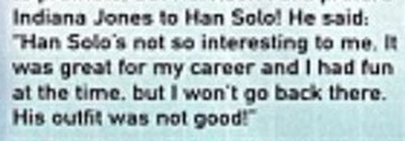

### Stat block notes (game mechanics, not feats)

- Space Gear 2: Cutaway Heaven! Kotobukiya ARTFX Cross-Section 3-D X-wing: CUTAWAY HEAVEN! Words: Jeremy Beckett KOTOBUKIYA ARTFX CROSS-SECTION 3-D X-WING Anyone who grew up in the 1970s and 1980s will remember the wonderfully illustrated cutaway books by David Macaulay, whose titles included Castle, Unbuilding, and City. Several decades later Richard Chasemore and Hans Jenssen gave us our first experience of the Star Wars cutaway. Now Kotobukiya, the Japanese company best known for its skillfully rendered Star Wars model kits, is getting in on the 3-D cutaway game with their first cross-sectional spaceship—the X-wing fighter. Even before you get your hands on any of the parts this set is impressive in its glossy box adorned with images taken from the first Incredible Cross-Sections of Star Wars book. Thanks to easy-to-follow instructions, assembling the X-wing is a relatively swift affair. The average build time is about one hour, but anyone experienced with model kits could shave some time off this. The entire kit is cast in high quality PVC and ABS plastic and the precision engineering that went into the design process at Kotobukiya's production facilities is evident. All the parts fit snugly together and match up with extreme accuracy. An amazing number of accessories come with this—from an assortment of cases and boxes to landing lights, a missile rack, and cockpit ladder leading to a vehicle maintenance energizer. There are also eight miniature figures included—counting two removable R2-D2 astromech units (pre- and post-Battle of Yavin)—in the set as well as a crew ground vehicle with driver and a spare X-wing pilot who has a passing likeness to Luke Skywalker. With its 100 detachable parts you'll find no end to the combination of displays you can create. • SUGGESTED RETAIL PRICE: $250 • AVAILABLE: AUGUST (Jeremy Beckett, Star Wars Insider 103, p. 8) (Source: *Star Wars Insider #103* (2008), scan p.8)
- Hoth & Cold: HOTH & COLD What's COOL and what's COLD in this month's popularity stakes? [Gauge labels:] RED HOT ON MUSTAFAR / PODRACING ON TATOOINE / BANISHED TO HOTH / FROZEN IN CARBONITE. STAR WARS: THE CLONE WARS–THE SECOND TRAILER Another stunning trailer and only a few days to wait until Star Wars: The Clone Wars can be seen in theatres! The final trailer was a darker, more somber affair, reflecting the "war is hell" feel of the forthcoming movie. INDY BOX OFFICE TRIUMPH! Well, maybe we can forgive Harrison (see below) as his latest movie is a hit. Indiana Jones and the Kingdom of the Crystal Skull took $311.1 million worldwide over the opening weekend, the fifth biggest international opening of all time. By mid-June, it had doubled that take to $602.8 million. Good, eh? FORD PREFERS INDY! Sacrilege! We know he's got a movie to promote, but Harrison Ford prefers Indiana Jones to Han Solo! He said: "Han Solo's not so interesting to me. It was great for my career and I had fun at the time, but I won't go back there. His outfit was not good!" TAKES AFTER MOTHER! Heckler Spray's list of 13 Top Sci-Fi Babes features a Star Wars mother-daughter duo, with Natalie Portman clocking in only at #10 (boo!) and Princess Leia herself, Carrie Fisher, taking the crown at #1 (yay!), beating Jane Fonda's Barbarella into second place! (Hoth & Cold, Star Wars Insider 103, p. 8) (Source: *Star Wars Insider #103* (2008), scan p.8)

## scan p.9 (scan page 9)

Page contents: Launch Pad: "Soul Wars!" (folio "14 INSIDER"): Soul Calibur IV Xbox 360 and PS3 box art, game screenshots of Darth Vader and Yoda, Expanded Universe box, Win! box; right-hand column is the Insider masthead (September 2008; Editorial: Editor Brian J. Robb, Deputy Editor Jonathan Wilkins, Senior Editor Simon Hugo, Art Editor Karl Barr, Assistant Editor Sarah Herman; Lucasfilm: Director of Publishing Carol Roeder, Lucasfilm Editor Frank Parisi, Director of Content Management and Fan Relations Steve Sansweet, Art Director Troy Alders, Bantha Tracks Mary Franklin; Contributors David Hawksett, Daniel Wallace, Calum Waddell, Jon Freel, Jason Fry, Jeremy Beckett, Leland Y. Chee, Steve Sansweet, W. Haden Blackman, Brett Rector, Charles Gerli; Special Thanks: Everyone at Lucas Licensing and all the Star Wars licensees; Titan Magazines production staff; Star Wars Insider US#103 UK#79 September 2008; postal addresses, phones and emails not transcribed) (hand-read)

### Stat block notes (game mechanics, not feats)

- Launch Pad: Soul Wars!: SOUL WARS! THE FIGHT IS ON AS YODA AND VADER JOIN THE SOUL CALIBUR IV LINE-UP! For the first time ever, Star Wars characters will do battle outside of an official Star Wars videogame! Allowing the warriors of the Soul Calibur universe to cross swords (and lightsabers!) with two of the most popular characters from the Star Wars galaxy, Soul Calibur IV lets owners of an Xbox360 play as Jedi Master Yoda while Playstation 3 fans can take a trip to the dark side as Darth Vader! EXPANDED UNIVERSE>>> The game is available now in stores [Win! box:] WIN! Thanks to our friends at Namco Bandai, we have three copies of Soul Calibur IV to be won for each console! So if you want one, write in (details opposite) for entry in our lucky dip! Don't forget to clearly specify which format you want to win! (Launch Pad, Star Wars Insider 103, p. 9) (Source: *Star Wars Insider #103* (2008), scan p.9)

## scan p.10 (scan page 10)

Page contents: Big Interview opener: Henry Gilroy "Cloak of Darkness" (Words: Dan Wallace; folio "16 INSIDER"): Big Interview logo, Henry Gilroy headshot, The Clone Wars logo, Clone Wars lightsaber-wielding art right (hand-read)

- **none** — entry/section: Gilroy on the Jedi as reluctant generals: ""Dave [Filoni, director of the movie and supervising director of the series] and I wanted this theme to permeate everything, because while the Jedi are forced into the role of military generals and must command clone armies, they are doing something that is opposed to their ideals. It really set the stage for interesting stories that have relevance today about how easy it is to be drawn into wars that maybe we shouldn't [be]." —Henry Gilroy, Star Wars Insider 103, p. 10" Source: *Star Wars Insider #103* (2008), scan p.10
  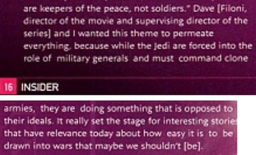
- **none** — entry/section: Gilroy's original pitch: ""I brought her a one page pitch of what The Clone Wars could be with a logline that read, "Star Wars meets Band of Brothers."" —Henry Gilroy, Star Wars Insider 103, p. 10" Source: *Star Wars Insider #103* (2008), scan p.10
  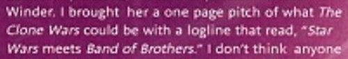

### Stat block notes (game mechanics, not feats)

- Big Interview: Henry Gilroy, Cloak of Darkness (pt. 1): THE CLONE WARS MOVIE—AND LATER TV SERIES—HAVE BEEN UNDER A CLOAK OF SECRECY. INSIDER TALKS TO ONE OF THE MOVIE AND SERIES' WRITERS HENRY GILROY WORDS: DAN WALLACE CLOAK OF DARKNESS The Clone Wars animated feature—and the television series to follow—provides new insight into Anakin's heroics and the wartime abilities of the Jedi generals and their clone soldiers. Fifteen-year animation veteran Henry Gilroy is a chief writer of the new tales. Here, he tells Insider how The Clone Wars is different from other animated series, how many of the story ideas came from George Lucas, and which member of the Jedi Council is going to be your new favorite. Insider: What can fans expect from the movie and series? Having already seen glimpses of the Clone Wars in Revenge of the Sith and the final, treacherous way that Darth Sidious brought an end to that conflict, how do you handle writing characters with predestined fates? Henry Gilroy: Have you ever missed an episode of your favorite serialized TV show and refused to watch the current episode until you've seen the one you missed? We're going to see the reasons why Anakin misses Padmé so much in Episode III. We're going to see why Grievous hates Jedi so much. We're going to see why the Jedi are so war weary and determined to end the fighting. In Episode I, Qui-Gon Jinn told Padmé, "I can't fight a war for you." In Episode II, Mace Windu says, "We are keepers of the peace, not soldiers." Dave [Filoni, director of the movie and supervising director of the series] and I wanted this theme to permeate everything, because while the Jedi are forced into the role of military generals and must command clone armies, they are doing something that is opposed to their ideals. It really set the stage for interesting stories that have relevance today about how easy it is to be drawn into wars that maybe we shouldn't [be]. How did you come to be writing for Star Wars: The Clone Wars? Back in April 2005, I met with producer Catherine Winder. I brought her a one page pitch of what The Clone Wars could be with a logline that read, "Star Wars meets Band of Brothers." I don't think anyone ever saw my pitch, but I think she was impressed that I knew the universe well enough to have something prepared. I also had written several Star Wars comics [The Phantom Menace, Attack of the Clones] as well as having a decade of experience on various animated action-adventure series [Batman, Justice League] that made me a good candidate. I think another big reason I got the job is that I love to collaborate with other creative people, and being [continues] (Dan Wallace, Star Wars Insider 103, p. 10) (Source: *Star Wars Insider #103* (2008), scan p.10)

## scan p.11 (scan page 11)

Page contents: Big Interview: Gilroy (folio "INSIDER 17"): full-page Clone Wars art of Anakin Skywalker and Obi-Wan Kenobi with lightsaber; Big Interview logo top-right; no text (hand-read)

## scan p.12 (scan page 12)

Page contents: Big Interview: Gilroy continued (folio "18 INSIDER"): Clone Wars still (hooded figure with clone trooper); pull quote; Clone Wars Yoda art; lightsaber-hilt hand art right (hand-read)

- **none** — entry/section: Lucas: "We're making cinema": ""As Dave and I came from TV, George would regularly remind us, "We're not making television here. We're making cinema." And that's why it wasn't really a surprise when he decided to release The Clone Wars first as a full-fledged animated feature." —Henry Gilroy, Star Wars Insider 103, p. 12" Source: *Star Wars Insider #103* (2008), scan p.12
  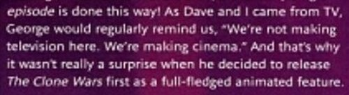
- **none** — entry/section: Gilroy: Lucas is the Alpha and the Omega: ""George is the Alpha and the Omega, and is involved in the story from beginning to end. On The Clone Wars, that means from the initial story idea until the final sound mix." —Henry Gilroy, Star Wars Insider 103, p. 12" Source: *Star Wars Insider #103* (2008), scan p.12
  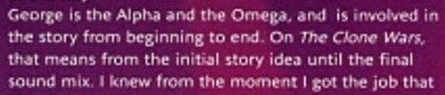
- **Obi-Wan Kenobi** — entry/section: Gilroy on writing Obi-Wan: ""I really enjoyed writing Obi-Wan Kenobi. Early on, I pushed for a story that gave us a little window into Obi-Wan's past that added a new dimension to him. I think it really deepens this character that we already love." —Henry Gilroy, Star Wars Insider 103, p. 12" Source: *Star Wars Insider #103* (2008), scan p.12
  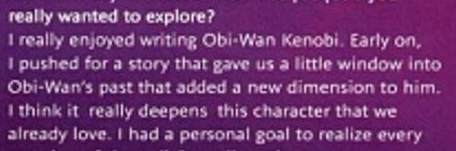

### Stat block notes (game mechanics, not feats)

- Big Interview: Henry Gilroy, Cloak of Darkness (pt. 2): able to do that well is a necessity on a project like this. After weeks of writhing in agony and suspense as Catherine met with other writers, I got the thrilling news that I was 'the chosen one' and here I am three years later. [Pull quote:] "GEORGE [LUCAS] IS INVOLVED FROM THE INITIAL STORY IDEA UNTIL THE FINAL SOUND MIX. [IT'S] GEORGE'S SHOW. MY JOB WAS TO EXECUTE HIS VISION." —HENRY GILROY How did The Clone Wars go from script to finished animation? The initial 15 or so story ideas were generated by myself and [director] Dave Filoni. We'd develop the stories into one- or two-page premises, then meet with George Lucas and he would input his ideas. Once George liked a story, we'd go through the outline process to figure out the specific character and plot arcs, and then we'd turn that into a script. Once we were happy, we'd send that back to George for his input. When George liked it, the script went final and the story would go into production, which means characters, ships, and locations are designed by our terrific design team. Then the script is pre-visualized, or storyboarded, by our awesome story team. When the script goes final, it's not really 'final.' The final script would be the end of the writing process on 95 per cent of animated television series. But at Lucasfilm, George uses movie-like pre-visualization and editorial stages as a big part of the writing process. The great thing about working this way is that you can really refine the story visually, adding and subtracting story elements to build drama and tension. Even though The Clone Wars started as made for television, George wanted a process where he could be involved creatively at every step. So making The Clone Wars series is more like making an animated feature except that every single episode is done this way! As Dave and I came from TV, George would regularly remind us, "We're not making television here. We're making cinema." And that's why it wasn't really a surprise when he decided to release The Clone Wars first as a full-fledged animated feature. It sounds like George Lucas was involved every step of the way. George is the Alpha and the Omega, and is involved in the story from beginning to end. On The Clone Wars, that means from the initial story idea until the final sound mix. I knew from the moment I got the job that The Clone Wars was going to be George's show. My job was to execute his vision and I have always tried my best to do that. Who are the other writers involved? My chief collaborators were Dave Filoni and George Lucas. Every story idea I had, Dave would hear first and once we got it to a place we liked, we would submit it to George who would bring his own magic. After about the first batch of stories, George got so excited about the show, he started writing his own story outlines! He'd send them over and we'd craft them into scripts. As time went on, George became more involved and wrote more stories and just about every story now comes from 'The Maker' himself. The primary freelance writer I worked with was prolific animation veteran Steven Melching, who was invaluable because he is a great talent and really knows the Star Wars universe well. Then about a year into the project, I got some much needed help at Skywalker Ranch in writer Scott Murphy, who brought his experience as a live action TV story editor to the production for a few months. A couple of other writers I'd like to mention who did solid work on the series were George Krstic, Paul Dini, and Katie Lucas. [The screenwriting credits for the movie go to Gilroy, Melching, and Murphy.] Are there any characters from the prequels you really wanted to explore? I really enjoyed writing Obi-Wan Kenobi. Early on, I pushed for a story that gave us a little window into Obi-Wan's past that added a new dimension to him. I think it really deepens this character that we already love. I had a personal goal to realize every member of the Jedi Council on the screen as [continues] (Dan Wallace, Star Wars Insider 103, p. 12) (Source: *Star Wars Insider #103* (2008), scan p.12)

## scan p.13 (scan page 13)

Page contents: Big Interview: Gilroy continued (folio "INSIDER 19"): pull quote; Clone Wars art of Ahsoka Tano with lightsaber and Commander Cody; Separatist/Republic warships still (hand-read)

- **Ahsoka Tano** — entry/section: Gilroy on Anakin and Ahsoka: ""Their snappy big brother/little sister interaction was a blast to write and I have high hopes for Ahsoka as a character who will soften the heart of even the most skeptical Star Wars fan." —Henry Gilroy, Star Wars Insider 103, p. 13" Source: *Star Wars Insider #103* (2008), scan p.13
  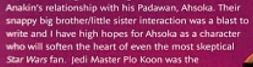
- **Plo Koon** — entry/section: Gilroy on Plo Koon: ""Jedi Master Plo Koon was the biggest challenge for me. I have to give all credit to Dave Filoni for really defining his voice. I think Plo is going to be an enduring favorite of fans for a long time." —Henry Gilroy, Star Wars Insider 103, p. 13" Source: *Star Wars Insider #103* (2008), scan p.13
  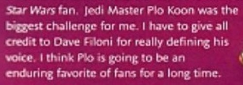
- **none** — entry/section: Lucas: "Dare to be great!": ""As time went on, George gave us boundaries and then took them away. He challenged us all the time to make it better than just good. One of his favorite quotes as he would finish our meetings was, "Dare to be great!"" —Henry Gilroy, Star Wars Insider 103, p. 13" Source: *Star Wars Insider #103* (2008), scan p.13
  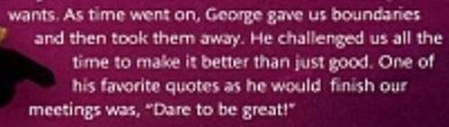
- **General Grievous** — entry/section: Gilroy's early Clone Wars episode titles: ""Here's a few that don't give anything away: "Rising Malevolence," "Cloak of Darkness," "Lair of Grievous," "Downfall of a Droid," and "Ambush in the Outer Rim."" —Henry Gilroy, Star Wars Insider 103, p. 13" Source: *Star Wars Insider #103* (2008), scan p.13
  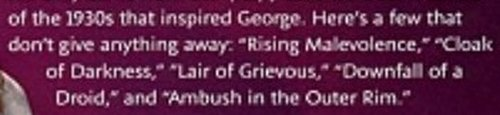

### Stat block notes (game mechanics, not feats)

- Big Interview: Henry Gilroy, Cloak of Darkness (pt. 3): [Pull quote:] "GEORGE CHALLENGED US TO MAKE IT BETTER THAN JUST GOOD. HE CHALLENGED US ALL THE TIME AND WOULD SAY TO US: 'DARE TO BE GREAT!'" —HENRY GILROY a memorable personality that we would want to see again and again. I want to credit Lucas Licensing and the novels and comics creators for laying the groundwork for those characters, which we tried to stay true to. As for original characters in the series, I really enjoyed working with George and Dave to develop Anakin's relationship with his Padawan, Ahsoka. Their snappy big brother/little sister interaction was a blast to write and I have high hopes for Ahsoka as a character who will soften the heart of even the most skeptical Star Wars fan. Jedi Master Plo Koon was the biggest challenge for me. I have to give all credit to Dave Filoni for really defining his voice. I think Plo is going to be an enduring favorite of fans for a long time. So how readily did you and Dave Filoni collaborate? In the early days of the studio, somebody created the nickname "Filroy Gilroni" because we were always together. In the very beginning of development, Dave and I used to meet at this coffee shop in Burbank almost every day and talk Star Wars, and we still talk Star Wars every day. We discuss the films, novels, comics and the stories we are developing and how to execute them thematically and visually, and how the characters interact and grow. Did I mention that the coffee shop is right next door to a Toys "R" Us? After our story meetings we'd go nerd out and see what latest Star Wars goodies were available. Anyway, it's always been a lot of creative give and take, where I might pitch Dave an idea for a character or a story and the next day he'd email me this amazing concept painting for it. Or he would pitch me a one sentence idea for a story and I'd write it into a two page premise—Plo Koon, hint, hint. Once I get the stories onto paper as premises, outlines, and scripts, Dave reads everything and his collaboration helps me get it ready for George, as well as production. Because Dave sits in editorial so much with George, he knows better than anyone what George wants. As time went on, George gave us boundaries and then took them away. He challenged us all the time to make it better than just good. One of his favorite quotes as he would finish our meetings was, "Dare to be great!" We're excited about the movie, but can you also give us any hints about episodes from the series? I always tried to give the episodes titles that sounded like they came from the pulpy adventure sci-fi serials of the 1930s that inspired George. Here's a few that don't give anything away: "Rising Malevolence," "Cloak of Darkness," "Lair of Grievous," "Downfall of a Droid," and "Ambush in the Outer Rim." Keeping the right tone is critical to having something feel like Star Wars. How do you do that without getting bogged down in formula? As far as the kind of stories we could tell, George told us that Star Wars could be a [continues] (Dan Wallace, Star Wars Insider 103, p. 13) (Source: *Star Wars Insider #103* (2008), scan p.13)

## scan p.14 (scan page 14)

Page contents: Big Interview: Gilroy concluded (folio "20 INSIDER"): Big Interview and Clone Wars logos; Who's Henry? and Writer's Room sidebars; Clone Wars stills/art of clone troopers (Captain Rex kneeling with blasters), Obi-Wan with clones; pull quote (hand-read)

- **none** — entry/section: Gilroy on the 22-minute episode challenge: ""There is the time limitation—the original attack on the Death Star took 20 minutes of screen time, but our entire episodes are only 22 minutes, so it was great to be able to start with a full feature-length movie." —Henry Gilroy, Star Wars Insider 103, p. 14" Source: *Star Wars Insider #103* (2008), scan p.14
  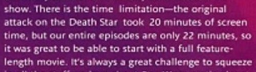

### Stat block notes (game mechanics, not feats)

- Big Interview: Henry Gilroy, Cloak of Darkness (pt. 4) with sidebars: forum for any kind of tale. So even though the movie and series are set against the backdrop of the Clone Wars, there are dramas, romances, mysteries, horrors, comedies, and more. The biggest challenge was making the universe feel as large as it is in the existing Star Wars movies within the limitations of an animated movie and TV series, meaning we couldn't go to three new planets every episode or have 10 new characters. We tried to include new characters in every single episode, extremely difficult on a weekly CG animated TV show. There is the time limitation—the original attack on the Death Star took 20 minutes of screen time, but our entire episodes are only 22 minutes, so it was great to be able to start with a full feature-length movie. It's always a great challenge to squeeze in all the stuff we love about Star Wars: exotic planets and aliens, epic space battles, exciting lightsaber duels, plus the solid character development that brings it all together into our limited screen time. How do you capture the voices of characters that fans know inside and out from watching the movies? I was working directly with George and he created these characters. No one knows them better. The fun part for me was putting the characters we know from the live-action movies in new situations to explore how they would behave. I think Dave and I got it right most of the time, then George would come in and add bits of action, dialogue, and humor that only he can to give it that classic Star Wars feeling. [Pull quote:] "THE CHALLENGE WAS MAKING THE UNIVERSE AS LARGE AS IT IS IN THE STAR WARS MOVIES." —HENRY GILROY [Sidebar:] WHO'S HENRY? As well as scripting the Dark Horse comic-book adaptations of The Phantom Menace and Attack of the Clones, writer Henry Gilroy has had plenty of experience writing for animated TV series and movies made for DVD release. Here's a selection of his pre-The Clone Wars credits: Transformers: Animated (2008) Justice League (2004) Lilo & Stitch: The Series (2003) Bionicle: Mask of Light (2003) Atlantis: Milo's Return (2005) Timon and Pumba [sic] (1995) The Tick (1994) Batman (1992) [Sidebar:] WRITER'S ROOM What have the other writers on The Clone Wars done? Steven Melching Legion of Super Heroes (2008) The Batman (2004-05) Scott Murphy Flash Gordon (2007) Angel (2001-02) [writer & story editor] The Nightmare Room (2001) (Dan Wallace, Star Wars Insider 103, p. 14) (Source: *Star Wars Insider #103* (2008), scan p.14)

## scan p.15 (scan page 15)

Page contents: Screen Idols opener: Who's Who guide to The Clone Wars; Clone Wars art of Captain Rex with twin blasters and two clone troopers; Clone Wars logo (hand-read)

### Stat block notes (game mechanics, not feats)

- Screen Idols: A Who's Who Guide to Star Wars: The Clone Wars: Screen Idols: A WHO'S WHO GUIDE TO STAR WARS: THE CLONE WARS YOU KNOW MOST OF THE CHARACTERS, BUT YOU'VE NEVER SEEN THEM QUITE LIKE THIS BEFORE. FROM HEROES LIKE ANAKIN SKYWALKER TO VILLAINS LIKE ASAJJ VENTRESS, THE CHARACTERS OF STAR WARS HAVE HAD A DRAMATIC MAKE-OVER FOR THE CLONE WARS. (Screen Idols, Star Wars Insider 103, p. 15) (Source: *Star Wars Insider #103* (2008), scan p.15)

## scan p.16 (scan page 16)

Page contents: Screen Idols (folio "24"): Obi-Wan Kenobi and Ahsoka Tano profiles with Clone Wars art and name plates (hand-read)

### Stat block notes (game mechanics, not feats)

- Screen Idols: Obi-Wan Kenobi: OBI-WAN KENOBI The noble Jedi Master Obi-Wan Kenobi is a high-ranking general in the Clone Army. Disciplined and courageous, Obi-Wan fights to preserve the Republic from the evil machinations of the Separatists. Having recently seen Anakin ascend to the status of Jedi Knight, Obi-Wan now finds endless delight in watching his one-time student struggle with a strong-willed learner of his own, Ahsoka Tano. (Screen Idols, Star Wars Insider 103, p. 16) (Source: *Star Wars Insider #103* (2008), scan p.16)
- Screen Idols: Ahsoka Tano: AHSOKA TANO A teenage Togruta Padawan, Ahsoka is eager to prove herself to her bold Master, Anakin Skywalker. Ahsoka complements Anakin's aggressive tendencies with a disarming innocence and wit. She can wield a lightsaber and pilot a spacecraft with equal talent. Straddling the chasm between Anakin's impulsiveness and Obi-Wan's staid deliberation, Ahsoka promises to become a worthy Jedi... if she survives the war. (Screen Idols, Star Wars Insider 103, p. 16) (Source: *Star Wars Insider #103* (2008), scan p.16)

## scan p.17 (scan page 17)

Page contents: Screen Idols (folio "INSIDER 25"): Master Yoda and Anakin Skywalker profiles with Clone Wars art and name plates (hand-read)

### Stat block notes (game mechanics, not feats)

- Screen Idols: Master Yoda: MASTER YODA At nearly 900 years old, Yoda is without peer in his knowledge of the Force. He wields his lightsaber with blinding speed and uses his agility to render himself nearly-invulnerable. In an attempt to teach Anakin responsibility, Yoda has given his newest general a Padawan learner named Ahsoka, but Yoda often wonders if his decision to pair the volatile duo has simply created twice the trouble for the Jedi Council. (Screen Idols, Star Wars Insider 103, p. 17) (Source: *Star Wars Insider #103* (2008), scan p.17)
- Screen Idols: Anakin Skywalker: ANAKIN SKYWALKER Brash young Jedi Knight Anakin Skywalker leads the clone armies of the Republic into battle against the Separatist forces during the galaxy-wide tumult of the Clone Wars. Together with his Padawan Ahsoka, Anakin uses his superior Force abilities to cunningly escape Separatist traps, maneuver through dangerous space battles, and boldly confront his own fateful destiny. (Screen Idols, Star Wars Insider 103, p. 17) (Source: *Star Wars Insider #103* (2008), scan p.17)

## scan p.18 (scan page 18)

Page contents: Screen Idols (folio "26 INSIDER"): Asajj Ventress and R2-D2 & C-3PO profiles with Clone Wars art and name plates (hand-read)

### Stat block notes (game mechanics, not feats)

- Screen Idols: Asajj Ventress: ASAJJ VENTRESS Serving as Count Dooku's most-trusted assassin, Asajj Ventress possesses both serpentine grace and lethality. Though she's not officially a Sith apprentice, Ventress has clearly been well-trained in the arts of lightsaber dueling and Force manipulation. If Dooku's Master, the terrifying Darth Sidious, ever finds out about Ventress' "education," the consequences will be dire for both teacher and student. (Screen Idols, Star Wars Insider 103, p. 18) (Source: *Star Wars Insider #103* (2008), scan p.18)
- Screen Idols: R2-D2 & C-3PO: R2-D2 & C-3PO Like his master Anakin Skywalker, R2-D2 is fearless, quick-thinking and dedicated. He is a tireless worker, a sympathetic listener, and always ready for action when the chips are down. Loyal to the end, Artoo is a devoted friend to many, especially the tall, golden protocol droid, C-3PO. Threepio constantly struggles to reconcile his genuine concern for his friends with his natural aversion to danger. The usual result is a comedic monologue centered on the seemingly-insurmountable peril presented by even the most benign circumstance. (Screen Idols, Star Wars Insider 103, p. 18) (Source: *Star Wars Insider #103* (2008), scan p.18)

## scan p.19 (scan page 19)

Page contents: Screen Idols (folio "INSIDER 27"): General Grievous and Clone Commander Rex profiles with Clone Wars art and name plates (hand-read)

### Stat block notes (game mechanics, not feats)

- Screen Idols: General Grievous: GENERAL GRIEVOUS Commander of the Separatist droid armies, the ruthless cyborg General Grievous is a highly-skilled warlord with a personal vendetta against the Jedi Order. Grievous lives as an alien enhanced by a machine's body, with body parts replaced with robotic appendages that give him superhuman strength and agility. He may not be Force sensitive, but his powers rival those of a Jedi Knight. (Screen Idols, Star Wars Insider 103, p. 19) (Source: *Star Wars Insider #103* (2008), scan p.19)
- Screen Idols: Clone Commander Rex: CLONE COMMANDER REX Anakin's second in command, Clone Captain Rex, is a freethinking and aggressive soldier's-soldier. Gruff, no-nonsense and tough as nails, Rex will voice his professional opinion to even the highest-ranking Jedi. In command of the famed 501st Clone Trooper Legion, Rex and his men are assigned to patrol the most lawless and dangerous sector of the galaxy, the feared Outer Rim. [Note: heading says "Commander", text says "Captain".] (Screen Idols, Star Wars Insider 103, p. 19) (Source: *Star Wars Insider #103* (2008), scan p.19)

## scan p.20 (scan page 20)

Page contents: The Big Event: May 19, 2005 Revenge of the Sith Opens (folio "28 INSIDER"): General Grievous still, Revenge of the Sith logo, Episode III Trailer box, Real Life 2005 sidebar, Letterman Digital Arts Center photo and box (hand-read)

### Stat block notes (game mechanics, not feats)

- The Big Event: Revenge of the Sith Opens: THE BIG EVENT May 19, 2005 REVENGE OF THE SITH OPENS The six episode Star Wars movie saga came to a dramatic conclusion on May 19, 2005, with the long-awaited release of Star Wars: Episode III Revenge of the Sith. With sold out midnight shows grossing almost $17 million, the movie was set to be a record-breaker. The movie went on to gross $158.5 million in its first four days, with an additional $303 million non-domestic gross creating a worldwide opening record. EPISODE III TRAILER March 10 Fox TV in the U.S. debuted the Episode III trailer during an episode of The O.C. It then appeared online, while the following day moviegoers were able to catch it on the big screen attached to animated comedy Robots (which featured the voice of Ewan McGregor). LETTERMAN DIGITAL ARTS CENTER OPENS June 2005 As the dust settled on the release of Revenge of the Sith, some divisions of Lucasfilm, among them ILM, LucasArts and Lucasfilm itself, underwent some upheaval. They moved into their new home, the Letterman Digital Arts Center in San Francisco. The 850,000-square-foot, $300 million complex brought Lucasfilm, Industrial Light & Magic, LucasArts Entertainment, and Lucas Online under one roof for the first time. Skywalker Sound remained at Skywalker Ranch. Lucasfilm holds a 60-year renewable lease on 23 acres in the Presidio, a 1,200-acre former military reserve turned national park at the foot of the Golden Gate Bridge, at an annual cost of $5.8 million. The site has enough workspace for 2,500 employees. REAL LIFE 2005 JANUARY 9 After three years of negotiations, a peace deal ended Sudan's two-decades-long civil war. The conflict between the Arab-Muslim government of the North and the black Christian and animist South left two million dead. MARCH 26 Doctor Who returned to British TV as a regular series after a 16-year break, going on to become a ratings success story starring Christopher Eccleston and David Tennant. JULY 7 London terrorist bombing kills 52 and wounds more than 700. A group calling itself the Secret Organization of al-Qaeda in Europe claimed responsibility. OCTOBER 8 An earthquake with a magnitude of 7.6 struck the Pakistani-controlled part of the Kashmir region; about half of the region's capital city, Muzaffarabad, was destroyed. More than 81,000 people were killed and three million left homeless. Neighboring India suffered 1,300 casualties. (The Big Event, Star Wars Insider 103, p. 20) (Source: *Star Wars Insider #103* (2008), scan p.20)

## scan p.21 (scan page 21)

Page contents: A Long Time Ago.... 2005 (running head "A long time ago.... 2005"): Star Wars: Visionaries cover, John Williams photo (Sith Score Recorded), Michael Sheard as Admiral Ozzel photo, George Lucas photo (Lucas Announces box), Real Life 2005 Entertainment sidebar (hand-read)

### Stat block notes (game mechanics, not feats)

- A Long Time Ago.... 2005: A LONG TIME AGO.... 2005 STAR WARS VISIONARIES April 2 Away from the movie screen, Dark Horse Comics released Star Wars: Visionaries, an experimental graphic novel collecting tales illustrated by concept artists who helped envision the worlds, characters and story of Episode III. It was their artwork that helped inspired [sic] George Lucas in the creation of the look of Revenge of the Sith. Strips included Old Wounds, which saw Obi-Wan Kenobi defend the Lars Homestead from an old enemy; Entrenched, in which the trenches of Hoth are the setting for hard-hitting military action; and Deep Forest, which saw a Wookiee hunting expedition in the forests of Kashyyyk become something far larger than expected when a young warrior uncovers the pending Separatist invasion. SITH SCORE RECORDED February 3 Composer John Williams created over 40 distinct cues for the Episode III score, performed and recorded in February 2005 by the London Symphony Orchestra. The recording order was delineated on an oversized printout, marking the title of the cue and the reel where it resides. These titles were more for internal use—they rarely ever make it to the liner notes of soundtrack albums since these cues are often combined and edited to make playable tracks. Cues like "Boys Into Battle" and "Palpatine's TV Set" were renamed before public consumption. MICHAEL SHEARD REMEMBERED August 31 Actor Michael Sheard, best remembered by Star Wars fans for his role as Admiral Ozzel, passed away at the end of August 2005 at his home on the Isle of Wight. He was 65. Born in Aberdeen, Scotland, Sheard studied at the Royal Academy of Dramatic Art in London. His lengthy filmography included over 40 feature films and extensive television, appearances, including Doctor Who, Coronation Street, Shackleton and Grange Hill. Sheard also made a brief but unforgettable appearance in another Lucasfilm production as Hitler in Indiana Jones and the Last Crusade. It was a role he had performed many times on film. His other film credits include All Quiet on the Western Front, The Dirty Dozen: Second Assignment and Force Ten from Navarone. In recent years, Sheard had made regular appearances at conventions where he would meet with fans, including 2005's Star Wars Celebration III. LUCAS ANNOUNCES STAR WARS FUTURE IS ON TV April 25, Celebration III Making his first appearance at a fan convention in 18 years, Star Wars creator George Lucas told the attendees at Celebration III in Indianapolis that he was planning two TV series to continue the saga. The first would be an animated half-hour show expanding on the Clone Wars micro-series (now coming to a theatre near you this August and on TV in the fall!). The series would be made using Lucasfilm's new CGI animation facility in Singapore. Lucas also revealed plans for a spin-off live-action TV series that would focus on supporting characters introduced in the movies. "We want to write all the stories for the entire first season all at once," said Lucas. "I'm going to get it started and hire the showrunners, then I'll probably step away." REAL LIFE 2005 ENTERTAINMENT TOP GROSSING FILMS U.S. BOX OFFICE Harry Potter and the Goblet of Fire knocked Revenge of the Sith into second place for the year in worldwide gross, followed by the first Chronicles of Narnia film, Steven Spielberg's War of the Worlds and Peter Jackson's remake of King Kong. Best Picture at the Oscars was Crash. TOP 5 ALBUMS (BILLBOARD) 1. The Massacre, 50 Cent 2. Encore, Eminem 3. American Idiot, Green Day 4. The Emancipation of Mimi, Mariah Carey 5. Breakaway, Kelly Clarkson THEATER Monty Python's Spamalot opened at the Shubert Theatre on March 17. (A Long Time Ago...., Star Wars Insider 103, p. 21) (Source: *Star Wars Insider #103* (2008), scan p.21)

## scan p.22 (scan page 22)

Page contents: Top Ten: Jaw-Droppers opener spread left (folio "30 INSIDER"): Top Ten badge; collage of Darth Vader, Ahsoka Tano (Clone Wars), Anakin (Clone Wars), AT-AT, X-wings, speeder bike scout trooper, Y-wing; "JAW DR-" title (hand-read)

## scan p.23 (scan page 23)

Page contents: Top Ten: Jaw-Droppers opener spread right (folio "INSIDER 31"): collage of Mace Windu, Luke Skywalker, Commander Cody (Clone Wars), Neimoidian and other figures, TIE fighters; "-OPPERS" title; standfirst (hand-read)

### Stat block notes (game mechanics, not feats)

- Top Ten: Jaw-Droppers (standfirst): JAW-DROPPERS THINK OF THOSE MOMENTS IN STAR WARS THAT MADE YOU GO "WOW!" WE'RE CALLING THEM "JAW-DROPPERS": THOSE DRAMATIC TWISTS, UNEXPECTED REVELATIONS, SHOCKING BETRAYALS, AND VISUALLY ARRESTING IMAGES THAT MADE YOUR JAWS HIT THE FLOOR. WORDS: MARK JAMES (Mark James, Star Wars Insider 103, p. 23) (Source: *Star Wars Insider #103* (2008), scan p.23)

## scan p.24 (scan page 24)

Page contents: Top Ten: Jaw-Droppers 10–8 (folio "32 INSIDER"): Geonosis arena Jedi battle still; Sarlacc pit skiff still; C-3PO exposed head close-up (hand-read)

### Stat block notes (game mechanics, not feats)

- Jaw-Droppers #10: The Jedi Come to the Rescue: 10 THE JEDI COME TO THE RESCUE ATTACK OF THE CLONES Something many Star Wars fans had longed to see on screen—and were hoping for from the prequels—were scenes of the massed ranks of the heroic Jedi in action. The original trilogy had only given us a few examples: out-of-practice Obi-Wan, and the machine-like Darth Vader, while Luke Skywalker was the young hope for a new generation of Jedi. The Phantom Menace introduced us to the Jedi Council, but we didn't actually see them in action, except for Qui-Gon Jinn and the younger Obi-Wan. Attack of the Clones changed that: just as our embattled heroes look like they are facing their ends in the arena on Geonosis, we see the distinctive footwear of Master Windu, his purple lightsaber ignites and he declares the party over. Jedi all around the arena ignite their lightsabers and join the battle, despite being "impossibly outnumbered" in the words of Count Dooku. Jedi rush head-to-head to battle with droids and Geonosians alike. As Yoda flies in to the rescue with his army of clone troopers, the Clone Wars have truly begun. It's a truly jaw-dropping scene, putting the war into Star Wars. WE LOVE: Kit Fisto's grinning face! He's having as much fun as we are! (Mark James, Star Wars Insider 103, p. 24) (Source: *Star Wars Insider #103* (2008), scan p.24)
- Jaw-Droppers #9: Luke's Heroics at the Sarlacc Pit: 9 LUKE'S HEROICS AT THE SARLACC PIT RETURN OF THE JEDI This whole sequence magnificently captures the sense of adventure and heroics from the old cinema serials that inspired George Lucas to create Star Wars in the first place. As Luke springs into action, it's not exactly unexpected (all those less-than-subtle nods back and forth between the characters is a bit of a giveaway!), but the way he walks off the plank, dynamically twists and leaps back up into action is a take-your-breath-away moment. That's rapidly followed with some fine lightsaber action, Leia's strangulation of Jabba and Boba Fett's comeuppance. Luke's final swing from the exploding sail barge, with Leia in his arms, is simply superb. A definite "Wow"! WE LOVE: Lando's scream when the Sarlacc grabs his leg! Yeuch! (Mark James, Star Wars Insider 103, p. 24) (Source: *Star Wars Insider #103* (2008), scan p.24)
- Jaw-Droppers #8: Darth Vader Builds C-3PO: 8 DARTH VADER BUILDS C-3PO THE PHANTOM MENACE Long before he became the Dark Lord of the Sith, cute little Annie had a knack for droid building. And whaddaya know, he only created our favorite protocol droid, C-3PO! The whole idea allowed Star Wars Tales writer Ryder Windham and artist Killian Plunkett to explore the implications of this surprising development in "Thank the Maker," a comic-strip fantasy that sees Vader re-encounter his creation on Cloud City during the events of The Empire Strikes Back. Flashbacks show how young Anakin discovers a damaged droid's head and uses it as the basis for his self-built protocol droid, intended to function as help for his mother, Shmi Skywalker. Whatever way you look at it, the idea that Vader built Threepio is a jaw-dropper of the first order. WE LOVE: Getting a Threepio-eye-view! One of the only times we get to see the Star Wars universe through the eyes of one of it's [sic] characters. (Mark James, Star Wars Insider 103, p. 24) (Source: *Star Wars Insider #103* (2008), scan p.24)

## scan p.25 (scan page 25)

Page contents: Top Ten: Jaw-Droppers 7–5 (folio "INSIDER 33"; Jaw-Droppers tab top-right): speeder bike scout trooper still; Darth Maul with double-bladed lightsaber; Clone Wars Anakin art; "Spoiler Warning" stamp on #5 (hand-read)

### Stat block notes (game mechanics, not feats)

- Jaw-Droppers #7: The Speeder Bike Chase: 7 THE SPEEDER BIKE CHASE RETURN OF THE JEDI Even when you know how this sequence was put together (the curse of so many behind-the-scenes documentaries and Insider articles!), this is still one of the most thrilling sequences in the Star Wars movies. One of several (Podracing, asteroid dodging) high-speed pursuits in the movies that reflect George Lucas' personal interest in hot-rodding and car racing, the visceral nature of the tree-dodging speeder bike chase results in a true edge-of-your-seat sequence. The first-person view of zooming through the forest on Endor's moon is a heart-in-the-mouth experience, drawing as much from theme park rides and roller coasters as filmic techniques. It takes the basics of the standard movie car chase to a whole other dimension—and that's not even mentioning Luke's neat chase-capping lightsaber action! WE LOVE: Leia swooping down through the trees! Way to go, girl! (Mark James, Star Wars Insider 103, p. 25) (Source: *Star Wars Insider #103* (2008), scan p.25)
- Jaw-Droppers #6: Darth Maul Reveals His Double-Bladed Lightsaber: 6 DARTH MAUL REVEALS HIS DOUBLE-BLADED LIGHTSABER THE PHANTOM MENACE OK, so we knew Darth Maul was a Sith, just like Darth Vader, and that with his distinctive tattooed visage and his animal-like instincts he was an unusual Sith. Sure, we expected him to have a lightsaber, but how much of a shock was it, that as soon as Maul ignited his blade, another one emerged from the other end of his lightsaber handle?! Die-hard fans of the Expanded Universe may have already seen something similar in earlier comics, but for the vast majority of the audience this was dramatic never-before-seen stuff. Lightsabers were known weapons but this new variation, based on an elongated fighting staff allowed for a whole new style of lightsaber combat. That unveiling of the double-bladed lightsaber—a jaw-dropper if ever there was one—was just the preliminary to one of Star Wars' best ever lightsaber battles. WE LOVE: Amidala's look of panic as the doors open. This is definitely Jedi business! (Mark James, Star Wars Insider 103, p. 25) (Source: *Star Wars Insider #103* (2008), scan p.25)
- Jaw-Droppers #5: AT-TE Ascends the Cliff: 5 AT-TE ASCENDS THE CLIFF STAR WARS: THE CLONE WARS [SPOILER WARNING] The new Star Wars: The Clone Wars movie has a lot to live up to. After all, it's following hard on the heels of one of the most successful film franchises of all time. The new movie had to provide dramatic moments of its own to compete, and it comes right at the beginning. Obi-Wan, Anakin and his Padawan Ahsoka are leading an assault on a Separatist stronghold in search of Jabba's kidnapped son. With clone troopers and their hardware in tow, things take an unexpected turn as the leading AT-TE transports begin to walk up the cliff-face! Just as the viewer is getting over that shock, Ahsoka and Anakin use the vehicles as stepping stones to get themselves to the top much quicker. As well as an explosive action sequence, the scene quickly establishes the relationship between Anakin and Ahsoka. WE LOVE: Anakin taking out the STAP's with consummate grace! (Mark James, Star Wars Insider 103, p. 25) (Source: *Star Wars Insider #103* (2008), scan p.25)

## scan p.26 (scan page 26)

Page contents: Top Ten: Jaw-Droppers 4–3 (folio "34 INSIDER"): Expanded Universe "Too Obvious to Mention" sidebar with stills (Vader/Luke Bespin gantry, Anakin unmasked, Luke and Leia on Endor); AT-ATs on Hoth still; Carrie Fisher as Leia in gold bikini photo (hand-read)

### Stat block notes (game mechanics, not feats)

- Jaw-Droppers sidebar: Too Obvious to Mention: EXPANDED UNIVERSE TOO OBVIOUS TO MENTION In compiling our main list of jaw-dropping Star Wars moments, we decided to avoid the obvious choices, as that'd make for a very predictable list. Nevertheless, here they are for completeness sake: "NO, I AM YOUR FATHER!" (THE EMPIRE STRIKES BACK) Yes, it's the biggest moment of the trilogy, and should be the number one jaw-dropper, but it's simply too overly familiar now. STAR DESTROYER OVERHEAD SHOT (A NEW HOPE) Again, an iconic moment and an obvious choice for a list such as this, but we wanted to make more unexpected choices. VADER UNMASKED (RETURN OF THE JEDI) Another pivotal surprise of the Star Wars saga, and another too easy choice for our Top 10 jaw-droppers list. LUKE & LEIA ARE BROTHER & SISTER (RETURN OF THE JEDI) Ouch, we didn't see that one coming, but now it is so obvious we left it off the main list. (Mark James, Star Wars Insider 103, p. 26) (Source: *Star Wars Insider #103* (2008), scan p.26)
- Jaw-Droppers #4: The AT-AT Assault: 4 THE AT-AT ASSAULT. ATTACK OF THE CLONES [sic; the entry describes The Empire Strikes Back] The opening of The Empire Strikes Back had to achieve a lot. It had to reintroduce the main characters of Star Wars, yet move them forward and generate a new sense of jeopardy. The Imperial assault on Hoth certainly did that. Here was a Rebel Alliance base under full attack by the forces of Vader and the Emperor, with the good guys on the run. The sheer visual oddity of the AT-AT walkers lumbering across the snowscape quickly sunk in, leaving the viewer agog at a stunning visual sequence. All the Rebels could hope to do was delay the attack long enough for the transport ships to get away from the embattled Hoth system. Like some kind of giant armored animal, these four-legged vehicles were stunning simply for looking so odd. As much a psychological weapon as a practical one, the first appearance of "walkers on the North Ridge" sent many a Star Wars fan's jaw heading south! WE LOVE: The walker that stands its ground before blasting a speeder to bits! (Mark James, Star Wars Insider 103, p. 26) (Source: *Star Wars Insider #103* (2008), scan p.26)
- Jaw-Droppers #3: Leia in the Gold Bikini: 3 LEIA IN THE GOLD BIKINI RETURN OF THE JEDI Here's a jaw-dropper in the genuine sense of the phrase: Many people simply couldn't believe what they were seeing! Here was the prim Princess as we'd never seen her before. Things got even better when she joined Luke and company in action, defeating nasty ol' Jabba into the bargain. WE LOVE: Leia blasting Jabba's barge into pieces! One for feminists all over the galaxy! (Mark James, Star Wars Insider 103, p. 26) (Source: *Star Wars Insider #103* (2008), scan p.26)

## scan p.27 (scan page 27)

Page contents: Top Ten: Jaw-Droppers 2–1 (folio "INSIDER 35"; Jaw-Droppers tab top-right): Commander Cody hologram still, Order 66 stills, Darth Vader (Force Unleashed) figure with lightsaber; The Force Unleashed logo; "Spoiler Warning" stamp on #1 (hand-read)

### Stat block notes (game mechanics, not feats)

- Jaw-Droppers #2: Order 66: 2 ORDER 66 REVENGE OF THE SITH Perhaps the most moving sequence of the entire Star Wars saga, the issuing of Order 66 by Emperor Palpatine moves the scale of the tragedies faced by our heroes from the personal to the galactic! As the emotional music swells, we watch astonished as one after another Jedi we've come to know through the previous two movies (and in much Expanded Universe material) are cut down by the very troops they trusted to protect them. This sequence is the very definition of a classic jaw-dropping moment. WE LOVE: John Williams' understated music that lends the sequence a sense of poignancy and dignity. (Mark James, Star Wars Insider 103, p. 27) (Source: *Star Wars Insider #103* (2008), scan p.27)
- Jaw-Droppers #1: Birth of the Rebel Alliance: 1 BIRTH OF THE REBEL ALLIANCE THE FORCE UNLEASHED [SPOILER WARNING] Of all the twists that came out of the prequel-era films (stormtroopers fighting for the good guys?), comic-books and novels, no-one could have predicted this one. The forthcoming video game The Force Unleashed sheds new light on the birth of the Rebel Alliance, with a plot point that will have you dropping your controllers and Wiimotes in shock! Of course, we can't reveal it yet, as that would spoil it! You'll just have to trust us and play the game for yourself next month to find out what it is. WE LOVE: The fact that Star Wars can still surprise us! (Mark James, Star Wars Insider 103, p. 27) (Source: *Star Wars Insider #103* (2008), scan p.27)

## scan p.28 (scan page 28)

Page contents: Versus: Juno Eclipse vs Mara Jade (folio "38 INSIDER"; "Versus" badge top-left): Juno Eclipse in Imperial uniform (The Force Unleashed render); large V graphic (hand-read)

### Stat block notes (game mechanics, not feats)

- Versus — Juno Eclipse: Databank: DATABANK Once the youngest cadets [sic] to be accepted into the Imperial Academy, Juno Eclipse was a hotshot combat pilot who also had a knack for starship repair and droid maintenance. Working in the Outer Rim as leader of Black Squadron, Eclipse excelled in combat missions. She was recognized for her skills, especially during the battle of Callos, and drafted by Darth Vader to pilot the Rogue Shadow. Thinking her passenger, Vader's secret apprentice, was just another of Vader's spies, Eclipse found herself caught up in major events and having to make dramatic decisions that affected the fate of the galaxy. (Versus, Star Wars Insider 103, p. 28) (Source: *Star Wars Insider #103* (2008), scan p.28)
- Versus — Juno Eclipse: Profile: PROFILE HOMEWORLD: CORULAG SPECIES: HUMAN GENDER: FEMALE HEIGHT: UNKNOWN WEAPONS: BLASTER AFFILIATION: IMPERIAL (Versus, Star Wars Insider 103, p. 28) (Source: *Star Wars Insider #103* (2008), scan p.28)
- Versus — Juno Eclipse: Skills and stats: SKILLS Mechanically minded, Eclipse shows a clear aptitude for working with machines, whether they be spaceships or malfunctioning droids. If it breaks, she can fix it. Very loyal, perhaps to a fault, Eclipse can follow orders and achieve set goals, but she makes these achievements while neglecting herself. As a fighter, she's better behind the controls of a starship than she is in face-to-face combat. STRENGTH 60 SPEED 80 JEDI POWER 45 LEADERSHIP 70 MOBILITY 70 LOYALTY 70 SPECIAL ABILITY 80 BONUS SKILL 80 (Versus, Star Wars Insider 103, p. 28) (Source: *Star Wars Insider #103* (2008), scan p.28)
- Versus intro [continues]: One is the flame-haired wife of Luke Skywalker who's seen service for both the Sith and the Jedi; the other is an intelligent, accomplished Imperial pilot charged with a secret mission. One began life in Star Wars novels, while the other debuts as a videogame character. However, if (in the wacky world of Star Wars Insider 'Versus') Mara Jade and Juno Eclipse were to meet in combat, who'd emerge victorious? With all the cunning that comes from being an Imperial operative, Eclipse might seem like a good bet. However, Jade has been around a bit longer and has much more experience. From Emperor's Hand to bride of [continues] (Versus, Star Wars Insider 103, p. 28) (Source: *Star Wars Insider #103* (2008), scan p.28)

## scan p.29 (scan page 29)

Page contents: Versus: Mara Jade (folio "INSIDER 39"; "Versus" badge top-right): Mara Jade costume photo (model uncredited) holding lightsaber hilt (hand-read)

### Stat block notes (game mechanics, not feats)

- Versus intro [continued]: Skywalker, she's one of the most rounded and experienced characters in the Star Wars Expanded Universe. While Eclipse is great flying a spaceship and commanding a battle fleet, she's not known for her hand-to-hand combat skills, more likely relying on getting off a lucky blaster shot rather than winning through strength or cunning. Strength and cunning, however, are two things Jade has in spades, along with top-notch lightsaber skills and the added advantage of her mastery of the Force. Put these two in an arena together and it might be a sharp, short, but very entertaining fight. Turn to page 79 to see who triumphs! (Versus, Star Wars Insider 103, p. 29) (Source: *Star Wars Insider #103* (2008), scan p.29)
- Versus — Mara Jade: Databank: DATABANK If there was one distinguishing feature about Mara Jade (apart from her trademark flaming red hair) it was the fact that she was a fighter. Regardless of who she was working for, whether as the 'Emperor's Hand' or in her role as part of the Skywalker dynasty, Jade gave her all. Her training, by Palpatine, resulted in her being calm and efficient under stress. Not afraid to fight, Jade found herself caught up in confrontations with Luke Skywalker and Kyle Katarn, two of the Rebellion's best fighters. In any battle, she was driven by a need to reveal the truth about a situation rather than a simple thirst for mere victory. Very protective of her son with Skywalker, named Ben, Mara Jade was not one to walk away from a challenge. (Versus, Star Wars Insider 103, p. 29) (Source: *Star Wars Insider #103* (2008), scan p.29)
- Versus — Mara Jade: Profile: PROFILE HOMEWORLD: UNKNOWN SPECIES: HUMAN GENDER: FEMALE HEIGHT: 1.6 METERS WEAPONS: LIGHTSABER AFFILIATION: JEDI (Versus, Star Wars Insider 103, p. 29) (Source: *Star Wars Insider #103* (2008), scan p.29)
- Versus — Mara Jade: Skills and stats: SKILLS Good at breaking into computer systems (slicing), Jade was an experienced pilot and skilled in the art of disguise. Most of all, though, Jade was a very accomplished lightsaber duelist. She developed considerable Jedi skills, eventually being able to manipulate the Force, and later becoming a Jedi Master. STRENGTH 70 SPEED 80 JEDI POWER 85 LEADERSHIP 70 MOBILITY 70 LOYALTY 70 SPECIAL ABILITY 90 BONUS SKILL 80 (Versus, Star Wars Insider 103, p. 29) (Source: *Star Wars Insider #103* (2008), scan p.29)

## scan p.30 (scan page 30)

Page contents: Inside the Worlds of The Force Unleashed opener (folio "40 INSIDER"; Force Unleashed logo top-left): "Felucia River" concept art credited Chris Voy; book cover of The Art and Making of Star Wars: The Force Unleashed (hand-read)

### Stat block notes (game mechanics, not feats)

- Inside the Worlds of The Force Unleashed: standfirst and source credit: INSIDE THE WORLDS OF THE FORCE UNLEASHED LUCASARTS' PROJECT LEAD HADEN BLACKMAN AND ASSISTANT PRODUCER BRETT RECTOR OFFER A UNIQUE INSIDER'S PERSPECTIVE IN THIS EXTRACT FROM THEIR BOOK ON THE FORCE UNLEASHED VIDEOGAME [Credit box:] Extracted from The Art and Making of Star Wars: The Force Unleashed by W. Haden Blackman and Brett Rector Published by Insight Editions, California (W. Haden Blackman and Brett Rector, Star Wars Insider 103, p. 30) (Source: *Star Wars Insider #103* (2008), scan p.30)

## scan p.31 (scan page 31)

Page contents: The Force Unleashed: "Alien and Beautiful" (folio "INSIDER 41"; running tab "Inside the Worlds of The Force Unleashed" top-right, vertical "The Force Unleashed" side tab): "Imperial Sarlacc Constraint Device" concept art credited Amy Beth Christenson; "Felucia Matte Painting, Episode III" credited ILM Digi-Matte Department (hand-read)

### Stat block notes (game mechanics, not feats)

- The Force Unleashed: Alien and Beautiful: Alien and Beautiful From the very beginning, the Star Wars films have been renowned for their memorable characters and rich stories. Just as important are the incredible and varied worlds George Lucas created to serve as backdrops to the action. From the icy wastelands of Hoth to the deserts of Tatooine and the lush forests of Endor, each planet in the Star Wars saga is instantly recognizable. In many ways, these worlds are characters unto themselves. Selecting and developing the locations for The Force Unleashed was an intense and lengthy process. We started with a handful of considerations: • We wanted a good mix of new and familiar locations and to include places from both trilogies. • Each location had to be recognizable as a Star Wars world or site. • We were keenly interested in showing the rise of the Empire and the evolution of the galaxy during the dark times between Episodes III and IV, so many of the locations needed to support an Imperial presence. • From an art standpoint, each location needed to look and feel different. • Perhaps most important, each location needed to be a compelling Force playground for our core gameplay. We gravitated toward worlds with lots of destructible objects and naturally recurring dangers, such as cliffs, toxic rivers, or jets of carbonite gas. (W. Haden Blackman and Brett Rector, Star Wars Insider 103, p. 31) (Source: *Star Wars Insider #103* (2008), scan p.31)

## scan p.32 (scan page 32)

Page contents: The Force Unleashed: Kashyyyk (folio "42 INSIDER"; Force Unleashed logo top-left): "Kashyyyk Matte Painting" credited Chin Ko; "Wookiee Village" concept art credited Greg Knight (hand-read)

### Stat block notes (game mechanics, not feats)

- The Force Unleashed: Kashyyyk: Kashyyyk The Wookiee homeworld of Kashyyyk has long lived in the minds of Star Wars aficionados since its appearance in the 1978 made-for-television Star Wars Holiday Special. The planet was fully realized as a lush, green forest world in Revenge of the Sith. Kashyyyk was one of the first locations selected for the game. We were attracted to the world because it offered a natural setting, which we knew would could [sic] evolve over time. As the story progresses, Kashyyyk transforms from the verdant world featured in Episode III to a charred and devastated planet under complete Imperial control. Kashyyyk also provided the benefit of a very familiar, well-established native species—Wookiees. Finally, Kashyyyk presented a number of technical and artistic challenges that we were excited to tackle, such as creating realistic foliage and Wookiee fur. Over time, Kashyyyk became one of the most important locations in the game. It has the distinct honor and challenge of being the opening location—a world that has to captivate players from the first second. In this prologue level, the player is placed in the role of Darth Vader, whose dark and violent character is a sharp contrast to the colorful world. Overall, Kashyyyk was an excellent starting point to show off what could be achieved graphically with our internally developed game engine. (W. Haden Blackman and Brett Rector, Star Wars Insider 103, p. 32) (Source: *Star Wars Insider #103* (2008), scan p.32)

## scan p.33 (scan page 33)

Page contents: The Force Unleashed: Kashyyyk art (folio "INSIDER 43"; running tab top-right): "Vader on Kashyyyk" credited Amy Beth Christenson; "Imperial Hunting Grounds on Kashyyyk" credited Stephen Chang; no body text (hand-read)

## scan p.34 (scan page 34)

Page contents: The Force Unleashed: Executor (folio "44 INSIDER"; Force Unleashed logo top-left): "Vader Knighting the Apprentice" concept art credited Chin Ko, spread across pp.34–35 (hand-read)

- **Darth Vader (Anakin Skywalker)** — entry/section: Chin Ko on Vader's Inner Sanctum: ""This is the first time you see Vader and become his apprentice. I wanted to evoke a really strange feeling between these two. This place is supposed to be hidden so you can't even see outside. No one knows about this place." —Chin Ko (concept artist), Star Wars Insider 103, p. 34" Source: *Star Wars Insider #103* (2008), scan p.34
  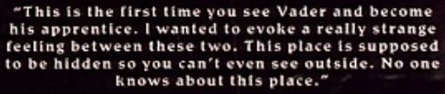

### Stat block notes (game mechanics, not feats)

- The Force Unleashed: Executor: Darth Vader's Inner Sanctum: Executor: Darth Vader's Inner Sanctum For story purposes, the team had to decide where Darth Vader would "live," his home base as the Apprentice travels the galaxy to do his bidding. We finally chose as Darth Vader's Inner Sanctum the Super Star Destroyer Executor, which is actually under construction during the events in The Force Unleashed. The look of the Inner Sanctum was inspired by Star Destroyers from the movies, including the Executor seen in The Empire Strikes Back, and production stills of the Death Star from A New Hope and Return of the Jedi. Everything has a sterile, Imperial look about it, which reflects Vader's cold-hearted disposition. (W. Haden Blackman and Brett Rector, Star Wars Insider 103, p. 34) (Source: *Star Wars Insider #103* (2008), scan p.34)

## scan p.35 (scan page 35)

Page contents: The Force Unleashed: Vader Knighting the Apprentice art continued (folio "INSIDER 45"; running tab top-right, vertical "The Force Unleashed" side tab); no body text (hand-read)

## scan p.36 (scan page 36)

Page contents: The Force Unleashed: art page (folio "46 INSIDER"; Force Unleashed logo top-left): "Early Tractor Beam Concept Art" credited Chris Voy; "Nar Shaddaa" credited Chin Ko; no body text (hand-read)

## scan p.37 (scan page 37)

Page contents: The Force Unleashed: TIE Fighter Construction Facility (folio "INSIDER 47"; running tab top-right, vertical side tab): "Battle with Kota" concept art credited Chris Voy; Nar Shaddaa moon art (hand-read)

### Stat block notes (game mechanics, not feats)

- The Force Unleashed: TIE Fighter Construction Facility: TIE Fighter Construction Facility The first level in which the player controls the Apprentice is the TIE Fighter Construction Facility. The installation is a satellite structure that orbits the pirate moon, Nar Shaddaa, and was constructed to manufacture Twin Ion Engine (TIE) fighter attack ships. Vader feels the time is right to begin testing his Apprentice and sends him on his inaugural mission to hunt down a Jedi. The target: Master Rahm Kota. From a story perspective, the grizzled Jedi general is actually trying to lure Darth Vader out of hiding by attacking Imperial targets. When thinking about the facility as a gameplay space, we decided that this would be a great opening area for the player to learn how to use his basic Force powers: Force grip and Force push. The space needed to be dynamic, big, and set the tone for the rest of the game. Throughout the level, designers implemented many destructible set-pieces, such as catwalks that can be ripped apart and destroyed, and we populated each area with plenty of enemies and objects that can be used as projectiles. It has also proved to be an excellent showcase for Digital Molecular Matter, a technology that enables the player to bend metal and blow open thick Imperial doors using the Force. The look of the location is, of course, very Imperial. The opening hangar as well as all subsequent hallways and gameplay spaces were derived from and inspired by areas from the films, especially A New Hope. Because there was such an abundance of reference material, most of the concept art for the level focused on areas meant to show how TIE fighters are constructed: the Wing Rack Room and cockpit assembly line, for example. The final gameplay space—a large command center where the Apprentice finally confronts Master Kota—also went through numerous revisions, including dramatic shifts in the color palette to complement Kota's green lightsaber and emerald Force effects. (W. Haden Blackman and Brett Rector, Star Wars Insider 103, p. 37) (Source: *Star Wars Insider #103* (2008), scan p.37)

## scan p.38 (scan page 38)

Page contents: Science of Star Wars (title spans pp.38–39; folio "48 INSIDER"): Mustafar duel still of Obi-Wan and Anakin with lightsabers (hand-read)

### Stat block notes (game mechanics, not feats)

- Science of Star Wars: The Real Mustafar on Our Doorstep: SCIENCE OF [STAR WARS] THE REAL MUSTAFAR ON OUR DOORSTEP COULD FIERY MUSTAFAR SHARE TRAITS WITH JUPITER'S MOON, IO? As the location for the legendary battle between Obi-Wan Kenobi and Anakin Skywalker, the fiery world of Mustafar was perhaps the most eagerly anticipated planet in the Star Wars movies. In reality, volcanoes function on rocky worlds as mechanisms to release internal energy into space. Large metal cores, like Earth's, contain radioactive metals whose gradual decay generates tremendous amounts of heat. In the case of Mustafar, an additional effect makes this world much more volcanically active. Its orbit is affected by the gravitational pulls of two nearby gas giants and the resulting stresses on the planet cause its interior to squeeze and heat even more. You can feel this effect for yourself when you try to operate a bicycle pump with a thumb over the air outlet. Pretty quickly you will feel the heat generated as the air inside the pump is squeezed in the same way as Mustafar's interior. This hellishly dynamic world in many ways reminds scientists of something much closer to home. Jupiter's moon Io orbits close to Jupiter and regularly passes the next moon out, Europa, which orbits more slowly. Each time the two moons encounter each other, Io is caught in a gravitational tug of war between Europa and Jupiter. The gas giant always wins, but each battle squeezes Io's insides like Mustafar's. In 1979 NASA's twin Voyager spacecraft swept through the Jupiter system during their "grand tour of the solar system." The mission scientists were not prepared for what was discovered at Io. The first clue was a single black and white navigation image of the moon that showed a crescent poking above its edge; it resembled another moon partially hidden behind Io itself. It turned out that this was a huge plume of gas and dust ejected hundreds of miles into space by a massive volcano. Dozens more were quickly discovered and this small moon, only around a quarter of Earth's diameter, was soon confirmed as the most volcanically active body in the solar system. One of its volcanoes, Loki, actually generates more heat than all of Earth's volcanoes put together! This is truly a hostile world. Its massive volcanism has completely turned this moon inside out, perhaps several times over its lifespan. Io also orbits Jupiter inside the deadly radiation belts surrounding the giant planet and its surface is bombarded constantly by this lethal storm of particles. If anyone is ever foolhardy enough to establish a base on this terrible moon, it would need much more protection than the mining facilities on Mustafar had. (David Hawksett, Star Wars Insider 103, p. 38) (Source: *Star Wars Insider #103* (2008), scan p.38)

## scan p.39 (scan page 39)

Page contents: Science of Star Wars continued (folio "INSIDER 49"): Texas Petawatt Laser lab photo; exoplanet and red dwarf illustration; ISS Columbus module illustration (hand-read)

### Stat block notes (game mechanics, not feats)

- Science of Star Wars: strapline: WHERE REAL WORLD SCIENCE AND TECHNOLOGY MEETS STAR WARS FANTASY WORDS: DAVID HAWKSETT (David Hawksett, Star Wars Insider 103, p. 39) (Source: *Star Wars Insider #103* (2008), scan p.39)
- Science of Star Wars: Now That's What I Call a Laser: NOW THAT'S WHAT I CALL A LASER You may not be able to vaporize a planet with it but, when it was first activated on March 31 2008, it officially became the most powerful laser in the world. In the basement of the physics department at the University of Texas is the Texas Petawatt Laser. It's a scientific tool rather than a weapon and will hopefully allow its operators to recreate, for a tiny fraction of a second, astrophysical phenomena such as supernovae. The numbers speak for themselves: the output of the laser in raw power tops a trillion watts. That's 1,000,000,000,000 watts. So far it can only be operated for a trillionth of a second but, during firing, it is around 2,000 times more powerful than all the power plants in the U.S. combined. (David Hawksett, Star Wars Insider 103, p. 39) (Source: *Star Wars Insider #103* (2008), scan p.39)
- Science of Star Wars: The Next Step Towards C-3PO Protocol Droids: THE NEXT STEP TOWARDS C-3PO PROTOCOL DROIDS A long-term goal in robotics has been the creation of "user friendly" robots easy for non-geeks to interact with. In essence, this is the principal [sic] behind our favorite protocol droid C-3PO, whose humanoid shape and face are designed to allow such interaction, since helping people is his prime function. In April 2008 scientists at the Massachusetts Institute of Technology (MIT) revealed the Nexi robot, which can perform a wide range of facial expressions. Laser rangers and infrared eyes allow Nexi to track objects. Initial reactions from the public range from awe to alarm, and some even find him "creepy". (David Hawksett, Star Wars Insider 103, p. 39) (Source: *Star Wars Insider #103* (2008), scan p.39)
- Science of Star Wars: Astronomers Home In on Earth-Like Worlds: ASTRONOMERS HOME IN ON EARTH-LIKE WORLDS In April 2008 astronomers revealed their discovery of the smallest planet yet discovered outside our solar system. Orbiting a red dwarf star some 30 light years away is a rocky "super Earth"—one of just a handful of extra-solar planets found so far that almost certainly have solid rocky surfaces and an atmosphere. It orbits close to its star, whizzing around it in just 5.2 days. Combined with its rotation rate of 4.2 days, this means that a full day on this world would take some 22 Earth days. And it's hot. Ranging from around 260 to 800 degrees F, life would have a hard time here but, at the poles, it's perhaps as cool as 175 degrees F, which is within the limits for some of the most extreme bacteria on earth. (David Hawksett, Star Wars Insider 103, p. 39) (Source: *Star Wars Insider #103* (2008), scan p.39)
- Science of Star Wars: That's No Moon, It's a Space Station: THAT'S NO MOON, IT'S A SPACE STATION Mankind's largest ever outpost in space has just gotten bigger. The International Space Station, orbiting 210 miles above the Earth, has been gradually assembled in space since 1998. In February 2008 the space shuttle Atlantis docked with the station, bringing the European Space Agency's Columbus Module with it. It took astronauts three spacewalks, along with precise coordination of the robot arms on the station and the shuttle, to install the research module, bringing the mass of the ISS up to around 275 tons. (David Hawksett, Star Wars Insider 103, p. 39) (Source: *Star Wars Insider #103* (2008), scan p.39)

## scan p.40 (scan page 40)

Page contents: Effects Maestros: Star Warrior — John Dykstra interview opener (folio "50 INSIDER"; "Words: Calum Waddell" top-right; Effects Maestros badge left edge): John Dykstra portrait photo; TIE fighter and X-wing model photos over Death Star (hand-read)

### Stat block notes (game mechanics, not feats)

- Star Warrior: standfirst: STAR WARRIOR A MOVIE SPECIAL EFFECTS INNOVATOR, JOHN DYKSTRA GOT HIS START DURING INDUSTRIAL LIGHT & MAGIC'S EARLIEST DAYS, WHEN THE EQUIPMENT TO ACHIEVE GROUNDBREAKING VISUAL EFFECTS HAD YET TO BE INVENTED! Words: Calum Waddell (Calum Waddell, Star Wars Insider 103, p. 40) (Source: *Star Wars Insider #103* (2008), scan p.40)

## scan p.41 (scan page 41)

Page contents: Star Warrior continued (folio "INSIDER 51"; Effects Maestros badge top-right): Mark Hamill as Luke in X-wing flight suit; Millennium Falcon model on motion-control mount ("Taking off:" caption); "Expanded Universe >>> A Team Effort" sidebar (hand-read)

- **none** — entry/section: Dykstra on his start in visual effects: ""I was in school as an industrial designer, but I had a lot of model-making skills. I also earned some money doing still photography. It was great, because I enjoyed the photographic process anyway. When I was at school I started to do some unusual photographic experiments. Through doing this, I came to understand the photographic process. At the time, that was the standard way of doing visual effects. Back then it was all about breaking down the various film elements and, because I was doing that—and because I was also involved in industrial design, which involved making models—the two things came together. I went to work for Doug Trumbull who had just returned from making 2001: A Space Odyssey." —John Dykstra, Star Wars Insider 103, p. 41" Source: *Star Wars Insider #103* (2008), scan p.41
  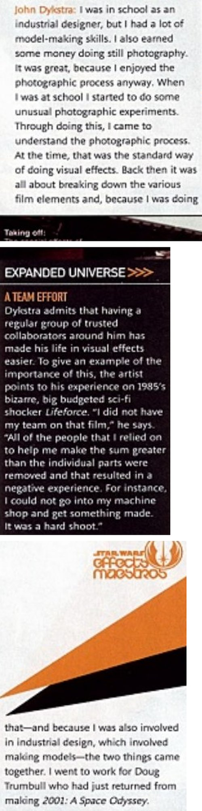

### Stat block notes (game mechanics, not feats)

- Star Warrior: intro: Perhaps the most influential visual effects technician to work on Star Wars, John Dykstra would win an Academy Award for his creation of a brand new motion picture camera system called the Dykstraflex. In this Insider exclusive interview, the genius who progressed to supervising the special effects on such blockbusters as Star Trek: The Motion Picture, Batman Forever and Spider-Man takes us through his early days in the industry and the time he spent breaking new ground on 1977's original classic Star Wars. (Calum Waddell, Star Wars Insider 103, p. 41) (Source: *Star Wars Insider #103* (2008), scan p.41)
- Star Warrior caption: Taking off: Taking off: The special effects of Star Wars saw a whole host of new technology being invented, like motion control. (Calum Waddell, Star Wars Insider 103, p. 41) (Source: *Star Wars Insider #103* (2008), scan p.41)
- Star Warrior sidebar: A Team Effort: EXPANDED UNIVERSE >>> A TEAM EFFORT Dykstra admits that having a regular group of trusted collaborators around him has made his life in visual effects easier. To give an example of the importance of this, the artist points to his experience on 1985's bizarre, big budgeted sci-fi shocker Lifeforce. "I did not have my team on that film," he says. "All of the people that I relied on to help me make the sum greater than the individual parts were removed and that resulted in a negative experience. For instance, I could not go into my machine shop and get something made. It was a hard shoot." (Calum Waddell, Star Wars Insider 103, p. 41) (Source: *Star Wars Insider #103* (2008), scan p.41)

## scan p.42 (scan page 42)

Page contents: Star Warrior continued (folio "52 INSIDER"; Effects Maestros badge left edge): Death Star trench miniature photo ("Trench time:"), TIE fighter models ("Timeless icon:"); "Expanded Universe >>> Creating Another Sci-Fi Legacy" sidebar; pull quote (hand-read)

### Stat block notes (game mechanics, not feats)

- Star Warrior captions: Trench time: Various techniques were used to capture the battle over the surface of the Death Star. Timeless icon: Few realized that the model ships from Star Wars would go on to become so iconic. (Calum Waddell, Star Wars Insider 103, p. 42) (Source: *Star Wars Insider #103* (2008), scan p.42)
- Star Warrior sidebar: Creating Another Sci-Fi Legacy: EXPANDED UNIVERSE >>> CREATING ANOTHER SCI-FI LEGACY After his acclaimed, Oscar winning work on Star Wars, Dykstra would find himself reunited with his mentor Doug Trumbull when the two were hired to take on the visual effects for 1979's would-be blockbuster Star Trek: The Motion Picture. Eager to outdo his own work on the George Lucas picture, Dykstra remembers his time on the first Star Trek feature with fondness. "Just like with Star Wars, the process on Star Trek was one of invention," he maintains. "It was a tough movie to do but, fortunately for me, Doug had some very specific ideas about how to create new and groundbreaking special effects." (Calum Waddell, Star Wars Insider 103, p. 42) (Source: *Star Wars Insider #103* (2008), scan p.42)

## scan p.43 (scan page 43)

Page contents: Star Warrior continued (folio "INSIDER 53"): Mark Hamill as Luke in X-wing cockpit ("Luke's luck:" caption); X-wing and Star Destroyer models on bluescreen mounts; "Expanded Universe >>> Inventing the Dykstraflex" sidebar (hand-read)

- **none** — entry/section: Dykstra on motion control and the Death Star trench [continued]: ""whole lot smaller than people had constructed in the past. Before Star Wars you would photograph special effects by putting a camera on a stage and creating a movement for it—although at that time it would have been done with synchronized motors—and that camera would stay on that stage for two weeks to complete a shot. What we came up with was a whole motion control system that was numerically manipulated—it was a bit like what a laser mill uses to control its machinery. As long as we knew where the subject material went we could shoot three or four elements per day as opposed to one element every two days—and that was because the camera movement was all pre-determined. We did not have to set everything back up again and we could complete the 240 odd shots that we had in the movie in record time. If we had done the visual effects photography in the traditional fashion, without the computer controlled cameras, Star Wars would have taken several years to make." —John Dykstra, Star Wars Insider 103, p. 43" Source: *Star Wars Insider #103* (2008), scan p.43
  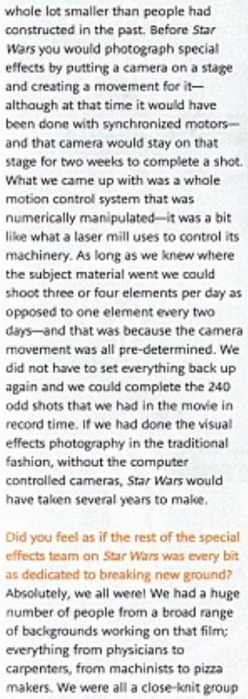

### Stat block notes (game mechanics, not feats)

- Star Warrior caption: Luke's luck: Luke's luck: Without John Dykstra's special effects breakthroughs, Luke Skywalker would have found defeating the Empire a lot harder! (Calum Waddell, Star Wars Insider 103, p. 43) (Source: *Star Wars Insider #103* (2008), scan p.43)

## scan p.44 (scan page 44)

Page contents: Blaster section cover (no folio; scan skips magazine pp.54–58 between this and the next page): Captain Rex render with blasters, TIE pilot, Bantha Tracks and Scouting the Galaxy cartoon badges, Star Wars and The Clone Wars logos (hand-read)

### Stat block notes (game mechanics, not feats)

- Blaster section cover lines: PACKED FULL WITH THE LATEST STUFF FROM THE STAR WARS UNIVERSE BLASTER PAGE 72 GET IN TRACKS [Bantha Tracks] PAGE 64 Steve Sansweet's SCOUTING THE GALAXY THE CLONE WARS WE LOOK AT THE LATEST BOOKS AND COMICS BASED ON THE NEW MOVIE! PLUS: ASK LOBOT 60 BOUNTY HUNTERS 70 CLASSIC MOMENT 76 AND MUCH MORE... 64 LATEST TOYS (Star Wars Insider 103, p. 44) (Source: *Star Wars Insider #103* (2008), scan p.44)

## scan p.45 (scan page 45)

Page contents: Books: The Clone Wars Hits Bookshelves! (folio "INSIDER 59"; Clone Wars logo top-right): Ahsoka Tano render with lightsaber; clone troopers renders; "Colour Your Galaxy" sidebar with "Spoiler Warning" stamp; pull quote (hand-read)

### Stat block notes (game mechanics, not feats)

- Books: The Clone Wars Hits Bookshelves! [continues]: BOOKS A NEW STAR WARS MOVIE CAN MEAN ONLY ONE THING: A HOST OF NEW STAR WARS BOOKS WORDS: JASON FRY THE CLONE WARS HITS BOOKSHELVES! Star Wars is back on the big screen, with Anakin Skywalker and Obi-Wan Kenobi battling Count Dooku, Asajj Ventress, and the Separatists' seemingly endless droid armies. The arrival of The Clone Wars in theaters and later as a weekly TV series also means that Star Wars is marching back into bookstores too, with a number of new titles offering different takes on heroes and villains, new and old. The Clone Wars movie introduces audiences to Ahsoka Tano, the Togruta Padawan assigned to Anakin Skywalker, and follows the young Ahsoka and her master as they try to return Jabba the Hutt's kidnapped son to the crime lord. It's a story filled with the action Star Wars fans expect—from Anakin's vertical assault on a Separatist fortress on Teth to Padmé's perilous journey into the dangerous Coruscant underworld. While there's action galore, fans will also learn more about Anakin, who finds that caring for a young, sometimes-reckless apprentice forces him to confront some of his own struggles as a Jedi Knight. Bringing this story to life on the page is a task for veteran Star Wars author Karen Traviss, whose Republic Commando novels have shown that very different minds are at work behind the identical faces of the galaxy's clone troopers. Traviss' novelization (Del Rey) isn't just a retelling of the movie, but also explores aspects of the story that you won't see in theaters. There's more good news: December will bring the first of a planned series of novels that tie in with the major story arcs of the TV show, with Karen Miller doing the writing honors for the first book. The Clone Wars movie and >>> [continues] [Pull quote:] The Clone Wars movie and TV series are a feast for the eyes, with Jedi, aliens, monsters, and starships all brought to life through animation. (Jason Fry, Star Wars Insider 103, p. 45) (Source: *Star Wars Insider #103* (2008), scan p.45)
- Books sidebar: Colour Your Galaxy: COLOUR YOUR GALAXY [SPOILER WARNING] Star Wars fans of a certain age will remember that the original film came with a raft of coloring and activity books. Doing mazes was more fun if you were trying to get R2-D2 to safety, while coming up with the perfect mix of colors for rendering a Wookiee's shaggy pelt takes a lifetime of practice. For the next generation, Dalmatian will offer a sextet of titles designed to let kids bring some color (and some stickers) to a galaxy far, far away. Parents can start with Jedi Forces ($2.99), move on to Troopers ($2.99) and The Clone Wars Sticker Coloring & Activity Book ($1.89), which covers it all. Also to consider: May the Force Be With You ($3.99), which comes with a "lightsaber pen," and The Dark Side ($4.99), a scratch-off book with stylus. Finally, kids who are more artistic-minded might like The Clone Wars ($3.99), whose illustrations are designed to be painted with water. Ahsoka's blue and white Togruta stripes await! (Jason Fry, Star Wars Insider 103, p. 45) (Source: *Star Wars Insider #103* (2008), scan p.45)

## scan p.46 (scan page 46)

Page contents: Books continued + Ask Lobot (folio "60 INSIDER"): "Younglings Lessons" sidebar; Ask Lobot panel (Lobot headshots, X-wings attacking Death Star still captioned "S-foils to attack positions!", Jango Fett render and Slave I images) (hand-read)

### Stat block notes (game mechanics, not feats)

- Books sidebar: Younglings Lessons: YOUNGLINGS LESSONS Young fans just learning their alphabet can turn to the two newest titles in DK's popular Readers series. These books are classified in four levels: Those just learning to read start off at Level 1, with key words repeated and labels and glossaries reinforcing lessons in an enjoyable way, while more-proficient readers will enjoy the rich vocabulary and glossaries of a Level 4 book. For The Clone Wars, DK is starting off with a pair of readers by Simon Beecroft: Watch Out for Jabba the Hutt ($3.99) is a Level 1 book, while Anakin in Action ($3.99) is a Level 2 reader. Sorry, no Huttese readers available yet, so you'll still need that protocol droid. Of course, kids like books that let them do things, too. Grosset & Dunlap will let readers choose their own adventure with the first of a planned series of digest novels—Jake T. Forbes' Decide Your Destiny #1: The Way of the Jedi. ($4.99). Those who like creating their own adventures with stickers, meanwhile, can turn to DK's The Clone Wars Ultimate Sticker Book ($6.99). Meanwhile, Star Wars fans in the U.K. can get a head start on two intriguing Clone Wars titles. Press Out 'n' Build (Ladybird) is a model-making kit in book form, letting Star Wars fans assemble paper models of a clone trooper, R2-D2 and an AT-TE. That book will appear in the U.S. at a later date. Currently slated to be a U.K.-only title is Dorling Kindersley's Funfax novelty book. (Jason Fry, Star Wars Insider 103, p. 46) (Source: *Star Wars Insider #103* (2008), scan p.46)
- Books continued: BOOKS continued.... series are a feast for the eyes, with Jedi, aliens, monsters, and starships all brought to life through CG animation. Kids and adults seeking a guide to help them sort out the action of the Clone Wars and the wealth of characters, settings, and ships will want to turn to The Clone Wars Visual Guide (DK, $19.99). Lavishly illustrated with art from the movie and series, the Visual Guide offers biographies of the major characters, information about the Republic and Separatist militaries, and details you won't find anywhere else. What's the significance of the scheming Ziro the Hutt's tattoos? Where did Anakin's trusty freighter Twilight come from? You'll find the answers to those questions and many others in the Visual Guide. Don't let the fact I wrote it put you off! With The Clone Wars appealing to fans of all ages, kids will find plenty for them on bookstore shelves. Grosset & Dunlap, a newcomer to Star Wars titles, will publish the junior novelization of The Clone Wars, penned by Tracey West. Grosset & Dunlap will also offer a quartet of books to introduce even younger readers to the story. Look for the reader The New Padawan ($3.99), Eric Stevens' introduction to brave, spunky Ahsoka Tano; Zachary Rau's The Galactic Photo Book ($6.99); the Rob Valois-penned The Battle Begins ($16.99); Valois' The Intergalactic Activity Book ($4.99); and Kirsten Mayer's Battle at Teth, an 8X8 storybook. (It's so named because the book is eight inches square, perfect for a kid's small hands, and is $3.99). (Jason Fry, Star Wars Insider 103, p. 46) (Source: *Star Wars Insider #103* (2008), scan p.46)
- Ask Lobot header and X-wing S-foils answer: ASK LOBOT CLOUD CITY'S COMPUTER LIAISON OFFICER ANSWERS ALL YOUR STAR WARS QUERIES. AS RELATED TO LELAND Y. CHEE [Still caption: "S-foils to attack positions!"] [Q: In A New Hope, the X-wing fighters open their "S-foils" to attack position so as to create space between the guns before the assault on the Death Star. The earlier version of the X-wing seen in Revenge of the Sith [the ARC-170] also opens its S-foils, although they have nothing on them. As it's in space, they can't be for aerodynamics. What's the point?] S-foils serve different purposes on different ships. As you've stated, the S-foils on the X-wings (and the B-wings as seen in Return of the Jedi) increase the target area of its lasers and increase performance in atmospheric flight. As described in Revenge of the Sith: Incredible Cross-Sections, the ARC-170s use the S-foils to expose the heat sinks and active radiators that aid the fighter's shielding and thermal stability during battle or hot pursuit. (Leland Y. Chee, Star Wars Insider 103, p. 46) (Source: *Star Wars Insider #103* (2008), scan p.46)
- Ask Lobot: Slave I color and Fett's armor: [Q: When does Boba Fett change the color of Slave I and his armor?] The change in color of Slave I between Attack of the Clones and The Empire Strikes Back suggests the passage of time, 25 years to be exact, and reflects the many modifications Fett has made to it. Slave I has also seen a great deal of action and so by the time of Empire, it has weathered countless harrowing situations. In the junior novel Boba Fett #5: A New Threat, Fett has a space duel with Asajj Ventress, badly damaging Slave I. The intention of creating this scene was to suggest a point where the change in the ship's coloring might have occurred. Regarding the armor, the Attack of the Clones Visual Dictionary points out that Fett has replacement armor for much of his suit, with additional items that can be fitted for particular mission profiles. Some configurations stress brute-force armament, while others maximize non-lethal weapons used for capturing quarry. This explains why Jango has two completely different jetpacks during the course of Attack of the Clones: the blue and goldenrod one seen on Kamino and the blue and silver one he uses on Geonosis. Though Jango's Kamino jetpack looks like the one we see Boba wearing in the classic trilogy, we know it's different because Jango's was destroyed during the duel with Obi-Wan. Other Expanded Universe material explains that Fett has more than one set of armor, which is supported in the films by the fact that the wrist gauntlets and jetpack from The Empire Strikes Back are different than the ones he wears in A New Hope and Return of the Jedi. With Fett possibly appearing in the live-action Star Wars television series in a few years, perhaps more light will be shed on the answers to these questions. (Leland Y. Chee, Star Wars Insider 103, p. 46) (Source: *Star Wars Insider #103* (2008), scan p.46)

## scan p.47 (scan page 47)

Page contents: Comics: Clone Wars Writ Large (folio "INSIDER 61"): top-right teaser box "76 Classic Moment: The Clone Factory" (Kamino clone mess-hall still); Captain Rex and Anakin renders; Galen Marek figure in "The Force Unleashed Graphic Novel" sidebar; Henry Gilroy pull quote (hand-read)

- **none** — entry/section: Gilroy on story arcs too big for TV: ""The initial story arcs I had always imagined for the show were too big for the TV series to handle initially," Gilroy explains. "I was able to do them justice on the sprawling pages of the comics." [Pull quote: "The initial story arcs I had imagined were too big for the TV series production to handle." —Henry Gilroy] —Henry Gilroy, Star Wars Insider 103, p. 47" Source: *Star Wars Insider #103* (2008), scan p.47
  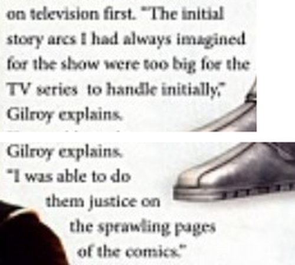

### Stat block notes (game mechanics, not feats)

- Top-right teaser box: 76 CLASSIC MOMENT: THE CLONE FACTORY (Star Wars Insider 103, p. 47) (Source: *Star Wars Insider #103* (2008), scan p.47)
- Comics: Clone Wars Writ Large [continues]: COMICS ANIMATED SERIES INSPIRES A NEW ONGOING COMIC WORDS: DANIEL WALLACE CLONE WARS WRIT LARGE After experiencing the animated Clone Wars adventures of Anakin and Obi-Wan in the theater this summer and on television in the fall, Star Wars fans have two ways to continue getting their Jedi fix. In September, Dark Horse is launching two Clone Wars comics at the same time: a digest-sized quarterly and a full-sized monthly ongoing series. A monthly comic set during the Clone Wars hasn't been seen on the racks since the retirement of Star Wars Republic in 2006. The new Clone Wars ongoing series takes place "very early in the war, according to George," says Henry Gilroy, a writer for the comics and the first season of the animated Clone Wars TV series. Each story arc of the monthly comic will be released as an adventure spread out over six issues. JUGGLING ACT The monthly Clone Wars series will clearly benefit from Gilroy's involvement, given his direct role in helping shape the animated series and crystallizing its style and tone. In fact, the debut storyline to appear in the comics very nearly showed up on television first. [Gilroy quote recorded separately] The monthly comic starts things off with "Slaves of the Republic," >>> [continues] (Daniel Wallace, Star Wars Insider 103, p. 47) (Source: *Star Wars Insider #103* (2008), scan p.47)
- Comics sidebar: The Force Unleashed Graphic Novel: THE FORCE UNLEASHED GRAPHIC NOVEL Hitting shops on August 18 is Star Wars: The Force Unleashed, a 120-page comics adventure that provides an all-new perspective on the events of LucasArts' groundbreaking gaming adventure. The Jedi-hunting missions of Darth Vader's secret apprentice are revealed here, in a comics storyline written by the game's author, Haden Blackman. The perfect purchase for those who haven't played the game and the ideal accompaniment for those who have, this trade paperback is this summer's don't-miss release. (Daniel Wallace, Star Wars Insider 103, p. 47) (Source: *Star Wars Insider #103* (2008), scan p.47)

## scan p.48 (scan page 48)

Page contents: Comics continued + Pocket Sized Clone Wars + Ask Lobot (folio not printed; presumed 62; scan then skips magazine p.63): Separatist ship over planet art; Darth Vader chestbox prop photo; Lobot headshot (hand-read)

- **none** — entry/section: Gilroy on deadlines: ""The key is having deadlines and the discipline to meet them." —Henry Gilroy, Star Wars Insider 103, p. 48" Source: *Star Wars Insider #103* (2008), scan p.48
  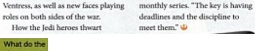

### Stat block notes (game mechanics, not feats)

- Comics continued: COMICS continued.... which pits Anakin, Obi-Wan, and Anakin's Padawan Ahsoka Tano against venal Zygerrian slavers. For Ahsoka, the conflict hits too close to home when many of the slaves prove to be Togrutas, members of her native species. Look for appearances from Count Dooku and Asajj Ventress, as well as new faces playing roles on both sides of the war. How the Jedi heroes thwart Dooku and the galactic slave trade is part of the fun, but the biggest question remains—how was Gilroy able to juggle several distinct Clone Wars projects? Staggered deadlines helped. After completing work on the animated series, he accepted the assignment to write the digest, then dove into the outline for the monthly series. "The key is having deadlines and the discipline to meet them." (Daniel Wallace, Star Wars Insider 103, p. 48) (Source: *Star Wars Insider #103* (2008), scan p.48)
- Pocket Sized Clone Wars: POCKET SIZED CLONE WARS CLONE WARS DIGEST PACKS BIG STORIES IN A SMALL PACKAGE The monthly comic isn't the only Clone Wars offering from Dark Horse. A series of digest-sized graphic novellas, similar to 2004-2007's Clone Wars Adventures but featuring a single 88 page story each issue, will debut at the same time and follow on a quarterly schedule. Because digests sell well to schools and bookstores, the series promises to hook fans lured by the August 15 Clone Wars movie premiere. Henry Gilroy, a writer for both the digest and the first season of the animated series, emphasizes the similarities. [Gilroy quotes recorded separately] The digest launches with "Shipyards of Doom," the tale of a Republic raid to demolish the InterGalactic Banking Clan's warship factories in the Gwori system. The tale is marked by hyperkinetic action, clone troopers, giant monsters, and a highly creative method used by the Jedi to slip past an enemy blockade. Lead characters in the digest include Anakin, Obi-Wan, and newcomer Ahsoka Tano, with others from the animated series and brand new faces, too. [Stradley quote recorded separately] Gilroy is no Star Wars neophyte, having penned the comics adaptations of The Phantom Menace and Attack of the Clones. As an animation scripter he has worked on programs including Bionicle, Justice League, Atlantis, Batman, and The Tick. (Daniel Wallace, Star Wars Insider 103, p. 48) (Source: *Star Wars Insider #103* (2008), scan p.48)
- Ask Lobot: Hebrew letters on Vader's chestbox: [Q: What do the Hebrew letters on the chestbox of the classic trilogy costume for Darth Vader say?] During their extensive research for the upcoming Star Wars Blueprints book, illustrators Chris Reiff and Chris Trevas consulted with multiple sources and concluded that the "Hebrew" characters found on various versions of the Darth Vader control panel unit amount to absolutely nothing. The writing is all just gibberish with many of the characters reversed, upside down, backwards, incomplete, or a combination of those. The letters themselves are different on the different versions of the unit. As to why they appear there, one of their theories is that the letters were actually reused from a Raiders of the Lost Ark prop, as the letters did not appear on the Vader costumes from A New Hope. (Leland Y. Chee, Star Wars Insider 103, p. 48) (Source: *Star Wars Insider #103* (2008), scan p.48)

## scan p.49 (scan page 49)

Page contents: Scouting the Galaxy (folio "64 INSIDER"): "Sansweet's View" panel with three snapshots (Sansweet sorting items on a shop floor, group photo at the Cantina restaurant-bar with R2-D2, Sansweet signing a wall: "The CANTINA Rocks!! With the Force, Steve Sansweet" plus an illegible line); Carbonite Copycat Q&A with Han Solo in carbonite photo (hand-read)

### Stat block notes (game mechanics, not feats)

- Scouting: Sansweet's View: SCOUTING.... IS IT CLAUDE MONET, PATRICK NAGEL... OR A FROZEN HAN SOLO? POSTERS, BANNERS, AND BOBBLE HEADS RAISE QUESTIONS WORDS: STEVE SANSWEET SANSWEET'S VIEW I know I told you about an item from Japan in the last column—the Yoshitoku Vader samurai armor—but here we are back in Japan, this time literally. As you probably know, we're ending the Star Wars Celebration 30th Anniversary World Tour in greater Tokyo July 19 to 21 with Star Wars Celebration Japan. Star Wars opened in Japan in June 1978, 13 months after it started playing in the U.S. We've always had awesome fans in Japan, and collectors know that some of the best items ever have been produced by Japanese companies—and still are being produced by them. So after four days of Celebration meetings in Tokyo in April, I had a chance for a brief... research... tour of a few collectors' shops. Actually, I spent most of my time in a small, crowded treasure house called Star Case, a shop where collectors put their Star Wars items on consignment so that other collectors may assume some pride of ownership. I felt like a kid in a candy shop. I looked, and poked, and asked lots of questions, then looked some more. My friends were amazingly patient, although some started drifting away, one by one. I kept looking to make sure that [names omitted] were still around since I didn't want to be left alone in the world's most confusing city without knowing more than how to say the most basic pleasantries in Japanese. They were real troopers! (Actually, they are members of the 501st!) I finally gathered a bunch of goodies and brought them to the store owner, [name omitted]. It would take a while to get it all together and calculate the total, so to keep me from getting bored, [name omitted] handed me a three-foot high stack of miscellaneous catalogs, brochures, flyers—you name it! "Choose whatever you don't have," he said. "It's a gift." I looked around and there was really only one place to sort through the stack—the floor. So the kid in the candy shop became the five-year-old on the floor, sifting through the pile of paper goods. My friends laughed a lot, took photos, and gently poked fun at me. I was oblivious to it all. And, yes, I found some treasures. But since I already had a majority of the items, I left plenty behind for the next set of treasure hunters! Then it was off to a restaurant-bar called the Cantina for dinner with members of the newly reinvigorated Japanese Garrison of the 501st, along with fellow honorary members, the artist Tsuneo Sanda and television director Kazuhishi Kawahara, both of whom will play an active role in Celebration Japan along with the 501st. I can't wait to return there! (Steve Sansweet, Star Wars Insider 103, p. 49) (Source: *Star Wars Insider #103* (2008), scan p.49)
- Scouting: Carbonite Copycat [continues]: CARBONITE COPYCAT [Q: I have a life size Han Solo frozen in carbonite. It stands six-feet 10-inches tall, two-feet 8-inches wide and 8-1/4 inches deep; it weighs approximately 80 pounds. It is painted in silver and gray metallic. The right control panel lights up. It is a flawless work of art in mint condition. I received it from a friend of a friend with no knowledge of the origin. It was bought online about 10 years ago for $2,500: at least, that's what I am told. I have researched Star Wars Insider, online, comic book stores, magazines, collectors, and dealers, but no one knows of one that lights up. In side-by-side comparisons to the ones made by Illusive Concepts, this Han Solo makes theirs look like a Patrick Nagel next to a Claude Monet. Can you please help me find out who made this or where it came from and what it is possibly worth? There are no stamps or signatures to help out.] Is this a test? Are you putting me on? First of all, I must admit that you hooked me at the "Patrick Nagel next to a Claude Monet" comparison. First, because I didn't have any name recognition of late pop artist Patrick Nagel's name until I Googled him [continues] (Steve Sansweet, Star Wars Insider 103, p. 49) (Source: *Star Wars Insider #103* (2008), scan p.49)

## scan p.50 (scan page 50)

Page contents: Scouting the Galaxy continued (folio "INSIDER 65"): Yoda Empire Strikes Back wristwatch in box photo; Episode I window banner (Maul, Qui-Gon, Anakin, Amidala); large "...THE GALAXY" title strip (hand-read)

### Stat block notes (game mechanics, not feats)

- Scouting: Carbonite Copycat [continued]: and recognized his art; second, I was vastly amused by the comparison in reference to your Han in Carbonite. Illusive Originals made and sold the original limited-edition run of the large fiberglass Han in Carbonite pieces starting in 1995; the original selling price was between $900 and $1,200, depending on retailer. The earliest pieces were the best made, but as production shifted, the quality deteriorated somewhat, leaving the front of the piece sometimes concave, sometimes convex. Fans also decried the fact that the eight side "control panels" were exactly the same, rather than all different as on the original prop. After these sold out, and collectors started seeing them in friends' houses and realized how cool they were, prices started to rise. With eBay entering the scene, some of these in years past have gone for double or more the original retail price. So, it's no surprise then that people started making and selling replicas of the authorized prop replica. From the looks of yours, I'd say it was a third or fourth generation item since the crisp lines of the original are mostly obscured. The one addition, or change, is that one of the side panels has been customized with lights added. You want me to tell you which bootlegger made it? If you really don't know, then I certainly have no way of telling. What is it possibly worth? Well, I personally wouldn't offer you two cents for it... but perhaps you'll find someone with much better taste who really does know the difference between a Nagel and a Monet. Then again, I think yours is the Nagel. (Steve Sansweet, Star Wars Insider 103, p. 50) (Source: *Star Wars Insider #103* (2008), scan p.50)
- Scouting: Time Out: TIME OUT [Q: A few years ago, my uncle gave me two watches that he acquired at a bank for which he worked many years ago. He said they were part of a bank promotion. The watches were made by Bradley and the boxes have official The Empire Strikes Back and Lucasfilm logos. Each watch has a likeness of Yoda with the Star Wars logo and the name "Yoda" printed on it. I have not made any serious effort to search out more or to find a value, but any limited search I have made has turned up nothing of this sort. Both watches are still in their original cases and have never been worn. Can you give me any more info on where they came from and where there might be others like it?] Bradley was an early Star Wars licensee and ended up making several dozen different watches in the vintage era, including at least four slightly different Yoda watches for 1980's The Empire Strikes Back. It would not have been difficult for a bank—or any company—to buy a number of these to use in connection with a promotion, perhaps to get kids to open savings accounts with a minimum deposit. In other words, this wasn't a special promotional piece, but an item that could be purchased at many stores or through catalogs. In a recent check on eBay, I found two of these adult-size watches being offered in mint condition, one for $75 and one for $139. In my view, these are at best a $50 item. A similar, child's version of the watch from Bradley was offered on eBay for $9.99 and there were no takers. (Steve Sansweet, Star Wars Insider 103, p. 50) (Source: *Star Wars Insider #103* (2008), scan p.50)
- Scouting: Boba Solo? Han Fett?: BOBA SOLO? HAN FETT? [Q: I had a question about a possible mistake during the packaging of the bobble head figures. I found and bought a Han Solo Bobble Head at the local Target. However, the packaging it is in says Boba Fett and has all of the details about Boba Fett. I just wondered if this might be a rare/collectable piece or if it was a common mistake and I could open it for display.] Sigh.... First it's Han in carbonite. Next it's Han in Fett. Open it. Please open it. Now! (Steve Sansweet, Star Wars Insider 103, p. 50) (Source: *Star Wars Insider #103* (2008), scan p.50)
- Scouting: King Overthrown [question; answer continues]: KING OVERTHROWN [Q: I have a complete set of the Burger King toys that was given to me because I would "appreciate them" more than the original owner. Which I do! But I don't know what to do with them; I hesitate to open the packages because I was told a complete set is rare (I don't know the truth of this), but they aren't being "appreciated" in a box in my corner! Also, if I should keep them packaged, do you have a suggestion on how to display them aesthetically but practically?] >>> [continues] (Steve Sansweet, Star Wars Insider 103, p. 50) (Source: *Star Wars Insider #103* (2008), scan p.50)
- Scouting: Big Banner: BIG BANNER [Q: I worked for a U.K. retailer called Topshop when Star Wars Episode I came out; we were selling picture T-shirts of the film. To promote this we had huge posters sent to us for the window displays. These posters were meant to be lit from behind. I was lucky enough to get one when we took them out of the windows. As far as I'm aware, there were only a maximum of five produced. The size of the poster is 89cm x 294cm (about three feet wide by nearly 10 feet tall). I would be interested to know how much it would be worth or where I would go to get it valued.] These are certainly an awesome size, [name omitted]. At the same time, however, the size really reduces the collectability of point-of-purchase material like this. These window banners are really too large for most collectors to display. In addition, exactly the same images were widely used on many posters and banners by retailers around the world. They were part of a special Retail Style Guide produced by Lucasfilm to provide a uniform look for Episode I across all different kinds of retailers. So as impressive as they might seem, I'd be surprised if you were able to get more than $25 to $50 for one of them. (Steve Sansweet, Star Wars Insider 103, p. 50) (Source: *Star Wars Insider #103* (2008), scan p.50)

## scan p.51 (scan page 51)

Page contents: Scouting continues + Toys (folio "66 INSIDER"): Burger King Episode III toy set photo; Spanish-language Empire Strikes Back ad-slick sheets ("El Imperio Contraataca"); Gentle Giant Anakin mini-bust with crossed lightsabers and "Must Have!" badge; magazine submission box (addresses and email not transcribed) (hand-read)

### Stat block notes (game mechanics, not feats)

- Scouting: King Overthrown answer [continued]: SCOUTING continues.... Please see my response to [name omitted]' question above. I assume you're referring to the Episode III Burger King premiums. These will never appreciate in value, even though they are very cool; there were just too many made, and too many people keeping sets of all 31 of them sealed in their bags, speculating perhaps that they'd be able to finance a college education by selling them off in the future. But if you wait too long, you might not even be able to buy a decent Burger King meal for the price that they would bring. A recent eBay seller was seeking $20.25 including postage for a full, sealed mint set of the toys. Others were offering individual toys for as little as a penny apiece. Liberate them and have fun! (Steve Sansweet, Star Wars Insider 103, p. 51) (Source: *Star Wars Insider #103* (2008), scan p.51)
- Scouting: Viva Espana: VIVA ESPANA [Q: Before I ask my question, I would like to thank you for one of my Star Wars collecting highlights. A while back, you purchased a Star Wars item from me on eBay. Selling a Star Wars item to you is like teaching Yoda about the Force. It's a rare occasion. Anyway, let's get down to business. I found a Star Wars item that I would like more information on. I have a set of three black and white The Empire Strikes Back posters. The posters are in Spanish. It reminds me of an advertising layout. Do you have any information on these posters?] My buying something from an Insider reader on eBay may not be as rare as you think! But I remember it was a very easy and pleasant transaction, so thank you! What you have are newspaper ad "slicks" from the U.S. printed by Gore Graphics, the printer that did such a great job on many of the original trilogy Star Wars saga posters for movie theaters. As more and more newspapers turned to offset printing in the 20th Century, actual metal type and metal or cardboard ad mats (which were the reverse of the final printed image) were replaced by pre-screened ad slicks that could be just cut out and pasted down on the page layout sheet. The ad slicks contained a variety of possible ads of different sizes; the distributor placed an order for an ad "insertion" into the newspaper and specified which ad to use. Movie-paper collectors consider this an interesting offshoot of poster collecting. Your sheets are meant for Spanish-language newspapers in the U.S., don't appear to be cut up, and are much rarer than the normal English-language slicks. Nice find! (Steve Sansweet, Star Wars Insider 103, p. 51) (Source: *Star Wars Insider #103* (2008), scan p.51)
- Toys intro: TOYS THAT'S NO MOON, IT'S A SPACE STATION... MADE OF BRICKS! AND THE NEW MILLENNIUM FALCON IS HEADING STRAIGHT TOWARDS IT! WORDS: JEREMY BECKETT The summer convention season is almost upon us, and with it comes some great exclusives from Gentle Giant and Hasbro: the toy giant has turned one of its most popular vehicles into a playset. LEGO has gone retro and reconceived a vintage Star Wars toy, not dissimilar to Heart Art's new vision of the classic astromech. (Jeremy Beckett, Star Wars Insider 103, p. 51) (Source: *Star Wars Insider #103* (2008), scan p.51)
- Toys: Gentle Giant Anakin Skywalker Mini-Bust (Must Have!): GENTLE GIANT ANAKIN SKYWALKER MINI-BUST As seen in Revenge of the Sith, Anakin gives in to his anger and savagely ends Count Dooku's life at Palpatine's command, slowly giving in to the dark side. This highly detailed mini-bust captures the evil that seethes below the surface as Anakin readies himself to strike the deadly blow! The bust stands approximately 6.5" tall and will only be available at this year's San Diego Comic Con for $55. (Jeremy Beckett, Star Wars Insider 103, p. 51) (Source: *Star Wars Insider #103* (2008), scan p.51)

## scan p.52 (scan page 52)

Page contents: Toys continued (folio "INSIDER 67"): Hasbro Millennium Falcon with Chewbacca and Han Solo figures ("Must Have!" badge); Comic-Con Exclusive badge with Vader kneeling before Emperor hologram set; Kotobukiya TIE fighter pilot statue with MSE-6 mouse droid (hand-read)

### Stat block notes (game mechanics, not feats)

- Toys: Hasbro Millennium Falcon (Must Have!): HASBRO MILLENNIUM FALCON The most iconic of Star Wars ships has been retooled and revamped for 2008. Boasting a massive two-and-a-half foot length and more features than ever before, this is sure to be the hottest toy of the year. The ship has a cockpit that holds four figures (including exclusive Han Solo and Chewbacca figures) and you can fit another 14 figures in the other sections: a medical bay that can house the tourniquet from the Luke Skywalker (Bespin Duel) figure, and smuggling compartments to hide from Imperial inspection teams. The Falcon also includes an auto-lowering boarding ramp, a detachable mini-fighter (an escape pod), rotating sensor dish, and even a holographic chess table. The new Millennium Falcon includes lighting effects such as a glowing hyperdrive, interactive sounds like engine noise and laser cannons, and famous one-liners from the Star Wars movies. Available now for a suggested retail price of $149.99. (Jeremy Beckett, Star Wars Insider 103, p. 52) (Source: *Star Wars Insider #103* (2008), scan p.52)
- Toys: Disturbance in the Force (Comic-Con Exclusive): DISTURBANCE IN THE FORCE Picture the scene: Darth Vader kneels in supplication before the holographic head and shoulders of his master, Emperor Palpatine. They have both felt a disturbance in the Force, one that bodes ill for the galactic Empire. Palpatine believes it is the son of Skywalker. Vader suggests bringing Luke over to the dark side and thus begins a chain of events that leads to one of the most shocking revelations of the entire Star Wars saga. Now you can enjoy the entire dialogue between master and servant with this exclusive from Hasbro. The suggested price will be $14.99, and will be available by two means: at San Diego Comic-Con International (SDCC), where it will be sold at the Hasbro booth, and on HasbroToyShop.com for those who weren't at SDCC. (Jeremy Beckett, Star Wars Insider 103, p. 52) (Source: *Star Wars Insider #103* (2008), scan p.52)
- Toys: Kotobukiya TIE Fighter Pilot ARTFX Statue: KOTOBUKIYA TIE FIGHTER PILOT ARTFX STATUE Only the intensely trained elite of the Imperial Navy have the honor of defending the galactic Empire by getting behind the twin ion engines of a TIE fighter. Garbed with a sinister black helmet connected to oxygen support tubes, the Pilot is portrayed as an 11-3/4" tall statue in a dynamic action pose. Bonus parts enable the Pilot to be displayed with his BlasTech E-11 Blaster in both hands at the ready, or throwing his arm forward to take a shot at Rebel scum. When the pilots step through a doorway on the Death Star, an MSE-6 is seemingly always underfoot. The Mouse droid is a separate piece, so it can be positioned anywhere. With its large scale and impeccable paint applications, this ARTFX statue is a fun to assemble snap-fit kit that can be easily put together in seconds without glue or modeling skills. This awesome product from Japan will be available in August for approximately $110. (Jeremy Beckett, Star Wars Insider 103, p. 52) (Source: *Star Wars Insider #103* (2008), scan p.52)

## scan p.53 (scan page 53)

Page contents: Toys: LEGO Death Star ("Must Have!" badge) + Ask Lobot (folio "68 INSIDER"): LEGO Death Star playset photos (Vader, Obi-Wan minifigures); Attack of the Clones still of Anakin carrying Shmi's body; Lobot headshot (hand-read)

### Stat block notes (game mechanics, not feats)

- Toys: LEGO Death Star (Must Have!): LEGO DEATH STAR Competing with Hasbro's Falcon for the most awesome toy of 2008 is the Death Star playset from LEGO. This detailed battle station features an incredible array of mini-figure scale scenes and includes a Death Star control room, hangar bay with TIE Advanced fighter, manned turbolasers, tractor beam controls, throne room, detention block, working trash compactor, conference room, droid maintenance facility, and the powerful Death Star super laser. With over 3,800 pieces, the Death Star measures 16" tall and 16-1/2" wide when completed. It comes complete with 25 Star Wars mini-figures and droids, seven of which are new and exclusive to this set: Luke Skywalker & Han Solo in stormtrooper outfits, Death Star troopers, phlutdroid, interrogation droid, Death Star droid and dianoga! The Death Star is a exclusive available for pre-order at LEGO.com starting July 1 and can be found only in LEGO shops starting September 1 for $399.99. (Jeremy Beckett, Star Wars Insider 103, p. 53) (Source: *Star Wars Insider #103* (2008), scan p.53)
- Ask Lobot: Did Obi-Wan know Shmi died? What happened to Cliegg Lars?: [Q: Is Obi-Wan aware that Shmi Skywalker died on Tatooine during the events of Attack of the Clones? Also, what happened to Cliegg Lars?] It's safe to assume that when they decide to send baby Luke to Tatooine in Revenge of the Sith, Yoda and Obi-Wan know with absolute certainty that Shmi is dead. If they didn't know this, Tatooine would be the worst place in the galaxy to try to hide from Anakin Skywalker. For some reason, they know that Tatooine holds painful memories for Anakin, making it a place that Darth Vader would actively avoid, and thus an ideal place to hide Luke. In Attack of the Clones, we know that Obi-Wan was aware of Anakin's nightmares of his mother dying and that Yoda feels "pain, suffering, and death" when Anakin was slaughtering the Tusken Raiders. When Obi-Wan tries to contact Anakin from Geonosis, he learns that Anakin is on Tatooine, despite Obi-Wan's orders that he stay on Naboo to protect Senator Amidala. It's certainly possible that Anakin could have informed the Council about the death of his mother when being questioned about his being on Tatooine. Another possibility is that Qui-Gon, whose voice we hear following Anakin's slaughter of the Tuskens, mentioned this to Yoda from the netherworld of the Force. As for Cliegg Lars, he passes away shortly after Attack of the Clones, having suffered both physically and mentally from Shmi Skywalker's kidnapping and murder at the hands of the Tusken Raiders. In his grief, he lost his will to live and died of a broken heart. (Leland Y. Chee, Star Wars Insider 103, p. 53) (Source: *Star Wars Insider #103* (2008), scan p.53)

## scan p.54 (scan page 54)

Page contents: Ask Lobot continued + Toys (folio not printed, presumed 69): Lobot headshot; Heart Art astromech shampoo bottles photo (R2-D2, R2-Q5 style black, R4-style and red/white units); full-height Kotobukiya Indiana Jones Raiders of the Lost Ark ARTFX Theatre ad (hand-read)

### Stat block notes (game mechanics, not feats)

- Ask Lobot: Why don't Luke and Leia learn about Padmé?: [Q: Why do Luke and Leia never find out about their mother, Padmé Amidala, until after the Yuuzhan Vong crisis? As far as I know, Ben Kenobi, Bail Organa, Yoda, Darth Vader, and R2-D2 knew, so why did they not tell them? I heard that a comic book stated that they once found out that Padmé's niece was living on Naboo and found her. Is this true?] Let's approach this through the process of elimination. Bail doesn't tell Leia growing up because that knowledge would put her at great risk; a greater risk than having her hide in plain sight as a vocal member of the Imperial Senate who also happens to be the daughter of a Senator who vehemently opposed Palpatine's increase in powers during the days of the Republic. Since Bail died on Alderaan, he's not talking. R2-D2 was programmed not to talk about anything to anybody so that rules him out; apparently he even keeps up the charade when he finally sees Obi-Wan on Tatooine. Certainly Obi-Wan, Yoda, and Anakin could have mentioned something from the Jedi afterlife, but they chose not to. In fact, their interactions with Luke after Return of the Jedi are pretty limited. Force spirits can be strange that way. In a passage from Jedi vs. Sith: The Essential Guide to the Force, after Leia Organa Solo discovered the identity of her mother, she realized that Pooja, a former Naboo representative and a friend she had known since her service in the Imperial Senate was not only Padmé's niece, but also her own first cousin. (Leland Y. Chee, Star Wars Insider 103, p. 54) (Source: *Star Wars Insider #103* (2008), scan p.54)
- Toys: Heart Art Shampoo Bottles: HEART ART SHAMPOO BOTTLES These have been available in Japan for a few months, but we couldn't help showing Heart Art's astromech shampoo bottle collection. Initially released in limited quantities, these were originally Toys "R" Us exclusives. This summer, however, they are scheduled to be made available at Celebration Japan for ¥1600 (approximately $16) each. (Jeremy Beckett, Star Wars Insider 103, p. 54) (Source: *Star Wars Insider #103* (2008), scan p.54)
- Ad: Kotobukiya Indiana Jones ARTFX Theatre: INDIANA JONES Direct from Japan ARTFX THEATRE ... AVAILABLE NOW! RAIDERS OF THE LOST ARK ARTFX THEATRE 11 3/4" Tall Prepainted PVC Model Kit - basic assembly required ARTFX Theatre is an innovative new concept which combines a movie's key elements into a hyper-detailed, three-dimensional collage. Raiders of the Lost Ark is the debut release, with a diorama from each of the Indy films forthcoming! (Kotobukiya advertisement, Star Wars Insider 103, p. 54) (Source: *Star Wars Insider #103* (2008), scan p.54)

## scan p.55 (scan page 55)

Page contents: Bounty Hunters reader-photo section (folio "70 INSIDER"): Boba Fett art header with Kotobukiya statue; three reader photos with actors/industry guests; "Bounty Winner!" badge (hand-read)

### Stat block notes (game mechanics, not feats)

- Bounty Hunters header: BOUNTY HUNTERS KOTOBUKIYA MEET THE STARS, SHOW THE EVIDENCE, WIN THE BOUNTY! INSIDER'S BOUNTY HUNTER SECTION IS SPONSORED BY KOTOBUKIYA. EACH WINNER WILL RECIEVE [sic] A SUPER KOTOBUKIYA STAR WARS STATUE WORTH ABOUT $100. (Star Wars Insider 103, p. 55) (Source: *Star Wars Insider #103* (2008), scan p.55)
- Bounty Hunters: Bringing Home the Bounty! (Bounty Winner): BRINGING HOME THE BOUNTY! We went to a little Star Wars convention in Greensboro, N.C. My son, [name omitted], dressed as Jango Fett, and here he is chumming with a Jedi and a bounty hunter. To have those kind of associates make you one "bad" man! Notice his bounty hunter scowl as he gets his picture taken with the beautiful Jedi Aayla Secura (Amy Allen) and bounty hunter Aurra Sing ([name omitted]). We also met Boba Fett! It was a wonderful time and all the actors and actresses were very kind and nice. [letter-writer name omitted] [Editor:] [name omitted] is certainly our luckiest bounty hunter so far! A prize is on its way as we speak.... (Star Wars Insider 103, p. 55) (Source: *Star Wars Insider #103* (2008), scan p.55)
- Bounty Hunters: Producing the Goods!: PRODUCING THE GOODS! My name is [name omitted] and I am part of the 501st with Garrison Excelsior. Here is a picture of Rick McCallum and myself at Disney Star Wars Weekends back in 2006. My wife [name omitted] and I have been going to Disney for Star Wars Weekends for five years straight, and I was very happy to get a chance to talk with Mr. McCallum and get a picture with him. In the picture I was showing him my Star Wars tattoo (I have my whole right arm sleeved in Star Wars characters), and I think he really enjoyed it! Keep up the great work with the Insider! [letter-writer name, 501st ID and city omitted] (Star Wars Insider 103, p. 55) (Source: *Star Wars Insider #103* (2008), scan p.55)
- Bounty Hunters: He Arrived Just Before I Did!: HE ARRIVED JUST BEFORE I DID! In May of 2007 I decided to go to the Motor City Comic-Con as I had heard that Billy Dee Williams was going to attend. He was only there for a brief time on Saturday. When I arrived, there was a sign saying he would be back in an hour. I joined a line of what would become at least 50 people. True to his character, Billy Dee was as cool as can be, and I tried to be cool as well. I asked him how he was, he said he was good, and I asked if I could have a photo. When I was taking the picture I suddenly froze up with nerves! The resulting picture is what you see! Thank you for reading my email, the "Bounty Hunters" section is my favorite in the magazine! [letter-writer name omitted] (Star Wars Insider 103, p. 55) (Source: *Star Wars Insider #103* (2008), scan p.55)
- Bounty Hunters: Can You Go One Better?: CAN YOU GO ONE BETTER? CAN YOU GUYS GO ONE BETTER? HAVE YOU HUNG OUT WITH HARRISON FORD? OR MAYBE YOU CUDDLED CHRISTOPHER LEE? WE WANT TO SEE YOUR PHOTOS! (Star Wars Insider 103, p. 55) (Source: *Star Wars Insider #103* (2008), scan p.55)

## scan p.56 (scan page 56)

Page contents: Bantha Tracks Vol. 34 (folio "72 INSIDER"): "By the Fans, For the Fans" header with bantha art; reader photos: origami landspeeder with family, hand-painted Darth Maul/Boba Fett "MAUL-FETT" jacket, scratch-built Chiss Clawcraft model; Bantha Tracks submission guidelines box (email and postal address not transcribed); "Get in Tracks!" tag (hand-read)

### Stat block notes (game mechanics, not feats)

- Bantha Tracks: They're Crafty! intro: BANTHA TRACKS VOL. 34 BY THE FANS. FOR THE FANS. THEY'RE CRAFTY! BANTHA TRACKS FANS... JUST OUR TYPES What are the building blocks of your Star Wars fandom? LEGO? Paintbrushes? Origami papers? Metal droid parts? Bantha Tracks readers fuel the fires of their own fandom, and the fandom of others, with their creative projects and most impressive talent. (Star Wars Insider 103, p. 56) (Source: *Star Wars Insider #103* (2008), scan p.56)
- Bantha Tracks: origami landspeeder: [name omitted] (left) reports that he and his brother [name omitted] are huge fans of Star Wars. "Every summer we go to visit my family in Israel," says [name omitted]. "I did find Return of the Jedi, with Hebrew subtitles, on one of the movie channels." [name omitted]'s grandmother makes artwork of paper origami triangles, and puts them all together to make vases, birds, elephants, camels, and more. Pictured with [name omitted] and the landspeeder is his grandmother and his brother [name omitted]. LEFT: "This year I thought it would be great if she could make a Star Wars object," says [name omitted]. "My grandmother and I made a miniature of the landspeeder out of the origami pieces. We used white and yellow papers because we were out of red." (Star Wars Insider 103, p. 56) (Source: *Star Wars Insider #103* (2008), scan p.56)
- Bantha Tracks: MAUL-FETT jacket: BELOW: [name omitted] of Puerto Rico painted this beautiful rendition of Star Wars characters onto a jacket to wear specifically at Star Wars Celebration IV in Los Angeles. (Star Wars Insider 103, p. 56) (Source: *Star Wars Insider #103* (2008), scan p.56)
- Bantha Tracks: Chiss Clawcraft model: LEFT & RIGHT: When [name omitted] first saw the Chiss Clawcraft illustrated in Star Wars Gamer magazine he knew he had to build one. "It's 1/48 scale and was made using styrene sheet, various styrene tubes, and brass rod and strip," writes [name omitted]. "The only thing that I didn't build was the TIE ball cockpit which is from another TIE Fighter kit." (Star Wars Insider 103, p. 56) (Source: *Star Wars Insider #103* (2008), scan p.56)
- Bantha Tracks submission guidelines: BANTHA TRACKS SUBMISSION GUIDELINES Any original art, envelope art, comics, illustrations, news, stories, meeting information, or any materials voluntarily submitted become the property of Bantha Tracks. No compensation will be given for voluntary submissions, and there is no guarantee of publication. Submissions will not be returned. Each submission must include the creator's name, age, contact information, date the work was created and a statement that the work is original, created by the person submitting it, and that the person is a member of the Official Star Wars Fan Club. [contact details omitted] GET IN TRACKS! (Star Wars Insider 103, p. 56) (Source: *Star Wars Insider #103* (2008), scan p.56)

## scan p.57 (scan page 57)

Page contents: Bantha Tracks continued (folio "INSIDER 73"): R2-D2 Builders' Group droid with child at Maker Faire; LEGO Battle of Endor diorama photos (AT-ATs, AT-STs, Ewok village); "Art Gallery" fan painting of Aayla Secura riding a droideka-like walker; LEGO/scratch Clawcraft photo; boy with recycled-materials Gonk droid; parchment-style caption box (hand-read)

### Stat block notes (game mechanics, not feats)

- Bantha Tracks: R2-D2 Builders at Maker Faire: ABOVE: Members of the R2-D2 Builders' Group exhibited their masterfully-made droids at Maker Faire in San Mateo, California this past May. Maker Faire champions Do-It-Yourself creations from inventors, craftsmen, and artists, and the remote-controlled droids were fantastic crowd pleasers as well as impressive exhibits. (Star Wars Insider 103, p. 57) (Source: *Star Wars Insider #103* (2008), scan p.57)
- Bantha Tracks Art Gallery: Montana artist [name omitted] takes Jedi Aayla Secura to the next level in this original work. ART GALLERY (Star Wars Insider 103, p. 57) (Source: *Star Wars Insider #103* (2008), scan p.57)
- Bantha Tracks: Brick It With Wicket!: BRICK IT WITH WICKET! Star Wars fan and loyal Bantha Tracks reader, [name omitted], built the Return of the Jedi Battle of Endor completely out of LEGO bricks (above). "I collected what sets I thought I would need over a three-year period, until I felt I had enough to build a good diorama," writes [name omitted]. "I also used a couple of buckets of plain block LEGO pieces." The resulting diorama is six feet long and two feet deep, and sits on a wide window-sill in [name omitted]'s home. (Star Wars Insider 103, p. 57) (Source: *Star Wars Insider #103* (2008), scan p.57)
- Bantha Tracks: recycled Gonk droid: "[name omitted] (left), an 8th-grader from San Diego and member of the San Diego Star Wars Society, is destined to join the R2-D2 Builders' Group when he grows up," writes [name omitted]. As part of his Earth Day assignment to learn about recycling, [name omitted] was instructed to build a robot out of recyclable objects. [name omitted] reports that [name omitted]' "Gonk" droid was built out of: 1 unbroken glass container 2 toilet paper rolls 2 plastic bins 11 assorted bottle caps (foil) 1 aluminum soda can 1 metal can 1 paint trim tray 2 cardboard drink holders 1 rechargeable battery 1 water bottle 1 cardboard top from a box of detergent the top of a milk jug 1 aluminum hose from a clothes dryer. Great work, [name omitted]! (Star Wars Insider 103, p. 57) (Source: *Star Wars Insider #103* (2008), scan p.57)

## scan p.58 (scan page 58)

Page contents: Bantha Tracks continued (folio "74 INSIDER"): "The Way We Were..." box with 1983 photo of a boy playing with vintage toys on an ice-chest "Hoth" and current headshot of David Collins; Editorial by Mary Franklin "D.I.Y. Awry"; reader photos: dog in Wicket costume, Jell-O dessert with marzipan limbs, two friends in "Twin Suns of Corellia" costumes, steam-iron Slave I; "Get in Tracks!" tag. Scan skips magazine p.75 between p58 and p59 (hand-read)

### Stat block notes (game mechanics, not feats)

- Bantha Tracks: The Way We Were... (David Collins): THE WAY WE WERE.... Many employees of the Lucasfilm companies have loved Star Wars since a long time ago. David Collins is a perfect example of someone who has turned his passion for the galaxy into doing something he loves. For the past seven years, Collins has been creating award-winning game audio at LucasArts. As an Audio Lead and Voice Director, he has led the sound efforts on projects such as Battlefront II, Star Wars Republic Commando (for which he received a G.A.N.G. nomination for Sound Design of the Year in 2006), and is currently the Lead on Star Wars: The Force Unleashed. In total, Collins has worked on more than a dozen Star Wars projects since the year 2000. (Star Wars Insider 103, p. 58) (Source: *Star Wars Insider #103* (2008), scan p.58)
- Bantha Tracks Editorial: D.I.Y. Awry: EDITORIAL BY MARY FRANKLIN D.I.Y. AWRY OR "STAR WARS DO-IT-YOURSELF GONE ALL TO HECK." While working on this issue of Bantha Tracks, I had many opportunities to reflect on how talented Star Wars fans are. I marvel at what they create, both out of standard building materials and out of items more unusual. Naturally, I planned to write this editorial about how impressed I am with my fellow fans. Then I got to thinking.... Not everything that is created in the name of Star Wars is an automatic triumph, is it? I recall that I once made a "Café Sith Lord," my own variation of the famous Café Diablo drink. In a Café Sith Lord (or Diablo), the grand finale includes lighting the bowl of hot liquid and fruits on fire. Then, with long strands of burning orange peel one creates a spectacular display in a darkened room. My Café Sith Lord was spectacular all right. So were the top of the counter and part of the bar stool, as they lit up in flames along with the beverage. I contacted a few of my very talented friends and asked them for stories on their Star Wars D.I.Y. Gone Wrong. Each of these folks has created many real Star Wars masterpieces, but had they ever had projects that started out great, only to turn disastrous? Seems like they had.... (Mary Franklin, Star Wars Insider 103, p. 58) (Source: *Star Wars Insider #103* (2008), scan p.58)
- Bantha Tracks: D.I.Y. disaster captions: Dog costumed as Wicket the Ewok. Really! Photo thanks to [name omitted]. ABOVE: My very good friends, [names omitted], decided to go to a Star Wars "Dress Like a Queen" costume contest dressed as the "Twin Suns of Corellia." Never mind that in the Star Wars galaxy Corellia does not have twin suns. Never mind that Amidala's Naboo makeup has nothing to do with Corellia. "The costume included wrapping ourselves in Christmas lights and draping ourselves in sequined material," writes [name omitted]. "The hats were made of yellow construction paper." ABOVE: [name omitted] seems to think that the D.I.Y. gone wrong in this picture is that she did not know that marzipan prevents JELL-O from setting up. She wrote about having to scrub stains out of the carpet because the gelatin was runny. I say my friend is totally missing the point. She made a dessert with marzipan limbs to commemorate the many arms and legs lopped-off in the Star Wars galaxy. This is a very wrong dessert, no matter what happens to the carpet! ABOVE: Making a Slave I out of a steam iron and bits of foam has a certain brilliance. Somewhere, [name omitted] submitted this image of one of his items for a Star Wars scavenger hunt run a few years ago by [fan URL omitted]. GET IN TRACKS! Mary Franklin (Editor, Bantha Tracks) DO YOU HAVE A STAR WARS D.I.Y. DISASTER? SEND IT TO BANTHA TRACKS. (SEE PAGE 72 FOR DETAILS) (Mary Franklin, Star Wars Insider 103, p. 58) (Source: *Star Wars Insider #103* (2008), scan p.58)

## scan p.59 (scan page 59)

Page contents: Classic Moment (folio "76 INSIDER"): Episode II Attack of the Clones [DVD Chapter 20]; still of Obi-Wan with Lama Su and Taun We in Tipoca City corridor beside clone hatchery pods (hand-read)

- **none** — entry/section: What They Said: Animation Director Rob Coleman: ""We have about 150 more shots in animation than we did last time [The Phantom Menace]. My group makes the character walk or deliver its line, or shoot a gun, or jump out a window—whatever it needs to do. A lot of the most difficult acting shots are when there is no dialogue, and it's a character just looking or reacting to what's said in the room. They need to have emotions and thoughts. We spend time on those shots." —Rob Coleman, Star Wars Insider 103, p. 59" Source: *Star Wars Insider #103* (2008), scan p.59
  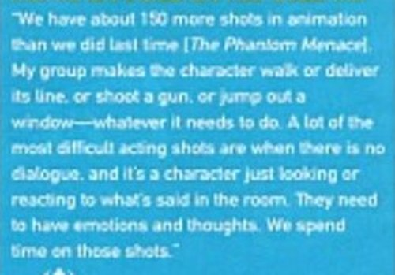

### Stat block notes (game mechanics, not feats)

- Classic Moment: The Clone Army (Attack of the Clones 2002 [script]): THE CLONE ARMY ATTACK OF THE CLONES 2002 [SCRIPT] In Tipoca City on the planet Kamino, OBI-WAN KENOBI, LAMA SU and TAUN WE inspect the clone army, touring the parade grounds, hatchery, classrooms, commissary and barracks. LAMA SU (beaming): Magnificent, aren't they? OBI-WAN nods slowly OBI-WAN: Very impressive. LAMA SU: I hoped you would be pleased. Clones can think creatively. You'll find that they are immensely superior to droids. The tour continues through a classroom filled with identical young boy clones. LAMA SU: We take great pride in our combat education and training programs. This group was created about five years ago. OBI-WAN: You mentioned growth acceleration... LAMA SU: Oh yes, it's essential. Otherwise, a mature clone would take a lifetime to grow. Now we can do it in half the time. Those items you saw on the parade ground were started 10 years ago, when Sifo-Dyas first placed the order, and they're already mature. LAMA SU conducts OBI-WAN through a large eating area. LAMA SU: You'll find they are totally obedient, taking any order without question. We modified their genetic structure to make them less independent than the original host. OBI-WAN: Who was the original host? LAMA SU: A bounty hunter called Jango Fett. We felt a Jedi would be the perfect choice, but Sifo-Dyas hand picked Jango fett [sic] himself. OBI-WAN: Where is this bounty hunter now? LAMA SU: Oh, we keep him here. The tour continues into the barracks in which the clones are climbing into transparent tubes and going to sleep. LAMA SU: Apart from his pay, which is considerable, Fett demanded only one thing—an unaltered clone for himself. Curious, isn't it? OBI-WAN: Unaltered? LAMA SU: Pure genetic replication. No tampering with the structure to make it docile... and no growth acceleration. OBI-WAN: I would very much like to meet this Jango Fett. TAUN WE: I would be most happy to arrange it for you. TAUN WE bows and leaves. (Star Wars Insider 103, p. 59) (Source: *Star Wars Insider #103* (2008), scan p.59)
- Classic Moment: Why It's a Classic: WHY IT'S A CLASSIC This seemingly simple scene does several spectacular things very well. It deepens the mystery of Sifo-Dyas and the creation of the clone army, while offering a visually stunning tour of the facility and deftly filling in the audience on the details of the Kaminoans' cloning techniques. It also introduces Jango Fett, and lays bare the surprising origins of fan favorite Boba Fett. Ewan McGregor, as Obi-Wan Kenobi, may not have much to do but react to the digital wonders (not) surrounding him, but it's an important scene in the middle of the middle film of the prequel trilogy. NEXT: OBI-WAN KENOBI BATTLES WITH GENERAL GRIEVOUS (Star Wars Insider 103, p. 59) (Source: *Star Wars Insider #103* (2008), scan p.59)

## scan p.60 (scan page 60)

Page contents: Next Time... Star Tours preview page (no folio): Clone Wars Anakin with lightsaber, Star Tours StarSpeeder art, "New Star Wars Movie!" badge with The Clone Wars logo; bottom-left Versus result box with Mara Jade photo (hand-read)

### Stat block notes (game mechanics, not feats)

- Next Time... (issue 104 preview): NEXT TIME.... STAR TOURS STAR TOURS AT 21! INSIDER TAKES AN IN-DEPTH LOOK AT DISNEY'S STAR TOURS RIDE, CURRENTLY CELEBRATING ITS 21ST YEAR, COVERING ITS CREATION AND DEVELOPMENT, THE SPIN-OFF MERCHANDISE, AND ITS FUTURE! MEET THE MEN WHO MAKE THE CLONE WARS! A UNIQUE TRIP BEHIND-THE-SCENES OF THE BRAND NEW STAR WARS MOVIE AND FORTHCOMING TV SERIES, THE CLONE WARS! THE FORCE IS UNLEASHED: ARE YOU? AN EXCLUSIVE SERIES OF HINTS AND TIPS TO HELP YOU FIGURE YOUR WAY THROUGH THE LONG-AWAITED NEW STAR WARS VIDEO GAME DENNIS MUREN! CONTINUING OUR SPECIAL EFFECTS SERIES, WE TALK WITH VISUAL EFFECTS MAESTRO DENNIS MUREN! ONE LINERS! THE TOP 10 STAR WARS QUOTABLE ONE-LINERS, ACCORDING TO OUR EXPERT PANEL! VERSUS! WHAT HAPPENS WHEN ADMIRAL ACKBAR MEETS ADMIRAL THRAWN? PLACE YOUR BETS ON THE ADMIRAL SHOWDOWN! PLUS ALL YOUR NEW-LOOK DEPARTMENTS AND MUCH, MUCH MORE! COMING TO A GALAXY NEAR YOU US NEWSSTANDS: SEP 16 UK NEWSAGENTS: OCT 9 (Star Wars Insider 103, p. 60) (Source: *Star Wars Insider #103* (2008), scan p.60)
- Versus: Who Wins? (Mara Jade vs. Juno Eclipse result): VERSUS: WHO WINS? C'mon! A Jedi Master, even one as unconventional as Mara Jade versus an Imperial pilot, even one as individual as Juno Eclipse? No contest, really. Mara Jade wins! (Star Wars Insider 103, p. 60) (Source: *Star Wars Insider #103* (2008), scan p.60)
