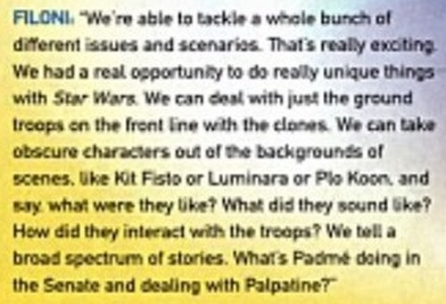
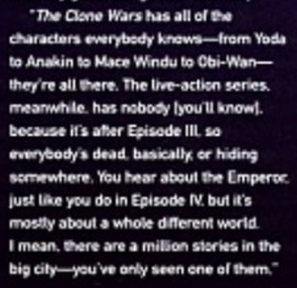
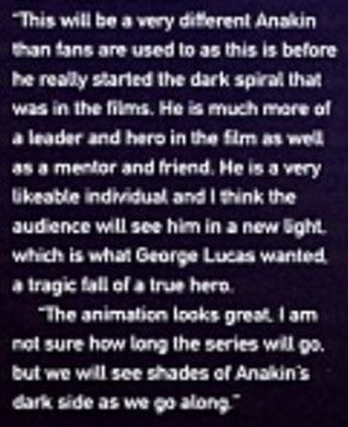
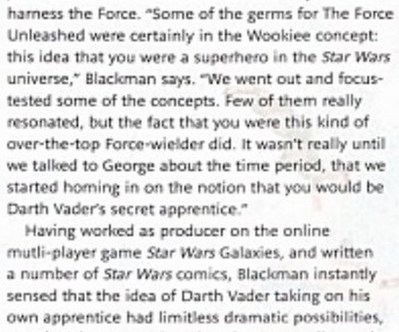
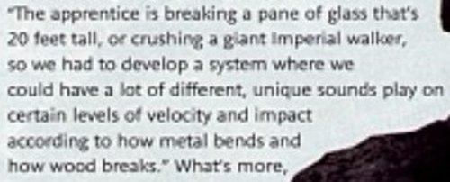
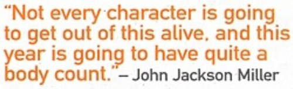
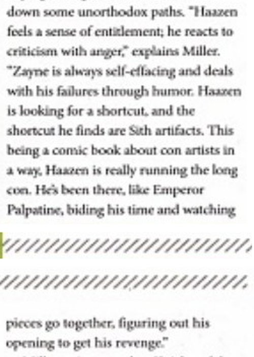
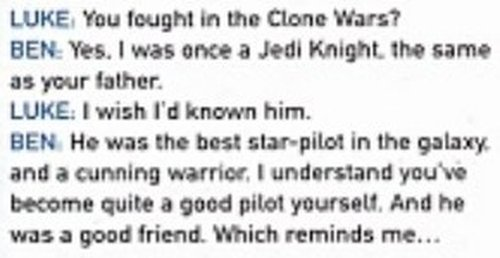
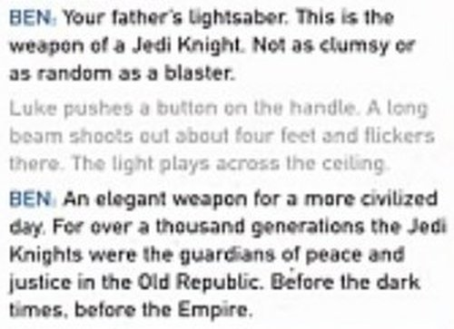
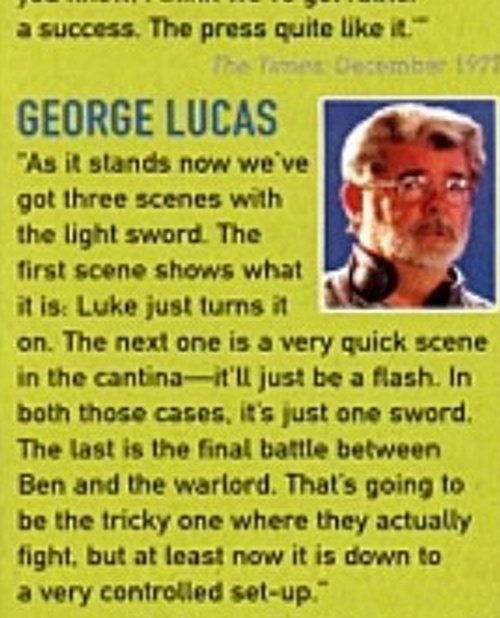

# Owner Material 038 — Star Wars Insider #1–153 plus specials (with The Lucasfilm Fan Club Magazine #1–22): Star Wars Insider #104 (2008)

- **Source:** *Star Wars Insider* magazine (issues 23–153, 1994–2014) and its predecessor *The Lucasfilm Fan Club Magazine* (issues 1–22, 1987–1994), plus seven special editions: articles, interviews, comics and short fiction Secondary source (licensed Legends reference). Scan OCR'd on the box; the scan stays box-only and is **not** published.
- **Method:** every scanned page was OCR'd and machine-screened sentence by sentence for power-relevant statements (fights, kills, defeats, Force feats, rankings, superweapons) that name a character on our roster; each kept sentence is quoted verbatim from the OCR text and has a crop of the printed passage directly under it. Pages with nothing power-relevant are still listed with what is on them.
- **Citation:** "*Star Wars Insider #104* (2008), p.X" by printed page ("scan p.X" where no printed number applies). **Weight:** Licensed magazine: a secondary source. Its short fiction and comics are Legends stories; its articles and interviews sum up or discuss lore and rank below the novels, comics and games they describe.

## scan p.1 (scan page 1)

Page contents: Cover: Star Wars Insider 104 (Asajj Ventress and Count Dooku, The Clone Wars art; "100 PAGES!" badge). Cover lines: "WAR IMAGES Exclusive scenes from The Clone Wars!"; "STAR TOURS AT 21 The Star Wars Disney theme park ride explored!"; "RELIVE 1978 It's the Star Wars Holiday Special!"; "THE FORCE UNLEASHED! The Star Wars Videogame is Finally Here!"; "TOP TEN CLASSIC QUOTES 'I've Got a Bad Feeling About This!'"; "VISUAL MAGIC Special Effects Maestro Dennis Muren"; "DARK FORCES THE CLONE WARS TV SERIES ARRIVES!"; "FASTEN YOUR SEATBELTS! Celebrating 21 years of Star Tours!"; "BLASTER Space Gear, Toys, Books, Collectibles, Ask Lobot, Comics, Classic Moment" (hand-read)

## scan p.2 (scan page 2)

Page contents: Docking Bay "This Issue...." contents, Features (folio 04; Clone Wars art of Asajj Ventress vs Obi-Wan Kenobi): 16 The Clone Wars (Dave Filoni); 28 The Force Unleashed (Skywalker Ranch and the Presidio); 39 Top Ten Classic Lines (A New Hope); 47 Dennis Muren (Star Wars Effects Maestros); 52 Star Tours (21 years) (hand-read)

### Stat block notes (game mechanics, not feats)

- This Issue epigraph: "I TOLD YOU THIS VICTORY WAS TOO EASY!"—MASTER KENOBI (This Issue, Star Wars Insider 104, p. 2) (Source: *Star Wars Insider #104* (2008), scan p.2)

## scan p.3 (scan page 3)

Page contents: Contents, Departments (folio 05): top box "The Special Edition!" (variant cover with Starkiller); 08 Editor's Welcome; 10 Launch Pad (Celebration Japan, San Diego Comic-Con); 26 Versus (Ackbar takes on Thrawn); 36 The Science of Star Wars (personal jetpacks); 44 A Long Time Ago.... (1978, the Holiday Special); Blaster review section: 73 Books (Michael Reaves, Coruscant Nights), 74 Ask Lobot, 75 Comics (Knights of the Old Republic "Vindication"), 79 International Collecting, 82 Toys (Wizards of the Coast, Top Trumps The Clone Wars; Ahsoka Tano card pictured), 87 Bounty Hunters, 89 Bantha Tracks, 93 Classic Moment (first mention of the Clone Wars as Obi-Wan passes the lightsaber to Luke). Scan is 72 pages of the 100-page issue (some magazine pages not in scan) (hand-read)

### Stat block notes (game mechanics, not feats)

- Contents: Versus: 26 VERSUS It's Admiral aggression, as Ackbar takes on Thrawn. There can only be one winner! (Contents, Star Wars Insider 104, p. 3) (Source: *Star Wars Insider #104* (2008), scan p.3)

## scan p.4 (scan page 4)

Page contents: Insider's Welcome (folio 08) by the editor: The Clone Wars weekly half-hour series, first season about eight hours (four movies' worth), Ahsoka introduced, live-action TV series to follow; Contact Us column (addresses omitted); "Taking off on a Star Tour" box; Asajj Ventress art. Pull quote from Ventress (hand-read)

### Stat block notes (game mechanics, not feats)

- Insider's Welcome pull quote: "Only the likes of me are prepared to tear the galaxy down." — Asajj Ventress, The Clone Wars (Insider's Welcome, Star Wars Insider 104, p. 4) (Source: *Star Wars Insider #104* (2008), scan p.4)

## scan p.5 (scan page 5)

Page contents: Launch Pad (folio 10): "Celebrating the Celebration!" Celebration Japan report: 7.0 earthquake during Filoni's presentation; George Lucas video welcome on Japanese influences (The Hidden Fortress told from two farmers' point of view -> two robots); Mark Hamill on Yokosuka and on believing in Star Wars; Dave Filoni on The Clone Wars and Ahsoka; photo of Atsushi Takeuchi and Dave Filoni (hand-read)

## scan p.6 (scan page 6)

Page contents: Launch Pad cont. (folio 11): Atsushi Takeuchi's episode "The Lair of Grievous"; Celebration Japan merchandise (zip-up stormtrooper hoodie) and Ralph McQuarrie finds (original C-3PO painting with a more human face and six-pack abs, unused crew T-shirt design for ESB); "Comedy Rules Fan Films" (7th Star Wars Fan Movie Challenge, Steve Sansweet remarks); list of winning entries (entrant names omitted) (hand-read)

### Stat block notes (game mechanics, not feats)

- The Lair of Grievous synopsis: In an atmospheric, even creepy start to the episode, Kit Fisto follows a homing signal to the Vassek moon, searching for Nute Gunray. Landing his Delta fighter, Fisto is joined by his former Padawan, the Mon Calamari Nahdarr Vebb, as well as several clone troopers. They find an entrance to a dark, creepy lair filled with statues honoring a powerful warrior. Before long, the Jedi realize they have uncovered the sanctuary of General Grievous. (Launch Pad, Star Wars Insider 104, p. 6) (Source: *Star Wars Insider #104* (2008), scan p.6)

## scan p.7 (scan page 7)

Page contents: Launch Pad (folio 13): "George said he wanted us to produce something that would blow everybody away..." Lucasfilm Comic-Con panel highlights (Catherine Winder, Dave Filoni, Henry Gilroy, Jason Tucker; moderated by Steve Sansweet); "The Clone Wars TV Series: The Critics Speak" press-reaction box (LA Times on Ventress as "genuinely frightening", Hollywood Reporter, Variety, San Francisco Chronicle) (hand-read)

- **Kit Fisto; Luminara Unduli; Plo Koon** — entry/section: Filoni on obscure characters: ""We're able to tackle a whole bunch of different issues and scenarios. That's really exciting. We had a real opportunity to do really unique things with Star Wars. We can deal with just the ground troops on the front line with the clones. We can take obscure characters out of the backgrounds of scenes, like Kit Fisto or Luminara or Plo Koon, and say, what were they like? What did they sound like? How did they interact with the troops? We tell a broad spectrum of stories. What's Padmé doing in the Senate and dealing with Palpatine?" —Dave Filoni, Star Wars Insider 104, p. 7" Source: *Star Wars Insider #104* (2008), scan p.7
  

## scan p.8 (scan page 8)

Page contents: Launch Pad (folio 14): "Sound Bites! Star Wars folk speak up!" George Lucas on his Star Wars involvement (father/son/holy ghost), Matt Lanter (Anakin voice; auditioned for "Starkiller"), Stewart Lee (episodic director, 3-D story); masthead (October/November 2008; addresses omitted) (hand-read)

- **none** — entry/section: Lucas on the live-action series: ""The Clone Wars has all of the characters everybody knows—from Yoda to Anakin to Mace Windu to Obi-Wan—they're all there. The live-action series, meanwhile, has nobody [you'll know], because it's after Episode III, so everybody's dead, basically, or hiding somewhere. You hear about the Emperor, just like you do in Episode IV, but it's mostly about a whole different world. I mean, there are a million stories in the big city—you've only seen one of them." —George Lucas, Star Wars Insider 104, p. 8" Source: *Star Wars Insider #104* (2008), scan p.8
  
- **Darth Vader (Anakin Skywalker)** — entry/section: Matt Lanter on his Anakin: ""This will be a very different Anakin than fans are used to as this is before he really started the dark spiral that was in the films. He is much more of a leader and hero in the film as well as a mentor and friend. He is a very likeable individual and I think the audience will see him in a new light, which is what George Lucas wanted, a tragic fall of a true hero. "The animation looks great. I am not sure how long the series will go, but we will see shades of Anakin's dark side as we go along." —Matt Lanter, Star Wars Insider 104, p. 8" Source: *Star Wars Insider #104* (2008), scan p.8
  

## scan p.9 (scan page 9)

Page contents: Feature opener "Send in the Clones" (folio 16): full-page art of clone troopers manning an AT-TE (no text) (hand-read)

## scan p.10 (scan page 10)

Page contents: Feature title page "Send in the Clones" (folio 17): "Insider catches up with supervising director Dave Filoni for the latest on the upcoming Star Wars: The Clone Wars animated TV series. Additional interview: Abbie Bernstein"; art of clone troopers and a commander (hand-read)

## scan p.11 (scan page 11)

Page contents: Dave Filoni interview (folio 18): how the series ties in with the movie; how he discovered Star Wars (playing Han and Luke shooting TIE fighters from the parents' car); drawing from first grade; caption ("Why the long face? Dooku—reimagined for animation. Right: Anakin and Obi-Wan, in their new 'painterly' form."); pull quote (hand-read)

## scan p.12 (scan page 12)

Page contents: Filoni interview cont. (folio 19): job interview with Catherine Winder, Gail Currey and George Lucas; production timeline (two-week story/storyboard period, six-week digital shoot, about two months of animation); coming from 2-D animation; captions ("Left: Anakin and Ahsoka. Yep, it's Star Wars! Below: Yoda, unleashed in animated form.") (hand-read)

## scan p.13 (scan page 13)

Page contents: Filoni interview cont. (folio 20): team of about 75 per episode; Tom Kane voicing Yoda; Corey Burton voicing Count Dooku; story potential (Anakin and Ahsoka arc; Clone Wars a three-year period); Dooku and Captain Rex art (hand-read)

## scan p.14 (scan page 14)

Page contents: Filoni interview cont. (folio 21): not constrained by the films; Yoda's power; the show running beyond 22 episodes (second season in work); kinds of episodes (philosophical, Padmé in the Senate, "I love you"/"I know"); caption "This Spread: Villains and heroes, from Dooku and clone troopers to Yoda, Anakin and Ventress." (hand-read)

## scan p.15 (scan page 15)

Page contents: Filoni interview cont. (folio 22): pressure to grab the fan base ("George is the audience"); droid humor (regular battle droids vs. super battle droids; droids get more menacing as the war progresses); concern about rooting for clones after ROTS; Asajj Ventress as Dooku's disciple; caption "This Spread: Asajj Ventress helps put the galaxy in jeopardy, while Ahsoka enjoys a baptism by fire at Anakin's side." (hand-read)

## scan p.16 (scan page 16)

Page contents: Filoni interview cont. (folio 23): Dooku having an apprentice despite the Rule of Two; Ben Burtt/Matt Wood sound; realizing human characters in CG (stylized faces, dramatic lighting); pull quote "Asajj Ventress is a disciple of Count Dooku. [She's] a villain. [But] how much is she being used by Sidious?"—Dave Filoni (hand-read)

## scan p.17 (scan page 17)

Page contents: Filoni interview end (folio 24): differences from the previous Clone Wars micro-series; HD hand-painted texture style; Big Rock Ranch; Lucas's involvement; why Star Wars is still popular ("relatability"); art of Ventress with twin red blades and a clone commander (hand-read)

## scan p.18 (scan page 18)

Page contents: Versus: Admiral Ackbar vs. Grand Admiral Thrawn, Ackbar side (folio 26): Databank, Profile (Mon Calamari; 1.8 m; Mon Calamarian star cruiser; Rebel Alliance/New Republic), Skills and ratings; intro text comparing the two strategists (hand-read)

### Stat block notes (game mechanics, not feats)

- Versus databank: Ackbar: Commander of the Rebel Alliance Fleet, Ackbar led in the Battle of Endor. Combining his proven military tactics with Lando Calrissian's unorthodox maneuvers saw Ackbar secure victory. Importantly, he was able to turn the Rebels' fortunes around after he realized: "It's a trap!" ... Drawn into Rebel service from his homeworld's ruling council, Ackbar had been a prisoner of the Empire and survived. He was freed during a Rebel raid on Grand Moff Tarkin's shuttle craft. Following the defeat of the Empire, Ackbar became an important figure in the New Republic. (Versus, Star Wars Insider 104, p. 18) (Source: *Star Wars Insider #104* (2008), scan p.18)
- Versus skills and ratings: Ackbar: "Diplomat and warrior, Admiral Ackbar displayed great resilience when held captive. He used his time in captivity to recall the details of many classified Imperial projects, including the Death Star. He was framed during the Thrawn crisis, and even left retirement to return to duty during the Yuuzhan Vong invasion." Ratings: Strength 80, Speed 60, Power 40, Leadership 90, Mobility 60, Loyalty 90, Special Ability 70, Bonus Skill 70. (Versus, Star Wars Insider 104, p. 18) (Source: *Star Wars Insider #104* (2008), scan p.18)
- Versus intro: Ackbar vs. Thrawn: "The similarity in their rank is not all that connects Admiral Ackbar and Grand Admiral Thrawn. They are both very intelligent thinkers who use their brains to triumph in battle, rather than just physical force. ... If they were to face each other in battle, in likely would not be in person. Instead, both would be in command of mighty war fleets, and both would attempt to out-think the other." (Versus, Star Wars Insider 104, pp. 18-19) (Source: *Star Wars Insider #104* (2008), scan p.18)

## scan p.19 (scan page 19)

Page contents: Versus, Thrawn side (folio 27): Databank, Profile (Chiss; 1.8 m; blaster pistol; Empire), Skills and ratings; "Turn to page 79 to see who triumphs!" (hand-read)

### Stat block notes (game mechanics, not feats)

- Versus databank: Thrawn: "A warrior whose mental skills were unsurpassed, Thrawn was a consummate strategist who could analyze situations and determine outcomes before his opponents had formulated their moves. Originally named Mitth'raw'nuruodo in his native Chiss language, Thrawn was banished by his own people due to the danger he posed. Thrawn's first major involvement with the Empire came when he helped it destroy the Outbound Flight project, eliminating a craft full of Jedi Masters. Thrawn became an intimate of Palpatine's, surviving the Emperor's fall to command a very active Imperial Remnant. The one opposing force he could not defeat was Princess Leia Organa who persuaded the exploited Noghri to turn on Thrawn." (Versus, Star Wars Insider 104, p. 19) (Source: *Star Wars Insider #104* (2008), scan p.19)
- Versus skills and ratings: Thrawn: "Thrawn was a thinker, a strategist who used the predictability of others against them. He could harness great forces to achieve his aims, but rarely had to resort to armed combat. Thrawn could take advantage of situations or the misfortunes of others in order to further his own aims." Ratings: Strength 90, Speed 90, Power 50, Leadership 90, Mobility 80, Loyalty 70, Special Ability 70, Bonus Skill 70. (Versus, Star Wars Insider 104, p. 19) (Source: *Star Wars Insider #104* (2008), scan p.19)

## scan p.20 (scan page 20)

Page contents: "Ultimate Force" feature opener (folio 28): The Force Unleashed logo; art of the secret apprentice, Juno Eclipse and Maris Brood (hand-read)

## scan p.21 (scan page 21)

Page contents: "Ultimate Force" opener cont. (folio 29): PROXY and Rahm Kota art; standfirst "'It's all about kicking butt with the Force!' So says LucasArts Producer Julio Torres of the highly anticipated Star Wars videogame The Force Unleashed. Insider takes a trip to Skywalker Ranch and the Presidio base of LucasArts to hear the lowdown. Words: Chris Prince" (hand-read)

## scan p.22 (scan page 22)

Page contents: The Force Unleashed feature (folio 30): bridging the trilogies; "Perfect Pitch" (Haden Blackman: hundreds of concepts, meetings with Lucas from late 2004, greenlit late 2005; discarded super-strong Wookiee and far-future Jedi concepts; Vader's secret apprentice); "Art Unleashed" (Matt Omernick on concept art) (hand-read)

- **Galen Marek; Darth Vader (Anakin Skywalker)** — entry/section: Blackman on the apprentice as a "superhero": ""Some of the germs for The Force Unleashed were certainly in the Wookiee concept: this idea that you were a superhero in the Star Wars universe," Blackman says. "We went out and focus-tested some of the concepts. Few of them really resonated, but the fact that you were this kind of over-the-top Force-wielder did. It wasn't really until we talked to George about the time period, that we started homing in on the notion that you would be Darth Vader's secret apprentice." —Haden Blackman, Star Wars Insider 104, p. 22" Source: *Star Wars Insider #104* (2008), scan p.22
  

## scan p.23 (scan page 23)

Page contents: TFU feature cont. (folio 31): concept paintings of the apprentice; original-trilogy "used universe" visual style in HD; "Casting Vader's Shadow" (the apprentice's look took around 400 illustrations); pull quote "We literally went through hundreds of concepts. We met with George Lucas pretty regularly every couple of months."—Project Lead Haden Blackman (hand-read)

### Stat block notes (game mechanics, not feats)

- TFU concept art: the apprentice's powers: "... Omernick and his team created a number of startling paintings that depicted the apprentice unleashing his powers in earth-shattering ways, from effortlessly tossing stormtroopers through the air, to bringing a Star Destroyer crashing down to a planet's surface." (The Force Unleashed feature, Star Wars Insider 104, p. 23) (Source: *Star Wars Insider #104* (2008), scan p.23)

## scan p.24 (scan page 24)

Page contents: TFU feature cont. (folio 32): Adrienne Wilkinson as Maris Brood; Sam Witwer on the apprentice; synopsis; pull quote from Art Lead Matt Omernick ("We had a lot of freedom to create these new characters and locations and storylines...") (hand-read)

### Stat block notes (game mechanics, not feats)

- TFU synopsis: Vader's secret apprentice: "Adopted as a child by Darth Vader, who senses the boy's innate connection to the Force, the apprentice is raised in isolation as the Sith Lord's personal assassin, dispatched to hunt down the last of the Jedi. When Vader conspires to use the apprentice to help him overthrow the Emperor, the volatile young Force-wielder becomes caught up in a galactic struggle that will lead him to question his allegiance to the dark side." (The Force Unleashed feature, Star Wars Insider 104, p. 24) (Source: *Star Wars Insider #104* (2008), scan p.24)

## scan p.25 (scan page 25)

Page contents: TFU feature cont. (folio 33): PROXY (David Collins), Jedi General Kota (Cully Fredricksen), a young Alderaanian princess; Witwer on the story's centrality; "A New Alliance" (LucasArts/ILM at the Presidio; CloneCam; Digital Molecular Matter and euphoria); "Symphony of Destruction" (David Collins on sound) (hand-read)

- **Galen Marek** — entry/section: Collins on the apprentice's destruction: ""The apprentice is breaking a pane of glass that's 20 feet tall, or crushing a giant Imperial walker, so we had to develop a system where we could have a lot of different, unique sounds play on certain levels of velocity and impact according to how metal bends and how wood breaks." —David Collins, Star Wars Insider 104, p. 25" Source: *Star Wars Insider #104* (2008), scan p.25
  

## scan p.26 (scan page 26)

Page contents: TFU feature end (folio 34): Felucia and Raxus Prime soundscapes; score with original music by David Minsky (KOTOR II composer, as printed); "Force Fed" (Blackman's "over-the-top, amped up" Force powers; Torres: "Our game is all about kicking butt with the Force."); pull quote from actress Adrienne Wilkinson on Maris Brood (hand-read)

## scan p.27 (scan page 27)

Page contents: "Science of Star Wars: The Real Flying Fett!" (folio 36): stuntman Dan Schlund's Rocketbelt; history of the Bell Aerospace jetpack (1950s, first untethered flight April 1961, 108 feet in three seconds); how it works (hydrogen peroxide, nitrogen) (hand-read)

## scan p.28 (scan page 28)

Page contents: Science of Star Wars cont. (folio 37, words David Hawksett): Rocketbelt thrust; Schlund flew as Boba Fett at Celebration IV (May 25, 2007); Fett's Z-6 jetpack compared; "Rise of the Clones" (U.K. hybrid-embryo vote, May 2008); "Video Calls Go 3-D"; "A Prototype Battle Droid?" (Sarcos XOS exoskeleton) (hand-read)

### Stat block notes (game mechanics, not feats)

- Science of Star Wars: Fett's Z-6 jetpack: "In fantasy, Fett's Z-6 model was designed for around a minute of continuous flight—around twice that of the real-life Rocketbelt. Fett's version is rated for a top speed of around 90 miles per hour, but the real limiting factor in both models is the amount of fuel they can carry." (Science of Star Wars, Star Wars Insider 104, p. 28) (Source: *Star Wars Insider #104* (2008), scan p.28)

## scan p.29 (scan page 29)

Page contents: "Top Ten Quotes" feature opener (folio 39), From Star Wars: A New Hope: "Star Wars has made such a huge cultural impact over the past 30 years..." (hand-read)

## scan p.30 (scan page 30)

Page contents: Top Ten Quotes cont. (folio 40): 10 "I suggest a new strategy, R2. Let the Wookiee win" (C-3PO); 9 "I recognized your foul stench the moment I came onboard" (Princess Leia); 8 "I find your lack of faith disturbing" (Darth Vader); 7 "That's no moon, it's a space station" (Obi-Wan Kenobi), each with commentary (hand-read)

## scan p.31 (scan page 31)

Page contents: Top Ten Quotes cont. (folio 41): 6 "Watch your mouth kid, or you'll find yourself floating home" (Han Solo); 5 "Evacuate in our moment of triumph? I think you overestimate their chances" (Grand Moff Tarkin); 4 "What a piece of junk!" (Luke Skywalker) (hand-read)

## scan p.32 (scan page 32)

Page contents: Top Ten Quotes cont. (folio 42): 3 "Into the garbage chute, flyboy!" (Princess Leia); 2 "You underestimate the power of the dark side!" (Darth Vader) with commentary ("Just how powerful might the dark side of the Force actually be?"); reader-feedback box (email address not logged) (hand-read)

## scan p.33 (scan page 33)

Page contents: Top Ten Quotes end (folio 43): 1 "I've a bad feeling about this" with commentary on the most repeated line in the saga (hand-read)

## scan p.34 (scan page 34)

Page contents: "The Big Event: Nov 17, 1978—Star Wars Holiday Special Premieres!" (folio 44, words Dan Wallace): the Holiday Special (Kashyyyk first seen; Lucas: "That's one of those things that happened, and I just have to live with it."); sidebar "Luke and Vader Duel! Splinter of the Mind's Eye, March 1978" (hand-read)

### Stat block notes (game mechanics, not feats)

- Splinter of the Mind's Eye sidebar: "The first Star Wars spin-off novel, Splinter of the Mind's Eye, stranded Luke, Leia, and the droids on a swamp planet where they attracted the attention of Darth Vader. Written by prolific sci-fi scribe Alan Dean Foster (who ghost-wrote the original Star Wars novelization from George Lucas' outline), Splinter featured some beats that would later be superseded by the movie sequels, including romantic tension between Luke and Leia (who were not known at the time to be brother and sister) and a lightsaber duel in which Luke cuts off Vader's arm!" (The Big Event, Star Wars Insider 104, p. 34) (Source: *Star Wars Insider #104* (2008), scan p.34)

## scan p.35 (scan page 35)

Page contents: The Big Event cont. (folio 45): "Attack of the Clone" (Battlestar Galactica lawsuit); "A Long Time Ago..." real-world 1978 events; "Boba Fett's Debut" (Nelvana cartoon in the Holiday Special; Fett first appears astride a dinosaur-like beast, seemingly helping a stranded Luke but secretly working for Vader; 2006 Hasbro figure); "Month by Month 1978" timeline (Marvel's "The Hunter" introduces Valance; Leigh Brackett's first Empire draft) (hand-read)

## scan p.36 (scan page 36)

Page contents: Dennis Muren interview opener (folio 46, words Calum Waddell): "Long associated with Star Wars and Industrial Light & Magic, visual effects genius Dennis Muren talks to Insider about his progression from home-made movies to that galaxy far, far away and beyond." (hand-read)

## scan p.37 (scan page 37)

Page contents: Muren interview (folio 47): career from Equinox (1970) to every Star Wars film except Revenge of the Sith; Oscars and Walk of Fame; how he got involved (two groups of effects people brought together by Lucas); influences (Harryhausen, John Fulton); AT-AT model caption (hand-read)

## scan p.38 (scan page 38)

Page contents: Muren interview cont.: Special Achievement Oscar for Empire; Empire's color artwork; sidebar "Expanded Universe: The Star Wars Special Editions" (cantina, Mos Eisley); pull quote (hand-read)

## scan p.39 (scan page 39)

Page contents: Muren interview end: Kershner vs. Lucas; why he did not work on Revenge of the Sith (Hulk); Walk of Fame; his how-to book; sidebar "Making Equinox" (budget around $6,500); captions on the Empire probot and physical models (hand-read)

## scan p.40 (scan page 40)

Page contents: "Star Tours 21st Anniversary" feature opener (folio 52): art of a StarSpeeder in hyperspace with TIE fighters (no body text) (hand-read)

## scan p.41 (scan page 41)

Page contents: Star Tours opener cont. (folio 53): "Taking Off on a Star Tour": "In Star Wars' 10th anniversary year George Lucas had something very special in store: his return to that galaxy far, far away would be very different—a Star Wars simulator ride over two years in the making: Star Tours! Words: Alex Newborn" (hand-read)

## scan p.42 (scan page 42)

Page contents: Star Tours feature: the Disney/ILM ride (StarSpeeder 3000, rookie pilot RX-24 "Rex", pre-show with R2-D2 and C-3PO); "Imagineering a New Hope" (Lucas, Michael Eisner and Tom Fitzgerald on the genesis) (hand-read)

## scan p.43 (scan page 43)

Page contents: Star Tours cont.: Dennis Muren's one-continuous-shot film; the Rediffusion simulator; unused concepts (underwater voyage beneath Dagobah's swamps, time travel, a Jedi training concept); setting after the Battle of Endor (sightseeing excursions to Endor); pull quote from Fitzgerald on Muren (hand-read)

## scan p.44 (scan page 44)

Page contents: Star Tours cont.: Rex's origins (originally "Crazy Harry, a gung-ho veteran of the Clone Wars", softened into a nervous rookie); sidebar "Star Tours Tokyo" (opened July 12, 1989; six simulators; Panarobo droids; Pan Galactic Pizza Port) (hand-read)

## scan p.45 (scan page 45)

Page contents: Star Tours cont.: Rex ("I've always wanted to do this!"); casting Paul Reubens; "The Droids Strike Back" (visits to ILM, April 1985) (hand-read)

## scan p.46 (scan page 46)

Page contents: Star Tours cont. (folio 58): StarSpeeder 3000 design (replacing Adventure Thru Inner Space, closed September 2, 1985); sidebar "Star Tours Paris" (opened April 12, 1992; X-wing out front; ROX-N droid); droid animatronics G2-4T and G2-9T; pull quote from George Lucas on ride intensity (hand-read)

## scan p.47 (scan page 47)

Page contents: Sidebar "Disney's Tom Fitzgerald on Star Tours" (interview on the ride's development and the Matterhorn comparison) (hand-read)

## scan p.48 (scan page 48)

Page contents: Star Tours cont.: ILM film crew (Ken Ralston/Bob Hall camera work, optical composite by Jon Alexander) and obstacles in the year-and-a-half project (hand-read)

## scan p.49 (scan page 49)

Page contents: Sidebar "Dennis Muren on Star Tours" (biggest challenge: conceptualizing one continuous take) (hand-read)

## scan p.50 (scan page 50)

Page contents: Sidebar "Tony Baxter on Star Tours" (Disney/Lucasfilm union, the British flight simulator, the "Tractor Beam" sequence to rest the hydraulics); Interplanetary Launch Party (January 8, 1987) and 60-hour grand opening (hand-read)

## scan p.51 (scan page 51)

Page contents: Star Tours cont.: opening-day press conference (Eisner: it cost more than Disneyland did in 1955, but "so does a hamburger"); Steve Sansweet's recollections; "Urban Legends of Star Tours" myths #1 (C-3PO's silver leg) and #2 (Rex's voice) (hand-read)

## scan p.52 (scan page 52)

Page contents: Sidebar "Star Tours Merchandise Explosion" (Lucas on merchandising; Ralph McQuarrie destination posters) (hand-read)

## scan p.53 (scan page 53)

Page contents: Urban Legends of Star Tours myth #3 (whether George Lucas is the man who ducks behind the desk) (hand-read)

## scan p.54 (scan page 54)

Page contents: Urban Legends myth #4 (whether a controller voice is an uncredited Mark Hamill); pull quote from George Lucas on revamping Star Tours (hand-read)

## scan p.55 (scan page 55)

Page contents: Star Tours merchandise (Hasbro theme-park Jedi Mickey and Yoda two-pack; Disney-character crossover figures); sidebar "ILM on Star Tours" (Steve Gawley, Ira Keeler, Selwyn Eddy, Jon Alexander, Claudia Mullaly) (hand-read)

## scan p.56 (scan page 56)

Page contents: Sidebar "Timothy Zahn on Star Tours" (Star Tours references in Specter of the Past; G-2RD guard droid in The Last Command; nods to fan films in Allegiance, focusing on Pink Five); "The Future of Star Tours" (Lucas at Celebration III: "They're hoping to revamp Star Tours"); author credits (hand-read)

## scan p.57 (scan page 57)

Page contents: Section opener (folio 71): "There's nothing like a good blaster at your side, kid"; Books, Comics, Toys, Ask Lobot and collecting departments follow (hand-read)

## scan p.58 (scan page 58)

Page contents: Sidebar "Karen Traviss Takes on The Clone Wars" (her novelization gives clones such as Captain Rex stories of their own; Ahsoka, Togrutas springing from predator stock) (hand-read)

### Stat block notes (game mechanics, not feats)

- Books: Shedding Light on Street of Shadows: The Coruscant Nights trilogy tells the story of Jax Pavan, who escaped the slaughter of Order 66 and remade himself as a private investigator in Coruscant's slums. In Jedi Twilight, Jax met Den Dhur, a cynical, hard-drinking Sullustan reporter, and I-5YQ, a protocol droid who may have a soul and certainly has a history—he once served Jax's father Lorn Pavan, who met his demise at the hands of another Sith Lord. Jedi Twilight saw Jax, Den, I-5 and the Twi'lek Jedi Laranth Tarak struggle to escape webs spun by the Black Sun leader Xizor and Darth Vader, and turned readers' expectations upside down: Laranth preferred blasters to lightsabers, while I-5 packed firepower in both his fingertips and in sardonic rejoinders that would make the diffident C-3PO blush. (Books, Star Wars Insider 104, p. 58) (Source: *Star Wars Insider #104* (2008), scan p.58)
- Books: Street of Shadows premise: The Camaasi artist Ven Volette has been killed, and his lover, the gorgeous Zeltron Dejah Duare, hires Jax and his crew to find out who did it. But the hunters are also the hunted—to be a Jedi is a death sentence on Coruscant, and Darth Vader is seeking Jax. (Books, Star Wars Insider 104, p. 58) (Source: *Star Wars Insider #104* (2008), scan p.58)

## scan p.59 (scan page 59)

Page contents: Incoming release list (Order 66, Millennium Falcon, The Life and Legend of Obi-Wan Kenobi, Wild Space, The Complete Star Wars Encyclopedia, Death Star reprint); Books cont. (Reaves on I-5 and on Coruscant Nights III: Patterns of Force); "Clone Art!" (The Art and Making of Star Wars: The Clone Wars); Ask Lobot (Leland Y. Chee) Q&A on the Jedi starfighter's astromech socket (Delta-7B Aethersprite); questioner names omitted (hand-read)

### Stat block notes (game mechanics, not feats)

- Ask Lobot: lightsaber shut-off: There must be some sort of emergency shut-off on the lightsaber. If the handle isn't being gripped for a certain amount of time, it automatically deactivates. This is clearly evident in the films since whenever a character loses a lightsaber (or the limb holding it), the lightsaber shuts off. There is, however, a setting on the lightsaber to keep the lightsaber on when you're not holding it. Examples include Vader throwing his lightsaber at the catwalk Luke is standing on in Return of the Jedi and the "lightsaber throw" move often found in Star Wars videogames. Even then, the shut-off still kicks in at some point. Yoda also uses this feature to take out a clone outside the Jedi Temple in Revenge of the Sith, but the Jedi Master is quick enough that he can retrieve it before the shut-off kicks in. There are no instances in the films depicting a lightsaber on for an extended period of time without someone holding it. (Ask Lobot, Star Wars Insider 104, p. 59) (Source: *Star Wars Insider #104* (2008), scan p.59)

## scan p.60 (scan page 60)

Page contents: Comics: "End Game" (Knights of the Old Republic "Vindication", John Jackson Miller; Zayne Carrick, the Jedi Covenant, Krynda and Lucien Draay, Haazen); sidebar "Classic Adventures" (Star Wars Omnibus: Early Victories) (hand-read)

- **none** — entry/section: Miller on the body count: ""Not every character is going to get out of this alive, and this year is going to have quite a body count." —John Jackson Miller, Star Wars Insider 104, p. 60" Source: *Star Wars Insider #104* (2008), scan p.60
  

### Stat block notes (game mechanics, not feats)

- Comics: the Jedi Covenant: Zayne and his friends, unlikely survivors of the Mandalorian Wars, now find themselves face-to-face with the Jedi Covenant—a secret order, according to Miller, "of Jedi extremists, devoted to the notion that the Sith are the only threat the Jedi should ever concern themselves with." This secret movement is led by Krynda Draay, wealthy Jedi heiress of the Draay fortune and mother of Zayne's Master Lucien Draay. (Comics, Star Wars Insider 104, p. 60) (Source: *Star Wars Insider #104* (2008), scan p.60)
- Comics: Haazen: There are wheels within wheels to this conspiracy, and no one has a bigger role to play than Haazen, a failed Padawan with dreams of power. (Comics, Star Wars Insider 104, p. 60) (Source: *Star Wars Insider #104* (2008), scan p.60)

## scan p.61 (scan page 61)

Page contents: Ask Lobot cont. (501st Legion and R2-KT as fan-generated material made official; "Darth Who?" contest for Jacen Solo's Sith name); "Savior of the Universe" (Luke Skywalker: Last Hope for the Galaxy Dark Horse compilation, story list) (hand-read)

- **Haazen; Zayne Carrick** — entry/section: Miller on Haazen and Zayne: ""Haazen feels a sense of entitlement; he reacts to criticism with anger," explains Miller. "Zayne is always self-effacing and deals with his failures through humor. Haazen is looking for a shortcut, and the shortcut he finds are Sith artifacts. This being a comic book about con artists in a way, Haazen is really running the long con. He's been there, like Emperor Palpatine, biding his time and watching pieces go together, figuring out his opening to get his revenge." —John Jackson Miller, Star Wars Insider 104, p. 61" Source: *Star Wars Insider #104* (2008), scan p.61
  

### Stat block notes (game mechanics, not feats)

- Ask Lobot: the three pillars of continuity: The three pillars that George Lucas refers to has a first pillar that is the part of the Star Wars universe that George follows and has direct control over, namely the movies and the television series. The second pillar includes the portions of the Star Wars universe created by Lucas Licensing that includes the videogames, books, and toys that George exhibits less direct control over. Both the first and second pillars are treated as official Star Wars continuity. The third pillar is anything generated by the fans, referred to by some as fanon (short for fan canon). ... For the most part, this third pillar is not part of official continuity, though there are various exceptions where fan-generated content has become official continuity. (Ask Lobot, Star Wars Insider 104, p. 61) (Source: *Star Wars Insider #104* (2008), scan p.61)

## scan p.62 (scan page 62)

Page contents: International Collecting (Gus Lopez): "Exploding Head" Vader poster (Poland, Witold Dybowski; "Although no version of Return of the Jedi offers a scene where Vader's head actually blows apart"); Droids dartboard (Spain) (hand-read)

## scan p.63 (scan page 63)

Page contents: International Collecting cont. (Star Wars Pine Sol bottle, Dixan laundry detergent); Toys: Expanded Universe comic two-packs (Cade Skywalker, Darth Talon, Grand Admiral Thrawn, Talon Karrde, Dengar, Fenn Shysa, Antares Draco, Ganner); Cartamundi playing cards (hand-read)

## scan p.64 (scan page 64)

Page contents: Toys cont.: KOTOR Campaign Guide; Star Wars Miniatures KOTOR set; The Clone Wars Top Trumps cards (hand-read)

### Stat block notes (game mechanics, not feats)

- Ask Lobot: when The Clone Wars takes place: There is no officially posted timeline for the series at this point in time. What we do know is that the series starts: After Obi-Wan and Anakin's initial confrontations with Asajj Ventress. After the Republic's first encounter with Grievous. After Anakin has received his facial scars. After Anakin has become a Jedi Knight. After Obi-Wan has joined the Jedi Council. After Padmé gives R2-D2 to Anakin and a gold-plated C-3PO is in the service of Padmé. After the 501st Legion is assigned to Anakin and Cody and the 212th are assigned to Obi-Wan. When the Hutts are undecided about supporting the Confederacy or the Republic. Before the clones switch to Revenge of the Sith-style Phase II armor. (Ask Lobot, Star Wars Insider 104, p. 64) (Source: *Star Wars Insider #104* (2008), scan p.64)

## scan p.65 (scan page 65)

Page contents: Toys cont.: Hasbro Droid Factory figures; Kotobukiya ARTFX bounty hunter statues (IG-88, Dengar, Bossk, 4-LOM, Zuckuss, Boba Fett); Galactic Heroes; Ask Lobot on what Palpatine knows about Anakin (hand-read)

### Stat block notes (game mechanics, not feats)

- Ask Lobot: Palpatine the All-Knowing: We know that Anakin told Palpatine about his slaughtering of the Tusken Raiders for revenge after Shmi's death because Palpatine reminds him of this right after Anakin kills Count Dooku in Revenge of the Sith. ... Palpatine probably knows more about Anakin than even Anakin himself. (Ask Lobot, Star Wars Insider 104, p. 65) (Source: *Star Wars Insider #104* (2008), scan p.65)

## scan p.66 (scan page 66)

Page contents: Bounty Hunters reader-photo section (folio 87); reader names omitted (hand-read)

## scan p.67 (scan page 67)

Page contents: Bantha Tracks vol. 35: "Star Wars Celebration Japan: The Fans' Tale" (July 19-21, Makuhari Messe; Jabba prop by the 501st); submission guidelines (hand-read)

## scan p.68 (scan page 68)

Page contents: Bantha Tracks photo spread (Star Warriors documentary debut, 501st photo shoot, the Vader Project helmets) (hand-read)

## scan p.69 (scan page 69)

Page contents: Bantha Tracks: "One Giant Labor of Love" (a full-sized rideable dewback prop); Mary Franklin editorial "Traveling Troops"; volunteer names omitted (hand-read)

## scan p.70 (scan page 70)

Page contents: Classic Moment: "Passing on the Lightsaber" (A New Hope script, DVD chapter 14); What They Said (Alec Guinness, George Lucas); next time: Obi-Wan Kenobi battles General Grievous (hand-read)

- **Darth Vader (Anakin Skywalker); Obi-Wan Kenobi** — entry/section: A New Hope script: Ben on Luke's father: "BEN: Yes, I was once a Jedi Knight, the same as your father. LUKE: I wish I'd known him. BEN: He was the best star-pilot in the galaxy, and a cunning warrior. I understand you've become quite a good pilot yourself. And he was a good friend. —A New Hope script excerpt, Star Wars Insider 104, p. 70" Source: *Star Wars Insider #104* (2008), scan p.70
  
- **Obi-Wan Kenobi** — entry/section: A New Hope script: the lightsaber: "BEN: Your father's lightsaber. This is the weapon of a Jedi Knight. Not as clumsy or as random as a blaster. ... BEN: An elegant weapon for a more civilized day. For over a thousand generations the Jedi Knights were the guardians of peace and justice in the Old Republic. Before the dark times, before the Empire. —A New Hope script excerpt, Star Wars Insider 104, p. 70" Source: *Star Wars Insider #104* (2008), scan p.70
  
- **Obi-Wan Kenobi; Darth Vader (Anakin Skywalker)** — entry/section: Lucas on the light sword scenes: ""As it stands now we've got three scenes with the light sword. The first scene shows what it is: Luke just turns it on. The next one is a very quick scene in the cantina—it'll just be a flash. In both those cases, it's just one sword. The last is the final battle between Ben and the warlord. That's going to be the tricky one where they actually fight, but at least now it is down to a very controlled set-up." —George Lucas (The Making of Star Wars), Star Wars Insider 104, p. 70" Source: *Star Wars Insider #104* (2008), scan p.70
  

## scan p.71 (scan page 71)

Page contents: Next Time preview (Jedi at 25; The Clone Wars; The Force Unleashed hints; Ken Ralston; Maris Brood model Adrienne Wilkinson; Versus: Boba Fett vs Durge) (hand-read)

### Stat block notes (game mechanics, not feats)

- Versus: Who Wins? (Ackbar vs Thrawn result): VERSUS: WHO WINS? It would be a long, hard-fought space battle, no doubt. It is our contention that Ackbar's 'humanity' would lead to his defeat by the ruthless inhuman Thrawn! This time, evil triumphs! (Versus, Star Wars Insider 104, p. 71) (Source: *Star Wars Insider #104* (2008), scan p.71)

## scan p.72 (scan page 72)

Page contents: Back cover: Wizards of the Coast Star Wars Miniatures & Roleplaying Games parody comic ad (Zayne Carrick vs Mandalore and Demagol, "Todd, roleplaying as a Jedi", Luke and Vader, Jar Jar); non-canonical ad, not logged as feats (hand-read)

