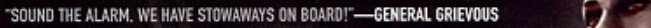
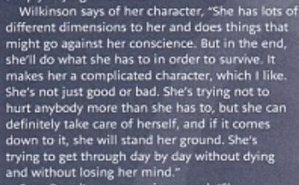
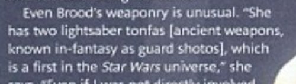

# Owner Material 038 — Star Wars Insider #1–153 plus specials (with The Lucasfilm Fan Club Magazine #1–22): Star Wars Insider #105 (2008)

- **Source:** *Star Wars Insider* magazine (issues 23–153, 1994–2014) and its predecessor *The Lucasfilm Fan Club Magazine* (issues 1–22, 1987–1994), plus seven special editions: articles, interviews, comics and short fiction Secondary source (licensed Legends reference). Scan OCR'd on the box; the scan stays box-only and is **not** published.
- **Method:** every scanned page was OCR'd and machine-screened sentence by sentence for power-relevant statements (fights, kills, defeats, Force feats, rankings, superweapons) that name a character on our roster; each kept sentence is quoted verbatim from the OCR text and has a crop of the printed passage directly under it. Pages with nothing power-relevant are still listed with what is on them.
- **Citation:** "*Star Wars Insider #105* (2008), p.X" by printed page ("scan p.X" where no printed number applies). **Weight:** Licensed magazine: a secondary source. Its short fiction and comics are Legends stories; its articles and interviews sum up or discuss lore and rank below the novels, comics and games they describe.

## scan p.1 (scan page 1)

Page contents: Cover: Star Wars Insider 105 (December 2008) — The Force Unleashed's Maris Brood big interview, Return of the Jedi 25th anniversary visual commentary, Versus Maris Brood vs Asajj Ventress; no further in-universe text. (hand-read)

## scan p.2 (scan page 2)

Page contents: Contents page (Docking Bay "This Issue..."): features list (25 Years of Return of the Jedi, Maris Brood big interview, Matthew Wood/Grievous interview, Ken Ralston, 1996 timeline); out-of-universe. (hand-read)

- **General Grievous** — entry/section: Grievous epigraph (contents page): ""Sound the alarm, we have stowaways on board!" —General Grievous, Star Wars Insider 105, p. 2" Source: *Star Wars Insider #105* (2008), scan p.2
  

## scan p.3 (scan page 3)

Page contents: Contents page continued: variant-cover note, departments list (Science of Star Wars, A Long Time Ago 1996, Versus Ventress vs Brood, Books Millennium Falcon, Comics Legacy Vector, lunch pails collecting, Toys, Bounty Hunters, Bantha Tracks Comic-Con, Classic Moment Obi-Wan vs Grievous); out-of-universe. (hand-read)

## scan p.4 (scan page 4)

Page contents: Insider's Welcome editorial: The Force Unleashed reveals Vader's secret apprentice and his role in founding the Rebel Alliance; Grievous's first appearance was the Clone Wars micro-series before Episode III, now in Star Wars: The Clone Wars TV series. (hand-read)

## scan p.5 (scan page 5)

Page contents: Launch: The Clone Wars movie theatrical release, LA premiere, London screening; Lucas quote on wanting to do something about the Clone Wars because the prequels didn't have anything to do with Anakin; guide to the first six TV episodes (Rising Malevolence, Destroy Malevolence, Rookies, Downfall of a Droid); out-of-universe. (hand-read)

### Stat block notes (game mechanics, not feats)

- The Clone Wars episode guide, "Ambush": "Great leadership comes in all sizes. Challenged by Ventress, Yoda leads three clone troopers against a huge droid army." (The Clone Wars episode guide, "Ambush", Star Wars Insider 105, p. 5) (Source: *Star Wars Insider #105* (2008), scan p.5)
- The Clone Wars episode guide, "Shadow of Malevolence": "Easy is the path to wisdom for those not blinded by ego. Anakin leads a strike on General Grievous' warship." (The Clone Wars episode guide, "Shadow of Malevolence", Star Wars Insider 105, p. 5) (Source: *Star Wars Insider #105* (2008), scan p.5)

## scan p.6 (scan page 6)

Page contents: Launch Pad: The Clone Wars movie DVD/Blu-ray release November 11; fact box ("only Star Wars movie not to include the phrase 'I have a bad feeling about this!'"); poster art; no feats. (hand-read)

## scan p.7 (scan page 7)

Page contents: Launch Pad: Complete Star Wars Encyclopedia announcement; Queen's University Belfast "Jedi course"; out-of-universe, no feats. (hand-read)

## scan p.8 (scan page 8)

Page contents: Launch Pad: The Force Unleashed release (record first-week sales), novelization tops NYT list; Ray Park motion-captured Bond moves in Quantum of Solace game; secret apprentice in Soul Calibur IV; out-of-universe. (hand-read)

## scan p.9 (scan page 9)

Page contents: Launch Pad: The Clone Wars: Lightsaber Duels (Wii) and Jedi Alliance (DS) announcements; out-of-universe. (hand-read)

## scan p.10 (scan page 10)

Page contents: Launch Pad: "Revenge of the Seths!" Robot Chicken / Family Guy parody news; Del Rey retains license, Fate of the Jedi series announced; Phil Tippett note; masthead; out-of-universe. (hand-read)

## scan p.11 (scan page 11)

Page contents: "Return of the Jedi at 25" section opener art; no in-universe text. (hand-read)

## scan p.12 (scan page 12)

Page contents: Insider Visual Commentary title page ("It may be 25 years old, but Return of the Jedi still has many secrets to offer", words Dan Wallace); out-of-universe. (hand-read)

## scan p.13 (scan page 13)

Page contents: 340 words, 12 paragraphs | headings/entries: IE} INSIDER + ; é

### Stat block notes (game mechanics, not feats)

- ROTJ visual commentary: second Death Star size: "Though unfinished, the second Death Star measures 900 kilometers in diameter." (Return of the Jedi visual commentary, Star Wars Insider 105, p. 13) (Source: *Star Wars Insider #105* (2008), scan p.13)
- ROTJ visual commentary: Avenger: "The Star Destroyer Avenger releases Vader's shuttle—you might remember it as ill-fated Captain Needa's vessel from The Empire Strikes Back." (Return of the Jedi visual commentary, Star Wars Insider 105, p. 13) (Source: *Star Wars Insider #105* (2008), scan p.13)
- ROTJ visual commentary: Jabba's palace: "Jabba's iron citadel has been established in Expanded Universe sources as the former domain of devout B'omarr monks. In the animated movie The Clone Wars, Anakin Skywalker and Ahsoka Tano infiltrate a similar-looking B'omarr fortress on Teth to rescue Jabba's son Rotta." (Return of the Jedi visual commentary, Star Wars Insider 105, p. 13) (Source: *Star Wars Insider #105* (2008), scan p.13)
- ROTJ visual commentary: Dengar: "Dengar is the bandaged Corellian bounty hunter introduced in The Empire Strikes Back. In the Expanded Universe, Dengar helps Boba Fett recuperate after escaping the Sarlacc and partners with him on a number of adventures." (Return of the Jedi visual commentary, Star Wars Insider 105, p. 13) (Source: *Star Wars Insider #105* (2008), scan p.13)
- ROTJ visual commentary: Amanin and Hermi Odle: "To the left of the slab is Hermi Odle, a Baragwin weaponsmith who escapes the destruction of Jabba's sail barge in his Expanded Universe biography. To the right is an Amanin, his gruesome staff decorated with shrunken heads; in the comic Star Wars Empire: To the Last Man, a legion of Imperial troops is overwhelmed by a horde of angry natives on the Amanin homeworld." (Return of the Jedi visual commentary, Star Wars Insider 105, p. 13) (Source: *Star Wars Insider #105* (2008), scan p.13)
- ROTJ visual commentary: Jerjerrod: "Footage from this scene was reused for the Special Edition of The Empire Strikes Back, placing Jerjerrod aboard the Super Star Destroyer Executor when Darth Vader returns from Bespin." (Return of the Jedi visual commentary, Star Wars Insider 105, p. 13) (Source: *Star Wars Insider #105* (2008), scan p.13)
- ROTJ visual commentary: Han's carbon-freeze: "In the script's second draft, Han remains in a deathlike state until—in a nod to Sleeping Beauty—Leia revives him with a kiss. Symptoms of hibernation sickness include temporary blindness. A cut scene from Jedi indicates that Han was conscious throughout his carbon-freeze, an experience he describes as "a big, wide-awake nothing."" (Return of the Jedi visual commentary, Star Wars Insider 105, p. 13) (Source: *Star Wars Insider #105* (2008), scan p.13)
- ROTJ visual commentary: Bib Fortuna: "In the rough draft, Bib Fortuna is described as the "High Beeser of Hoth." Based on his appearance in The Phantom Menace, Bib Fortuna has served Jabba the Hutt for over three decades." (Return of the Jedi visual commentary, Star Wars Insider 105, p. 13) (Source: *Star Wars Insider #105* (2008), scan p.13)

## scan p.14 (scan page 14)

Page contents: Visual commentary production notes: EV-9D9 voiced by Richard Marquand (Yeardley Smith in radio drama); Sy Snootles Special Edition makeover; Greeata and Rystáll in the Palpatones and at the Galaxies Opera House in ROTS; Jabba puppet 18 ft, six operators; rancor 18-inch foam-latex puppet; Gamorrean Jubnuk; floating microphone is a modified remote like Luke's training remote. (hand-read)

### Stat block notes (game mechanics, not feats)

- ROTJ visual commentary: Rystáll Sant: "Rystáll Sant is an alien hybrid born to a human mother and a Theelin father; Lando Calrissian rescued her from slavery at the hands of Prince Xizor prior to her employment as a back-up singer." (Return of the Jedi visual commentary, Star Wars Insider 105, p. 14) (Source: *Star Wars Insider #105* (2008), scan p.14)
- ROTJ visual commentary: Lyn Me: "Following a childhood rescue, Lyn Me became obsessed with Boba Fett and swore revenge on Luke Skywalker after his rescue plan seemingly resulted in the bounty hunter's death." (Return of the Jedi visual commentary, Star Wars Insider 105, p. 14) (Source: *Star Wars Insider #105* (2008), scan p.14)
- ROTJ visual commentary: Boushh: "Leia is wearing the armor of the bounty hunter Boushh, an Ubesse who earned fame hunting fugitive Jedi who had escaped Order 66. He died just before Return of the Jedi, killed by the Black Sun criminal syndicate when he tried to extort money from them." (Return of the Jedi visual commentary, Star Wars Insider 105, p. 14) (Source: *Star Wars Insider #105* (2008), scan p.14)

## scan p.15 (scan page 15)

Page contents: Visual commentary: Sarlacc's rich EU life; sand clogged Sarlacc hydraulics (Anakin's sand line quoted); rough draft "Sloth Pit"; Dagobah gnarltrees; ROTJ novelization has Obi-Wan say he and Owen Lars are brothers (overturned by prequels); Tydirium capture tales in X-Wing Alliance and Rogue Leader, tydirium ore used in phrik. (hand-read)

### Stat block notes (game mechanics, not feats)

- ROTJ visual commentary: Wol Cabasshite: "This snail-like creature is a Wol Cabasshite, an intelligent species that communicates via magnetic fields. This Wol Cabasshite is named Ghoel; other members of the species have included Jedi Master Omo Bouri." (Return of the Jedi visual commentary, Star Wars Insider 105, p. 15) (Source: *Star Wars Insider #105* (2008), scan p.15)
- ROTJ visual commentary: Corellian corvettes: "Corellian corvettes are compact, 150 meter long ships dominated by their engines and their guns. Also known as blockade runners, they reappear in Return of the Jedi for the first time since Princess Leia's Tantive IV roared on screen in A New Hope." (Return of the Jedi visual commentary, Star Wars Insider 105, p. 15) (Source: *Star Wars Insider #105* (2008), scan p.15)
- ROTJ visual commentary: Home One: "The Mon Calamari MC80 star cruiser Home One is the flagship of the Rebel Alliance fleet. Its bumpy, pickle-shaped contours are hallmarks of Mon Cal design, and all such vessels were originally engineered as non-combat passenger liners." (Return of the Jedi visual commentary, Star Wars Insider 105, p. 15) (Source: *Star Wars Insider #105* (2008), scan p.15)
- ROTJ visual commentary: GR-75 transports at Endor: "The Gallofree Yards GR-75 medium transport is a non-combat vessel used to ferry goods from one location to another. At the Battle of Endor, transports were loaded with explosives and locked onto collision courses with Imperial vessels." (Return of the Jedi visual commentary, Star Wars Insider 105, p. 15) (Source: *Star Wars Insider #105* (2008), scan p.15)

## scan p.16 (scan page 16)

Page contents: Visual commentary production notes: Harrison Ford's duster coat; Rebel parkas were white lab coats; Ewoks call C-3PO "the Golden One"; "widowmaker" branch; Logray inspects Leia in the rough draft; Ewok headdresses hide seams; Paploo speeder-bike effect with Kenny Baker. (hand-read)

### Stat block notes (game mechanics, not feats)

- ROTJ visual commentary: Vader Force-chokes Royal Guards (script): "The scene was originally scripted with Vader Force-choking the Royal guards when they blocked his passage. In the comic Tag and Bink Were Here, the two protagonists—disguised as these same guards—obey the Emperor's "leave us" command only to discover that there's no exit on the opposite side of the elevator shaft." (Return of the Jedi visual commentary, Star Wars Insider 105, p. 16) (Source: *Star Wars Insider #105* (2008), scan p.16)
- ROTJ visual commentary: Emperor's tower: "The tower shaft leads directly into the Death Star's hypermatter reactor." / "The Emperor's tower is located at the Death Star's north pole." (Return of the Jedi visual commentary, Star Wars Insider 105, p. 16) (Source: *Star Wars Insider #105* (2008), scan p.16)
- ROTJ visual commentary: Aratech 74-Z speeder bike: "Mostly used for reconnaissance, the Aratech 74-Z speeder bike can go as fast as 500 kilometers per hour." (Return of the Jedi visual commentary, Star Wars Insider 105, p. 16) (Source: *Star Wars Insider #105* (2008), scan p.16)
- ROTJ visual commentary: Leia remembers her mother: "Leia remembers her birth mother as "beautiful but sad" in this scene, an accurate description of Padmé (but a precocious one, considering Leia's age at the time of Padmé's death). The novelization also has Leia recall "distorted visions of running... a beautiful woman... hiding in a trunk."" (Return of the Jedi visual commentary, Star Wars Insider 105, p. 16) (Source: *Star Wars Insider #105* (2008), scan p.16)

## scan p.17 (scan page 17)

Page contents: 124 words, 8 paragraphs | headings/entries: 

### Stat block notes (game mechanics, not feats)

- ROTJ visual commentary: Arvel Crynyd rams the Executor: "Green Leader Arvel Crynyd is the pilot of the out-of-control A-wing that rams the bridge of the Super Star Destroyer Executor. The New Republic later named a captured Star Destroyer in his honor." (Return of the Jedi visual commentary, Star Wars Insider 105, p. 17) (Source: *Star Wars Insider #105* (2008), scan p.17)
- ROTJ visual commentary: original throne-room confrontation: "The original version of this confrontation took place in the Emperor's throne room on the capital of Had Abbadon, far below the planet's surface in a cavern of lava and fire. Ralph McQuarrie made several illustrations of this hellish realm." (Return of the Jedi visual commentary, Star Wars Insider 105, p. 17) (Source: *Star Wars Insider #105* (2008), scan p.17)
- ROTJ visual commentary: Liberty: "The first vessel destroyed by the Death Star's superlaser is the MC80 Mon Calamari star cruiser Liberty. A New Republic Majestic-class heavy cruiser used during the Black Fleet Crisis was named in honor of the lost vessel." (Return of the Jedi visual commentary, Star Wars Insider 105, p. 17) (Source: *Star Wars Insider #105* (2008), scan p.17)
- ROTJ visual commentary: Chimaera at Endor: "The Chimaera's captain will die during the fighting; his junior officer, Gilad Pellaeon, will take command of the ship and escape. The Chimaera will serve as Grand Admiral Thrawn's flagship during the "Thrawn trilogy" of novels." (Return of the Jedi visual commentary, Star Wars Insider 105, p. 17) (Source: *Star Wars Insider #105* (2008), scan p.17)
- ROTJ visual commentary: Accuser, Adjudicator, Avenger: "The Accuser is captured and renamed Emancipator; it serves the New Republic until annihilated by one of the Emperor's World Devastator war machines." / "The Adjudicator is captured by the Rebels during the fighting and renamed Liberator; it crashes on Coruscant during a battle six years later." / "The Avenger, also seen at the start of the film, acts as a communications ship during the fighting; it escapes intact and serves Imperial Military Executor Sedriss during the Battle of Balmerra." (Return of the Jedi visual commentary, Star Wars Insider 105, p. 17) (Source: *Star Wars Insider #105* (2008), scan p.17)

## scan p.18 (scan page 18)

Page contents: Visual commentary production notes: Endor ground battle staffing/cost; tree fire; Colonel Dyer played by Ben Burtt (Wilhelm-style cry); Robert Watts and Richard Marquand in the AT-ST, named Scout Walker Seven. (hand-read)

### Stat block notes (game mechanics, not feats)

- ROTJ visual commentary: A-wings vs TIE interceptors: "Green Group's A-wings are relatively new additions to the Rebel fleet, able to go toe-to-toe with the Empire's TIE interceptors." (Return of the Jedi visual commentary, Star Wars Insider 105, p. 18) (Source: *Star Wars Insider #105* (2008), scan p.18)
- ROTJ visual commentary: Han tears AT-ST in half (rough draft): "In the rough draft, Han attempts to yank the bunker doors open with a cable attached to his captured AT-ST. Instead, he tears the scout walker in half." (Return of the Jedi visual commentary, Star Wars Insider 105, p. 18) (Source: *Star Wars Insider #105* (2008), scan p.18)
- ROTJ visual commentary: spice vaults of Gargon: "In the novelization, Han likens breaking into the bunker to an adventure in which he and Chewbacca raided the spice vaults of Gargon." (Return of the Jedi visual commentary, Star Wars Insider 105, p. 18) (Source: *Star Wars Insider #105* (2008), scan p.18)
- ROTJ visual commentary: proton grenade: "The charge is a MerrSonn Munitions 7-PrG proton grenade; it contains a highly volatile proton core." (Return of the Jedi visual commentary, Star Wars Insider 105, p. 18) (Source: *Star Wars Insider #105* (2008), scan p.18)

## scan p.19 (scan page 19)

Page contents: Visual commentary: reactor shafts were 1500 fishing rods; Vader's pyre a last-minute addition, revisited at Qui-Gon's funeral; T-16 Skyhopper controls similar to T-65 X-wing; only time a Skyhopper seen in flight is ROTJ SE. (hand-read)

### Stat block notes (game mechanics, not feats)

- ROTJ visual commentary: Lando survives in all script versions: "Despite rumors to the contrary, Lando and the Millennium Falcon survived the Death Star explosion in all versions of the Jedi script, according to starwars.com" (Return of the Jedi visual commentary, Star Wars Insider 105, p. 19) (Source: *Star Wars Insider #105* (2008), scan p.19)

## scan p.20 (scan page 20)

Page contents: Science of Star Wars: "The Gravity of the Situation" (artificial gravity, LIGO), "Not Quite an Ion Cannon" (Raytheon LADS laser); real-world science, no feats. (hand-read)

## scan p.21 (scan page 21)

Page contents: Science of Star Wars cont.: Martian soil, "That's Handy" (i-Limb artificial hand; notes Vader had a hand lopped off "no less than three times"), maglev trains vs landspeeder repulsorlifts; real-world, no feats. (hand-read)

## scan p.22 (scan page 22)

Page contents: Grievous Alarm (Matthew Wood interview) opener: General Grievous art; no text. (hand-read)

## scan p.23 (scan page 23)

Page contents: Grievous Alarm title page ("Words: Amos Wong"); no in-universe text. (hand-read)

## scan p.24 (scan page 24)

Page contents: Matthew Wood interview: career at Lucasfilm Games/Skywalker Sound, played Bib Fortuna cameo in Episode I, auditioned anonymously for Grievous; pull quote "A lot of [the coughing] you hear is actually George Lucas! When we were recording this character, he had a really bad cough!"; out-of-universe. (hand-read)

## scan p.25 (scan page 25)

Page contents: Wood interview cont.: voices Grievous and battle droids in the movie and series; Lucas directive "barking out orders... most bad guys have a deep voice... Bela Lugosi"; supervising audio on The Clone Wars. (hand-read)

## scan p.26 (scan page 26)

Page contents: Wood interview cont.: longevity of Star Wars, playing Star Wars Galaxies, favorite Grievous toys; out-of-universe. (hand-read)

## scan p.27 (scan page 27)

Page contents: 1996 timeline (Daniel Wallace): StarWars.com launch; X-Wing novels by Stackpole (Rogue Squadron, Wedge's Gamble, The Krytos Trap) put Wedge at the head of Rogue Squadron during the invasion of Coruscant and the hunt for renegade Imperial warlords; Shadows of the Empire multimedia event (Dash Rendar helps hunt for Han while battling Prince Xizor); Episode I pre-production; real-life news. (hand-read)

### Stat block notes (game mechanics, not feats)

- 1996 timeline: "Wedge Lives!": "Not only did Rebel pilot Wedge Antilles appear in all three classic trilogy films, he survived every battle — making him a cult figure among fans who shared their love on early internet newsgroups like alt.fan.wedge." (A Long Time Ago... 1996, Star Wars Insider 105, p. 27) (Source: *Star Wars Insider #105* (2008), scan p.27)

## scan p.28 (scan page 28)

Page contents: 1996 month by month: Tales from Jabba's Palace; X-Wing Rogue Squadron comic "The Phantom Affair"; Before the Storm (Luke searches for his mother, finds an imposter); Shadows of the Empire novel, sourcebook, toys and N64 game (Dash vs IG-88 and Boba Fett); Golden Age of the Sith #0 (5,000 years before the films); The Krytos Trap (plague on newly captured Coruscant); Dark Forces PlayStation. (hand-read)

## scan p.29 (scan page 29)

Page contents: Maris Brood Big Interview (Adrienne Wilkinson) opener: The Force Unleashed art of Maris Brood; no text. (hand-read)

## scan p.30 (scan page 30)

Page contents: Interview title "Maris: Brood of Hero"; no in-universe text. (hand-read)

## scan p.31 (scan page 31)

Page contents: Wilkinson interview: "There's a new Jedi on the scene, and she's fighting for her very survival in a universe where every man, woman, and creature may be against her"; audition required head-shot and in-person audition. (hand-read)

## scan p.32 (scan page 32)

Page contents: Wilkinson interview cont.: cast because she resembled the concept art; sessions at Letterman Digital Arts Center from February 2007; face-capture photography. (hand-read)

## scan p.33 (scan page 33)

Page contents: Wilkinson interview cont.: teeth modelling; ~400 people on the project; prosthetics for her small horns; motion capture. (hand-read)

## scan p.34 (scan page 34)

Page contents: Wilkinson interview cont.: recorded with Sam Witwer (Starkiller) and Natalie Cox (Juno Eclipse); motion capture for shoulders up, animation for bodies. (hand-read)

## scan p.35 (scan page 35)

Page contents: Wilkinson: Brood is a female Jedi who survived Order 66, "trying to survive"; "it's a really scary time to be a Jedi"; doesn't know how much of her story is in the game vs other media. (hand-read)

- **Maris Brood** — entry/section: Adrienne Wilkinson on Maris Brood (creator/actor quote): ""She has lots of different dimensions to her and does things that might go against her conscience. But in the end, she'll do what she has to in order to survive. It makes her a complicated character, which I like. She's not just good or bad. She's trying not to hurt anybody more than she has to, but she can definitely take care of herself, and if it comes down to it, she will stand her ground. She's trying to get through day by day without dying and without losing her mind." —Adrienne Wilkinson, Star Wars Insider 105, p. 35" Source: *Star Wars Insider #105* (2008), scan p.35
  
- **Maris Brood** — entry/section: Adrienne Wilkinson on Brood's weapons (creator/actor quote): ""She has two lightsaber tonfas [ancient weapons, known in-fantasy as guard shotos], which is a first in the Star Wars universe," —Adrienne Wilkinson, Star Wars Insider 105, p. 35" Source: *Star Wars Insider #105* (2008), scan p.35
  

## scan p.36 (scan page 36)

Page contents: 298 words, 9 paragraphs | headings/entries: PROFILE

### Stat block notes (game mechanics, not feats)

- Versus databank: Maris Brood: "Like Asajj Ventress, Maris Brood was found by a member of the Jedi Order as an infant and trained during the Clone Wars on the starship Gray Pilgrim. She and her Master escaped Order 66 as a result of their isolation. Seeking information on galactic events, her Master vanished, but not before Brood learned of the fall of the Jedi and Vader's role in the rise of the Empire. Seeking revenge, Brood gained the tutelage of Jedi Master Shaak Ti, who drew her back from the dark side. Hiding in the forests of Felucia, Brood imprisoned Senator Bail Organa during his attempts to build the Rebel Alliance. After battling Vader's secret apprentice Starkiller, Brood escaped but the shadow of the dark side hung over her." (Versus: Maris Brood vs Asajj Ventress, Star Wars Insider 105, p. 36) (Source: *Star Wars Insider #105* (2008), scan p.36)
- Versus profile and skills: Maris Brood: "HOMEWORLD: UNKNOWN (POSSIBLY IRIDONIA) SPECIES: ZABRAK GENDER: FEMALE WEAPON: GUARD SHOTOS AFFILIATION: JEDI, GALACTIC REPUBLIC" / SKILLS: "Again like Ventress, Brood's Jedi training was disrupted. As a result she never learned the discipline necessary to becoming a Jedi. Unlike Ventress, she has resisted the lure of the dark side, despite being involved in several doubtful ventures. Skilled with her weapons, Brood lacks the cunning of Ventress and she is more sympathetic to those around her." (Versus: Maris Brood vs Asajj Ventress, Star Wars Insider 105, p. 36) (Source: *Star Wars Insider #105* (2008), scan p.36)
- Versus ratings: Maris Brood: "STRENGTH 70 SPEED 70 POWER 30 LEADERSHIP 60 MOBILITY 80 LOYALTY 70 SPECIAL ABILITY 70 BONUS SKILL 70" (Versus: Maris Brood vs Asajj Ventress, Star Wars Insider 105, p. 36) (Source: *Star Wars Insider #105* (2008), scan p.36)
- Versus analysis: Brood vs Ventress: "They're both orphans whose training remained incomplete due to tragedy. However, they turned out to be very different people. Where Ventress turned unequivocally to the dark side, there remained within Brood a source of light that prevented her from falling to darkness entirely, no matter how severe the temptation or provocation. Confused by events in the galaxy, Brood found it difficult to pick sides, so decided to look out for the one person who mattered the most to her: herself. Meeting in battle, Ventress and Brood would certainly put on a powerful display of lightsaber skills and acrobatic moves. Both are very physical fighters who'd be equally matched, although Ventress could call more readily on her dark side powers to push home her advantage. While Brood might lack the killer instincts displayed by Ventress, she does have an innate and powewrful sense of positivity that might just see her through. Often the overconfidence of those on the dark side can lead to them making mistakes, although the sheer power of dark side strength can be hard to resist. This would be a drawn-out dynamic battle with the ultimate victor unclear until the very last moment!" (Versus: Maris Brood vs Asajj Ventress, Star Wars Insider 105, pp. 36-37) (Source: *Star Wars Insider #105* (2008), scan p.36)

## scan p.37 (scan page 37)

Page contents: 306 words, 21 paragraphs | headings/entries: ASAJJ VENTRESS; As |; DATABANK; Count Dooku's most-trusted assassin, Asajj; PROFILE; SKILLS; Trained by jedi Ky Narec, the orphaned; Ventress quickly absorbed jedi ways until Narec; STRENGTH SPEED; SSSSssss

### Stat block notes (game mechanics, not feats)

- Versus databank: Asajj Ventress: "Count Dooku's most-trusted assassin, Asajj Ventress deeply wished to become a Sith even though she was never an official apprentice. Well-trained in the arts of lightsaber dueling and Force manipulation, she had to remain hidden for some time from Dooku's master, Darth Sidious. Cunning and cruel, Ventress would entrap and play with her opponents before dispatching them. She engaged in conflict with both Skywalker and Kenobi, but neither could beat her, just as she could not vanquish them. A lifetime of cruel hardships had given Ventress a hard-edged confidence, a cold heart and a fierce survival instinct." (Versus: Maris Brood vs Asajj Ventress, Star Wars Insider 105, p. 37) (Source: *Star Wars Insider #105* (2008), scan p.37)
- Versus profile and skills: Asajj Ventress: "HOMEWORLD: RATTATAK SPECIES: RATTATAK GENDER: FEMALE VEHICLE: GEONOSIAN FANBLADE STARFIGHTER AFFILIATION: CONFEDERATION OF INDEPENDENT SYSTEMS" / SKILLS: "Trained by Jedi Ky Narec, the orphaned Ventress quickly absorbed Jedi ways until Narec was killed before completing her training. Her raw, unfocused power in the Force was allowed to develop without the discipline of the Jedi, fueling her instinctual fury. Turning against the Republic, Ventress became a ruthless killing machine, further increasing her dark side abilities. A cunning military mastermind, Ventress became a key figure in the Separatist army, doing Dooku's bidding." (Versus: Maris Brood vs Asajj Ventress, Star Wars Insider 105, p. 37) (Source: *Star Wars Insider #105* (2008), scan p.37)
- Versus ratings: Asajj Ventress: "STRENGTH 80 SPEED 80 POWER 20 LEADERSHIP 60 MOBILITY 80 LOYALTY 50 SPECIAL ABILITY 80 BONUS SKILL 60" (Versus: Maris Brood vs Asajj Ventress, Star Wars Insider 105, p. 37) (Source: *Star Wars Insider #105* (2008), scan p.37)

## scan p.38 (scan page 38)

Page contents: Ken Ralston interview opener (Words: Calum Waddell): visual effects wizard who started in ILM's miniature and optical effects shop on A New Hope; out-of-universe. (hand-read)

## scan p.39 (scan page 39)

Page contents: Ralston interview: Harryhausen influence, Famous Monsters, Dennis Muren; ANH budget ($9 million, final over $11 million); night crew; X-wing trench shots; out-of-universe. (hand-read)

## scan p.40 (scan page 40)

Page contents: Ralston interview: Empire walkers/snowspeeder stop-motion and optical printing, freer space scenes; praise for Kershner; out-of-universe. (hand-read)

## scan p.41 (scan page 41)

Page contents: Ralston interview: Lucas gave flexibility; Ralston did most spaceship shots on Jedi; technology improvements; pull quote "I didn't really care what was being spent. I was just trying to do a good job."; out-of-universe. (hand-read)

## scan p.42 (scan page 42)

Page contents: Ralston interview end: Star Trek films, monster shop with Phil Tippett on Jedi; pull quote on Lucas leading the charge; out-of-universe. (hand-read)

## scan p.43 (scan page 43)

Page contents: Section opener for news/departments (toys, classic scene "a single shot from Obi-Wan Kenobi takes down General Grievous", Falcon "hunk of junk" book); no in-universe feat text. (hand-read)

## scan p.44 (scan page 44)

Page contents: Books: Millennium Falcon novel by James Luceno (Luceno: "I wanted to show that the Falcon had an impact on the lives of everyone who piloted it through a span of just over 100 years."), Han, Leia and Allana with Tobb Jadak plot thread; Frames book. Ask Lobot on the dianoga (described in the EU as an uninvited guest). Publishing/out-of-universe; no combat feats. (hand-read)

## scan p.45 (scan page 45)

Page contents: Books continued (Falcon novel, art book); no feats beyond the p44 summary. (hand-read)

## scan p.46 (scan page 46)

Page contents: Vector crossover feature: Celeste Morne, a Jedi infected by the Muur Talisman, a conduit for the Sith Karness Muur, letting her control rakghouls; long suspended animation; she met Luke Skywalker. Summary only; see Q records for verbatim quotes. (hand-read)

### Stat block notes (game mechanics, not feats)

- Vector: Darth Krayt described: "a dark side dictator who ordered the massacre of the Jedi and seized the reins of the new Empire in a bloody coup" (Vector feature, Star Wars Insider 105, p. 46) (Source: *Star Wars Insider #105* (2008), scan p.46)

## scan p.47 (scan page 47)

Page contents: Vector continued: Duursema on syncing with Cade's plan; Roan Fel and the Galactic Alliance Remnant. Ask Lobot: A-wings carry no astromech for speed; B-wings use advanced computers. Comics: Rebellion vol. 3 Small Victories, Deena Shan's suicide mission against Bannistar Station with Luke and Leia. No verbatim feat text logged. (hand-read)

## scan p.48 (scan page 48)

Page contents: Star Wars Collecting: lunch boxes (Words & Pictures: Gus Lopez), King Seeley Thermos first metal box, plastic variants, Sakura bento box; out-of-universe. (hand-read)

## scan p.49 (scan page 49)

Page contents: Lunch boxes continued (Empire/Jedi King Seeley boxes, condition notes). Ask Lobot on missing alien Rebels in the ANH medal ceremony: answer speculates they were with the unseen Rebel fleet; no feats. (hand-read)

## scan p.50 (scan page 50)

Page contents: Lunch boxes continued (prequel boxes, retro boxes, Hardware Wars box); out-of-universe. (hand-read)

### Stat block notes (game mechanics, not feats)

- Ask Lobot: lightsaber cauterization evidence: "Episode I: Qui-Gon is impaled by Maul's lightsaber, no blood. When Obi-Wan cuts Maul in half, there's a quick spray of blood during the cut, but no blood when his body fall downs the reactor shaft. Episode II: Jango is decapitated by Mace and Dooku severs Anakin's arm, no blood. But when Dooku gashes Obi-Wan in the arm and leg, there's a little blood. Episode III: Anakin cuts off the head and hands of Dooku—no blood. No blood when Palpatine cuts down Mace or when Anakin cuts off Mace's hand. No blood when Obi-Wan cuts down Anakin on Mustafar. Episode IV: When Obi-Wan slices off Ponda Baba's arm, there's a trace a blood from the severed limb. Obviously no blood (or body, for that matter) when Vader strikes down Obi-Wan. Episode V: When Luke cuts off the wampa's arm, no blood in either the limb or the wampa body. When Han slice open the tauntaun carcass, we get guts, though no blood. When Luke's hand is cut off by Vader, no blood. Episode VI: None of victims of Luke's lightsaber show any blood." (Ask Lobot, Star Wars Insider 105, p. 50) (Source: *Star Wars Insider #105* (2008), scan p.50)
- Ask Lobot: cauterization conclusion: "In conclusion, though there's a general rule about lightsabers cauterizing wounds, the films are always going to allow room for exceptions." (Ask Lobot, Star Wars Insider 105, p. 50) (Source: *Star Wars Insider #105* (2008), scan p.50)

## scan p.51 (scan page 51)

Page contents: Toys: Sideshow 12-inch ANH Darth Vader and Rebel fleet trooper figures; out-of-universe. (hand-read)

## scan p.52 (scan page 52)

Page contents: Toys: LEGO Republic fighter tank, droid gunship, Twilight (Anakin, Ahsoka, R2-D2, Rotta minifigs), spider droid; mimobot series 3; out-of-universe. (hand-read)

## scan p.53 (scan page 53)

Page contents: Bounty Hunters: reader photos with cast (reader names omitted); out-of-universe. (hand-read)

## scan p.54 (scan page 54)

Page contents: Bantha Tracks: San Diego Comic-Con 2008 Lucasfilm Pavilion, Ahsoka appearances; fan names omitted; out-of-universe. (hand-read)

## scan p.55 (scan page 55)

Page contents: Bantha Tracks: Comic-Con costume photos; fan names omitted. (hand-read)

## scan p.56 (scan page 56)

Page contents: Bantha Tracks: Fan Movie Challenge awards and Traveling Troops volunteer thanks; fan/volunteer names omitted. (hand-read)

## scan p.57 (scan page 57)

Page contents: Classic Moment: Obi-Wan shoots Grievous (ROTS DVD chapter 24). What They Said: Ewan McGregor on the role (Cinema Confidential) and Matthew Wood on how his anonymous audition was picked for Grievous's voice; out-of-universe quotes not logged as feats. (hand-read)

### Stat block notes (game mechanics, not feats)

- Classic Moment: ROTS script, Obi-Wan vs Grievous: "OBI-WAN charges GENERAL GRIEVOUS, swinging the staff and hitting the Droid in the stomach, knocking the gun away. GENERAL GRIEVOUS is hit by the staff, and the Force bends his forearm. He pulls OBI-WAN close to him, and they engage in a furious fight. The electro-staff is knocked away. The two engage in hand-to-hand combat. OBI-WAN struggles to avoid the deadly blows of the brutal, unstoppable Droid. GENERAL GRIEVOUS's stomachplate is loose. OBI-WAN grabs it and rips it off, revealing the alien life form's guts encased in a bag in the Droid's chest. GENERAL GRIEVOUS grabs OBI-WAN, hoists him over his head, and tosses him across the platform. OBI-WAN dangles off the edge of the platform. He clutches the rim, trying to hold on. The DROID then grabs the staff and charges OBI-WAN. At the last second, OBI-WAN reaches out his hand and uses the Force to retrieve the Droid's laser pistol. The JEDI fires several blasts in the stomach area of the alien Droid, and he EXPLODES from the inside out." (Classic Moment, Revenge of the Sith 2005 script, Star Wars Insider 105, p. 57) (Source: *Star Wars Insider #105* (2008), scan p.57)
- Classic Moment: Why it's a classic: "Obi-Wan Kenobi goes man-to-cyborg with General Grievous... and wins! Coming just after their lightsaber confrontation (which Kenobi seemed to relish, too) and the Boga-and-bike chase, the vicious hands-on fight sees Kenobi turn the General's seeming strengths against him. After some blows from the electrostaff, Kenobi pries apart the General's armor, exposing his vital organs. The coup-de-grace comes in the form of two blaster bolts, as Kenobi hangs precariously from a ledge." (Why It's a Classic, Star Wars Insider 105, p. 57) (Source: *Star Wars Insider #105* (2008), scan p.57)

## scan p.58 (scan page 58)

Page contents: Next issue preview (Han Solo life and times, Clone Wars voice cast, Life Day, Best of 2008, Versus: Skywalker vs Starkiller). (hand-read)

### Stat block notes (game mechanics, not feats)

- Versus result: Maris Brood vs Asajj Ventress: "A very close-run fight, with Ventress often taking the advantage and Brood perhaps lacking the killer edge needed for a swift conclusion. However, the over-confidence of Ventress allows the more balanced Brood to ultimately triumph!" (Versus: Who Wins?, Star Wars Insider 105, p. 58) (Source: *Star Wars Insider #105* (2008), scan p.58)

## scan p.59 (scan page 59)

Page contents: Star Wars Miniatures advertisement (comic with Ahsoka, Grievous and clone troopers); promotional, no feats logged. (hand-read)

