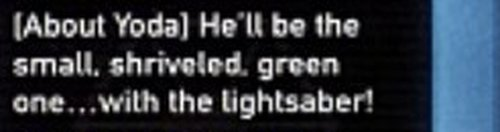
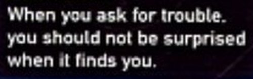
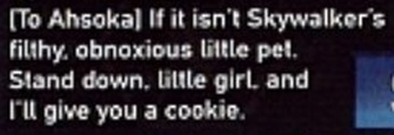
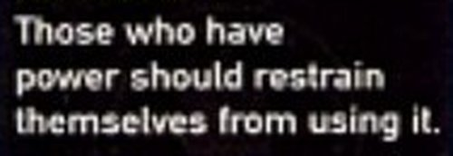
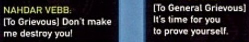
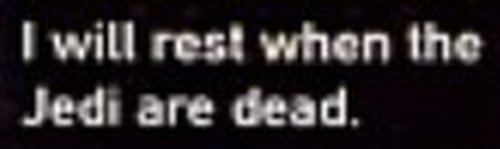
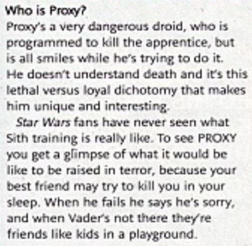
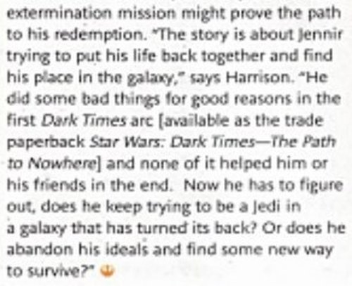

# Owner Material 038 — Star Wars Insider #1–153 plus specials (with The Lucasfilm Fan Club Magazine #1–22): Star Wars Insider #106 (2009)

- **Source:** *Star Wars Insider* magazine (issues 23–153, 1994–2014) and its predecessor *The Lucasfilm Fan Club Magazine* (issues 1–22, 1987–1994), plus seven special editions: articles, interviews, comics and short fiction Secondary source (licensed Legends reference). Scan OCR'd on the box; the scan stays box-only and is **not** published.
- **Method:** every scanned page was OCR'd and machine-screened sentence by sentence for power-relevant statements (fights, kills, defeats, Force feats, rankings, superweapons) that name a character on our roster; each kept sentence is quoted verbatim from the OCR text and has a crop of the printed passage directly under it. Pages with nothing power-relevant are still listed with what is on them.
- **Citation:** "*Star Wars Insider #106* (2009), p.X" by printed page ("scan p.X" where no printed number applies). **Weight:** Licensed magazine: a secondary source. Its short fiction and comics are Legends stories; its articles and interviews sum up or discuss lore and rank below the novels, comics and games they describe.

## scan p.1 (scan page 1)

Page contents: Cover: Insider's guide to Han's early years; Versus Luke Skywalker vs the Secret Apprentice; Holiday Special; Falcon toy designer; David Collins on voicing PROXY; departments list. (hand-read)

## scan p.2 (scan page 2)

Page contents: Contents: Clone Wars season one episode guide; The Force Unleashed PROXY interview; Holiday Special; Han Solo early exploits; Millennium Man (Falcon toy designer). (hand-read)

## scan p.3 (scan page 3)

Page contents: Contents continued: special edition cover note; departments (Books/Encyclopedia, Comics, Collecting Han Solo, Toys Gentle Giant, Bounty Hunters, Bantha Tracks, Classic Moment, Launch Pad, A Long Time Ago 1991, Versus Luke vs the Secret Apprentice). (hand-read)

## scan p.4 (scan page 4)

Page contents: Editor's welcome (Jonathan Wilkins): heroes come in all shapes and sizes; Han Solo back-story; Clone Wars episode guide; PROXY; Holiday Special. Out-of-universe. (hand-read)

## scan p.5 (scan page 5)

Page contents: Launch Pad: The Clone Wars premiere watched by more than 27 million people; out-of-universe. (hand-read)

## scan p.6 (scan page 6)

Page contents: Launch Pad: George Lucas receives the Comic-Con Icon Award at the Scream Awards; Samuel L. Jackson inducted as honorary 501st member; out-of-universe. (hand-read)

## scan p.7 (scan page 7)

Page contents: Launch Pad: Star Wars: The Old Republic MMO announced (set roughly 300 years after KOTOR); NPD toy sales; Clone Wars books on NYT list; out-of-universe. (hand-read)

## scan p.8 (scan page 8)

Page contents: Launch Pad: masthead; Fandex giveaway; Dave Prowse at the UK launch of Hasbro's Millennium Falcon; out-of-universe. (hand-read)

## scan p.9 (scan page 9)

Page contents: Clone Wars Season One Episode Guide part one opener (compiled by Sarah Herman). (hand-read)

## scan p.10 (scan page 10)

Page contents: "Ambush" box also: super battle droid and Jek/Yoda lines ("Left behind, no one will be."); Star Warriors cast list; Insider info on the Republic frigate targeting display. (hand-read)

- **Asajj Ventress; Yoda** — entry/section: Ventress on Yoda ("Ambush"): ""[About Yoda] He'll be the small, shriveled, green one...with the lightsaber!" —Asajj Ventress, Star Wars Insider 106, p. 10" Source: *Star Wars Insider #106* (2009), scan p.10
  

### Stat block notes (game mechanics, not feats)

- Episode guide 1.01 "Ambush" mission brief: "Jedi Master Yoda and three clone troopers—Thire, Jek, and Rys—take on Asajj Ventress and her droid army in a battle to prove a single Jedi can make a difference." (Clone Wars Episode Guide, Star Wars Insider 106, p. 10) (Source: *Star Wars Insider #106* (2009), scan p.10)

## scan p.11 (scan page 11)

Page contents: 1.02/1.03 boxes: Grievous/Dooku, Anakin, battle droid, Broadside and Plo Koon lines; 1.03 brief: Anakin leads an assault on Malevolence through a mysterious nebula while Grievous prepares to attack an unprotected medical base; cast lists; Insider info (Triumphant escape pods, Crumb Bomber gunship). (hand-read)

- **Plo Koon** — entry/section: Plo Koon ("Rising Malevolence"): ""When you ask for trouble, you should not be surprised when it finds you." —Plo Koon, Star Wars Insider 106, p. 11" Source: *Star Wars Insider #106* (2009), scan p.11
  

### Stat block notes (game mechanics, not feats)

- Episode guide 1.02 "Rising Malevolence" mission brief: "The Separatists' new battleship, Malevolence, is revealed. As its mighty ion canon kills the power of Republic ships, can anyone escape from its devastating might?" (Clone Wars Episode Guide, Star Wars Insider 106, p. 11) (Source: *Star Wars Insider #106* (2009), scan p.11)

## scan p.12 (scan page 12)

Page contents: 1.04 boxes: Dooku to Grievous ("Do not compound your failure..."), Grievous "Sound the alarm! We have stowaways on board!", Obi-Wan and Padmé lines; Insider info ("mind the gap"); cast list. (hand-read)

### Stat block notes (game mechanics, not feats)

- Episode guide 1.04 "Destroy Malevolence" mission brief: "With the Malevolence taking heavy fire, Count Dooku sets a plan in motion that sees Senator Amidala taken hostage in order to deter the clones from their attack. Anakin and Obi-Wan start a rescue mission, heading to the heart of Malevolence for some serious payback!" (Clone Wars Episode Guide, Star Wars Insider 106, p. 12) (Source: *Star Wars Insider #106* (2009), scan p.12)

## scan p.13 (scan page 13)

Page contents: 1.05/1.06 boxes: Grievous lines on Kamino and "Skywalker, now you have fallen into my trap!"; Gha Nachkt, Echo, Rex, Ahsoka ("Suicide is not the Jedi way, Master.") and Anakin lines; cast lists; Insider info (Rob Coleman's first episode). (hand-read)

### Stat block notes (game mechanics, not feats)

- Episode guide 1.05 "Rookies" mission brief: "General Grievous' droid army takes over a clone tracking station, emitting a false all-clear signal while the Separatists prepare to launch an attack on the clone home-planet of Kamino. Commander Cody and Captain Rex arrive for a routine inspection only to be met by the rookie clones and a besieged station they must protect." (Clone Wars Episode Guide, Star Wars Insider 106, p. 13) (Source: *Star Wars Insider #106* (2009), scan p.13)
- Episode guide 1.06 "Downfall of a Droid" mission brief: "Against the odds Anakin Skywalker manages to defend the world of Bothawui from General Grievous' attack, but R2-D2 is lost in the fray. Refusing to leave his loyal friend behind Anakin embarks on a daring rescue mission—accompanied by Artoo's replacement, R3-S6." (Clone Wars Episode Guide, Star Wars Insider 106, p. 13) (Source: *Star Wars Insider #106* (2009), scan p.13)

## scan p.14 (scan page 14)

Page contents: 1.07 boxes: Gha Nachkt on R2-D2's unerased mission memory; Anakin "That double-crossing droid is a spy!"; Insider info on R3 droids (R3-Y2 at Echo Base); cast list. (hand-read)

### Stat block notes (game mechanics, not feats)

- Episode guide 1.07 "Duel of the Droids" mission brief: "Anakin Skywalker and Ahsoka Tano continue their search for R2-D2, who has been snatched by a droid smuggler and delivered into General Grievous' hands. They locate the Separatist listening post and board with orders to destroy it, even though they believe Artoo to be held there. Ahsoka raises her lightsaber to Grievous himself as Anakin races to find Artoo, and R3-S6 turns out to be something other than advertised." (Clone Wars Episode Guide, Star Wars Insider 106, p. 14) (Source: *Star Wars Insider #106* (2009), scan p.14)

## scan p.15 (scan page 15)

Page contents: 1.08/1.09 boxes: Nute Gunray, Threepio, Jar Jar ("Meesa not a Jedi!") lines; Ahsoka to Gunray ("...or I will gut you like a Rokarian dirt fish!"); cast lists; Insider info (Kevin Rubio "Troops", Paul Dini). (hand-read)

- **Asajj Ventress; Ahsoka Tano** — entry/section: Ventress to Ahsoka ("Cloak of Darkness"): ""[To Ahsoka] If it isn't Skywalker's filthy, obnoxious little pet. Stand down, little girl, and I'll give you a cookie." —Asajj Ventress, Star Wars Insider 106, p. 15" Source: *Star Wars Insider #106* (2009), scan p.15
  

### Stat block notes (game mechanics, not feats)

- Episode guide 1.08 "Bombad Jedi" mission brief: "Senator Padmé Amidala leads a diplomatic convoy to Rodia accompanied by Jar Jar Binks and C-3PO. On arrival, her "uncle," Senator Onaconda Farr, reveals she has become a bargaining chip as he plans to join the Separatists who promise to bring relief to his suffering people. He imprisons Padmé, and prepares to hand her over to Separatist leader Nute Gunray. It's left to Threepio and Jar Jar—mistaken for a Jedi—to do their best to save her before it's too late." (Clone Wars Episode Guide, Star Wars Insider 106, p. 15) (Source: *Star Wars Insider #106* (2009), scan p.15)
- Episode guide 1.09 "Cloak of Darkness" mission brief: "When Jedi Master Luminara Unduli and Ahsoka Tano escort war prisoner Nute Gunray to a Jedi cruiser, they are attacked by droid forces led by Asajj Ventress. While Ahsoka guards the prisoner, Luminara takes on the accomplished killer, only to realize that she needs the Padawan's help. With a traitorous soldier working against them, and Ventress hungry for a kill, they must fight to keep their prisoner...and their lives!" (Clone Wars Episode Guide, Star Wars Insider 106, p. 15) (Source: *Star Wars Insider #106* (2009), scan p.15)

## scan p.16 (scan page 16)

Page contents: 1.10 boxes: Dooku to Grievous "It's time for you to prove yourself."; cast list; Insider info (Atsushi Takeuchi); to be continued. (hand-read)

- **Kit Fisto** — entry/section: Kit Fisto ("Lair of Grievous"): ""Those who have power should restrain themselves from using it." —Kit Fisto, Star Wars Insider 106, p. 16" Source: *Star Wars Insider #106* (2009), scan p.16
  
- **Nahdar Vebb; General Grievous** — entry/section: Nahdar Vebb to Grievous ("Lair of Grievous"): ""[To Grievous] Don't make me destroy you!" —Nahdar Vebb, Star Wars Insider 106, p. 16" Source: *Star Wars Insider #106* (2009), scan p.16
  
- **General Grievous** — entry/section: Grievous ("Lair of Grievous"): ""I will rest when the Jedi are dead." —General Grievous, Star Wars Insider 106, p. 16" Source: *Star Wars Insider #106* (2009), scan p.16
  

### Stat block notes (game mechanics, not feats)

- Episode guide 1.10 "Lair of Grievous" mission brief: "In an desperate effort to recapture escaped prisoner Nute Gunray, Jedi Master Kit Fisto and his former Padawan, Nahdar Vebb, find themselves in a stone fortress in the Vassek system: General Grievous' lair. They have fallen foul of Count Dooku's plan to test Grievous' strength, and with no sign of Gunray, they must defend themselves and escape. But Nahdar is a young, vengeful Jedi who cannot overcome his emotions when fighting Grievous, leading to tragic consequences." (Clone Wars Episode Guide, Star Wars Insider 106, p. 16) (Source: *Star Wars Insider #106* (2009), scan p.16)

## scan p.17 (scan page 17)

Page contents: Big Interview opener art: PROXY (The Force Unleashed). (hand-read)

## scan p.18 (scan page 18)

Page contents: Big Interview: David W. Collins, LucasArts sound designer and audio lead on The Force Unleashed (Words: Jonathan Wilkins): audio lead role, previsualization stormtrooper voices, reading as PROXY at the February 2007 table read with Sam Witwer. (hand-read)

## scan p.19 (scan page 19)

Page contents: Collins interview continued: casting Juno Eclipse (Nathalie Cox), Jimmy Smits as Bail Organa, Ben Burtt sound archive, Force lightning/push sound design, 12-14,000 unique sound effects, Felucia; out-of-universe. (hand-read)

- **PROXY (droid); Galen Marek; Darth Vader (Anakin Skywalker)** — entry/section: David W. Collins on PROXY: ""Proxy's a very dangerous droid, who is programmed to kill the apprentice, but is all smiles while he's trying to do it. He doesn't understand death and it's this lethal versus loyal dichotomy that makes him unique and interesting. Star Wars fans have never seen what Sith training is really like. To see PROXY you get a glimpse of what it would be like to be raised in terror, because your best friend may try to kill you in your sleep. When he fails he says he's sorry, and when Vader's not there they're friends like kids in a playground." —David W. Collins, Star Wars Insider 106, p. 19" Source: *Star Wars Insider #106* (2009), scan p.19
  

## scan p.20 (scan page 20)

Page contents: Collins interview continued: Felucian and Sarlacc sounds, casting Darth Vader's voice (Matt Sloan); pull quote on Felucia; out-of-universe. (hand-read)

## scan p.21 (scan page 21)

Page contents: Collins interview end: young Leia (about 14, voiced by Catherine Taber), Lobot voiced by Tom Kane, hopes to see PROXY again, Jett Lucas intern, George Lucas at launch; out-of-universe. (hand-read)

## scan p.22 (scan page 22)

Page contents: Holiday Special feature "I Have a Bad Feeling About This" (Alex Newborn), opener: Marty Balin's "What are they watching us for?", Robot Chicken Lucas joke, aired once on November 17, 1978; "Chewie: A Family Guy!" begins. Out-of-universe. (hand-read)

## scan p.23 (scan page 23)

Page contents: Holiday Special: draft-script descriptions of Malla, Itchy (Attichitouk) and Lumpy (Lumpawarrump); Kazzook renamed Kashyyyk; McQuarrie/Johnston treehouse designs. Out-of-universe production history; no feats. (hand-read)

## scan p.24 (scan page 24)

Page contents: Holiday Special: Ben Burtt's Wookiee voices (bear recordings), Stan Winston/Burman costumes, Nelvana animated segment (Boba Fett's debut), Kenner toy concepts, Mickey Morton and Patty Maloney; out-of-universe. (hand-read)

## scan p.25 (scan page 25)

Page contents: Holiday Special: returning cast (Anthony Daniels quote "I had fun doing it, but as a safety measure I didn't actually watch it."), Carrie Fisher's song, Bea Arthur as Ackmena; Luke/Malla wall-screen caption; out-of-universe. (hand-read)

## scan p.26 (scan page 26)

Page contents: Holiday Special: Harvey Korman roles, Art Carney as Saun Dann, Diahann Carroll, Ben Burtt and Peter Mayhew on a re-release, legacy; out-of-universe. (hand-read)

## scan p.27 (scan page 27)

Page contents: 164 words, 12 paragraphs | headings/entries: DATABANK; STRENGTR\ 80 SPEED ~-/ 85; POWER — 90°. LEADERSHIP 70

### Stat block notes (game mechanics, not feats)

- Versus databank: the Secret Apprentice: "Orphaned by Darth Vader during a brutal raid on Kashyyyk, a young Galen Marek – the son of a powerful Jedi – was taken by Vader and became a pawn in the Dark Lord's plot to overthrow Emperor Palpatine. Given the code name Starkiller, he helped Vader implement the final stages of the Jedi Purge by eliminating exiled Jedi Masters Kazdan Paratus and Shaak Ti and taking on the powerful Rahm Kota. A cunning warrior whose skill with the lightsaber was matched by his sheer brutality when harnessing the power of the Force, Marek was raised in fear. Constantly tested in battle by his droid aide, PROXY, he trusted few other beings. This lack of love led to a dehumanized warrior, angry, unleashed, and virtually unstoppable...." (Versus, Star Wars Insider 106, p. 27) (Source: *Star Wars Insider #106* (2009), scan p.27)
- Versus skills and ratings: the Secret Apprentice: "Highly skilled with the Force and the lightsaber, Marek's lack of life experience outside of his intense Sith training puts him at a disadvantage in terms of leadership and piloting skills. His loyalty is also questionable. Can anyone raised in fear be trusted?" Ratings: Strength 80, Speed 85, Power 90, Leadership 70, Mobility 85, Loyalty 70, Special Ability 85, Bonus Skill 85. Profile: Homeworld Kashyyyk; Human; Male; 1.85 meters; Lightsaber; Empire/Sith. (Versus, Star Wars Insider 106, p. 27) (Source: *Star Wars Insider #106* (2009), scan p.27)
- Versus matchup analysis (pp. 27-28): "They are both strong with the Force. They both have much anger in them and they are both potentially powerful enough to overthrow Emperor Palpatine in order to rule the galaxy. Hot-headed and naive, despite his great powers, Luke Skywalker is perhaps the underdog when his skills are compared to the amazing unleashed abilities of his Sith opponent. But Skywalker has the advantage of great determination and strength of character. Thanks to the guidance and loyalty of family, Jedi, and friends, Luke is a compassionate and resourceful warrior who often puts those closest to him first. Vader's apprentice is the exact negative of Skywalker, raised in isolation as a Sith by Darth Vader. The Jedi use the Force with care and respect, but the Sith test its limits, craving unlimited power. Vader trained his apprentice to use the Force at it's most extreme. So will the secret apprentice extinguish the "New Hope?" Or will Skywalker prove to be a Starkiller killer!" (Versus, Star Wars Insider 106, pp. 27-28) (Source: *Star Wars Insider #106* (2009), scan p.27)

## scan p.28 (scan page 28)

Page contents: 278 words, 25 paragraphs | headings/entries: PON. LIGHTSABER. BLASTER FFILIATION. JEDI. REBELLION; SKILLS; Bllows his own destiny. Skilled at combat,; STRENGTH; INSIDER [ES

### Stat block notes (game mechanics, not feats)

- Versus databank: Luke Skywalker: "A Jedi like his father before him, Luke Skywalker's upbringing on the sleepy planet of Tatooine did little to prepare him for his role in galactic history. He was briefly trained by the wise old hermit Ben (Obi-Wan) Kenobi, who had served the Republic as a Jedi general during the Clone Wars. Stubborn and argumentative, Luke learned to curb his aggression thanks to the influence of Kenobi and the Jedi Master Yoda. Unlike earlier Jedi, for whom emotional attachments were forbidden, Luke had friends and even family members who loved him and provided him with the support he needed to overcome the dark side." (Versus, Star Wars Insider 106, p. 28) (Source: *Star Wars Insider #106* (2009), scan p.28)
- Versus skills and ratings: Luke Skywalker: "Strong with the Force, adept with a lightsaber and a formidable pilot, Luke Skywalker is a skilled mechanic, able to fix minor faults on droids and ships. He is able to follow orders, but at the same time follows his own destiny. Skilled at combat, both face-to-face and ship-to-ship, Skywalker's only weaknessess might be his impetuous nature and his unending loyalty to his friends." Ratings: Strength 75, Speed 80, Power 85, Leadership 80, Mobility 80, Loyalty 90, Special Ability 85, Bonus Skill 80. Profile: Homeworld Tatooine; Human; Male; 1.72 meters; Lightsaber, Blaster; Jedi, Rebellion. (Versus, Star Wars Insider 106, p. 28) (Source: *Star Wars Insider #106* (2009), scan p.28)

## scan p.29 (scan page 29)

Page contents: "Han Solo: The Early Years" opener (Jonathan Wilkins): "the life of Han Solo leading up to that fateful encounter with a Jedi Knight and his apprentice in the seedy hives of Mos Eisley!" (hand-read)

## scan p.30 (scan page 30)

Page contents: Han Solo feature art (Han, Chewbacca, Millennium Falcon); no text. (hand-read)

## scan p.31 (scan page 31)

Page contents: 584 words, 24 paragraphs | headings/entries: Be; Cron Vs=; Dislikes: Sneaking around:; Tharen, a slave, and they escaped aboard

### Stat block notes (game mechanics, not feats)

- Han Solo profile box: "HAN SOLO Homeworld: Corellia Born: 29 BBY Species: Human Gender: Male Height: 1.8 meters Hair: Brown Eyes: Brown Likes: A straight fight, Princess Leia Dislikes: Sneaking around; cruelty to Wookiees" (Han Solo: The Early Years, Star Wars Insider 106, p. 31) (Source: *Star Wars Insider #106* (2009), scan p.31)
- Han Solo's early life: "Abandoned by his parents, Han Solo was discovered on Corellia by the conman Garris Shrike. He joined Shrike's gang, learning the art of pick-pocketing. He befriended Dewlanna, a Wookiee who served as a cook aboard Shrike's ship, the Trader's Luck. She taught him Shyriiwook, the language of the Wookiees. Determined to seek out his parents, Han jumped ship and tracked down his cousin, Thrackan Sal-Solo. It was a disastrous encounter during which Han was betrayed and sold out to Shrike. Solo became a skilled pilot, and traveled the galaxy, learning many languages. At one point he joined pirates and even raced swoop bikes. He made an enemy out of a Corellian swoop jockey named Dengar when, racing through the crystal swamps of Agrilat, Solo forced him to crash into a crystalline plant. Dengar held a grudge against Solo for the rest of his life and later became a bounty hunter contracted to hunt him down. Solo was caught cheating at cards and sentenced to fight on the penal world of Jubilar. It was during this incident that he first glimpsed the mysterious bounty hunter, Boba Fett. At the age of 19, Solo managed to escape from the Trader's Luck by stowing away in a freighter. He changed his name to Vykk Draygo and worked for the Hutts, piloting cargo. He fell in love with Bria Tharen, a slave, and they escaped aboard a stolen yacht with a bounty on their heads." (Han Solo: The Early Years, Star Wars Insider 106, p. 31) (Source: *Star Wars Insider #106* (2009), scan p.31)
- Serving the Empire: "Solo planned to join the Imperial Navy but his dreams were shattered when his finances were called into question and Bria left him. Gathering his remaining credits to buy falsified I.D, he registered his application to join the Imperial Navy. But Garris Shrike found him and was ready to collect the bounty on his former protégé! A rival bounty hunter killed Shrike and that the hunter was killed by Solo. Switching clothes and shooting the man in the face to remove his identity, Solo had killed "Vykk Draygo." Now a cadet, Solo earned respect and admiration for his skill and ability. He graduated top of his class, but his career was cut short when he rescued Wookiee slaves who were being cruelly treated at the hands of a superior officer. Because of Solo's intervention he was discharged from the fleet. One of the Wookiees, Chewbacca, swore a life debt to his liberator. The two soon became firm friends as they launched into a new life, working outside of Imperial law." (Han Solo: The Early Years, Star Wars Insider 106, p. 31) (Source: *Star Wars Insider #106* (2009), scan p.31)
- Working for the Hutts: "During an encounter on Nar Shaddaa, the Smuggler's Moon, Solo was reunited with Mako Spince, an acquaintance from his days at the Academy. During this time, they mastered the art of flying the Kessel Run and caught the attention of Jabba the Hutt, who hired the smuggler to complete many risky assignments. However, fate caught up with Solo when a High Priest on the planet Ylesia uncovered evidence that "Vykk Draygo" was alive and well. The Besadii clan of Hutts hired Boba Fett to bring Solo in. Fett cornered his target on Nar Shaddaa, but Lando Calrissian, pilot of the freighter the Millennium Falcon, rescued him. Solo then bought a SoroSuub Starmite that he named the Bria. As the Empire's might grew, the Hutts were called into question. To counteract an attack that would have destroyed the Smuggler's Moon, the Hutts bribed Admiral Greelanx, the officer in charge of the attack, in order to gain the battle plans. The battle was brief, and the Imperials withdrew. Solo fought valiantly, taking on Soontir Fel, his former classmate who commanded the Dreadnaught, Pride of the Senate. After losing the Bria, Solo entered a sabacc tournament to raise funds to buy a new ship. He defeated Lando Calrissian and won the Millennium Falcon." (Han Solo: The Early Years, Star Wars Insider 106, pp. 31-33) (Source: *Star Wars Insider #106* (2009), scan p.31)

## scan p.32 (scan page 32)

Page contents: Caption: "Clockwise from left: Bollux and Blue Max, Han Solo and the Lost Legacy, Thracken Sal-Solo, Dengar" (art: Dengar in armor, Thrackan Sal-Solo, Han/Chewie book cover). (hand-read)

### Stat block notes (game mechanics, not feats)

- Chewbacca profile box: "CHEWBACCA Homeworld: Kashyyyk Born: 200 BBY Species: Wookiee Gender: Male Height: 2.28 meters Hair color: Brown Eye color: Blue Weapon: Bowcaster Likes: Han Solo, Mallatobuck Dislikes: MSE-6 droids, Jabba the Hutt" (Han Solo: The Early Years, Star Wars Insider 106, p. 32) (Source: *Star Wars Insider #106* (2009), scan p.32)
- A Smuggler's Best Friend! (Chewbacca's early life): "Chewbacca was born 200 BBY, the son of Attichitcuk. Unlike other Wookiees who rarely left Kashyyyk's lush forests, Chewie sought adventure and exploration. Before long, his travels took him offworld. Chewbacca's future wife Mallatobuck was shy and hid all hints of her true feelings from her would-be suitor. Chewbacca's cousin Jowdrrl was friends with Malla and helped nurture a relationship. When the Wookiee Tojjevvuk began to fight for Malla's affection, Chewie took part in an honor duel with Tojjevvuk for her hand. Chewie won when he sent Tojjevvuk falling into the Shadowlands of Kashyyyk. Chewie and his father were responsible for building many villages on Kashyyyk. Chewbacca encountered Qui-Gon Jinn and Obi-Wan Kenobi, who had been sent by the Galactic Republic to end the conflict on Alaris Prime. Under Jinn's tutelage, Chewbacca successfully lead the colony to military and economic success. Rivalry between families continued to plague Kashyyyk. Tvrrdko, the father of Tojjevvuk sought revenge for the death of his son." (Han Solo: The Early Years, Star Wars Insider 106, pp. 32-33) (Source: *Star Wars Insider #106* (2009), scan p.32)

## scan p.33 (scan page 33)

Page contents: Caption: "Above: Solo leaves the Imperial Navy; Right: Lando Calrissian; Bria Tharen" (hand-read)

### Stat block notes (game mechanics, not feats)

- Chewbacca in the Clone Wars: "Tvrrdko's rage forced Chewie to remain distant from his homeworld, but the Confederacy's invasion of Kashyyyk forced him to return. The clones and their Jedi generals recruited many Wookiees, and Chewbacca became a leading member of the Wookiee resistance to the Confederacy of Independent Systems. During the Battle of Kashyyyk, he oversaw the conflict between the Grand Army of the Republic's 41st Elite Corps and the invading droid forces alongside Tarfful and Jedi general Yoda. Along with Tarfful, he accompanied Jedi General Quinlan Vos in the charge against the enemy. Following the implementation of Order 66, Chewbacca helped Yoda elude the clone troopers and escape from the planet." (Han Solo: The Early Years, Star Wars Insider 106, p. 33) (Source: *Star Wars Insider #106* (2009), scan p.33)
- Chewbacca after Order 66: "After the Battle of Kashyyyk, Chewie helped a small band of renegade Jedi led by Olee Starstone search for survivors of Order 66. The Empire caught up with the fleeing Jedi and began their assault. The Wookiees, still haunted by their battle with the Separatists only a month before, resumed fighting in order to defend their homes from the Imperial onslaught. Darth Vader ordered one of the orbiting Star Destroyers to bombard Kashyyyk with turbolaser fire. Roan Shryne, one of the remaining Jedi, faced off against Vader while the others fled. Chewbacca helped Starstone escape along with a small group of smugglers. After the fall of Kashyyyk, Chewie joined the crew of the Drunk Dancer along with Starstone, as they did their best to sabotage the Empire's efforts whenever possible." (Han Solo: The Early Years, Star Wars Insider 106, p. 33) (Source: *Star Wars Insider #106* (2009), scan p.33)
- Han and Chewie after winning the Falcon: "To celebrate winning their new ship, Han and Chewie flew to Kashyyyk, Chewie's home planet, where the Wookiee married Mallatobuck. Solo found love as well with fellow smuggler Salla Zend, but the relationship was short-lived. Han joined a team of dissidents in the Corporate Sector including Bollux, a labor droid who had a positronic processor called Blue Max hidden in his chest to investigate disappearances from the sector; they discovered the secret Stars' End Prison. When Chewie was captured, Han infiltrated the prison with his team. The prison break was a success and Stars' End was destroyed. Han and Chewie continued to work with Bollux and Blue Max for a while. Offered 10,000 credits to make a pick up that turned out to be slaves, Solo sacrificed his payment in favor of freeing them. It was shortly after this time that Solo ran into an old pal, Alexsandr Badure, also known as Trooper, who was searching for the legendary lost ship, Queen of the Ranroon. During the search, Han was slashed across the chin with a knife, leaving a scar that would never quite fade. The ship was eventually discovered, but the "treasure" contained inside proved to be worthless. Bollux and Blue Max stayed behind to help catalog the ship's contents as Han and Chewie made the long journey back to Hutt space." (Han Solo: The Early Years, Star Wars Insider 106, p. 33) (Source: *Star Wars Insider #106* (2009), scan p.33)

## scan p.34 (scan page 34)

Page contents: Falcon blueprint labels (quad laser cannon, concussion-missile tubes (2), forward mandibles, equipment access bay (4), deflector-shield projector, sensor dish, escape pods, armor plating, drive units); Lando and Bria Tharen art. (hand-read)

### Stat block notes (game mechanics, not feats)

- Millennium Falcon specs and history: "Millennium Falcon Technical specifications: Length 34.75 meters Width 25.61 meters Height/depth 8.27 meters Max. speed 1,050 km/h" / "Built nearly 60 years prior to the Battle of Yavin by the Corellian Engineering Corporation, the Millennium Falcon was a YT-1300f light freighter. The ship was hit by an asteroid that damaged its entire frame. What was left was abandoned in an orbital junkyard near Nar Shaddaa until it was purchased as scrap. The ship was reconstructed, and various systems were updated. Several parts of the ship were refitted with modular components from an old YT-1300p light freighter. It was at this point that the technician restoring the ship named it the Millennium Falcon. After a few years performing basic light freight duties the ship was stolen by a pirate. It passed through the hands of several shady owners before it was acquired by Lando Calrissian. With each owner adding his or her own "special modifications," the ship slowly became one of the fastest ships in the galaxy, well on the way to becoming a legend." (A Fast Ship!, Star Wars Insider 106, p. 34) (Source: *Star Wars Insider #106* (2009), scan p.34)

## scan p.35 (scan page 35)

Page contents: Han Solo feature art: Han before Jabba with Gamorrean guards (Reese '93); inset art of Han at sabacc. (hand-read)

### Stat block notes (game mechanics, not feats)

- Han Solo: return to Hutt space: "On their return, Han found that Jabba had become head of the Desilijic clan and was determined to destroy the rival Bessadii clan. He contacted Bria Tharen, who had become a key player in the forces of resistance against the evil Empire. By wiping out the Bessadii owned spice factories, the wily Hutt would ruin his rivals and leave the Rebels free to sell the spice to fund their cause. Solo and Tharen fell in love again, but Tharen double-crossed him for the Rebellion and took the spice. Solo's fellow smugglers believed that he had turned traitor and severed all contact with him. Solo and Chewie made the Kessel Run for Jabba, shattering speed records for the journey, but dumped an expensive shipment to avoid unwanted Imperial attention, angering Jabba. Solo was forced to go to Tatooine to find enough credits to pay Jabba for the loss. Boba Fett gave Solo the message that Bria Tharen was killed while acquiring the plans for something that would figure heavily in Solo's future: the Death Star! TO BE CONTINUED!" (Han Solo: The Early Years, Star Wars Insider 106, p. 35) (Source: *Star Wars Insider #106* (2009), scan p.35)

## scan p.36 (scan page 36)

Page contents: "A Long Time Ago...." 1991 timeline (Words: Daniel Wallace): real-life world news and entertainment; "Heir to the Empire Debuts!" — Zahn's novel set five years after Return of the Jedi topped the New York Times bestseller list; Thrawn Trilogy. Out-of-universe. (hand-read)

## scan p.37 (scan page 37)

Page contents: 1991 timeline continued: West End Games roleplaying products, Dark Empire comic (Tom Veitch/Cam Kennedy), "New Acquisitions" box on Thrawn and Mara Jade debuts, monthly Star Wars events. Out-of-universe. (hand-read)

## scan p.38 (scan page 38)

Page contents: "Falcon" toy feature opener (Words: Jason Fry): Mark Boudreaux's design of the original Kenner Millennium Falcon and the new Hasbro Falcon. Out-of-universe. (hand-read)

## scan p.39 (scan page 39)

Page contents: Boudreaux feature: the Falcon as icon; 1977 Kenner preliminary design; pull quote "You're not going to fly this thing around; you'll be lucky to get it from room to room!" —Mark Boudreaux. Out-of-universe. (hand-read)

## scan p.40 (scan page 40)

Page contents: Falcon toy feature continued: Kenner tooling reuse in the 1990s, new Falcon planning in early 2006 (foamcore model, CAD); Essential Reads box: The Dark Lord Trilogy omnibus and Star Wars Omnibus: Early Victories. Out-of-universe. (hand-read)

## scan p.41 (scan page 41)

Page contents: Falcon toy feature continued: Empire Strikes Back landing gear, play features, CAD vs wooden patterns, cockpit console notes; Essential Collectibles boxes (The Force Unleashed game, 12-inch figure, snow-bunny Padmé). Out-of-universe. (hand-read)

## scan p.42 (scan page 42)

Page contents: Falcon toy feature end: the mini-ship, sound chip, Boudreaux on a Falcon 3.0; LEGO MagnaGuard Starfighter ("captained by General Grievous' elite guard, the silent and deadly MagnaGuard Droids"), LEGO Republic Fighter Tank, Kotobukiya Bounty Hunters. Product copy; out-of-universe. (hand-read)

## scan p.43 (scan page 43)

Page contents: Blaster section cover: Heroes for Sale! Han Solo collectibles; Classic Scene: Boba Fett; Encyclopedia; Ask Lobot; Bantha Tracks; Bounty Hunters. (hand-read)

## scan p.44 (scan page 44)

Page contents: Books: "The Tale of Team Encyclopedia and the Very Big Saga" (Words: Jason Fry) on The Complete Star Wars Encyclopedia (Del Rey, $125; three volumes, 1,224 pages), Steve Sansweet, Pablo Hidalgo, Bob Vitas, Dan Wallace, Mary Franklin, Josh Kushins, Chris Cassidy. Out-of-universe. (hand-read)

## scan p.45 (scan page 45)

Page contents: Books continued: sources (Holocron, CUSWE), inclusion of Marvel comics and Nelvana series (Lumiya came from the Marvel comic); "Sizing Up Star Wars" box on Wookieepedia/CUSWE. Out-of-universe. (hand-read)

### Stat block notes (game mechanics, not feats)

- Ask Lobot: cut ROTS scenes on Anakin's jealousy (reader name omitted): "Several scenes that were filmed but ultimately cut suggested some sort of jealousy of Obi-Wan brewing in the mind of Anakin. In one scene, Anakin senses that Obi-Wan had recently been at Padmé's apartment and asks about why he was there. This story angle was abandoned in the final film. Anakin's motivation for strangling Padmé on Mustafar became entirely focused on his belief that she had betrayed him by bringing Obi-Wan to Mustafar to kill him." (Ask Lobot, as related to Leland Y. Chee, Star Wars Insider 106, p. 45) (Source: *Star Wars Insider #106* (2009), scan p.45)

## scan p.46 (scan page 46)

Page contents: Books end: in-jokes ("yazstrimskizzie", Zzzanirud the Zanibar leader), Sansweet broke spell-check, a future Encyclopedia Bookshelf. Comics: "One-Man Showdown" (Words: Daniel Wallace) opener. (hand-read)

### Stat block notes (game mechanics, not feats)

- Comics: Dark Times "Blue Harvest" premise: "The "Blue Harvest" story arc (Dark Times issues #13-17) will tell the tale of fugitive Jedi Dass Jennir as he uses his powers to wipe out a hive of scum and villainy. The online preview will show the calm before the blood-spattered storm." (Comics, Star Wars Insider 106, p. 46) (Source: *Star Wars Insider #106* (2009), scan p.46)

## scan p.47 (scan page 47)

Page contents: Comics continued: Mick Harrison and Doug Wheatley on Blue Harvest's Western/samurai influences (A Fistful of Dollars, Yojimbo, Red Harvest), aging Telerath 4,000 years, female Chagrian and T'surr designs (Mas Amedda the only Chagrian in the films). Out-of-universe. (hand-read)

- **Dass Jennir** — entry/section: Mick Harrison on Dass Jennir: ""The story is about Jennir trying to put his life back together and find his place in the galaxy. He did some bad things for good reasons in the first Dark Times arc [available as the trade paperback Star Wars: Dark Times—The Path to Nowhere] and none of it helped him or his friends in the end. Now he has to figure out, does he keep trying to be a Jedi in a galaxy that has turned its back? Or does he abandon his ideals and find some new way to survive?" —Mick Harrison, Star Wars Insider 106, p. 47" Source: *Star Wars Insider #106* (2009), scan p.47
  

### Stat block notes (game mechanics, not feats)

- Now This Is Podracing! (Clone Wars Vol. 2—Crash Course): "Anakin Skywalker returns to his childhood roots and reenters the world of competitive Podracing to expose a Separatist spy ring. But will his reckless new Padawan Ahsoka Tano jeopardize the mission?" (Comics, Star Wars Insider 106, p. 47) (Source: *Star Wars Insider #106* (2009), scan p.47)
- Future Fights (Legacy Vol. 4—Alliance): "Three factions—the Sith Order led by Darth Krayt, the Empire-in-exile of Emperor Roan Fel, and the fugitive Galactic Alliance under Admiral Gar Stazi—all plot to seize the ultimate prize, with annihilation as punishment for failure. The trade paperback collects issues #20-22 and #27 of the ongoing series." (Comics, Star Wars Insider 106, p. 47) (Source: *Star Wars Insider #106* (2009), scan p.47)

## scan p.48 (scan page 48)

Page contents: Collecting: "Corellian Collection" (Words & Pictures: Gus Lopez) on rare Han Solo items: 12-back small/large-head variants, unproduced large-size "Hoth Han", POTF "Hans Solo" coin misprint. Out-of-universe. (hand-read)

## scan p.49 (scan page 49)

Page contents: Collecting continued: Gentle Giant animated Han statue, Master Replicas and Icons Han blasters, Han Solo Underoos. Out-of-universe. (hand-read)

### Stat block notes (game mechanics, not feats)

- Ask Lobot: deleted ROTJ Jerjerrod material (reader name omitted): "Jerjerrod's role in the film was much more significant in earlier versions of the script. In addition to the Vader choking scene, a subplot towards the end of the film involved Jerjerrod feeling uncomfortable with the Emperor's order to destroy the moon of Endor as he expresses his concern for the lives of the Imperials still on the planet. Though this subplot was included in the novelization, this sequence of events never made the final cut of the film." (Ask Lobot, as related to Leland Y. Chee, Star Wars Insider 106, p. 49) (Source: *Star Wars Insider #106* (2009), scan p.49)

## scan p.50 (scan page 50)

Page contents: Collecting end: M&M's Han, Froot Loops "Han stormtrooper" mail-away, Australian Dog Chow stickers, Illusive Concepts life-size Han in Carbonite; caption on the Huttese greeting not translated by Ben Burtt. Out-of-universe. (hand-read)

## scan p.51 (scan page 51)

Page contents: Toys: "Making Giant Plans!" interview with Gentle Giant's Dev Gilmore (actor head scans, Anakin bust). Out-of-universe. (hand-read)

## scan p.52 (scan page 52)

Page contents: Gilmore interview continued (animated maquettes, 1/2-scale helmets, charity items, wish for Jar Jar and 4-LOM, Lt. Renz sound bust). Out-of-universe. (hand-read)

## scan p.53 (scan page 53)

Page contents: Bounty Hunters reader celebrity photos (Sam Witwer, Harrison Ford); reader names omitted. (hand-read)

## scan p.54 (scan page 54)

Page contents: Bounty Hunters continued (Kenny Baker, Carrie Fisher, Bodie Taylor); reader names omitted. (hand-read)

## scan p.55 (scan page 55)

Page contents: Bantha Tracks 2008 Best of the Year opener; fan photos. Out-of-universe; fan names omitted. (hand-read)

## scan p.56 (scan page 56)

Page contents: Bantha Tracks fan photos and crafts (dewback, clone party, Celebration Japan bottle caps, piñata, AT-AT cat bed). Fan names omitted. (hand-read)

## scan p.57 (scan page 57)

Page contents: Bantha Tracks fan photos (wedding cake, R2 proposal) and Mary Franklin's editorial (clone armor builds, Celebration Japan, charities). Fan names omitted. (hand-read)

## scan p.58 (scan page 58)

Page contents: Classic Moment (Words: Brian J. Robb): Star Wars Holiday Special 1978 script "Boba Fett Encounter"; What They Said quotes from George Lucas, Jeremy Bulloch, Pete Vilmur (out-of-universe); Did You Know box on "The Frozen World of Ota" strip; Next Time: The Death of Mara Jade. (hand-read)

### Stat block notes (game mechanics, not feats)

- Classic Moment: Boba Fett Encounter (Holiday Special script): "Pursuing the Millennium Falcon and in search of a mysterious talisman, Luke faces a threatening creature. The creature is hit by a ray that makes it dive into the ocean. The ray came has come from a forked rifle held by Boba Fett. He is seated in a saddle on another of the creatures." … "BOBA FETT: You are foolish to waste your kindness on this dumb creature. No lower life form is worth going hungry for, friend. I take it you have no love of the Empire." (Classic Moment, Star Wars Insider 106, p. 58) (Source: *Star Wars Insider #106* (2009), scan p.58)
- Why It's a Classic: "Fett is as cool in animation as he would prove to be in live action: he quickly saves Luke and offers help, but later events make it clear he is not to be trusted—as he's working for Darth Vader! Only R2-D2 and Chewbacca suspect things aren't right." (Classic Moment, Star Wars Insider 106, p. 58) (Source: *Star Wars Insider #106* (2009), scan p.58)

## scan p.59 (scan page 59)

Page contents: Next issue preview: Anthony Daniels on C-3PO, Clone Wars cast/crew, Kevin Kiner, action figure journey, Bounty Battle: Zam Wesell vs Aurra Sing. (hand-read)

## scan p.60 (scan page 60)

Page contents: Ad: Star Wars Miniatures Clone Wars starter set (comic-style ad referencing Master Yoda and clone troopers). Advertising. (hand-read)

